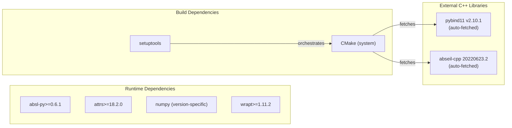
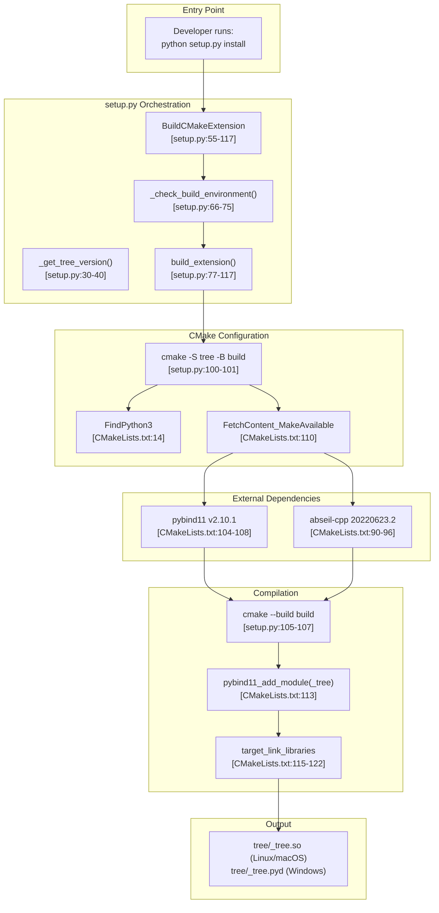
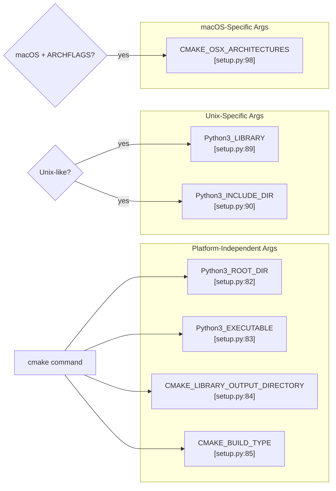
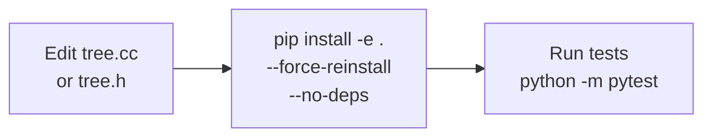

<!-- source: DeepWiki mcp.deepwiki.com · repo google-deepmind/tree · page 4.1 Development Setup · fetched 2026-10-26 -->

# Development Setup

<details>
<summary>Relevant source files</summary>

The following files were used as context for generating this wiki page:

- [README.md](README.md)
- [setup.py](setup.py)
- [tree/CMakeLists.txt](tree/CMakeLists.txt)

</details>


## Purpose and Scope

This document provides a comprehensive guide for setting up a development environment for the dm-tree repository. It covers the prerequisites, building the C++ extension from source, installing the package in development mode, and verifying your setup by running tests.

This page focuses on the practical steps for local development. For detailed information about how the build system works internally, see [Build System Architecture](#4.2). For comprehensive testing procedures and benchmark execution, see [Testing and Benchmarking](#4.3). If you only need to install dm-tree as a user (not for development), see [Installation and Setup](#3.1).

## Prerequisites

### System Requirements

dm-tree requires Python 3.10 or later and has been tested on the following platforms:
- Linux (Ubuntu, Debian, CentOS)
- macOS (Intel and Apple Silicon)
- Windows

**Sources:** [setup.py:130](), [tree/CMakeLists.txt:16-19]()

### Required Build Tools

The following tools must be installed before building dm-tree from source:

| Tool | Minimum Version | Purpose |
|------|----------------|---------|
| CMake | 3.24 | Build system generator for C++ extension |
| C++ Compiler | C++14 compatible | Compiling the native extension module |
| Python | 3.10+ | Runtime and development headers |
| Git | Any | Cloning the repository |

The build system checks for CMake availability at build time and will raise a `RuntimeError` if it's not found [setup.py:68-74]().

**CMake version requirement:** The project specifically requires CMake 3.24 or later for the new `FindPython` module and `FIND_PACKAGE_ARGS` keyword support [tree/CMakeLists.txt:1-4]().

**C++ standard:** The project uses C++14 [tree/CMakeLists.txt:22]().

**Sources:** [setup.py:66-75](), [tree/CMakeLists.txt:1-22]()

### Installing Build Dependencies

#### Linux (Ubuntu/Debian)
```bash
sudo apt-get update
sudo apt-get install -y cmake g++ python3-dev git
```

#### macOS
```bash
brew install cmake
# Xcode Command Line Tools provide the C++ compiler
xcode-select --install
```

#### Windows
- Install CMake from https://cmake.org/download/
- Install Visual Studio 2019 or later with C++ build tools
- Ensure CMake and the compiler are in your PATH

**Sources:** [setup.py:66-75]()

### Python Dependencies

The project requires several Python packages both for runtime and development:



**NumPy version matrix:**

| Python Version | Minimum NumPy Version |
|----------------|-----------------------|
| 3.10 | 1.21.2 |
| 3.11 | 1.23.3 |
| 3.12 | 1.26.0 |
| 3.13 | 2.1.0 |

**Sources:** [setup.py:131-140](), [tree/CMakeLists.txt:90-110]()

## Repository Setup

### Cloning the Repository

Clone the dm-tree repository from GitHub:

```bash
git clone https://github.com/deepmind/tree.git
cd tree
```

**Sources:** [README.md:30-31]()

### Virtual Environment Setup

It's strongly recommended to use a virtual environment for development to isolate dependencies:

```bash
# Create a virtual environment
python3 -m venv tree-dev-env

# Activate it (Linux/macOS)
source tree-dev-env/bin/activate

# Activate it (Windows)
tree-dev-env\Scripts\activate

# Upgrade pip
pip install --upgrade pip setuptools wheel
```

### Installing Python Dependencies

Install the required Python dependencies:

```bash
pip install numpy attrs absl-py wrapt
```

Or install all dependencies from the setup configuration:

```bash
pip install -e .
```

**Sources:** [setup.py:131-140]()

## Build Process Overview

The dm-tree build process involves multiple stages coordinated by `setup.py` and `CMakeLists.txt`:



**Sources:** [setup.py:55-117](), [tree/CMakeLists.txt:1-126]()

## Building the C++ Extension

### Understanding the Build Classes

The build process uses two custom classes defined in `setup.py`:

1. **`CMakeExtension`** [setup.py:43-52]() - A setuptools extension with no sources, since CMake handles all compilation
2. **`BuildCMakeExtension`** [setup.py:55-117]() - Custom build command that invokes CMake instead of using distutils' default compiler

### Build Configuration

The `BuildCMakeExtension.build_extension()` method configures CMake with the following arguments:



**Sources:** [setup.py:81-98]()

### Standard Build Process

To build the C++ extension and install the package:

```bash
# Standard installation
python setup.py install
```

This command:
1. Checks for CMake availability [setup.py:68-75]()
2. Creates a build directory [setup.py:99]()
3. Runs CMake configuration [setup.py:100-101]()
4. Compiles the C++ extension [setup.py:105-107]()
5. Moves the compiled extension to the correct location [setup.py:111-116]()

**Sources:** [setup.py:55-117](), [README.md:36-38]()

### Development Installation (Editable Mode)

For active development, use editable mode to avoid reinstalling after each change:

```bash
pip install -e .
```

This creates a link to your source directory, so Python changes take effect immediately. However, you must rebuild after C++ changes:

```bash
# After modifying tree.cc or tree.h
pip install -e . --force-reinstall --no-deps
```

### Build Options

#### Debug Build

To build with debug symbols and reduced optimizations:

```bash
python setup.py build_ext --debug install
```

The CMake configuration sets appropriate compiler flags based on the build type [tree/CMakeLists.txt:36-48]():
- **Debug**: `-g -Og` (debug symbols, minimal optimization)
- **Release**: `-DNDEBUG -O3` (no debug checks, maximum optimization)

**Sources:** [setup.py:80](), [tree/CMakeLists.txt:27-48]()

#### Parallel Build

Speed up compilation by building with multiple jobs:

```bash
python setup.py build_ext --parallel=4 install
```

This passes `-j4` to CMake [setup.py:102-107]().

**Sources:** [setup.py:102-107]()

#### Using System Dependencies

By default, CMake fetches pybind11 and abseil-cpp automatically. To use system-installed versions:

```bash
cmake -DUSE_SYSTEM_PYBIND11=ON -DUSE_SYSTEM_ABSEIL=ON ...
```

Note: This requires manual CMake invocation; the standard `setup.py` flow doesn't expose these options.

**Sources:** [tree/CMakeLists.txt:10-11](), [tree/CMakeLists.txt:68-71](), [tree/CMakeLists.txt:98-102]()

## Build Artifacts and Output Structure

After a successful build, the following structure is created:

```
tree/
├── __init__.py
├── _tree.so          # Linux/macOS compiled extension
├── _tree.pyd         # Windows compiled extension
├── sequence.py
└── ...

build/
└── temp.linux-*/     # Temporary build files
    ├── CMakeCache.txt
    ├── _tree.dir/
    └── ...
```

The extension module is placed in the `tree/` package directory and named `_tree` [tree/CMakeLists.txt:125]().

**Sources:** [setup.py:78-79](), [setup.py:111-116](), [tree/CMakeLists.txt:125]()

## Verification

### Import Test

Verify the installation by importing the module:

```bash
python -c "import tree; print(tree.__version__)"
```

This should print the version number without errors.

**Sources:** [setup.py:30-40]()

### Basic Functionality Test

Test core functionality:

```bash
python -c "
import tree
structure = [[1, 2], {'a': 3}]
print('Flatten:', tree.flatten(structure))
print('Map:', tree.map_structure(lambda x: x * 2, structure))
"
```

Expected output:
```
Flatten: [1, 2, 3]
Map: [[2, 4], {'a': 6}]
```

### Running the Test Suite

The repository includes a comprehensive test suite. To run all tests:

```bash
python -m pytest tree/tree_test.py -v
```

Or using Python's unittest:

```bash
python -m unittest tree.tree_test
```

For more details on the test suite structure and running specific tests, see [Testing and Benchmarking](#4.3).

**Sources:** [setup.py:141]()

### Checking C++ Extension Loading

Verify the C++ extension is properly loaded:

```bash
python -c "
import tree
print('Has C++ extension:', hasattr(tree, '_tree'))
import tree._tree as _tree
print('C++ functions:', [x for x in dir(_tree) if not x.startswith('_')])
"
```

This should list functions like `assert_same_structure`, `flatten`, `is_attrs`, etc.

## Common Development Workflows

### Workflow: Modifying Python Code


Python-only changes don't require rebuilding when using editable install (`pip install -e .`).

### Workflow: Modifying C++ Code



**Sources:** [tree/CMakeLists.txt:113]()

### Workflow: Testing on Multiple Python Versions

```bash
# Using pyenv or similar
for version in 3.10 3.11 3.12 3.13; do
    pyenv shell $version
    pip install -e .
    python -m pytest tree/tree_test.py
done
```

**Sources:** [setup.py:130](), [setup.py:151-154]()

## Platform-Specific Considerations

### macOS

**Apple Silicon (ARM64) and Universal Builds:**

When building on macOS, the `ARCHFLAGS` environment variable controls target architectures:

```bash
# Intel only
ARCHFLAGS="-arch x86_64" pip install -e .

# ARM only
ARCHFLAGS="-arch arm64" pip install -e .

# Universal binary
ARCHFLAGS="-arch x86_64 -arch arm64" pip install -e .
```

The build system parses `ARCHFLAGS` and passes appropriate values to CMake via `CMAKE_OSX_ARCHITECTURES` [setup.py:92-98]().

**Linker flags:** macOS builds use `-undefined dynamic_lookup` for proper pybind11 linking [tree/CMakeLists.txt:50-53]().

**Sources:** [setup.py:92-98](), [tree/CMakeLists.txt:50-58]()

### Windows

**Visual Studio configuration:**

Windows builds use CMake's multi-configuration generator, which creates separate `Debug/` and `Release/` subdirectories. The build script automatically moves the extension to the correct location [setup.py:111-116]().

**Output file naming:** The extension is named `_tree.pyd` on Windows instead of `_tree.so`.

**Sources:** [setup.py:109-116]()

### Linux

**Position-independent code:** The build enables `-fPIC` for creating shared libraries [tree/CMakeLists.txt:24-25]().

**Optimization flags:** Release builds use `-O3 -DNDEBUG` for maximum performance [tree/CMakeLists.txt:43-47]().

**Sources:** [tree/CMakeLists.txt:24-25](), [tree/CMakeLists.txt:36-48]()

## Troubleshooting

### CMake Not Found

**Error:**
```
RuntimeError: CMake must be installed to build the following extensions: _tree
```

**Solution:** Install CMake as described in [Required Build Tools](#required-build-tools).

**Sources:** [setup.py:68-74]()

### Python Development Headers Missing

**Error during CMake configuration:**
```
Could NOT find Python3 (missing: Python3_INCLUDE_DIRS Development)
```

**Solution:**
- **Linux:** `sudo apt-get install python3-dev`
- **macOS:** Python from python.org includes headers; if using Homebrew, ensure `python` package is installed
- **Windows:** Reinstall Python with "Development" option checked

**Sources:** [tree/CMakeLists.txt:14-19]()

### Compiler Version Issues

**Error:**
```
error: This file requires compiler and library support for the ISO C++ 2014 standard
```

**Solution:** Ensure your compiler supports C++14:
- **GCC:** Version 5.0+
- **Clang:** Version 3.4+
- **MSVC:** Visual Studio 2015+

**Sources:** [tree/CMakeLists.txt:22]()

### Import Error After Building

**Error:**
```
ImportError: cannot import name '_tree' from 'tree'
```

**Solution:** The C++ extension wasn't built or placed correctly. Check:
1. The extension file exists: `ls tree/_tree.so` (or `_tree.pyd` on Windows)
2. Rebuild with verbose output: `python setup.py build_ext -v install`

**Sources:** [setup.py:111-116](), [tree/CMakeLists.txt:125]()

### macOS Universal Build Issues

**Error:**
```
ld: warning: ignoring file ... building for macOS-arm64 but attempting to link with file built for macOS-x86_64
```

**Solution:** Ensure all dependencies are built for the same architecture. Clean and rebuild:
```bash
rm -rf build/
ARCHFLAGS="-arch arm64" pip install -e . --force-reinstall --no-deps
```

**Sources:** [setup.py:92-98]()

## Next Steps

After successfully setting up your development environment:

- Learn about the build system internals in [Build System Architecture](#4.2)
- Explore the test suite and benchmarking tools in [Testing and Benchmarking](#4.3)
- Understand the CI/CD pipeline in [CI/CD Pipeline](#4.4)
- Review contributing guidelines in [Contributing Guidelines](#5.1)

---

