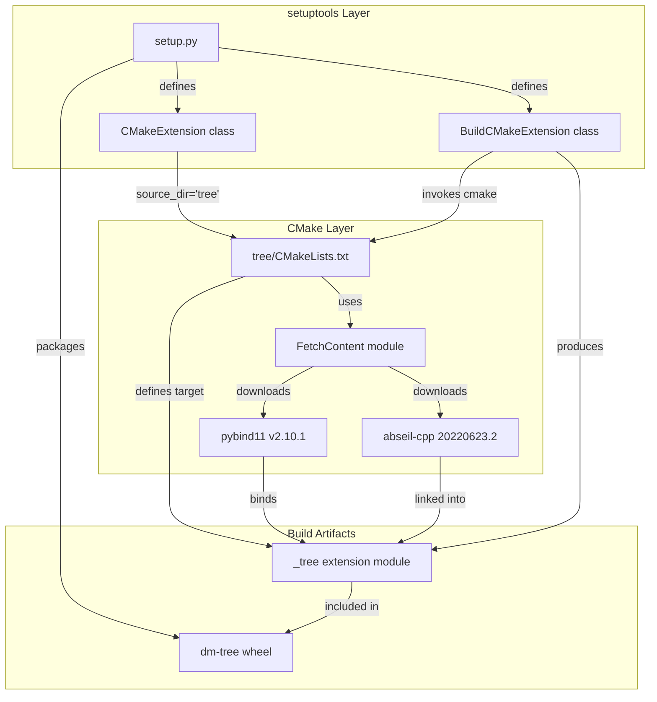
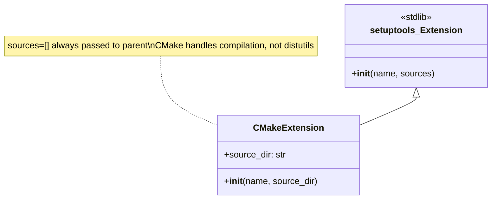
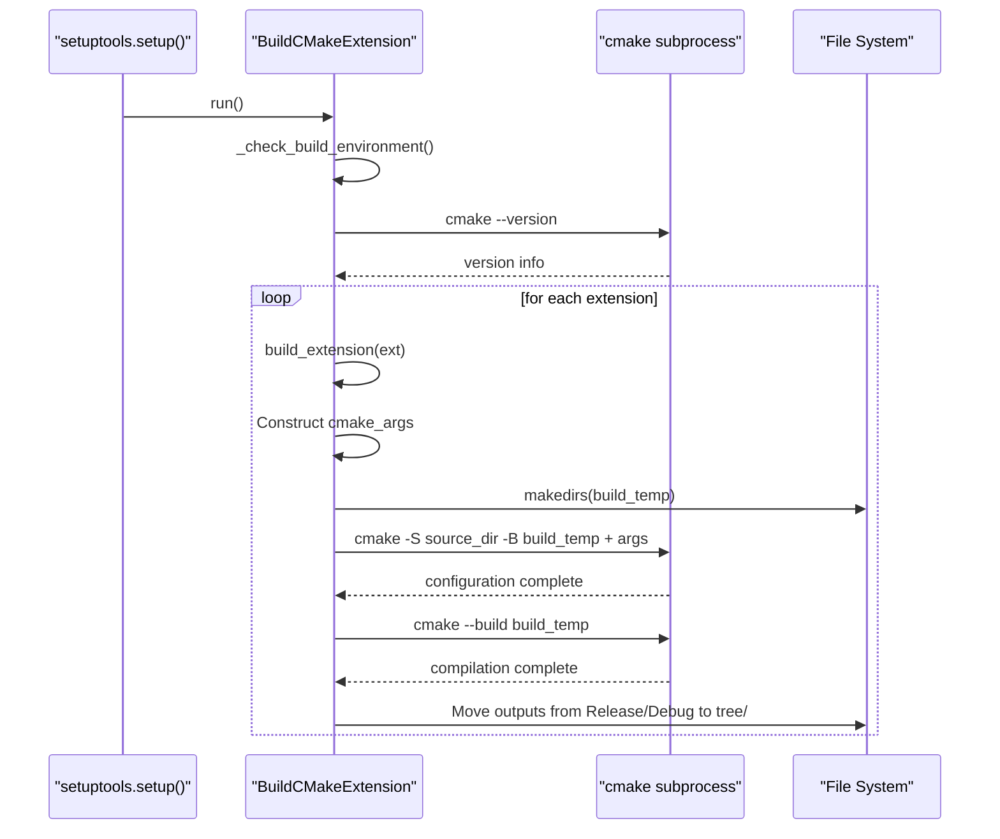
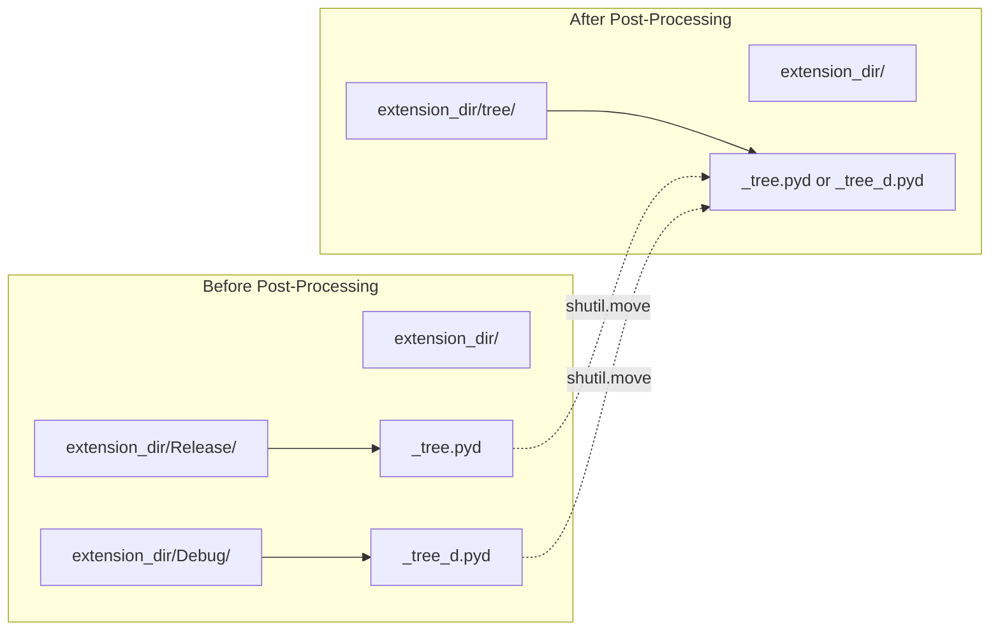
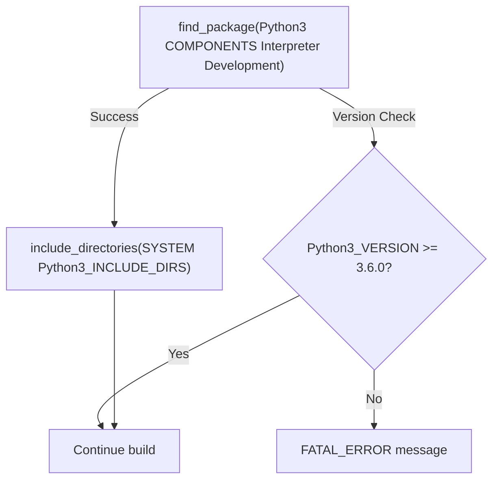
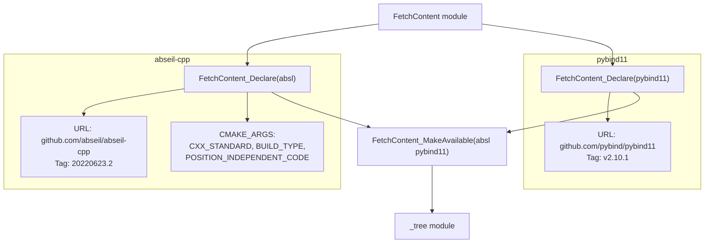
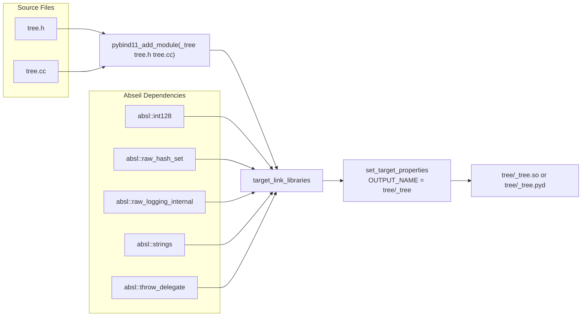
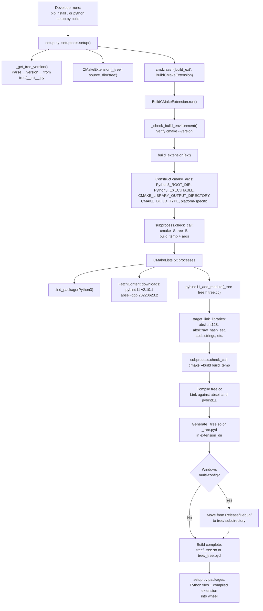

<!-- source: DeepWiki mcp.deepwiki.com · repo google-deepmind/tree · page 4.2 Build System Architecture · fetched 2026-10-26 -->

# Build System Architecture

Relevant source files

The following files were used as context for generating this wiki page:

- [MANIFEST.in](MANIFEST.in)
- [setup.py](setup.py)
- [tree/CMakeLists.txt](tree/CMakeLists.txt)

## Purpose and Scope

This document explains the build system architecture for dm-tree, which enables compilation and distribution of a Python package with C++ extensions. The build system bridges Python packaging standards (setuptools) with CMake-based C++ compilation, handles cross-platform builds, and manages external dependencies (pybind11 and abseil-cpp).

This page covers the build configuration, compilation process, and dependency management. For information about setting up a development environment and building from source, see [Development Setup](#4.1). For details about the CI/CD pipeline that automates builds across platforms, see [CI/CD Pipeline](#4.4).

## Build System Components

The dm-tree build system consists of three primary components that work together to produce distributable Python wheels containing compiled C++ extensions:

| Component | File | Purpose |
|-----------|------|---------|
| **Python Build Configuration** | `setup.py` | Defines package metadata, dependencies, and custom build commands |
| **CMake Build Script** | `tree/CMakeLists.txt` | Configures C++ compilation, manages external dependencies, and defines build targets |
| **Distribution Manifest** | `MANIFEST.in` | Specifies which source files to include in source distributions |

**Diagram: Build System Component Relationships**

Sources: [setup.py:1-161](), [tree/CMakeLists.txt:1-128](), [MANIFEST.in:1-11]()

## setup.py Architecture

The `setup.py` file implements a custom build process that integrates CMake into Python's standard setuptools workflow. This approach allows the package to leverage CMake's sophisticated C++ build capabilities while remaining compatible with standard Python packaging tools like pip.

### CMakeExtension Class

The `CMakeExtension` class extends `setuptools.Extension` but intentionally passes an empty source list, as all compilation is delegated to CMake:

**Diagram: CMakeExtension Inheritance**

The constructor signature is `CMakeExtension(name, source_dir='')` where:
- `name`: Extension module name (`'_tree'`)
- `source_dir`: Path to CMakeLists.txt location (`'tree'`)

The `source_dir` is converted to an absolute path and stored for later use by `BuildCMakeExtension`.

Sources: [setup.py:43-52]()

### BuildCMakeExtension Class

The `BuildCMakeExtension` class inherits from `build_ext.build_ext` and implements the actual build logic. It overrides the standard extension building process to invoke CMake instead of using the default C compiler.

#### Key Methods

| Method | Purpose | Key Operations |
|--------|---------|----------------|
| `run()` | Entry point for build command | Validates environment, iterates extensions |
| `_check_build_environment()` | Verifies build prerequisites | Checks for CMake installation |
| `build_extension(ext)` | Builds a single extension | Configures and invokes CMake, handles output |

#### Build Process Implementation

**Diagram: BuildCMakeExtension Execution Flow**

Sources: [setup.py:55-117]()

### CMake Configuration Arguments

The `build_extension()` method constructs platform-specific CMake arguments:

**Base Arguments (all platforms):**
- `-DPython3_ROOT_DIR`: Python installation prefix from `sys.prefix`
- `-DPython3_EXECUTABLE`: Path to Python interpreter from `sys.executable`
- `-DCMAKE_LIBRARY_OUTPUT_DIRECTORY`: Target directory for compiled extension
- `-DCMAKE_BUILD_TYPE`: `Debug` or `Release` based on `self.debug`

**Unix-specific Arguments:**
- `-DPython3_LIBRARY`: Standard library path from `sysconfig`
- `-DPython3_INCLUDE_DIR`: Python headers path from `sysconfig`

**macOS-specific Arguments:**
- `-DCMAKE_OSX_ARCHITECTURES`: Extracted from `ARCHFLAGS` environment variable
  - Supports `x86_64`, `arm64`, or universal binaries

Sources: [setup.py:77-98]()

### Parallel Build Support

The build system supports parallel compilation when the `--parallel` flag is passed to setup.py:

- If `self.parallel` is truthy, passes `-j{self.parallel}` to CMake build command
- Uses Python tuple idiom: `num_jobs = (f'-j{self.parallel}',) if self.parallel else ()`

Sources: [setup.py:102-107]()

### Windows Multi-Generator Output Handling

On Windows, CMake may create `Debug/` and `Release/` subdirectories. The build system post-processes these outputs:

**Diagram: Windows Output Directory Normalization**

The code iterates through `Release` and `Debug` subdirectories and moves all files to `extension_dir/tree/`, ensuring consistent output structure across platforms.

Sources: [setup.py:109-116]()

## CMakeLists.txt Configuration

The CMake build script at `tree/CMakeLists.txt` configures C++ compilation, manages dependencies, and defines the `_tree` extension module.

### Version and Policy Requirements

The build requires CMake >= 3.24 for:
- Modern `FindPython` module with improved Python detection
- `FIND_PACKAGE_ARGS` keyword in `FetchContent_Declare()` for system-wide package detection

Policy CMP0135 is set to NEW to use new timestamp behavior for `FetchContent`.

Sources: [tree/CMakeLists.txt:1-6]()

### Build Options

| Option | Default | Description |
|--------|---------|-------------|
| `USE_SYSTEM_ABSEIL` | `OFF` | Use system abseil-cpp instead of downloading |
| `USE_SYSTEM_PYBIND11` | `OFF` | Use system pybind11 instead of downloading |

These options allow developers to use system-installed dependencies when available, useful for package maintainers and offline builds.

Sources: [tree/CMakeLists.txt:10-11]()

### Python Detection and Configuration

**Diagram: Python Detection Process**

The build script requires both Python interpreter and development headers. While the version check requires Python >= 3.6.0, the `setup.py` restricts to >= 3.10 in practice.

Sources: [tree/CMakeLists.txt:13-19]()

### Compiler and Build Configuration

**C++ Standard:**
- C++14 is set as the required standard
- `CMAKE_CXX_STANDARD` is configurable via cache variable

**Position-Independent Code:**
- `CMAKE_POSITION_INDEPENDENT_CODE` is enabled globally
- Required for Python extension modules on all platforms

**Build Types:**

| Build Type | Flags (Unix) | Purpose |
|------------|--------------|---------|
| `Debug` | `-g -Og` | Debugging with minimal optimization |
| `Release` | `-DNDEBUG -O3` | Full optimization, no debug checks |

Sources: [tree/CMakeLists.txt:21-48]()

### Platform-Specific Configuration

**macOS:**
- `-Wno-everything -w`: Suppress all warnings
- `-undefined dynamic_lookup`: Required for pybind11 linking on macOS
- `CMAKE_FIND_FRAMEWORK LAST`: Prioritize virtual environment Python over system frameworks

**Windows/MSVC:**
- Platform-specific flags are not set (default MSVC behavior used)

Sources: [tree/CMakeLists.txt:50-58]()

## Dependency Management with FetchContent

The build system uses CMake's `FetchContent` module to automatically download and build external dependencies. This approach eliminates manual dependency installation while supporting system-wide packages when available.

**Diagram: FetchContent Dependency Resolution**

### abseil-cpp Configuration

The Abseil C++ library is fetched from GitHub with specific build configuration:

**Version:** 20220623.2 (SHA256-verified download)

**Custom CMAKE_ARGS:**
- `CMAKE_CXX_STANDARD`: Inherited from parent project
- `CMAKE_CXX_COMPILER`: Inherited compiler
- `CMAKE_CXX_FLAGS`: Inherited flags
- `CMAKE_BUILD_TYPE`: Inherited build type
- `CMAKE_POSITION_INDEPENDENT_CODE`: Enabled
- `ABSL_PROPAGATE_CXX_STD`: ON (ensures consistent C++ standard)
- `CMAKE_OSX_ARCHITECTURES`: Inherited on macOS for universal binaries

The `EXCLUDE_FROM_ALL` flag prevents Abseil targets from being built unless required by the `_tree` target.

Sources: [tree/CMakeLists.txt:64-96]()

### pybind11 Configuration

**Version:** v2.10.1 (SHA256-verified download)

No custom CMAKE_ARGS are required for pybind11 as it's header-only.

Sources: [tree/CMakeLists.txt:98-110]()

### System Package Support

When `USE_SYSTEM_ABSEIL=ON` or `USE_SYSTEM_PYBIND11=ON`:
- `FIND_PACKAGE_ARGS` keyword is added to `FetchContent_Declare()`
- CMake first attempts `find_package()` for system-installed library
- Falls back to downloading if system package not found

Sources: [tree/CMakeLists.txt:68-71](), [tree/CMakeLists.txt:99-102]()

## Extension Module Definition

The `_tree` extension module is defined using pybind11's CMake integration:

**Diagram: Extension Module Build Graph**

### Module Configuration

**Sources:**
- `tree.h`: Header file with declarations
- `tree.cc`: Implementation with pybind11 bindings

**Linked Libraries (PRIVATE):**
- `absl::int128`: 128-bit integer support
- `absl::raw_hash_set`: Hash set implementation
- `absl::raw_logging_internal`: Internal logging
- `absl::strings`: String utilities
- `absl::throw_delegate`: Exception handling

**Output Name:**
- `OUTPUT_NAME` property set to `tree/_tree`
- Ensures module is placed in `tree/` subdirectory
- Creates `tree/_tree.so` (Unix) or `tree/_tree.pyd` (Windows)

Sources: [tree/CMakeLists.txt:112-125]()

## Complete Build Flow

**Diagram: Complete Build Process Flow**

### Build Invocation Methods

The build can be triggered through multiple entry points:

| Command | Entry Point | Use Case |
|---------|-------------|----------|
| `pip install .` | pip → setuptools | Standard installation |
| `python setup.py build` | setuptools directly | Development builds |
| `python setup.py build_ext --inplace` | setuptools directly | In-place development |
| `pip wheel .` | pip → setuptools | Create wheel without installing |

All paths eventually invoke `BuildCMakeExtension.run()`.

Sources: [setup.py:1-161](), [tree/CMakeLists.txt:1-128]()

## Source Distribution Configuration

The `MANIFEST.in` file specifies which files are included in source distributions (sdist):

**Included Files:**
- **Metadata:** `LICENSE`, `WORKSPACE`, `CONTRIBUTING.md`, `README.md`
- **Requirements:** All `requirements*.txt` files
- **Source Code:** Recursively includes files matching: `CMakeLists.txt`, `*.cc`, `*.cpp`, `*.h`, `*.sh`, `*.py`, `*.cmake`

This ensures source distributions contain everything needed to build from source, including the CMake configuration and C++ implementation files.

Sources: [MANIFEST.in:1-11]()

## Key Design Decisions

### Why CMake Instead of Direct Compilation?

**Advantages:**
1. **Dependency Management:** Automatic download and configuration of pybind11 and abseil-cpp
2. **Cross-Platform:** Unified build logic across Linux, macOS, and Windows
3. **Build System Integration:** Leverages CMake's mature ecosystem and tooling
4. **Optimization Control:** Fine-grained control over compiler flags and build types

**Tradeoffs:**
- Requires CMake installation (not pure Python)
- More complex than simple extension modules
- Higher barrier to entry for contributors unfamiliar with CMake

### Two-Stage Build System

The separation of `setup.py` (Python packaging) and `CMakeLists.txt` (C++ compilation) follows Python's extension module best practices:

- **setup.py:** Handles Python-side concerns (versioning, dependencies, metadata)
- **CMakeLists.txt:** Handles C++-side concerns (compilation, linking, external libraries)

This separation allows each tool to focus on its strengths while maintaining integration through the `CMakeExtension` and `BuildCMakeExtension` classes.

### FetchContent vs. Git Submodules

The build system uses CMake's `FetchContent` rather than Git submodules:

**Benefits:**
- No need to clone submodules separately
- Automatic version pinning with SHA256 verification
- Support for system-installed dependencies via `FIND_PACKAGE_ARGS`
- Works in source distributions where `.git/` is absent

Sources: [setup.py:43-117](), [tree/CMakeLists.txt:60-110]()

---

