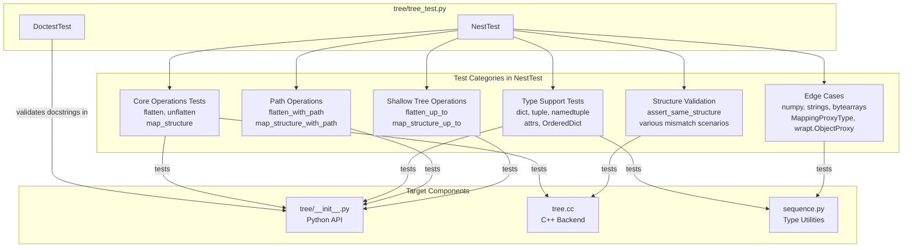
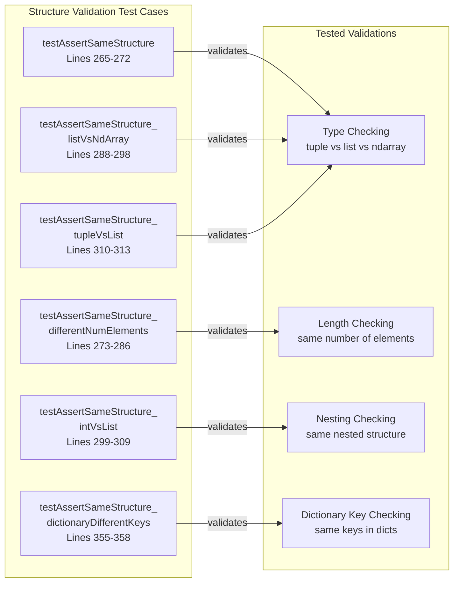
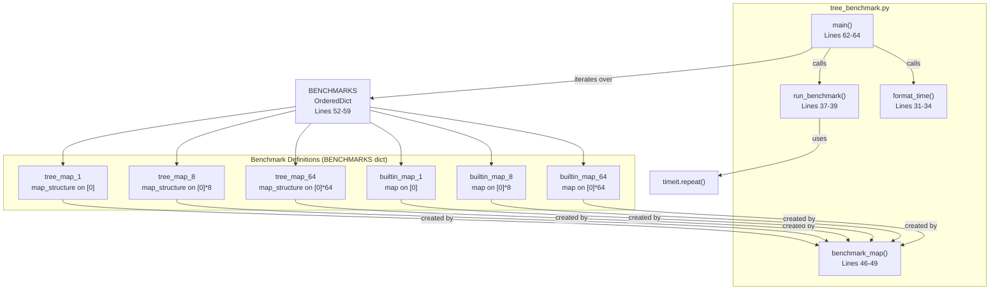

<!-- source: DeepWiki mcp.deepwiki.com · repo google-deepmind/tree · page 4.3 Testing and Benchmarking · fetched 2026-10-26 -->

# Testing and Benchmarking

<details>
<summary>Relevant source files</summary>

The following files were used as context for generating this wiki page:

- [LICENSE](LICENSE)
- [tree/tree_benchmark.py](tree/tree_benchmark.py)
- [tree/tree_test.py](tree/tree_test.py)

</details>


This page documents the testing and benchmarking infrastructure for dm-tree. It covers the test suite organization, test execution, coverage areas, and performance benchmarking tools. For information about the CI/CD pipeline that automates test execution, see [CI/CD Pipeline](#4.4). For details on setting up a development environment to run tests locally, see [Development Setup](#4.1).

## Overview

The dm-tree testing infrastructure consists of two primary components:

- **Test Suite** ([tree/tree_test.py]()):  A comprehensive test suite with 1100+ lines of tests validating all library functionality
- **Benchmark Suite** ([tree/tree_benchmark.py]()): Performance benchmarks comparing dm-tree operations against Python built-ins

The test suite uses Python's `unittest` framework with `parameterized` decorators from `absl.testing` for test parameterization. All tests validate both the Python API layer and the underlying C++ implementation.

## Test Suite Architecture

The test suite is organized into two main test classes that validate different aspects of the library:



**Sources:** [tree/tree_test.py:1-1143]()

### Test Classes

| Class | Purpose | Line Range |
|-------|---------|------------|
| `DoctestTest` | Validates docstrings examples in the Python API module | [tree/tree_test.py:35-46]() |
| `NestTest` | Comprehensive functional tests for all tree operations | [tree/tree_test.py:48-1139]() |

## Test Categories

The `NestTest` class contains tests organized by functionality:

### Core Operations Tests

Tests for fundamental tree manipulation functions:

- **Flatten/Unflatten Operations**: [tree/tree_test.py:97-129]()
  - Basic flattening of nested structures
  - Unflattening with structure templates
  - Handling of named tuples with field preservation
  - Scalar handling (non-nested values)
  - Error cases (wrong sequence lengths, non-iterable inputs)

- **Map Structure Operations**: [tree/tree_test.py:390-452]()
  - Single and multi-structure mapping
  - Empty structure handling (tuples, lists, dicts, named tuples)
  - Structure compatibility validation
  - Type checking behavior

**Sources:** [tree/tree_test.py:97-129](), [tree/tree_test.py:390-452]()

### Type Support Tests

Validates compatibility with Python's type system:

- **attrs Classes**: [tree/tree_test.py:53-96]()
  - Flattening and unflattening attrs-decorated classes
  - Map structure operations on attrs instances
  - Error handling for non-iterable `__attrs_attrs__`

- **Dictionary Types**: [tree/tree_test.py:131-149](), [tree/tree_test.py:150-195]()
  - `OrderedDict` with key order preservation
  - Plain `dict` with alphabetical sorting
  - `defaultdict` reconstruction [tree/tree_test.py:225-232]()
  - Nested dictionary structures

- **Named Tuples**: [tree/tree_test.py:251-259]()
  - Multiple named tuple types with same/different names
  - Field name matching validation
  - Nested named tuple handling

- **Special Types**: 
  - `MappingProxyType` [tree/tree_test.py:1004-1010]()
  - `wrapt.ObjectProxy` [tree/tree_test.py:83-85](), [tree/tree_test.py:962-964]()

**Sources:** [tree/tree_test.py:53-96](), [tree/tree_test.py:131-232](), [tree/tree_test.py:251-259](), [tree/tree_test.py:1004-1010]()

### Structure Validation Tests

Tests for `assert_same_structure` function:



Error message validation tests ensure proper diagnostic information:
- Structure mismatch descriptions with full structure dumps
- Specific error locations with path information
- Type mismatch details [tree/tree_test.py:288-298]()

**Sources:** [tree/tree_test.py:265-388]()

### Path Operations Tests

Tests for path-aware variants that track element locations:

- **flatten_with_path**: [tree/tree_test.py:949-967]()
  - Returns `(path, value)` tuples for each leaf
  - Handles nested structures with proper path construction
  - Supports all container types (lists, tuples, dicts, named tuples)

- **map_structure_with_path**: [tree/tree_test.py:968-1003]()
  - Passes path information to mapping function
  - Compatible structures test [tree/tree_test.py:982-989]()
  - Incompatible structures test [tree/tree_test.py:990-1003]()

- **flatten_with_path_up_to**: [tree/tree_test.py:671-919]()
  - Combines path tracking with shallow flattening
  - Validates path construction at various nesting levels
  - Error messages include path context [tree/tree_test.py:906-919]()

**Sources:** [tree/tree_test.py:671-919](), [tree/tree_test.py:949-1003]()

### Shallow Tree Operations Tests

Tests for operations that only traverse to a specified depth:

- **flatten_up_to**: [tree/tree_test.py:509-665]()
  - Stops flattening at shallow structure boundaries
  - Handles scalar, string, and sequence shallow trees
  - Edge cases: non-list shallow trees, mismatched types
  
- **map_structure_up_to**: [tree/tree_test.py:920-948](), [tree/tree_test.py:1034-1103]()
  - Maps only to shallow structure depth
  - Output type matches shallow structure type
  - Supports dict subtrees [tree/tree_test.py:1034-1046]()
  - Supports None values [tree/tree_test.py:1047-1055]()
  - Mixed list/tuple handling [tree/tree_test.py:1085-1103]()

**Sources:** [tree/tree_test.py:509-665](), [tree/tree_test.py:920-948](), [tree/tree_test.py:1034-1103]()

### Edge Cases and Special Scenarios

- **Non-flattened Types**: 
  - NumPy arrays [tree/tree_test.py:196-200]()
  - Strings [tree/tree_test.py:201-206]()
  - Bytearrays [tree/tree_test.py:207-214]()
  - Sets (not treated as sequences) [tree/tree_test.py:242]()

- **Sequence Detection**: [tree/tree_test.py:233-247]()
  - `tree.is_nested()` behavior for various types
  - String/bytes exclusion from sequence handling [tree/tree_test.py:666-670]()

- **None Value Handling**: [tree/tree_test.py:1104-1107]()
  - None nodes included in flattening

- **traverse Function**: [tree/tree_test.py:1011-1033]()
  - Top-down vs bottom-up traversal
  - Early termination with return values
  - Visitor function invocation order

- **Custom Classes**: [tree/tree_test.py:1108-1139]()
  - `Mapping` subclass support with path operations

**Sources:** [tree/tree_test.py:196-247](), [tree/tree_test.py:666-670](), [tree/tree_test.py:1011-1139]()

## Running Tests

### Local Execution

```bash
# Run all tests
python -m pytest tree/tree_test.py

# Run specific test class
python -m pytest tree/tree_test.py::NestTest

# Run specific test method
python -m pytest tree/tree_test.py::NestTest::testFlattenAndUnflatten

# Run with verbose output
python -m pytest tree/tree_test.py -v

# Run doctests only
python -m pytest tree/tree_test.py::DoctestTest
```

Tests can also be run directly with unittest:

```bash
python tree/tree_test.py
```

**Sources:** [tree/tree_test.py:1141-1143]()

### Test Fixtures and Data

The test suite uses predefined structures for consistency:

| Constant | Definition | Usage |
|----------|------------|-------|
| `STRUCTURE1` | `(((1, 2), 3), 4, (5, 6))` | Primary test structure [tree/tree_test.py:29]() |
| `STRUCTURE2` | `((("foo1", "foo2"), "foo3"), "foo4", ("foo5", "foo6"))` | Compatible structure for multi-structure tests [tree/tree_test.py:30]() |
| `STRUCTURE_DIFFERENT_NUM_ELEMENTS` | `("spam", "eggs")` | Incompatible structure tests [tree/tree_test.py:31]() |
| `STRUCTURE_DIFFERENT_NESTING` | `(((1, 2), 3), 4, 5, (6,))` | Nesting validation tests [tree/tree_test.py:32]() |

**Sources:** [tree/tree_test.py:29-33]()

## Benchmarking Infrastructure

The benchmarking suite provides performance measurements for dm-tree operations:



**Sources:** [tree/tree_benchmark.py:1-69]()

### Benchmark Components

**Time Formatting** ([tree/tree_benchmark.py:23-34]()):
- Converts raw times to human-readable format
- Supports seconds (s), milliseconds (ms), microseconds (us), nanoseconds (ns)

**Benchmark Execution** ([tree/tree_benchmark.py:37-39]()):
- Uses `timeit.repeat()` for accurate measurements
- Runs benchmarks twice and discards first run for warmup
- Returns average time per iteration

**Benchmark Factory** ([tree/tree_benchmark.py:46-49]()):
- Creates benchmark functions for map operations
- Compares `tree.map_structure` against `map_to_list`
- Tests with structures of varying sizes

### Running Benchmarks

```bash
# Run all benchmarks
python tree/tree_benchmark.py

# Sample output:
# tree_map_1 XX.XXus
# tree_map_8 XX.XXus
# tree_map_64 XX.XXus
# builtin_map_1 XX.XXus
# builtin_map_8 XX.XXus
# builtin_map_64 XX.XXus
```

The benchmark suite measures performance across three structure sizes (1, 8, 64 elements) to understand scaling behavior.

**Sources:** [tree/tree_benchmark.py:62-69]()

### Benchmark Interpretation

The benchmarks compare:
- **dm-tree overhead**: Additional cost of structure traversal and validation
- **Scaling characteristics**: How performance changes with structure size
- **Baseline comparison**: Performance relative to Python's built-in `map`

The 1000 iteration count ([tree/tree_benchmark.py:64]()) provides sufficient samples for stable measurements while keeping total execution time reasonable.

**Sources:** [tree/tree_benchmark.py:52-64]()

## Test Assertions and Helpers

The test suite includes several custom helper methods:

| Helper Method | Purpose | Location |
|---------------|---------|----------|
| `assertAllEquals(a, b)` | NumPy array comparison | [tree/tree_test.py:50-51]() |
| `assertRaisesWithLiteralMatch(exc, msg)` | Exact error message matching | Used throughout for error validation |

Parameterized tests use `@parameterized.parameters` and `@parameterized.named_parameters` decorators to reduce duplication and improve test coverage systematically.

**Sources:** [tree/tree_test.py:50-51](), [tree/tree_test.py:78-85]()

## Writing New Tests

When adding new functionality to dm-tree, follow these patterns:

### Test Structure Pattern

```python
def testNewFeature(self):
    # 1. Setup test data
    structure = {"key": [1, 2, 3]}
    
    # 2. Execute operation
    result = tree.new_operation(structure)
    
    # 3. Validate result
    self.assertEqual(expected, result)
    
    # 4. Test error cases
    with self.assertRaisesRegex(ValueError, "expected error"):
        tree.new_operation(invalid_input)
```

### Parameterized Test Pattern

```python
@parameterized.parameters([
    (input1, expected1),
    (input2, expected2),
    (input3, expected3),
])
def testNewFeature(self, input_data, expected):
    result = tree.new_operation(input_data)
    self.assertEqual(expected, result)
```

**Sources:** [tree/tree_test.py:78-96](), [tree/tree_test.py:949-967]()

### Coverage Requirements

New tests should cover:
1. **Happy path**: Standard usage with typical inputs
2. **Type variations**: All supported container types (dict, tuple, list, namedtuple, attrs)
3. **Edge cases**: Empty structures, None values, single elements
4. **Error conditions**: Invalid inputs with expected error messages
5. **Cross-platform**: No platform-specific assumptions

**Sources:** Referenced throughout [tree/tree_test.py:1-1143]()

---

