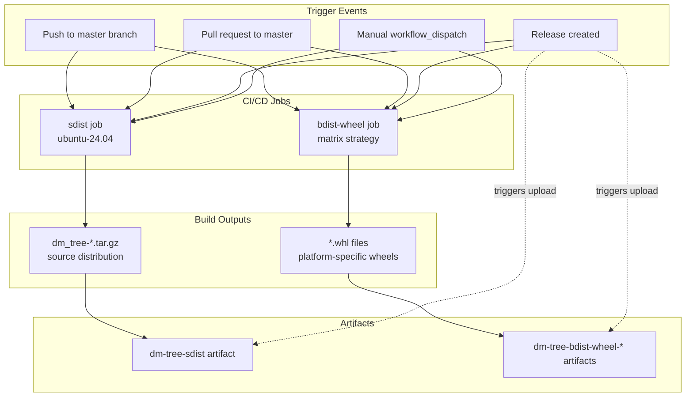
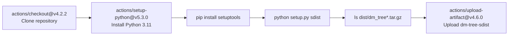
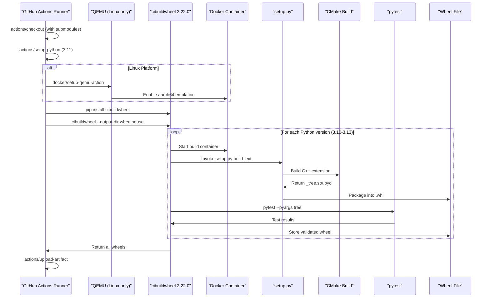
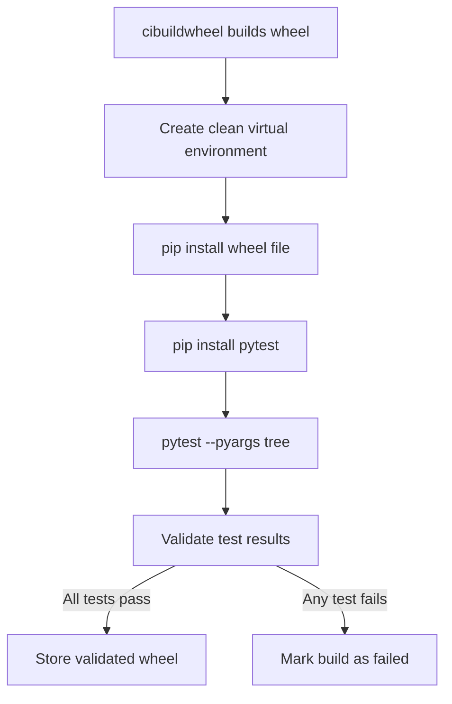
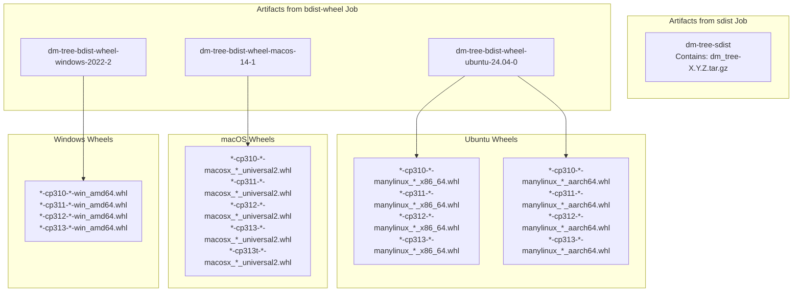
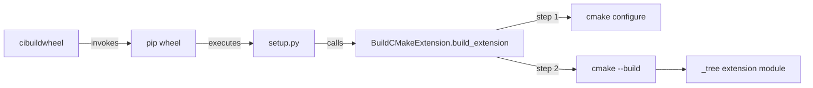
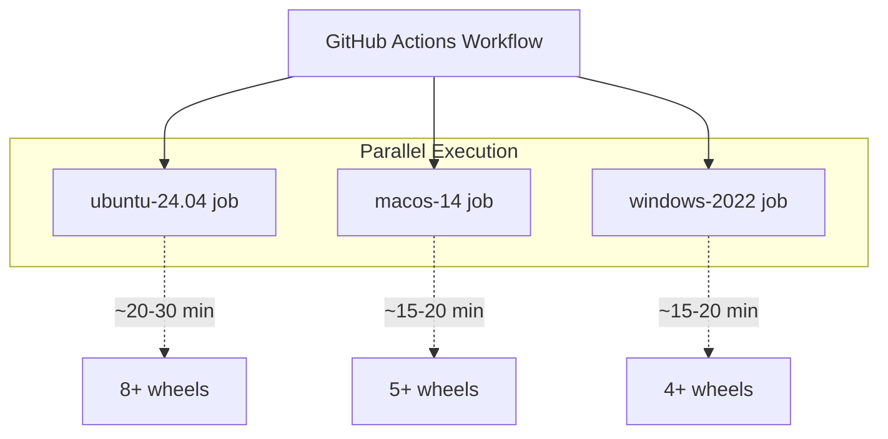
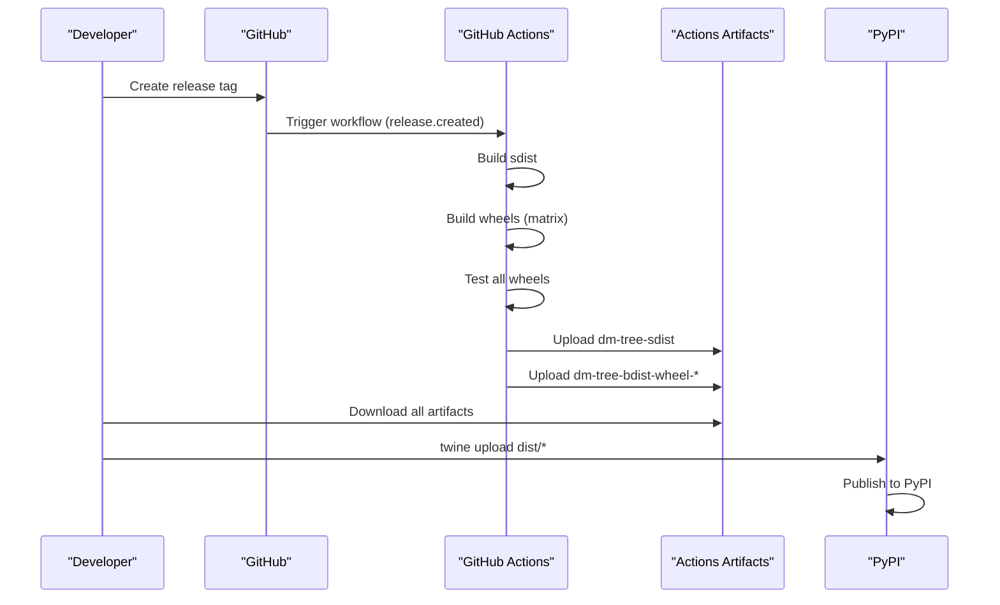

<!-- source: DeepWiki mcp.deepwiki.com · repo google-deepmind/tree · page 4.4 CI/CD Pipeline · fetched 2026-10-26 -->

# CI/CD Pipeline

<details>
<summary>Relevant source files</summary>

The following files were used as context for generating this wiki page:

- [.github/workflows/build.yml](.github/workflows/build.yml)
- [setup.py](setup.py)

</details>


## Purpose and Scope

This page documents the Continuous Integration and Continuous Deployment (CI/CD) pipeline for dm-tree, implemented via GitHub Actions. The pipeline automates building platform-specific wheels, running tests, and publishing releases to PyPI.

For information about the underlying build system that the CI/CD pipeline invokes, see [Build System Architecture](#4.2). For details on the test suite that runs within the pipeline, see [Testing and Benchmarking](#4.3).

**Sources:** [.github/workflows/build.yml:1-78]()

## Workflow Overview

The CI/CD pipeline is defined in `.github/workflows/build.yml` and consists of two primary jobs:

1. **sdist** - Creates a source distribution tarball
2. **bdist-wheel** - Builds binary wheels for multiple platforms and Python versions



**Workflow Trigger Conditions**

The pipeline runs automatically on:
- Pushes to the `master` branch
- Pull requests targeting `master`
- Release creation events
- Manual triggering via `workflow_dispatch`

**Sources:** [.github/workflows/build.yml:3-10]()

## Source Distribution Job

The `sdist` job creates a source distribution package containing all source code, which users can build locally if pre-built wheels are unavailable for their platform.

### Job Configuration

| Property | Value |
|----------|-------|
| Job Name | `sdist` |
| Runner | `ubuntu-24.04` |
| Python Version | `3.11` |
| Output | `dist/dm_tree-*.tar.gz` |

### Execution Steps



The job performs these operations:

1. **Checkout** - Clones the repository at the commit being built ([.github/workflows/build.yml:17]())
2. **Setup Python** - Installs Python 3.11 ([.github/workflows/build.yml:18-20]())
3. **Install Dependencies** - Updates pip and setuptools ([.github/workflows/build.yml:23]())
4. **Create sdist** - Invokes `python setup.py sdist` to create the source tarball ([.github/workflows/build.yml:24]())
5. **List Output** - Verifies the created file ([.github/workflows/build.yml:27]())
6. **Upload Artifact** - Uploads the tarball as a GitHub Actions artifact (only on release or manual dispatch) ([.github/workflows/build.yml:29-33]())

The source distribution includes all Python source files, C++ source files, and build configuration defined in [setup.py:119-160]() and `MANIFEST.in`.

**Sources:** [.github/workflows/build.yml:13-33]()

## Binary Wheel Job

The `bdist-wheel` job builds platform-specific binary wheels using `cibuildwheel`, which automates building and testing across multiple Python versions and architectures.

### Platform Matrix

The job uses a matrix strategy to build wheels on three operating systems:

| OS | Runner | Architectures |
|----|--------|---------------|
| Linux | `ubuntu-24.04` | `x86_64`, `aarch64` |
| macOS | `macos-14` | `universal2` (x86_64 + arm64) |
| Windows | `windows-2022` | `x86_64` |

**Sources:** [.github/workflows/build.yml:36-40]()

### Build Process Flow



**Sources:** [.github/workflows/build.yml:42-77](), [setup.py:55-117]()

### Step-by-Step Execution

#### 1. Repository Checkout

The workflow checks out the repository with submodules enabled, which is necessary for fetching external dependencies like pybind11 and abseil-cpp.

```yaml
- uses: actions/checkout@v4.2.2
  with:
    submodules: true
```

**Sources:** [.github/workflows/build.yml:43-45]()

#### 2. QEMU Setup (Linux Only)

For Linux builds, QEMU is configured to enable cross-compilation for ARM64 (aarch64) architecture. This allows building ARM wheels on x86_64 runners.

```yaml
- name: Set up QEMU
  if: runner.os == 'Linux'
  uses: docker/setup-qemu-action@v3.3.0
  with:
    platforms: all
    image: tonistiigi/binfmt:qemu-v8.1.5
```

**Sources:** [.github/workflows/build.yml:49-57]()

#### 3. cibuildwheel Installation and Execution

The workflow installs `cibuildwheel` version 2.22.0, which orchestrates the entire wheel building process across multiple Python versions.

**Sources:** [.github/workflows/build.yml:58-72]()

### cibuildwheel Configuration

The build behavior is controlled through environment variables prefixed with `CIBW_`:

| Variable | Value | Purpose |
|----------|-------|---------|
| `CIBW_ARCHS_LINUX` | `auto aarch64` | Build x86_64 and ARM64 wheels on Linux |
| `CIBW_ARCHS_MACOS` | `universal2` | Build universal2 wheels (x86_64 + arm64) on macOS |
| `CIBW_BUILD` | `cp310-* cp311-* cp312-* cp313-* cp313t-*` | Build for Python 3.10-3.13 (including free-threaded) |
| `CIBW_BUILD_VERBOSITY` | `1` | Enable verbose build output |
| `CIBW_FREE_THREADED_SUPPORT` | `True` | Build free-threaded Python wheels |
| `CIBW_PRERELEASE_PYTHONS` | `True` | Include pre-release Python versions |
| `CIBW_SKIP` | `*musllinux* *i686* *win32* *t-win*` | Skip musl Linux, 32-bit, and Windows free-threaded |
| `CIBW_TEST_COMMAND` | `pytest --pyargs tree` | Test command to run after building |
| `CIBW_TEST_REQUIRES` | `pytest` | Test dependencies to install |
| `MAKEFLAGS` | `-j$(nproc)` | Parallel compilation flag |

**Build Target Matrix**

The `CIBW_BUILD` specification expands to the following wheel types:

| Python Version | Platform Tags | Example Wheel Name |
|----------------|---------------|-------------------|
| 3.10 | `cp310-cp310` | `dm_tree-*-cp310-cp310-manylinux_2_17_x86_64.whl` |
| 3.11 | `cp311-cp311` | `dm_tree-*-cp311-cp311-macosx_11_0_universal2.whl` |
| 3.12 | `cp312-cp312` | `dm_tree-*-cp312-cp312-win_amd64.whl` |
| 3.13 | `cp313-cp313` | `dm_tree-*-cp313-cp313-manylinux_2_17_aarch64.whl` |
| 3.13t | `cp313t-cp313t` | `dm_tree-*-cp313t-cp313t-macosx_11_0_universal2.whl` |

**Skip Rules**

The `CIBW_SKIP` patterns exclude:
- `*musllinux*` - Alpine Linux and other musl-based distributions
- `*i686*` - 32-bit x86 architectures (deprecated)
- `*win32*` - 32-bit Windows (unsupported)
- `*t-win*` - Free-threaded Python on Windows (not yet stable)

**Sources:** [.github/workflows/build.yml:62-72]()

## Test Integration

Each wheel is automatically tested before being considered valid. The test integration ensures that:

1. The wheel installs correctly in a clean environment
2. All tests pass on the target platform
3. The C++ extension loads properly

### Test Execution Flow



The test command `pytest --pyargs tree` ([.github/workflows/build.yml:70]()) runs the full test suite from [tree_test.py](), which includes:

- Core functionality tests (flatten, unflatten, map_structure)
- Type support validation (dict, tuple, namedtuple, attrs)
- Edge case handling (ObjectProxy, MappingProxyType)
- Structure validation tests
- Path operations tests

If any test fails, the wheel is rejected and the build fails, preventing broken wheels from being published.

**Sources:** [.github/workflows/build.yml:70-71](), referenced from section [4.3](#4.3)

## Artifact Management

The workflow uploads built artifacts conditionally based on the trigger event.

### Upload Conditions

Artifacts are uploaded only when:
- `github.event_name == 'workflow_dispatch'` (manual trigger), OR
- `github.event_name == 'release' && github.event.action == 'created'` (release creation)

For normal pushes and pull requests, wheels are built and tested but not uploaded, which saves storage costs while still validating changes.

**Sources:** [.github/workflows/build.yml:30](), [.github/workflows/build.yml:74]()

### Artifact Structure



Each artifact is named with the pattern:
- `dm-tree-sdist` - Source distribution
- `dm-tree-bdist-wheel-{os}-{job-index}` - Binary wheels per platform

The `strategy.job-index` ensures unique artifact names when the matrix expands.

**Sources:** [.github/workflows/build.yml:29-33](), [.github/workflows/build.yml:73-77]()

## Build Environment Details

### Action Versions

The workflow uses pinned versions of GitHub Actions for reproducibility and security:

| Action | Version | Commit SHA | Purpose |
|--------|---------|------------|---------|
| `actions/checkout` | v4.2.2 | `11bd71901bbe5b1630ceea73d27597364c9af683` | Repository checkout |
| `actions/setup-python` | v5.3.0 | `0b93645e9fea7318ecaed2b359559ac225c90a2b` | Python installation |
| `docker/setup-qemu-action` | v3.3.0 | `53851d14592bedcffcf25ea515637cff71ef929a` | QEMU setup |
| `actions/upload-artifact` | v4.6.0 | `65c4c4a1ddee5b72f698fdd19549f0f0fb45cf08` | Artifact upload |

**Sources:** [.github/workflows/build.yml:17](), [.github/workflows/build.yml:18](), [.github/workflows/build.yml:51](), [.github/workflows/build.yml:29]()

### Runner Images

| Platform | Runner Image | Architecture Support |
|----------|--------------|---------------------|
| Linux | `ubuntu-24.04` | x86_64 (native), aarch64 (QEMU) |
| macOS | `macos-14` | arm64 (native), x86_64 (cross-compile) |
| Windows | `windows-2022` | x86_64 (native) |

The Linux runner uses Docker containers provided by `cibuildwheel`, while macOS and Windows build directly on the runner.

**Sources:** [.github/workflows/build.yml:15](), [.github/workflows/build.yml:37](), [.github/workflows/build.yml:40]()

## Integration with setup.py

The CI/CD pipeline invokes the build system defined in `setup.py` for each wheel. The key integration points:

### CMakeExtension Build Process

When `cibuildwheel` runs `pip wheel`, it triggers the `BuildCMakeExtension` class defined in [setup.py:55-117](), which:

1. Checks for CMake availability ([setup.py:66-75]())
2. Configures CMake with Python paths ([setup.py:81-91]())
3. Handles macOS universal binary architectures ([setup.py:92-98]())
4. Invokes CMake to build the C++ extension ([setup.py:100-107]())
5. Moves output files to the correct location ([setup.py:109-116]())

### Build Configuration



The build type is determined by the `self.debug` flag in `BuildCMakeExtension`, defaulting to `Release` for optimized performance ([setup.py:80]()).

**Sources:** [setup.py:55-117](), [.github/workflows/build.yml:61]()

## Parallelization and Performance

### Parallel Builds

The workflow enables parallel compilation through the `MAKEFLAGS` environment variable:

```yaml
MAKEFLAGS: "-j$(nproc)"
```

This uses all available CPU cores during C++ compilation. Additionally, `cibuildwheel` can be configured to use parallel jobs via the `--parallel` flag (not currently used).

**Sources:** [.github/workflows/build.yml:72]()

### Build Matrix Parallelization

The matrix strategy runs jobs concurrently:



All three platform jobs run simultaneously, significantly reducing total build time compared to sequential execution.

**Sources:** [.github/workflows/build.yml:38-40]()

## Publishing Flow

While the current workflow uploads artifacts to GitHub Actions, the typical release process continues with manual or automated publishing to PyPI:

1. **Create GitHub Release** - Triggers the workflow with `release.created` event
2. **Build Artifacts** - All wheels and sdist are built and uploaded
3. **Download Artifacts** - Release manager downloads artifacts from GitHub Actions
4. **PyPI Upload** - Artifacts are published to PyPI using `twine upload`



**Note:** The workflow does not automatically publish to PyPI. This is a deliberate design choice to allow manual review of artifacts before public release.

**Sources:** [.github/workflows/build.yml:8-9](), [.github/workflows/build.yml:30](), [.github/workflows/build.yml:74]()

## Troubleshooting Common Issues

### Build Failures

| Issue | Cause | Solution |
|-------|-------|----------|
| CMake not found | Missing CMake in build environment | Verified by [setup.py:66-75](), should not occur in cibuildwheel |
| Compilation errors | C++ code incompatibility | Check compiler version and abseil-cpp compatibility |
| Test failures | Breaking changes in code | Fix failing tests before merging |
| QEMU timeout | ARM64 builds taking too long | Increase timeout or reduce test scope |

### Platform-Specific Issues

**Linux (aarch64)**
- QEMU emulation is slower than native builds
- Docker image version matters for ARM64 support ([.github/workflows/build.yml:57]())

**macOS (universal2)**
- Requires macOS 11.0+ to run universal2 binaries
- `ARCHFLAGS` environment variable controls architecture selection ([setup.py:92-98]())

**Windows**
- CMake generator may default to wrong platform
- Build artifacts may end up in `Release/` or `Debug/` subdirectories ([setup.py:109-116]())

**Sources:** [setup.py:66-117](), [.github/workflows/build.yml:49-57]()

## Summary

The CI/CD pipeline provides:

- **Automated builds** across 3 platforms and 5 Python versions (including free-threaded)
- **Comprehensive testing** of every wheel before artifact upload
- **Platform-specific optimizations** (universal2 on macOS, multi-arch on Linux)
- **Artifact management** with conditional uploads based on trigger events
- **Reproducible builds** via pinned action versions and cibuildwheel configuration

The pipeline ensures that dm-tree releases are high-quality, well-tested, and compatible with a wide range of Python environments.

**Sources:** [.github/workflows/build.yml:1-78](), [setup.py:1-160]()

---

