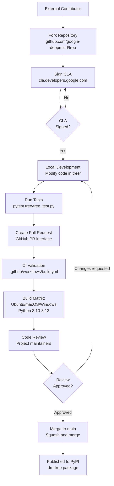
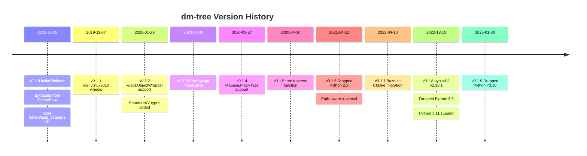
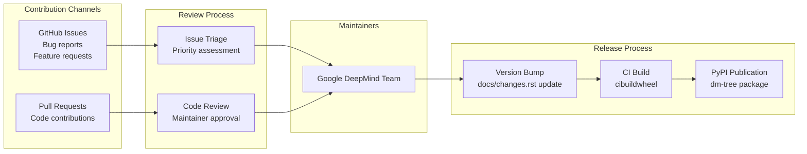

<!-- source: DeepWiki mcp.deepwiki.com · repo google-deepmind/tree · page 5 Project Information · fetched 2026-10-26 -->

# Project Information

Relevant source files

The following files were used as context for generating this wiki page:

- [CONTRIBUTING.md](CONTRIBUTING.md)
- [docs/changes.rst](docs/changes.rst)

## Purpose and Scope

This page provides meta-information about the dm-tree project, including repository organization, contribution workflow, version history, and governance structure. For detailed contribution guidelines and the CLA process, see [Contributing Guidelines](#5.1). For a complete version-by-version changelog, see [Changelog and History](#5.2).

## Project Overview

dm-tree is an open-source project maintained by Google DeepMind. The project originated from TensorFlow's nested structure utilities and was extracted as a standalone library in November 2019.

| Property | Value |
|----------|-------|
| **Repository** | `google-deepmind/tree` |
| **Language** | Python with C++ backend |
| **License** | Apache 2.0 |
| **Package Name** | `dm-tree` |
| **Initial Release** | Version 0.1.0 (2019-11-05) |
| **Current Version** | 0.1.9 (2025-01-30) |
| **Python Support** | 3.10+ (as of 0.1.9) |

Sources: [docs/changes.rst:1-79]()

## Repository Organization

The repository follows a standard structure with clear separation between source code, build configuration, testing, and documentation.

**Repository Structure by Component**

```mermaid
graph TB
    Root["Repository Root<br/>google-deepmind/tree"]
    
    subgraph "Source Code"
        TreePkg["tree/<br/>Python package"]
        TreeInit["tree/__init__.py<br/>Public API"]
        SeqPy["tree/sequence.py<br/>Type utilities"]
        TreeCC["tree/tree.cc<br/>C++ implementation"]
        TreeH["tree/tree.h<br/>C++ header"]
    end
    
    subgraph "Build System"
        SetupPy["setup.py<br/>Python package setup<br/>CMakeExtension class"]
        CMakeLists["CMakeLists.txt<br/>C++ build config"]
        Manifest["MANIFEST.in<br/>Package files"]
    end
    
    subgraph "Testing"
        TreeTest["tree/tree_test.py<br/>Unit tests"]
        TreeBench["tree/tree_benchmark.py<br/>Performance tests"]
    end
    
    subgraph "Documentation"
        DocsDir["docs/<br/>Sphinx documentation"]
        ConfPy["docs/conf.py<br/>Sphinx config"]
        ApiRst["docs/api.rst<br/>API reference"]
        RecipesRst["docs/recipes.rst<br/>Usage examples"]
        ChangesRst["docs/changes.rst<br/>Version history"]
        RTDYml["readthedocs.yml<br/>RTD config"]
    end
    
    subgraph "CI/CD"
        GHWorkflows[".github/workflows/"]
        BuildYml[".github/workflows/build.yml<br/>CI pipeline"]
    end
    
    subgraph "Project Meta"
        ContribMd["CONTRIBUTING.md<br/>Contribution guide"]
        License["LICENSE<br/>Apache 2.0"]
        ReadmeMd["README.md<br/>Project intro"]
    end
    
    Root --> TreePkg
    Root --> SetupPy
    Root --> DocsDir
    Root --> GHWorkflows
    Root --> ContribMd
    
    TreePkg --> TreeInit
    TreePkg --> SeqPy
    TreePkg --> TreeCC
    TreePkg --> TreeH
    TreePkg --> TreeTest
    TreePkg --> TreeBench
    
    DocsDir --> ConfPy
    DocsDir --> ApiRst
    DocsDir --> RecipesRst
    DocsDir --> ChangesRst
    
    GHWorkflows --> BuildYml
```

Sources: Repository structure analysis from provided diagrams

## Contribution Workflow

All contributions to dm-tree must follow a structured process involving a Contributor License Agreement (CLA) and code review.

**Contribution Process Flow**

### CLA Requirement

All contributors must sign a Contributor License Agreement before any contributions can be accepted. The CLA is managed through `https://cla.developers.google.com/`. Contributors retain copyright to their work; the CLA simply grants Google DeepMind permission to use and redistribute the contribution.

### Code Review Process

- All submissions require review via GitHub Pull Requests
- Reviews are required even for project members
- The CI pipeline ([.github/workflows/build.yml]()) automatically validates all PRs
- Reviews focus on code quality, test coverage, and alignment with project goals

### Community Guidelines

The project follows [Google's Open Source Community Guidelines](https://opensource.google.com/conduct/), which establish expectations for respectful collaboration.

Sources: [CONTRIBUTING.md:1-29]()

## Project Evolution Timeline

dm-tree has evolved from its TensorFlow origins through 9 major releases, with significant changes in build systems, Python version support, and feature additions.

**Version History and Major Milestones**

### Key Evolution Patterns

| Category | Evolution |
|----------|-----------|
| **Build System** | Bazel (pre-0.1.7) → CMake (0.1.7+) |
| **Python Support** | 2.7-3.X (0.1.0-0.1.5) → 3.7+ (0.1.6-0.1.7) → 3.10+ (0.1.9) |
| **Type Support** | Basic types → MappingProxyType (0.1.4) → wrapt.ObjectWrapper (0.1.2) |
| **Features** | Core API → traverse (0.1.5) → Path tracking (0.1.6) |
| **Dependencies** | pybind11 v2.6 → v2.10.1 (0.1.8) |

### Notable Changes by Version

**v0.1.7 (2022-04-10) - Build System Overhaul**
- Migrated from Bazel to CMake for C++ compilation
- Simplified build process for contributors
- Improved cross-platform support

**v0.1.6 (2021-04-12) - Python 3 Transition**
- Dropped Python 2.X support
- Added path-aware traversal capabilities

**v0.1.5 (2020-04-30) - Traversal API**
- Introduced `tree.traverse` function for visiting all subtrees

**v0.1.0 (2019-11-05) - Initial Release**
- Extracted from TensorFlow's nested structure utilities
- Established as standalone `dm-tree` package on PyPI

Sources: [docs/changes.rst:1-79]()

## Governance and Maintenance

### Project Ownership

dm-tree is maintained by Google DeepMind. The project follows Google's open source practices and governance models.

### Maintenance Model

### Release Cadence

The project follows a semantic versioning approach with releases driven by:
- Feature additions (e.g., `traverse` function in 0.1.5)
- Dependency updates (e.g., pybind11 bump in 0.1.8)
- Python version support changes (e.g., dropping old versions)
- Build system improvements (e.g., Bazel to CMake in 0.1.7)

Release frequency has varied from monthly (early 2020) to yearly (2021-2022), depending on feature maturity and dependency requirements.

Sources: [docs/changes.rst:1-79](), [CONTRIBUTING.md:1-29]()

## License Information

dm-tree is licensed under the Apache License 2.0, a permissive open-source license that allows:

- **Commercial use**: The library can be used in commercial products
- **Modification**: The code can be modified for any purpose
- **Distribution**: Modified or unmodified versions can be distributed
- **Patent use**: Express grant of patent rights from contributors
- **Private use**: The library can be used privately

The Apache 2.0 license requires:
- License and copyright notice inclusion
- State changes documentation
- Disclaimer of warranty

The license text is available at [LICENSE]() in the repository root.

Sources: Repository analysis

## Support and Communication

### Issue Reporting

Bug reports, feature requests, and questions should be submitted through GitHub Issues at the repository. The maintainer team triages issues based on:
- Impact on users
- Alignment with project goals
- Technical feasibility
- Resource availability

### Documentation Resources

- **ReadTheDocs**: Hosted documentation at the official ReadTheDocs site
- **API Reference**: Complete function signatures and usage at [docs/api.rst]()
- **Usage Examples**: Practical recipes at [docs/recipes.rst]()
- **Changelog**: Version history at [docs/changes.rst]()

### Related Projects

dm-tree is used extensively in the DeepMind ecosystem and integrates with:
- JAX nested structure manipulation
- TensorFlow (original source of the code)
- DeepMind research codebases

Sources: Repository analysis, [docs/changes.rst:1-79]()

---

