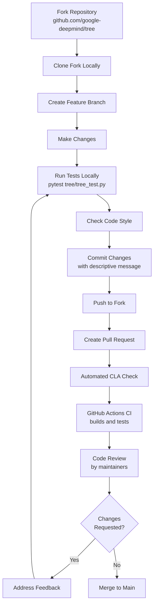
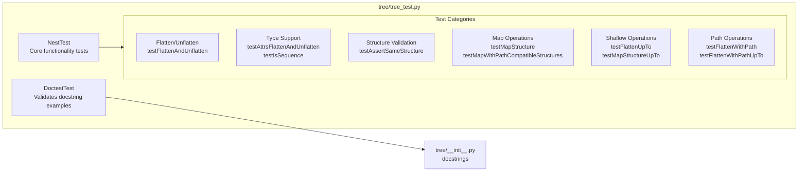
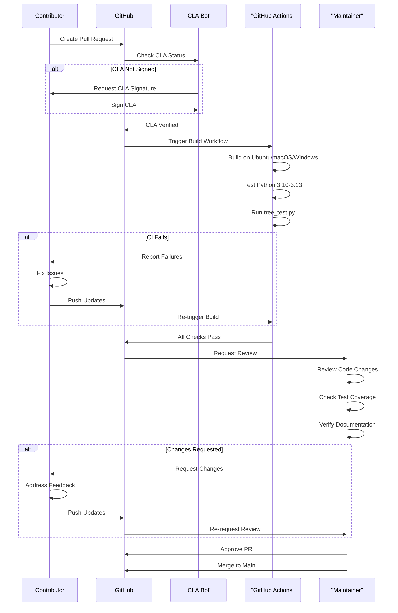

<!-- source: DeepWiki mcp.deepwiki.com · repo google-deepmind/tree · page 5.1 Contributing Guidelines · fetched 2026-10-26 -->

# Contributing Guidelines

<details>
<summary>Relevant source files</summary>

The following files were used as context for generating this wiki page:

- [CONTRIBUTING.md](CONTRIBUTING.md)
- [LICENSE](LICENSE)
- [tree/tree_test.py](tree/tree_test.py)

</details>


This document explains the process and requirements for contributing code, bug fixes, features, and documentation to the dm-tree project. It covers the Contributor License Agreement (CLA) requirements, code submission workflow, testing expectations, and community standards that all contributors must follow.

For information about setting up a development environment and building the project locally, see [Development Setup](#4.1). For details about the test infrastructure and how to run tests, see [Testing and Benchmarking](#4.3).

## Purpose and Scope

This page provides practical guidance for external contributors and project members who want to submit changes to the dm-tree codebase. All contributions, including code, documentation, and configuration changes, must follow these guidelines.

**Sources:** [CONTRIBUTING.md:1-29]()

---

## Contributor License Agreement

### CLA Requirement

All contributions to dm-tree must be accompanied by a signed Contributor License Agreement (CLA). The CLA ensures that you (or your employer) retain copyright to your contribution while granting Google DeepMind permission to use and redistribute it as part of the project.

| Requirement | Details |
|-------------|---------|
| **Submission URL** | https://cla.developers.google.com/ |
| **Frequency** | One-time (applies across all Google open source projects) |
| **Scope** | Individual or corporate CLA depending on employment status |
| **Verification** | Automated check during pull request submission |

If you have previously signed a CLA for another Google open source project, you do not need to sign a new one for dm-tree.

**Sources:** [CONTRIBUTING.md:6-16]()

---

## Code Submission Workflow

### Contribution Process



**Sources:** [CONTRIBUTING.md:18-23](), [.github/workflows/build.yml]()

### Pull Request Requirements

All submissions, including those from project members, require review via GitHub pull requests. No direct commits to the main branch are permitted.

| Requirement | Description |
|-------------|-------------|
| **Branch naming** | Use descriptive branch names (e.g., `fix-flatten-dict-order`, `add-custom-type-support`) |
| **Commit messages** | Clear, descriptive commit messages explaining the change |
| **Test coverage** | All new functionality must include corresponding tests in [tree/tree_test.py]() |
| **Documentation** | Update docstrings and documentation for API changes |
| **CI passing** | All GitHub Actions workflows must pass successfully |

**Sources:** [CONTRIBUTING.md:18-23](), [tree/tree_test.py:1-1142]()

---

## Testing Requirements

### Test Suite Structure

Contributors must ensure their changes pass all existing tests and add new tests for any new functionality. The test suite is organized into several categories:



**Sources:** [tree/tree_test.py:35-46](), [tree/tree_test.py:48-1142]()

### Running Tests Locally

Before submitting a pull request, contributors must run the full test suite locally:

```bash
# Run all tests
pytest tree/tree_test.py

# Run specific test class
pytest tree/tree_test.py::NestTest

# Run specific test method
pytest tree/tree_test.py::NestTest::testMapStructure
```

The test file uses Python's `unittest` framework with `parameterized` test cases for comprehensive coverage across different data types.

**Sources:** [tree/tree_test.py:1-1142]()

### Test Coverage Areas

Contributors should understand which parts of the system their changes affect and ensure appropriate test coverage:

| Component | Test Methods | Line Range |
|-----------|-------------|------------|
| **Attrs support** | `testAttrsFlattenAndUnflatten`, `testAttrsMapStructure` | [tree/tree_test.py:53-96]() |
| **Flatten/Unflatten** | `testFlattenAndUnflatten`, `testFlattenDictOrder` | [tree/tree_test.py:97-149]() |
| **Type checking** | `testIsSequence` | [tree/tree_test.py:233-247]() |
| **Structure validation** | `testAssertSameStructure*` (multiple methods) | [tree/tree_test.py:265-388]() |
| **Map operations** | `testMapStructure`, `testMapStructureWithStrings` | [tree/tree_test.py:390-472]() |
| **Shallow operations** | `testFlattenUpTo`, `testMapStructureUpTo` | [tree/tree_test.py:509-665]() |
| **Path operations** | `testFlattenWithPath`, `testMapWithPathCompatibleStructures` | [tree/tree_test.py:949-1002]() |
| **Special types** | `testMappingProxyType`, `testCustomClassMapWithPath` | [tree/tree_test.py:1004-1138]() |

**Sources:** [tree/tree_test.py:53-1138]()

### Adding New Tests

When adding new functionality, follow these patterns from the existing test suite:

1. **Parameterized tests** for multiple input types:
   ```python
   @parameterized.parameters([
       (input1, expected1),
       (input2, expected2),
   ])
   def testNewFeature(self, input, expected):
       result = tree.new_feature(input)
       self.assertEqual(result, expected)
   ```

2. **Named tuples for complex structures**:
   ```python
   TestTuple = collections.namedtuple("TestTuple", ["field1", "field2"])
   ```

3. **Error case validation**:
   ```python
   with self.assertRaisesRegex(ValueError, "expected error message"):
       tree.function_that_should_fail(invalid_input)
   ```

**Sources:** [tree/tree_test.py:78-95](), [tree/tree_test.py:949-966]()

---

## Code Review Process

### Review Workflow



**Sources:** [CONTRIBUTING.md:18-23](), [.github/workflows/build.yml]()

### Review Criteria

Maintainers evaluate pull requests based on the following criteria:

| Criterion | Requirements |
|-----------|-------------|
| **Functionality** | Changes correctly implement the intended feature or fix |
| **Code quality** | Follows existing code style and patterns in [tree/__init__.py]() |
| **Test coverage** | New code is adequately tested in [tree/tree_test.py]() |
| **Documentation** | Docstrings follow NumPy/Google style, examples provided |
| **Performance** | Changes do not degrade performance (verify with [tree/tree_benchmark.py]()) |
| **Backward compatibility** | Existing APIs remain functional unless explicitly deprecated |
| **Type support** | Works with supported types: dict, list, tuple, namedtuple, attrs, OrderedDict |

**Sources:** [tree/__init__.py](), [tree/tree_test.py:1-1142](), [tree/tree_benchmark.py]()

---

## Community Standards

### Code of Conduct

This project follows [Google's Open Source Community Guidelines](https://opensource.google.com/conduct/). All contributors are expected to:

- Be respectful and inclusive
- Provide constructive feedback
- Focus on what is best for the community
- Show empathy towards other community members

**Sources:** [CONTRIBUTING.md:25-28]()

### Communication Channels

| Channel | Purpose |
|---------|---------|
| **GitHub Issues** | Bug reports, feature requests, questions about usage |
| **Pull Requests** | Code contributions and reviews |
| **GitHub Discussions** | General discussions, design proposals |

---

## License Compliance

All contributions are made under the Apache License 2.0. By submitting a contribution, you agree that your contributions will be licensed under the same terms.

### Copyright Notice

All source files must include the standard copyright header:

```python
# Copyright [year] DeepMind Technologies Limited. All Rights Reserved.
#
# Licensed under the Apache License, Version 2.0 (the "License");
# you may not use this file except in compliance with the License.
# You may obtain a copy of the License at
#
#     http://www.apache.org/licenses/LICENSE-2.0
#
# Unless required by applicable law or agreed to in writing, software
# distributed under the License is distributed on an "AS IS" BASIS,
# WITHOUT WARRANTIES OR CONDITIONS OF ANY KIND, either express or implied.
# See the License for the specific language governing permissions and
# limitations under the License.
```

**Sources:** [tree/tree_test.py:1-14](), [LICENSE:1-203]()

---

## Contribution Types and Examples

### Bug Fixes

When fixing bugs, include:
1. Test case demonstrating the bug (should fail before fix)
2. The fix itself
3. Verification that the test now passes
4. Update to changelog if appropriate

Example test pattern from the suite:
- Structure validation bugs: [tree/tree_test.py:273-388]()
- Type handling bugs: [tree/tree_test.py:53-77]()
- Edge cases: [tree/tree_test.py:666-919]()

### New Features

For new features:
1. Propose the feature in a GitHub issue first
2. Implement the feature following existing patterns in [tree/__init__.py]()
3. Add comprehensive tests covering normal and edge cases
4. Update documentation with examples
5. Consider performance impact using [tree/tree_benchmark.py]()

### Documentation Improvements

Documentation contributions are welcome and should update:
- Docstrings in [tree/__init__.py]()
- Sphinx documentation in `docs/` directory
- README examples
- Code comments for complex logic

**Sources:** [tree/__init__.py](), [tree/tree_test.py:1-1142](), [tree/tree_benchmark.py]()

---

## Summary

Contributing to dm-tree requires:

1. **Legal:** Sign the CLA at https://cla.developers.google.com/
2. **Technical:** Ensure all tests pass in [tree/tree_test.py]()
3. **Process:** Submit via GitHub pull request for review
4. **Standards:** Follow Google's Open Source Community Guidelines

All contributions undergo code review by project maintainers before being merged to the main branch. The automated CI/CD pipeline validates builds across multiple platforms and Python versions to ensure quality and compatibility.

**Sources:** [CONTRIBUTING.md:1-29](), [tree/tree_test.py:1-1142]()

---

