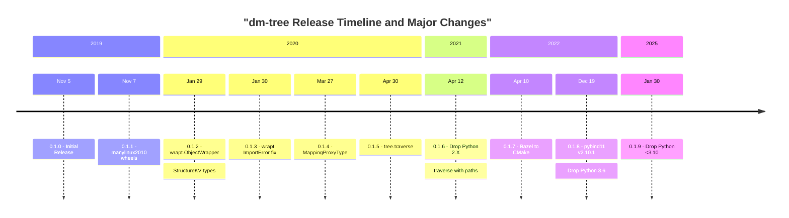
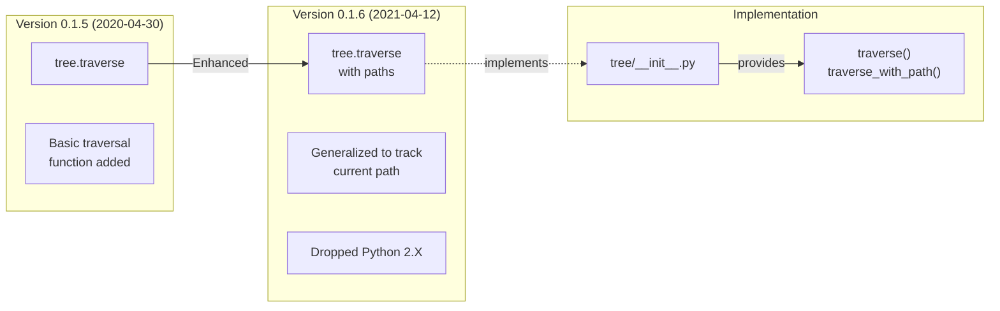
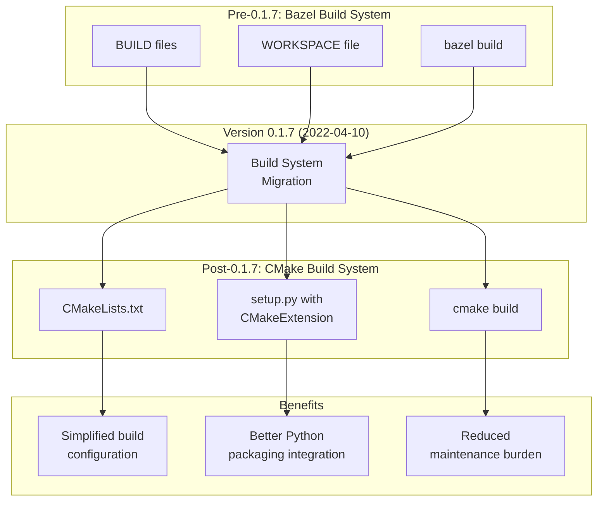
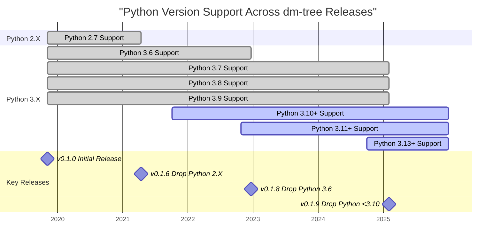
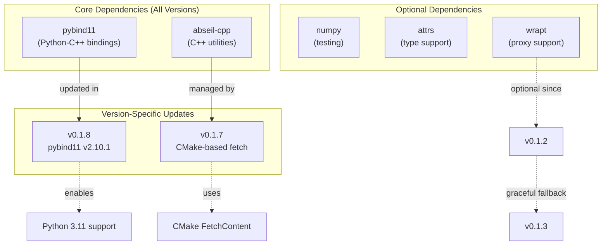
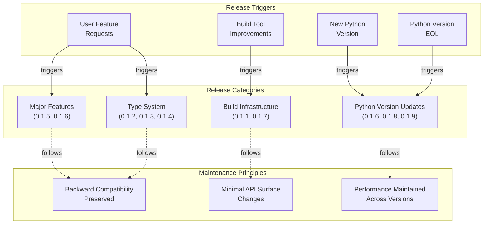

<!-- source: DeepWiki mcp.deepwiki.com · repo google-deepmind/tree · page 5.2 Changelog and History · fetched 2026-10-26 -->

# Changelog and History

Relevant source files

The following files were used as context for generating this wiki page:

- [README.md](README.md)
- [docs/changes.rst](docs/changes.rst)

## Purpose and Scope

This document provides a comprehensive record of dm-tree's version history, major milestones, and technical evolution from its initial public release to the current version. It tracks all releases with their associated changes, including feature additions, deprecations, build system migrations, and dependency updates. For information about contributing to future releases, see [Contributing Guidelines](#5.1). For current installation instructions, see [Installation and Setup](#3.1).

**Sources:** [docs/changes.rst:1-79](), [README.md:1-48]()

---

## Project Origins

The dm-tree library originated from internal utilities used within TensorFlow for manipulating nested data structures. These utilities were extracted and published as a standalone library to provide the broader Python community with high-performance tree manipulation capabilities. The initial public release (version 0.1.0) on November 5, 2019, established dm-tree as an independent package available on PyPI under the name `dm-tree`.

The library was designed from the outset with a dual implementation strategy: a Python API layer for ease of use and a C++ backend for performance-critical operations. This architecture has remained consistent throughout the library's evolution, though the build system and supported platforms have undergone significant changes.

**Sources:** [README.md:1-48](), [docs/changes.rst:74-78]()

---

## Complete Version History

The following table summarizes all releases of dm-tree, including release dates and major changes:

| Version | Release Date | Key Changes |
|---------|-------------|-------------|
| 0.1.9 | 2025-01-30 | Dropped Python <3.10 support |
| 0.1.8 | 2022-12-19 | Bumped pybind11 to v2.10.1 for Python 3.11; dropped Python 3.6 |
| 0.1.7 | 2022-04-10 | Migrated build system from Bazel to CMake |
| 0.1.6 | 2021-04-12 | Dropped Python 2.X; added path tracking to `traverse` |
| 0.1.5 | 2020-04-30 | Added `tree.traverse` function |
| 0.1.4 | 2020-03-27 | Added support for `types.MappingProxyType` |
| 0.1.3 | 2020-01-30 | Fixed `ImportError` when `wrapt` unavailable |
| 0.1.2 | 2020-01-29 | Added `wrapt.ObjectWrapper` support; added type annotations |
| 0.1.1 | 2019-11-07 | Ensured manylinux2010 compatibility for Linux wheels |
| 0.1.0 | 2019-11-05 | Initial public release |

**Sources:** [docs/changes.rst:5-78]()

---

## Release Timeline and Feature Evolution

**Sources:** [docs/changes.rst:5-78]()

---

## Major Milestones

### Initial Release (0.1.0 - 0.1.1)

The first public release established the core API surface, including `flatten`, `unflatten_as`, `map_structure`, `assert_same_structure`, and related functions. Version 0.1.1 immediately followed to ensure Linux wheel compatibility with the manylinux2010 standard, enabling broader distribution across Linux systems without requiring users to compile from source.

**Key API Components at Launch:**
- Core flattening operations in [tree/__init__.py]()
- C++ backend implementation in [tree.cc]()
- Support for `dict`, `list`, `tuple`, `namedtuple`, `OrderedDict`, `defaultdict`
- attrs class support

**Sources:** [docs/changes.rst:66-78]()

---

### Type System Expansion (0.1.2 - 0.1.4)

Between January and March 2020, three releases focused on expanding type system compatibility:

**Version 0.1.2 (2020-01-29):**
- Added support for `wrapt.ObjectWrapper` objects [docs/changes.rst:58-64]()
- Introduced type annotations: `StructureKV[K, V]` and `Structure[Text, V]` types for better type checking integration

**Version 0.1.3 (2020-01-30):**
- Fixed import error when the optional `wrapt` dependency was not installed [docs/changes.rst:51-56]()
- Improved graceful degradation of optional features

**Version 0.1.4 (2020-03-27):**
- Added support for `types.MappingProxyType` on Python 3.X [docs/changes.rst:44-49]()
- Expanded read-only mapping compatibility

**Sources:** [docs/changes.rst:44-64]()

---

### Feature Additions: Traversal Operations (0.1.5 - 0.1.6)

**Version 0.1.5 Changes:**
The `tree.traverse` function was introduced, allowing users to traverse a nested structure and apply a function to each subtree [docs/changes.rst:36-42](). This complemented the existing `map_structure` function by providing more control over the traversal process.

**Version 0.1.6 Changes:**
The traverse functionality was generalized to track the current path during traversal [docs/changes.rst:28-34](). This enabled path-aware operations where the callback function receives both the value and its location in the tree structure. This version also marked the end of Python 2.X support [docs/changes.rst:32](), aligning with the Python community's transition to Python 3.

**Sources:** [docs/changes.rst:28-42]()

---

### Build System Migration (0.1.7)

Version 0.1.7, released on April 10, 2022, marked a significant technical transition: the build system was migrated from Bazel to CMake [docs/changes.rst:20-25](). This change simplified the build configuration and improved integration with Python packaging tools, particularly `setup.py` and wheel building via `cibuildwheel`.

**Key Technical Changes:**
- New `CMakeLists.txt` configuration file replaced Bazel BUILD files
- Modified `setup.py` to use custom `CMakeExtension` class [setup.py]()
- Streamlined dependency management for pybind11 and abseil-cpp
- Improved compatibility with standard Python build workflows

This migration reduced the complexity of the build system while maintaining the same C++ performance characteristics. For detailed information on the current build system, see [Build System Architecture](#4.2).

**Sources:** [docs/changes.rst:20-25]()

---

## Python Version Support Evolution

The following diagram illustrates how Python version support has evolved across releases:

**Version-Specific Changes:**

| Version | Python Versions Dropped | Python Versions Added | Rationale |
|---------|------------------------|----------------------|-----------|
| 0.1.6 | 2.X | - | Python 2 EOL (January 1, 2020) |
| 0.1.8 | 3.6 | 3.11 support via pybind11 v2.10.1 | Python 3.6 EOL (December 23, 2021) |
| 0.1.9 | 3.7, 3.8, 3.9 | - | Align with modern Python versions |

**Current Support (0.1.9):** Python 3.10, 3.11, 3.12, 3.13

**Sources:** [docs/changes.rst:5-34]()

---

## Dependency Evolution

**Key Dependency Milestones:**

1. **pybind11 v2.10.1 (Version 0.1.8):** Updated to support Python 3.11 [docs/changes.rst:17]()
   - Provides Python-C++ binding layer for `_tree` extension module
   - Located in [tree.cc]() implementation

2. **CMake Dependency Management (Version 0.1.7):** Transitioned to CMake's FetchContent for managing C++ dependencies
   - Automated fetching of pybind11 and abseil-cpp during build
   - Configuration in [CMakeLists.txt]()

3. **wrapt ImportError Fix (Version 0.1.3):** Made wrapt truly optional [docs/changes.rst:51-56]()
   - Graceful degradation when `wrapt.ObjectProxy` support is unavailable
   - Error handling in [tree/__init__.py]() and [sequence.py]()

**Sources:** [docs/changes.rst:17-64]()

---

## Feature Mapping to Code Entities

The following table maps features added in each version to their corresponding code implementations:

| Version | Feature | Primary Implementation | Related Files |
|---------|---------|----------------------|---------------|
| 0.1.0 | Core API | `flatten`, `map_structure`, etc. | [tree/__init__.py]() |
| 0.1.0 | C++ Backend | Core flattening/validation | [tree.cc](), [tree.h]() |
| 0.1.2 | wrapt Support | `wrapt.ObjectProxy` handling | [sequence.py]() |
| 0.1.2 | Type Annotations | `StructureKV[K, V]` | [tree/__init__.py]() |
| 0.1.4 | MappingProxyType | Read-only mapping support | [tree.cc](), [sequence.py]() |
| 0.1.5 | traverse | `tree.traverse(func, structure)` | [tree/__init__.py]() |
| 0.1.6 | Path Tracking | `traverse` with path parameter | [tree/__init__.py]() |
| 0.1.7 | CMake Build | `CMakeExtension`, `CMakeLists.txt` | [setup.py](), [CMakeLists.txt]() |
| 0.1.8 | Python 3.11 | pybind11 v2.10.1 compatibility | [CMakeLists.txt]() |

**Sources:** [docs/changes.rst:5-78](), [tree/__init__.py](), [tree.cc](), [sequence.py](), [setup.py](), [CMakeLists.txt]()

---

## Release Patterns and Maintenance Philosophy

The release history reveals several patterns:

1. **Incremental Feature Addition:** New features are added conservatively, ensuring each addition integrates cleanly with the existing API (traverse in 0.1.5, path tracking in 0.1.6)

2. **Proactive Python Version Management:** Python version support is updated in response to community EOL dates rather than waiting for user reports

3. **Build System Modernization:** The Bazel-to-CMake migration (0.1.7) demonstrates willingness to make significant infrastructure changes for long-term maintainability

4. **Rapid Bug Fixes:** Quick turnaround on issues like the wrapt ImportError (0.1.2 → 0.1.3) demonstrates responsive maintenance

5. **Platform Compatibility Focus:** Early attention to wheel compatibility (0.1.1) established the pattern of prioritizing ease of installation

**Sources:** [docs/changes.rst:5-78]()

---

## Looking Forward

As of version 0.1.9, dm-tree maintains a stable API surface with a modern Python version support baseline (≥3.10). The library's core functionality remains unchanged from the initial release, while the supporting infrastructure (build system, Python version support, type system coverage) has evolved to meet current ecosystem standards.

Future development is expected to focus on:
- Maintaining compatibility with new Python versions
- Potential performance optimizations in the C++ backend
- Continued support for emerging Python type system features
- Community-driven feature requests and bug fixes

For information on how to contribute to future releases, see [Contributing Guidelines](#5.1).

**Sources:** [docs/changes.rst:5-10](), [README.md:40-48]()