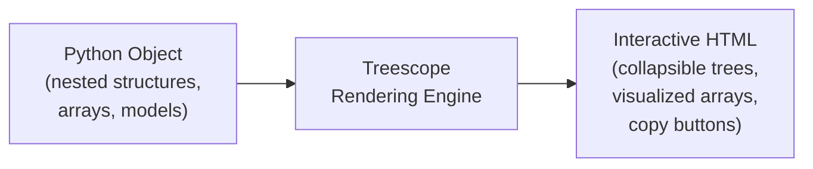
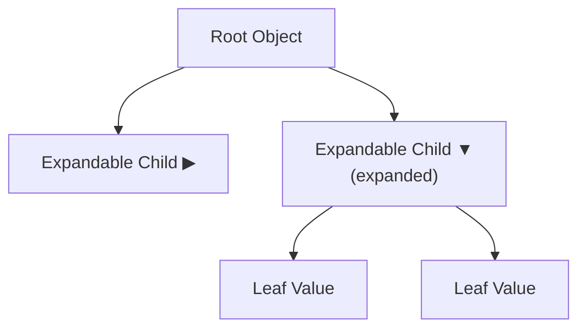
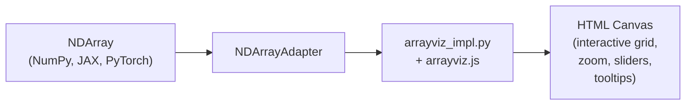
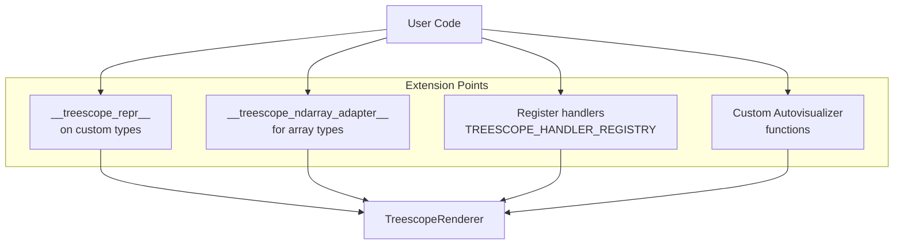
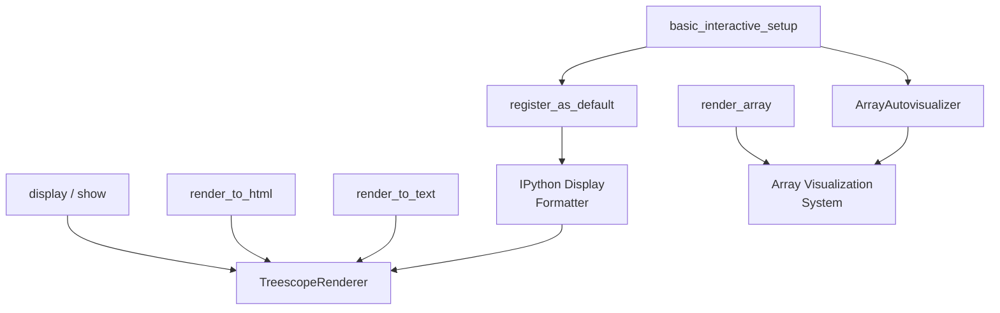
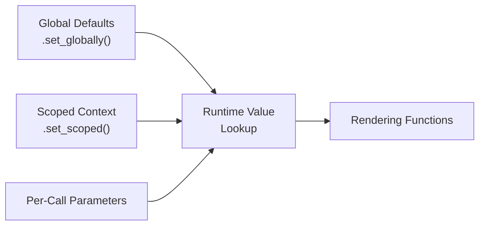
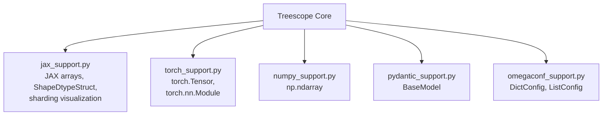
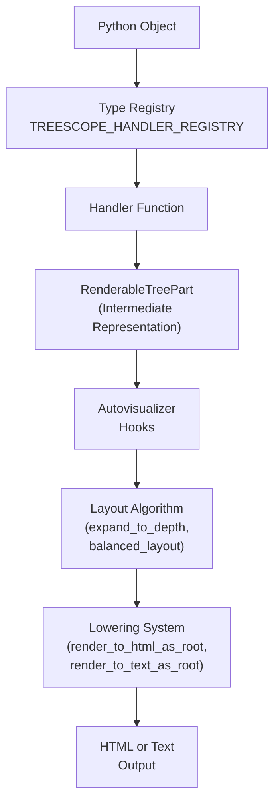

<!-- source: DeepWiki mcp.deepwiki.com · repo google-deepmind/treescope · page 1 Introduction · fetched 2026-10-26 -->

# Introduction

Relevant source files

The following files were used as context for generating this wiki page:

- [README.md](README.md)
- [docs/index.rst](docs/index.rst)
- [docs/notebooks/array_visualization.ipynb](docs/notebooks/array_visualization.ipynb)
- [docs/notebooks/building_custom_visualizations.ipynb](docs/notebooks/building_custom_visualizations.ipynb)
- [docs/notebooks/pretty_printing.ipynb](docs/notebooks/pretty_printing.ipynb)
- [treescope/__init__.py](treescope/__init__.py)

This page introduces Treescope: its purpose, core capabilities, and high-level architecture. For detailed instructions on installation and setup, see [Installation and Quick Start](#2). For in-depth explanations of the rendering system, see [Core Rendering System](#3).

## Purpose and Scope

Treescope is an interactive HTML pretty-printer and N-dimensional array visualizer designed for machine learning and neural networks research in IPython notebooks. It serves as a drop-in replacement for the standard IPython/Colab renderer, providing enhanced visualization capabilities for complex nested data structures, tensors, and neural network models.

**Target Audience**: Machine learning researchers and practitioners working with:
- JAX, PyTorch, or NumPy arrays
- Nested data structures (PyTrees, dataclasses, etc.)
- Neural network models (Equinox, Flax NNX, PyTorch modules, etc.)
- IPython/Jupyter notebooks or Google Colab

Sources: [README.md:1-33](), [docs/index.rst:1-37](), [treescope/__init__.py:15-31]()

## What is Treescope?

Treescope transforms the standard Python `repr` output into interactive, syntax-highlighted HTML visualizations. Instead of static text output that becomes unreadable for large nested structures, Treescope provides:

**Key Design Principle**: Treescope follows Python's `repr` conventions—most output is valid Python syntax, with extra annotations either hidden from selection or represented as comments. This makes outputs copyable and, when possible, executable.

Sources: [README.md:1-33](), [docs/notebooks/pretty_printing.ipynb:40-54]()

## Core Capabilities

### Interactive Tree Rendering

Treescope renders Python objects as collapsible tree structures, allowing users to focus on relevant parts of complex data:

**Key Features**:
- Expand/collapse any multi-line object with ▶/▼ markers
- Configurable default expansion via `active_expansion_strategy`
- Abbreviation of deeply nested collapsed nodes via `abbreviation_threshold`
- Copy-path buttons to generate code that accesses specific subtrees

Sources: [docs/notebooks/pretty_printing.ipynb:232-290](), [treescope/__init__.py:140-148](), [treescope/__init__.py:159-169]()

### Array Visualization

Treescope includes a specialized visualizer for N-dimensional arrays that renders array contents as interactive pixel grids:

**Capabilities**:
- Automatic visualization via `ArrayAutovisualizer`
- Manual rendering via `render_array()`
- Interactive features: zoom, axis sliders, hover tooltips, dynamic colormaps
- Support for arbitrarily high-dimensional arrays
- Categorical (discrete) and continuous (numeric) rendering modes
- JAX sharding visualization via `render_array_sharding()`

Sources: [docs/notebooks/array_visualization.ipynb:40-52](), [treescope/__init__.py:59-65](), [README.md:10-12]()

### Neural Network Model Support

Treescope provides specialized rendering for neural network models from multiple frameworks:

| Framework | Support | Rendering Approach |
|-----------|---------|-------------------|
| **Penzai** | First-class | Dataclass attributes with color-coding |
| **Equinox** | Full | Dataclass attributes (PyTree structure) |
| **Flax NNX** | Full | Extension API via `__treescope_repr__` |
| **PyTorch** | Full | Dynamic inspection of `nn.Module` parameters/buffers |
| **JAX** | Arrays only | Array visualization + sharding info |

Sources: [docs/notebooks/pretty_printing.ipynb:1012-1076](), [README.md:20-32]()

### Extensibility

Treescope supports customization at multiple levels:

Sources: [docs/notebooks/building_custom_visualizations.ipynb:40-54](), [treescope/__init__.py:44-50]()

## Key Entry Points and Usage Patterns

The following diagram maps user-facing functions to their roles in the system:

**Primary Usage Patterns**:

1. **Quick Setup (Recommended)**:
   - Call `treescope.basic_interactive_setup()` to configure Treescope as the default IPython renderer with array autovisualization
   - Located in [treescope/__init__.py:82]()

2. **Manual Display**:
   - `treescope.display(obj)` - Display a single object
   - `treescope.show(*args)` - Display multiple objects (like `print`)
   - Located in [treescope/__init__.py:83-87]()

3. **Rendering Functions**:
   - `treescope.render_to_html(obj)` - Generate HTML string
   - `treescope.render_to_text(obj)` - Generate plain text
   - Located in [treescope/__init__.py:76-77]()

4. **Array Visualization**:
   - `treescope.render_array(array, ...)` - Explicitly render an array
   - `treescope.ArrayAutovisualizer()` - Automatic array visualization in trees
   - Located in [treescope/__init__.py:56-65]()

Sources: [treescope/__init__.py:52-88](), [docs/notebooks/pretty_printing.ipynb:223-225](), [README.md:51-90]()

## Configuration System

Treescope uses a `ContextualValue` pattern for configuration, allowing global defaults, scoped contexts, and per-call parameters:

**Key Configuration Values**:
- `active_autovisualizer` - Controls automatic visualization [treescope/__init__.py:114-122]()
- `active_renderer` - Handler chain and postprocessors [treescope/__init__.py:124-138]()
- `active_expansion_strategy` - Default fold states [treescope/__init__.py:140-148]()
- `abbreviation_threshold` - Collapse depth limit [treescope/__init__.py:159-169]()
- `default_diverging_colormap` - Array colormap for signed data [treescope/__init__.py:96-103]()
- `default_sequential_colormap` - Array colormap for unsigned data [treescope/__init__.py:105-112]()

Sources: [treescope/__init__.py:96-184](), [docs/notebooks/pretty_printing.ipynb:532-598]()

## Output Modes

Treescope generates output in two primary formats:

| Mode | Format | Use Case | Key Features |
|------|--------|----------|--------------|
| **HTML** | Interactive HTML with CSS/JS | IPython notebooks, saved HTML files | Collapsible trees, interactive array grids, copy buttons |
| **Text** | Plain text with ANSI colors | Terminal output, logs | Indentation-based structure, abbreviation markers |

Both modes support:
- **Normal mode**: Abbreviated type names, compact rendering
- **Roundtrip mode** (toggle with `r` key): Fully qualified type names, explicit reconstruction syntax

Sources: [docs/notebooks/pretty_printing.ipynb:332-387](), [treescope/__init__.py:171-184]()

## Supported External Libraries

Treescope provides specialized integration for the following libraries through dedicated support modules:

Each support module calls `set_up_treescope()` to register handlers, adapters, and type metadata with the core system. For details on library-specific features, see [External Library Support](#6).

Sources: [README.md:20-36](), [docs/index.rst:24-36]()

## Architecture at a Glance

The high-level data flow through Treescope:

**Pipeline Stages**:
1. **Type Dispatch**: Look up handler for object type in registry
2. **Handler Execution**: Convert object to intermediate representation
3. **Autovisualization**: Optionally enhance/replace subtrees with visualizations
4. **Layout**: Determine which nodes to expand/collapse
5. **Lowering**: Convert IR to final HTML or text format

For detailed explanations of each stage, see [Rendering Pipeline](#3.1).

Sources: Diagram 2 from system overview, [treescope/__init__.py:38-50]()

## Next Steps

- **Getting Started**: See [Installation and Quick Start](#2) for setup instructions
- **Pretty-Printing**: Learn about tree rendering features in [Core Rendering System](#3)
- **Array Visualization**: Explore array rendering capabilities in [Array Visualization](#4)
- **IPython Integration**: Understand notebook usage in [IPython and Jupyter Integration](#5)
- **Extending Treescope**: Add custom handlers in [Extending Treescope](#8)

---

