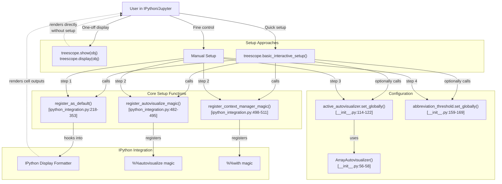
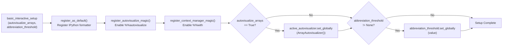
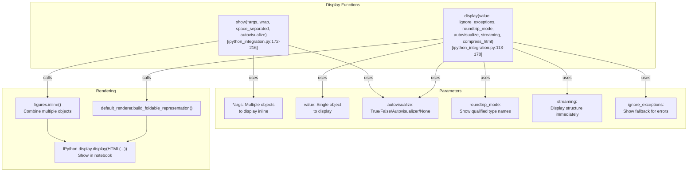

<!-- source: DeepWiki mcp.deepwiki.com · repo google-deepmind/treescope · page 2 Installation and Quick Start · fetched 2026-10-26 -->

# Installation and Quick Start

<details>
<summary>Relevant source files</summary>

The following files were used as context for generating this wiki page:

- [README.md](README.md)
- [docs/api/treescope.rst](docs/api/treescope.rst)
- [docs/index.rst](docs/index.rst)
- [treescope/__init__.py](treescope/__init__.py)
- [treescope/_internal/api/ipython_integration.py](treescope/_internal/api/ipython_integration.py)
- [treescope/rendering_parts.py](treescope/rendering_parts.py)

</details>


This page guides you through installing Treescope and getting started with basic usage. It covers installation via pip, importing the library, and three common setup patterns for IPython/Jupyter notebooks. For detailed information about configuration options and context management, see [Configuration and Context](#5.3). For information about the display functions themselves, see [Display Functions](#5.1).

## Installation

Treescope is available via pip and can be installed with a single command:

```bash
pip install treescope
```

After installation, import Treescope in your Python code:

```python
import treescope
```

**Sources:** [README.md:53-63](), [docs/index.rst:66-72]()

## Three Approaches to Using Treescope

Treescope provides three main usage patterns depending on your needs:

| Approach | Function | Use Case |
|----------|----------|----------|
| **One-off display** | `treescope.show()` or `treescope.display()` | Display specific objects without changing notebook defaults |
| **All-in-one setup** | `treescope.basic_interactive_setup()` | Quick setup with sensible defaults for interactive work |
| **Manual setup** | `treescope.register_as_default()` + configuration | Fine-grained control over rendering behavior |

### Approach 1: One-off Display with `show()` and `display()`

Use `treescope.show()` or `treescope.display()` to render individual objects without configuring Treescope as the default renderer:

```python
import treescope

# Like print, but with rich interactive output
treescope.show(my_object)

# Display with more control
treescope.display(my_object, autovisualize=True)
```

**Key differences:**
- `show(*args, wrap=False, space_separated=True)` - Similar to `print()`, accepts multiple arguments and displays them inline
- `display(value, ignore_exceptions=False, roundtrip_mode=False, autovisualize=None, streaming=True)` - Displays a single value with more configuration options

**Sources:** [treescope/__init__.py:29-30](), [treescope/_internal/api/ipython_integration.py:172-216](), [treescope/_internal/api/ipython_integration.py:113-170]()

### Approach 2: All-in-One Setup with `basic_interactive_setup()`

The simplest way to configure Treescope for interactive notebook use:

```python
import treescope

# Recommended: Enable all interactive features
treescope.basic_interactive_setup(autovisualize_arrays=True)

# Or with abbreviation for verbose outputs
treescope.basic_interactive_setup(
    autovisualize_arrays=True,
    abbreviation_threshold=1  # Collapse at depth 1
)
```

This single function call performs multiple setup steps automatically.

**Sources:** [treescope/__init__.py:82-86](), [README.md:84-86](), [treescope/_internal/api/ipython_integration.py:514-547]()

### Approach 3: Manual Setup for Fine Control

For precise control over configuration:

```python
import treescope

# Step 1: Register as default renderer
treescope.register_as_default()

# Step 2: Register magic commands
treescope.register_autovisualize_magic()
treescope.register_context_manager_magic()

# Step 3: Enable array visualization (optional)
treescope.active_autovisualizer.set_globally(
    treescope.ArrayAutovisualizer()
)

# Step 4: Configure abbreviation (optional)
treescope.abbreviation_threshold.set_globally(1)
```

**Sources:** [treescope/__init__.py:21-27](), [README.md:72-79](), [treescope/_internal/api/ipython_integration.py:218-353]()

## Setup Functions and Their Relationships



**Sources:** [treescope/_internal/api/ipython_integration.py:514-547](), [treescope/_internal/api/ipython_integration.py:218-353](), [treescope/_internal/api/ipython_integration.py:482-511]()

## What `basic_interactive_setup()` Does

The `basic_interactive_setup()` function performs the following operations:



**Implementation details:**

| Step | Function Called | Purpose |
|------|----------------|---------|
| 1 | `register_as_default()` | Hooks Treescope into IPython's display formatter to render all cell outputs |
| 2 | `register_autovisualize_magic()` | Enables `%%autovisualize` cell magic for per-cell visualization control |
| 3 | `register_context_manager_magic()` | Enables `%%with` cell magic for per-cell context management |
| 4 | `active_autovisualizer.set_globally()` | If `autovisualize_arrays=True`, enables automatic array visualization |
| 5 | `abbreviation_threshold.set_globally()` | If provided, configures depth at which collapsed nodes are abbreviated |

**Sources:** [treescope/_internal/api/ipython_integration.py:514-547]()

## First Steps After Setup

Once you've configured Treescope, you can start using it immediately. The behavior depends on your setup approach:

### If you used `basic_interactive_setup()` or `register_as_default()`

Cell outputs are automatically rendered with Treescope:

```python
# After setup, just evaluate objects at the end of a cell
my_dict = {"key": [1, 2, 3], "nested": {"a": 10, "b": 20}}
my_dict  # Automatically rendered with Treescope
```

### If you're using `show()` or `display()`

Explicitly call the function:

```python
# Display specific objects
treescope.show("Result:", my_dict)

# Or with configuration
treescope.display(my_dict, autovisualize=True, roundtrip_mode=True)
```

### Using IPython Magics

If you registered magics, you can use them in cells:

```python
%%autovisualize
# Enables array visualization for this cell only
my_array = np.random.randn(10, 10)
my_array
```

```python
%%with treescope.active_autovisualizer.set_scoped(None)
# Disables autovisualization for this cell
my_array  # Rendered without automatic visualization
```

**Sources:** [README.md:65-90](), [docs/index.rst:74-89](), [treescope/_internal/api/ipython_integration.py:361-442]()

## Key Configuration Options

Treescope's behavior can be customized through `ContextualValue` objects. The most important ones for getting started:

| Configuration | Type | Default | Purpose |
|--------------|------|---------|---------|
| `active_autovisualizer` | `ContextualValue[Autovisualizer \| None]` | `None` | Controls automatic visualization of arrays and other objects |
| `abbreviation_threshold` | `ContextualValue[int \| None]` | `None` | Depth at which collapsed nodes show `...` instead of full content |
| `active_renderer` | `ContextualValue[TreescopeRenderer]` | Default renderer | The handler chain used to render objects |
| `default_magic_autovisualizer` | `ContextualValue[Autovisualizer]` | `ArrayAutovisualizer()` | The autovisualizer used by `%%autovisualize` with no arguments |

### Example: Configuring Abbreviation

```python
# Set globally for all subsequent renders
treescope.abbreviation_threshold.set_globally(1)

# Or use a context manager for temporary changes
with treescope.abbreviation_threshold.set_scoped(2):
    treescope.show(large_nested_structure)
```

For complete documentation of configuration options, see [Configuration and Context](#5.3).

**Sources:** [treescope/__init__.py:96-184](), [treescope/_internal/api/ipython_integration.py:42-48]()

## Interactive Features

After rendering an object with Treescope, you can interact with the visualization:

| Key/Action | Effect |
|------------|--------|
| Click `▶` buttons | Expand/collapse subtrees |
| Press `r` key | Toggle "roundtrip mode" (shows fully qualified type names) |
| Shift + scroll | Scroll horizontally |
| Click "Copy path" buttons | Copy Python path to clipboard for accessing that part of the object |

**Sources:** [README.md:88-90](), [docs/index.rst:91-93]()

## Display Functions Reference



**Sources:** [treescope/_internal/api/ipython_integration.py:113-216](), [docs/api/treescope.rst:6-18]()

## Common Setup Recipes

### Recipe 1: Minimal Setup (Default Renderer Only)

```python
import treescope
treescope.register_as_default()
```

**Use when:** You want Treescope as your default renderer but don't need array visualization or magic commands.

### Recipe 2: Full Interactive Setup (Recommended)

```python
import treescope
treescope.basic_interactive_setup(autovisualize_arrays=True)
```

**Use when:** Working interactively in notebooks and want all features enabled.

### Recipe 3: Verbose Output Control

```python
import treescope
treescope.basic_interactive_setup(
    autovisualize_arrays=True,
    abbreviation_threshold=1  # Show ... for collapsed children
)
```

**Use when:** Working with large nested structures and outputs are too verbose.

### Recipe 4: Selective Display Without Global Setup

```python
import treescope

# No global setup - use show() for specific objects
treescope.show(my_model, autovisualize=True)
treescope.display(my_data, roundtrip_mode=True)
```

**Use when:** You want to keep the default IPython renderer but occasionally use Treescope.

**Sources:** [README.md:84-106](), [docs/index.rst:86-107]()

## Next Steps

After completing the setup:

- For information about rendering arrays with interactive visualizations, see [Array Visualization](#4)
- For details on the `%%autovisualize` and `%%with` magics, see [Magic Commands](#5.2)
- To understand how to customize rendering behavior, see [Configuration and Context](#5.3)
- To learn about the rendering pipeline, see [Rendering Pipeline](#3.1)
- For information about extending Treescope, see [Extending Treescope](#8)

---

