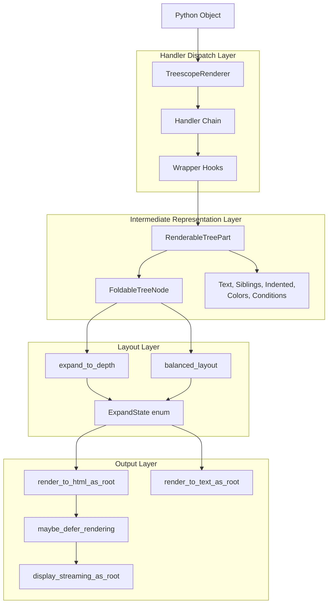
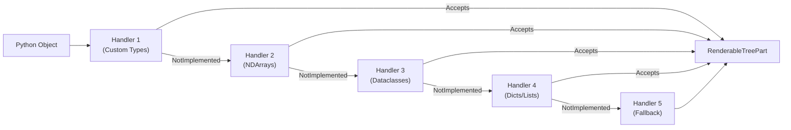
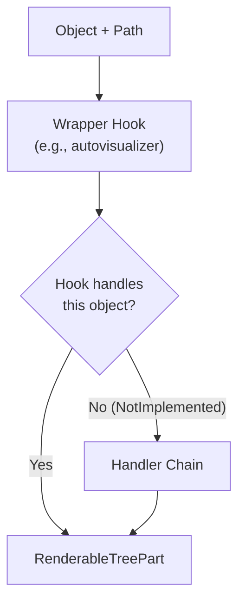
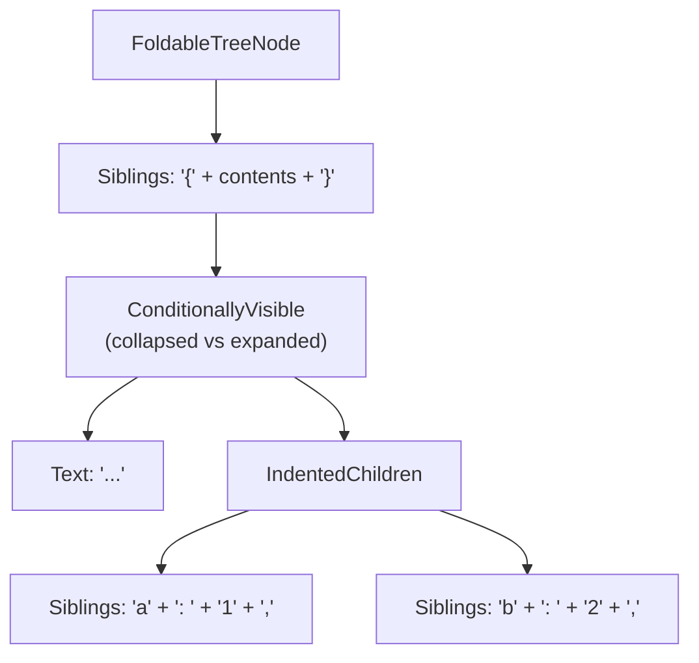
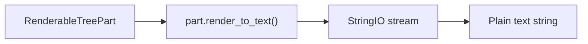
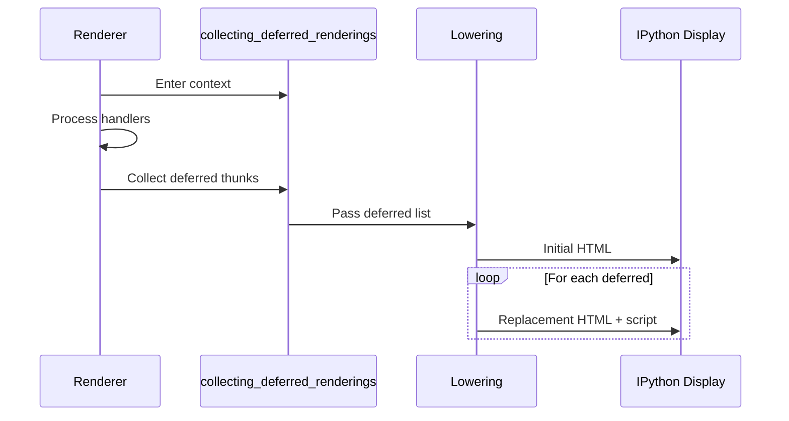
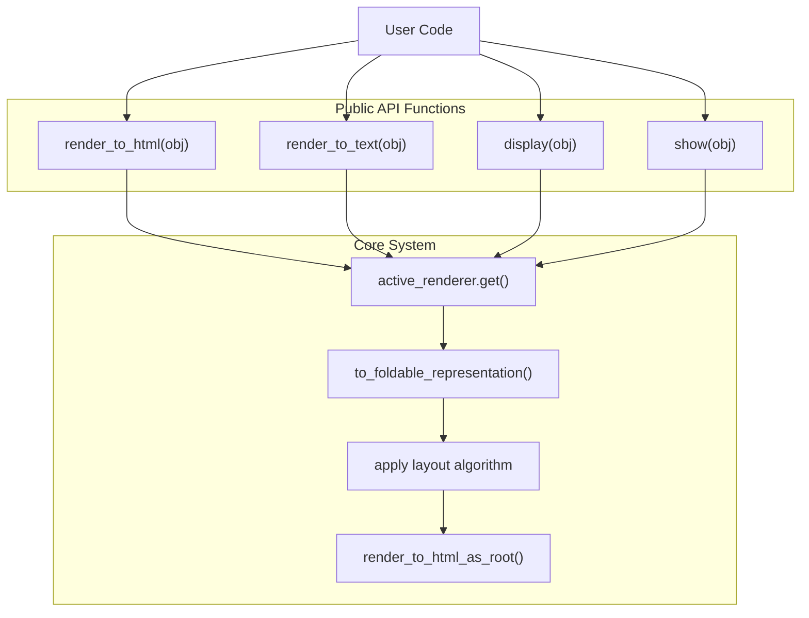

<!-- source: DeepWiki mcp.deepwiki.com · repo google-deepmind/treescope · page 3 Core Rendering System · fetched 2026-10-26 -->

# Core Rendering System

<details>
<summary>Relevant source files</summary>

The following files were used as context for generating this wiki page:

- [tests/renderer_test.py](tests/renderer_test.py)
- [treescope/__init__.py](treescope/__init__.py)
- [treescope/_internal/handlers/autovisualizer_hook.py](treescope/_internal/handlers/autovisualizer_hook.py)
- [treescope/_internal/parts/embedded_iframe.py](treescope/_internal/parts/embedded_iframe.py)
- [treescope/lowering.py](treescope/lowering.py)

</details>


This document describes the fundamental architecture of Treescope's rendering system, which converts Python objects into interactive HTML visualizations or plain text output. This page provides an overview of the major components and their interactions.

For detailed information about specific subsystems:
- For the complete rendering pipeline flow, see [Rendering Pipeline](#3.1)
- For type registry mechanics and handler registration, see [Type System and Registries](#3.2)
- For asynchronous rendering and streaming output, see [Deferred Rendering and Streaming](#3.3)

## Architecture Overview

Treescope's rendering system is organized into four major layers that transform Python objects into output:



**Sources:** [treescope/__init__.py:67-88](), [treescope/lowering.py:1-505](), [Diagram 1 and Diagram 2 from high-level architecture]

## Core Components

### TreescopeRenderer

The `TreescopeRenderer` class is the central orchestrator of the rendering process. It maintains a chain of handlers and wrapper hooks that process objects.

| Method | Purpose |
|--------|---------|
| `to_foldable_representation` | Converts object to intermediate representation |
| `to_html` | Renders object to HTML string |
| `to_text` | Renders object to plain text string |
| `extended_with` | Creates new renderer with additional handlers/hooks |

The active renderer is stored in the `active_renderer` contextual value and can be customized globally or temporarily scoped.

**Sources:** [treescope/__init__.py:124-138](), [tests/renderer_test.py:66-79]()

### Handler Chain

Handlers are functions that examine an object and either render it or return `NotImplemented` to pass control to the next handler. The handler chain is evaluated in order until a handler accepts responsibility for the object.



Handlers receive three arguments:
- `node`: The object to render
- `path`: String representation of the object's path in the tree (e.g., `"[0].foo"`)
- `subtree_renderer`: Function to recursively render child objects

**Sources:** [tests/renderer_test.py:88-122](), [Diagram 2 from high-level architecture]

### Wrapper Hooks

Wrapper hooks execute around the handler chain and can intercept, modify, or replace the rendering. The primary wrapper hook is the autovisualizer hook ([treescope/_internal/handlers/autovisualizer_hook.py:33-200]()), which allows custom visualizations to be injected for specific nodes.



**Sources:** [treescope/_internal/handlers/autovisualizer_hook.py:33-200](), [tests/renderer_test.py:94-121]()

## Intermediate Representation

The rendering system uses an intermediate representation (IR) based on the `RenderableTreePart` interface. This IR is independent of the output format and can be lowered to either HTML or text.

### RenderableTreePart Types

| Part Type | Purpose | Example Use |
|-----------|---------|-------------|
| `Text` | Atomic text content | Variable names, literals |
| `Siblings` | Horizontal composition | `foo` + `,` + ` ` + `bar` |
| `IndentedChildren` | Vertical composition with indentation | List items, dict entries |
| `FoldableTreeNode` | Collapsible nodes | Dicts, lists, objects |
| `Styled` | Applies colors/formatting | Syntax highlighting |
| `ConditionallyColored` | Changes based on mode | Roundtrip mode differences |
| `EmbeddedIFrame` | External HTML content | Rich visualizations |

**Sources:** [treescope/rendering_parts.py (referenced throughout codebase)]

### Example IR Structure

For a simple dict `{"a": 1, "b": 2}`:



**Sources:** [tests/renderer_test.py:204-215](), [Diagram 2 from high-level architecture]

## Layout Algorithms

After handlers produce the IR, layout algorithms determine which foldable nodes should be expanded or collapsed by default. Two main strategies exist:

### expand_to_depth

The `expand_to_depth` function expands all `FoldableTreeNode` instances up to a specified depth. Depth 0 collapses everything, depth 1 expands the root, etc.

```python
# Usage pattern
rendering = renderer.to_foldable_representation(obj)
layout_algorithms.expand_to_depth(rendering.renderable, depth=2)
```

### balanced_layout

The `balanced_layout` strategy attempts to maximize information displayed within a target line count by selectively expanding nodes that fit within the budget.

**Sources:** [tests/renderer_test.py:105-106](), [tests/renderer_test.py:986-1016]()

## Lowering to Output Formats

The lowering layer converts the IR to final output formats. The main entry points are defined in [treescope/lowering.py:1-505]().

### Text Output

`render_to_text_as_root` converts the IR to plain text by calling `render_to_text` on each part:



Parameters control abbreviation thresholds and roundtrip mode behavior.

**Sources:** [treescope/lowering.py:146-199]()

### HTML Output

`render_to_html_as_root` produces interactive HTML with several features:

1. **CSS Setup**: Collects and injects CSS rules from all parts
2. **JavaScript Setup**: Collects and injects JavaScript definitions
3. **HTML Generation**: Calls `render_to_html` on each part
4. **Encapsulation**: Wraps output in a shadow DOM for isolation

The HTML rendering process is more complex due to:
- Dynamic CSS and JS collection
- Deferred rendering support
- Interactive features (collapse/expand, copy buttons)

**Sources:** [treescope/lowering.py:440-460]()

### Streaming Output

For expensive renderings, the system supports streaming output where initial structure is displayed immediately and deferred parts are filled in asynchronously:



**Sources:** [treescope/lowering.py:46-111](), [treescope/lowering.py:463-505]()

## Roundtrip Mode

Treescope supports a "roundtrip mode" where output aims to be valid Python code that recreates the object. The IR includes conditional parts that render differently in roundtrip vs normal mode:

- Canonical aliases are used (e.g., `treescope.render_to_text` instead of `render_to_text`)
- Custom visualizations are hidden
- Different abbreviation thresholds apply

This is controlled by the `roundtrip` parameter in lowering functions and the `roundtrip_mode` flag in render context.

**Sources:** [treescope/__init__.py:171-184](), [treescope/lowering.py:173-180](), [tests/renderer_test.py:191-230]()

## Error Handling

The rendering system includes error recovery mechanisms to prevent failures in custom handlers from breaking the entire visualization:

1. **Handler Exceptions**: When a handler raises an exception, the system can optionally catch it and use a fallback `repr` rendering
2. **Deferred Exceptions**: Exceptions during deferred rendering are caught and displayed as error markers in the output
3. **Warning Messages**: Non-fatal errors emit warnings with traceback information

The `ignore_exceptions` parameter controls this behavior in `to_foldable_representation` and related functions.

**Sources:** [tests/renderer_test.py:87-153](), [tests/renderer_test.py:1174-1208]()

## Configuration System

The rendering system reads configuration from contextual values that can be set globally or temporarily:

| Contextual Value | Purpose |
|------------------|---------|
| `active_renderer` | The renderer instance to use |
| `active_expansion_strategy` | Default layout algorithm |
| `abbreviation_threshold` | Depth limit for collapsing |
| `roundtrip_abbreviation_threshold` | Depth limit in roundtrip mode |

These are accessed via the `ContextualValue` pattern, which supports both global settings and scoped overrides.

**Sources:** [treescope/__init__.py:124-184](), [Diagram 5 from high-level architecture]

## High-Level API Entry Points

The public API provides several convenience functions that wrap the core rendering system:



These functions automatically:
- Retrieve the active renderer
- Convert objects to IR
- Apply the active expansion strategy
- Lower to the appropriate output format

**Sources:** [treescope/__init__.py:76-88](), [tests/renderer_test.py:80-85]()

---

