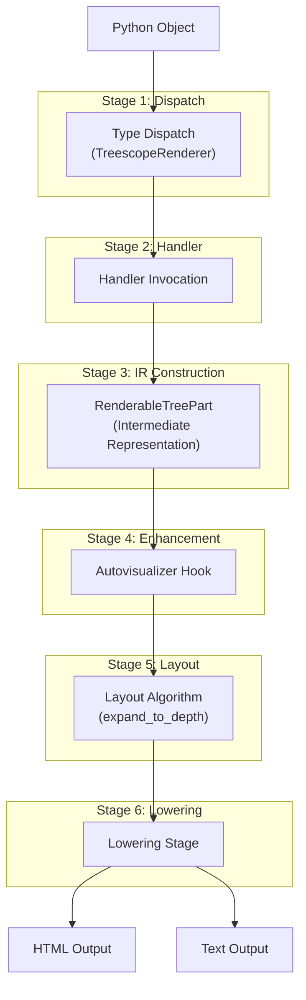
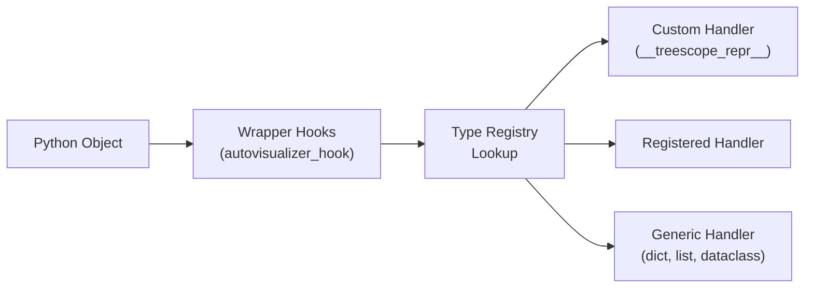
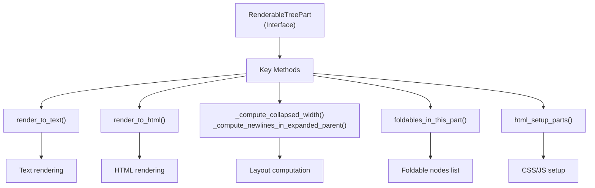
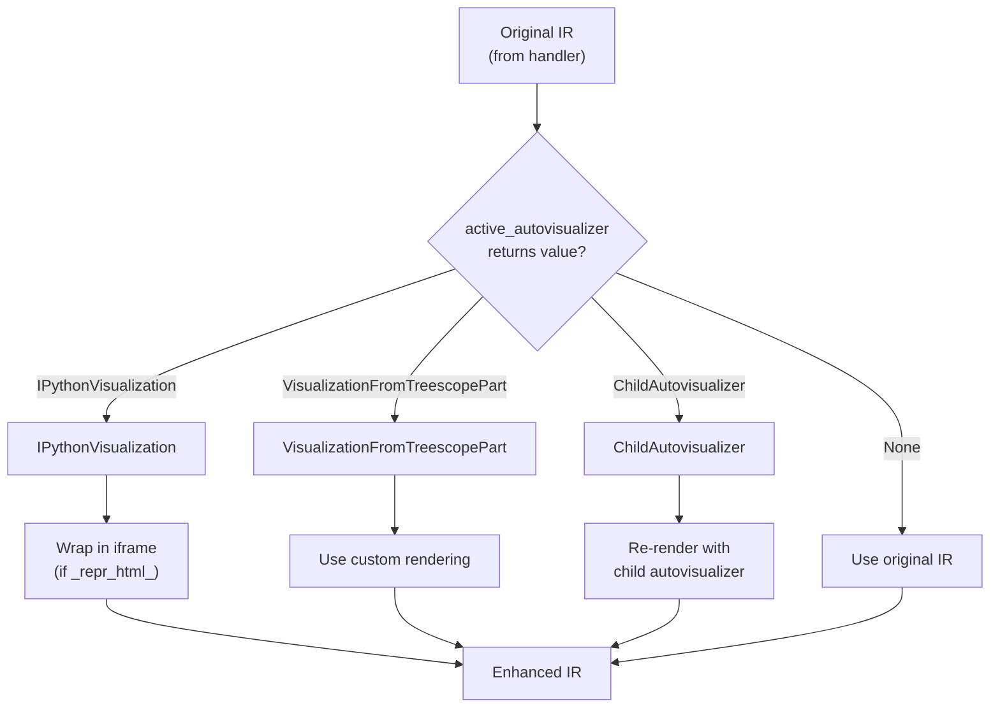
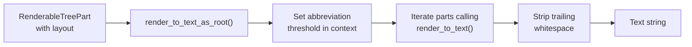
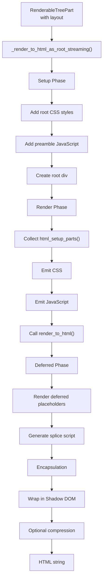
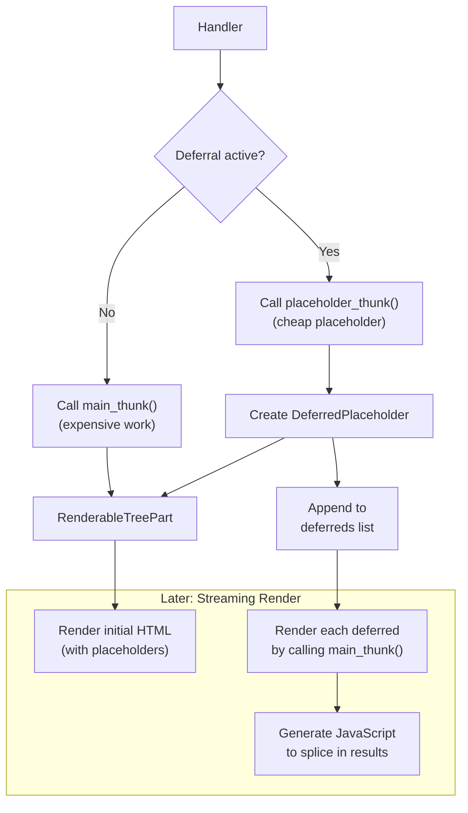
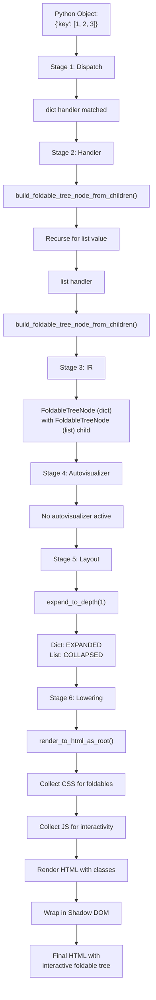

<!-- source: DeepWiki mcp.deepwiki.com · repo google-deepmind/treescope · page 3.1 Rendering Pipeline · fetched 2026-10-26 -->

# Rendering Pipeline

<details>
<summary>Relevant source files</summary>

The following files were used as context for generating this wiki page:

- [tests/renderer_test.py](tests/renderer_test.py)
- [treescope/_internal/handlers/autovisualizer_hook.py](treescope/_internal/handlers/autovisualizer_hook.py)
- [treescope/_internal/parts/embedded_iframe.py](treescope/_internal/parts/embedded_iframe.py)
- [treescope/lowering.py](treescope/lowering.py)

</details>


## Purpose and Scope

This page describes the complete rendering pipeline that transforms Python objects into interactive HTML visualizations or plain text output. The pipeline consists of five main stages: type dispatch, handler invocation, intermediate representation construction, autovisualizer enhancement, layout computation, and lowering to the final output format.

For information about the type registry system that powers the dispatch stage, see [Type System and Registries](#3.2). For details on deferred rendering and streaming output, see [Deferred Rendering and Streaming](#3.3).

## Pipeline Overview

The rendering pipeline transforms Python objects through a series of well-defined stages:



**Sources:** [treescope/lowering.py:1-505](), [tests/renderer_test.py:59-154]()

## Stage 1: Type Dispatch and Renderer Interface

The entry point to the rendering pipeline is the `TreescopeRenderer` interface, which provides three main methods:

| Method | Return Type | Purpose |
|--------|-------------|---------|
| `to_foldable_representation()` | `RenderableAndLineAnnotations` | Produces intermediate representation with layout state |
| `to_html()` | `str` | Renders directly to HTML string |
| `to_text()` | `str` | Renders directly to text string |

The renderer maintains a chain of handlers and wrapper hooks that are invoked in sequence to process objects. When an object is passed to the renderer, it:

1. Iterates through registered wrapper hooks (e.g., the autovisualizer hook)
2. Dispatches to the appropriate handler based on type matching
3. Falls back to generic handlers if no specific handler matches



**Sources:** [tests/renderer_test.py:66-78](), [tests/renderer_test.py:88-102]()

## Stage 2: Handler Invocation and IR Construction

Handlers are functions with the signature:

```
handler(node: Any, path: str | None, subtree_renderer: TreescopeSubtreeRenderer) 
    -> RenderableTreePart | RenderableAndLineAnnotations | NotImplemented
```

Each handler examines the node and either:
- Returns `NotImplemented` to pass control to the next handler
- Returns a `RenderableTreePart` (the intermediate representation)
- Returns a `RenderableAndLineAnnotations` (IR plus annotations)

Handlers construct the intermediate representation using functions from the `rendering_parts` module. Common IR construction patterns include:

| Pattern | Functions Used | Purpose |
|---------|---------------|---------|
| One-line objects | `build_one_line_tree_node()` | Simple values like strings, numbers |
| Collection types | `build_foldable_tree_node_from_children()` | Lists, dicts, tuples |
| Custom structures | `build_custom_foldable_tree_node()` | Complex objects with custom rendering |
| Arrays | Array visualization subsystem | NDArrays with interactive canvas |

**Sources:** [tests/renderer_test.py:155-519]()

## Stage 3: Intermediate Representation (RenderableTreePart)

The `RenderableTreePart` interface is the core abstraction of Treescope's intermediate representation. All parts of the rendered tree implement this interface, which defines:



Key IR part types include:

| Part Type | Purpose | Module |
|-----------|---------|--------|
| `Text` | Literal text content | `rendering_parts` |
| `OneLine` | Single-line content | `rendering_parts` |
| `Siblings` | Multiple parts in sequence | `rendering_parts` |
| `IndentedChildren` | Indented child content | `rendering_parts` |
| `FoldableTreeNode` | Expandable/collapsible nodes | `foldable_impl` |
| `EmbeddedIFrame` | External HTML content | `embedded_iframe` |
| `DeferredPlaceholder` | Placeholder for deferred content | `foldable_impl` |

**Sources:** [treescope/_internal/parts/embedded_iframe.py:33-150](), [tests/renderer_test.py:104-110]()

## Stage 4: Autovisualizer Hook

After handlers construct the initial IR, the autovisualizer hook has an opportunity to enhance or replace parts of the tree. The hook is implemented as a wrapper hook in the handler chain.



The autovisualizer can:
- Return `None` to leave the node unchanged
- Return `IPythonVisualization` to embed rich HTML content (e.g., plots)
- Return `VisualizationFromTreescopePart` to provide custom Treescope rendering
- Return `ChildAutovisualizer` to recursively render with a different autovisualizer

**Sources:** [treescope/_internal/handlers/autovisualizer_hook.py:33-200]()

## Stage 5: Layout Algorithm

After the complete IR tree is constructed, the layout algorithm determines which nodes should be expanded or collapsed. The primary function is `expand_to_depth()` from the `layout_algorithms` module.

Layout computation uses information from the IR:
- `_compute_collapsed_width()`: Width of node when collapsed
- `_compute_newlines_in_expanded_parent()`: Additional height when expanded
- `foldables_in_this_part()`: List of all foldable nodes

The algorithm traverses the tree and sets the `ExpandState` of each `FoldableTreeNode` to either:
- `EXPANDED`: Node is expanded, children visible
- `COLLAPSED`: Node is collapsed, children hidden
- `WEAKLY_EXPANDED`: Node expanded, but children may be collapsed

**Sources:** [tests/renderer_test.py:105-110](), [tests/renderer_test.py:986-1016]()

## Stage 6: Lowering to Output Format

The final stage converts the IR with layout decisions into either HTML or text output. This is handled by functions in the `lowering` module.

### Text Rendering



The text rendering process:
1. Sets up render context with abbreviation thresholds
2. Calls `render_to_text()` on root node, which recursively calls children
3. Each part writes to a `StringIO` stream
4. Strips trailing whitespace and empty lines
5. Returns final text string

**Sources:** [treescope/lowering.py:146-199]()

### HTML Rendering



The HTML rendering process:
1. **Setup**: Adds root CSS and JavaScript definitions
2. **Main render**: Traverses IR tree, collecting CSS/JS from `html_setup_parts()` and calling `render_to_html()`
3. **Deferred render**: If there are deferred parts, renders them and generates JavaScript to splice them in
4. **Encapsulation**: Wraps everything in Shadow DOM for style isolation
5. Returns complete HTML string

**Sources:** [treescope/lowering.py:236-437](), [treescope/lowering.py:440-460]()

## Deferred Rendering

Treescope supports deferred rendering for expensive operations (like array visualization). The mechanism uses:

1. **`maybe_defer_rendering()`**: Called by handlers to optionally defer work
2. **`collecting_deferred_renderings()`**: Context manager that enables deferral
3. **`DeferredPlaceholder`**: IR node that reserves space for deferred content
4. **`display_streaming_as_root()`**: IPython function that renders in multiple updates



The deferred rendering flow:
1. Handler calls `maybe_defer_rendering()` with `main_thunk` (expensive) and `placeholder_thunk` (cheap)
2. If deferral is active, placeholder is rendered immediately and deferred object is queued
3. Layout algorithm runs on placeholders to determine expansion
4. `display_streaming_as_root()` renders initial HTML with placeholders
5. Each deferred main_thunk is called (with final layout decision if requested)
6. JavaScript splices the final content into the DOM

**Sources:** [treescope/lowering.py:46-110](), [treescope/lowering.py:113-138](), [treescope/lowering.py:358-437](), [treescope/lowering.py:463-505](), [tests/renderer_test.py:1174-1208]()

## Complete Pipeline Example

Here's how an object flows through the complete pipeline:



**Sources:** [tests/renderer_test.py:66-122](), [tests/renderer_test.py:946-1020]()

## Key Code Entities

| Entity | Location | Role |
|--------|----------|------|
| `TreescopeRenderer` | `treescope/renderer.py` | Main renderer with handler chain |
| `to_foldable_representation()` | `TreescopeRenderer` | Produces IR from object |
| `RenderableTreePart` | `rendering_parts` | Base interface for IR |
| `FoldableTreeNode` | `foldable_impl` | Expandable/collapsible IR nodes |
| `use_autovisualizer_if_present()` | `autovisualizer_hook.py` | Wrapper hook for autovisualizers |
| `expand_to_depth()` | `layout_algorithms` | Sets expansion state on nodes |
| `render_to_text_as_root()` | `lowering.py` | Lowers IR to text |
| `render_to_html_as_root()` | `lowering.py` | Lowers IR to HTML |
| `maybe_defer_rendering()` | `lowering.py` | Optionally defers expensive work |
| `collecting_deferred_renderings()` | `lowering.py` | Context manager for deferral |
| `display_streaming_as_root()` | `lowering.py` | Streaming display for IPython |

**Sources:** [treescope/lowering.py:1-505](), [treescope/_internal/handlers/autovisualizer_hook.py:1-201](), [tests/renderer_test.py:1-2800]()

---

