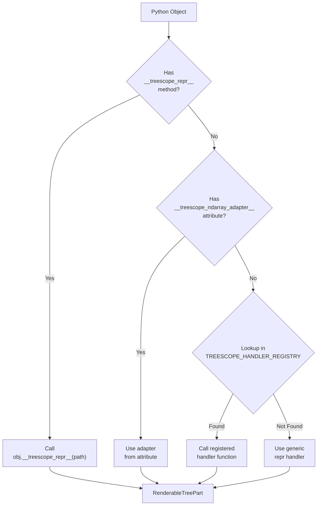
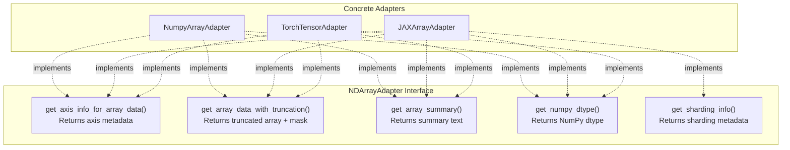
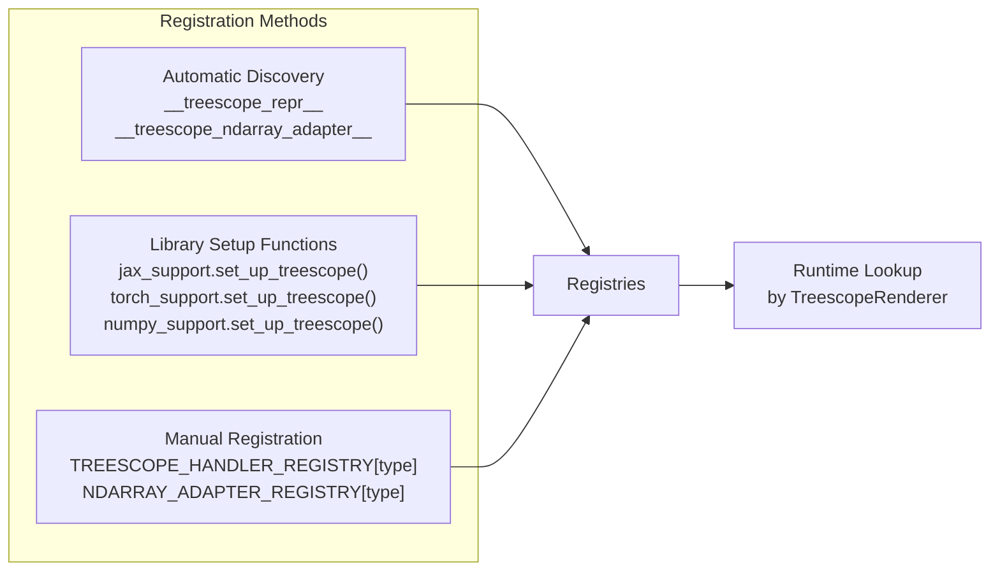
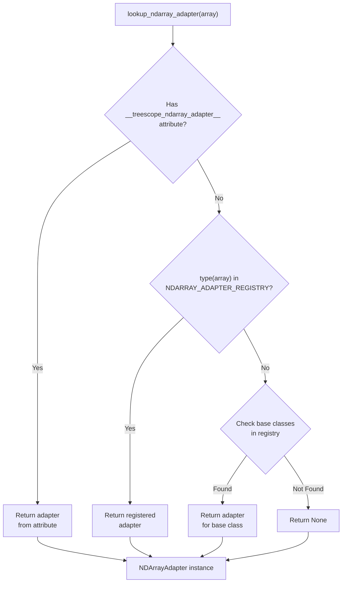

<!-- source: DeepWiki mcp.deepwiki.com · repo google-deepmind/treescope · page 3.2 Type System and Registries · fetched 2026-10-26 -->

# Type System and Registries

<details>
<summary>Relevant source files</summary>

The following files were used as context for generating this wiki page:

- [tests/__init__.py](tests/__init__.py)
- [tests/ndarray_adapters_test.py](tests/ndarray_adapters_test.py)
- [tests/renderer_test.py](tests/renderer_test.py)
- [treescope/__init__.py](treescope/__init__.py)
- [treescope/_internal/handlers/generic_repr_handler.py](treescope/_internal/handlers/generic_repr_handler.py)
- [treescope/external/numpy_support.py](treescope/external/numpy_support.py)

</details>


## Purpose and Scope

This document explains Treescope's registry-based type system that enables extensible rendering. The registries map Python types to custom rendering logic (handlers) and array-specific operations (adapters), allowing Treescope to support diverse ecosystems (JAX, PyTorch, NumPy, Pydantic, etc.) without tight coupling.

For information about the overall rendering pipeline, see [Rendering Pipeline](#3.1). For details about creating custom handlers for your own types, see [Custom Type Handlers](#8.1).

## Registry Overview

Treescope maintains five primary registries that control how objects are rendered:

| Registry | Type | Purpose |
|----------|------|---------|
| `TREESCOPE_HANDLER_REGISTRY` | `dict[type, HandlerFunction]` | Maps types to rendering handler functions |
| `NDARRAY_ADAPTER_REGISTRY` | `dict[type, NDArrayAdapter]` | Maps array types to adapter instances that provide array-specific operations |
| `IMMUTABLE_TYPES_REGISTRY` | `set[type]` | Marks types as immutable for safe caching |
| `VIRTUAL_BASE_CLASSES` | List of type predicates | Extends type hierarchy for registration |
| `canonical_aliases` | Module | Maps types/functions to canonical import paths |

**Sources:** [treescope/__init__.py:50](), [treescope/external/numpy_support.py:322-326]()

## Type-to-Handler Dispatch



**Handler Dispatch Process**

The renderer dispatches objects to handlers using the following priority:

1. **Method-based discovery**: If the object has a `__treescope_repr__` method, call it directly
2. **Attribute-based adapter**: If the object has a `__treescope_ndarray_adapter__` attribute, use that adapter
3. **Registry lookup**: Search `TREESCOPE_HANDLER_REGISTRY` for the object's type (including base classes)
4. **Fallback**: Use the generic `repr`-based handler

**Sources:** [tests/renderer_test.py:88-122](), Diagram 4 from high-level architecture

## Handler Function Interface

Handler functions must conform to this signature:

```python
def handler(
    node: Any,
    path: str | None,
    subtree_renderer: TreescopeSubtreeRenderer,
) -> RenderableTreePart | RenderableAndLineAnnotations | type(NotImplemented)
```

### Handler Parameters

| Parameter | Type | Description |
|-----------|------|-------------|
| `node` | `Any` | The object to render |
| `path` | `str \| None` | The keypath to this object (e.g., `"[0].foo"`) |
| `subtree_renderer` | `TreescopeSubtreeRenderer` | Function to recursively render child objects |

### Handler Return Values

Handlers must return one of:

- `RenderableTreePart`: The rendered representation of the object
- `RenderableAndLineAnnotations`: Renderable plus annotations (e.g., copy buttons)
- `NotImplemented`: Signal that this handler cannot handle this type

**Example Handler** (from NumPy support):

[treescope/external/numpy_support.py:215-283]() shows the `render_ndarrays` handler:
- Takes `node`, `path`, `subtree_renderer`
- Creates an `NumpyArrayAdapter` instance
- Returns `RenderableAndLineAnnotations` with deferred rendering

**Sources:** [treescope/external/numpy_support.py:215-223](), [treescope/_internal/handlers/generic_repr_handler.py:25-33]()

## NDArray Adapter Interface

The `NDArrayAdapter` interface abstracts different array types (NumPy, JAX, PyTorch) for visualization:



### Key Adapter Methods

**`get_axis_info_for_array_data(array) -> tuple[AxisInfo, ...]`**

Returns metadata about each axis. Can return:
- `PositionalAxisInfo(index, size)` - unnamed axis
- `NamedPositionalAxisInfo(index, name, size)` - named axis (e.g., PyTorch named tensors)

[treescope/external/numpy_support.py:90-96]() shows NumPy implementation returning `PositionalAxisInfo` tuples.

**`get_array_data_with_truncation(array, mask, edge_items_per_axis) -> tuple[array, mask]`**

Returns a truncated view of the array with corresponding mask. Truncation keeps `edge_items` elements from start and end of each axis.

[treescope/external/numpy_support.py:98-133]() implements the truncation logic recursively.

**`get_array_summary(array, fast) -> RenderableTreePart`**

Returns a summary line showing dtype, shape, and statistics. The `fast` parameter controls whether to compute statistics.

[treescope/external/numpy_support.py:135-209]() computes mean, std, min, max, zero counts, etc.

**Sources:** [treescope/external/numpy_support.py:87-213](), [tests/ndarray_adapters_test.py:42-155]()

## Registration Mechanisms



### 1. Automatic Discovery

Types can implement special methods/attributes for automatic detection:

**`__treescope_repr__(path: str | None) -> RenderableTreePart`**

Implement this method to provide custom rendering without explicit registration.

**`__treescope_ndarray_adapter__: NDArrayAdapter`**

Set this class attribute to provide an adapter for custom array types.

**Sources:** Diagram 4 from high-level architecture

### 2. Library Setup Functions

External library support modules provide `set_up_treescope()` functions that register handlers and adapters:

[treescope/external/numpy_support.py:322-342]() shows NumPy's setup:
```python
def set_up_treescope():
  """Sets up treescope to render Numpy objects."""
  type_registries.NDARRAY_ADAPTER_REGISTRY[np.ndarray] = NumpyArrayAdapter()
  type_registries.TREESCOPE_HANDLER_REGISTRY[np.ndarray] = render_ndarrays
  type_registries.TREESCOPE_HANDLER_REGISTRY[np.dtype] = render_dtype_instances
  canonical_aliases.populate_from_public_api(np, ...)
```

This pattern is used by:
- `jax_support.set_up_treescope()`
- `torch_support.set_up_treescope()` 
- `numpy_support.set_up_treescope()`
- `pydantic_support.set_up_treescope()`
- `omegaconf_support.set_up_treescope()`

**Sources:** [treescope/external/numpy_support.py:322-342]()

### 3. Manual Registration

Users can directly register handlers and adapters:

```python
# Register a handler
type_registries.TREESCOPE_HANDLER_REGISTRY[MyCustomType] = my_handler_function

# Register an adapter
type_registries.NDARRAY_ADAPTER_REGISTRY[MyArrayType] = MyArrayAdapter()
```

**Sources:** [treescope/external/numpy_support.py:324-326]()

## Registry Lookup Process



**Handler Lookup**

The `TREESCOPE_HANDLER_REGISTRY` lookup follows similar logic:
1. Check exact type match
2. Check base classes (walking up the MRO)
3. Check virtual base classes from `VIRTUAL_BASE_CLASSES`
4. Return `None` if no match

**Adapter Lookup**

The `lookup_ndarray_adapter()` function:
1. Checks for `__treescope_ndarray_adapter__` attribute
2. Looks up exact type in `NDARRAY_ADAPTER_REGISTRY`
3. Walks base classes to find a registered adapter
4. Returns `None` if no adapter found

[tests/ndarray_adapters_test.py:62-66]() demonstrates adapter lookup:
```python
np_adapter = type_registries.lookup_ndarray_adapter(array_np)
self.assertIsNotNone(np_adapter)

cur_adapter = type_registries.lookup_ndarray_adapter(array)
self.assertIsNotNone(cur_adapter)
```

**Sources:** [tests/ndarray_adapters_test.py:62-66](), [tests/ndarray_adapters_test.py:169-177]()

## Handler Execution and Error Recovery

When a handler is invoked, the renderer provides error recovery:

[tests/renderer_test.py:87-153]() shows error handling behavior:
- Handlers that raise exceptions can be caught with `ignore_exceptions=True`
- Warnings are emitted for ignored exceptions
- Fallback rendering uses `repr()` when custom handlers fail

This allows robust rendering even when custom handlers are buggy.

**Sources:** [tests/renderer_test.py:87-153]()

## Summary of Registry-Type Relationships

| Type Category | Handler Registry | Adapter Registry | Example Types |
|---------------|------------------|------------------|---------------|
| NumPy arrays | ✓ | ✓ | `np.ndarray` |
| JAX arrays | ✓ | ✓ | `jax.Array`, `ShapeDtypeStruct` |
| PyTorch tensors | ✓ | ✓ | `torch.Tensor`, `torch.nn.Parameter` |
| PyTorch modules | ✓ | ✗ | `torch.nn.Module` |
| Dataclasses | ✓ | ✗ | Any `@dataclass` |
| Pydantic models | ✓ | ✗ | `pydantic.BaseModel` |
| OmegaConf configs | ✓ | ✗ | `DictConfig`, `ListConfig` |
| NumPy dtypes | ✓ | ✗ | `np.dtype` |
| Standard types | ✓ | ✗ | `dict`, `list`, `tuple`, `set` |

**Sources:** [treescope/external/numpy_support.py:322-326](), [tests/renderer_test.py:155-944]()

---

