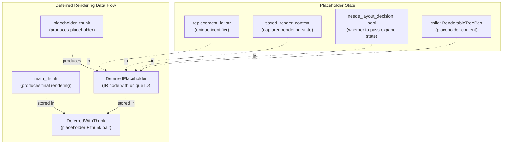
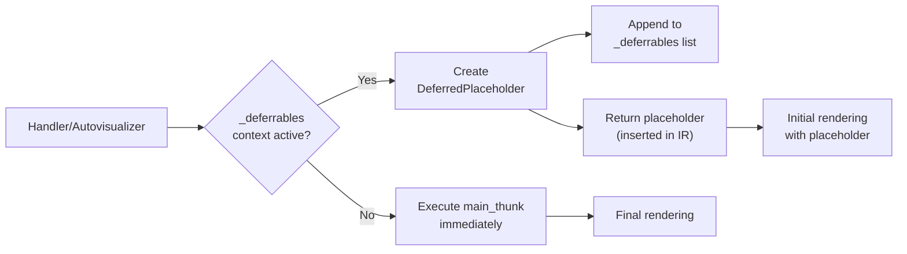
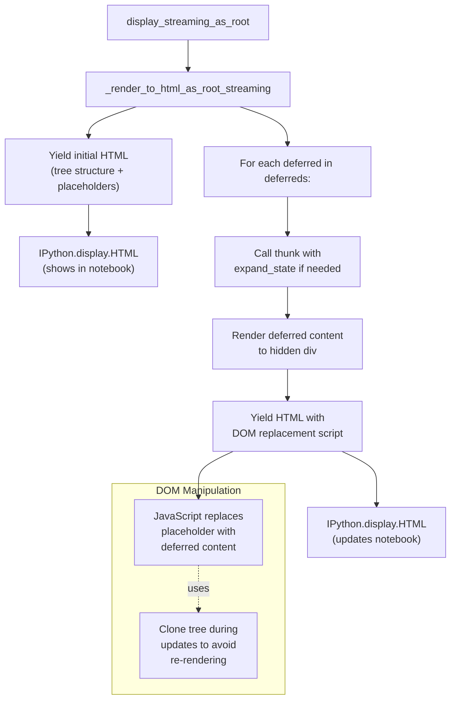
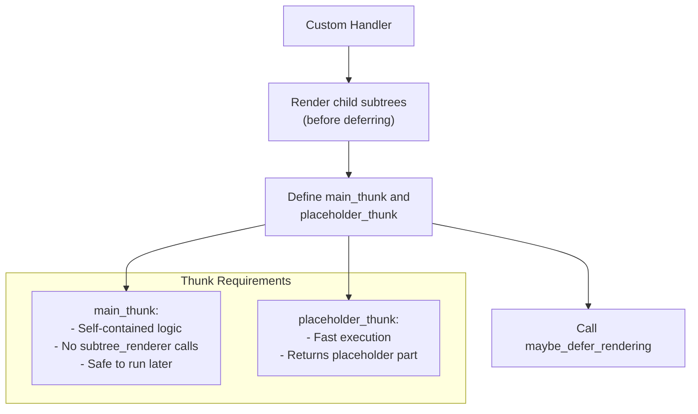
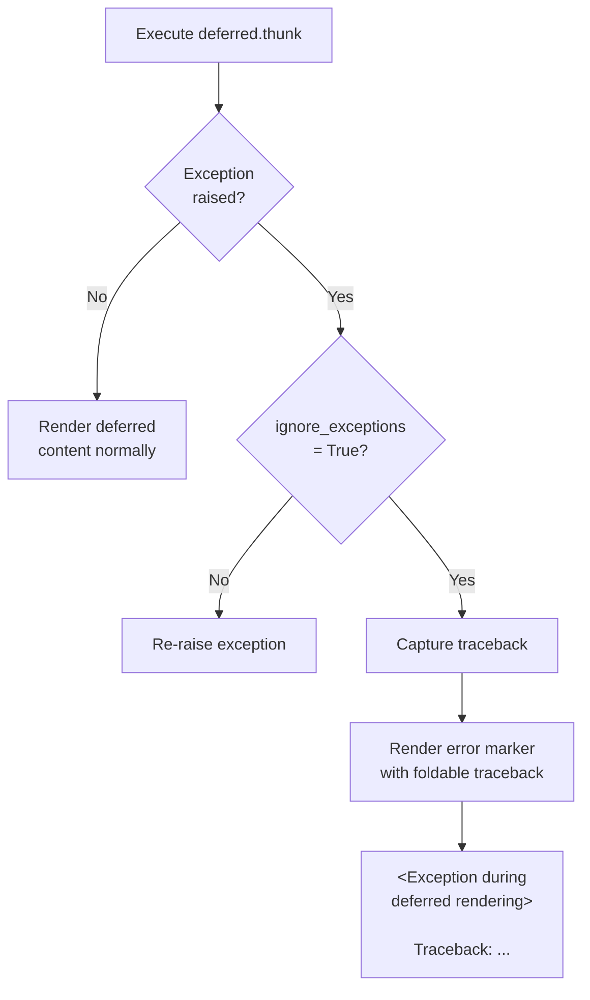
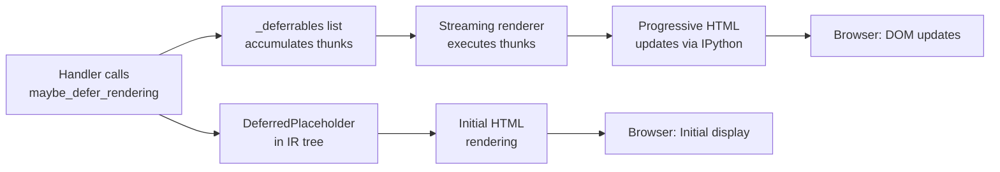

<!-- source: DeepWiki mcp.deepwiki.com · repo google-deepmind/treescope · page 3.3 Deferred Rendering and Streaming · fetched 2026-10-26 -->

# Deferred Rendering and Streaming

<details>
<summary>Relevant source files</summary>

The following files were used as context for generating this wiki page:

- [tests/renderer_test.py](tests/renderer_test.py)
- [treescope/_internal/handlers/autovisualizer_hook.py](treescope/_internal/handlers/autovisualizer_hook.py)
- [treescope/_internal/parts/embedded_iframe.py](treescope/_internal/parts/embedded_iframe.py)
- [treescope/lowering.py](treescope/lowering.py)

</details>


## Purpose and Scope

This document describes Treescope's **deferred rendering** and **streaming output** mechanisms, which allow expensive rendering operations to be postponed and executed asynchronously in interactive environments. Deferred rendering prevents slow computations (such as summarizing large JAX arrays) from blocking the initial display of object structure, while streaming enables progressive updates to be sent to the browser.

For information about the overall rendering pipeline that deferred rendering is part of, see [Rendering Pipeline](#3.1). For details on how layout algorithms determine expand states before deferred rendering occurs, see [Rendering Pipeline](#3.1).

---

## Overview

Treescope's deferred rendering system splits expensive rendering operations into two phases:

1. **Initial rendering**: Quickly displays the object's tree structure with lightweight **placeholders** for expensive nodes
2. **Deferred rendering**: Asynchronously computes and injects the full rendering for expensive nodes after the initial structure is visible

In interactive IPython/Jupyter environments, this provides a responsive user experience where the structure appears immediately, followed by streaming updates as expensive operations complete.

**Key benefits:**
- Users can interact with the tree structure while expensive leaves are still computing
- Browser remains responsive during rendering of large objects
- Layout algorithms can make decisions before expensive rendering completes

Sources: [treescope/lowering.py:46-110](), [treescope/lowering.py:236-437]()

---

## Core Components

### Contextual State

**`_deferrables` Contextual Value** [treescope/lowering.py:38-42]()

A contextual value storing an optional list of `DeferredWithThunk` objects. When `None`, deferred rendering is disabled (non-interactive mode). When set to a list, calls to `maybe_defer_rendering` append to this list instead of executing immediately.

### Key Data Structures



**`DeferredPlaceholder`** - An IR node representing a deferred operation
- `replacement_id`: Unique identifier for DOM replacement
- `child`: The placeholder content (visible initially)
- `needs_layout_decision`: Whether the final rendering needs the inferred expand state
- `saved_render_context`: Captured rendering context for deferred execution

**`DeferredWithThunk`** - Pairs a placeholder with its deferred computation
- `placeholder`: The `DeferredPlaceholder` in the IR tree
- `thunk`: Function to produce the final rendering

**`fake_placeholder_foldable`** [treescope/lowering.py:99-100]()
- Creates a foldable node that participates in layout with estimated height but doesn't actually expand

Sources: [treescope/lowering.py:38-42](), [treescope/lowering.py:90-110]()

---

## Deferred Rendering Workflow

### Phase 1: Deferral



**`maybe_defer_rendering(main_thunk, placeholder_thunk, expanded_newlines_for_layout)`** [treescope/lowering.py:46-110]()

This function determines whether to defer an expensive operation:

1. **Check context**: If `_deferrables.get()` is `None`, execute `main_thunk(None)` immediately
2. **Create placeholder**: If deferring, call `placeholder_thunk()` to get placeholder content
3. **Layout participation** (optional): If `expanded_newlines_for_layout` is provided:
   - Wrap placeholder in a `fake_placeholder_foldable` with estimated height
   - Mark `needs_layout_decision=True` so expand state is passed to `main_thunk`
4. **Generate unique ID**: Create a `replacement_id` using `uuid.uuid4().hex`
5. **Build and register**: Create `DeferredPlaceholder`, append to `_deferrables`, return it

**Example usage pattern:**
```python
def expensive_handler(node, path, subtree_renderer):
    def main_thunk(expand_state):
        # Expensive operation - may be called later
        return render_expensive_content(node)
    
    def placeholder_thunk():
        # Cheap operation - called immediately
        return rendering_parts.text("<computing...>")
    
    return lowering.maybe_defer_rendering(
        main_thunk,
        placeholder_thunk,
        expanded_newlines_for_layout=10  # Estimated height when expanded
    )
```

Sources: [treescope/lowering.py:46-110](), [treescope/_internal/handlers/autovisualizer_hook.py:87-92]()

### Phase 2: Collection

**`collecting_deferred_renderings()`** [treescope/lowering.py:113-138]()

Context manager that enables deferred rendering for a rendering operation:

```python
with lowering.collecting_deferred_renderings() as deferreds:
    foldable_ir = renderer.to_foldable_representation(obj)
    # deferreds now contains all DeferredWithThunk objects
```

This sets `_deferrables` to an empty list, which is populated during rendering and yielded to the caller.

Sources: [treescope/lowering.py:113-138](), [tests/renderer_test.py:1183-1186]()

---

## Streaming HTML Output

### Streaming Process



**`display_streaming_as_root(root_node, deferreds, ...)`** [treescope/lowering.py:463-504]()

Displays a root node in IPython with streaming updates:

1. **Iterate streaming renderer**: Calls `_render_to_html_as_root_streaming`
2. **Display initial structure**: First yield contains tree with placeholders, displayed via `IPython.display.HTML`
3. **Display deferred updates**: Subsequent yields contain DOM replacement scripts, each displayed separately
4. **Return stealer** (optional): If `stealable=True`, returns a final HTML snippet that can relocate the rendering

**`_render_to_html_as_root_streaming(root_node, roundtrip, deferreds, ignore_exceptions)`** [treescope/lowering.py:236-437]()

Generator that produces HTML in chunks:

### Initial Yield

1. **Setup styles/scripts**: Include preamble with `runSoon` queue and CSS
2. **Render root**: Call `_render_one(root_node, ...)` to render initial tree with placeholders
3. **Yield HTML**: Return complete initial HTML structure

### Deferred Yields

For each `deferred` in `deferreds`:

1. **Retrieve context**: Get `saved_at_beginning_of_line` and `saved_render_context` from placeholder
2. **Execute thunk**: Call `deferred.thunk(layout_decision)` where `layout_decision` is:
   - The inferred `expand_state` if `needs_layout_decision=True`
   - `None` otherwise
3. **Render to hidden div**: Render result to `<div id="for_{replacement_id}">`
4. **Generate swap script**: Create JavaScript that:
   - Clones the root tree (to prevent re-rendering during edits)
   - Replaces each placeholder span with corresponding deferred content from hidden div
   - Swaps the clone back with the edited original
5. **Yield update**: Return HTML with hidden divs and replacement script

### DOM Replacement Strategy

[treescope/lowering.py:415-437]()

The replacement uses a clone-edit-swap strategy to maintain performance:

```javascript
// Clone tree to avoid repeated re-renders
const treerootClone = treeroot.cloneNode(true);
treeroot.replaceWith(treerootClone);

// Edit original tree in document fragment
for each placeholder_id:
    target = find placeholder by id
    sourceDiv = find hidden div by id
    target.replaceWith(sourceDiv.firstElementChild)

// Swap edited tree back
treerootClone.replaceWith(treeroot);
```

This preserves node identity (important for event listeners) while avoiding expensive DOM re-rendering.

Sources: [treescope/lowering.py:236-437](), [treescope/lowering.py:463-504]()

---

## Layout Participation

Deferred nodes can participate in layout algorithm decisions by providing an estimated height when expanded.

### Mechanism

When `expanded_newlines_for_layout` is provided to `maybe_defer_rendering`:

1. **Create fake foldable**: `fake_placeholder_foldable(placeholder_thunk(), extra_newlines_guess=expanded_newlines_for_layout)` [treescope/lowering.py:99-100]()
2. **Layout runs**: Layout algorithm treats this as a foldable with the estimated height
3. **Capture decision**: After layout, the placeholder's `get_expand_state()` reflects the final decision
4. **Pass to thunk**: When deferred rendering executes, `main_thunk(expand_state)` receives this decision

### Example: JAX Array Handler

A handler for large arrays might:

```python
def render_jax_array(array):
    def main_thunk(expand_state):
        if expand_state == ExpandState.EXPANDED:
            return render_full_array(array)
        else:
            return render_summary(array)
    
    def placeholder_thunk():
        return rendering_parts.text(f"<Array {array.shape}>")
    
    return lowering.maybe_defer_rendering(
        main_thunk,
        placeholder_thunk,
        expanded_newlines_for_layout=array.shape[0] + 2  # Estimate
    )
```

This allows the layout algorithm to decide whether to expand the array based on available space, even though the full rendering hasn't been computed yet.

Sources: [treescope/lowering.py:94-101](), [treescope/lowering.py:374-379]()

---

## Using Deferred Rendering in Handlers

### Handler Integration Pattern

Handlers and autovisualizers can use deferred rendering for expensive operations:



### Best Practices

**Render subtrees before deferring**: Don't call `subtree_renderer` inside `main_thunk`, as context managers may have been exited.

```python
# ✓ Good: Render children before deferring
def handler(node, path, subtree_renderer):
    children = [subtree_renderer(child, f"{path}[{i}]") 
                for i, child in enumerate(node.children)]
    
    def main_thunk(expand_state):
        return expensive_layout(children)  # Uses pre-rendered children
    
    return lowering.maybe_defer_rendering(main_thunk, placeholder_thunk)

# ✗ Bad: Subtree rendering inside main_thunk
def bad_handler(node, path, subtree_renderer):
    def main_thunk(expand_state):
        children = [subtree_renderer(child, f"{path}[{i}]") 
                    for i, child in enumerate(node.children)]  # Context lost!
        return expensive_layout(children)
    
    return lowering.maybe_defer_rendering(main_thunk, placeholder_thunk)
```

**Control all logic in main_thunk**: The handler should control the entire deferred computation rather than delegating to external code that might have assumptions about context.

**Provide layout estimates when possible**: If the deferred content's height is predictable, provide `expanded_newlines_for_layout` so the layout algorithm can make informed decisions.

### Autovisualizer Example

[treescope/_internal/handlers/autovisualizer_hook.py:70-92]()

The autovisualizer hook defers rendering of rich HTML visualizations:

```python
def _thunk(_):
    html_rendering = object_inspection.to_html(display_obj)
    if html_rendering:
        return rendering_parts.embedded_iframe(
            embedded_html=html_rendering,
            fallback_in_text_mode=rendering_parts.text("<rich HTML>")
        )
    else:
        return rendering_parts.error_color(...)

ipy_rendering = lowering.maybe_defer_rendering(
    _thunk,
    lambda: rendering_parts.text("<rich HTML visualization loading...>")
)
```

This defers the potentially expensive conversion of display objects to HTML.

Sources: [treescope/lowering.py:46-110](), [treescope/_internal/handlers/autovisualizer_hook.py:70-92]()

---

## Error Handling

### Exception Recovery in Deferred Rendering

Deferred rendering operations may fail after the initial structure is displayed. The `ignore_exceptions` parameter enables graceful degradation:



**`_render_to_html_as_root_streaming` exception handling** [treescope/lowering.py:380-399]()

When rendering deferred content:

```python
try:
    replacement_part = deferred.thunk(layout_decision)
except Exception as e:
    if not ignore_exceptions:
        raise
    exc_child = rendering_parts.fold_condition(
        expanded=rendering_parts.indented_children(
            [rendering_parts.text(traceback.format_exc())]
        )
    )
    replacement_part = rendering_parts.error_color(
        rendering_parts.build_custom_foldable_tree_node(
            label=rendering_parts.text(
                f"<{type(e).__name__} during deferred rendering"
            ),
            contents=rendering_parts.siblings(exc_child, rendering_parts.text(">")),
        ).renderable
    )
```

This creates a foldable error node showing:
- Exception type in error color
- Full traceback when expanded

**Test coverage**: [tests/renderer_test.py:1174-1208]() demonstrates error handling with a custom handler that throws during deferred rendering.

Sources: [treescope/lowering.py:380-399](), [tests/renderer_test.py:1174-1208]()

---

## Static vs Streaming Rendering

### Mode Comparison

| Aspect | `render_to_html_as_root` | `display_streaming_as_root` |
|--------|--------------------------|----------------------------|
| **Deferred rendering** | Not supported | Supported via `deferreds` parameter |
| **Output** | Single HTML string | Iterator of HTML chunks via IPython.display |
| **Use case** | Static HTML export, non-interactive | Interactive IPython/Jupyter notebooks |
| **Execution** | Synchronous | Streaming/progressive |
| **Implementation** | [lowering.py:440-460]() | [lowering.py:463-504]() |

### Static Rendering

[treescope/lowering.py:440-460]()

```python
def render_to_html_as_root(root_node, roundtrip=False, compressed=False):
    render_iterator = _render_to_html_as_root_streaming(
        root_node, roundtrip, []  # Empty deferreds list
    )
    html_src = "".join(render_iterator)  # Consume immediately
    return html_encapsulation.encapsulate_html(html_src, compress=compressed)
```

Static rendering calls the streaming renderer with an empty `deferreds` list, then immediately consumes the iterator (which yields only once).

### Streaming Rendering

[treescope/lowering.py:463-504]()

Streaming rendering:
1. Calls `_render_to_html_as_root_streaming` with actual `deferreds`
2. Wraps output with `html_encapsulation.encapsulate_streaming_html`
3. Displays each chunk via `IPython.display.HTML`
4. Optionally returns a "stealer" snippet for relocation

The `stealable` parameter enables special handling for IPython output cell association in some backends like JupyterLab.

Sources: [treescope/lowering.py:440-460](), [treescope/lowering.py:463-504]()

---

## Summary

### Key Functions

| Function | Purpose | Location |
|----------|---------|----------|
| `maybe_defer_rendering` | Defer an expensive operation | [lowering.py:46-110]() |
| `collecting_deferred_renderings` | Context manager to enable deferral | [lowering.py:113-138]() |
| `_render_to_html_as_root_streaming` | Generate streaming HTML chunks | [lowering.py:236-437]() |
| `display_streaming_as_root` | Display with streaming in IPython | [lowering.py:463-504]() |
| `render_to_html_as_root` | Static HTML rendering | [lowering.py:440-460]() |

### Data Flow



Deferred rendering and streaming enable Treescope to provide responsive interactive experiences even when rendering complex objects with expensive leaves like large arrays or rich visualizations.

Sources: [treescope/lowering.py:1-504]()

---

