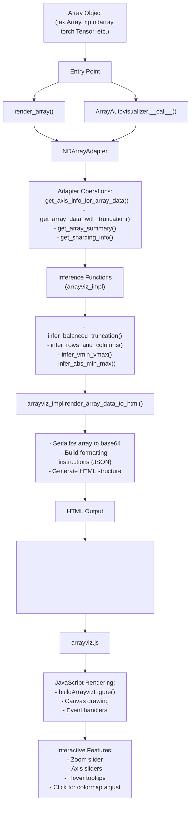
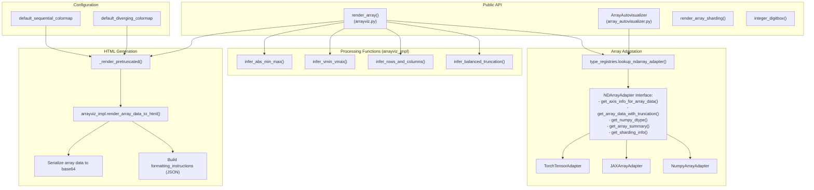
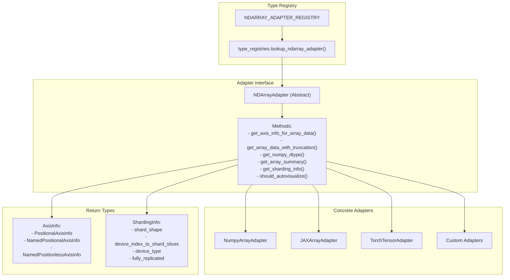
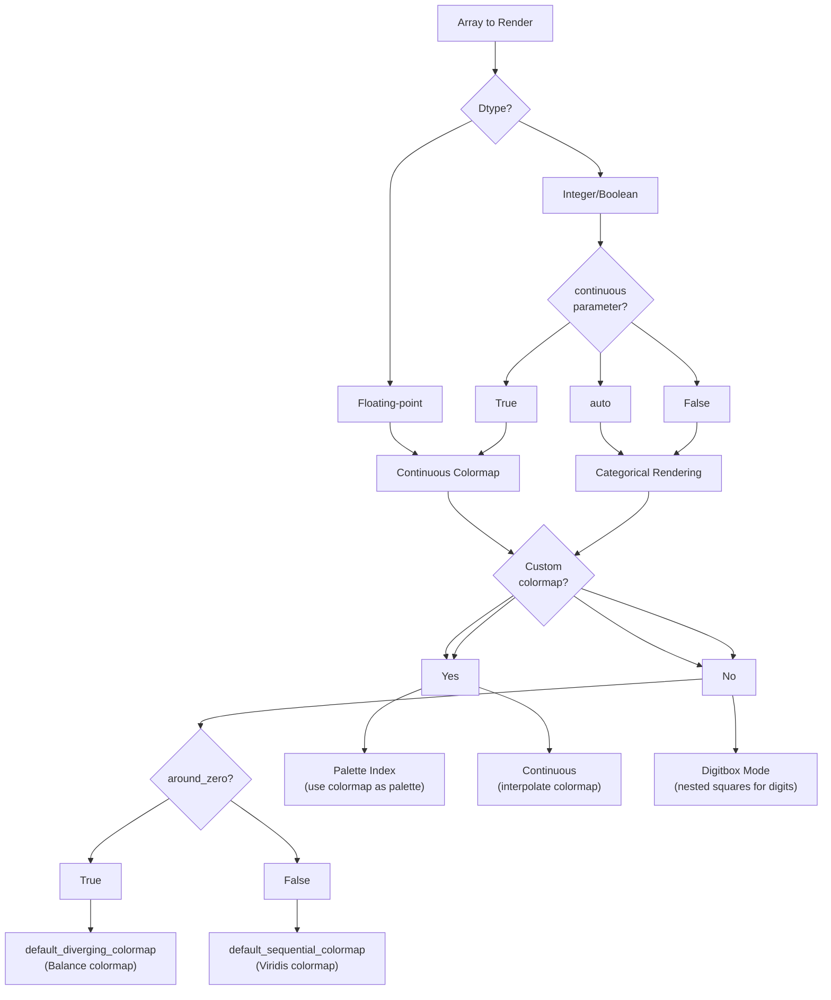
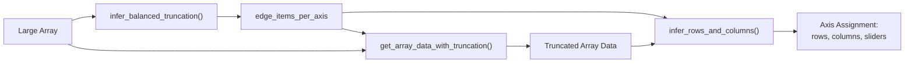
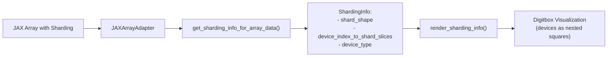

<!-- source: DeepWiki mcp.deepwiki.com · repo google-deepmind/treescope · page 4 Array Visualization · fetched 2026-10-26 -->

# Array Visualization

<details>
<summary>Relevant source files</summary>

The following files were used as context for generating this wiki page:

- [docs/notebooks/array_visualization.ipynb](docs/notebooks/array_visualization.ipynb)
- [docs/notebooks/building_custom_visualizations.ipynb](docs/notebooks/building_custom_visualizations.ipynb)
- [docs/notebooks/pretty_printing.ipynb](docs/notebooks/pretty_printing.ipynb)
- [treescope/_internal/api/array_autovisualizer.py](treescope/_internal/api/array_autovisualizer.py)
- [treescope/_internal/api/arrayviz.py](treescope/_internal/api/arrayviz.py)

</details>


## Purpose and Scope

This document describes Treescope's specialized array visualization subsystem, which renders multidimensional arrays (NumPy arrays, JAX arrays, PyTorch tensors, etc.) as interactive HTML visualizations. The system handles arbitrarily high-dimensional arrays, displaying them as nested grids with interactive controls for zooming, slicing, and inspecting values.

For information about how arrays are automatically visualized within rendered objects, see [ArrayAutovisualizer](#4.2). For details on the array rendering API and parameters, see [Array Rendering API](#4.1). For interactive features of the JavaScript-based renderer, see [Interactive Array Features](#4.3). For extending the system to support custom array types, see [NDArray Adapters](#4.4).

## System Overview

The array visualization system provides two primary entry points:

1. **`render_array`**: Direct function to render a single array with full control over visualization parameters
2. **`ArrayAutovisualizer`**: Automatic visualizer that renders arrays encountered during tree traversal with configurable defaults

Both produce interactive HTML visualizations that embed array data and JavaScript code to render arrays on an HTML canvas with user controls.

### High-Level Data Flow



**Sources:** [treescope/_internal/api/arrayviz.py:108-367](), [treescope/_internal/api/array_autovisualizer.py:91-297]()

## Core Components

### Python Layer

The Python layer is responsible for data processing, truncation, colormap inference, and HTML generation:



**Sources:** [treescope/_internal/api/arrayviz.py:1-698](), [treescope/_internal/api/array_autovisualizer.py:1-398]()

### JavaScript Layer

The JavaScript layer (`arrayviz.js`) deserializes the embedded data and renders it to an HTML canvas with interactive controls. It handles:

- Canvas drawing for array elements
- Zoom controls
- Axis sliders for high-dimensional arrays
- Hover tooltips showing array indices and values
- Click interactions for dynamic colormap adjustment
- Multiple rendering modes (continuous, palette_index, digitbox)

**Sources:** [treescope/_internal/api/arrayviz.py:15-20](), High-level architecture Diagram 3

## Entry Points

### `render_array()` Function

The `render_array` function provides direct, fine-grained control over array visualization:

```python
treescope.render_array(
    array,
    columns=[...],      # Axis assignment
    rows=[...],
    sliders=[...],
    continuous=True,    # Rendering strategy
    around_zero=True,   # Colormap centering
    vmin=None,          # Colormap bounds
    vmax=None,
    colormap=None,      # Custom colormap
    truncate=True,      # Truncation control
    maximum_size=10_000,
    axis_labels={...},  # Metadata
    axis_item_labels={...},
    # ... additional parameters
)
```

**Location:** [treescope/_internal/api/arrayviz.py:108-367]()

For details on all parameters and usage, see [Array Rendering API](#4.1).

### `ArrayAutovisualizer` Class

The `ArrayAutovisualizer` class implements the autovisualizer protocol to automatically render arrays encountered during tree traversal:

```python
autovisualizer = treescope.ArrayAutovisualizer(
    maximum_size=4_000,
    cutoff_size_per_axis=128,
    edge_items=5,
    prefers_column=(),
    prefers_row=(),
    around_zero=True,
    force_continuous=False,
    include_repr_line_threshold=5,
    token_lookup_fn=None,
    pixels_per_cell=7,
)
```

**Location:** [treescope/_internal/api/array_autovisualizer.py:49-398]()

When activated, it replaces arrays in the rendered tree with visualizations. For details on configuration and usage, see [ArrayAutovisualizer](#4.2).

## NDArrayAdapter System

The array visualization system abstracts different array types through the `NDArrayAdapter` interface, allowing it to work uniformly with NumPy arrays, JAX arrays, PyTorch tensors, and custom array types:



**Sources:** [treescope/_internal/api/array_autovisualizer.py:33-36](), [treescope/_internal/api/arrayviz.py:42-45]()

The adapter system enables visualization of:
- **NumPy arrays** (`np.ndarray`)
- **JAX arrays** (`jax.Array`), including sharding information
- **PyTorch tensors** (`torch.Tensor`)
- **Penzai NamedArrays** with named axes
- **Custom array types** via the `__treescope_ndarray_adapter__` protocol

For details on implementing adapters for custom array types, see [NDArray Adapters](#4.4).

## Rendering Strategies

The array visualizer supports three primary rendering strategies, selected automatically or explicitly via the `continuous` parameter:



**Sources:** [treescope/_internal/api/arrayviz.py:571-662]()

### Strategy Details

| Strategy | When Used | Description |
|----------|-----------|-------------|
| **Continuous** | Float arrays or `continuous=True` | Maps values to colors via interpolation. Supports diverging (around zero) or sequential colormaps. |
| **Digitbox** | Integer arrays (default) | Renders integers as nested colored squares, one per digit. Supports up to 7-digit integers. |
| **Palette Index** | Integer arrays with custom colormap | Maps each integer to a color in the provided colormap (no interpolation). |

**Sources:** [treescope/_internal/api/arrayviz.py:138-180]()

## Colormap Configuration

Two contextual values control default colormaps:

- **`default_sequential_colormap`**: Used for `around_zero=False`. Initially set to Viridis (matplotlib).
- **`default_diverging_colormap`**: Used for `around_zero=True`. Initially set to Balance (cmocean).

These can be overridden globally or within a context:

```python
# Set globally
treescope.default_diverging_colormap.set_globally(custom_colormap)

# Set in context
with treescope.default_diverging_colormap.set_scoped(custom_colormap):
    treescope.render_array(my_array)
```

**Location:** [treescope/_internal/api/arrayviz.py:50-105]()

**Sources:** [treescope/_internal/api/arrayviz.py:50-105]()

## Truncation and Inference

For large arrays, the system automatically infers balanced truncation strategies to keep visualization sizes manageable:



**Sources:** [treescope/_internal/api/array_autovisualizer.py:114-126](), [treescope/_internal/api/arrayviz.py:314-343]()

The truncation system:
1. Determines how many elements to keep along each axis via `infer_balanced_truncation`
2. Extracts truncated data through the adapter's `get_array_data_with_truncation` method
3. Infers optimal row/column assignments via `infer_rows_and_columns`

Truncated regions are rendered with gray pixels and dots to indicate missing data.

## JAX Sharding Visualization

For JAX arrays with sharding information, the system provides specialized visualization:

- **`render_array_sharding(array)`**: Renders which device stores each shard
- **`render_sharding_info(array_axis_info, sharding_info)`**: Renders sharding from metadata
- **Automatic sharding display**: `ArrayAutovisualizer` automatically includes sharding info when rendering JAX arrays



**Sources:** [treescope/_internal/api/arrayviz.py:700-989](), [treescope/_internal/api/array_autovisualizer.py:173-220]()

Sharding visualizations reuse the digitbox rendering mode to assign each device or shard a distinct visual pattern.

## Related Functions

### `integer_digitbox()`

Renders a single integer using the digitbox visualization strategy:

```python
treescope.integer_digitbox(
    value=42,
    label="some_label",
    size="1em"
)
```

**Location:** [treescope/_internal/api/arrayviz.py:1035-1077]()

This is useful for custom visualizations that need to render token IDs or device indices.

**Sources:** [treescope/_internal/api/arrayviz.py:1035-1077]()

## Architecture Summary

The array visualization system is a two-layer architecture:

1. **Python Layer** ([arrayviz.py](), [array_autovisualizer.py](), [arrayviz_impl.py]()):
   - Array type abstraction via `NDArrayAdapter`
   - Truncation and inference logic
   - Colormap configuration
   - HTML and JSON generation

2. **JavaScript Layer** ([arrayviz.js]()):
   - Canvas-based rendering
   - Interactive controls (zoom, sliders)
   - Event handling (hover, click)
   - Dynamic colormap adjustment

This separation allows the system to generate self-contained HTML that requires no server-side state and can be saved to files for offline viewing.

**Sources:** High-level architecture Diagram 3, [treescope/_internal/api/arrayviz.py:15-20]()

## Related Pages

- [Array Rendering API](#4.1): Detailed documentation of `render_array` parameters
- [ArrayAutovisualizer](#4.2): Configuration and usage of automatic array visualization
- [Interactive Array Features](#4.3): JavaScript-powered interactivity details
- [NDArray Adapters](#4.4): Extending the system to support custom array types

---

