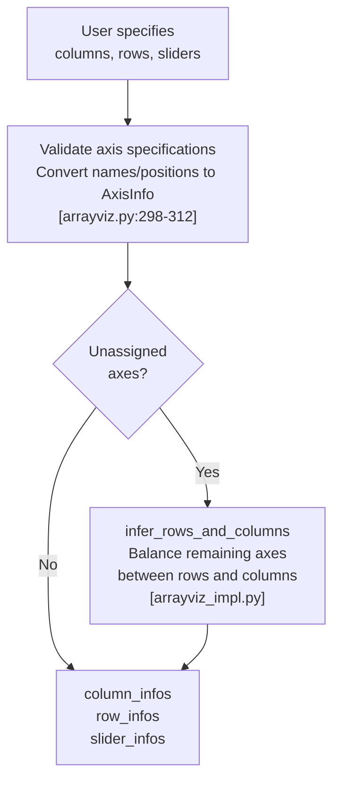
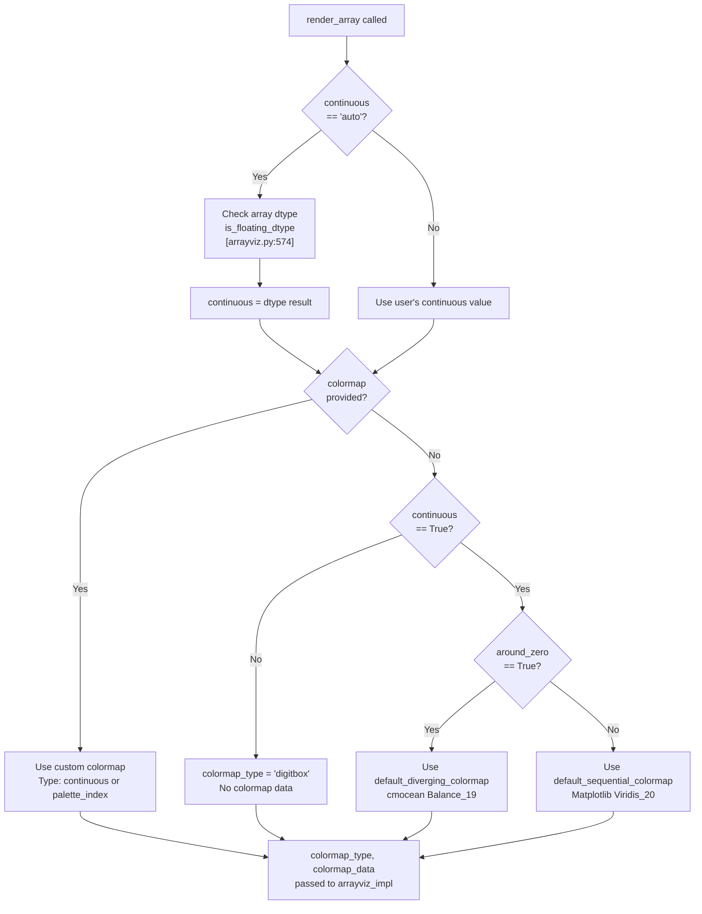
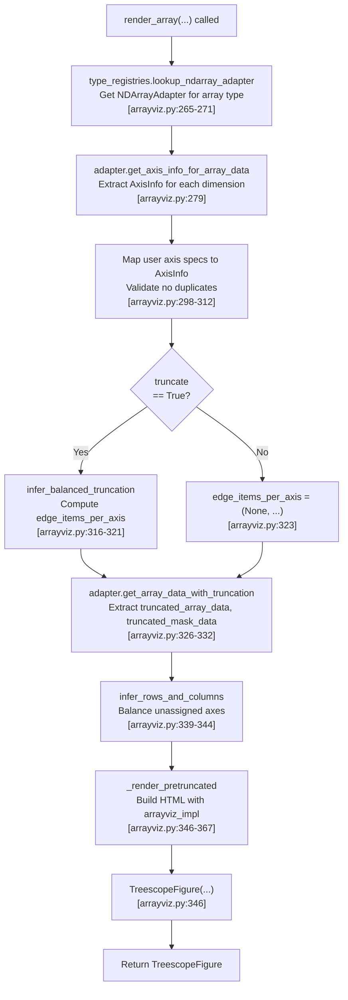

<!-- source: DeepWiki mcp.deepwiki.com · repo google-deepmind/treescope · page 4.1 Array Rendering API · fetched 2026-10-26 -->

# Array Rendering API

<details>
<summary>Relevant source files</summary>

The following files were used as context for generating this wiki page:

- [docs/notebooks/array_visualization.ipynb](docs/notebooks/array_visualization.ipynb)
- [docs/notebooks/building_custom_visualizations.ipynb](docs/notebooks/building_custom_visualizations.ipynb)
- [docs/notebooks/pretty_printing.ipynb](docs/notebooks/pretty_printing.ipynb)
- [treescope/_internal/api/arrayviz.py](treescope/_internal/api/arrayviz.py)

</details>


## Purpose and Scope

This page documents the programmatic API for rendering arrays to interactive visualizations in Treescope. The primary function is `render_array`, which converts NDArrays (NumPy, JAX, PyTorch, etc.) into interactive HTML visualizations with customizable colormaps, axis layouts, and truncation strategies. This page also covers `render_array_sharding` for visualizing JAX array shardings and the `integer_digitbox` utility for rendering categorical values.

For information about automatically visualizing arrays within object trees, see [ArrayAutovisualizer](#4.2). For details on the JavaScript-powered interactive features (zoom, sliders, tooltips), see [Interactive Array Features](#4.3). For information about supporting custom array types, see [NDArray Adapters](#4.4).

**Sources:** [treescope/_internal/api/arrayviz.py:1-130]()

---

## Core Rendering Function

### render_array

The `render_array` function is the primary entry point for creating array visualizations. It accepts any array type registered in the NDArray adapter registry and produces a `TreescopeFigure` containing interactive HTML visualization.

```python
treescope.render_array(
    array: ArrayInRegistry,
    *,
    # Axis assignment
    columns: Sequence[AxisName | int] = (),
    rows: Sequence[AxisName | int] = (),
    sliders: Sequence[AxisName | int] = (),
    # Colormap configuration
    continuous: bool | Literal["auto"] = "auto",
    around_zero: bool | Literal["auto"] = "auto",
    vmax: float | None = None,
    vmin: float | None = None,
    trim_outliers: bool = True,
    dynamic_colormap: bool | Literal["auto"] = "auto",
    colormap: list[tuple[int, int, int]] | None = None,
    # Truncation
    truncate: bool = False,
    maximum_size: int = 10_000,
    cutoff_size_per_axis: int = 512,
    minimum_edge_items: int = 5,
    # Labels
    axis_item_labels: dict[AxisName | int, list[str]] | None = None,
    value_item_labels: dict[int, str] | None = None,
    axis_labels: dict[AxisName | int, str] | None = None,
    # Display
    valid_mask: Any | None = None,
    pixels_per_cell: int | float = 7,
) -> figures_impl.TreescopeFigure
```

**Return Type:** `TreescopeFigure` - a renderable object that can be displayed in IPython or converted to HTML.

**Sources:** [treescope/_internal/api/arrayviz.py:108-262](), [docs/notebooks/array_visualization.ipynb:136-179]()

---

## Parameter Reference

### Axis Assignment Parameters

These parameters control how array dimensions are mapped to the visualization layout. Axes can be assigned to columns (horizontal), rows (vertical), or sliders (interactive slicing).

| Parameter | Type | Default | Description |
|-----------|------|---------|-------------|
| `columns` | `Sequence[AxisName \| int]` | `()` | Axes to place on x-axis, innermost to outermost |
| `rows` | `Sequence[AxisName \| int]` | `()` | Axes to place on y-axis, innermost to outermost |
| `sliders` | `Sequence[AxisName \| int]` | `()` | Axes to show with interactive sliders |

**Axis Specification:** Axes can be specified by:
- **Position** (for positional axes): integer index (e.g., `0`, `1`, `2`)
- **Name** (for named axes): axis name (e.g., `"batch"`, `"features"`)

**Automatic Inference:** If `columns` and `rows` are not fully specified, unassigned axes are automatically distributed to balance the visualization layout. The inference logic is in `arrayviz_impl.infer_rows_and_columns`.

**Sources:** [treescope/_internal/api/arrayviz.py:111-113, 186-193](), [treescope/_internal/api/arrayviz.py:298-344](), [docs/notebooks/array_visualization.ipynb:286-338]()

#### Axis Assignment Flow Diagram



**Sources:** [treescope/_internal/api/arrayviz.py:298-344]()

---

### Colormap and Rendering Parameters

These parameters control how array values are mapped to colors and rendered visually.

| Parameter | Type | Default | Description |
|-----------|------|---------|-------------|
| `continuous` | `bool \| Literal["auto"]` | `"auto"` | Whether to use continuous colormap (vs categorical) |
| `around_zero` | `bool \| Literal["auto"]` | `"auto"` | Whether to use diverging colormap centered at zero |
| `vmax` | `float \| None` | `None` | Maximum value for colormap range |
| `vmin` | `float \| None` | `None` | Minimum value for colormap range |
| `trim_outliers` | `bool` | `True` | Clip colormap to 3 std devs from mean |
| `dynamic_colormap` | `bool \| Literal["auto"]` | `"auto"` | Enable mouse-based colormap adjustment |
| `colormap` | `list[tuple[int, int, int]] \| None` | `None` | Custom RGB colormap |

**Rendering Modes:**

1. **Continuous Mode** (`continuous=True`):
   - Uses interpolated colormaps for float data
   - Supports diverging (around zero) and sequential colormaps
   - Out-of-range values marked with "+" or "-"
   - Invalid values (NaN, Inf) marked with "X", "I", "-I"

2. **Categorical Mode** (`continuous=False`):
   - Uses "digitbox" rendering for integers 0-9,999,999
   - Each digit rendered as nested colored square
   - Only valid for integer/boolean dtypes

**Default Colormaps:**

- **Diverging (around_zero=True):** `default_diverging_colormap` - cmocean Balance_19 (blue=positive, red=negative)
- **Sequential (around_zero=False):** `default_sequential_colormap` - Matplotlib Viridis_20

**Sources:** [treescope/_internal/api/arrayviz.py:115-121, 199-223](), [treescope/_internal/api/arrayviz.py:50-105](), [docs/notebooks/array_visualization.ipynb:145-267]()

#### Colormap Selection Logic



**Sources:** [treescope/_internal/api/arrayviz.py:574-662]()

---

### Truncation Parameters

Large arrays are truncated before rendering to limit memory usage and rendering time. These parameters control the truncation strategy.

| Parameter | Type | Default | Description |
|-----------|------|---------|-------------|
| `truncate` | `bool` | `False` | Whether to enable truncation |
| `maximum_size` | `int` | `10_000` | Max total elements to display |
| `cutoff_size_per_axis` | `int` | `512` | Max elements per axis before truncation |
| `minimum_edge_items` | `int` | `5` | Min elements to keep at each edge |

**Truncation Strategy:** When `truncate=True`, the function calls `arrayviz_impl.infer_balanced_truncation` to compute `edge_items_per_axis`, which determines how many items to keep at the start and end of each axis. The truncation algorithm:
1. Respects `maximum_size` as a global budget
2. Truncates axes longer than `cutoff_size_per_axis`
3. Keeps at least `minimum_edge_items` at each edge
4. Balances edge items across axes to use the full budget

Truncated regions are rendered as masked (gray with dots).

**Sources:** [treescope/_internal/api/arrayviz.py:122-125, 224-235, 314-323]()

---

### Label Parameters

These parameters add semantic labels to axes and values in the visualization.

| Parameter | Type | Default | Description |
|-----------|------|---------|-------------|
| `axis_item_labels` | `dict[AxisName \| int, list[str]] \| None` | `None` | Labels for each item along axes |
| `value_item_labels` | `dict[int, str] \| None` | `None` | Labels for categorical values |
| `axis_labels` | `dict[AxisName \| int, str] \| None` | `None` | Custom names for axes |

**Axis Item Labels:** Provide semantic meaning for positions along axes (e.g., token strings for sequence positions, class names for classification axes). Shown in hover tooltips and click displays.

**Value Item Labels:** For categorical data, map integer values to human-readable strings (e.g., token IDs to token strings).

**Axis Labels:** Override the default axis labeling (which uses axis names for named axes, or "axis {i}" for positional axes).

**Sources:** [treescope/_internal/api/arrayviz.py:126-128, 236-252](), [docs/notebooks/array_visualization.ipynb:636-690]()

---

### Display Parameters

| Parameter | Type | Default | Description |
|-----------|------|---------|-------------|
| `valid_mask` | `Any \| None` | `None` | Boolean mask for valid elements |
| `pixels_per_cell` | `int \| float` | `7` | Zoom level (1-21 pixels per cell) |

**Valid Mask:** A boolean array with the same shape as the input. Elements where the mask is `False` are rendered as masked (gray with dots), allowing you to hide invalid, missing, or out-of-bounds data.

**Pixels Per Cell:** Controls the visual zoom level. Arrays are always rendered at 7 pixels per cell internally and then scaled. Values less than 7 may cause annotation artifacts.

**Sources:** [treescope/_internal/api/arrayviz.py:114, 129, 194-198, 253-257, 272-276]()

---

## Rendering Pipeline

### Internal Processing Flow



**Sources:** [treescope/_internal/api/arrayviz.py:263-367]()

### _render_pretruncated Internal Function

The `_render_pretruncated` helper function (lines 370-697) handles the core rendering logic:

1. **Axis metadata processing:** Builds `data_axis_labels` and `formatting_instructions` for displaying array indices and labels
2. **Colormap inference:** Determines `vmin`, `vmax`, `colormap_type`, and `colormap_data` based on parameters
3. **HTML generation:** Calls `arrayviz_impl.render_array_data_to_html` to serialize the array data to HTML with embedded JavaScript

The function produces an `ArrayvizRendering` object containing HTML source code.

**Sources:** [treescope/_internal/api/arrayviz.py:370-697]()

---

## Sharding Visualization

### render_array_sharding

For JAX arrays with sharding information, `render_array_sharding` visualizes which devices store which parts of the array.

```python
treescope.render_array_sharding(
    array: ArrayInRegistry,
    rows: Sequence[int | AxisName] = (),
    columns: Sequence[int | AxisName] = (),
) -> figures_impl.TreescopeFigure
```

**Parameters:**
- `array`: JAX array with sharding metadata
- `rows`, `columns`: Optional explicit axis ordering for the visualization

**Rendering Strategy:** The function reuses the "digitbox" categorical rendering mode to visualize shardings:
- Each device is assigned a unique integer value or pattern
- The visualization shows which device(s) own each shard
- Device assignments are labeled below the visualization

**Sources:** [treescope/_internal/api/arrayviz.py:992-1032](), [docs/notebooks/array_visualization.ipynb:822-913]()

### render_sharding_info

The `render_sharding_info` helper function (lines 700-989) performs the actual sharding visualization:

1. **Extract sharding metadata:** Convert `ShardingInfo.device_index_to_shard_slices` into a visualization array
2. **Build shard representation:** Create a smaller "mini" representation of each shard using `infer_balanced_truncation`
3. **Assign device colors:** Map devices to integer values for digitbox rendering:
   - ≤10 devices: Each device gets a digit 1-9, replicas shown as multi-digit numbers
   - Many devices/shards: Each unique shard gets a distinct pattern
4. **Render:** Use `arrayviz_impl.render_array_data_to_html` with `colormap_type="digitbox"`

**Sources:** [treescope/_internal/api/arrayviz.py:700-989]()

---

## Integer Digitbox Rendering

### integer_digitbox

The `integer_digitbox` function renders a single integer using the "digitbox" pattern, useful for custom visualizations of categorical data.

```python
treescope.integer_digitbox(
    value: int,
    *,
    label: str | None = None,
    size: str = "1em"
) -> figures_impl.TreescopeFigure
```

**Parameters:**
- `value`: Integer to render (supports up to 7 digits)
- `label`: Optional text label to display next to the digitbox
- `size`: CSS size specification (e.g., "1em", "30px")

**Rendering:** Each digit is rendered as a nested colored square, with colors from the D3 Category20 palette. This is the same rendering used for categorical array elements and sharding visualizations.

**Sources:** [treescope/_internal/api/arrayviz.py:1035-1077](), [docs/notebooks/array_visualization.ipynb:549-588]()

---

## Configuration Values

### Default Colormaps

Two contextual values control the default colormaps used by `render_array`:

**`default_sequential_colormap`:** Used for continuous, non-centered data (`around_zero=False`)
- **Type:** `ContextualValue[list[tuple[int, int, int]]]`
- **Default:** Matplotlib Viridis_20 colormap (20 RGB color stops)
- **Location:** [treescope/_internal/api/arrayviz.py:50-78]()

**`default_diverging_colormap`:** Used for continuous, zero-centered data (`around_zero=True`)
- **Type:** `ContextualValue[list[tuple[int, int, int]]]`
- **Default:** cmocean Balance_19 colormap (17 RGB color stops, truncated)
- **Location:** [treescope/_internal/api/arrayviz.py:80-105]()

These can be customized globally using `.set_globally()` or scoped using `.set_scoped()`. See [Configuration and Context](#5.3) for details on ContextualValue usage.

**Sources:** [treescope/_internal/api/arrayviz.py:50-105]()

---

## Parameter Summary Table

| Category | Parameters |
|----------|------------|
| **Axis Assignment** | `columns`, `rows`, `sliders` |
| **Colormap** | `continuous`, `around_zero`, `vmax`, `vmin`, `trim_outliers`, `dynamic_colormap`, `colormap` |
| **Truncation** | `truncate`, `maximum_size`, `cutoff_size_per_axis`, `minimum_edge_items` |
| **Labels** | `axis_item_labels`, `value_item_labels`, `axis_labels` |
| **Display** | `valid_mask`, `pixels_per_cell` |

**Sources:** [treescope/_internal/api/arrayviz.py:108-130]()

---

