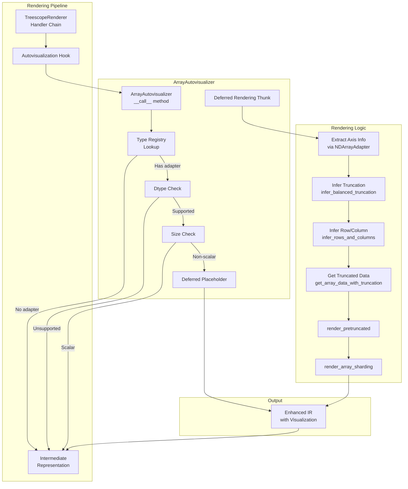
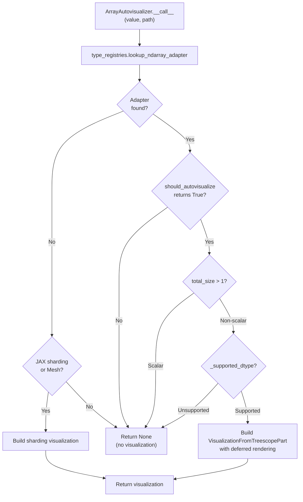
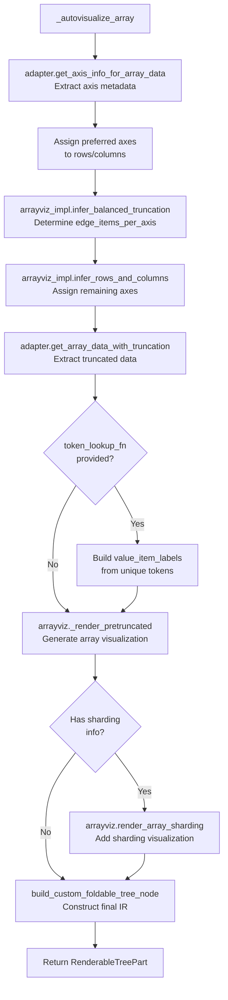
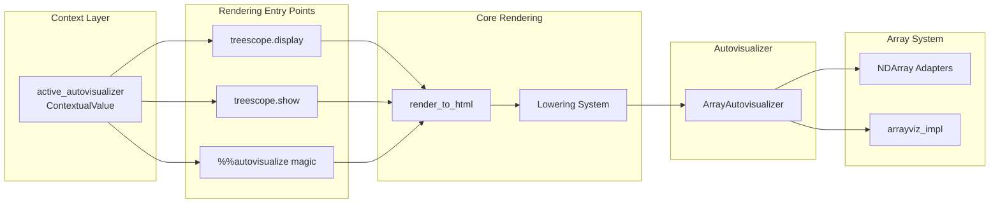

<!-- source: DeepWiki mcp.deepwiki.com · repo google-deepmind/treescope · page 4.2 ArrayAutovisualizer · fetched 2026-10-26 -->

# ArrayAutovisualizer

<details>
<summary>Relevant source files</summary>

The following files were used as context for generating this wiki page:

- [treescope/__init__.py](treescope/__init__.py)
- [treescope/_internal/api/array_autovisualizer.py](treescope/_internal/api/array_autovisualizer.py)

</details>


`ArrayAutovisualizer` is a specialized implementation of the `Autovisualizer` interface that automatically detects and visualizes arrays within object trees. When configured as the active autovisualizer, it intercepts array objects during rendering and replaces their standard representation with rich, interactive visualizations powered by the array visualization system.

For information about the general autovisualizer mechanism and other autovisualizer types, see [Understanding Autovisualizers](#7.1). For details on the underlying array rendering functions, see [Array Rendering API](#4.1). For interactive features of the rendered output, see [Interactive Array Features](#4.3).

## Overview

The `ArrayAutovisualizer` class is defined in [treescope/_internal/api/array_autovisualizer.py:49-398]() as a dataclass that implements the autovisualizer protocol. It detects arrays registered in `NDARRAY_ADAPTER_REGISTRY` and automatically generates visualizations for them during tree rendering.



**Sources:** [treescope/_internal/api/array_autovisualizer.py:246-297]()

## Configuration Options

`ArrayAutovisualizer` is configured through dataclass attributes that control visualization behavior:

| Attribute | Type | Default | Description |
|-----------|------|---------|-------------|
| `maximum_size` | `int` | `4_000` | Maximum total elements to display. Larger arrays are truncated. |
| `cutoff_size_per_axis` | `int` | `128` | Per-axis truncation threshold. Axes longer than this are truncated with logarithmic visual scaling. |
| `edge_items` | `int` | `5` | Number of elements to preserve at each edge of truncated axes. |
| `prefers_column` | `Collection[str]` | `()` | Axis names that should be assigned to columns. |
| `prefers_row` | `Collection[str]` | `()` | Axis names that should be assigned to rows. |
| `around_zero` | `bool` | `True` | Whether to use diverging colormaps centered at zero for continuous data. |
| `force_continuous` | `bool` | `False` | Force integer arrays to render as continuous colormaps. |
| `include_repr_line_threshold` | `int` | `5` | Maximum lines in array `repr` to include in visualization. Useful for small arrays. |
| `token_lookup_fn` | `Callable[[int], str] \| None` | `None` | Function mapping integer values to token strings for hover annotations. |
| `pixels_per_cell` | `int \| float` | `7` | Rendering size per array element (1-21 pixels). Values below 7 may have display issues. |

**Sources:** [treescope/_internal/api/array_autovisualizer.py:49-90]()

## Usage

### Basic Setup

The most common usage is to set `ArrayAutovisualizer` as the global active autovisualizer:

```python
import treescope

# Enable array autovisualization globally
treescope.active_autovisualizer.set_globally(
    treescope.ArrayAutovisualizer()
)
```

This is also done automatically by `basic_interactive_setup()` when `autovisualize_arrays=True`:

```python
treescope.basic_interactive_setup(autovisualize_arrays=True)
```

**Sources:** [treescope/__init__.py:17-27]()

### Scoped Configuration

Use context managers for temporary configuration:

```python
# Temporarily use custom configuration
with treescope.active_autovisualizer.set_scoped(
    treescope.ArrayAutovisualizer(
        maximum_size=10_000,
        edge_items=10,
        around_zero=False,
    )
):
    treescope.show(my_array)
```

### Tokenizer Integration

The `for_tokenizer` class method creates an autovisualizer that annotates integer arrays with token strings:

```python
autovisualizer = treescope.ArrayAutovisualizer.for_tokenizer(tokenizer)
treescope.active_autovisualizer.set_globally(autovisualizer)
```

This supports two tokenizer types:
1. Callable objects mapping token IDs to strings
2. SentencePiece tokenizers with `IdToPiece` and `GetPieceSize` methods

**Sources:** [treescope/_internal/api/array_autovisualizer.py:369-397]()

## Implementation Details

### Detection and Dispatch Flow



**Sources:** [treescope/_internal/api/array_autovisualizer.py:246-367]()

### Deferred Rendering Strategy

`ArrayAutovisualizer` uses deferred rendering to avoid blocking on expensive array operations:

1. **Placeholder function** (`_placeholder`): Returns fast summary from `adapter.get_array_summary(value, fast=True)`
2. **Rendering thunk** (`_thunk`): Performs full array visualization when requested

This is implemented via `lowering.maybe_defer_rendering`, which renders the placeholder immediately and schedules the full rendering to execute asynchronously.

**Sources:** [treescope/_internal/api/array_autovisualizer.py:269-297]()

### Visualization Construction Process

The `_autovisualize_array` helper method orchestrates the visualization:



**Sources:** [treescope/_internal/api/array_autovisualizer.py:91-244]()

### Axis Assignment Logic

The autovisualizer assigns axes to rows, columns, and sliders based on:

1. **User preferences**: Axes named in `prefers_column` or `prefers_row` are assigned first
2. **Inference algorithm**: Remaining axes are assigned by `infer_rows_and_columns` to balance visual layout
3. **Truncation constraints**: Assignment considers `edge_items_per_axis` to prevent overly sparse displays

**Sources:** [treescope/_internal/api/array_autovisualizer.py:103-126]()

## Supported Array Types

The autovisualizer supports arrays registered in `NDARRAY_ADAPTER_REGISTRY` with dtypes:

- **Integer types**: All NumPy integer dtypes (`int8`, `int16`, `int32`, `int64`, `uint8`, etc.)
- **Floating point types**: `float16`, `float32`, `float64`, `bfloat16`
- **Boolean type**: `bool`

Unsupported dtypes (complex, string, object, etc.) are not visualized.

**Sources:** [treescope/_internal/api/array_autovisualizer.py:41-46](), [treescope/_internal/api/array_autovisualizer.py:265-267]()

## Special Features

### Sharding Visualization

When an array has sharding information (typically JAX arrays), the autovisualizer adds a foldable sharding visualization section:

- **Single device**: Displays device type and ID as inline text
- **Multiple devices**: Displays sharding summary and expandable visual representation via `render_array_sharding`

The sharding visualization uses the same row/column axis assignment as the main array display for consistency.

**Sources:** [treescope/_internal/api/array_autovisualizer.py:173-220]()

### JAX Sharding Objects

The autovisualizer has special handling for bare JAX sharding objects (`jax.sharding.NamedSharding` and `jax.sharding.Mesh`):

- **NamedSharding**: Constructs fake positional axis info based on partition spec and mesh shape
- **Mesh**: Creates a NamedSharding with full partitioning and uses named axis info

These are visualized using `render_sharding_info` to show device placement.

**Sources:** [treescope/_internal/api/array_autovisualizer.py:299-367]()

### Token Annotations

When `token_lookup_fn` is provided and the array has integer dtype:

1. Extract unique integer values from the truncated array
2. Call `token_lookup_fn` for each unique value
3. Pass resulting `value_item_labels` dictionary to the renderer
4. Hover tooltips display token strings alongside numeric values

**Sources:** [treescope/_internal/api/array_autovisualizer.py:138-148]()

## Integration with Rendering Pipeline



**Sources:** [treescope/__init__.py:56-88](), [treescope/_internal/api/array_autovisualizer.py]()

The autovisualizer is invoked during the lowering phase of rendering, after handlers have produced initial intermediate representations but before final HTML/text generation. This allows it to enhance or replace array representations with rich visualizations while preserving the overall tree structure.

---

