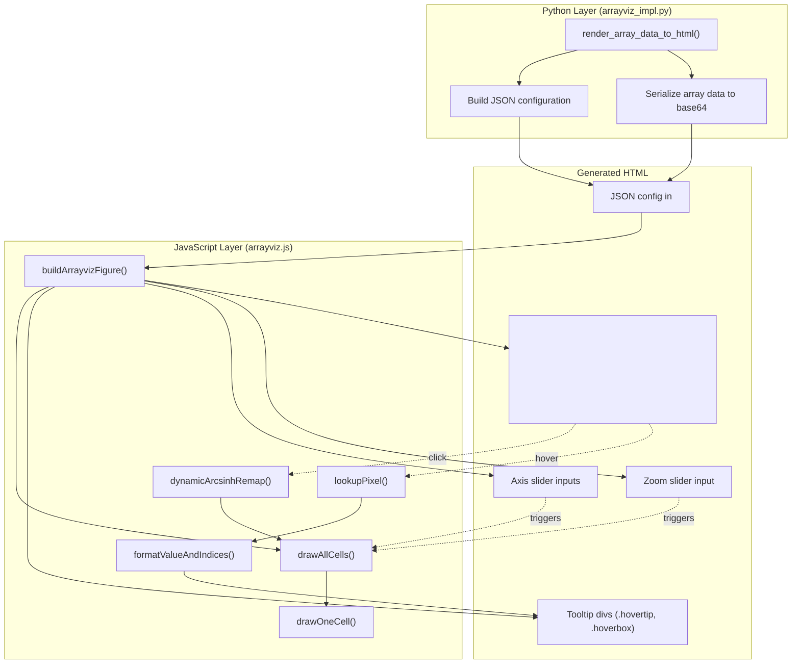
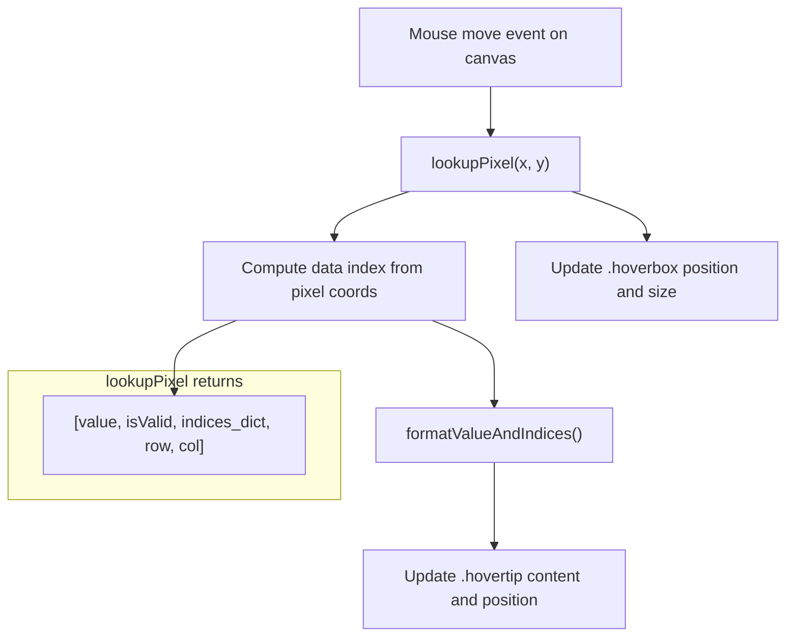
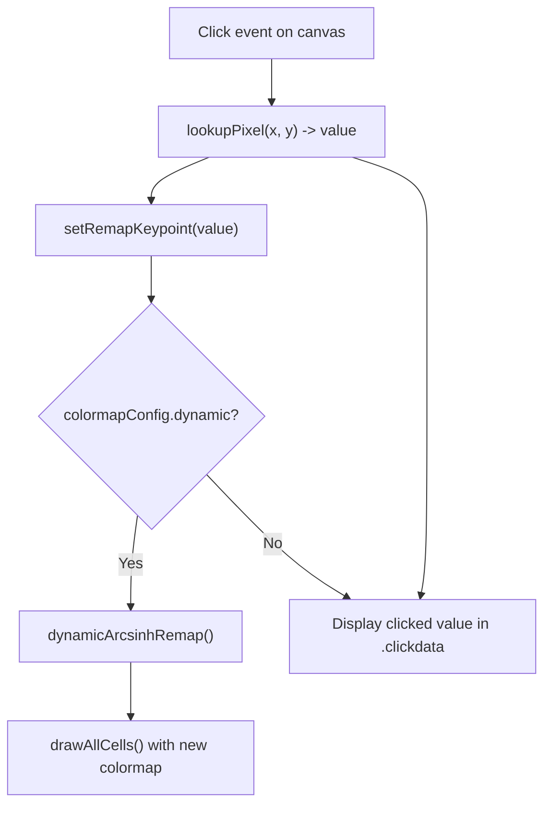
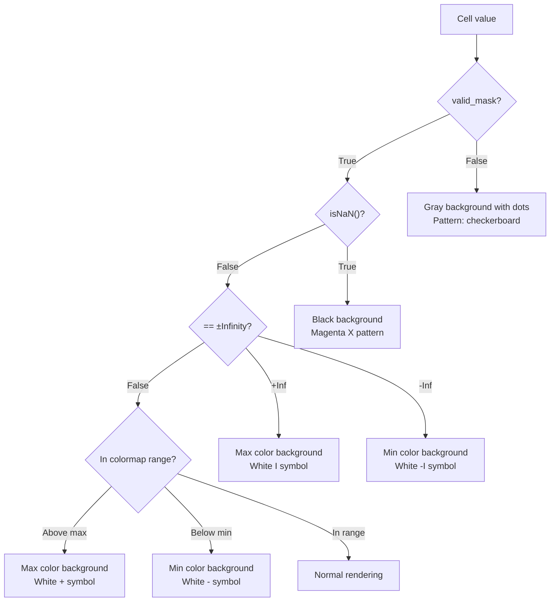
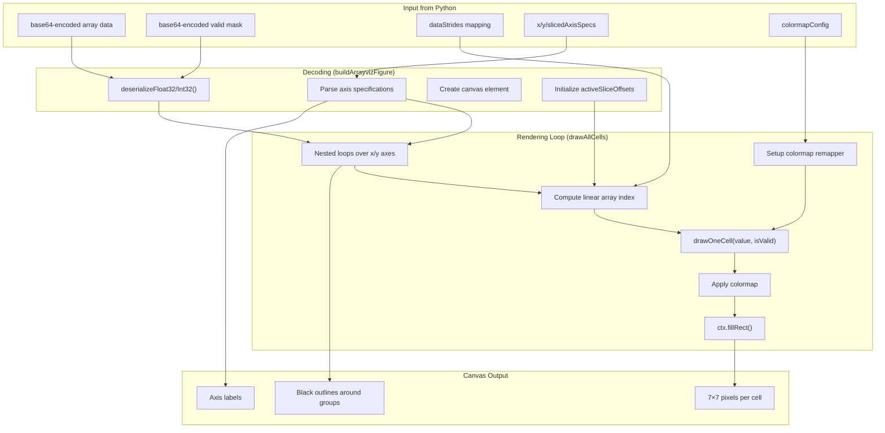

<!-- source: DeepWiki mcp.deepwiki.com · repo google-deepmind/treescope · page 4.3 Interactive Array Features · fetched 2026-10-26 -->

# Interactive Array Features

<details>
<summary>Relevant source files</summary>

The following files were used as context for generating this wiki page:

- [docs/notebooks/array_visualization.ipynb](docs/notebooks/array_visualization.ipynb)
- [docs/notebooks/building_custom_visualizations.ipynb](docs/notebooks/building_custom_visualizations.ipynb)
- [docs/notebooks/pretty_printing.ipynb](docs/notebooks/pretty_printing.ipynb)
- [treescope/_internal/arrayviz_impl.py](treescope/_internal/arrayviz_impl.py)
- [treescope/_internal/js/arrayviz.js](treescope/_internal/js/arrayviz.js)

</details>


**Purpose**: This page documents the JavaScript-powered interactive features that make Treescope's array visualizations dynamic and explorable. For the Python API to create array visualizations, see [Array Rendering API](#4.1). For automatic array visualization in object trees, see [ArrayAutovisualizer](#4.2).

## Architecture Overview

Treescope's array visualizer uses a two-layer architecture separating data processing (Python) from interactive rendering (JavaScript):



**Sources**: [treescope/_internal/arrayviz_impl.py:129-266](), [treescope/_internal/js/arrayviz.js:580-825]()

The Python layer processes array data, applies truncation, and serializes it to base64-encoded binary data embedded in HTML. The JavaScript layer deserializes this data and renders it to an HTML5 canvas with interactive controls. This design allows visualizations to work offline and remain functional even after the Python kernel disconnects.

## Interactive Controls

### Zoom Slider

The zoom slider controls the pixel size of each array cell, allowing users to zoom in for detail or zoom out for an overview:

```mermaid
graph LR
    Slider["<input type='range'> zoom slider"]
    CSSVar["CSS variable --arrayviz-zoom"]
    CanvasScale["canvas CSS scale property"]
    ContainerSize["container width/height"]
    
    Slider -->|updates| CSSVar
    CSSVar --> CanvasScale
    CSSVar --> ContainerSize
```



**Sources**: [treescope/_internal/js/arrayviz.js:1020-1034](), [treescope/_internal/js/arrayviz.js:900-910]()

The zoom slider has predefined snap points at `[1, 2, 3.5, 7, 14, 21]` pixels per cell ([arrayviz.js:1015-1019]()). The initial zoom level is controlled by the `pixels_per_cell` parameter in `render_array_data_to_html` ([arrayviz_impl.py:145]()).

**Implementation**: The zoom is implemented using CSS transforms rather than redrawing the canvas. The canvas is always rendered at exactly 7×7 pixels per cell, then scaled using `scale: var(--arrayviz-zoom)` ([arrayviz.js:910]()). This provides smooth, GPU-accelerated zooming without re-rendering.

### Axis Sliders for High-Dimensional Arrays

For arrays with more than 2-3 dimensions, axis sliders allow users to "scrub" through slices along specified axes:

```mermaid
graph TB
    SliderSpec["slicedAxisSpecs configuration"]
    SliderHTML["Slider UI elements"]
    ActiveOffsets["activeSliceOffsets state"]
    Redraw["drawAllCells() re-render"]
    
    SliderSpec -->|defines| SliderHTML
    SliderHTML -->|user input| ActiveOffsets
    ActiveOffsets -->|triggers| Redraw
    
    subgraph "Per-axis slider"
        NumBox["<input type='number'>"]
        RangeSlider["<input type='range'>"]
    end
    
    SliderHTML --> NumBox
    SliderHTML --> RangeSlider
    NumBox -.synced.-> RangeSlider
```



**Sources**: [treescope/_internal/js/arrayviz.js:970-1008](), [treescope/_internal/arrayviz_impl.py:134]()

Each slider corresponds to one axis in the `slider_axes` parameter. The slider shows both a range input (for dragging) and a number input (for precise entry), synchronized via event listeners ([arrayviz.js:999-1007]()):

| Component | Purpose | Updates |
|-----------|---------|---------|
| `slicedAxisSpecs` | Configuration from Python | Defines axis name, start, end |
| `activeSliceOffsets` | JavaScript state object | Current slice index per axis |
| `sliceSliderCallback` | Event handler | Updates state and triggers redraw |
| `drawAllCells` | Rendering function | Reads offsets to select data slice |

When a slider moves, the callback updates `activeSliceOffsets[spec.name]` and calls `drawAllCells()` to re-render the entire canvas with the new slice ([arrayviz.js:1003-1004]()).

## Hover Tooltips

Hovering over the array visualization displays a tooltip with the value and indices at that location:



**Sources**: [treescope/_internal/js/arrayviz.js:836-886](), [treescope/_internal/js/arrayviz.js:1064-1149]()

The `lookupPixel` function ([arrayviz.js:837-886]()) performs reverse coordinate lookup:

1. **Pixel to cell**: Divides pixel coordinates by `cellSize` (7) to get row/column
2. **Cell to axis indices**: Iterates through axis groups (sliders, columns, rows) to compute multi-dimensional indices
3. **Indices to data offset**: Uses `dataStrides` to calculate linear array offset
4. **Retrieve value**: Returns `array[dataIndex]` and `valid_mask[dataIndex]`

The `formatValueAndIndices` function ([arrayviz.js:464-512]()) interprets `valueFormattingInstructions` from Python to format the display. Instructions can be:

| Instruction Type | Purpose | Example Output |
|-----------------|---------|----------------|
| `"literal"` | Static text | `"["` or `"]"` |
| `"index"` | Show axis index | `"5"` or `"10:15"` (for truncated) |
| `"value"` | Show array value | `"3.14159"` or `"(masked out)"` |
| `"value_lookup"` | Map value to label | Token ID → token text |
| `"axis_lookup"` | Map index to label | Position → axis label |

**Sources**: [treescope/_internal/arrayviz_impl.py:140-141](), [treescope/_internal/js/arrayviz.js:464-512]()

## Click Interaction and Dynamic Colormap

Clicking on an array cell remembers that value and, in continuous mode with `dynamic_continuous_cmap=True`, dynamically adjusts the colormap to improve contrast around the clicked value:



**Sources**: [treescope/_internal/js/arrayviz.js:1151-1199](), [treescope/_internal/js/arrayviz.js:826-833](), [treescope/_internal/js/arrayviz.js:110-177]()

The dynamic remapping uses a symmetric arcsinh transformation ([arrayviz.js:110-177]()):

**Purpose**: Ensure the clicked "keypoint" value has high visual contrast while keeping zero centered and clipping outliers appropriately.

**Algorithm**:
1. If keypoint < clipMax: Use arcsinh to compress the colormap, ensuring keypoint maps to at least `1 - dynamicGap` (default 0.15) on the [0, 1] colormap range
2. If keypoint > clipMax: Extend the colormap beyond clipMax, ensuring keypoint maps to at most `1 - dynamicGap`
3. Special case for keypoint=0: Use the smallest non-zero value or clipMax instead

The `tau` parameter controls the transition between linear (tau → ∞) and logarithmic (small tau) scaling. This provides smooth, context-sensitive rescaling that adapts to the value the user is examining.

**Sources**: [treescope/_internal/arrayviz_impl.py:142-144]()

## Rendering Modes

Treescope supports three rendering modes, determined by `cmap_type` in the colormap configuration:

### Mode Comparison

```mermaid
graph TB
    subgraph continuous["continuous mode"]
        CFloatData["float32 array data"]
        CRemapper["Value remapper function"]
        CContinuousColor["getContinuousColor()"]
        CRGBPixel["Interpolated RGB color"]
        
        CFloatData --> CRemapper
        CRemapper --> CContinuousColor
        CContinuousColor --> CRGBPixel
    end
    
    subgraph palette_index["palette_index mode"]
        PIntData["int32 array data"]
        PLookup["Direct index into cmapData"]
        PRGBPixel["RGB color from palette"]
        
        PIntData --> PLookup
        PLookup --> PRGBPixel
    end
    
    subgraph digitbox["digitbox mode"]
        DIntData["int32 array data"]
        DDigits["Extract decimal digits"]
        DPattern["Nested box pattern"]
        DColors["Color per digit 0-9"]
        
        DIntData --> DDigits
        DDigits --> DPattern
        DPattern --> DColors
    end
```



**Sources**: [treescope/_internal/arrayviz_impl.py:138](), [treescope/_internal/js/arrayviz.js:274-451]()

### Continuous Mode

Used for floating-point data with smooth color gradients:

- **Data type**: `float32` ([arrayviz_impl.py:192-193]())
- **Colormap**: Linear interpolation between RGB color stops in `cmapData` ([arrayviz.js:71-91]())
- **Value mapping**: `remapper(value)` transforms values to [0, 1] range before color lookup
- **Special values**: NaN renders as magenta X pattern, ±Infinity render as I/-I symbols with background color from endpoints ([arrayviz.js:290-324]())
- **Out-of-bounds**: Values outside [0, 1] after remapping show + or - symbols ([arrayviz.js:327-350]())

### Palette Index Mode

Used for categorical data with discrete color assignments:

- **Data type**: `int32` ([arrayviz_impl.py:195-196]())
- **Colormap**: Direct lookup: `cmapData[value]` gives RGB triple ([arrayviz.js:362-382]())
- **Invalid values**: Values not in colormap render as magenta X on black ([arrayviz.js:367-377]())
- **Use case**: Useful when values have semantic meaning (e.g., class labels, token IDs)

### Digitbox Mode

Used for visualizing integers with arbitrary magnitude using nested colored boxes:

- **Data type**: `int32` ([arrayviz_impl.py:195-196]())
- **Rendering**: Each digit rendered as a nested square, with size and position determined by digit position ([arrayviz.js:385-418]())
- **Colors**: Digits 0-9 use distinct primary colors, with white for 0 ([arrayviz.js:227-234]())
- **Sign**: Negative numbers show a black triangle in corner ([arrayviz.js:420-428]())
- **Limits**: Supports integers with up to 7 digits ([arrayviz.js:385-446]())

| Value | Rendering | Color Pattern |
|-------|-----------|---------------|
| 0-9 | Single solid color | White (0), then distinct hues |
| 10-99 | Two nested boxes | Outer=tens digit, Inner=ones digit |
| 123 | Three nested boxes | Outermost=hundreds, middle=tens, innermost=ones |
| -42 | Two boxes + triangle | Same as 42, with black corner indicator |

**Sources**: [treescope/_internal/js/arrayviz.js:383-446]()

## Special Value Rendering

The visualizer includes special handling for invalid and out-of-range values:

### Annotation Patterns



**Sources**: [treescope/_internal/js/arrayviz.js:274-360]()

### Pattern Definitions

The `fillPattern` helper ([arrayviz.js:215-224]()) renders pixel patterns within each 7×7 cell. Pattern arrays specify which pixels to fill:

| Special Value | Background | Pattern | Code Reference |
|---------------|------------|---------|----------------|
| Masked out | Gray (#888) | Dots at (1,1), (1,3), (3,1), (3,3) | [arrayviz.js:276-286]() |
| NaN | Black | Magenta X (diagonal lines) | [arrayviz.js:290-300]() |
| +Infinity | Max color | White vertical "I" bar | [arrayviz.js:301-312]() |
| -Infinity | Min color | White vertical "-I" bar | [arrayviz.js:313-324]() |
| Above max | Max color | White "+" (horizontal + vertical) | [arrayviz.js:327-338]() |
| Below min | Min color | White "-" (horizontal line) | [arrayviz.js:339-350]() |

All patterns use contrasting colors computed by `contrastingStyleString()` ([arrayviz.js:195-204]()), which selects white or black based on background luminance.

## Canvas Drawing Pipeline

The complete rendering pipeline processes array data into visible pixels:



**Sources**: [treescope/_internal/js/arrayviz.js:585-824](), [treescope/_internal/js/arrayviz.js:663-824]()

### Rendering Algorithm

The `drawAllCells` function ([arrayviz.js:664-824]()) uses nested iteration over axis groups:

1. **Setup**: Compute total rows/columns including spacing between axis groups ([arrayviz.js:620-643]())
2. **Cell rendering loop**: Double-nested while loop over X and Y positions ([arrayviz.js:702-758]())
   - For each cell: compute linear data index using strides
   - Call `drawOneCell` to render value at that index
   - Increment position with axis-group wrapping and spacing
3. **Outline drawing**: Second loop draws black borders around axis groups ([arrayviz.js:763-823]())

**Spacing**: Groups along the same physical axis (X or Y) are separated by Fibonacci sequence spacing ([arrayviz.js:610-618]()): gaps of 0, 1, 1, 2, 3, 5, 8, ... pixels, making nested structure visually distinguishable.

### Performance

**Data Transfer**: All array data is serialized once and embedded in HTML. Hovering, zooming, and slider interactions do not require Python communication.

**Rendering Cost**: 
- Each slider move redraws the entire canvas (O(visible_cells))
- Each hover updates tooltip only (O(1))
- Each click with dynamic colormap redraws entire canvas (O(visible_cells))

**Memory**: A 1000×1000 array adds ~5MB to notebook size (4 bytes per float32 value, plus base64 encoding overhead ≈ 1.33×).

**Sources**: [docs/notebooks/array_visualization.ipynb:800-814]()

## HTML Structure

The generated HTML follows this structure:

```
<div class="arrayviz_container">
  <span class="loading_message">Rendering array...</span>
  <treescope-run-here>
    <!-- JavaScript that calls buildArrayvizFigure -->
  </treescope-run-here>
  <template class="deferred_args">
    <script type="application/json">
      {
        "arrayBase64": "...",
        "validMaskBase64": "...",
        "dataStrides": {"a0": 1, "a1": 10, ...},
        "xAxisSpecs": [...],
        "yAxisSpecs": [...],
        "slicedAxisSpecs": [...],
        "colormapConfig": {...},
        "pixelsPerCell": 7,
        "valueFormattingInstructions": [...]
      }
    </script>
  </template>
</div>
```

After JavaScript execution, this becomes:

```
<div class="arrayviz_container">
  <div> <!-- Sliders for sliced axes -->
    <input type="number"> <input type="range">
  </div>
  <div> <!-- Main figure container -->
    <canvas></canvas>
    <div class="hovertip"></div> <!-- Tooltip -->
    <div class="hoverbox"></div> <!-- Highlight box -->
    <!-- Axis labels positioned absolutely -->
  </div>
  <div class="info"> <!-- Zoom slider and metadata -->
    Zoom: -<input type="range">+ ...
  </div>
  <div class="info clickdata"></div> <!-- Clicked value display -->
</div>
```

**Sources**: [treescope/_internal/arrayviz_impl.py:257-264](), [treescope/_internal/js/arrayviz.js:890-1049]()

The `treescope-run-here` custom element triggers deferred execution of the JavaScript, and the `<template>` element holds the JSON configuration until needed. This allows the visualization to load lazily when scrolled into view ([arrayviz.js:523-539]()).

---

