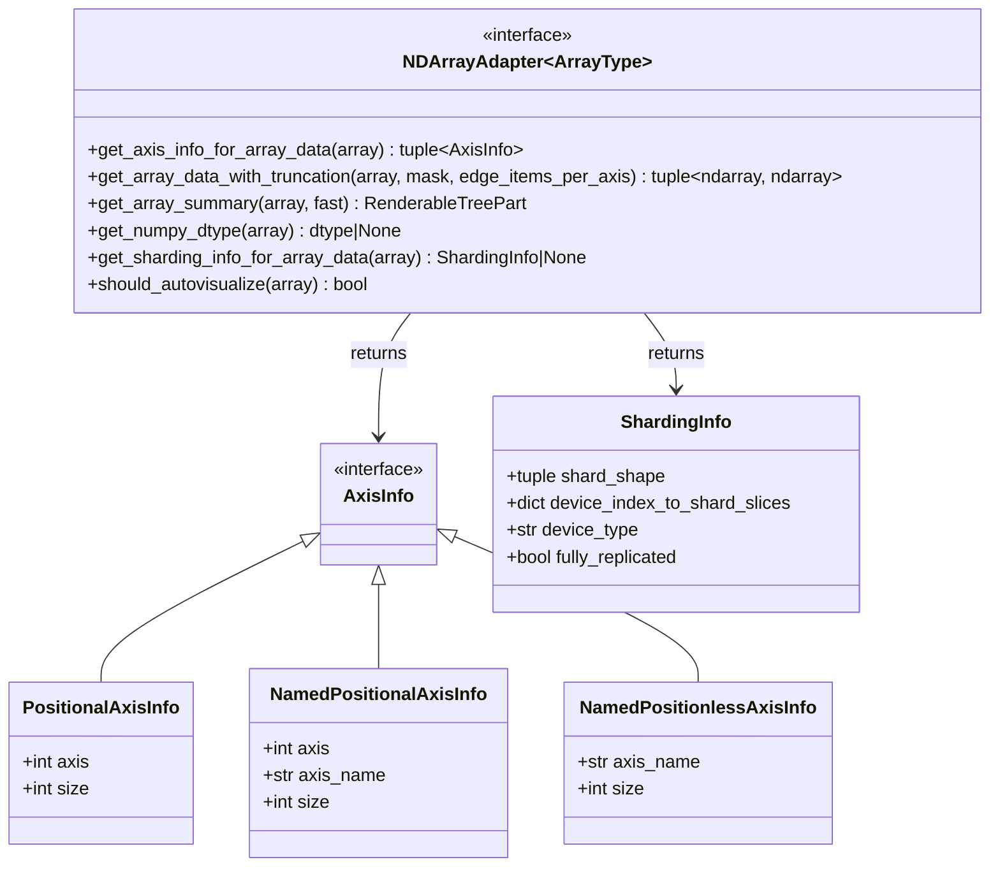
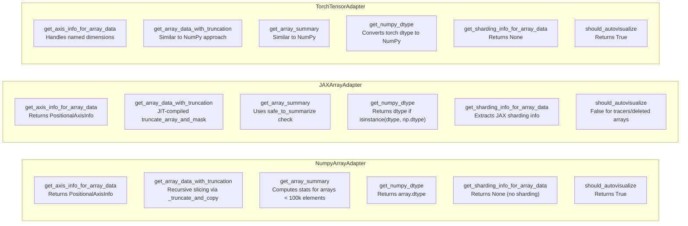
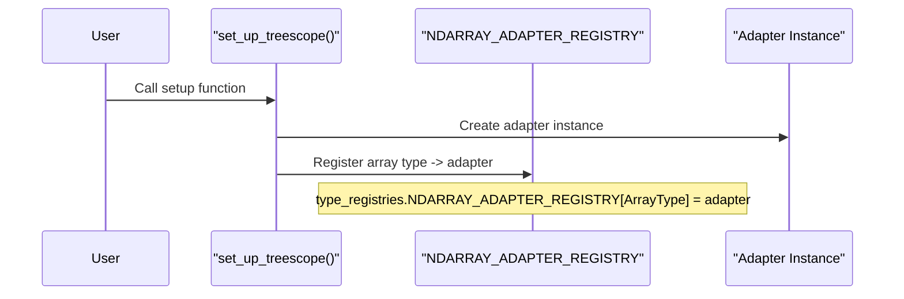
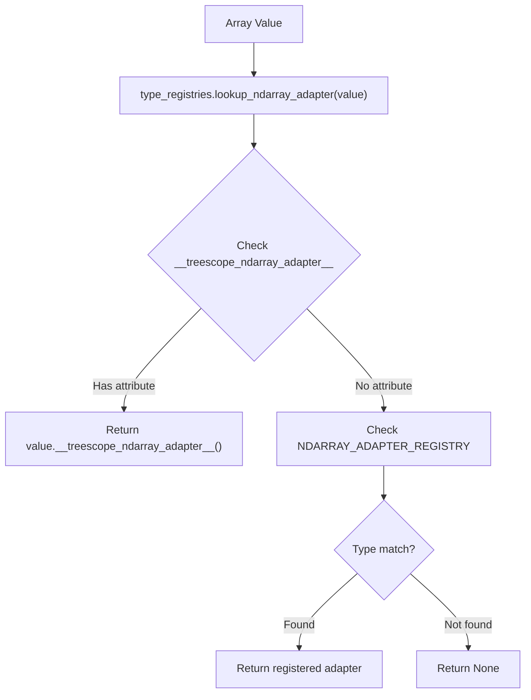
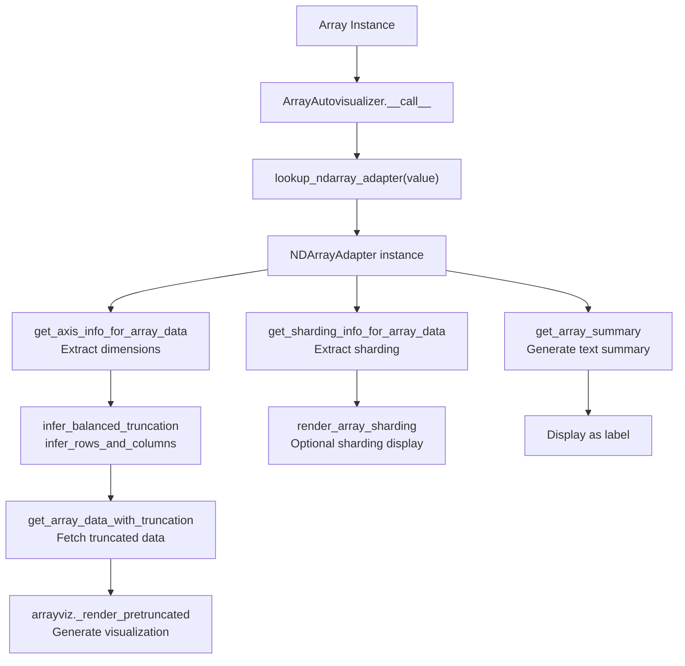
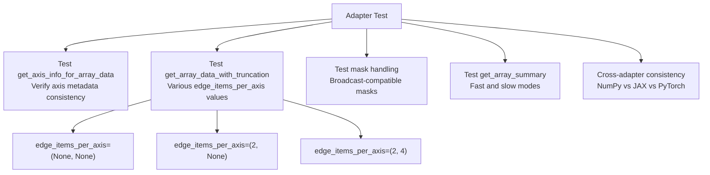

<!-- source: DeepWiki mcp.deepwiki.com · repo google-deepmind/treescope · page 4.4 NDArray Adapters · fetched 2026-10-26 -->

# NDArray Adapters

<details>
<summary>Relevant source files</summary>

The following files were used as context for generating this wiki page:

- [tests/__init__.py](tests/__init__.py)
- [tests/ndarray_adapters_test.py](tests/ndarray_adapters_test.py)
- [treescope/_internal/api/array_autovisualizer.py](treescope/_internal/api/array_autovisualizer.py)
- [treescope/_internal/handlers/generic_repr_handler.py](treescope/_internal/handlers/generic_repr_handler.py)
- [treescope/external/jax_support.py](treescope/external/jax_support.py)
- [treescope/external/numpy_support.py](treescope/external/numpy_support.py)

</details>


## Purpose and Scope

This document describes the NDArrayAdapter system, which provides a uniform interface for working with different array types (NumPy, JAX, PyTorch) in Treescope's array visualization pipeline. NDArray adapters abstract away the differences between array implementations, allowing the visualization system to work seamlessly with any registered array type.

For information about using the array visualization API, see [Array Rendering API](#4.1). For automatic array visualization, see [ArrayAutovisualizer](#4.2). For creating custom handlers for non-array types, see [Custom Type Handlers](#8.1).

## Overview

The NDArrayAdapter system enables Treescope to support multiple array libraries without tight coupling. Each array type (e.g., `np.ndarray`, `jax.Array`, `torch.Tensor`) has a corresponding adapter that implements a standard interface for extracting array metadata, truncating data, and providing summary information.

### Architecture

```mermaid
graph TB
    subgraph "Array Types"
        NumPy["np.ndarray"]
        JAX["jax.Array"]
        Torch["torch.Tensor"]
        Custom["Custom Array Type"]
    end
    
    subgraph "Adapter Layer"
        NumpyAdapter["NumpyArrayAdapter"]
        JAXAdapter["JAXArrayAdapter"]
        TorchAdapter["TorchTensorAdapter"]
        CustomAdapter["Custom Adapter"]
    end
    
    subgraph "Registry"
        Registry["NDARRAY_ADAPTER_REGISTRY"]
    end
    
    subgraph "Consumers"
        ArrayViz["ArrayAutovisualizer"]
        RenderArray["render_array"]
        ShardingViz["render_array_sharding"]
    end
    
    NumPy -.registered with.-> NumpyAdapter
    JAX -.registered with.-> JAXAdapter
    Torch -.registered with.-> TorchAdapter
    Custom -.registered with.-> CustomAdapter
    
    NumpyAdapter --> Registry
    JAXAdapter --> Registry
    TorchAdapter --> Registry
    CustomAdapter --> Registry
    
    Registry --> ArrayViz
    Registry --> RenderArray
    Registry --> ShardingViz
    
    ArrayViz -.calls methods on.-> NumpyAdapter
    ArrayViz -.calls methods on.-> JAXAdapter
    ArrayViz -.calls methods on.-> TorchAdapter
```

**Sources:** Diagram based on architecture overview from high-level diagrams and [treescope/external/jax_support.py:491-706](), [treescope/external/numpy_support.py:87-324]()

## The NDArrayAdapter Interface

The `NDArrayAdapter` interface is a generic class parameterized by the array type. Implementations must provide six methods to support array visualization and inspection.

### Interface Methods



**Sources:** [treescope/external/jax_support.py:491-573](), [treescope/external/numpy_support.py:87-213](), [treescope/_internal/api/array_autovisualizer.py:33-36]()

### Method Descriptions

| Method | Purpose | Return Type |
|--------|---------|-------------|
| `get_axis_info_for_array_data` | Extract axis metadata (names, positions, sizes) | `tuple[AxisInfo, ...]` |
| `get_array_data_with_truncation` | Retrieve array data with optional truncation and masking | `tuple[np.ndarray, np.ndarray]` |
| `get_array_summary` | Generate a text summary of the array for display | `RenderableTreePart` |
| `get_numpy_dtype` | Get the NumPy-compatible dtype if available | `np.dtype \| None` |
| `get_sharding_info_for_array_data` | Extract device sharding information | `ShardingInfo \| None` |
| `should_autovisualize` | Determine if this array should be auto-visualized | `bool` |

**Sources:** [treescope/external/jax_support.py:494-573](), [treescope/external/numpy_support.py:90-213]()

#### get_axis_info_for_array_data

Returns axis metadata for the array. The tuple length equals the number of dimensions. Each `AxisInfo` object describes an axis:

- **PositionalAxisInfo**: Unnamed axis with position and size
- **NamedPositionalAxisInfo**: Named axis with position, name, and size (e.g., PyTorch named tensors)
- **NamedPositionlessAxisInfo**: Named axis without a position (used for mesh axes)

```python
# Example from JAXArrayAdapter
def get_axis_info_for_array_data(self, array: jax.Array) -> tuple[AxisInfo, ...]:
    return tuple(
        PositionalAxisInfo(i, size)
        for i, size in enumerate(array.shape)
    )
```

**Sources:** [treescope/external/jax_support.py:494-501](), [treescope/external/numpy_support.py:90-96](), [tests/ndarray_adapters_test.py:156-177]()

#### get_array_data_with_truncation

Retrieves array data with optional truncation and masking. Returns a tuple of (data, mask), both as NumPy arrays.

Parameters:
- `array`: The array to truncate
- `mask`: Optional mask array (broadcast-compatible with array shape), or `None`
- `edge_items_per_axis`: Tuple specifying edge items to keep per axis (`None` = no truncation)

The method must handle truncation by keeping only the first and last `edge_items` elements along each axis, inserting a placeholder element (with mask=False) in the middle.

```python
# Example truncation specification
edge_items_per_axis = (2, None, 4)
# Means: keep 2 edge items on axis 0, all of axis 1, 4 edge items on axis 2
```

**Sources:** [treescope/external/jax_support.py:503-521](), [treescope/external/numpy_support.py:98-133](), [tests/ndarray_adapters_test.py:75-142]()

#### get_array_summary

Generates a `RenderableTreePart` that summarizes the array. The `fast` parameter indicates whether to compute statistics (when `False`) or just return basic metadata like shape and dtype (when `True`).

Summaries typically include:
- Array type prefix (e.g., "jax.Array", "np.ndarray")
- Dtype
- Shape
- Optional statistics (mean, std, min, max, special value counts)

**Sources:** [treescope/external/jax_support.py:522-544](), [treescope/external/numpy_support.py:135-209]()

#### get_numpy_dtype

Returns the NumPy dtype of the array if available, or `None` if the array uses a non-NumPy dtype (e.g., JAX's custom dtypes).

**Sources:** [treescope/external/jax_support.py:546-550](), [treescope/external/numpy_support.py:211-212]()

#### get_sharding_info_for_array_data

Extracts device sharding information for distributed arrays. Returns `None` for non-distributed arrays. The `ShardingInfo` object contains:
- `shard_shape`: Shape of individual shards
- `device_index_to_shard_slices`: Mapping from device IDs to slice tuples
- `device_type`: Type of devices (e.g., "TPU", "GPU", "CPU")
- `fully_replicated`: Whether the array is replicated across all devices

**Sources:** [treescope/external/jax_support.py:552-568](), [treescope/_internal/api/array_autovisualizer.py:174-220]()

#### should_autovisualize

Returns whether this array should be automatically visualized by `ArrayAutovisualizer`. Used to skip visualization of special array types like JAX tracers or deleted arrays.

**Sources:** [treescope/external/jax_support.py:570-572](), [treescope/_internal/api/array_autovisualizer.py:254-255]()

## Existing Adapters

Treescope includes three built-in adapters for common array types.

### Adapter Implementations



**Sources:** [treescope/external/numpy_support.py:87-213](), [treescope/external/jax_support.py:491-573](), [tests/ndarray_adapters_test.py:156-177]()

### NumpyArrayAdapter

The NumPy adapter is the reference implementation, providing straightforward access to NumPy array properties.

**Key characteristics:**
- Uses recursive slicing in `_truncate_and_copy` helper for truncation
- Computes summary statistics for arrays under 100,000 elements
- Always returns `True` for `should_autovisualize`
- Returns `None` for `get_sharding_info_for_array_data` (no sharding support)

**Sources:** [treescope/external/numpy_support.py:87-213]()

### JAXArrayAdapter

The JAX adapter handles JAX arrays with special consideration for distributed computing and JIT compilation.

**Key characteristics:**
- Uses `truncate_array_and_mask` function with JIT compilation for efficient truncation
- Falls back to NumPy for small arrays (< 10M elements) to avoid JIT overhead
- Checks `safe_to_summarize` before computing statistics (respects `summarization_threshold`)
- Extracts sharding information from `jax.sharding` objects
- Returns `False` for tracers and deleted arrays in `should_autovisualize`
- Handles device placement and replication metadata

**Special features:**
- `safe_to_summarize()`: Checks array size against device-specific thresholds
- `faster_array_repr()`: Optimized repr computation that truncates before host transfer
- `summarize_array_data()`: Computes statistics with special handling for tracers

**Sources:** [treescope/external/jax_support.py:90-573]()

### TorchTensorAdapter

The PyTorch adapter (implementation not shown in provided files, but referenced in tests) supports both standard and named tensors.

**Key characteristics:**
- Supports PyTorch's named tensor dimensions via `NamedPositionalAxisInfo`
- Converts PyTorch dtypes to NumPy-compatible dtypes
- Handles tensors on different devices (CPU, CUDA)

**Sources:** [tests/ndarray_adapters_test.py:156-177]()

## Registration and Lookup

### Registration Process

Adapters are registered in the `NDARRAY_ADAPTER_REGISTRY` during library setup. Each array type is mapped to its corresponding adapter instance.



**Example registration code:**

```python
# From jax_support.py
def set_up_treescope():
    type_registries.NDARRAY_ADAPTER_REGISTRY[jax.Array] = JAXArrayAdapter()
    type_registries.TREESCOPE_HANDLER_REGISTRY[jax.Array] = render_jax_arrays
    # ... other registrations
```

**Sources:** [treescope/external/jax_support.py:664-708](), [treescope/external/numpy_support.py:322-326]()

### Lookup Process

The `type_registries.lookup_ndarray_adapter()` function retrieves the appropriate adapter for a given array instance. This function is used by visualization components to obtain the adapter without knowing the specific array type.



**Sources:** [treescope/_internal/api/array_autovisualizer.py:252](), [tests/ndarray_adapters_test.py:63-66]()

## Adapter Usage in Visualization Pipeline

The array visualization pipeline uses adapters at multiple stages:



**Sources:** [treescope/_internal/api/array_autovisualizer.py:91-244](), [treescope/_internal/api/array_autovisualizer.py:246-297]()

### Truncation Workflow

The truncation process is critical for displaying large arrays efficiently:

| Step | Function | Adapter Method |
|------|----------|----------------|
| 1. Determine truncation | `infer_balanced_truncation` | Uses axis sizes from `get_axis_info_for_array_data` |
| 2. Request truncated data | Array visualization | Calls `get_array_data_with_truncation` |
| 3. Adapter truncates | Adapter implementation | Returns (data, mask) tuple with placeholders |
| 4. Render truncated data | `arrayviz_impl` | Uses returned NumPy arrays |

**Sources:** [treescope/_internal/api/array_autovisualizer.py:114-135]()

## Custom Adapter Implementation

To support a custom array type, implement the `NDArrayAdapter` interface and register it.

### Implementation Template

```python
from treescope import ndarray_adapters
from treescope import type_registries
import numpy as np

class CustomArrayAdapter(ndarray_adapters.NDArrayAdapter[CustomArrayType]):
    def get_axis_info_for_array_data(
        self, array: CustomArrayType
    ) -> tuple[ndarray_adapters.AxisInfo, ...]:
        # Return axis information
        return tuple(
            ndarray_adapters.PositionalAxisInfo(i, size)
            for i, size in enumerate(array.shape)
        )
    
    def get_array_data_with_truncation(
        self,
        array: CustomArrayType,
        mask: np.ndarray | None,
        edge_items_per_axis: tuple[int | None, ...],
    ) -> tuple[np.ndarray, np.ndarray]:
        # Convert to NumPy and truncate
        # Must handle mask broadcasting and placeholder insertion
        ...
    
    def get_array_summary(
        self, array: CustomArrayType, fast: bool
    ) -> rendering_parts.RenderableTreePart:
        # Generate summary text
        ...
    
    def get_numpy_dtype(self, array: CustomArrayType) -> np.dtype | None:
        # Return NumPy-compatible dtype or None
        ...
    
    def get_sharding_info_for_array_data(
        self, array: CustomArrayType
    ) -> ndarray_adapters.ShardingInfo | None:
        # Return sharding info for distributed arrays, or None
        return None
    
    def should_autovisualize(self, array: CustomArrayType) -> bool:
        # Return whether to auto-visualize this array
        return True

# Register the adapter
type_registries.NDARRAY_ADAPTER_REGISTRY[CustomArrayType] = CustomArrayAdapter()
```

**Sources:** Template structure based on [treescope/external/jax_support.py:491-573]() and [treescope/external/numpy_support.py:87-213]()

### Alternative: Per-Instance Adapters

For types that cannot be registered globally, implement the `__treescope_ndarray_adapter__` method:

```python
class CustomArray:
    def __treescope_ndarray_adapter__(self) -> ndarray_adapters.NDArrayAdapter:
        return CustomArrayAdapter()
```

This method is checked before consulting the registry during adapter lookup.

**Sources:** Inferred from lookup pattern in [treescope/_internal/api/array_autovisualizer.py:252]()

## Testing Adapters

The test suite includes comprehensive adapter tests to ensure consistency across implementations.

### Key Test Patterns



**Sources:** [tests/ndarray_adapters_test.py:32-222]()

### Example Test

The test suite verifies that different adapters produce identical results for equivalent operations:

```python
# Test pattern from ndarray_adapters_test.py
def test_adapter_positional_numpy_consistency(self, array_type, dtype):
    # Create equivalent arrays in NumPy, JAX, PyTorch
    array_np = ...
    array_other = convert_to_type(array_np, array_type)
    
    # Get adapters
    np_adapter = lookup_ndarray_adapter(array_np)
    other_adapter = lookup_ndarray_adapter(array_other)
    
    # Verify consistency
    assert np_adapter.get_axis_info(...) == other_adapter.get_axis_info(...)
    assert_arrays_equal(
        np_adapter.get_array_data_with_truncation(...),
        other_adapter.get_array_data_with_truncation(...)
    )
```

**Sources:** [tests/ndarray_adapters_test.py:42-154]()

---

