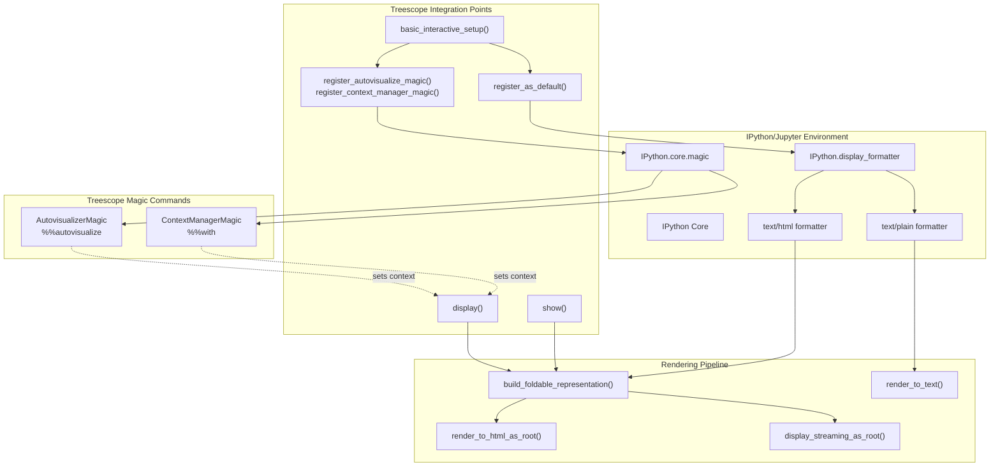
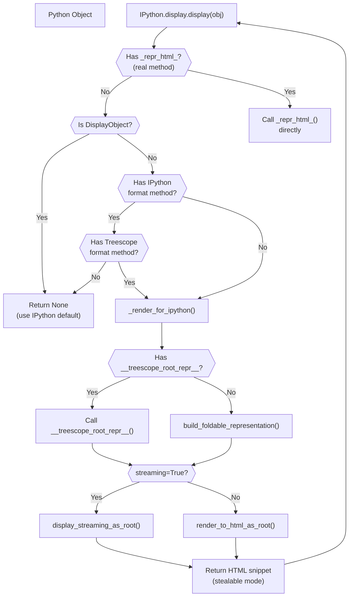
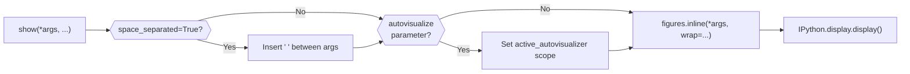
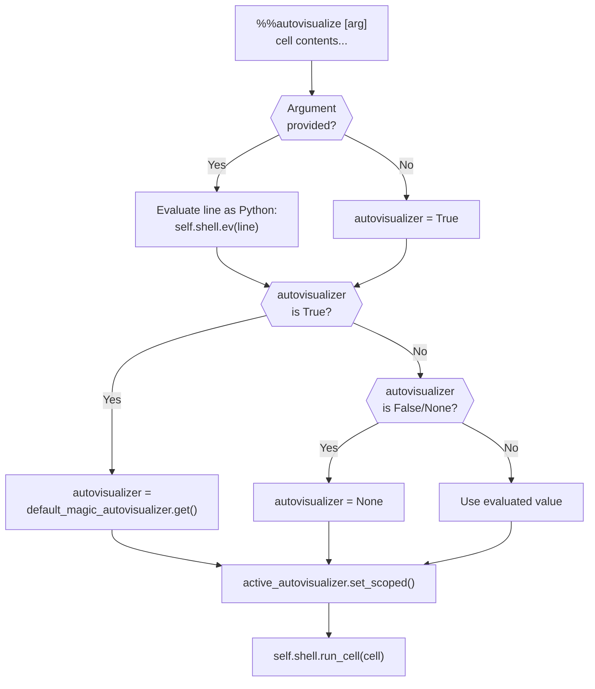
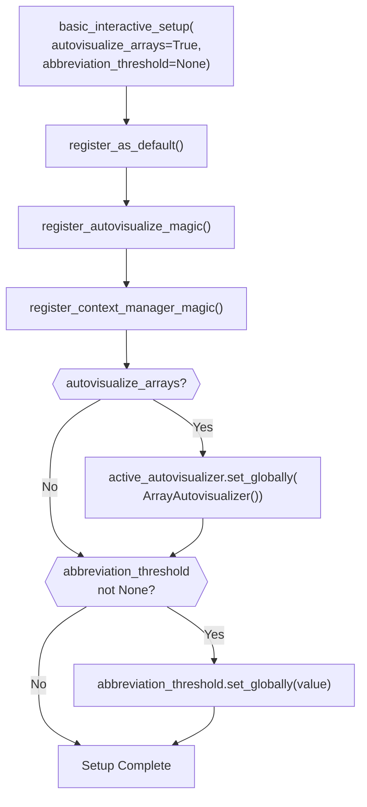

<!-- source: DeepWiki mcp.deepwiki.com · repo google-deepmind/treescope · page 5 IPython and Jupyter Integration · fetched 2026-10-26 -->

# IPython and Jupyter Integration

<details>
<summary>Relevant source files</summary>

The following files were used as context for generating this wiki page:

- [docs/api/treescope.rst](docs/api/treescope.rst)
- [treescope/__init__.py](treescope/__init__.py)
- [treescope/_internal/api/ipython_integration.py](treescope/_internal/api/ipython_integration.py)
- [treescope/rendering_parts.py](treescope/rendering_parts.py)

</details>


## Purpose and Scope

This page explains how Treescope integrates with IPython and Jupyter notebook environments to provide interactive HTML visualizations. It covers the mechanisms by which Treescope hooks into IPython's display system, registers as a formatter, and provides convenience functions for rendering objects.

For detailed documentation of individual display functions, see [Display Functions](#5.1). For magic command syntax and usage, see [Magic Commands](#5.2). For configuration options and context management, see [Configuration and Context](#5.3). For details on the rendering pipeline that powers these displays, see [Core Rendering System](#3).

## Integration Architecture

Treescope integrates with IPython at multiple levels to provide seamless interactive visualization:



**Integration Architecture Overview**

Sources: [treescope/_internal/api/ipython_integration.py:1-547]()

The integration operates through three primary mechanisms:

1. **Display Formatter Registration**: `register_as_default()` hooks into IPython's formatter system to render objects as HTML or text
2. **Direct Display Functions**: `display()` and `show()` provide explicit rendering control
3. **Magic Commands**: Cell-level directives (`%%autovisualize`, `%%with`) for scoped configuration

## Display Formatter Registration

The `register_as_default()` function establishes Treescope as IPython's default renderer for objects without specialized formatters:



**Formatter Registration Flow**

Sources: [treescope/_internal/api/ipython_integration.py:218-353]()

### Key Components

**Formatter Function**: `_render_for_ipython(value)` [treescope/_internal/api/ipython_integration.py:265-308]()

This function is registered with `IPython.display_formatter.formatters["text/html"]` for the `object` type, making it a fallback for all objects. It implements a priority system:

1. **Defer to `_repr_html_`**: If the object has a real `_repr_html_` method (not inherited), call it directly [treescope/_internal/api/ipython_integration.py:266-275]()
2. **Skip DisplayObjects**: If the object is an `IPython.display.DisplayObject`, return `None` to let IPython handle it [treescope/_internal/api/ipython_integration.py:277-279]()
3. **Check Format Methods**: If the object has IPython format methods (`_repr_pretty_`, `_repr_mimebundle_`) but no Treescope methods, return `None` [treescope/_internal/api/ipython_integration.py:281-292]()
4. **Render with Treescope**: Otherwise, render using Treescope's pipeline [treescope/_internal/api/ipython_integration.py:294-308]()

**Output Stealing**: The rendering is done in "stealable" mode [treescope/_internal/api/ipython_integration.py:300](), which means it displays immediately but returns an HTML snippet that can relocate the output to the correct position (e.g., after the "Out[]" marker in JupyterLab).

**Text Formatter**: For `jax.Array` specifically, a text formatter is registered to avoid copying large arrays to CPU [treescope/_internal/api/ipython_integration.py:314-328]().

**Formatter Ordering**: The HTML formatter is moved to the front of the formatter dict to ensure streaming outputs work correctly [treescope/_internal/api/ipython_integration.py:332-337]().

## Display Functions

Treescope provides two main functions for explicit rendering:

### display()

```mermaid
graph LR
    DisplayCall["display(value, ...)"]
    
    CheckAutovis{{"autovisualize<br/>parameter?"}}
    SetScope["Set active_autovisualizer<br/>scope"]
    
    DisplayHelper["_display_and_maybe_steal()"]
    
    CheckRootRepr{{"Has __treescope_root_repr__?"}}
    CallRoot["Call __treescope_root_repr__()"]
    BuildFoldable["build_foldable_representation()"]
    
    CheckStreaming{{"streaming=True?"}}
    StreamDisplay["display_streaming_as_root()"]
    StaticDisplay["render_to_html_as_root()<br/>+ IPython.display.display()"]
    
    DisplayCall --> CheckAutovis
    CheckAutovis -->|Yes| SetScope
    CheckAutovis -->|No| DisplayHelper
    SetScope --> DisplayHelper
    
    DisplayHelper --> CheckRootRepr
    CheckRootRepr -->|Yes| CallRoot
    CheckRootRepr -->|No| BuildFoldable
    CallRoot --> CheckStreaming
    BuildFoldable --> CheckStreaming
    
    CheckStreaming -->|Yes| StreamDisplay
    CheckStreaming -->|No| StaticDisplay
```



**display() Function Flow**

Sources: [treescope/_internal/api/ipython_integration.py:113-170]()

The `display()` function [treescope/_internal/api/ipython_integration.py:113-170]() renders a single value as an interactive foldable tree. Key parameters:

- `value`: The object to display
- `ignore_exceptions`: Whether to catch rendering errors and show fallbacks [default: `False`]
- `roundtrip_mode`: Whether to start in roundtrip mode [default: `False`]
- `autovisualize`: Override for active autovisualizer - `True` uses default, `False` disables, or provide a custom autovisualizer [default: `None`]
- `streaming`: Whether to use streaming mode (displays structure immediately, fills in expensive parts later) [default: `True`]
- `compress_html`: Whether to zlib-compress output for transmission/storage [default: `True`]

### show()



**show() Function Flow**

Sources: [treescope/_internal/api/ipython_integration.py:172-216]()

The `show()` function [treescope/_internal/api/ipython_integration.py:172-216]() is similar to Python's `print()` but with rich display. It renders multiple objects inline, treating strings as plain text and other objects with their Treescope or IPython representations. Parameters:

- `*args`: Objects to show
- `wrap`: Whether to wrap at line end [default: `False`]
- `space_separated`: Whether to add spaces between objects [default: `True`]
- `autovisualize`: Same as `display()`

## Helper Function: _display_and_maybe_steal()

The core rendering logic is in `_display_and_maybe_steal()` [treescope/_internal/api/ipython_integration.py:51-111](), which both `display()` and the registered formatter use. It handles:

1. **Deferred Rendering Collection**: If `streaming=True`, collects deferred renderings [treescope/_internal/api/ipython_integration.py:76-79]()
2. **Root Repr Method**: Checks for `__treescope_root_repr__` for custom root rendering [treescope/_internal/api/ipython_integration.py:81-85]()
3. **Foldable IR Construction**: Builds the intermediate representation [treescope/_internal/api/ipython_integration.py:87-91]()
4. **Streaming or Static**: Renders either as streaming (with deferred updates) or complete HTML [treescope/_internal/api/ipython_integration.py:92-110]()
5. **Stealable Mode**: Optionally returns HTML for output relocation [treescope/_internal/api/ipython_integration.py:98-99]()

Sources: [treescope/_internal/api/ipython_integration.py:51-111]()

## Magic Commands

Treescope provides two IPython magic commands for cell-level configuration:

### AutovisualizerMagic



**%%autovisualize Magic Flow**

Sources: [treescope/_internal/api/ipython_integration.py:356-442]()

The `AutovisualizerMagic` class [treescope/_internal/api/ipython_integration.py:357-442]() implements the `%%autovisualize` cell magic. Usage patterns:

1. **No arguments or `True`**: Uses `default_magic_autovisualizer` (usually `ArrayAutovisualizer`)
2. **`False` or `None`**: Disables autovisualization
3. **Expression**: Evaluates to an autovisualizer object

Example:
```python
%%autovisualize
result = {"array": jnp.ones((5, 5))}
result  # Arrays will be visualized
```

### ContextManagerMagic

Sources: [treescope/_internal/api/ipython_integration.py:444-475]()

The `ContextManagerMagic` class [treescope/_internal/api/ipython_integration.py:444-475]() implements the `%%with` cell magic for running cells under any context manager:

```python
%%with abbreviation_threshold.set_scoped(2)
large_object = {"nested": {"data": [1, 2, 3, ...]}}
large_object  # Will abbreviate at depth 2
```

The magic evaluates the line as a Python expression to get a context manager [treescope/_internal/api/ipython_integration.py:473](), then runs the cell within it [treescope/_internal/api/ipython_integration.py:474-475]().

## Setup and Registration Functions

### basic_interactive_setup()



**basic_interactive_setup() Flow**

Sources: [treescope/_internal/api/ipython_integration.py:514-546]()

The `basic_interactive_setup()` function [treescope/_internal/api/ipython_integration.py:514-546]() is a convenience function that performs common setup steps:

1. Calls `register_as_default()` to hook into IPython's display system
2. Calls `register_autovisualize_magic()` to enable `%%autovisualize`
3. Calls `register_context_manager_magic()` to enable `%%with`
4. If `autovisualize_arrays=True`, globally enables `ArrayAutovisualizer` [treescope/_internal/api/ipython_integration.py:540-542]()
5. If `abbreviation_threshold` is provided, sets it globally [treescope/_internal/api/ipython_integration.py:545-546]()

This is the recommended way to set up Treescope for interactive use.

### register_autovisualize_magic()

Sources: [treescope/_internal/api/ipython_integration.py:482-495]()

Registers the `AutovisualizerMagic` class with IPython [treescope/_internal/api/ipython_integration.py:495](). Must be called after IPython is available.

### register_context_manager_magic()

Sources: [treescope/_internal/api/ipython_integration.py:498-511]()

Registers the `ContextManagerMagic` class with IPython [treescope/_internal/api/ipython_integration.py:511](). Must be called after IPython is available.

## Contextual Configuration

The IPython integration uses a `ContextualValue` for the default magic autovisualizer:

**default_magic_autovisualizer** [treescope/_internal/api/ipython_integration.py:42-48]()

This determines which autovisualizer is used when `%%autovisualize` is called without arguments. Default value is `ArrayAutovisualizer()`. Users can override it:

```python
treescope.default_magic_autovisualizer.set_globally(my_custom_autovisualizer)
```

For more details on contextual configuration and scoping, see [Configuration and Context](#5.3).

## Colab-Specific Integration

Sources: [treescope/_internal/api/ipython_integration.py:339-352]()

When running in Google Colab, `register_as_default()` disables Colab's custom reprs for strings, ndarrays, and functions [treescope/_internal/api/ipython_integration.py:339-352]() to ensure consistent Treescope rendering.

## API Entry Points Summary

| Function | Purpose | Location |
|----------|---------|----------|
| `basic_interactive_setup()` | One-command setup for interactive use | [treescope/_internal/api/ipython_integration.py:514-546]() |
| `display()` | Display single object with Treescope | [treescope/_internal/api/ipython_integration.py:113-170]() |
| `show()` | Display multiple objects inline | [treescope/_internal/api/ipython_integration.py:172-216]() |
| `register_as_default()` | Hook into IPython's display system | [treescope/_internal/api/ipython_integration.py:218-353]() |
| `register_autovisualize_magic()` | Enable `%%autovisualize` magic | [treescope/_internal/api/ipython_integration.py:482-495]() |
| `register_context_manager_magic()` | Enable `%%with` magic | [treescope/_internal/api/ipython_integration.py:498-511]() |

Sources: [treescope/__init__.py:80-88](), [treescope/_internal/api/ipython_integration.py:1-547]()

---

