<!-- source: DeepWiki mcp.deepwiki.com · repo google-deepmind/treescope · page 5.1 Display Functions · fetched 2026-10-26 -->

# Display Functions

<details>
<summary>Relevant source files</summary>

The following files were used as context for generating this wiki page:

- [README.md](README.md)
- [docs/api/treescope.rst](docs/api/treescope.rst)
- [docs/index.rst](docs/index.rst)
- [treescope/_internal/api/ipython_integration.py](treescope/_internal/api/ipython_integration.py)
- [treescope/rendering_parts.py](treescope/rendering_parts.py)

</details>


This document covers the primary functions for displaying Python objects using Treescope in IPython/Jupyter environments: `treescope.display()`, `treescope.show()`, and `treescope.register_as_default()`. These functions provide different interfaces for rendering objects with Treescope's interactive visualizations.

For information about IPython magic commands (`%%autovisualize`, `%%with`), see [Magic Commands](#5.2). For details about configuration options and context management, see [Configuration and Context](#5.3).

## Overview

Treescope provides three main entry points for displaying objects in IPython/Jupyter:

| Function | Purpose | When to Use |
|----------|---------|-------------|
| `treescope.display()` | Displays a single value with full control over rendering options | When you need explicit control over streaming, compression, or roundtrip mode |
| `treescope.show()` | Displays multiple objects inline, similar to `print()` | When you want to quickly show multiple values with rich formatting |
| `treescope.register_as_default()` | Registers Treescope as IPython's default renderer | When you want all cell outputs to automatically use Treescope |

### Display Functions Architecture

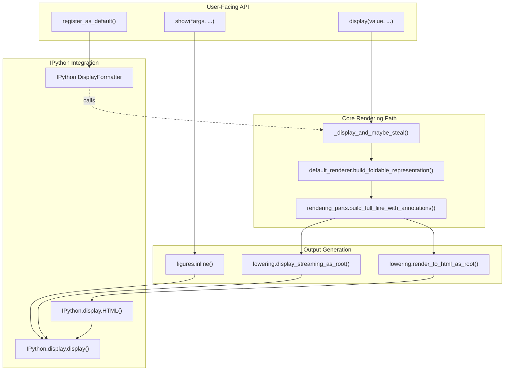

Sources: [treescope/_internal/api/ipython_integration.py:1-547]()

## The `display()` Function

The `display()` function is the primary way to explicitly render a value with Treescope in IPython/Jupyter notebooks. It provides full control over rendering options including streaming, compression, and autovisualization.

### Function Signature

```python
def display(
    value: Any,
    ignore_exceptions: bool = False,
    roundtrip_mode: bool = False,
    autovisualize: bool | Autovisualizer | None = None,
    streaming: bool = True,
    compress_html: bool = True,
)
```

### Parameters

| Parameter | Type | Default | Description |
|-----------|------|---------|-------------|
| `value` | `Any` | Required | The Python object to display |
| `ignore_exceptions` | `bool` | `False` | Whether to catch errors during rendering of subtrees and show a fallback |
| `roundtrip_mode` | `bool` | `False` | Whether to start in roundtrip mode (shows qualified type names) |
| `autovisualize` | `bool \| Autovisualizer \| None` | `None` | Controls automatic visualization: `True` for default autovisualizer, `False` to disable, an `Autovisualizer` object for custom, or `None` to use active context |
| `streaming` | `bool` | `True` | Whether to render in streaming mode (displays structure immediately while computing expensive parts) |
| `compress_html` | `bool` | `True` | Whether to zlib-compress HTML to reduce size |

### Rendering Flow

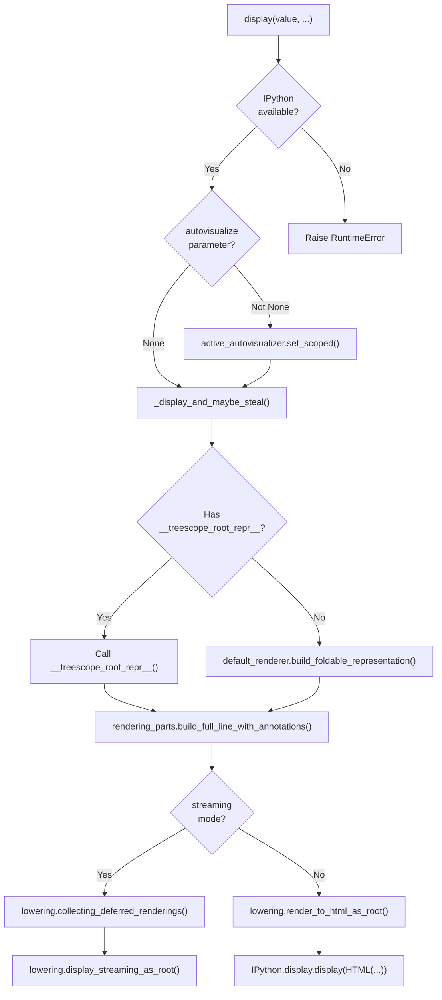

Sources: [treescope/_internal/api/ipython_integration.py:113-170]()

### Example Usage

```python
import treescope
import jax.numpy as jnp

# Basic display
treescope.display({"key": [1, 2, 3]})

# With array autovisualization
treescope.display(
    jnp.array([[1, 2], [3, 4]]),
    autovisualize=True
)

# In roundtrip mode with error handling
treescope.display(
    complex_object,
    roundtrip_mode=True,
    ignore_exceptions=True
)

# Disable streaming for stable HTML output
treescope.display(
    my_data,
    streaming=False
)
```

### Autovisualize Parameter Behavior

The `autovisualize` parameter controls automatic visualization for the display call:

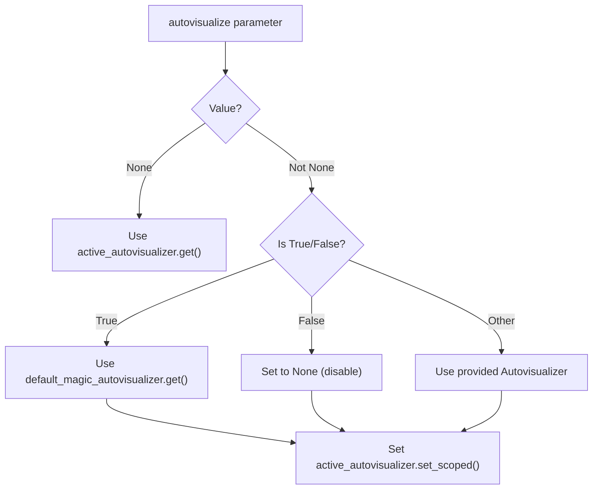

Sources: [treescope/_internal/api/ipython_integration.py:149-159]()

## The `show()` Function

The `show()` function displays multiple objects inline, similar to Python's `print()` function but with rich Treescope formatting. It's particularly useful for quick inspection of multiple values.

### Function Signature

```python
def show(
    *args,
    wrap: bool = False,
    space_separated: bool = True,
    autovisualize: bool | Autovisualizer | None = None,
)
```

### Parameters

| Parameter | Type | Default | Description |
|-----------|------|---------|-------------|
| `*args` | Multiple values | Required | Values to show. Strings display as themselves, other objects use Treescope or IPython rendering |
| `wrap` | `bool` | `False` | Whether to wrap at the end of the line |
| `space_separated` | `bool` | `True` | Whether to add single spaces between objects |
| `autovisualize` | `bool \| Autovisualizer \| None` | `None` | Controls automatic visualization (same as `display()`) |

### Object Handling

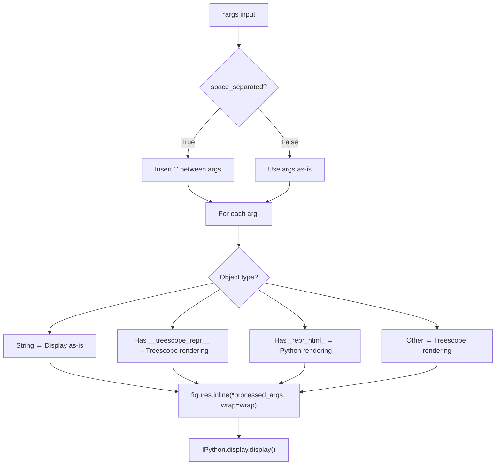

Sources: [treescope/_internal/api/ipython_integration.py:172-216]()

### Example Usage

```python
import treescope

# Show multiple values with automatic spacing
treescope.show("Result:", result, "Status:", status)

# Show without spacing
treescope.show("x=", x, space_separated=False)

# Show with wrapping enabled
treescope.show(
    "Long output:", data1, data2, data3,
    wrap=True
)

# Show with array visualization
treescope.show(
    "Array:", my_array,
    autovisualize=True
)
```

### Comparison: `display()` vs `show()`

| Feature | `display()` | `show()` |
|---------|-------------|----------|
| Number of arguments | Single value | Multiple values |
| Output style | Full tree rendering | Inline formatting |
| Streaming control | Yes | No (always static) |
| Compression control | Yes | No |
| Roundtrip mode | Yes | No |
| Space separation | N/A | Yes (configurable) |
| Wrapping | N/A | Yes (configurable) |
| Use case | Primary rendering function | Quick multi-value inspection |

Sources: [treescope/_internal/api/ipython_integration.py:113-216]()

## The `register_as_default()` Function

The `register_as_default()` function configures Treescope as IPython's default renderer for all cell outputs. This enables automatic Treescope rendering without explicitly calling `display()` or `show()`.

### Function Signature

```python
def register_as_default(
    streaming: bool = True,
    compress_html: bool = True,
)
```

### Parameters

| Parameter | Type | Default | Description |
|-----------|------|---------|-------------|
| `streaming` | `bool` | `True` | Whether to use streaming mode for all renderings |
| `compress_html` | `bool` | `True` | Whether to compress HTML output |

### Registration Process

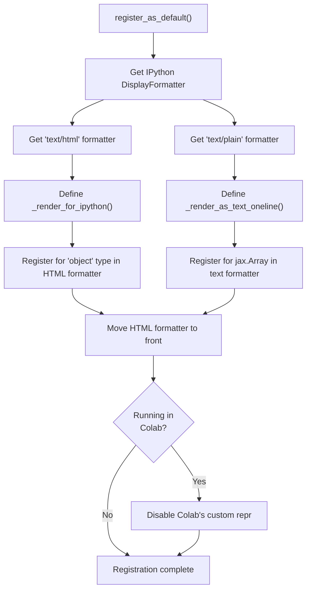

Sources: [treescope/_internal/api/ipython_integration.py:218-353]()

### HTML Renderer Logic

The `_render_for_ipython()` function registered as the HTML formatter implements the following decision logic:

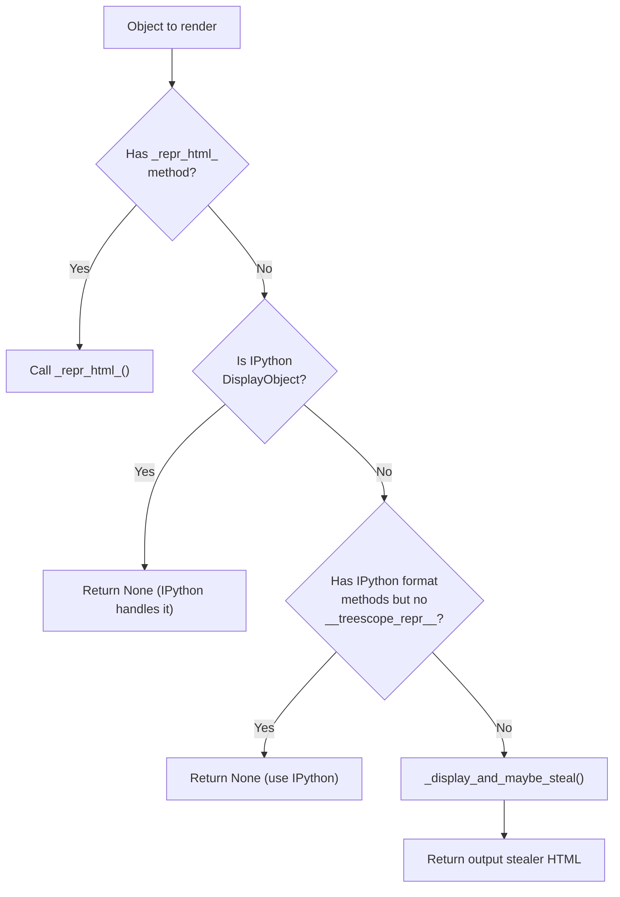

This logic ensures Treescope respects existing IPython display methods while providing fallback rendering for other objects.

Sources: [treescope/_internal/api/ipython_integration.py:265-308]()

### Output Stealing Mechanism

When `register_as_default()` is active, Treescope uses an "output stealing" mechanism to ensure rendered HTML appears in the correct location in Jupyter:

1. **Problem**: In streaming mode, the final rendered HTML is empty, which can cause issues with IPython's display system
2. **Solution**: Render with `stealable=True` to get an HTML snippet that relocates already-displayed content
3. **Implementation**: The stealer HTML is returned as the formatter result, ensuring correct placement

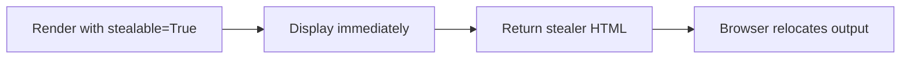

Sources: [treescope/_internal/api/ipython_integration.py:294-308]()

### Text Formatter for JAX Arrays

`register_as_default()` also registers a custom text formatter specifically for JAX arrays to avoid copying large arrays to host:

```python
def _render_as_text_oneline(value, p, cycle):
    with default_renderer.using_expansion_strategy(max_height=None):
        rendering = default_renderer.render_to_text(value, ignore_exceptions=True)
    for i, line in enumerate(rendering.split("\n")):
        if i:
            p.break_()
        p.text(line)
```

This formatter is registered for `jaxlib.xla_extension.ArrayImpl` (JAX's internal array type).

Sources: [treescope/_internal/api/ipython_integration.py:314-328]()

### Example Usage

```python
import treescope

# Basic registration
treescope.register_as_default()

# Now all cell outputs use Treescope automatically
my_dict = {"a": 1, "b": [2, 3, 4]}
my_dict  # Automatically rendered with Treescope

# Registration with specific options
treescope.register_as_default(
    streaming=False,  # Disable streaming for stable outputs
    compress_html=False  # Disable compression for debugging
)
```

## Rendering Modes: Streaming vs Static

Treescope supports two rendering modes that affect how HTML output is generated and displayed.

### Streaming Mode (`streaming=True`)

In streaming mode, Treescope immediately displays the structure of the output while computing expensive leaf renderings asynchronously:

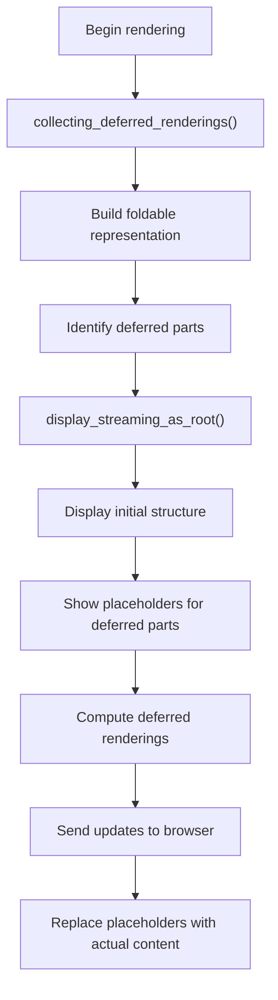

**Advantages:**
- Provides immediate feedback in interactive environments
- Better user experience for complex objects
- Allows interaction before full rendering completes

**Disadvantages:**
- Final HTML in notebook is empty (content delivered via updates)
- Can interfere with other IPython display handlers
- Not suitable for static notebook exports

Sources: [treescope/_internal/api/ipython_integration.py:76-100]()

### Static Mode (`streaming=False`)

In static mode, Treescope computes the complete rendering before displaying:

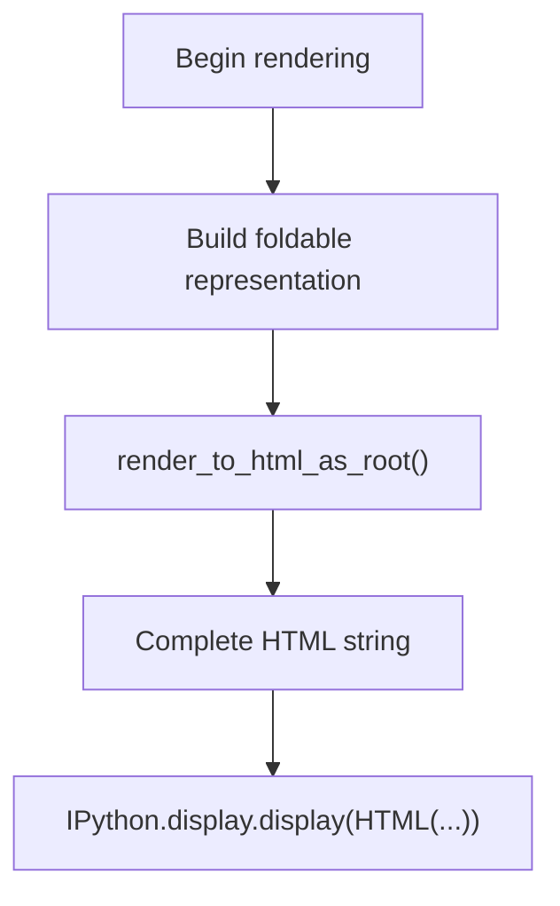

**Advantages:**
- Complete HTML in notebook cells
- Works with notebook exports
- Predictable behavior with other display handlers

**Disadvantages:**
- Slower initial display for complex objects
- No progressive rendering feedback

Sources: [treescope/_internal/api/ipython_integration.py:101-110]()

## The `_display_and_maybe_steal()` Helper

The `_display_and_maybe_steal()` function is the core implementation that both `display()` and `register_as_default()` use. It handles the actual rendering logic with optional output stealing.

### Function Signature

```python
def _display_and_maybe_steal(
    value: Any,
    ignore_exceptions: bool,
    roundtrip_mode: bool,
    streaming: bool,
    compress_html: bool,
    stealable: bool,
) -> str | None
```

### Implementation Flow

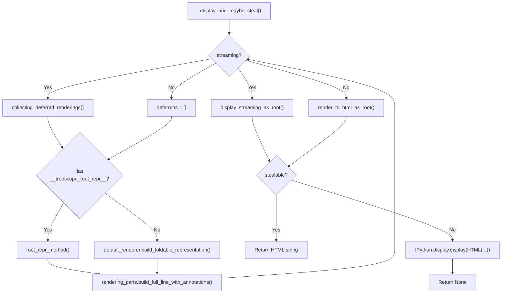

Sources: [treescope/_internal/api/ipython_integration.py:51-111]()

### Special Method: `__treescope_root_repr__`

Objects can define a `__treescope_root_repr__()` method to customize root-level rendering:

```python
class CustomObject:
    def __treescope_root_repr__(self):
        # Return a RenderableTreePart
        return rendering_parts.text("Custom root representation")
```

This method:
- Takes no arguments
- Returns a `RenderableTreePart` or `RenderableAndLineAnnotations`
- Bypasses the normal handler chain
- Only affects root-level rendering (use `__treescope_repr__` for general customization)

Sources: [treescope/_internal/api/ipython_integration.py:81-91](), [treescope/_internal/api/ipython_integration.py:239-245]()

## Integration with IPython Display System

### Display System Architecture

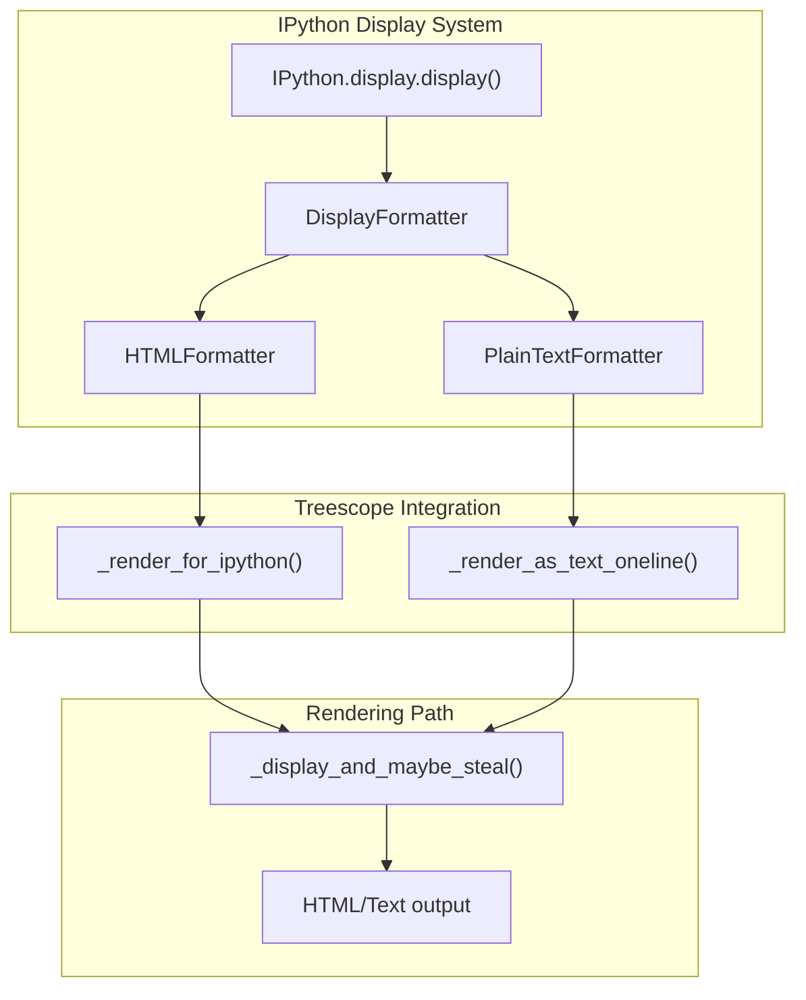

Sources: [treescope/_internal/api/ipython_integration.py:260-337]()

### Formatter Priority

When `register_as_default()` is called, it reorders IPython's formatters to ensure HTML rendering happens first:

```python
# Make sure the HTML formatter runs first
old_formatters = display_formatter.formatters
display_formatter.formatters = {}
display_formatter.formatters["text/html"] = cur_html_formatter
for k, v in old_formatters.items():
    if k != "text/html":
        display_formatter.formatters[k] = v
```

This ensures streaming outputs work correctly by having the HTML output precede any other format outputs.

Sources: [treescope/_internal/api/ipython_integration.py:330-337]()

## Summary of Key Functions

| Function | Module | Lines | Purpose |
|----------|--------|-------|---------|
| `display()` | `ipython_integration` | 113-170 | Explicitly display a value with full control |
| `show()` | `ipython_integration` | 172-216 | Display multiple values inline |
| `register_as_default()` | `ipython_integration` | 218-353 | Register Treescope as default renderer |
| `_display_and_maybe_steal()` | `ipython_integration` | 51-111 | Core rendering implementation |
| `_render_for_ipython()` | `ipython_integration` | 265-308 | HTML formatter for IPython |
| `_render_as_text_oneline()` | `ipython_integration` | 314-321 | Text formatter for JAX arrays |

Sources: [treescope/_internal/api/ipython_integration.py:1-547]()

---

