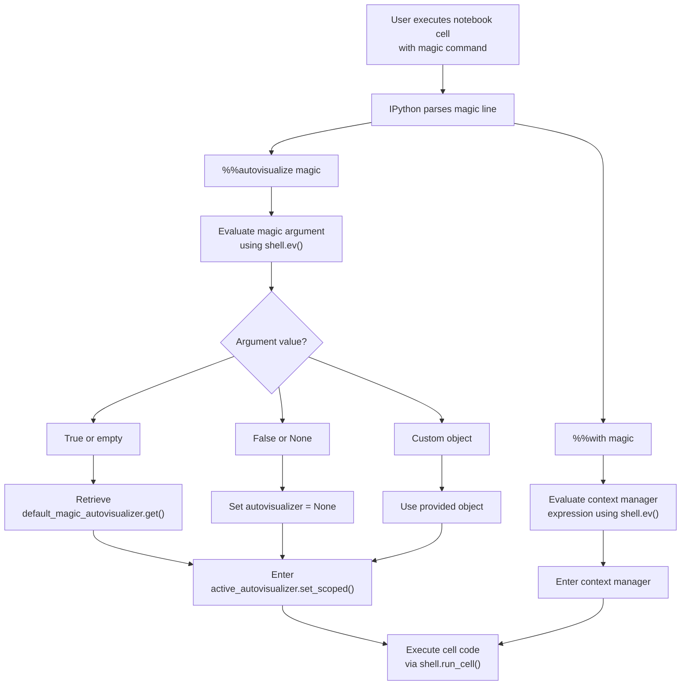
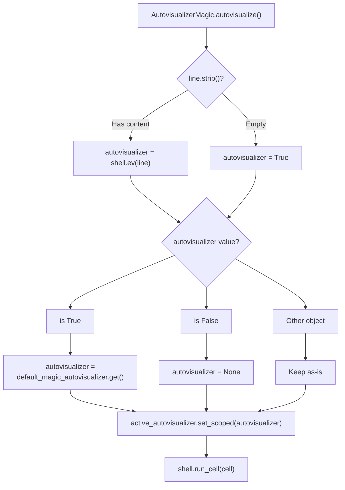
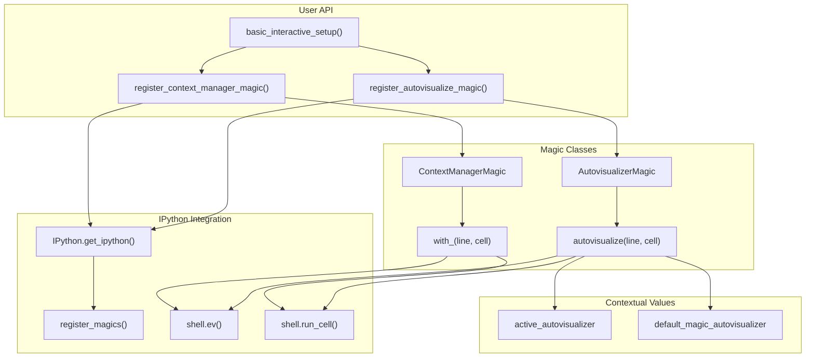
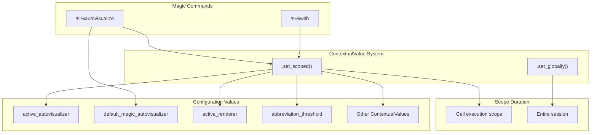

<!-- source: DeepWiki mcp.deepwiki.com · repo google-deepmind/treescope · page 5.2 Magic Commands · fetched 2026-10-26 -->

# Magic Commands

<details>
<summary>Relevant source files</summary>

The following files were used as context for generating this wiki page:

- [docs/api/treescope.rst](docs/api/treescope.rst)
- [docs/notebooks/array_visualization.ipynb](docs/notebooks/array_visualization.ipynb)
- [docs/notebooks/building_custom_visualizations.ipynb](docs/notebooks/building_custom_visualizations.ipynb)
- [docs/notebooks/pretty_printing.ipynb](docs/notebooks/pretty_printing.ipynb)
- [treescope/_internal/api/ipython_integration.py](treescope/_internal/api/ipython_integration.py)
- [treescope/rendering_parts.py](treescope/rendering_parts.py)

</details>


## Purpose and Scope

This page documents the IPython/Jupyter magic commands provided by Treescope for cell-level configuration. Magic commands allow users to temporarily override configuration settings for a single notebook cell without explicit context manager boilerplate.

For information about the underlying configuration system and contextual values, see [Configuration and Context](#5.3). For general display functions, see [Display Functions](#5.1).

**Sources**: [treescope/_internal/api/ipython_integration.py:355-512]()

---

## Overview

Treescope provides two cell magic commands for IPython/Jupyter notebooks:

| Magic Command | Purpose | Typical Use Case |
|--------------|---------|------------------|
| `%%autovisualize` | Enable/disable/configure automatic visualization for cell outputs | Temporarily enable array visualization or use custom autovisualizer |
| `%%with` | Run cell code within a context manager scope | Temporarily override any `ContextualValue` setting |

Both magics are registered by calling `register_autovisualize_magic()` and `register_context_manager_magic()`, respectively. The `basic_interactive_setup()` function registers both automatically.

**Sources**: [treescope/_internal/api/ipython_integration.py:482-512](), [treescope/_internal/api/ipython_integration.py:514-547]()

---

## Magic Command Processing Flow



**Sources**: [treescope/_internal/api/ipython_integration.py:361-442](), [treescope/_internal/api/ipython_integration.py:448-475]()

---

## The `%%autovisualize` Magic

### Syntax

The `%%autovisualize` magic accepts an optional argument that specifies which autovisualizer to use:

```python
%%autovisualize [expression]
```

Where `[expression]` can be:
- **Empty or `True`**: Activates `default_magic_autovisualizer` (typically `ArrayAutovisualizer`)
- **`False` or `None`**: Disables autovisualization
- **Any Python expression**: Evaluates to an autovisualizer object

### Usage Examples

**Enable default autovisualizer:**
```python
%%autovisualize
treescope.display(some_arrays)
```

**Disable autovisualization:**
```python
%%autovisualize False
treescope.display(some_arrays)
```

**Use custom autovisualizer:**
```python
%%autovisualize treescope.ArrayAutovisualizer(maximum_size=100)
treescope.display(some_arrays)
```

**Use custom function:**
```python
%%autovisualize my_custom_visualizer_function
treescope.display(data)
```

**Sources**: [docs/notebooks/pretty_printing.ipynb:572-598](), [docs/notebooks/array_visualization.ipynb:890-913]()

### Implementation

The `%%autovisualize` magic is implemented by the `AutovisualizerMagic` class:



The magic expands to approximately:
```python
with treescope.active_autovisualizer.set_scoped(autovisualizer):
    # ... cell contents ...
    IPython.display.display(result)
```

**Sources**: [treescope/_internal/api/ipython_integration.py:361-442]()

### Key Implementation Details

| Component | Description | Code Reference |
|-----------|-------------|----------------|
| `default_magic_autovisualizer` | `ContextualValue` storing the default autovisualizer for the magic | [ipython_integration.py:42-48]() |
| `shell.ev(line)` | Evaluates the magic argument as Python expression | [ipython_integration.py:430]() |
| `active_autovisualizer.set_scoped()` | Creates scoped context for autovisualizer | [ipython_integration.py:441]() |
| `shell.run_cell(cell)` | Executes cell code within the context | [ipython_integration.py:442]() |

**Sources**: [treescope/_internal/api/ipython_integration.py:361-442]()

---

## The `%%with` Magic

### Syntax

The `%%with` magic takes a Python expression that evaluates to a context manager:

```python
%%with context_manager_expression
```

### Usage Examples

**Set a contextual value:**
```python
%%with treescope.abbreviation_threshold.set_scoped(2)
treescope.display(large_nested_structure)
```

**Combine multiple context managers:**
```python
%%with contextlib.ExitStack() as stack; stack.enter_context(value1.set_scoped(x)); stack.enter_context(value2.set_scoped(y))
# Note: Single line required for magic argument
treescope.display(data)
```

**Use custom context manager:**
```python
%%with my_custom_context_manager()
result = compute_something()
result
```

**Sources**: [treescope/_internal/api/ipython_integration.py:448-475]()

### Implementation

The `%%with` magic is implemented by the `ContextManagerMagic` class:


The magic expands to:
```python
with context_manager_expression:
    # ... cell contents ...
    IPython.display.display(result)
```

**Sources**: [treescope/_internal/api/ipython_integration.py:448-475]()

---

## Code Entity Mapping



**Sources**: [treescope/_internal/api/ipython_integration.py:355-512]()

---

## Registration and Setup

### Manual Registration

Magic commands must be registered with IPython before use:

```python
import treescope

# Register %%autovisualize
treescope.register_autovisualize_magic()

# Register %%with
treescope.register_context_manager_magic()
```

**Sources**: [treescope/_internal/api/ipython_integration.py:482-511]()

### Automatic Registration

The `basic_interactive_setup()` function registers both magics automatically:

```python
treescope.basic_interactive_setup()
# Now both %%autovisualize and %%with are available
```

**Sources**: [treescope/_internal/api/ipython_integration.py:514-547]()

### Registration Implementation

| Function | Implementation | Code Reference |
|----------|---------------|----------------|
| `register_autovisualize_magic()` | Calls `IPython.get_ipython().register_magics(AutovisualizerMagic)` | [ipython_integration.py:482-495]() |
| `register_context_manager_magic()` | Calls `IPython.get_ipython().register_magics(ContextManagerMagic)` | [ipython_integration.py:498-511]() |

Both functions check if IPython is available and raise `RuntimeError` if not.

**Sources**: [treescope/_internal/api/ipython_integration.py:482-511]()

---

## Relationship to Configuration System



Magic commands provide **cell-level scoping** as a convenience wrapper around `ContextualValue.set_scoped()`. They are equivalent to using explicit context managers but reduce boilerplate for interactive notebook usage.

**Sources**: [treescope/_internal/api/ipython_integration.py:361-475]()

---

## Implementation Details Table

| Aspect | `%%autovisualize` | `%%with` |
|--------|------------------|----------|
| **Magic Type** | Cell magic (`@cell_magic`) | Cell magic (`@cell_magic("with")`) |
| **Decorator Class** | `@IPython.core.magic.magics_class` | `@IPython.core.magic.magics_class` |
| **Argument Processing** | Evaluates as Python expression via `shell.ev()`, with special handling for True/False | Evaluates as Python expression via `shell.ev()` |
| **Context Setup** | Always uses `active_autovisualizer.set_scoped()` | Uses whatever context manager is returned |
| **Default Behavior** | Uses `default_magic_autovisualizer.get()` if argument is True or empty | No default; requires explicit context manager |
| **Cell Execution** | `shell.run_cell(cell)` within context | `shell.run_cell(cell)` within context |

**Sources**: [treescope/_internal/api/ipython_integration.py:355-479]()

---

## Error Handling

Both magic commands will raise errors in the following scenarios:

1. **IPython Not Available**: If executed outside IPython environment, registration functions raise `RuntimeError`
2. **Invalid Expression**: If the magic argument cannot be evaluated, `shell.ev()` raises appropriate Python exceptions
3. **Invalid Context Manager**: For `%%with`, if the expression doesn't return a valid context manager, Python raises `AttributeError` when entering context

**Sources**: [treescope/_internal/api/ipython_integration.py:482-511]()

---

## Complete Usage Example

```python
# Setup (run once per session)
import treescope
treescope.basic_interactive_setup()

# Example 1: Default array visualization
%%autovisualize
{
    "weights": jax.random.normal(jax.random.key(0), (10, 20)),
    "biases": jnp.zeros((20,))
}

# Example 2: Custom autovisualizer
%%autovisualize treescope.ArrayAutovisualizer(maximum_size=50)
large_model_weights

# Example 3: Disable autovisualization
%%autovisualize False
model_with_many_arrays

# Example 4: Set abbreviation threshold
%%with treescope.abbreviation_threshold.set_scoped(1)
deeply_nested_structure

# Example 5: Combine multiple settings
%%with treescope.active_expansion_strategy.set_scoped(treescope.balanced_layout)
complex_pytree
```

**Sources**: [docs/notebooks/pretty_printing.ipynb:572-598](), [docs/notebooks/array_visualization.ipynb:890-948]()

---

