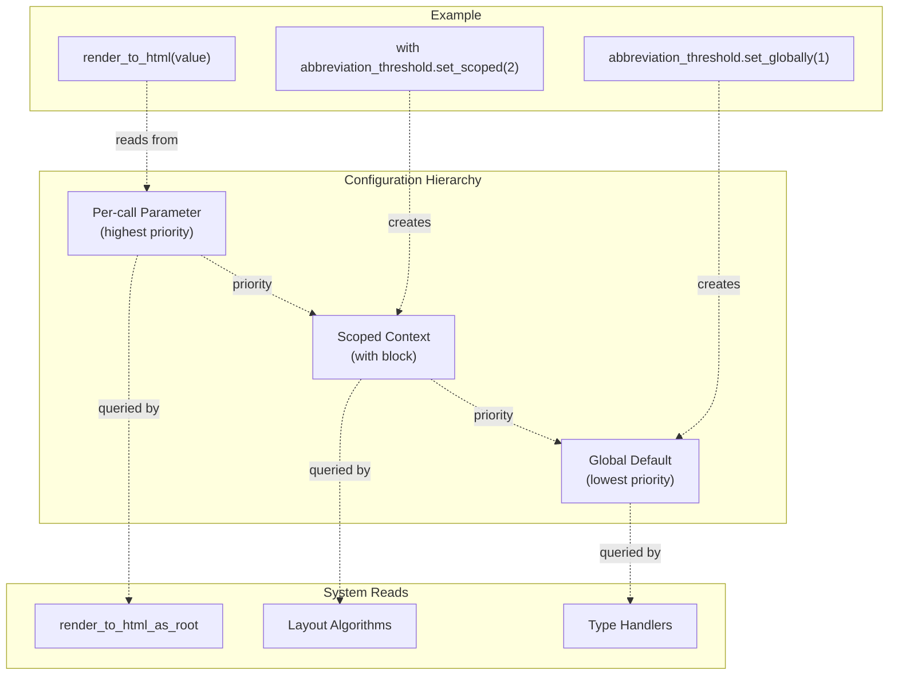
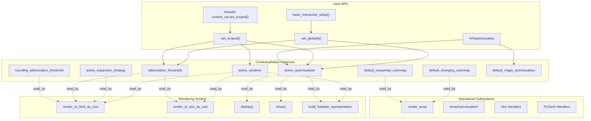
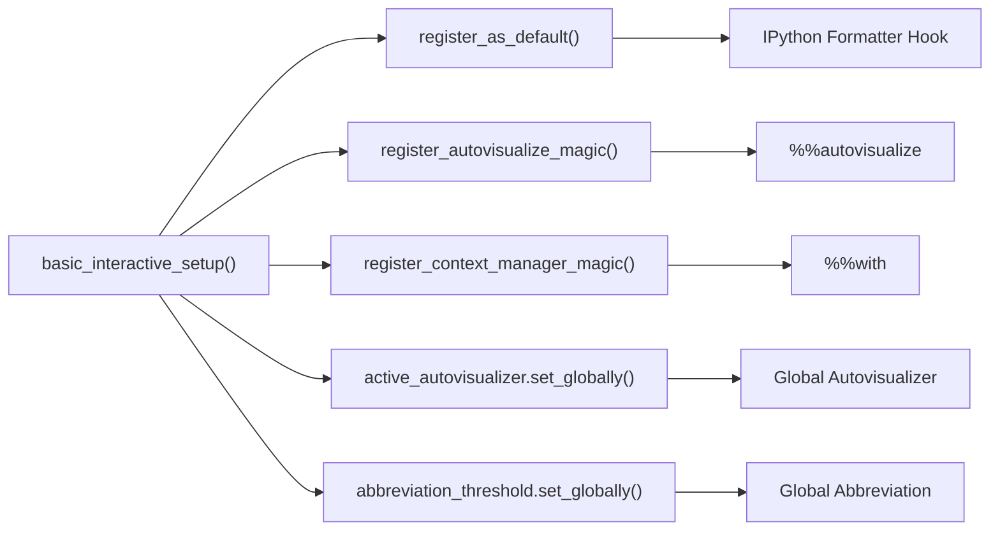
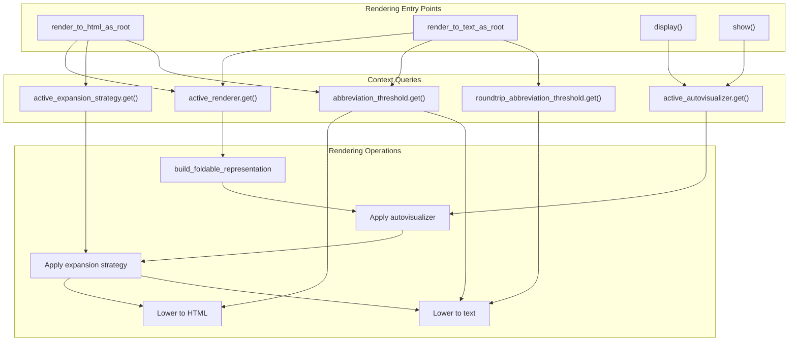
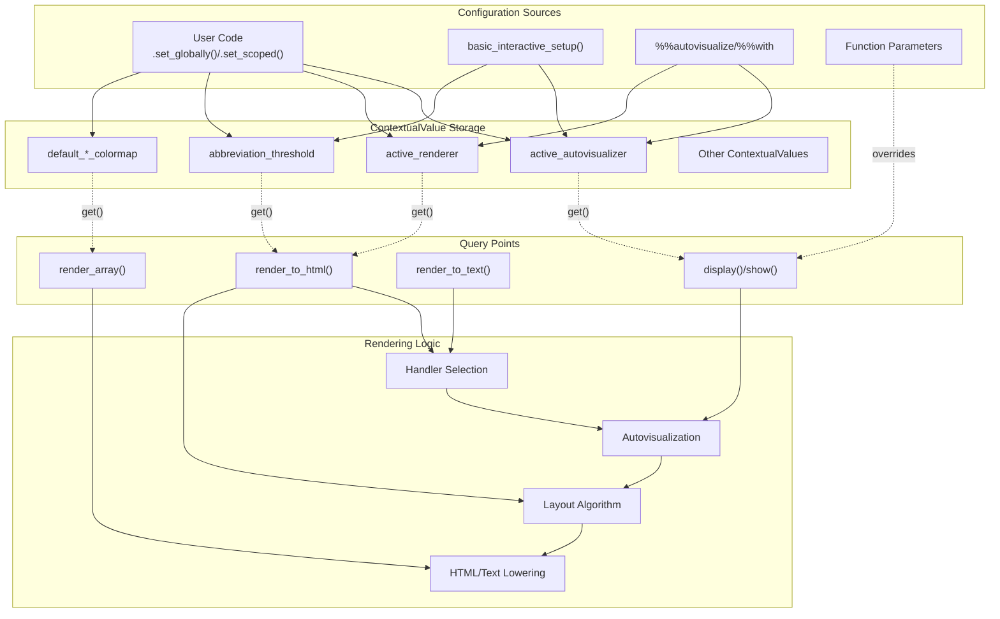

<!-- source: DeepWiki mcp.deepwiki.com · repo google-deepmind/treescope · page 5.3 Configuration and Context · fetched 2026-10-26 -->

# Configuration and Context

<details>
<summary>Relevant source files</summary>

The following files were used as context for generating this wiki page:

- [docs/api/treescope.rst](docs/api/treescope.rst)
- [treescope/__init__.py](treescope/__init__.py)
- [treescope/_internal/api/ipython_integration.py](treescope/_internal/api/ipython_integration.py)
- [treescope/rendering_parts.py](treescope/rendering_parts.py)

</details>


## Purpose and Scope

This page explains Treescope's configuration system, which uses a `ContextualValue` pattern to manage rendering options across different scopes. It covers the available configuration options, how to set them globally or temporarily, and how the system reads these values during rendering.

For information about IPython integration APIs like `display()` and `show()`, see [Display Functions](#5.1). For details on magic commands syntax and usage, see [Magic Commands](#5.2).

## The ContextualValue Pattern

Treescope's configuration system is built on `context.ContextualValue`, a pattern that provides hierarchical scoping with three levels:

1. **Global defaults** - Set permanently for the session
2. **Scoped contexts** - Temporary overrides within a `with` block
3. **Per-call parameters** - One-time overrides for specific function calls

Each configuration option is represented by a `ContextualValue` instance that can be queried by any part of the rendering system without explicit parameter passing.



**Sources:** [treescope/context.py](), [treescope/__init__.py:96-184]()

## Available Configuration Options

Treescope provides ten primary `ContextualValue` instances that control different aspects of rendering:

| ContextualValue | Type | Purpose | Default Value |
|----------------|------|---------|---------------|
| `active_autovisualizer` | `Autovisualizer \| None` | Controls automatic visualization of tree nodes | `None` |
| `active_renderer` | `TreescopeRenderer` | Handler chain and postprocessors for rendering | Default renderer instance |
| `active_expansion_strategy` | `Callable` | Determines default fold/expand states | `expand_to_depth` |
| `default_magic_autovisualizer` | `Autovisualizer` | Autovisualizer used by `%%autovisualize` magic | `ArrayAutovisualizer()` |
| `abbreviation_threshold` | `int \| None` | Depth at which to abbreviate collapsed nodes | `None` (no abbreviation) |
| `roundtrip_abbreviation_threshold` | `int \| None` | Depth threshold for roundtrip mode | `None` (no abbreviation) |
| `default_diverging_colormap` | `list[tuple[int, int, int]]` | Colormap for around-zero array values | Built-in diverging colormap |
| `default_sequential_colormap` | `list[tuple[int, int, int]]` | Colormap for sequential array values | Built-in sequential colormap |
| `summarization_threshold` | `int` | JAX array size limit for full rendering | Large integer |
| `show_dynamic_attributes` | `bool` | Whether to inspect PyTorch module attributes | `False` |

**Sources:** [treescope/__init__.py:96-184](), [treescope/_internal/api/ipython_integration.py:42-48]()

## Configuration Scope Diagram



**Sources:** [treescope/_internal/api/ipython_integration.py:514-546](), [treescope/_internal/api/default_renderer.py]()

## Setting Configuration Values

### Global Configuration

Use `.set_globally()` to permanently change a configuration value for the entire session:

```python
import treescope

# Enable array autovisualization globally
treescope.active_autovisualizer.set_globally(
    treescope.ArrayAutovisualizer()
)

# Set abbreviation threshold
treescope.abbreviation_threshold.set_globally(2)

# Change default colormap
treescope.default_diverging_colormap.set_globally(custom_colormap)
```

Global settings persist until explicitly changed or until the Python session ends.

**Sources:** [treescope/_internal/api/ipython_integration.py:540-546]()

### Scoped Configuration

Use `.set_scoped()` as a context manager to temporarily override configuration:

```python
import treescope

# Temporarily enable autovisualization
with treescope.active_autovisualizer.set_scoped(
    treescope.ArrayAutovisualizer()
):
    treescope.display(my_model)  # Uses autovisualizer
    
treescope.display(my_model)  # No autovisualization

# Temporarily change abbreviation threshold
with treescope.abbreviation_threshold.set_scoped(1):
    result = treescope.render_to_html(large_object)
```

The original value is restored when exiting the `with` block.

**Sources:** [treescope/context.py]()

### Per-Call Parameters

Some functions accept direct parameter overrides:

```python
import treescope

# Override autovisualizer for one call
treescope.display(value, autovisualize=True)

# Disable autovisualization for one call
treescope.show(value, autovisualize=False)
```

Per-call parameters take precedence over scoped and global settings.

**Sources:** [treescope/_internal/api/ipython_integration.py:113-170]()

## The basic_interactive_setup Function

The `basic_interactive_setup()` function provides a convenient way to configure Treescope for interactive use:

```python
treescope.basic_interactive_setup(
    autovisualize_arrays=True,
    abbreviation_threshold=None
)
```

This function performs several setup steps:

1. Calls `register_as_default()` to make Treescope the default IPython renderer
2. Registers the `%%autovisualize` magic command
3. Registers the `%%with` magic command  
4. If `autovisualize_arrays=True`, sets `active_autovisualizer` globally to `ArrayAutovisualizer()`
5. If `abbreviation_threshold` is provided, sets it globally



**Sources:** [treescope/_internal/api/ipython_integration.py:514-546]()

## IPython Magic Commands and Context

### The %%autovisualize Magic

The `%%autovisualize` magic provides cell-level scoping for autovisualization:

```python
%%autovisualize
# Uses default_magic_autovisualizer
result = compute_model()
result
```

This expands to approximately:

```python
with treescope.active_autovisualizer.set_scoped(
    treescope.default_magic_autovisualizer.get()
):
    result = compute_model()
    IPython.display.display(result)
```

You can also specify a custom autovisualizer:

```python
%%autovisualize my_custom_autovisualizer
result = compute_model()
result
```

**Sources:** [treescope/_internal/api/ipython_integration.py:361-442]()

### The %%with Magic

The `%%with` magic allows using any context manager at the cell level:

```python
%%with treescope.abbreviation_threshold.set_scoped(1)
large_structure = build_large_tree()
large_structure
```

This is equivalent to:

```python
with treescope.abbreviation_threshold.set_scoped(1):
    large_structure = build_large_tree()
    IPython.display.display(large_structure)
```

**Sources:** [treescope/_internal/api/ipython_integration.py:444-475]()

## How Configuration is Read by the System

Different components of Treescope query `ContextualValue` instances at render time:



**Sources:** [treescope/_internal/api/default_renderer.py](), [treescope/_internal/api/ipython_integration.py:81-111]()

### Configuration Read Points

| Component | Reads Configuration | Purpose |
|-----------|-------------------|---------|
| `build_foldable_representation` | `active_renderer`, `active_autovisualizer` | Select handler chain and apply visualizations |
| `render_to_html_as_root` | `active_expansion_strategy`, `abbreviation_threshold` | Determine fold states and abbreviation |
| `render_to_text_as_root` | `active_renderer`, `abbreviation_threshold`, `roundtrip_abbreviation_threshold` | Text rendering with abbreviation |
| `display()` / `show()` | `active_autovisualizer` | Apply autovisualization override |
| `render_array` | `default_diverging_colormap`, `default_sequential_colormap` | Select colormaps for visualization |
| JAX handlers | `summarization_threshold` | Determine when to summarize vs fully render arrays |
| PyTorch handlers | `show_dynamic_attributes` | Control module attribute inspection |

**Sources:** [treescope/_internal/api/default_renderer.py](), [treescope/_internal/api/arrayviz.py](), [treescope/external/jax_support.py](), [treescope/external/torch_support.py]()

## Common Configuration Patterns

### Interactive Exploration

For interactive data exploration, enable array visualization and abbreviation:

```python
treescope.basic_interactive_setup(
    autovisualize_arrays=True,
    abbreviation_threshold=2
)
```

### Scripted Workflows

For scripts that generate HTML reports, configure once at the start:

```python
import treescope

treescope.active_autovisualizer.set_globally(
    treescope.ArrayAutovisualizer()
)
treescope.abbreviation_threshold.set_globally(1)
```

### Temporary Overrides

For specific rendering needs, use scoped contexts:

```python
# Render with full expansion
with treescope.active_expansion_strategy.set_scoped(lambda x: None):
    html = treescope.render_to_html(obj)

# Render without autovisualization
with treescope.active_autovisualizer.set_scoped(None):
    simple_html = treescope.render_to_html(obj)
```

### Custom Colormaps

Configure array colormaps for specific color schemes:

```python
# Use custom colormaps
custom_diverging = [(0, 0, 255), (255, 255, 255), (255, 0, 0)]
custom_sequential = [(255, 255, 255), (0, 128, 0)]

treescope.default_diverging_colormap.set_globally(custom_diverging)
treescope.default_sequential_colormap.set_globally(custom_sequential)
```

**Sources:** [treescope/__init__.py:17-30](), [treescope/_internal/api/ipython_integration.py:514-546]()

## Configuration Flow Diagram



**Sources:** [treescope/_internal/api/ipython_integration.py:51-170](), [treescope/_internal/api/default_renderer.py]()

---

