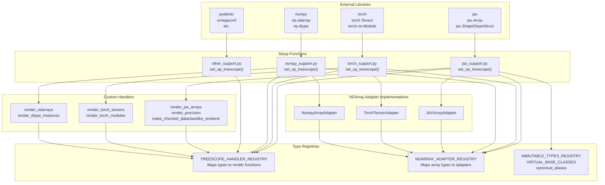
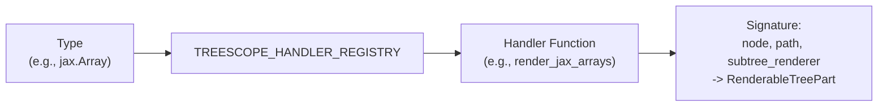
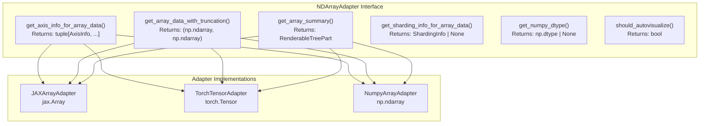
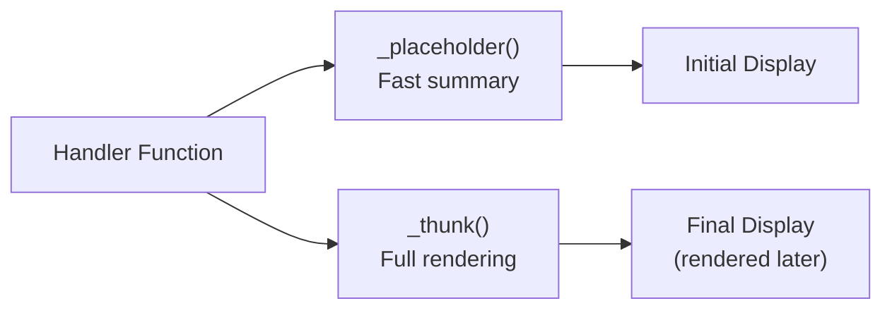
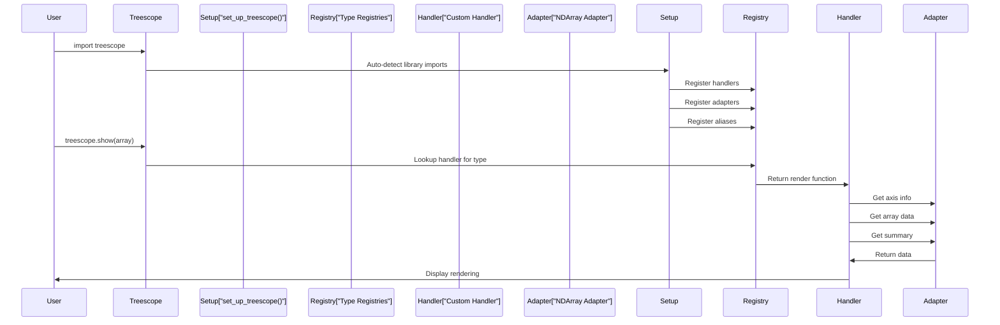

<!-- source: DeepWiki mcp.deepwiki.com · repo google-deepmind/treescope · page 6 External Library Support · fetched 2026-10-26 -->

# External Library Support

<details>
<summary>Relevant source files</summary>

The following files were used as context for generating this wiki page:

- [tests/__init__.py](tests/__init__.py)
- [tests/ndarray_adapters_test.py](tests/ndarray_adapters_test.py)
- [treescope/_internal/handlers/generic_repr_handler.py](treescope/_internal/handlers/generic_repr_handler.py)
- [treescope/external/jax_support.py](treescope/external/jax_support.py)
- [treescope/external/numpy_support.py](treescope/external/numpy_support.py)
- [treescope/external/torch_support.py](treescope/external/torch_support.py)

</details>


This page provides an overview of how Treescope integrates with external Python libraries through specialized handlers and adapters. Treescope supports major ML and scientific computing libraries including JAX, PyTorch, NumPy, Pydantic, and OmegaConf.

For details on specific library integrations:
- JAX-specific features: [JAX Support](#6.1)
- PyTorch-specific features: [PyTorch Support](#6.2)
- NumPy-specific features: [NumPy Support](#6.3)
- Pydantic and OmegaConf: [Pydantic and OmegaConf Support](#6.4)

For information on creating custom handlers or extending support to new libraries, see [Extending Treescope](#8).

## Architecture Overview

External library support in Treescope follows a consistent pattern where each library provides:

1. **Setup functions** that register library types with Treescope registries
2. **Custom handlers** that define how to render library-specific objects
3. **NDArray adapters** for array types that provide a uniform interface for visualization
4. **Configuration options** that control library-specific behavior



**Sources:** [treescope/external/jax_support.py:664-733](), [treescope/external/torch_support.py:584-598](), [treescope/external/numpy_support.py:322-343]()

## Setup Functions

Each external library support module provides a `set_up_treescope()` function that registers the library's types with Treescope. These setup functions are called automatically when Treescope detects that a library is imported, or can be called manually.

### Setup Function Pattern

All setup functions follow a common pattern:

```python
def set_up_treescope():
    """Sets up treescope to render <Library> objects."""
    if library is None:
        raise RuntimeError("Cannot set up <Library> support...")
    
    # Register handlers
    type_registries.TREESCOPE_HANDLER_REGISTRY[LibraryType] = render_function
    
    # Register adapters
    type_registries.NDARRAY_ADAPTER_REGISTRY[ArrayType] = AdapterClass()
    
    # Register additional metadata
    type_registries.IMMUTABLE_TYPES_REGISTRY[Type] = True
    canonical_aliases.populate_from_public_api(...)
```

### Library Setup Functions

| Library | Module | Function | Key Registrations |
|---------|--------|----------|-------------------|
| JAX | `treescope.external.jax_support` | `set_up_treescope()` | `jax.Array`, `jax.ShapeDtypeStruct`, tree utility keys, `jax.lax.Precision` |
| PyTorch | `treescope.external.torch_support` | `set_up_treescope()` | `torch.Tensor`, `torch.nn.Module` |
| NumPy | `treescope.external.numpy_support` | `set_up_treescope()` | `np.ndarray`, `np.dtype` |
| Pydantic | `treescope.external.pydantic_support` | `set_up_treescope()` | `pydantic.BaseModel` |
| OmegaConf | `treescope.external.omegaconf_support` | `set_up_treescope()` | `DictConfig`, `ListConfig` |

**Sources:** [treescope/external/jax_support.py:664-733](), [treescope/external/torch_support.py:584-598](), [treescope/external/numpy_support.py:322-343]()

## Extension Mechanisms

Treescope provides two primary extension mechanisms for external libraries:

### Handler Registration

The `TREESCOPE_HANDLER_REGISTRY` maps types to rendering functions. Handlers receive a node, path, and subtree renderer, and return a renderable tree part.



Example handler registrations:

```python
# JAX
type_registries.TREESCOPE_HANDLER_REGISTRY[jax.Array] = render_jax_arrays
type_registries.TREESCOPE_HANDLER_REGISTRY[jax.ShapeDtypeStruct] = ...

# PyTorch
type_registries.TREESCOPE_HANDLER_REGISTRY[torch.Tensor] = render_torch_tensors
type_registries.TREESCOPE_HANDLER_REGISTRY[torch.nn.Module] = render_torch_modules

# NumPy
type_registries.TREESCOPE_HANDLER_REGISTRY[np.ndarray] = render_ndarrays
type_registries.TREESCOPE_HANDLER_REGISTRY[np.dtype] = render_dtype_instances
```

**Sources:** [treescope/external/jax_support.py:707-708](), [treescope/external/torch_support.py:591-597](), [treescope/external/numpy_support.py:324-326]()

### NDArray Adapter Registration

The `NDARRAY_ADAPTER_REGISTRY` maps array types to adapter instances that implement the `NDArrayAdapter` interface. This enables array visualization for different array libraries.



Adapter registration examples:

```python
# JAX
type_registries.NDARRAY_ADAPTER_REGISTRY[jax.Array] = JAXArrayAdapter()

# PyTorch
type_registries.NDARRAY_ADAPTER_REGISTRY[torch.Tensor] = TorchTensorAdapter()

# NumPy
type_registries.NDARRAY_ADAPTER_REGISTRY[np.ndarray] = NumpyArrayAdapter()
```

**Sources:** [treescope/external/jax_support.py:491-573](), [treescope/external/torch_support.py:118-314](), [treescope/external/numpy_support.py:87-213]()

## NDArray Adapter Interface

All array adapters must implement the `NDArrayAdapter` interface. The key methods are:

| Method | Purpose | Return Type |
|--------|---------|-------------|
| `get_axis_info_for_array_data()` | Provides axis metadata (size, names) | `tuple[AxisInfo, ...]` |
| `get_array_data_with_truncation()` | Extracts truncated array data and validity mask | `(np.ndarray, np.ndarray)` |
| `get_array_summary()` | Creates a text summary of the array | `RenderableTreePart` |
| `get_sharding_info_for_array_data()` | Provides device sharding information | `ShardingInfo \| None` |
| `get_numpy_dtype()` | Converts array dtype to NumPy dtype | `np.dtype \| None` |
| `should_autovisualize()` | Determines if array should be auto-visualized | `bool` |

### Example Implementations

**JAX Array Truncation:**
```python
# Uses on-device truncation with JIT compilation
def get_array_data_with_truncation(self, array, mask, edge_items_per_axis):
    if edge_items_per_axis == (None,) * array.ndim:
        return np.array(array), np.broadcast_to(mask, array.shape)
    
    array, mask = truncate_array_and_mask(array, mask, edge_items_per_axis)
    return jax.device_get((array, mask))
```

**PyTorch Tensor Summary:**
```python
# Computes statistics for tensor summary
def get_array_summary(self, array, fast):
    summary_parts = []
    if not fast and array.size < 100_000:
        if array.dtype.is_floating_point:
            summary_parts.append(f" ≈{float(mean):.2} ±{float(std):.2}")
            summary_parts.append(f" [≥{float(nanmin):.2}, ≤{float(nanmax):.2}]")
    return rendering_parts.siblings(*parts, *summary_parts)
```

**Sources:** [treescope/external/jax_support.py:503-521](), [treescope/external/torch_support.py:177-291](), [treescope/external/numpy_support.py:98-133]()

## Common Rendering Patterns

All library support modules follow similar patterns for rendering their objects:

### Deferred Rendering with Placeholders

Large arrays use deferred rendering to avoid blocking the UI:



This pattern is implemented identically across all array handlers:

```python
def render_arrays(node, path, subtree_renderer):
    def _placeholder():
        return adapter.get_array_summary(node, fast=True)
    
    def _thunk(placeholder_expand_state):
        # Full rendering logic here
        return rendering
    
    return RenderableAndLineAnnotations(
        renderable=lowering.maybe_defer_rendering(
            main_thunk=_thunk,
            placeholder_thunk=_placeholder
        ),
        annotations=build_copy_button(path)
    )
```

**Sources:** [treescope/external/jax_support.py:602-661](), [treescope/external/torch_support.py:334-392](), [treescope/external/numpy_support.py:229-282]()

### Foldable Array Representations

Arrays with multi-line reprs are rendered as foldable nodes with summaries:

| State | Display |
|-------|---------|
| Collapsed | `<jax.Array float32(100, 200) ≈1.5 ±0.8 [≥0.0, ≤3.2]>` |
| Expanded | Full `repr()` output with comment-styled summary |

The expansion state logic is consistent:

```python
if node_repr.count("\n") <= 15:
    default_expand_state = ExpandState.WEAKLY_EXPANDED
else:
    default_expand_state = ExpandState.COLLAPSED
```

**Sources:** [treescope/external/jax_support.py:619-652](), [treescope/external/torch_support.py:348-381](), [treescope/external/numpy_support.py:240-273]()

## Library-Specific Configuration

Each library can define contextual configuration values that control rendering behavior:

### Configuration Values

| Library | Configuration | Type | Purpose |
|---------|--------------|------|---------|
| JAX | `summarization_threshold` | `Mapping[str, int \| None]` | Controls when to compute array statistics by device type |
| PyTorch | `show_dynamic_attributes` | `bool` | Controls whether to inspect all module attributes |

### JAX Summarization Threshold

The `summarization_threshold` configuration controls when JAX arrays should compute summary statistics:

```python
summarization_threshold = ContextualValue(
    module=__name__,
    qualname="summarization_threshold",
    initial_value={
        "tpu": 1_000_000_000,
        "gpu": 10_000_000,
        "default": 100_000,
    }
)
```

Usage:
```python
# Check if safe to summarize
def safe_to_summarize(array):
    thresh_dict = summarization_threshold.get()
    [platform] = set(device.platform for device in array.devices())
    thresh = thresh_dict.get(platform, thresh_dict["default"])
    return thresh is None or array.size < thresh
```

**Sources:** [treescope/external/jax_support.py:53-79](), [treescope/external/jax_support.py:97-112]()

### PyTorch Dynamic Attributes

The `show_dynamic_attributes` configuration controls PyTorch module rendering:

```python
show_dynamic_attributes = ContextualValue(
    module=__name__,
    qualname="show_dynamic_attributes",
    initial_value=True,
)
```

When `True`, renders all non-private attributes. When `False`, uses `extra_repr()` method.

**Sources:** [treescope/external/torch_support.py:39-52](), [treescope/external/torch_support.py:448-500]()

## Additional Type Registrations

Beyond handlers and adapters, libraries may register additional metadata:

### Virtual Base Classes

JAX registers `jax.Array` as a virtual base class because the concrete array type is private and dynamically registered:

```python
type_registries.VIRTUAL_BASE_CLASSES.append(jax.Array)
```

This enables handler lookup for all JAX array subclasses.

**Sources:** [treescope/external/jax_support.py:704]()

### Immutable Types

Libraries can mark types as immutable to enable safe rendering optimizations:

```python
type_registries.IMMUTABLE_TYPES_REGISTRY[jax.Array] = True
```

**Sources:** [treescope/external/jax_support.py:705]()

### Canonical Aliases

Libraries populate canonical aliases to enable consistent type name display:

```python
canonical_aliases.populate_from_public_api(
    jax_api_module,
    canonical_aliases.prefix_filter("jax")
)
```

This ensures types display as `jax.Array` rather than internal module paths.

**Sources:** [treescope/external/jax_support.py:709-720](), [treescope/external/numpy_support.py:340-342]()

## Testing NDArray Adapters

The test suite verifies that all array adapters produce consistent results with NumPy as the reference implementation:

```python
@parameterized.product(
    array_type=["jax", "torch"],
    dtype=[np.int32, np.float32, np.bool_],
)
def test_adapter_positional_numpy_consistency(self, array_type, dtype):
    # Test axis info consistency
    # Test untruncated data consistency
    # Test truncated data consistency
    # Test summary consistency
```

**Sources:** [tests/ndarray_adapters_test.py:32-155]()

## Integration Flow



**Sources:** [treescope/external/jax_support.py:664-733](), [treescope/external/torch_support.py:584-598]()

## Next Steps

- For detailed JAX-specific features including sharding visualization and tracer handling, see [JAX Support](#6.1)
- For PyTorch module rendering and parameter display, see [PyTorch Support](#6.2)  
- For NumPy array and dtype handling, see [NumPy Support](#6.3)
- For Pydantic and OmegaConf integration, see [Pydantic and OmegaConf Support](#6.4)
- To add support for a new library, see [Adding External Library Support](#8.3)

---

