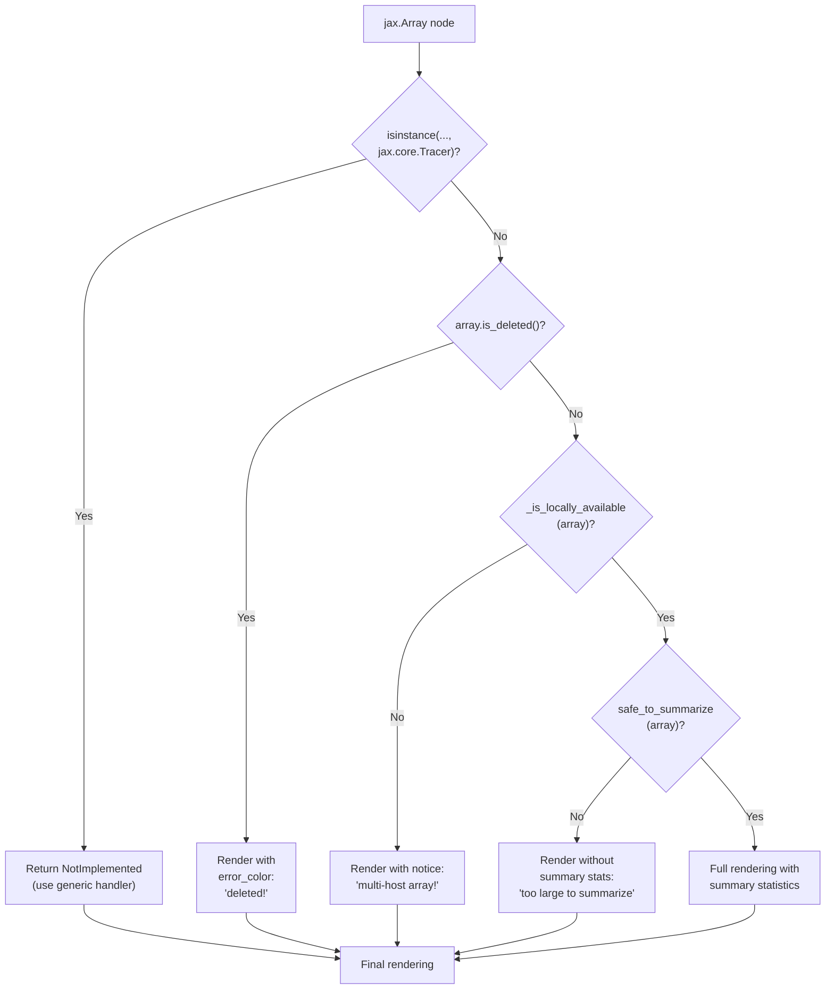
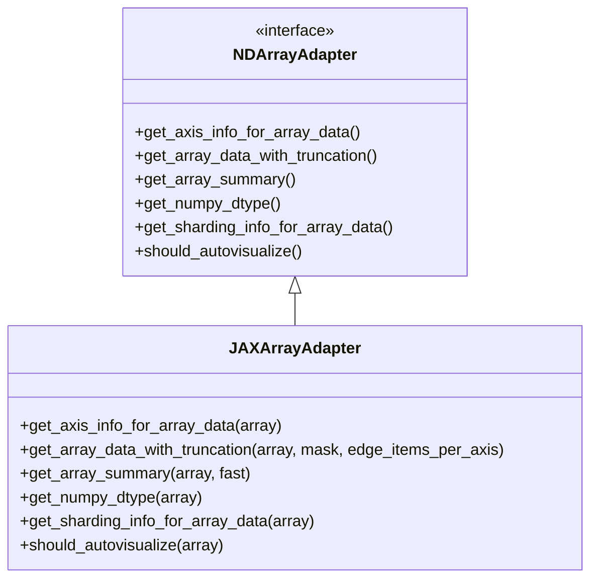
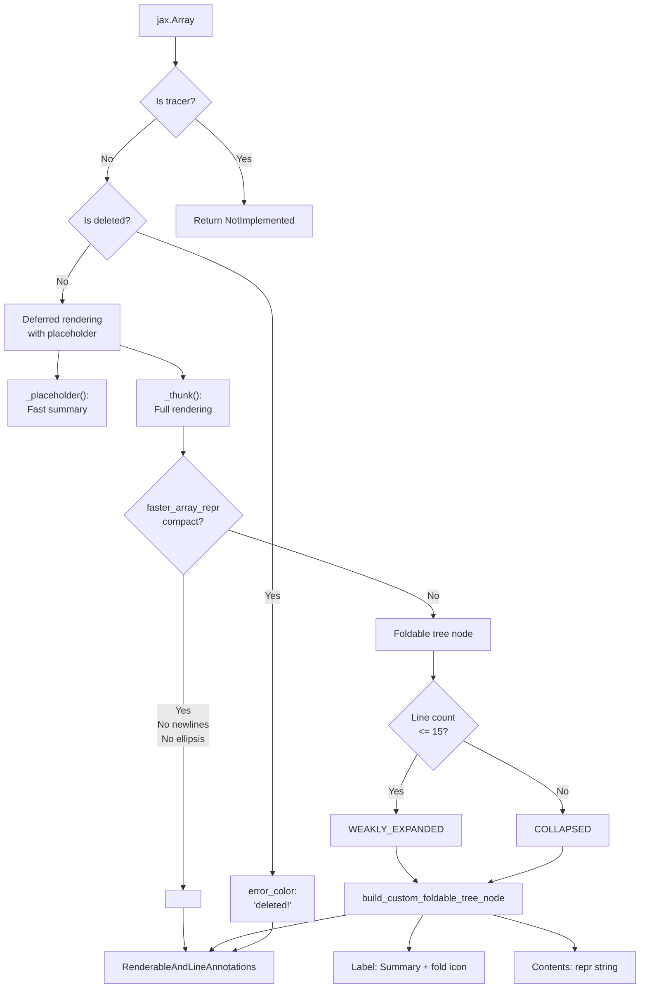
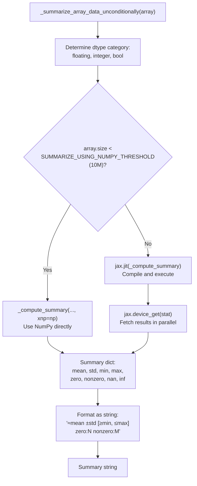
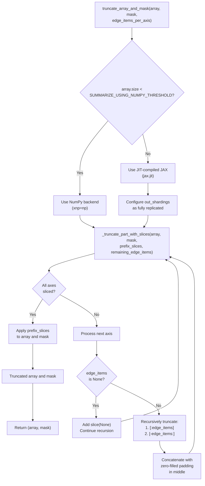
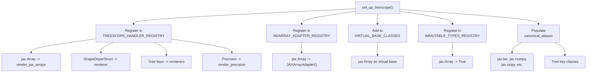

<!-- source: DeepWiki mcp.deepwiki.com · repo google-deepmind/treescope · page 6.1 JAX Support · fetched 2026-10-26 -->

# JAX Support

<details>
<summary>Relevant source files</summary>

The following files were used as context for generating this wiki page:

- [treescope/external/jax_support.py](treescope/external/jax_support.py)

</details>


This page documents Treescope's specialized support for JAX arrays and related types. It covers the `JAXArrayAdapter` implementation, array summarization logic, sharding visualization, and handling of JAX-specific constructs like tracers and multi-host arrays.

For general array visualization features that apply to all array types, see [Array Visualization](#4). For configuration of the rendering system, see [Configuration and Context](#5.3).

## Overview

Treescope provides first-class support for JAX through the [treescope/external/jax_support.py]() module. This module registers handlers for `jax.Array` and related JAX types, implements an `NDArrayAdapter` for JAX arrays, and provides specialized logic to safely handle JAX's computational model (tracers, JIT compilation, multi-host arrays).

**Key capabilities:**
- Safe rendering of JAX arrays that avoids triggering unwanted computations
- Efficient truncation of large arrays on-device before fetching to host
- Summary statistics computed with configurable thresholds per accelerator type
- Sharding information visualization for distributed arrays
- Special handling for tracers, deleted arrays, and multi-host scenarios
- Support for JAX dataclass-like types (`ShapeDtypeStruct`, tree util keys, etc.)

Sources: [treescope/external/jax_support.py:15-80]()

## JAX Array Types and Safety Considerations

### Array States

JAX arrays can exist in several states that require different handling:

| Array State | Check Method | Rendering Behavior |
|-------------|--------------|-------------------|
| Normal | Default | Full rendering with summary statistics |
| Tracer (inside JIT/grad) | `isinstance(array, jax.core.Tracer)` | Delegates to generic handler |
| Deleted | `array.is_deleted()` | Shows error-colored deletion notice |
| Multi-host | `not _is_locally_available(array)` | Shows "multi-host array!" notice |
| Too large | `not safe_to_summarize(array)` | Skips summary statistics |



### Safety Check: `safe_to_summarize()`

The `safe_to_summarize()` function determines whether it's safe to compute summary statistics for an array:

[treescope/external/jax_support.py:97-112]()

**Check sequence:**
1. **Not a tracer**: Ensures we're not inside a JIT/grad context
2. **Not deleted**: Verifies the array buffer exists
3. **Locally available**: Checks `is_fully_addressable` or `is_fully_replicated`
4. **Below threshold**: Compares array size against platform-specific threshold from `summarization_threshold` contextual value

Sources: [treescope/external/jax_support.py:90-112]()

## JAXArrayAdapter Implementation

The `JAXArrayAdapter` class implements the `NDArrayAdapter` interface to provide JAX-specific array operations:



### Key Methods

#### `get_axis_info_for_array_data()`

Returns positional axis information for each dimension:

[treescope/external/jax_support.py:494-501]()

Returns a tuple of `PositionalAxisInfo` objects, one per axis.

#### `get_array_data_with_truncation()`

Efficiently truncates large arrays on-device before fetching to host:

[treescope/external/jax_support.py:503-521]()

**Key optimization:** Calls `truncate_array_and_mask()` which performs truncation on-device using JIT compilation, then uses `jax.device_get()` only on the truncated result. This avoids copying entire large arrays to host memory.

#### `get_array_summary()`

Generates a summary representation of the array:

[treescope/external/jax_support.py:522-544]()

**Output format:** `jax.Array dtype(shape) [summary statistics]`

The `fast` parameter controls whether to include summary statistics (mean, std, min, max, etc.) or just basic metadata.

#### `get_sharding_info_for_array_data()`

Extracts sharding information for distributed arrays:

[treescope/external/jax_support.py:552-568]()

Returns `ShardingInfo` with:
- `shard_shape`: Shape of individual shards
- `device_index_to_shard_slices`: Mapping from device IDs to slice tuples
- `device_type`: Platform name (e.g., "TPU", "GPU")
- `fully_replicated`: Boolean indicating replication status

Sources: [treescope/external/jax_support.py:491-573]()

## Array Rendering Pipeline

The `render_jax_arrays()` function orchestrates JAX array rendering:



### Deferred Rendering

JAX array rendering uses deferred rendering to avoid blocking on expensive operations:

[treescope/external/jax_support.py:602-661]()

**Two-phase approach:**
1. **Placeholder**: Shows fast summary immediately (`get_array_summary(array, fast=True)`)
2. **Thunk**: Computes full rendering asynchronously, including:
   - `faster_array_repr()` for element values
   - `summarize_array_data()` for statistics
   - Foldable tree construction for large arrays

Sources: [treescope/external/jax_support.py:575-662]()

## Array Summarization System

### Summarization Threshold Configuration

The `summarization_threshold` contextual value controls when to compute summary statistics:

[treescope/external/jax_support.py:53-79]()

**Default values:**
```python
{
    "tpu": 1_000_000_000,    # 1B elements
    "gpu": 10_000_000,        # 10M elements
    "default": 100_000,       # 100K elements
}
```

Users can customize these thresholds:
```python
from treescope.external.jax_support import summarization_threshold

# Globally
summarization_threshold.set_globally({"gpu": 50_000_000})

# Scoped
with summarization_threshold.set_scoped({"tpu": None}):  # No limit
    treescope.show(large_array)
```

### Summary Statistics Computation

The summarization pipeline efficiently computes statistics:



#### Statistics Computed

**For floating-point arrays:**
- Mean and standard deviation (using `nanmean`/`nanstd`)
- Min and max (using `nanmin`/`nanmax`) 
- Counts: zero, nonzero, nan, inf, -inf

**For integer arrays:**
- Min and max
- Counts: zero, nonzero

**For boolean arrays:**
- Counts: true, false

Implementation: [treescope/external/jax_support.py:383-416]()

### Optimized Array repr: `faster_array_repr()`

Standard `repr(jax_array)` can be slow for large arrays because it copies the entire array to host. The `faster_array_repr()` function optimizes this:

[treescope/external/jax_support.py:254-299]()

**Optimization strategy:**
1. Check if array is small (below NumPy's print threshold) - if so, use standard `repr()`
2. For large arrays:
   - Determine edge items per axis based on `np.get_printoptions()['edgeitems']`
   - Call `truncate_array_and_mask()` to truncate **on-device**
   - Fetch only truncated data with `jax.device_get()`
   - Format using `np.array2string()` with ellipsis for omitted elements

Sources: [treescope/external/jax_support.py:254-299](), [treescope/external/jax_support.py:418-489]()

## On-Device Array Truncation

The `truncate_array_and_mask()` function is a critical optimization that truncates arrays before copying to host:

### Truncation Algorithm

[treescope/external/jax_support.py:197-251]()

**Recursive slicing approach:**



**Key implementation details:**

1. **Sharding-aware**: Sets `out_shardings` to fully replicated to avoid partitioning errors when retrieving results [treescope/external/jax_support.py:221-244]()

2. **Recursive structure**: Processes one axis at a time, building up `prefix_slices` [treescope/external/jax_support.py:114-194]()

3. **Padding insertion**: Adds zero-filled "gap" elements to represent omitted data [treescope/external/jax_support.py:185-194]()

4. **Mask broadcasting**: Handles masks with singleton dimensions correctly [treescope/external/jax_support.py:147-153]()

Sources: [treescope/external/jax_support.py:114-251]()

## Sharding Visualization

The `get_sharding_info_for_array_data()` method provides sharding metadata for visualization:

[treescope/external/jax_support.py:552-568]()

**Extracted information:**
- **Platform**: Determined from `device.platform` (e.g., "cpu", "gpu", "tpu")
- **Shard shape**: Computed via `array.sharding.shard_shape(array.shape)`
- **Device mapping**: Uses `array.sharding.devices_indices_map(array.shape)` to get per-device slice tuples
- **Replication status**: From `array.is_fully_replicated`

This information is consumed by the array visualization system (see [Array Visualization](#4)) to render sharding diagrams showing how data is distributed across devices.

**Example output structure:**
```python
ShardingInfo(
    shard_shape=(128, 256),
    device_index_to_shard_slices={
        0: (slice(0, 128), slice(0, 256)),
        1: (slice(128, 256), slice(0, 256)),
        # ...
    },
    device_type="TPU",
    fully_replicated=False,
)
```

Sources: [treescope/external/jax_support.py:552-568]()

## Additional JAX Types

Beyond `jax.Array`, the module registers handlers for several JAX-specific types:

### ShapeDtypeStruct

JAX's abstract array type used in shape inference:

[treescope/external/jax_support.py:670-676]()

Rendered as: `jax.ShapeDtypeStruct(shape=..., dtype=..., sharding=...)`

### Tree Utility Keys

JAX's pytree traversal key types:

[treescope/external/jax_support.py:677-696]()

- `jax.tree_util.SequenceKey`: For indexing sequences
- `jax.tree_util.DictKey`: For dictionary keys
- `jax.tree_util.GetAttrKey`: For object attributes
- `jax.tree_util.FlattenedIndexKey`: For flattened indices

### Precision Enum

The `jax.lax.Precision` enum for matrix multiplication precision:

[treescope/external/jax_support.py:361-380](), [treescope/external/jax_support.py:697-699]()

Rendered as enum-like: `jax.lax.Precision.DEFAULT`, `jax.lax.Precision.HIGH`, etc.

### Checked Dataclass Renderer

The `make_checked_dataclasslike_renderer()` utility creates safe renderers for dataclass-like types:

[treescope/external/jax_support.py:302-358]()

**Safety mechanism:**
1. Extract attributes specified in `fields` parameter
2. Reconstruct object by calling constructor with those attributes
3. Verify reconstructed object equals original via `==`
4. If verification fails, return `NotImplemented` (falls back to generic handler)

This ensures the rendering is truly roundtrippable and robust to API changes.

Sources: [treescope/external/jax_support.py:302-380](), [treescope/external/jax_support.py:670-699]()

## Setup and Registration

### `set_up_treescope()` Function

The main entry point that registers all JAX support:

[treescope/external/jax_support.py:664-733]()

**Registration steps:**



**Key registrations:**

| Registry | Type | Handler/Value |
|----------|------|---------------|
| `TREESCOPE_HANDLER_REGISTRY` | `jax.Array` | `render_jax_arrays` |
| `TREESCOPE_HANDLER_REGISTRY` | `jax.ShapeDtypeStruct` | Dataclass-like renderer |
| `TREESCOPE_HANDLER_REGISTRY` | `jax.lax.Precision` | `render_precision` |
| `TREESCOPE_HANDLER_REGISTRY` | Tree key types | Dataclass-like renderers |
| `NDARRAY_ADAPTER_REGISTRY` | `jax.Array` | `JAXArrayAdapter()` instance |
| `VIRTUAL_BASE_CLASSES` | `jax.Array` | Appended to list |
| `IMMUTABLE_TYPES_REGISTRY` | `jax.Array` | `True` |

**Canonical aliases:** Populated from JAX's public API modules (`jax.lax`, `jax.numpy`, `jax.scipy`, `jax.random`, `jax.nn`, `jax.custom_derivatives`) and tree utility keys [treescope/external/jax_support.py:709-732]()

### Virtual Base Class Registration

JAX arrays use a dynamically-registered concrete type, so `jax.Array` is added to `VIRTUAL_BASE_CLASSES`:

[treescope/external/jax_support.py:704]()

This ensures isinstance checks work correctly during type dispatch (see [Type System and Registries](#3.2)).

Sources: [treescope/external/jax_support.py:664-733]()

## Configuration Reference

### Contextual Values

| Name | Type | Purpose | Default |
|------|------|---------|---------|
| `summarization_threshold` | `Mapping[str, int \| None]` | Per-platform thresholds for computing summary stats | `{"tpu": 1B, "gpu": 10M, "default": 100K}` |

### Module Constants

| Name | Value | Purpose |
|------|-------|---------|
| `SUMMARIZE_USING_NUMPY_THRESHOLD` | `10_000_000` | Size threshold for using NumPy vs JAX for summarization |

Sources: [treescope/external/jax_support.py:53-87]()

## Usage Examples

### Basic Setup

```python
import treescope
from treescope.external import jax_support

# Initialize JAX support
jax_support.set_up_treescope()

# Configure if needed
jax_support.summarization_threshold.set_globally({
    "gpu": 50_000_000,  # Increase GPU threshold
    "tpu": None,         # No limit for TPU
})
```

### Checking Safety

```python
import jax.numpy as jnp
from treescope.external.jax_support import safe_to_summarize

array = jnp.ones((1000, 1000))

if safe_to_summarize(array):
    # Safe to compute statistics
    summary = jax_support.summarize_array_data(array)
    print(summary)
```

### Custom Truncation

```python
from treescope.external.jax_support import truncate_array_and_mask

# Truncate to first/last 3 elements per axis
truncated, mask = truncate_array_and_mask(
    array=large_array,
    mask=jnp.ones((1,) * large_array.ndim),
    edge_items_per_axis=(3, 3, None),  # None = don't truncate that axis
)
```

Sources: [treescope/external/jax_support.py:1-733]()

---

