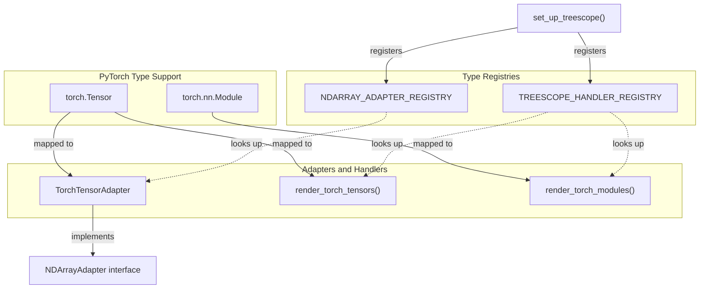
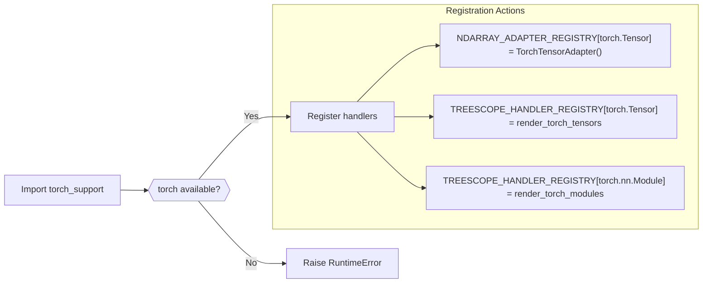
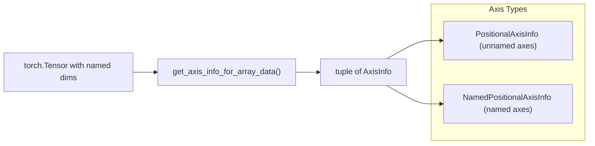
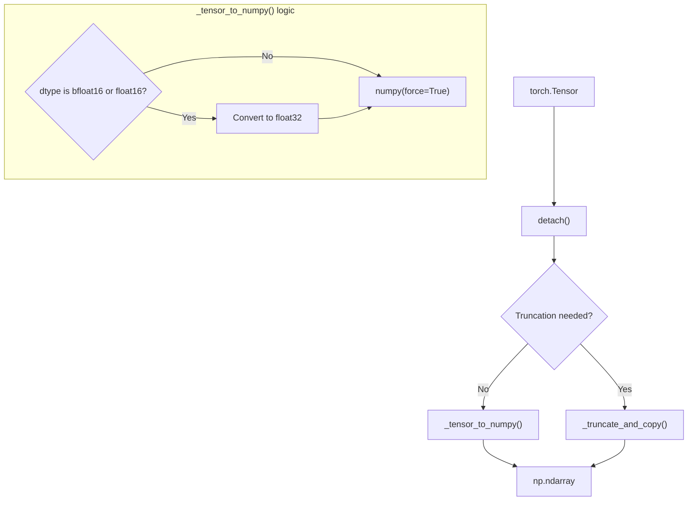
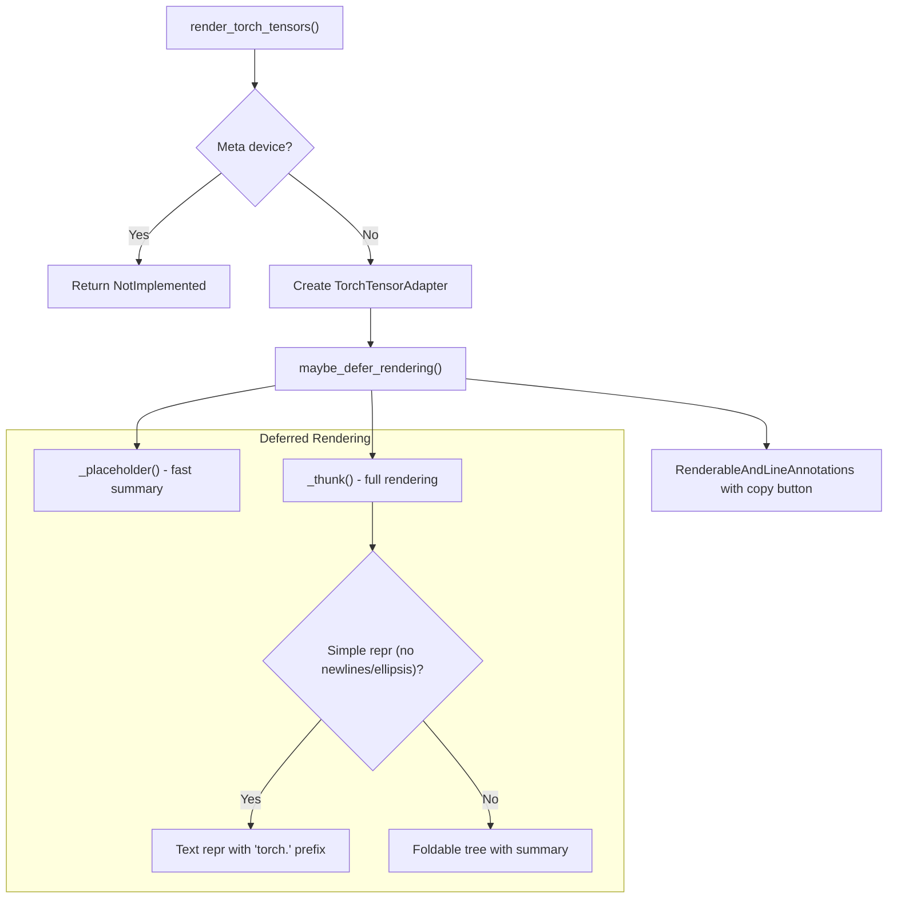
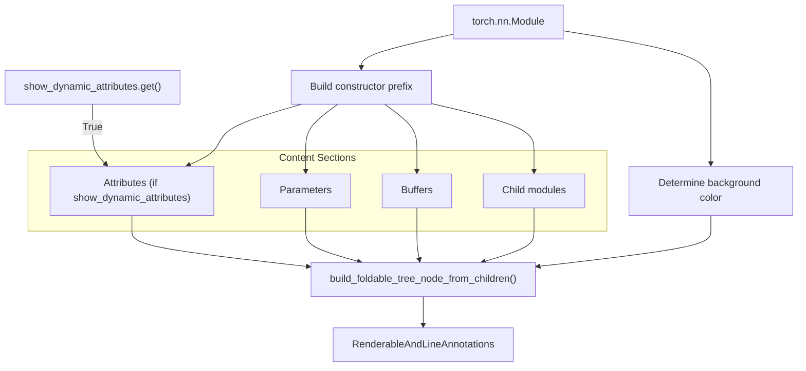
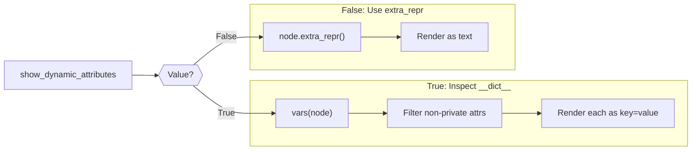

<!-- source: DeepWiki mcp.deepwiki.com · repo google-deepmind/treescope · page 6.2 PyTorch Support · fetched 2026-10-26 -->

# PyTorch Support

<details>
<summary>Relevant source files</summary>

The following files were used as context for generating this wiki page:

- [treescope/external/torch_support.py](treescope/external/torch_support.py)

</details>


This page documents Treescope's integration with PyTorch, covering how `torch.Tensor` objects and `torch.nn.Module` instances are rendered in interactive HTML and text output. This includes array visualization for tensors, structured display of neural network modules with their parameters and submodules, and configuration options for controlling the level of detail shown.

For general information about array visualization capabilities, see [Array Visualization](#4). For details on the NDArray adapter interface, see [NDArray Adapters](#4.4). For information about custom type handlers, see [Custom Type Handlers](#8.1).

**Sources:** [treescope/external/torch_support.py:1-598]()

## Overview

PyTorch support in Treescope is implemented through the type registry system, which maps `torch.Tensor` to a specialized array adapter and rendering handler, and `torch.nn.Module` to a module-specific handler. The integration is activated by calling `set_up_treescope()` from the `treescope.external.torch_support` module.



**Sources:** [treescope/external/torch_support.py:584-597]()

## Setup and Registration

The `set_up_treescope()` function registers PyTorch types with Treescope's type registries. This function is typically called automatically when using `basic_interactive_setup()` with PyTorch available, or can be called manually.



The function performs the following registrations:
- Maps `torch.Tensor` to `TorchTensorAdapter` in `NDARRAY_ADAPTER_REGISTRY`
- Maps `torch.Tensor` to `render_torch_tensors` handler in `TREESCOPE_HANDLER_REGISTRY`
- Maps `torch.nn.Module` to `render_torch_modules` handler in `TREESCOPE_HANDLER_REGISTRY`

**Sources:** [treescope/external/torch_support.py:584-597]()

## Tensor Rendering

### TorchTensorAdapter

The `TorchTensorAdapter` class implements the `NDArrayAdapter` interface for PyTorch tensors, enabling integration with Treescope's array visualization system.

| Method | Purpose |
|--------|---------|
| `get_axis_info_for_array_data()` | Extracts axis metadata including named dimensions |
| `get_array_data_with_truncation()` | Retrieves truncated tensor data as NumPy arrays |
| `get_array_summary()` | Generates summary statistics (mean, std, min, max, counts) |
| `get_sharding_info_for_array_data()` | Returns device information as sharding metadata |
| `get_numpy_dtype()` | Converts PyTorch dtype to NumPy dtype |
| `should_autovisualize()` | Returns `True` unless tensor is on meta device |

**Sources:** [treescope/external/torch_support.py:118-314]()

#### Named Dimensions

PyTorch tensors can have named dimensions, which the adapter extracts and provides to the visualization system:



**Sources:** [treescope/external/torch_support.py:121-134]()

#### Data Truncation and Conversion

The adapter handles conversion from PyTorch tensors to NumPy arrays, with special handling for 16-bit float types (`bfloat16`, `float16`) which are converted to `float32` before conversion to NumPy. Truncation is performed recursively to extract only edge items along each axis.



**Sources:** [treescope/external/torch_support.py:55-59](), [treescope/external/torch_support.py:62-115](), [treescope/external/torch_support.py:136-175]()

#### Tensor Summary Statistics

The `get_array_summary()` method generates comprehensive statistics for tensors, including:

- **Always shown:** Type name, dtype, shape (with named dimensions if present)
- **For floating-point tensors:** Mean, standard deviation, min, max (excluding infinities)
- **For integer tensors:** Min, max
- **For floating-point and integer tensors:** Zero count, nonzero count
- **For floating-point tensors:** NaN count, infinity counts
- **For boolean tensors:** True/false counts
- **Gradient information:** `requires_grad` flag and `grad` attribute presence

Statistics are computed only for tensors with fewer than 100,000 elements when `fast=False`.

**Sources:** [treescope/external/torch_support.py:177-291]()

#### Device Information as Sharding

The adapter converts PyTorch device information into sharding metadata, treating each tensor as a single shard on its device:

**Sources:** [treescope/external/torch_support.py:293-304]()

### render_torch_tensors Handler

The `render_torch_tensors()` function is the top-level handler that orchestrates tensor rendering. It uses deferred rendering for complex tensors and provides copy buttons for path expressions.



The handler logic:
1. Returns `NotImplemented` for tensors on the meta device (which have no data)
2. Creates a `TorchTensorAdapter` instance
3. For simple tensors (compact repr without newlines/ellipsis), renders as plain text with `torch.` prefix
4. For complex tensors, creates a foldable tree node with:
   - Summary as the label (abbreviated when collapsed)
   - Full `repr()` as the contents (shown when expanded)
   - Default expand state based on size (collapsed for very large tensors)

**Sources:** [treescope/external/torch_support.py:316-392]()

## Module Rendering

The `render_torch_modules()` function handles rendering of `torch.nn.Module` instances, displaying their structure including parameters, buffers, submodules, and optionally all attributes.



**Sources:** [treescope/external/torch_support.py:395-581]()

### Module Structure

Modules are rendered as foldable tree nodes with the following structure:

1. **Constructor prefix:** Type name followed by opening parenthesis
2. **Content sections** (in order):
   - Attributes (when `show_dynamic_attributes` is True)
   - Parameters (from `named_parameters(recurse=False)`)
   - Buffers (from `named_buffers(recurse=False)`)
   - Child modules (from `named_children()`)
3. **Closing suffix:** Closing parenthesis

Each section is preceded by a comment-style header when expanded (e.g., `# Parameters:`).

**Sources:** [treescope/external/torch_support.py:408-559]()

### Background Coloring

Modules are color-coded based on their type:

| Module Type | Color Strategy |
|-------------|----------------|
| Has `__treescope_color__()` method | Uses the returned color specification |
| `torch.nn.Sequential` | Fixed gray color |
| No custom `forward()` (container) | No background color |
| Other modules | Hash-based color from fully qualified type name |

**Sources:** [treescope/external/torch_support.py:418-440]()

### Expand State Heuristic

Modules with submodules default to `WEAKLY_EXPANDED` state, while leaf modules (no submodules) default to `COLLAPSED` state, matching PyTorch's default `repr()` behavior.

**Sources:** [treescope/external/torch_support.py:565-570]()

## Configuration: show_dynamic_attributes

The `show_dynamic_attributes` contextual value controls how module attributes are displayed.

| Setting | Behavior |
|---------|----------|
| `True` (default) | Inspects and renders all non-private attributes from module's `__dict__` |
| `False` | Uses module's `extra_repr()` method, matching default PyTorch behavior |

When `True`, attributes are rendered in a specific order:
1. All non-underscore, non-`training` attributes (alphabetically from `vars(node)`)
2. The `training` attribute (if present)

For modules with more than one attribute, they are grouped under a collapsible "# Attributes:" section.



**Sources:** [treescope/external/torch_support.py:39-52](), [treescope/external/torch_support.py:448-499]()

### Usage Example

```python
from treescope.external import torch_support

# Globally set to False to match PyTorch repr behavior
torch_support.show_dynamic_attributes.set_globally(False)

# Or use scoped context manager
with torch_support.show_dynamic_attributes.set_scoped(False):
    treescope.show(my_module)
```

**Sources:** [treescope/external/torch_support.py:39-52]()

## Special Handling

### Parameter vs. Non-Parameter Tensors

The tensor summary includes information about the `requires_grad` attribute, with different defaults:

- **`torch.nn.Parameter` instances:** Assumes `requires_grad=True` by default, shows `requires_grad=False` if disabled
- **Other tensors:** Assumes `requires_grad=False` by default, shows `requires_grad=True` if enabled

**Sources:** [treescope/external/torch_support.py:273-283]()

### Meta Device Tensors

Tensors on the meta device (which have no actual data) are not rendered by the tensor handler and fall back to default rendering. The adapter's `should_autovisualize()` method returns `False` for meta device tensors.

**Sources:** [treescope/external/torch_support.py:311-313](), [treescope/external/torch_support.py:329-331]()

### Gradient Information

If a tensor has a gradient attached (non-None `grad` attribute), the summary includes `grad=<GradientTypeName>`.

**Sources:** [treescope/external/torch_support.py:282-283]()

---

