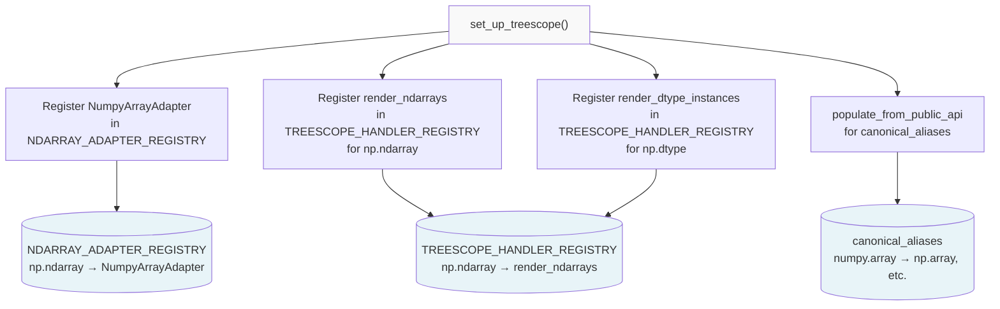
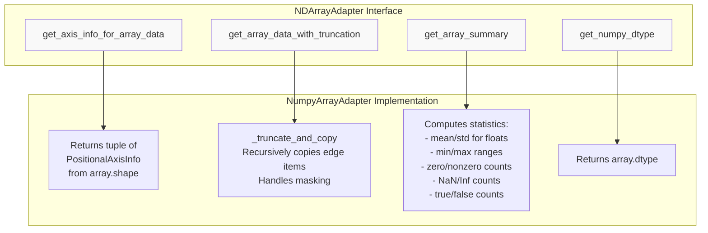
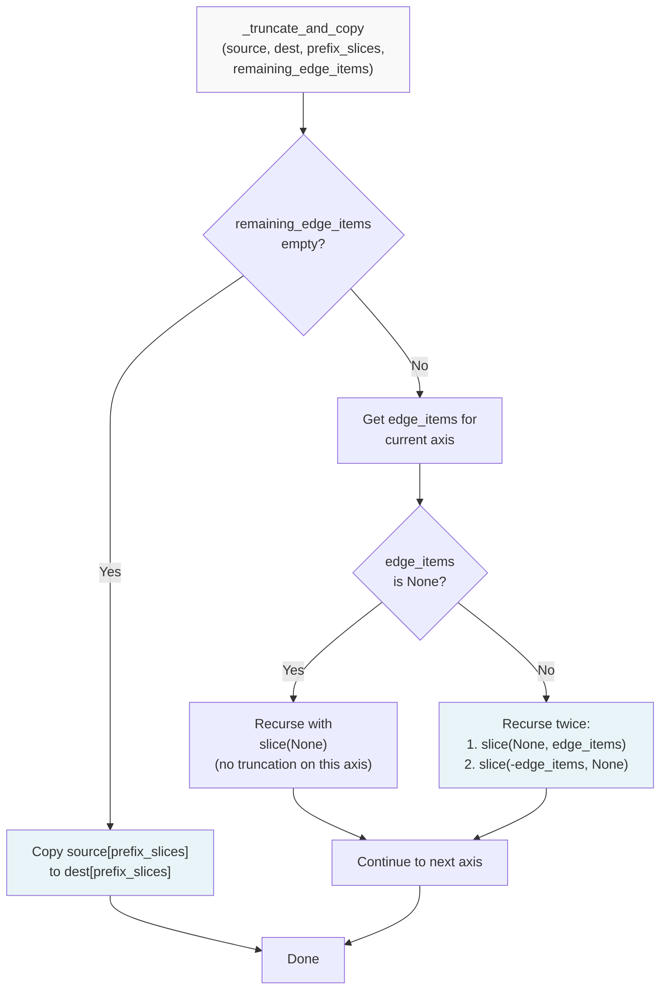
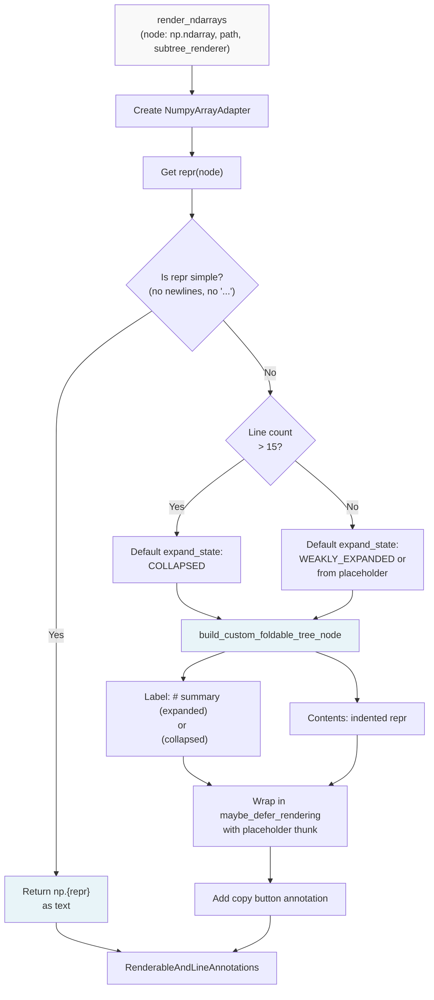
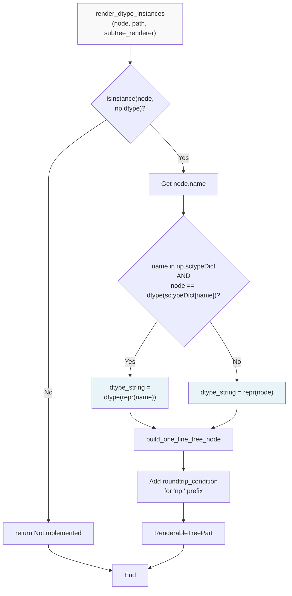

<!-- source: DeepWiki mcp.deepwiki.com · repo google-deepmind/treescope · page 6.3 NumPy Support · fetched 2026-10-26 -->

# NumPy Support

Relevant source files

The following files were used as context for generating this wiki page:

- [tests/__init__.py](tests/__init__.py)
- [tests/ndarray_adapters_test.py](tests/ndarray_adapters_test.py)
- [treescope/_internal/handlers/generic_repr_handler.py](treescope/_internal/handlers/generic_repr_handler.py)
- [treescope/external/numpy_support.py](treescope/external/numpy_support.py)

## Purpose and Scope

This document describes Treescope's support for NumPy objects, focusing on how NumPy arrays (`np.ndarray`) and data types (`np.dtype`) are rendered. It covers the implementation of the `NumpyArrayAdapter`, the specialized rendering handlers, array truncation logic, and summary statistics generation.

For general information about the NDArray adapter interface that NumPy implements, see [NDArray Adapters](#4.4). For details on array visualization features (colormaps, interactive controls, etc.) that work with NumPy arrays, see [Array Visualization](#4).

## Setup and Registration

NumPy support is initialized through the `set_up_treescope()` function, which registers handlers and adapters with Treescope's type registries.

### Registration Flow

**Sources:** [treescope/external/numpy_support.py:322-342]()

The setup function performs four key registrations:

| Registry | Type | Target | Purpose |
|----------|------|--------|---------|
| `NDARRAY_ADAPTER_REGISTRY` | `np.ndarray` | `NumpyArrayAdapter()` | Enables array visualization |
| `TREESCOPE_HANDLER_REGISTRY` | `np.ndarray` | `render_ndarrays` | Custom array rendering |
| `TREESCOPE_HANDLER_REGISTRY` | `np.dtype` | `render_dtype_instances` | Dtype display |
| `canonical_aliases` | NumPy API | Various | Qualified name resolution |

**Sources:** [treescope/external/numpy_support.py:322-342]()

## NumpyArrayAdapter Implementation

The `NumpyArrayAdapter` class implements the `NDArrayAdapter` interface to provide NumPy-specific array operations for Treescope's visualization system.

### Adapter Method Mapping

**Sources:** [treescope/external/numpy_support.py:87-213]()

### Key Methods

#### `get_axis_info_for_array_data`

Returns axis information for visualization. For NumPy arrays with positional axes only:

[treescope/external/numpy_support.py:90-96]()

Returns a tuple of `PositionalAxisInfo` objects, one per dimension, containing the axis index and size.

**Sources:** [treescope/external/numpy_support.py:90-96]()

#### `get_array_data_with_truncation`

Performs edge-based truncation on large arrays to reduce memory usage during visualization:

[treescope/external/numpy_support.py:98-133]()

The method:
1. Broadcasts the optional mask to match the array shape
2. Determines the destination shape based on `edge_items_per_axis`
3. Allocates destination arrays for data and mask
4. Calls `_truncate_and_copy` to recursively copy edge items

**Sources:** [treescope/external/numpy_support.py:98-133]()

#### `get_array_summary`

Generates a summary with array metadata and statistics:

[treescope/external/numpy_support.py:135-209]()

The summary includes:
- Array type prefix (`np.ndarray` or `np` abbreviated)
- Dtype name
- Shape tuple

For non-fast mode (arrays < 100,000 elements):

| Dtype Category | Statistics Included |
|----------------|-------------------|
| Floating-point | Mean ± std, min/max range, zero/nonzero counts, NaN count, +/-Inf counts |
| Integer | Min/max range, zero/nonzero counts |
| Boolean | True/false counts |

**Sources:** [treescope/external/numpy_support.py:135-209]()

#### `get_numpy_dtype`

Simple accessor returning the array's dtype:

[treescope/external/numpy_support.py:211-212]()

**Sources:** [treescope/external/numpy_support.py:211-212]()

## Array Truncation Algorithm

The `_truncate_and_copy` function implements recursive edge-based truncation, copying only the beginning and end items along each axis.

### Truncation Process

**Sources:** [treescope/external/numpy_support.py:32-84]()

### Example: 2D Truncation

For a shape `(19, 23)` array with `edge_items_per_axis=(2, 4)`:

1. **Axis 0 (size 19)**: Copy rows 0-1 and 17-18 → destination shape 5 (2+1+2)
2. **Axis 1 (size 23)**: Copy columns 0-3 and 19-22 → destination shape 9 (4+1+4)
3. **Result**: Destination array shape `(5, 9)` containing edges of original `(19, 23)` array

The middle elements (implicit in the +1) represent truncation markers used by the visualization system.

**Sources:** [treescope/external/numpy_support.py:32-84]()

## Array Rendering

The `render_ndarrays` function handles visualization of NumPy arrays, providing both simple repr-based rendering and detailed foldable summaries.

### Rendering Decision Flow

**Sources:** [treescope/external/numpy_support.py:215-282]()

### Rendering Modes

The handler chooses between two rendering approaches:

| Condition | Rendering Approach |
|-----------|-------------------|
| `repr` has no newlines and no `...` | Simple text: `np.{repr}` |
| `repr` is complex | Foldable tree with summary and full repr |

For complex arrays:
- **Placeholder**: Fast summary from `adapter.get_array_summary(node, fast=True)`
- **Label**: Comment-colored summary with fold indicators
- **Contents**: Full `repr(node)` output, indented
- **Default state**: `COLLAPSED` for >15 lines, `WEAKLY_EXPANDED` otherwise

**Sources:** [treescope/external/numpy_support.py:215-282]()

### Deferred Rendering Integration

The rendering is wrapped with `maybe_defer_rendering` to support asynchronous computation:

[treescope/external/numpy_support.py:277-282]()

This allows expensive array summary calculations to occur in the background while displaying a fast placeholder first.

**Sources:** [treescope/external/numpy_support.py:277-282]()

## Dtype Rendering

The `render_dtype_instances` function handles `np.dtype` objects, ensuring they display with the `np.` prefix for clarity.

### Dtype Display Logic

**Sources:** [treescope/external/numpy_support.py:285-319]()

### Dtype Handling Cases

The function handles two cases:

1. **Named scalar types** (e.g., `'float32'`, `'int64'`):
   - Checks if the name is in `np.sctypeDict`
   - Uses `dtype(repr(name))` format for roundtrippable output
   - Example: `np.dtype('float32')`

2. **Other dtypes** (structured, extended, etc.):
   - Uses `repr(node)` directly
   - Adds `np.` prefix in roundtrip mode
   - Example: `np.dtype([('f0', '<i4'), ('f1', '<f8')])`

**Sources:** [treescope/external/numpy_support.py:285-319]()

## Statistics and Summary Generation

The `get_array_summary` method computes comprehensive statistics to provide meaningful array summaries.

### Statistics by Dtype

#### Floating-Point Arrays

For floating-point dtypes, when `fast=False` and `size < 100,000`:

[treescope/external/numpy_support.py:154-192]()

Statistics computed:
- **Mean and standard deviation**: `≈{mean:.2} ±{std:.2}` (ignoring infinities)
- **Range**: `[≥{min:.2}, ≤{max:.2}]`
- **Zero count**: `zero:{count:_d}` (underscore thousands separator)
- **Nonzero count**: `nonzero:{count:_d}`
- **NaN count**: `nan:{count:_d}`
- **Positive infinity**: `inf:{count:_d}`
- **Negative infinity**: `-inf:{count:_d}`

**Sources:** [treescope/external/numpy_support.py:154-192]()

#### Integer Arrays

For integer dtypes:

[treescope/external/numpy_support.py:169-179]()

Statistics computed:
- **Range**: `[≥{min:_d}, ≤{max:_d}]`
- **Zero count**: `zero:{count:_d}`
- **Nonzero count**: `nonzero:{count:_d}`

**Sources:** [treescope/external/numpy_support.py:169-179]()

#### Boolean Arrays

For boolean dtypes:

[treescope/external/numpy_support.py:194-201]()

Statistics computed:
- **True count**: `true:{count:_d}`
- **False count**: `false:{count:_d}`

**Sources:** [treescope/external/numpy_support.py:194-201]()

### Fast vs. Full Summary

The `fast` parameter controls summary computation:

| Mode | When Used | Information Included |
|------|-----------|---------------------|
| `fast=True` | Placeholder rendering | Type, dtype, shape only |
| `fast=False` | Final rendering | Type, dtype, shape + statistics |
| `size >= 100,000` | Automatic | Always fast mode |

The size threshold prevents expensive computation on very large arrays.

**Sources:** [treescope/external/numpy_support.py:135-209]()

## Canonical Aliases

During setup, NumPy's public API is scanned to populate canonical aliases:

[treescope/external/numpy_support.py:328-342]()

This allows Treescope to display NumPy objects with their canonical import paths (e.g., `np.array` instead of `numpy.core.multiarray.array`). The function filters out deprecated modules like `numpy.core`.

**Sources:** [treescope/external/numpy_support.py:328-342]()

---

