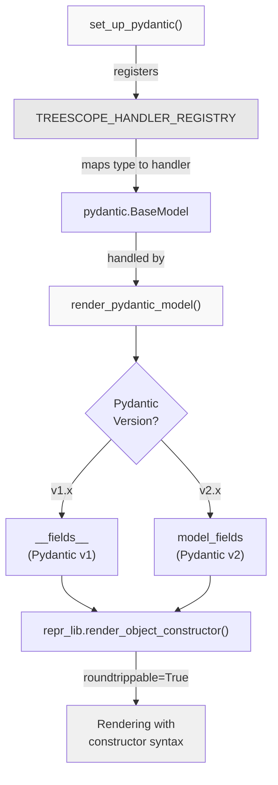
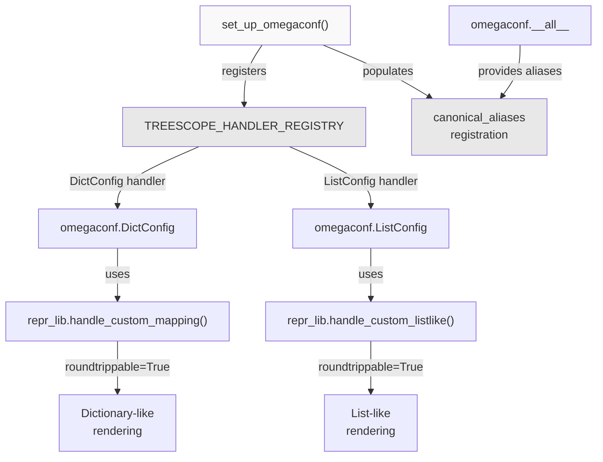
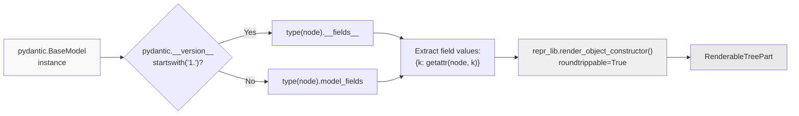
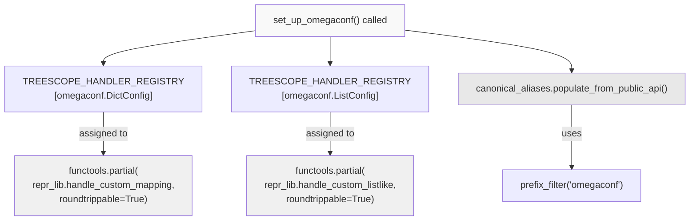
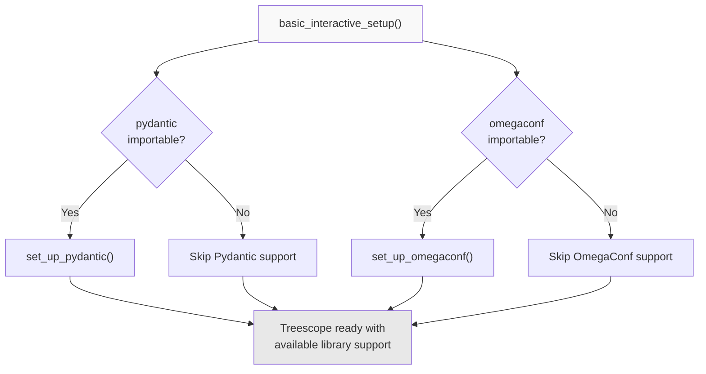
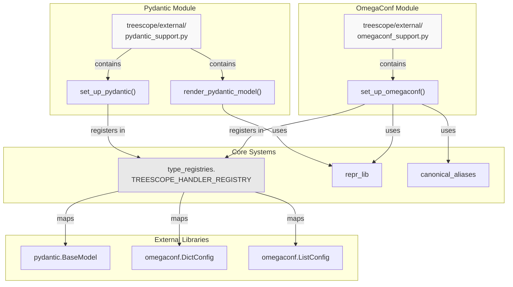

<!-- source: DeepWiki mcp.deepwiki.com · repo google-deepmind/treescope · page 6.4 Pydantic and OmegaConf Support · fetched 2026-10-26 -->

# Pydantic and OmegaConf Support

<details>
<summary>Relevant source files</summary>

The following files were used as context for generating this wiki page:

- [treescope/external/omegaconf_support.py](treescope/external/omegaconf_support.py)
- [treescope/external/pydantic_support.py](treescope/external/pydantic_support.py)

</details>


## Purpose and Scope

This page documents Treescope's support for rendering **Pydantic** models and **OmegaConf** configurations. Pydantic is a data validation library built around Python type hints, commonly used for configuration and data serialization. OmegaConf is a hierarchical configuration system with variable interpolation, often used in ML research workflows.

Treescope provides specialized handlers that render these types in a structured, readable format while preserving their semantics. For information about extending Treescope with custom types, see [Custom Type Handlers](#8.1). For general information about type registry systems, see [Type System and Registries](#3.2).

## Overview

Both Pydantic and OmegaConf support modules follow Treescope's standard extension pattern:

1. **Lazy Import**: Libraries are imported conditionally to avoid hard dependencies
2. **Setup Function**: A `set_up_X()` function registers handlers with the type registry
3. **Custom Handlers**: Specialized rendering functions handle library-specific types
4. **Roundtrippable Output**: Generated representations can be copy-pasted as valid Python

### Pydantic Support Architecture



**Diagram: Pydantic Support Flow**

Sources: [treescope/external/pydantic_support.py:1-62]()

### OmegaConf Support Architecture



**Diagram: OmegaConf Support Flow**

Sources: [treescope/external/omegaconf_support.py:1-50]()

## Pydantic Support

### Setup and Registration

The `set_up_pydantic()` function enables Pydantic support by registering a handler for `pydantic.BaseModel` in the type registry.

**Setup Function**: [treescope/external/pydantic_support.py:52-62]()

| Component | Description |
|-----------|-------------|
| **Import Check** | Pydantic is imported conditionally; raises `RuntimeError` if unavailable |
| **Registry Target** | `pydantic.BaseModel` registered in `TREESCOPE_HANDLER_REGISTRY` |
| **Handler Function** | `render_pydantic_model` processes all Pydantic model instances |

### Rendering Logic

The `render_pydantic_model` function handles both Pydantic v1 and v2:

**Key Implementation Details**: [treescope/external/pydantic_support.py:31-49]()



**Diagram: Pydantic Model Rendering Pipeline**

Sources: [treescope/external/pydantic_support.py:31-49]()

### Version Compatibility

| Pydantic Version | Field Access | Line Reference |
|------------------|-------------|----------------|
| **v1.x** | `type(node).__fields__` | [pydantic_support.py:40]() |
| **v2.x** | `type(node).model_fields` | [pydantic_support.py:42]() |

Both versions extract field names and use `getattr()` to retrieve values, ensuring consistent rendering across Pydantic versions.

### Roundtrippable Output

The handler uses `repr_lib.render_object_constructor` with `roundtrippable=True`, meaning the output can be copy-pasted as valid Python code to reconstruct the object:

```python
# Example Pydantic model rendering:
# Input:  User(id=123, name="Alice")
# Output: User(id=123, name="Alice")  # Valid constructor syntax
```

Sources: [treescope/external/pydantic_support.py:43-49]()

## OmegaConf Support

### Setup and Registration

The `set_up_omegaconf()` function registers handlers for both `DictConfig` and `ListConfig` types.

**Setup Function**: [treescope/external/omegaconf_support.py:32-49]()

| Component | Description |
|-----------|-------------|
| **Import Check** | OmegaConf imported conditionally; raises `RuntimeError` if unavailable |
| **DictConfig Handler** | Maps to `repr_lib.handle_custom_mapping` |
| **ListConfig Handler** | Maps to `repr_lib.handle_custom_listlike` |
| **Canonical Aliases** | Registers display names for all types in `omegaconf.__all__` |

### Handler Registration



**Diagram: OmegaConf Handler Registration**

Sources: [treescope/external/omegaconf_support.py:39-49]()

### DictConfig Rendering

`omegaconf.DictConfig` objects are rendered as custom mappings using `repr_lib.handle_custom_mapping`. This displays them in a dictionary-like format while preserving OmegaConf-specific features like variable interpolation.

**Handler Registration**: [treescope/external/omegaconf_support.py:39-41]()

The `functools.partial` wraps the generic mapping handler with `roundtrippable=True`, ensuring the output uses constructor syntax.

### ListConfig Rendering

`omegaconf.ListConfig` objects are rendered as custom list-like structures using `repr_lib.handle_custom_listlike`.

**Handler Registration**: [treescope/external/omegaconf_support.py:42-44]()

This displays them in a list-like format with proper indentation and folding for nested structures.

### Canonical Aliases

OmegaConf support includes automatic registration of canonical display names for all public API types:

**Alias Registration**: [treescope/external/omegaconf_support.py:45-49]()

```python
canonical_aliases.populate_from_public_api(
    omegaconf, canonical_aliases.prefix_filter("omegaconf")
)
```

This ensures that OmegaConf types display with their canonical names (e.g., `omegaconf.DictConfig` rather than internal module paths).

## Activation and Usage

### Automatic Setup

Both Pydantic and OmegaConf support can be activated automatically:

| Method | When Used | Notes |
|--------|-----------|-------|
| **Automatic on import** | When respective libraries are available | Checked at `basic_interactive_setup()` time |
| **Manual activation** | Call `set_up_pydantic()` or `set_up_omegaconf()` | Useful for explicit control |
| **Lazy loading** | Import failure is handled gracefully | No hard dependency required |



**Diagram: Conditional Setup During Initialization**

Sources: [treescope/external/pydantic_support.py:52-62](), [treescope/external/omegaconf_support.py:32-38]()

### Manual Setup

To explicitly enable support (e.g., in scripts where `basic_interactive_setup()` is not called):

```python
from treescope.external import pydantic_support
from treescope.external import omegaconf_support

pydantic_support.set_up_pydantic()
omegaconf_support.set_up_omegaconf()
```

## Implementation Patterns

### Common Design Elements

Both support modules share common patterns:

| Pattern | Implementation | Purpose |
|---------|---------------|---------|
| **Lazy Import** | `try: import X except ImportError: X = None` | Avoid hard dependencies |
| **Guard Checks** | `if X is None: raise RuntimeError(...)` | Provide clear error messages |
| **Roundtrippable** | `roundtrippable=True` parameter | Enable copy-paste code reconstruction |
| **Registry Use** | Registration in `TREESCOPE_HANDLER_REGISTRY` | Integrate with dispatch system |

Sources: [treescope/external/pydantic_support.py:24-28](), [treescope/external/omegaconf_support.py:24-29]()

### Handler Function Signatures

Both rendering functions follow the standard Treescope handler signature:

```python
def render_X(
    node: X,
    path: str | None,
    subtree_renderer: renderers.TreescopeSubtreeRenderer,
) -> rendering_parts.Rendering | type(NotImplemented)
```

This allows them to be registered in `TREESCOPE_HANDLER_REGISTRY` and participate in the standard rendering pipeline.

Sources: [treescope/external/pydantic_support.py:31-35]()

### Reusing Generic Handlers

OmegaConf support demonstrates how to leverage existing generic handlers:

- **DictConfig**: Reuses `repr_lib.handle_custom_mapping`
- **ListConfig**: Reuses `repr_lib.handle_custom_listlike`

This approach minimizes code duplication and ensures consistent behavior with other mapping/list types.

Sources: [treescope/external/omegaconf_support.py:39-44]()

## Code-to-Concept Mapping

### Key Files and Functions



**Diagram: File and Function Relationships**

Sources: [treescope/external/pydantic_support.py:1-62](), [treescope/external/omegaconf_support.py:1-50]()

### Function Call Chain

| User Action | Setup Function | Registry Update | Runtime Handler |
|-------------|---------------|-----------------|-----------------|
| Enable Pydantic | `set_up_pydantic()` | `TREESCOPE_HANDLER_REGISTRY[pydantic.BaseModel]` | `render_pydantic_model()` |
| Enable OmegaConf | `set_up_omegaconf()` | `TREESCOPE_HANDLER_REGISTRY[omegaconf.DictConfig/ListConfig]` | `handle_custom_mapping()` / `handle_custom_listlike()` |

Sources: [treescope/external/pydantic_support.py:52-62](), [treescope/external/omegaconf_support.py:32-49]()

## Related Documentation

- For information about creating support for other libraries, see [Adding External Library Support](#8.3)
- For details on the type registry system, see [Type System and Registries](#3.2)
- For general handler implementation patterns, see [Custom Type Handlers](#8.1)
- For other external library examples, see [JAX Support](#6.1), [PyTorch Support](#6.2), and [NumPy Support](#6.3)

---

