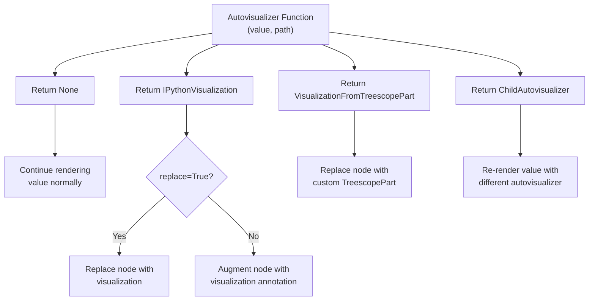
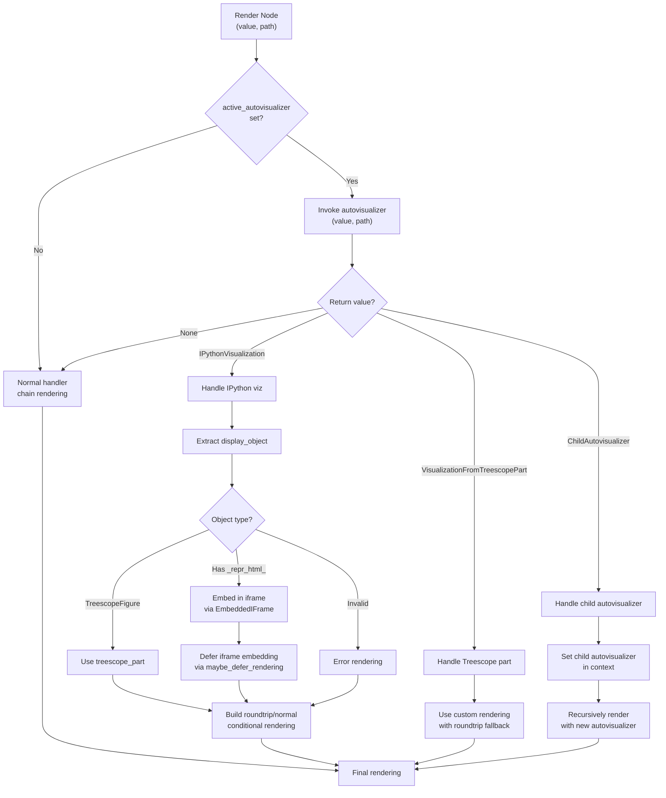
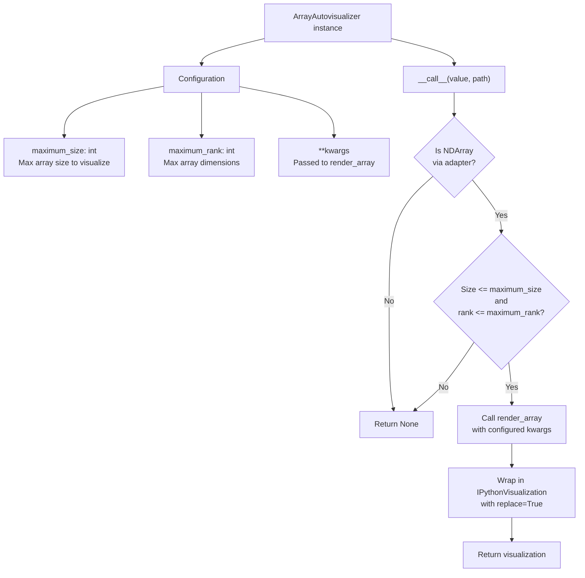
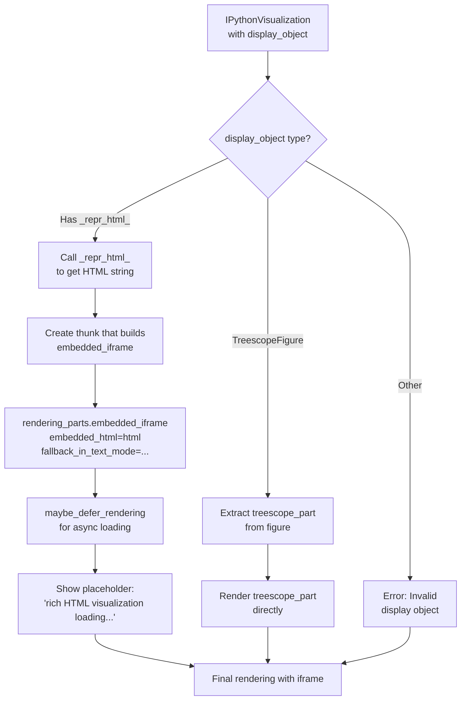
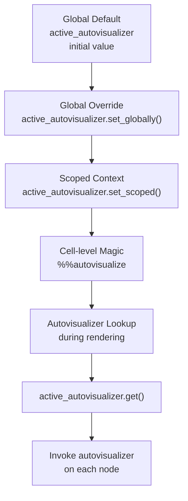
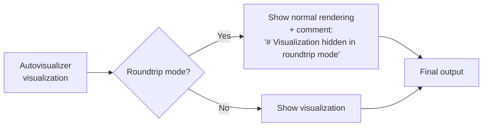

<!-- source: DeepWiki mcp.deepwiki.com · repo google-deepmind/treescope · page 7 Autovisualizer System · fetched 2026-10-26 -->

# Autovisualizer System

<details>
<summary>Relevant source files</summary>

The following files were used as context for generating this wiki page:

- [docs/notebooks/array_visualization.ipynb](docs/notebooks/array_visualization.ipynb)
- [docs/notebooks/building_custom_visualizations.ipynb](docs/notebooks/building_custom_visualizations.ipynb)
- [docs/notebooks/pretty_printing.ipynb](docs/notebooks/pretty_printing.ipynb)
- [treescope/__init__.py](treescope/__init__.py)
- [treescope/_internal/handlers/autovisualizer_hook.py](treescope/_internal/handlers/autovisualizer_hook.py)
- [treescope/_internal/parts/embedded_iframe.py](treescope/_internal/parts/embedded_iframe.py)
- [treescope/lowering.py](treescope/lowering.py)

</details>


## Purpose and Scope

This document describes the autovisualizer system, which enables automatic insertion of rich visualizations at specific nodes during tree rendering. The system allows users to define functions that can augment or replace parts of rendered objects with custom visualizations such as array plots, matplotlib figures, or interactive HTML widgets.

For information about the array rendering API itself, see [Array Visualization](#4). For details on creating custom type handlers, see [Custom Type Handlers](#8.1). For IPython integration features, see [IPython and Jupyter Integration](#5).

---

## What is an Autovisualizer?

An autovisualizer is a callable that intercepts node rendering and optionally returns a visualization to insert at that node. The autovisualizer is invoked for every node in the object tree during rendering.

### Function Signature

```python
def autovisualizer(
    value: Any,
    path: str | None,
) -> IPythonVisualization | VisualizationFromTreescopePart | ChildAutovisualizer | None
```

| Parameter | Type | Description |
|-----------|------|-------------|
| `value` | `Any` | The Python object being rendered at this node |
| `path` | `str \| None` | String keypath to this node from the root (e.g., `"['foo'][0].bar"`) |
| **Returns** | Various | Action to take: visualize, replace, recurse with different autovisualizer, or continue normally |

**Sources:** [treescope/_internal/api/autovisualize.py](), [docs/notebooks/building_custom_visualizations.ipynb:264-274]()

---

## Autovisualizer Return Types

The autovisualizer can return one of four values, each triggering different behavior:

### Return Type Reference



### IPythonVisualization

Embeds a rich display object (anything with `_repr_html_`) such as matplotlib figures, plotly charts, or custom HTML.

```python
class IPythonVisualization:
    display_object: Any  # Must have _repr_html_ method
    replace: bool        # If True, replaces node; if False, augments it
```

The `display_object` can be:
- Any IPython rich display object (matplotlib figure, plotly figure, etc.)
- A `TreescopeFigure` from `treescope.figures`
- An object with `_repr_html_` method

**Sources:** [treescope/_internal/api/autovisualize.py](), [treescope/_internal/handlers/autovisualizer_hook.py:52-183]()

### VisualizationFromTreescopePart

Replaces the node with a custom Treescope rendering constructed using `treescope.rendering_parts`.

```python
class VisualizationFromTreescopePart:
    rendering: RenderableAndLineAnnotations
```

This provides full control over the rendering using Treescope's internal IR.

**Sources:** [treescope/_internal/api/autovisualize.py](), [treescope/_internal/handlers/autovisualizer_hook.py:154-158]()

### ChildAutovisualizer

Changes the active autovisualizer for rendering this node and its children.

```python
class ChildAutovisualizer:
    autovisualizer: Autovisualizer
```

This enables hierarchical autovisualizer scoping, where different parts of the tree use different visualization strategies.

**Sources:** [treescope/_internal/api/autovisualize.py](), [treescope/_internal/handlers/autovisualizer_hook.py:185-188]()

### None

Returning `None` indicates the autovisualizer has no visualization for this node. Rendering continues normally using standard handlers.

**Sources:** [treescope/_internal/handlers/autovisualizer_hook.py:47-50]()

---

## Integration into Rendering Pipeline

The autovisualizer system integrates into Treescope's rendering pipeline as a wrapper hook that intercepts every node before normal rendering occurs.

### Rendering Pipeline Flow with Autovisualizer



### Key Components

| Component | Location | Purpose |
|-----------|----------|---------|
| `active_autovisualizer` | [treescope/_internal/api/autovisualize.py]() | ContextualValue holding the current autovisualizer |
| `use_autovisualizer_if_present` | [treescope/_internal/handlers/autovisualizer_hook.py:33-201]() | Wrapper hook that invokes the autovisualizer |
| `EmbeddedIFrame` | [treescope/_internal/parts/embedded_iframe.py:34-150]() | Renders external HTML in an iframe |
| `maybe_defer_rendering` | [treescope/lowering.py:46-111]() | Defers expensive rendering operations |

**Sources:** [treescope/_internal/handlers/autovisualizer_hook.py](), [treescope/lowering.py:46-111](), [treescope/_internal/parts/embedded_iframe.py]()

---

## Built-in Autovisualizers

### ArrayAutovisualizer

The primary built-in autovisualizer that automatically visualizes NDArrays when encountered in the object tree.



#### Usage

```python
# Set globally
treescope.active_autovisualizer.set_globally(
    treescope.ArrayAutovisualizer(maximum_size=1000)
)

# Use in context
with treescope.active_autovisualizer.set_scoped(
    treescope.ArrayAutovisualizer(maximum_size=100)
):
    display(my_data)

# Use with magic command
%%autovisualize treescope.ArrayAutovisualizer(maximum_size=100)
my_data
```

#### Configuration Parameters

| Parameter | Type | Default | Description |
|-----------|------|---------|-------------|
| `maximum_size` | `int` | `10_000` | Maximum array size (number of elements) to visualize |
| `maximum_rank` | `int` | `None` | Maximum number of dimensions to visualize |
| Additional kwargs | | | Passed through to `render_array` (e.g., `around_zero`, `colormap`) |

**Sources:** [treescope/_internal/api/array_autovisualizer.py](), [treescope/__init__.py:56-58](), [docs/notebooks/array_visualization.ipynb:920-1002]()

---

## Creating Custom Autovisualizers

Custom autovisualizers can be implemented as simple functions or callable classes that follow the autovisualizer signature.

### Simple Function Autovisualizer

```python
def my_autovisualizer(value: Any, path: str | None):
    if isinstance(value, MyCustomType):
        # Return visualization for MyCustomType
        return treescope.IPythonVisualization(
            display_object=create_visualization(value),
            replace=True
        )
    # Return None for other types
    return None
```

### Example: Plotly Histogram Autovisualizer

```python
def plotly_histogram_autovisualizer(value: Any, path: str | None):
    if isinstance(value, (np.ndarray, jax.Array)):
        return treescope.IPythonVisualization(
            px.histogram(
                value.flatten(),
                width=400, height=200
            ).update_layout(
                margin=dict(l=20, r=20, t=20, b=20)
            ),
            replace=True
        )
```

### Example: Conditional Rendering Mode

```python
def continuous_array_autovisualizer(value: Any, path: str | None):
    if isinstance(value, np.ndarray):
        return treescope.IPythonVisualization(
            treescope.render_array(
                value,
                continuous=True,
                around_zero=False
            ),
            replace=True
        )
```

### Example: Augmentation (replace=False)

```python
def verbose_metadata_autovisualizer(value: Any, path: str | None):
    if isinstance(value, np.ndarray):
        return treescope.IPythonVisualization(
            treescope.figures.inline(
                f"Array metadata: shape={value.shape}, dtype={value.dtype}\n",
                treescope.render_array(value),
            ),
            replace=False  # Augments instead of replacing
        )
```

**Sources:** [docs/notebooks/building_custom_visualizations.ipynb:225-454](), [docs/notebooks/pretty_printing.ipynb:606-665]()

---

## HTML Embedding and IFrame Handling

When an autovisualizer returns an `IPythonVisualization` with a display object that has `_repr_html_`, the system embeds it in an iframe for isolation and sizing.

### IFrame Embedding Flow



### EmbeddedIFrame Implementation

The `EmbeddedIFrame` class handles the actual iframe rendering:

- **HTML Rendering**: Creates an `<iframe srcdoc="...">` element with the external HTML
- **Auto-sizing**: JavaScript automatically resizes iframe to fit content using ResizeObserver
- **Text Fallback**: Renders a fallback in text mode (non-HTML output)
- **Virtual Dimensions**: Reports virtual width/height for layout purposes

**Sources:** [treescope/_internal/handlers/autovisualizer_hook.py:64-92](), [treescope/_internal/parts/embedded_iframe.py:33-150]()

---

## Configuration and Context Management

The autovisualizer system uses Treescope's `ContextualValue` pattern for hierarchical configuration.

### Configuration Levels



### Setting the Active Autovisualizer

| Method | Scope | Example |
|--------|-------|---------|
| Global | Entire session | `treescope.active_autovisualizer.set_globally(my_autovisualizer)` |
| Scoped | Python context block | `with treescope.active_autovisualizer.set_scoped(my_autovisualizer):` |
| Magic | Single notebook cell | `%%autovisualize my_autovisualizer` |

### Default Magic Autovisualizer

The `default_magic_autovisualizer` ContextualValue determines which autovisualizer is used when `%%autovisualize` is called without arguments (i.e., `%%autovisualize` on its own line).

```python
# Set the default for %%autovisualize
treescope.default_magic_autovisualizer.set_globally(
    treescope.ArrayAutovisualizer(maximum_size=1000)
)

# Now this uses the configured default
%%autovisualize
my_data
```

**Sources:** [treescope/__init__.py:114-157](), [treescope/_internal/api/ipython_integration.py](), [docs/notebooks/pretty_printing.ipynb:529-598]()

---

## Roundtrip Mode Handling

Autovisualizers must respect roundtrip mode, where visualizations should be hidden to maintain valid Python syntax.

### Roundtrip Conditional Rendering

The autovisualizer hook automatically wraps visualizations in a roundtrip conditional:



For `replace=True` visualizations:
- **Normal mode**: Shows the visualization
- **Roundtrip mode**: Shows the normal rendering with a comment annotation

For `replace=False` visualizations:
- **Normal mode**: Shows both normal rendering and visualization
- **Roundtrip mode**: Shows only normal rendering

**Sources:** [treescope/_internal/handlers/autovisualizer_hook.py:159-183]()

---

## Code Entity Reference

### Key Classes and Functions

| Entity | Location | Purpose |
|--------|----------|---------|
| `Autovisualizer` | [treescope/_internal/api/autovisualize.py]() | Protocol defining autovisualizer callable |
| `IPythonVisualization` | [treescope/_internal/api/autovisualize.py]() | Dataclass for rich display visualizations |
| `VisualizationFromTreescopePart` | [treescope/_internal/api/autovisualize.py]() | Dataclass for custom Treescope renderings |
| `ChildAutovisualizer` | [treescope/_internal/api/autovisualize.py]() | Dataclass for hierarchical autovisualizer scoping |
| `active_autovisualizer` | [treescope/_internal/api/autovisualize.py]() | ContextualValue for current autovisualizer |
| `ArrayAutovisualizer` | [treescope/_internal/api/array_autovisualizer.py]() | Built-in array autovisualizer class |
| `use_autovisualizer_if_present` | [treescope/_internal/handlers/autovisualizer_hook.py:33-201]() | Wrapper hook that invokes autovisualizer |
| `EmbeddedIFrame` | [treescope/_internal/parts/embedded_iframe.py:34-150]() | Renders external HTML in iframe |
| `embedded_iframe` | [treescope/_internal/parts/embedded_iframe.py:152-185]() | Factory function for EmbeddedIFrame |

### Registration and Setup

The autovisualizer hook is registered as part of the default renderer configuration. When `basic_interactive_setup()` is called, it:

1. Registers the autovisualizer hook in the handler chain
2. Sets `active_autovisualizer` to `ArrayAutovisualizer()` by default
3. Registers the `%%autovisualize` magic command

**Sources:** [treescope/_internal/api/ipython_integration.py](), [treescope/__init__.py:80-88]()

---

## Examples from Documentation

### Example 1: Array Autovisualization

From [docs/notebooks/pretty_printing.ipynb:529-541]():

```python
# Arrays automatically visualized after basic_interactive_setup()
some_arrays['array_1']
# Displays with automatic array visualization
```

### Example 2: Custom Size Limit

From [docs/notebooks/pretty_printing.ipynb:553-564]():

```python
with treescope.active_autovisualizer.set_scoped(
    treescope.ArrayAutovisualizer(maximum_size=100)
):
    treescope.display(some_arrays['array_1'])
```

### Example 3: Plotly Integration

From [docs/notebooks/building_custom_visualizations.ipynb:398-428]():

```python
def my_plotly_autovisualizer(value: Any, path: tuple[Any, ...] | None):
    if isinstance(value, (np.ndarray, jax.Array)):
        return treescope.IPythonVisualization(
            px.histogram(value.flatten(), width=400, height=200)
        )

with treescope.active_autovisualizer.set_scoped(my_plotly_autovisualizer):
    IPython.display.display({"foo": arr1, "bar": arr2})
```

### Example 4: Using Magic Command

From [docs/notebooks/pretty_printing.ipynb:576-585]():

```python
%%autovisualize treescope.ArrayAutovisualizer(maximum_size=100)
treescope.display(some_arrays['array_1'])
```

**Sources:** [docs/notebooks/pretty_printing.ipynb](), [docs/notebooks/building_custom_visualizations.ipynb](), [docs/notebooks/array_visualization.ipynb]()

---

