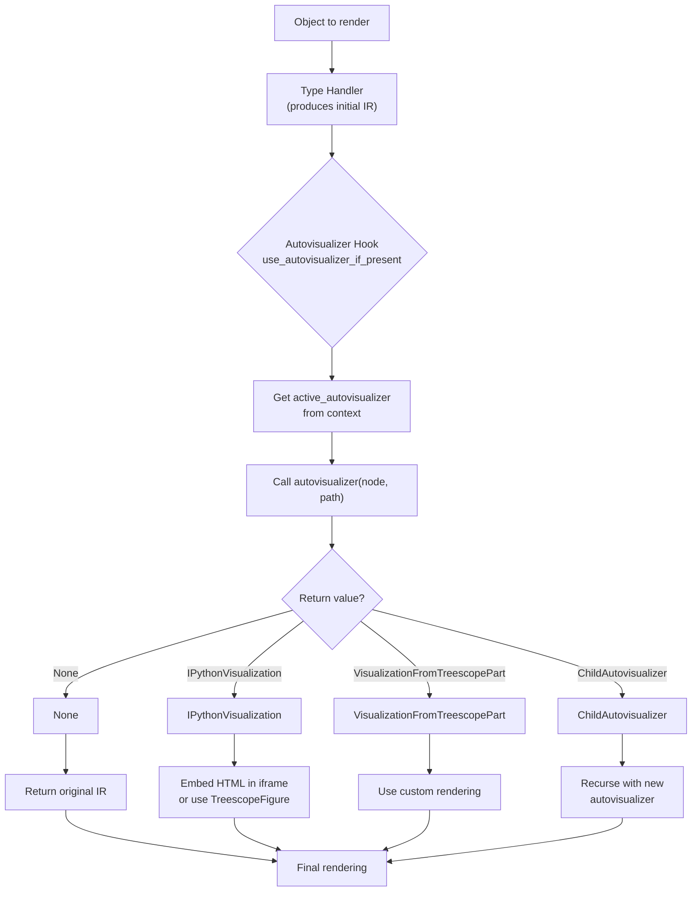
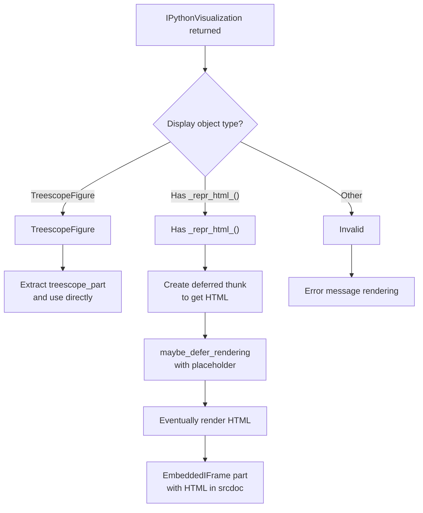
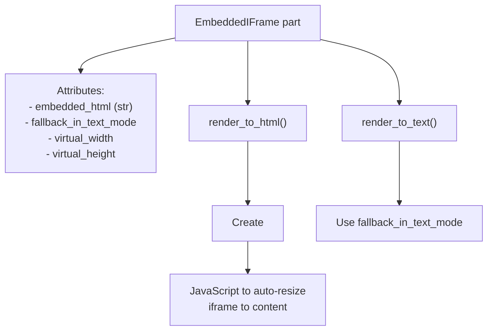
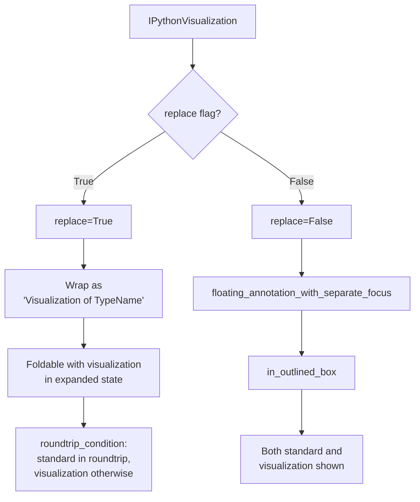

<!-- source: DeepWiki mcp.deepwiki.com · repo google-deepmind/treescope · page 7.1 Understanding Autovisualizers · fetched 2026-10-26 -->

# Understanding Autovisualizers

<details>
<summary>Relevant source files</summary>

The following files were used as context for generating this wiki page:

- [tests/renderer_test.py](tests/renderer_test.py)
- [treescope/_internal/handlers/autovisualizer_hook.py](treescope/_internal/handlers/autovisualizer_hook.py)
- [treescope/_internal/parts/embedded_iframe.py](treescope/_internal/parts/embedded_iframe.py)
- [treescope/lowering.py](treescope/lowering.py)

</details>


## Purpose and Scope

This document explains the autovisualizer mechanism in Treescope: how it allows users to inject custom visualizations at specific nodes in the object tree during rendering. Autovisualizers are functions that intercept the rendering process and can either enhance or replace the standard representation of objects with custom visualizations, such as plots, interactive widgets, or specialized views.

For information about creating custom autovisualizers and integrating plotting libraries, see [Creating Custom Autovisualizers](#7.2). For the array-specific autovisualizer implementation, see [ArrayAutovisualizer](#4.2).

---

## What Are Autovisualizers?

An **autovisualizer** is a callable that takes a node and its path in the object tree and optionally returns a custom visualization. The signature is:

```python
def autovisualizer(node: Any, path: str | None) -> AutovisualizerResult | None
```

Autovisualizers enable:
- **Adding visualizations** to specific objects (e.g., showing a plot alongside an array)
- **Replacing representations** entirely (e.g., rendering a model as an interactive diagram)
- **Contextual rendering** where different parts of the tree use different visualization strategies
- **Rich HTML embedding** for integration with external plotting libraries

The active autovisualizer is controlled by the `active_autovisualizer` contextual value and can be set globally or scoped to specific code blocks.

**Sources:** [treescope/_internal/handlers/autovisualizer_hook.py:33-50]()

---

## Autovisualizer in the Rendering Pipeline

The autovisualizer mechanism is implemented as a **wrapper hook** in the rendering pipeline, meaning it runs after handlers produce their initial representation but before the final result is returned.



**Key points:**
- The hook is registered in the renderer's `wrapper_hooks` list
- It runs **after** the standard handler produces the initial representation
- It can inspect the node and its path to decide whether to visualize
- The original rendering is always computed as a fallback for roundtrip mode

**Sources:** [treescope/_internal/handlers/autovisualizer_hook.py:33-200]()

---

## Return Types

Autovisualizers can return one of four types. The return type determines how the visualization is integrated into the tree.

| Return Type | Purpose | Effect |
|-------------|---------|--------|
| `None` | No visualization | Continue with standard rendering |
| `IPythonVisualization` | Rich HTML display object | Embed HTML in iframe or display TreescopeFigure |
| `VisualizationFromTreescopePart` | Custom treescope rendering | Use the provided renderable part directly |
| `ChildAutovisualizer` | Contextual autovisualizer | Apply a different autovisualizer to this subtree |

### None

Returning `None` indicates no visualization should be applied. The rendering continues normally as if no autovisualizer was active.

**Sources:** [treescope/_internal/handlers/autovisualizer_hook.py:48-50]()

### IPythonVisualization

`IPythonVisualization` wraps a display object (anything with `_repr_html_()` or a `TreescopeFigure`) and specifies whether it should replace the standard rendering.

```python
class IPythonVisualization:
    display_object: Any  # Object with _repr_html_() or TreescopeFigure
    replace: bool        # If True, replace; if False, annotate
```

**When `replace=True`:**
- The visualization replaces the standard rendering in normal mode
- In roundtrip mode, the standard rendering is shown with a comment indicating the visualization is hidden
- Useful for completely custom representations

**When `replace=False`:**
- The visualization appears as a floating annotation alongside the standard rendering
- The standard rendering remains visible
- Useful for supplementary information like plots

**Display object types:**
- `TreescopeFigure` - Directly embedded as a treescope part
- Objects with `_repr_html_()` - HTML is extracted and embedded in an iframe
- Invalid objects trigger an error message

**Sources:** [treescope/_internal/handlers/autovisualizer_hook.py:52-183]()

---

## HTML Embedding and Deferred Rendering

When an autovisualizer returns an `IPythonVisualization` with a display object that has `_repr_html_()`, the HTML content is embedded in an isolated iframe within the treescope output.



### Deferred Rendering Flow

The HTML extraction and iframe creation is **deferred** to avoid blocking the initial tree rendering:

1. **Placeholder creation** - A placeholder `"<rich HTML visualization loading...>"` is inserted
2. **Thunk registration** - A thunk that will call `_repr_html_()` and create the iframe is registered
3. **Initial display** - The tree structure is displayed immediately with the placeholder
4. **Deferred execution** - The thunk is called asynchronously
5. **DOM update** - The placeholder is replaced with the actual iframe containing the HTML

This pattern allows expensive visualizations (e.g., rendering a large plot) to complete without delaying the display of the overall tree structure.

**Sources:** [treescope/_internal/handlers/autovisualizer_hook.py:64-92](), [treescope/lowering.py:46-110]()

---

## EmbeddedIFrame Implementation

The `EmbeddedIFrame` part handles the actual embedding of external HTML content:



**Key features:**
- **Isolated rendering** - HTML is rendered in an iframe with its own document context
- **Auto-resizing** - JavaScript observes the content size and resizes the iframe
- **Text mode fallback** - A simpler representation is used when rendering to plain text
- **Virtual dimensions** - For layout purposes, the iframe has estimated width/height before actual rendering

The iframe uses the `srcdoc` attribute to embed HTML directly without external URLs:

```html
<iframe srcdoc="<html><body style='margin: 0'><!-- content --></body></html>"
        onload="resize_iframe_by_content(this)">
</iframe>
```

**Sources:** [treescope/_internal/parts/embedded_iframe.py:33-184]()

---

## VisualizationFromTreescopePart

This return type allows autovisualizers to provide a completely custom treescope rendering built from rendering parts:

```python
class VisualizationFromTreescopePart:
    rendering: RenderableAndLineAnnotations
```

The provided rendering is used directly, bypassing the standard handler. This is always a replacement (equivalent to `IPythonVisualization` with `replace=True`).

**Use cases:**
- Building custom tree structures with specific layout
- Combining multiple rendering parts in complex ways
- Fine-grained control over foldable regions and annotations

In roundtrip mode, the standard rendering is shown instead with a comment.

**Sources:** [treescope/_internal/handlers/autovisualizer_hook.py:154-179]()

---

## ChildAutovisualizer

This return type switches the autovisualizer used for the current subtree:

```python
class ChildAutovisualizer:
    autovisualizer: Callable[[Any, str | None], AutovisualizerResult | None]
```

When returned, the rendering process **re-renders the current node** using the new autovisualizer. This enables:
- **Contextual visualization** - Different parts of an object tree can use different strategies
- **Composition** - Autovisualizers can delegate to specialized autovisualizers for certain object types
- **Scoped behavior** - Visualization rules can apply only to specific subtrees

Example pattern:
```python
def outer_autovisualizer(node, path):
    if isinstance(node, SpecialContainer):
        # Use a different autovisualizer for contents of SpecialContainer
        return ChildAutovisualizer(autovisualizer=inner_autovisualizer)
    return None
```

**Sources:** [treescope/_internal/handlers/autovisualizer_hook.py:185-188]()

---

## Configuration and Context

Autovisualizers are controlled through the `active_autovisualizer` contextual value:

| Method | Scope | Use Case |
|--------|-------|----------|
| `active_autovisualizer.set_globally(fn)` | Global (process-wide) | Set default behavior |
| `active_autovisualizer.set_scoped(fn)` | Context manager | Temporary changes |
| `basic_interactive_setup(autovisualize_arrays=True)` | Global | Enable array autovisualization |
| `%%autovisualize` magic | IPython cell | Cell-level autovisualization |

**Example usage:**

```python
# Global setting
treescope.active_autovisualizer.set_globally(my_autovisualizer)

# Scoped setting
with treescope.active_autovisualizer.set_scoped(my_autovisualizer):
    treescope.show(my_object)

# Disable autovisualization temporarily
with treescope.active_autovisualizer.set_scoped(lambda node, path: None):
    treescope.show(my_object)
```

The autovisualizer receives:
- `node` - The object being rendered
- `path` - A string representation of the path to this node (e.g., `"[0]['key']"`) or `None` for the root

**Sources:** [treescope/_internal/handlers/autovisualizer_hook.py:43-45]()

---

## Integration with Replace Flag

The `replace` flag in `IPythonVisualization` controls whether the visualization supplements or replaces the standard rendering:



**Replace mode (`replace=True`):**
- Visualization is the primary rendering
- Standard rendering appears only in roundtrip mode with a comment: `"# Visualization hidden in roundtrip mode"`
- Useful when the visualization **is** the representation

**Annotate mode (`replace=False`):**
- Standard rendering is shown normally
- Visualization appears as a floating annotation in an outlined box
- Can be collapsed independently
- Comment when collapsed: `"(Visualization hidden)"`
- Useful for **supplementary** visualizations like plots or explanatory diagrams

**Sources:** [treescope/_internal/handlers/autovisualizer_hook.py:104-183]()

---

## Code Entity Reference

This table maps conceptual entities to their code locations:

| Concept | Code Entity | Location |
|---------|-------------|----------|
| Autovisualizer hook | `use_autovisualizer_if_present()` | [treescope/_internal/handlers/autovisualizer_hook.py:33-200]() |
| Active autovisualizer context | `active_autovisualizer` | Referenced from autovisualize module |
| IPython visualization | `IPythonVisualization` | [treescope/_internal/handlers/autovisualizer_hook.py:28]() |
| Treescope part visualization | `VisualizationFromTreescopePart` | [treescope/_internal/handlers/autovisualizer_hook.py:29]() |
| Child autovisualizer | `ChildAutovisualizer` | [treescope/_internal/handlers/autovisualizer_hook.py:30]() |
| HTML embedding | `EmbeddedIFrame` | [treescope/_internal/parts/embedded_iframe.py:33-184]() |
| Deferred rendering | `maybe_defer_rendering()` | [treescope/lowering.py:46-110]() |
| Deferred context | `collecting_deferred_renderings()` | [treescope/lowering.py:113-138]() |
| HTML extraction | `object_inspection.to_html()` | Referenced in [treescope/_internal/handlers/autovisualizer_hook.py:71]() |
| Figure type | `TreescopeFigure` | Referenced in [treescope/_internal/handlers/autovisualizer_hook.py:66]() |

**Sources:** Multiple files listed above

---

