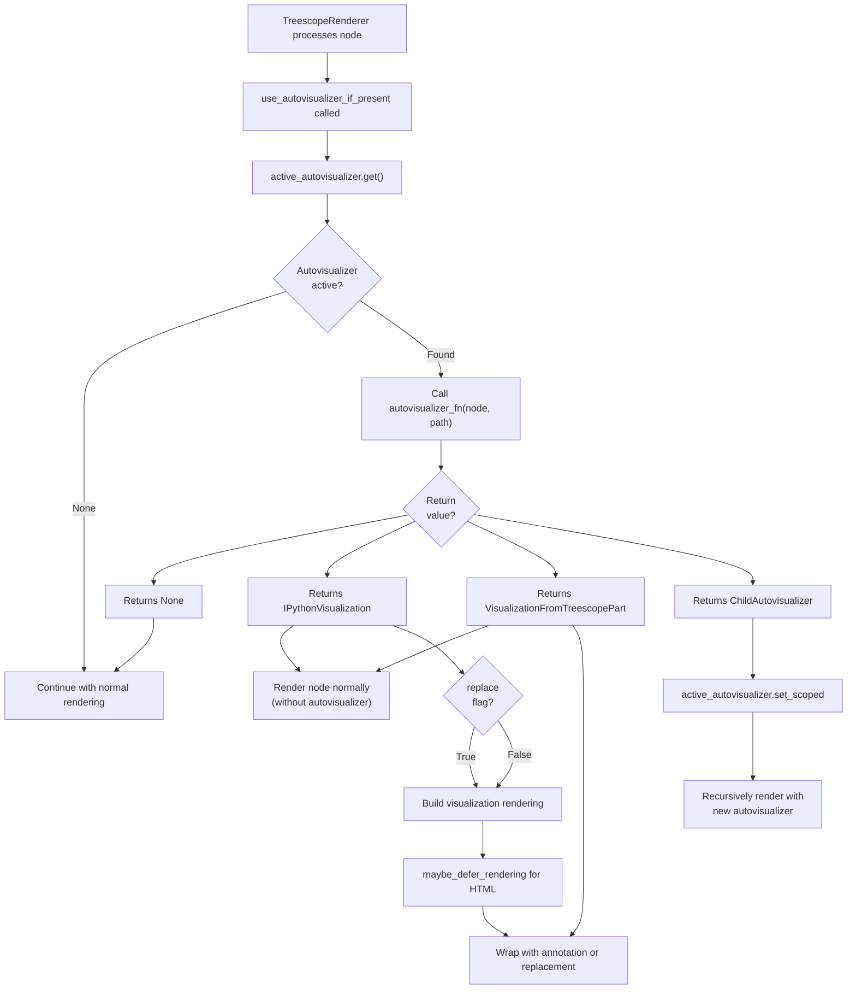
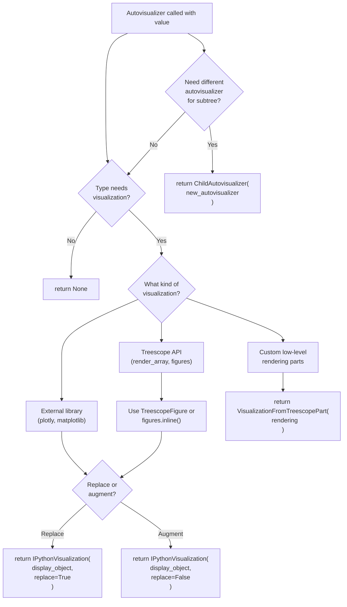

<!-- source: DeepWiki mcp.deepwiki.com · repo google-deepmind/treescope · page 7.2 Creating Custom Autovisualizers · fetched 2026-10-26 -->

# Creating Custom Autovisualizers

<details>
<summary>Relevant source files</summary>

The following files were used as context for generating this wiki page:

- [docs/notebooks/array_visualization.ipynb](docs/notebooks/array_visualization.ipynb)
- [docs/notebooks/building_custom_visualizations.ipynb](docs/notebooks/building_custom_visualizations.ipynb)
- [docs/notebooks/pretty_printing.ipynb](docs/notebooks/pretty_printing.ipynb)
- [treescope/_internal/handlers/autovisualizer_hook.py](treescope/_internal/handlers/autovisualizer_hook.py)
- [treescope/_internal/parts/embedded_iframe.py](treescope/_internal/parts/embedded_iframe.py)
- [treescope/lowering.py](treescope/lowering.py)

</details>


This page provides a practical guide to writing custom autovisualizer functions that automatically visualize specific types of objects within rendered trees. Custom autovisualizers allow you to enhance Treescope's output by adding rich visualizations (histograms, plots, custom figures) at specific nodes in the object tree.

For information about the conceptual model of autovisualizers and the different visualization types they can return, see [Understanding Autovisualizers](#7.1). For information about extending Treescope by adding custom type handlers instead, see [Custom Type Handlers](#8.1).

## Autovisualizer Function Signature

An autovisualizer is a callable that examines each node in the tree during rendering and optionally returns a visualization. The function signature is:

```python
def autovisualizer_fn(
    value: Any,
    path: tuple[Any, ...] | None,
) -> (
    IPythonVisualization 
    | VisualizationFromTreescopePart 
    | ChildAutovisualizer 
    | None
)
```

**Parameters:**
- `value`: The current node being rendered
- `path`: Optional tuple representing the path from root to this node (e.g., `("key", 0, "field")`)

**Return values:**
- `None`: Continue with normal rendering
- `IPythonVisualization`: Display a rich visualization
- `VisualizationFromTreescopePart`: Display a custom Treescope rendering
- `ChildAutovisualizer`: Use a different autovisualizer for this subtree

Sources: [docs/notebooks/building_custom_visualizations.ipynb:264-274](), [treescope/_internal/handlers/autovisualizer_hook.py:33-50]()

## Autovisualizer Execution Flow



**Autovisualizer Hook Execution in Rendering Pipeline**

Sources: [treescope/_internal/handlers/autovisualizer_hook.py:33-200]()

## Return Types and Their Usage

| Return Type | Purpose | When to Use |
|------------|---------|-------------|
| `None` | No visualization | Type doesn't need custom visualization |
| `IPythonVisualization` | Rich HTML display | Embedding plots, charts, or external library output |
| `VisualizationFromTreescopePart` | Custom Treescope rendering | Building visualizations with Treescope's internal APIs |
| `ChildAutovisualizer` | Change autovisualizer | Different subtrees need different visualization strategies |

Sources: [treescope/_internal/handlers/autovisualizer_hook.py:28-30](), [docs/notebooks/building_custom_visualizations.ipynb:264-274]()

## Basic Example: Customizing Array Visualization

The simplest autovisualizer checks the type and returns a visualization:

```python
def my_continuous_autovisualizer(value, path):
    if isinstance(value, np.ndarray):
        return treescope.IPythonVisualization(
            treescope.render_array(value, continuous=True, around_zero=False),
            replace=True,
        )
    # Return None for non-arrays (continue normal rendering)
    return None
```

**Using the autovisualizer:**

```python
# In a cell or context:
with treescope.active_autovisualizer.set_scoped(my_continuous_autovisualizer):
    treescope.display(my_data)

# Or using the magic command:
%%autovisualize my_continuous_autovisualizer
my_data
```

Sources: [docs/notebooks/building_custom_visualizations.ipynb:286-319](), [docs/notebooks/pretty_printing.ipynb:625-656]()

## Integrating External Libraries

Autovisualizers can embed any object that implements IPython's `_repr_html_` method, including plots from matplotlib, plotly, or other visualization libraries.

**Example: Plotly histograms for arrays**

```python
import plotly.express as px

def my_plotly_autovisualizer(value, path):
    if isinstance(value, (np.ndarray, jax.Array)):
        return treescope.IPythonVisualization(
            px.histogram(
                value.flatten(),
                width=400, height=200
            ).update_layout(
                margin=dict(l=20, r=20, t=20, b=20)
            )
        )
```

The rendering system:
1. Detects the object has `_repr_html_`
2. Calls `object_inspection.to_html(display_obj)` to get HTML content
3. Wraps it in an `EmbeddedIFrame` via `rendering_parts.embedded_iframe()`
4. Uses `lowering.maybe_defer_rendering()` to defer expensive rendering

Sources: [docs/notebooks/building_custom_visualizations.ipynb:393-429](), [treescope/_internal/handlers/autovisualizer_hook.py:64-92]()

## Replace vs Augment Mode

The `IPythonVisualization` constructor accepts a `replace` parameter:

```python
class IPythonVisualization:
    display_object: Any
    replace: bool = True
```

### Replace Mode (`replace=True`)

The visualization replaces the normal rendering entirely:

```python
def replace_mode_example(value, path):
    if isinstance(value, np.ndarray):
        return treescope.IPythonVisualization(
            my_custom_figure(value),
            replace=True  # Default
        )
```

**Behavior:**
- Normal rendering is wrapped in `roundtrip_condition` and shown only in roundtrip mode
- Visualization is primary, with comment "# Visualization hidden in roundtrip mode"
- User sees the visualization by default, object structure only when pressing 'r'

### Augment Mode (`replace=False`)

The visualization is added alongside the normal rendering:

```python
def augment_mode_example(value, path):
    if isinstance(value, np.ndarray):
        return treescope.IPythonVisualization(
            my_custom_figure(value),
            replace=False
        )
```

**Behavior:**
- Normal rendering remains visible
- Visualization appears in a `floating_annotation_with_separate_focus`
- Can be collapsed with "(Visualization hidden)" comment when folded
- Both structure and visualization are always visible

Sources: [treescope/_internal/handlers/autovisualizer_hook.py:104-183](), [treescope/_internal/api/autovisualize.py]()

## Decision Flow for Return Values



**Return Value Decision Tree**

Sources: [treescope/_internal/handlers/autovisualizer_hook.py:42-200]()

## Advanced: Using ChildAutovisualizer

`ChildAutovisualizer` allows changing the autovisualizer for a specific subtree. This is useful when different parts of your data structure need different visualization strategies.

**Example: Different visualization for nested structures**

```python
def outer_autovisualizer(value, path):
    if isinstance(value, MyCustomContainer):
        # Use a different autovisualizer for contents
        return treescope.ChildAutovisualizer(
            inner_autovisualizer
        )
    # Default handling
    return None

def inner_autovisualizer(value, path):
    # Specialized visualization for inner values
    if isinstance(value, np.ndarray):
        return treescope.IPythonVisualization(
            treescope.render_array(value, vmax=1.0)
        )
    return None
```

**Implementation:**
The `ChildAutovisualizer` return causes the hook to:
1. Call `active_autovisualizer.set_scoped(result.autovisualizer)`
2. Recursively call the renderer on the same node
3. The new autovisualizer is active for all descendants

Sources: [treescope/_internal/handlers/autovisualizer_hook.py:185-188](), [treescope/_internal/api/autovisualize.py]()

## Adding Metadata and Context

Autovisualizers receive the path to the current node, which can be used to provide context-specific visualizations:

```python
def path_aware_autovisualizer(value, path):
    if isinstance(value, np.ndarray):
        size = value.size
        
        # Use path information to customize display
        path_str = ".".join(str(p) for p in path) if path else "root"
        
        return treescope.IPythonVisualization(
            treescope.figures.inline(
                f"Array at {path_str}:\\n",
                treescope.render_array(value),
                f"\\nSize: {size}, Mean: {value.mean():.3f}"
            ),
            replace=False
        )
```

Sources: [docs/notebooks/building_custom_visualizations.ipynb:338-378]()

## Combining with treescope.figures

The `treescope.figures` module provides utilities for building rich inline content:

```python
def rich_metadata_autovisualizer(value, path):
    if isinstance(value, np.ndarray):
        return treescope.IPythonVisualization(
            treescope.figures.inline(
                treescope.figures.bolded("Array Summary"),
                ":\\n",
                "  Shape: ", value.shape, "\\n",
                "  Visualization:\\n",
                treescope.figures.indented(
                    treescope.render_array(value)
                ),
                "\\n  Statistics:\\n",
                treescope.figures.indented(
                    treescope.figures.inline(
                        "Mean: ", treescope.figures.with_color(f"{value.mean():.3f}", "blue"), "\\n",
                        "Std: ", treescope.figures.with_color(f"{value.std():.3f}", "green")
                    )
                )
            ),
            replace=False
        )
```

Sources: [docs/notebooks/building_custom_visualizations.ipynb:156-208]()

## Best Practices and Considerations

### Memory Management

Visualizations are serialized into the notebook output. Large visualizations increase notebook size and browser memory usage:

- Arrays are fully serialized even when using sliders
- A 1000×1000 array adds ~5MB to the notebook
- Consider size limits or conditional visualization for large arrays

Sources: [docs/notebooks/array_visualization.ipynb:800-814]()

### Deferred Rendering

The autovisualizer hook uses `lowering.maybe_defer_rendering()` for HTML content from external libraries. This:
- Renders the tree structure first
- Inserts visualizations asynchronously
- Improves perceived performance for expensive visualizations

The deferral is automatic for `IPythonVisualization` objects containing HTML-capable display objects.

Sources: [treescope/_internal/handlers/autovisualizer_hook.py:87-92](), [treescope/lowering.py:46-111]()

### Context Safety

Autovisualizers are called during rendering, which may be in a different context than where they were defined:

- Avoid relying on global state
- Don't call subtree renderers inside deferred thunks (as shown in `lowering.py:68-72`)
- The `path` parameter is only available during initial rendering, not in deferred rendering

Sources: [treescope/lowering.py:67-72]()

### Type Checking

Always check types explicitly before returning visualizations:

```python
def safe_autovisualizer(value, path):
    # Explicit type check
    if not isinstance(value, np.ndarray):
        return None
    
    # Only visualize if criteria met
    if value.size > 100:
        return treescope.IPythonVisualization(...)
    
    return None
```

### Roundtrip Mode Compatibility

When `replace=True`, the normal rendering is still generated for roundtrip mode. Ensure your types have proper `__repr__` or `__treescope_repr__` implementations so the roundtrip view is useful.

Sources: [treescope/_internal/handlers/autovisualizer_hook.py:159-179]()

## Activation Methods

Autovisualizers can be activated in three ways:

```python
# 1. Globally (persistent across cells)
treescope.active_autovisualizer.set_globally(my_autovisualizer)

# 2. Context manager (scoped to block)
with treescope.active_autovisualizer.set_scoped(my_autovisualizer):
    treescope.display(data)

# 3. Cell magic (scoped to cell)
%%autovisualize my_autovisualizer
data
```

The `ArrayAutovisualizer` is set globally by `basic_interactive_setup()` and can be customized:

```python
treescope.basic_interactive_setup(
    autovisualize_arrays=True,  # Enable ArrayAutovisualizer
)
```

Sources: [docs/notebooks/building_custom_visualizations.ipynb:312-453](), [docs/notebooks/array_visualization.ipynb:936-993]()

---

