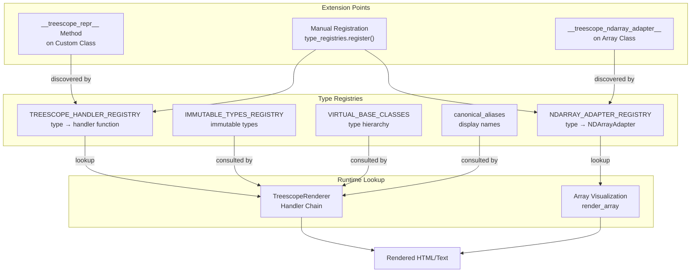
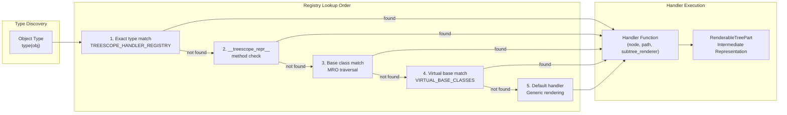
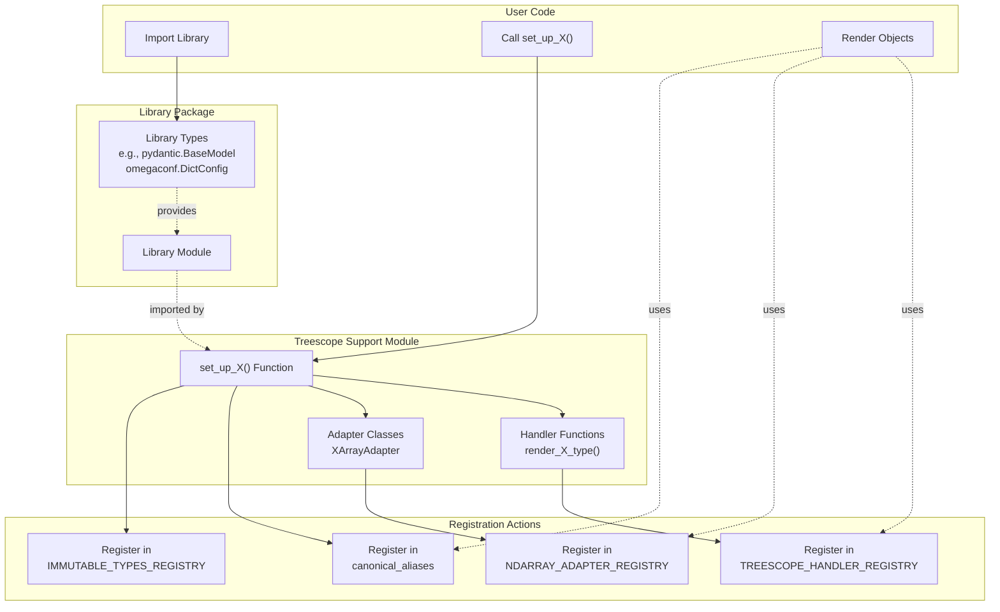

<!-- source: DeepWiki mcp.deepwiki.com · repo google-deepmind/treescope · page 8 Extending Treescope · fetched 2026-10-26 -->

# Extending Treescope

<details>
<summary>Relevant source files</summary>

The following files were used as context for generating this wiki page:

- [tests/fixtures/treescope_examples_fixture.py](tests/fixtures/treescope_examples_fixture.py)
- [tests/renderer_test.py](tests/renderer_test.py)
- [treescope/external/omegaconf_support.py](treescope/external/omegaconf_support.py)
- [treescope/external/pydantic_support.py](treescope/external/pydantic_support.py)

</details>


## Purpose and Scope

This document provides an overview of Treescope's extensibility mechanisms, explaining how to add support for custom types and external libraries. Treescope is designed to be extensible through a registry-based architecture that allows users and library authors to customize how objects are rendered.

This page covers the high-level extension architecture and patterns. For implementation details, see:
- [Custom Type Handlers](#8.1) - for adding `__treescope_repr__` methods or registering handlers
- [Custom Array Adapters](#8.2) - for integrating custom array types with array visualization
- [Adding External Library Support](#8.3) - for creating comprehensive library integrations

## Extension Mechanisms Overview

Treescope provides three primary mechanisms for extension:

| Mechanism | Use Case | Requires Modification |
|-----------|----------|----------------------|
| `__treescope_repr__` method | Custom rendering for types you own | Type definition |
| Handler Registration | Custom rendering for any type | No (registration code) |
| NDArray Adapter | Array visualization for custom array types | No (adapter class + registration) |

All mechanisms integrate with Treescope's rendering pipeline at runtime through type registries.

## Core Extension Architecture



**Sources:** [treescope/external/pydantic_support.py:59-61](), [treescope/external/omegaconf_support.py:39-44](), [tests/fixtures/treescope_examples_fixture.py:186-192]()

## Type Registry System

The registry system maps types to their rendering logic:



**Sources:** [tests/renderer_test.py:506-511](), [treescope/external/pydantic_support.py:31-49]()

## Extension Patterns

### Pattern 1: Custom Repr Method

The simplest extension for types you control:

```python
class ObjectWithCustomHandler:
  def __treescope_repr__(self, path, subtree_renderer):
    # Return a RenderableTreePart
    return treescope.rendering_parts.text(f"Custom rendering! Path: {path}")
```

The method receives:
- `path`: String representation of the object's path in the tree (e.g., `"[0].foo"`)
- `subtree_renderer`: Renderer for recursively rendering child objects

**Sources:** [tests/fixtures/treescope_examples_fixture.py:186-192](), [tests/renderer_test.py:506-511]()

### Pattern 2: Handler Registration

For types you don't control, register a handler function:

```python
def render_pydantic_model(node, path, subtree_renderer):
  fields = type(node).model_fields
  return repr_lib.render_object_constructor(
      type(node),
      attributes={k: getattr(node, k) for k in fields.keys()},
      path=path,
      subtree_renderer=subtree_renderer,
      roundtrippable=True,
  )

type_registries.TREESCOPE_HANDLER_REGISTRY[pydantic.BaseModel] = (
    render_pydantic_model
)
```

Handler functions have the same signature as `__treescope_repr__` methods.

**Sources:** [treescope/external/pydantic_support.py:31-61]()

### Pattern 3: External Library Setup Function

Create a `set_up_X()` function that performs all registrations:

```python
def set_up_omegaconf():
  """Registers handlers for OmegaConf types."""
  if omegaconf is None:
    raise RuntimeError("Cannot set up OmegaConf support: omegaconf cannot be imported.")
  
  # Register handlers
  type_registries.TREESCOPE_HANDLER_REGISTRY[omegaconf.DictConfig] = (
      functools.partial(repr_lib.handle_custom_mapping, roundtrippable=True)
  )
  type_registries.TREESCOPE_HANDLER_REGISTRY[omegaconf.ListConfig] = (
      functools.partial(repr_lib.handle_custom_listlike, roundtrippable=True)
  )
  
  # Register canonical aliases
  canonical_aliases.populate_from_public_api(
      omegaconf, canonical_aliases.prefix_filter("omegaconf")
  )
```

This pattern allows lazy imports and centralized configuration.

**Sources:** [treescope/external/omegaconf_support.py:32-49](), [treescope/external/pydantic_support.py:52-61]()

## Registry Types and Their Roles

| Registry | Purpose | Registration Method |
|----------|---------|-------------------|
| `TREESCOPE_HANDLER_REGISTRY` | Maps types to rendering functions | Direct assignment or `register()` |
| `NDARRAY_ADAPTER_REGISTRY` | Maps array types to NDArrayAdapter instances | Direct assignment or `__treescope_ndarray_adapter__` |
| `IMMUTABLE_TYPES_REGISTRY` | Marks types as immutable for optimization | `add()` or `update()` |
| `VIRTUAL_BASE_CLASSES` | Defines virtual inheritance for type matching | Direct assignment |
| `canonical_aliases` | Display names for types and functions | `update()` or `populate_from_public_api()` |

**Sources:** [treescope/external/pydantic_support.py:59-61](), [treescope/external/omegaconf_support.py:39-48]()

## External Library Integration Flow



**Sources:** [treescope/external/pydantic_support.py:52-61](), [treescope/external/omegaconf_support.py:32-49]()

## Examples in the Codebase

The codebase includes several examples of extensions:

### Test Fixtures

| Example | File | Purpose |
|---------|------|---------|
| `ObjectWithCustomHandler` | [tests/fixtures/treescope_examples_fixture.py:186-192]() | Simple custom handler via `__treescope_repr__` |
| `ObjectWithCustomHandlerThatThrows` | [tests/fixtures/treescope_examples_fixture.py:195-202]() | Error handling example |
| `UnknownPytreeNode` | [tests/fixtures/treescope_examples_fixture.py:141-161]() | PyTree without custom handler |

### External Library Support

| Library | Module | Key Registrations |
|---------|--------|------------------|
| Pydantic | [treescope/external/pydantic_support.py]() | `pydantic.BaseModel` handler |
| OmegaConf | [treescope/external/omegaconf_support.py]() | `DictConfig`, `ListConfig` handlers |
| JAX | Referenced in tests | Array handlers, sharding visualization |
| PyTorch | Referenced in tests | Tensor and Module handlers |

**Sources:** [tests/fixtures/treescope_examples_fixture.py:186-256](), [treescope/external/pydantic_support.py:1-62](), [treescope/external/omegaconf_support.py:1-50]()

## Handler Function Signature

All custom handlers must follow this signature:

```python
def handler(
    node: Any,  # The object being rendered
    path: str | None,  # Path to object in tree (e.g., "[0].foo")
    subtree_renderer: TreescopeSubtreeRenderer,  # Renderer for children
) -> Rendering | type(NotImplemented):
    # Return NotImplemented to fall through to next handler
    # Return a Rendering (RenderableTreePart) to handle the object
    pass
```

The handler can:
- Return `NotImplemented` to decline handling (next handler in chain is tried)
- Return a `RenderableTreePart` (via `rendering_parts` module) to provide the rendering
- Use `subtree_renderer` to recursively render child objects
- Use `repr_lib` utilities for common patterns (e.g., `render_object_constructor`)

**Sources:** [treescope/external/pydantic_support.py:31-49](), [tests/fixtures/treescope_examples_fixture.py:186-192]()

## Error Handling

Treescope includes error recovery mechanisms:

```python
# Test showing error recovery with ignore_exceptions=True
def test_fallback_repr_after_error(self):
  target = [ObjectWithCustomHandlerThatThrows()]
  renderer = treescope.active_renderer.get()
  
  # Raises error normally
  with self.assertRaises(RuntimeError):
    renderer.to_foldable_representation(target)
  
  # With ignore_exceptions, falls back to __repr__
  rendering = renderer.to_foldable_representation(
      target, ignore_exceptions=True
  )
```

When `ignore_exceptions=True`, Treescope:
1. Catches exceptions in custom handlers
2. Issues a warning with traceback
3. Falls back to the object's `__repr__` method
4. Displays `<Fallback repr for TypeName>` if `__repr__` also fails

**Sources:** [tests/renderer_test.py:1137-1172]()

## Next Steps

For detailed implementation guides, see:

- **[Custom Type Handlers](#8.1)** - Learn to implement `__treescope_repr__` and register custom handlers for full control over rendering
- **[Custom Array Adapters](#8.2)** - Create adapters for custom array types to enable array visualization features
- **[Adding External Library Support](#8.3)** - Follow the established pattern for comprehensive library integration

For understanding the rendering pipeline that your extensions integrate with, see [Rendering Pipeline](#3.1).

For array-specific visualization features, see [Array Visualization](#4).

---

