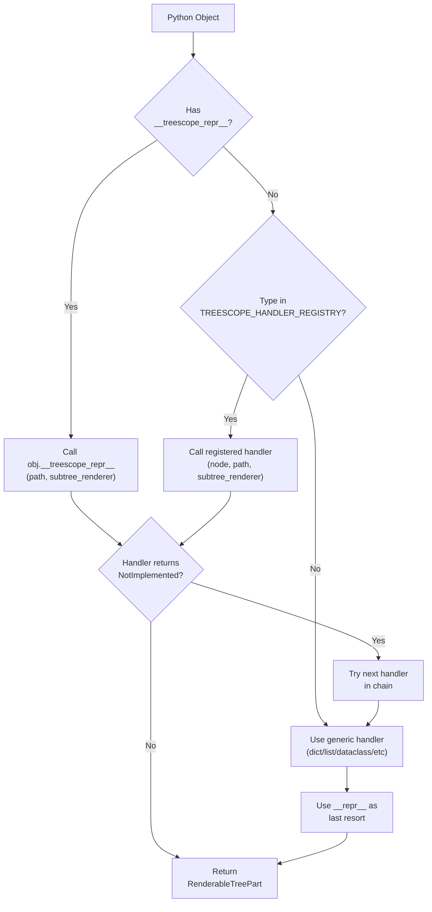
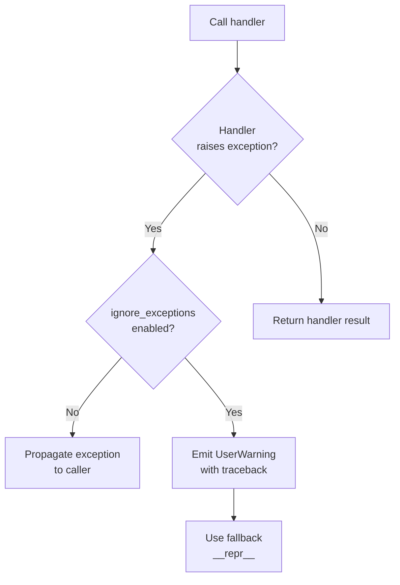
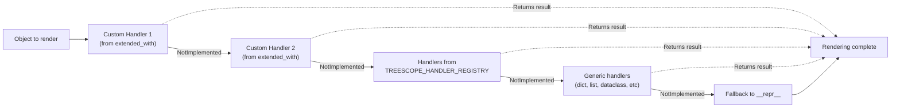

<!-- source: DeepWiki mcp.deepwiki.com · repo google-deepmind/treescope · page 8.1 Custom Type Handlers · fetched 2026-10-26 -->

# Custom Type Handlers

<details>
<summary>Relevant source files</summary>

The following files were used as context for generating this wiki page:

- [tests/fixtures/treescope_examples_fixture.py](tests/fixtures/treescope_examples_fixture.py)
- [tests/renderer_test.py](tests/renderer_test.py)

</details>


## Purpose and Scope

This page explains how to control the rendering of custom types in Treescope by implementing custom type handlers. There are two primary approaches: implementing the `__treescope_repr__` method on your class, or manually registering handler functions in the global registry. 

For adding custom array type support, see [Custom Array Adapters](#8.2). For creating comprehensive external library support modules, see [Adding External Library Support](#8.3).

## Overview of Custom Type Handlers

Custom type handlers intercept the rendering process for specific object types, allowing you to control how they appear in Treescope's output. This is essential for:

- Providing meaningful representations of domain-specific objects
- Hiding implementation details while showing relevant structure
- Integrating custom visualization logic
- Supporting types from external libraries

**Sources:** [tests/renderer_test.py:87-153](), [tests/fixtures/treescope_examples_fixture.py:186-225]()

## Handler Dispatch Mechanism



**Sources:** [tests/renderer_test.py:88-122]()

## Two Approaches to Custom Handlers

| Approach | When to Use | Pros | Cons |
|----------|-------------|------|------|
| `__treescope_repr__` method | You control the class definition | Automatic discovery, no registration needed | Requires modifying the class |
| Manual registration | External types, library integration | Works with any type, can override existing handlers | Requires explicit registration, order matters |

**Sources:** [tests/fixtures/treescope_examples_fixture.py:186-192](), [tests/renderer_test.py:100-102]()

## Implementing `__treescope_repr__`

### Method Signature

```python
def __treescope_repr__(
    self, 
    path: str, 
    subtree_renderer: Callable[[Any, str], RenderableTreePart]
) -> RenderableTreePart | NotImplemented
```

**Parameters:**
- `path`: String representation of the path to this object in the tree (e.g., `"[0].foo.bar"`)
- `subtree_renderer`: Function to recursively render child objects at new paths

**Returns:**
- A `RenderableTreePart` (typically created via `rendering_parts` functions), or
- `NotImplemented` to delegate to the next handler in the chain

**Sources:** [tests/fixtures/treescope_examples_fixture.py:188-192]()

### Basic Example

```python
# From tests/fixtures/treescope_examples_fixture.py:186-192
class ObjectWithCustomHandler:

  def __treescope_repr__(self, path, subtree_renderer):
    del subtree_renderer
    return treescope.rendering_parts.text(
        f"<ObjectWithCustomHandler custom rendering! Path: {repr(path)}>"
    )
```

This example demonstrates:
- Receiving the `path` parameter showing the object's location in the tree
- Using `rendering_parts.text()` to create a simple text rendering
- Ignoring `subtree_renderer` when no child rendering is needed

**Sources:** [tests/fixtures/treescope_examples_fixture.py:186-192](), [tests/renderer_test.py:506-511]()

### Rendering with Children

To render child objects, use the `subtree_renderer` callback:

```python
def __treescope_repr__(self, path, subtree_renderer):
    # Render child attributes
    child_parts = []
    for attr_name in ['foo', 'bar']:
        attr_value = getattr(self, attr_name)
        child_rendering = subtree_renderer(
            attr_value, 
            f"{path}.{attr_name}"
        )
        child_parts.append(child_rendering)
    
    # Combine into structured output
    return rendering_parts.siblings(
        rendering_parts.text("MyObject("),
        rendering_parts.indented_children(child_parts),
        rendering_parts.text(")")
    )
```

**Key points:**
- Always pass updated paths when recursing (e.g., `f"{path}.{attr_name}"`)
- Use `rendering_parts` functions to structure output
- The renderer handles foldable/expandable behavior automatically

**Sources:** [tests/fixtures/treescope_examples_fixture.py:188-192]()

## Manual Handler Registration

### Handler Function Signature

Handler functions registered in the global registry follow this signature:

```python
def custom_handler(
    node: Any,
    path: str,
    subtree_renderer: Callable[[Any, str], RenderableTreePart]
) -> RenderableTreePart | type(NotImplemented)
```

**Parameters:**
- `node`: The object to render
- `path`: String path to this object in the tree
- `subtree_renderer`: Function to recursively render children

**Returns:**
- A `RenderableTreePart` if the handler handles this type, or
- `NotImplemented` to pass to the next handler

**Sources:** [tests/renderer_test.py:88-99]()

### Extending the Renderer

```python
# From tests/renderer_test.py:100-102
renderer = treescope.active_renderer.get().extended_with(
    handlers=[handler_that_checks_type],
    wrapper_hooks=[optional_wrapper_hook]
)
```

This creates a new renderer with additional handlers prepended to the handler chain. Handlers are tried in order until one returns a result (not `NotImplemented`).

**Sources:** [tests/renderer_test.py:100-102](), [tests/renderer_test.py:1033-1040]()

### Example Handler Function

```python
def handler_for_my_type(node, path, subtree_renderer):
    if not isinstance(node, MyCustomType):
        return NotImplemented
    
    # Handle the type
    return rendering_parts.text(
        f"<MyCustomType: {node.important_field}>"
    )

# Use it
renderer = treescope.active_renderer.get().extended_with(
    handlers=[handler_for_my_type]
)
```

**Sources:** [tests/renderer_test.py:88-99]()

## Error Handling and Recovery

### Exception Handling in Handlers

Treescope provides robust error recovery when handlers fail:



**Sources:** [tests/renderer_test.py:123-153](), [tests/renderer_test.py:1287-1320]()

### Example: Handler That Throws

```python
# From tests/fixtures/treescope_examples_fixture.py:195-202
class ObjectWithCustomHandlerThatThrows:

  def __treescope_repr__(self, path, subtree_renderer):
    del path, subtree_renderer
    raise RuntimeError("Simulated treescope_repr failure!")

  def __repr__(self):
    return "<Fallback repr for ObjectWithCustomHandlerThatThrows>"
```

When `ignore_exceptions=True` is used:
1. The exception is caught and logged as a warning
2. The object's `__repr__` is used as a fallback
3. Rendering continues for other objects

**Sources:** [tests/fixtures/treescope_examples_fixture.py:195-202](), [tests/renderer_test.py:1137-1172]()

### Testing Error Recovery

```python
# From tests/renderer_test.py:123-153
with warnings.catch_warnings(record=True) as recorded:
    rendering = renderer.to_foldable_representation(
        [1, 2, 3, "trigger handler error", "trigger hook error", 4],
        ignore_exceptions=True,
    )

# Warnings are emitted but rendering continues
assert len(recorded) == 2
```

**Sources:** [tests/renderer_test.py:123-153]()

## Deferred Rendering in Custom Handlers

For expensive rendering operations, handlers can defer computation until the node is actually expanded:

### Deferred Rendering Pattern

```python
# From tests/fixtures/treescope_examples_fixture.py:211-225
class ObjectWithCustomHandlerThatThrowsDeferred:

  def __treescope_repr__(self, path, subtree_renderer):
    del path, subtree_renderer

    def _internal_main_thunk(layout_decision):
        del layout_decision
        # Expensive computation here
        raise RuntimeError("Simulated deferred treescope_repr failure!")

    return treescope.lowering.maybe_defer_rendering(
        main_thunk=_internal_main_thunk,
        placeholder_thunk=lambda: treescope.rendering_parts.text(
            "<deferred placeholder>"
        ),
    )
```

**How it works:**
1. `placeholder_thunk` runs immediately, providing a lightweight summary
2. `main_thunk` runs only when the node is expanded in the UI
3. This avoids expensive computation for collapsed nodes

**Sources:** [tests/fixtures/treescope_examples_fixture.py:211-225](), [tests/renderer_test.py:1174-1208]()

## Building Renderable Parts

### Common Rendering Primitives

The `treescope.rendering_parts` module provides building blocks for constructing renderable output:

| Function | Purpose |
|----------|---------|
| `text(s)` | Plain text content |
| `siblings(*parts)` | Horizontal concatenation |
| `indented_children(parts)` | Vertical list with indentation |
| `fold_condition(collapsed, expanded)` | Foldable content |
| `build_foldable_tree_node(prefix, contents, suffix)` | Standard tree node structure |

**Sources:** [tests/fixtures/treescope_examples_fixture.py:190-192](), [tests/renderer_test.py:1356-1385]()

### Example: Complex Structured Output

```python
def __treescope_repr__(self, path, subtree_renderer):
    # Render children
    children = [
        subtree_renderer(getattr(self, attr), f"{path}.{attr}")
        for attr in self.__dict__
    ]
    
    # Build foldable structure
    return rendering_parts.build_foldable_tree_node(
        prefix=rendering_parts.text(f"{self.__class__.__name__}("),
        contents=rendering_parts.indented_children(children),
        suffix=rendering_parts.text(")")
    )
```

This creates a collapsible tree node similar to how dataclasses are rendered.

**Sources:** [tests/renderer_test.py:339-351]()

## Integration with Renderer Chain

### Handler Execution Order



**Key points:**
- Handlers added via `extended_with()` are tried first
- Earlier handlers take precedence over later ones
- Returning `NotImplemented` passes control to the next handler
- The fallback `__repr__` always succeeds (returns a value)

**Sources:** [tests/renderer_test.py:88-122]()

## Best Practices

### Type Checking in Handlers

Always check the type before handling:

```python
def my_handler(node, path, subtree_renderer):
    if not isinstance(node, MyType):
        return NotImplemented
    # ... handle MyType
```

**Sources:** [tests/renderer_test.py:88-99]()

### Path Management

When recursing, always update the path:

```python
# Good
child_rendering = subtree_renderer(child, f"{path}.child_attr")

# Bad - loses path information
child_rendering = subtree_renderer(child, path)
```

**Sources:** [tests/fixtures/treescope_examples_fixture.py:188-192]()

### Error Messages

Provide informative error messages for debugging:

```python
def __treescope_repr__(self, path, subtree_renderer):
    if not self.is_valid():
        raise ValueError(
            f"Cannot render invalid {self.__class__.__name__} at {path}"
        )
    # ... normal rendering
```

**Sources:** [tests/fixtures/treescope_examples_fixture.py:197-199]()

### Performance Considerations

For expensive operations:
1. Use deferred rendering with `maybe_defer_rendering`
2. Provide a lightweight placeholder
3. Compute expensive summaries only when expanded

**Sources:** [tests/fixtures/treescope_examples_fixture.py:211-225]()

## Testing Custom Handlers

### Basic Handler Testing

```python
# From tests/renderer_test.py:506-511
def test_custom_handler(self):
    target = [fixture_lib.ObjectWithCustomHandler()]
    
    renderer = treescope.active_renderer.get()
    rendering = renderer.to_foldable_representation(target)
    
    result = lowering.render_to_text_as_root(
        rendering_parts.build_full_line_with_annotations(rendering)
    )
    
    self.assertEqual(
        result,
        "[<ObjectWithCustomHandler custom rendering! Path: '[0]'>]"
    )
```

**Sources:** [tests/renderer_test.py:506-511]()

### Testing Error Handling

```python
# From tests/renderer_test.py:513-519
def test_custom_handler_that_throws(self):
    target = [fixture_lib.ObjectWithCustomHandlerThatThrows()]
    
    rendering = renderer.to_foldable_representation(
        target,
        ignore_exceptions=True
    )
    
    # Should fall back to __repr__
    self.assertContains(result, "Fallback repr")
```

**Sources:** [tests/renderer_test.py:513-519](), [tests/renderer_test.py:1137-1172]()

## Summary

Custom type handlers provide two integration points:

1. **`__treescope_repr__` method**: For types you control, implement this method directly on the class
2. **Manual registration**: For external types or advanced use cases, register handler functions via `extended_with()`

Both approaches receive `node`, `path`, and `subtree_renderer` parameters and return `RenderableTreePart` objects. Handlers can defer expensive computation, handle errors gracefully, and integrate seamlessly with Treescope's foldable tree rendering system.

**Sources:** [tests/renderer_test.py:59-1686](), [tests/fixtures/treescope_examples_fixture.py:186-225]()

---

