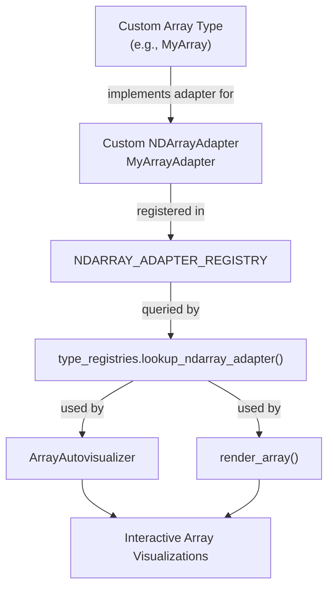
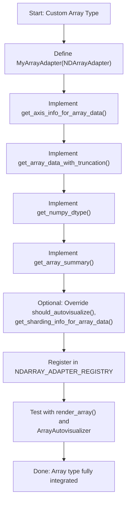

<!-- source: DeepWiki mcp.deepwiki.com · repo google-deepmind/treescope · page 8.2 Custom Array Adapters · fetched 2026-10-26 -->

# Custom Array Adapters

<details>
<summary>Relevant source files</summary>

The following files were used as context for generating this wiki page:

- [tests/__init__.py](tests/__init__.py)
- [tests/ndarray_adapters_test.py](tests/ndarray_adapters_test.py)
- [treescope/_internal/api/array_autovisualizer.py](treescope/_internal/api/array_autovisualizer.py)
- [treescope/_internal/handlers/generic_repr_handler.py](treescope/_internal/handlers/generic_repr_handler.py)
- [treescope/external/numpy_support.py](treescope/external/numpy_support.py)

</details>


## Purpose and Scope

This page provides a tutorial for implementing custom `NDArrayAdapter` classes to integrate new array types with Treescope's array visualization system. This enables automatic visualization and rendering of proprietary or domain-specific array types through the same infrastructure used for NumPy, JAX, and PyTorch arrays.

For information about the `NDArrayAdapter` interface itself and how it fits into the visualization system, see [NDArray Adapters](#4.4). For general information about custom type handlers, see [Custom Type Handlers](#8.1).

---

## The NDArrayAdapter Interface

An `NDArrayAdapter` is a protocol that abstracts array-like objects so they can be visualized using Treescope's array visualization system. By implementing this interface for a custom array type, you enable:

- Automatic visualization via `ArrayAutovisualizer`
- Manual visualization via `treescope.render_array()`
- Interactive features (zoom, sliders, colormaps)
- Sharding visualization



**Sources:** [treescope/_internal/api/array_autovisualizer.py:91-98](), [treescope/external/numpy_support.py:87-213]()

---

## Required Methods

Every `NDArrayAdapter` must implement the following core methods:

### Method Overview Table

| Method | Purpose | Returns |
|--------|---------|---------|
| `get_axis_info_for_array_data` | Describe axis structure (positions, names, sizes) | `tuple[AxisInfo, ...]` |
| `get_array_data_with_truncation` | Extract truncated data for visualization | `tuple[np.ndarray, np.ndarray]` |
| `get_numpy_dtype` | Get NumPy-compatible dtype | `np.dtype` |
| `get_array_summary` | Generate text summary of the array | `RenderableTreePart` |

### 1. `get_axis_info_for_array_data`

This method returns metadata about each axis of the array.

**Signature:**
```python
def get_axis_info_for_array_data(
    self, array: YourArrayType
) -> tuple[ndarray_adapters.AxisInfo, ...]
```

**Returns:** A tuple of `AxisInfo` objects, one per axis. Each `AxisInfo` can be:
- `PositionalAxisInfo(position: int, size: int)` - For unnamed positional axes
- `NamedPositionalAxisInfo(position: int, axis_name: str, size: int)` - For named positional axes
- `NamedPositionlessAxisInfo(axis_name: str, size: int)` - For named axes without fixed positions

**Example (NumPy):**
```python
# From numpy_support.py:90-96
def get_axis_info_for_array_data(
    self, array: np.ndarray
) -> tuple[ndarray_adapters.AxisInfo, ...]:
  return tuple(
      ndarray_adapters.PositionalAxisInfo(i, size)
      for i, size in enumerate(array.shape)
  )
```

**Sources:** [treescope/external/numpy_support.py:90-96](), [treescope/_internal/api/array_autovisualizer.py:101]()

### 2. `get_array_data_with_truncation`

This method extracts the actual array data, optionally truncating large arrays to show only edge elements along each axis. It must handle optional masking.

**Signature:**
```python
def get_array_data_with_truncation(
    self,
    array: YourArrayType,
    mask: YourArrayType | None,
    edge_items_per_axis: tuple[int | None, ...],
) -> tuple[np.ndarray, np.ndarray]
```

**Parameters:**
- `array`: The source array to extract data from
- `mask`: Optional boolean mask indicating which elements are valid (same shape as array or broadcastable)
- `edge_items_per_axis`: For each axis, either `None` (keep all elements) or an integer N (keep first N and last N elements only)

**Returns:** A tuple of `(truncated_data, truncated_mask)`, both as NumPy arrays.

**Example (NumPy):**
```python
# From numpy_support.py:98-133
def get_array_data_with_truncation(
    self,
    array: np.ndarray,
    mask: np.ndarray | None,
    edge_items_per_axis: tuple[int | None, ...],
) -> tuple[np.ndarray, np.ndarray]:

  if mask is None:
    mask = np.ones((1,) * array.ndim, dtype=bool)

  # Broadcast mask
  mask = np.broadcast_to(mask, array.shape)

  if edge_items_per_axis == (None,) * array.ndim:
    # No truncation
    return array, mask

  # Create destination arrays with truncated shapes
  dest_shape = [
      size if edge_items is None else 2 * edge_items + 1
      for size, edge_items in zip(array.shape, edge_items_per_axis)
  ]
  array_dest = np.zeros(dest_shape, array.dtype)
  mask_dest = np.zeros(dest_shape, bool)
  
  # Copy edge elements (implementation using _truncate_and_copy helper)
  # ...
  return array_dest, mask_dest
```

**Sources:** [treescope/external/numpy_support.py:98-133](), [treescope/_internal/api/array_autovisualizer.py:129-135]()

### 3. `get_numpy_dtype`

Returns the NumPy-compatible dtype of the array.

**Signature:**
```python
def get_numpy_dtype(self, array: YourArrayType) -> np.dtype
```

**Example (NumPy):**
```python
# From numpy_support.py:211-212
def get_numpy_dtype(self, array: np.ndarray) -> np.dtype:
  return array.dtype
```

**Sources:** [treescope/external/numpy_support.py:211-212](), [treescope/_internal/api/array_autovisualizer.py:265]()

### 4. `get_array_summary`

Generates a human-readable summary of the array for display in collapsed mode.

**Signature:**
```python
def get_array_summary(
    self, array: YourArrayType, fast: bool
) -> rendering_parts.RenderableTreePart
```

**Parameters:**
- `fast`: If `True`, return a quick summary (no statistics). If `False`, compute detailed statistics.

**Returns:** A `RenderableTreePart` containing the summary text.

**Example (NumPy):**
```python
# From numpy_support.py:135-209
def get_array_summary(
    self, array: np.ndarray, fast: bool
) -> rendering_parts.RenderableTreePart:
  main_parts = [
      rendering_parts.abbreviatable(
          rendering_parts.text("np.ndarray "),
          rendering_parts.text("np "),
      )
  ]
  main_parts.append(dtype_util.get_dtype_name(array.dtype))
  main_parts.append(repr(array.shape))

  summary_parts = []
  if array.size > 0 and array.size < 100_000 and not fast:
    # Add statistics: mean, std, min, max, counts
    # ...
  
  return rendering_parts.siblings(*main_parts, ...)
```

**Sources:** [treescope/external/numpy_support.py:135-209](), [treescope/_internal/api/array_autovisualizer.py:270]()

---

## Optional Methods

### `should_autovisualize`

Control whether the array should be automatically visualized.

**Signature:**
```python
def should_autovisualize(self, array: YourArrayType) -> bool
```

**Default behavior:** Returns `True` if not overridden.

**Use case:** Skip visualization for special array types (e.g., symbolic arrays, very large arrays).

**Sources:** [treescope/_internal/api/array_autovisualizer.py:254]()

### `get_sharding_info_for_array_data`

Return information about how the array is distributed across devices.

**Signature:**
```python
def get_sharding_info_for_array_data(
    self, array: YourArrayType
) -> ndarray_adapters.ShardingInfo | None
```

**Returns:** A `ShardingInfo` object or `None` if the array is not sharded.

**Sources:** [treescope/_internal/api/array_autovisualizer.py:174]()

---

## Implementation Workflow



**Sources:** [treescope/external/numpy_support.py:87-213]()

---

## Complete Implementation Example

Here's a skeleton implementation for a hypothetical custom array type:

```python
import numpy as np
from treescope import ndarray_adapters
from treescope import rendering_parts
from treescope import dtype_util

class MyCustomArray:
    """Example custom array type."""
    def __init__(self, data, axis_names=None):
        self.data = np.asarray(data)
        self.axis_names = axis_names or [None] * self.data.ndim
    
    @property
    def shape(self):
        return self.data.shape
    
    @property
    def dtype(self):
        return self.data.dtype

class MyCustomArrayAdapter(ndarray_adapters.NDArrayAdapter):
    """Adapter for MyCustomArray."""
    
    def get_axis_info_for_array_data(
        self, array: MyCustomArray
    ) -> tuple[ndarray_adapters.AxisInfo, ...]:
        """Return axis information with names if available."""
        result = []
        for i, (size, name) in enumerate(zip(array.shape, array.axis_names)):
            if name is not None:
                result.append(
                    ndarray_adapters.NamedPositionalAxisInfo(i, name, size)
                )
            else:
                result.append(ndarray_adapters.PositionalAxisInfo(i, size))
        return tuple(result)
    
    def get_array_data_with_truncation(
        self,
        array: MyCustomArray,
        mask: MyCustomArray | np.ndarray | None,
        edge_items_per_axis: tuple[int | None, ...],
    ) -> tuple[np.ndarray, np.ndarray]:
        """Extract truncated data as NumPy arrays."""
        # Convert to numpy
        np_array = array.data
        
        if mask is None:
            np_mask = np.ones((1,) * np_array.ndim, dtype=bool)
        elif isinstance(mask, MyCustomArray):
            np_mask = mask.data
        else:
            np_mask = mask
        
        # Broadcast mask
        np_mask = np.broadcast_to(np_mask, np_array.shape)
        
        if edge_items_per_axis == (None,) * np_array.ndim:
            return np_array, np_mask
        
        # Truncate (simplified version - see numpy_support.py for full impl)
        # For production, implement proper edge truncation
        return np_array, np_mask
    
    def get_numpy_dtype(self, array: MyCustomArray) -> np.dtype:
        """Return the NumPy dtype."""
        return array.dtype
    
    def get_array_summary(
        self, array: MyCustomArray, fast: bool
    ) -> rendering_parts.RenderableTreePart:
        """Generate a summary string."""
        parts = [
            rendering_parts.text("MyCustomArray "),
            dtype_util.get_dtype_name(array.dtype),
            rendering_parts.text(repr(array.shape)),
        ]
        
        if not fast and array.data.size > 0:
            # Add statistics
            if dtype_util.is_floating_dtype(array.dtype):
                mean = np.mean(array.data)
                std = np.std(array.data)
                parts.append(
                    rendering_parts.text(f" ≈{float(mean):.2} ±{float(std):.2}")
                )
        
        return rendering_parts.siblings(*parts)
```

**Sources:** [treescope/external/numpy_support.py:87-213]()

---

## Registration

Once your adapter is implemented, register it with Treescope's type registry:

```python
from treescope import type_registries

# Register the adapter
type_registries.NDARRAY_ADAPTER_REGISTRY[MyCustomArray] = MyCustomArrayAdapter()
```

This typically happens in a setup function similar to the pattern used for external library support:

```python
def set_up_treescope():
    """Sets up treescope to render MyCustomArray objects."""
    type_registries.NDARRAY_ADAPTER_REGISTRY[MyCustomArray] = (
        MyCustomArrayAdapter()
    )
```

Call this function once during application initialization or when importing your library's Treescope integration module.

**Sources:** [treescope/external/numpy_support.py:322-326]()

---

## Registration Diagram

```mermaid
graph LR
    SetupFunc["set_up_treescope()"]
    AdapterInstance["MyCustomArrayAdapter()"]
    Registry["type_registries.NDARRAY_ADAPTER_REGISTRY"]
    LookupFunc["lookup_ndarray_adapter(obj)"]
    ArrayAutovis["ArrayAutovisualizer"]
    
    SetupFunc -->|"creates"| AdapterInstance
    AdapterInstance -->|"stored in"| Registry
    Registry -->|"type(obj) -> adapter"| LookupFunc
    LookupFunc -->|"returns adapter"| ArrayAutovis
```



**Sources:** [treescope/external/numpy_support.py:322-326](), [treescope/_internal/api/array_autovisualizer.py:252]()

---

## Testing Your Adapter

After registration, test your adapter in several ways:

### 1. Direct Adapter Testing

```python
import numpy as np
from treescope import type_registries

# Create test array
test_array = MyCustomArray([[1, 2, 3], [4, 5, 6]], axis_names=["rows", "cols"])

# Look up the adapter
adapter = type_registries.lookup_ndarray_adapter(test_array)
assert adapter is not None

# Test axis info
axis_info = adapter.get_axis_info_for_array_data(test_array)
print(axis_info)  # Should show named axes

# Test truncation
data, mask = adapter.get_array_data_with_truncation(
    test_array, mask=None, edge_items_per_axis=(None, None)
)
assert isinstance(data, np.ndarray)
assert isinstance(mask, np.ndarray)

# Test summary
summary = adapter.get_array_summary(test_array, fast=False)
print(summary)  # Should render to text
```

### 2. Rendering Tests

```python
import treescope

# Test manual rendering
fig = treescope.render_array(test_array)
display(fig)  # In Jupyter

# Test automatic visualization
with treescope.active_autovisualizer.set_scoped(
    treescope.ArrayAutovisualizer()
):
    treescope.show(test_array)
```

### 3. Integration Tests

Create tests similar to those in [tests/ndarray_adapters_test.py:38-155]():

```python
from absl.testing import absltest
from absl.testing import parameterized
import numpy as np
import treescope

class MyCustomArrayAdapterTest(parameterized.TestCase):
    
    def test_axis_info(self):
        array = MyCustomArray([[1, 2], [3, 4]], axis_names=["x", "y"])
        adapter = type_registries.lookup_ndarray_adapter(array)
        self.assertIsNotNone(adapter)
        
        axis_info = adapter.get_axis_info_for_array_data(array)
        self.assertEqual(len(axis_info), 2)
        self.assertIsInstance(
            axis_info[0], ndarray_adapters.NamedPositionalAxisInfo
        )
    
    def test_truncation_consistency(self):
        # Compare truncated output with NumPy reference
        array = MyCustomArray(np.arange(100).reshape(10, 10))
        adapter = type_registries.lookup_ndarray_adapter(array)
        
        data, mask = adapter.get_array_data_with_truncation(
            array, mask=None, edge_items_per_axis=(2, 2)
        )
        self.assertEqual(data.shape, (5, 5))  # 2*2+1 per axis
    
    def test_rendering_without_error(self):
        array = MyCustomArray([[1, 2], [3, 4]])
        result = treescope.render_array(array)
        self.assertTrue(hasattr(result, "_repr_html_"))
```

**Sources:** [tests/ndarray_adapters_test.py:38-155]()

---

## Common Pitfalls and Solutions

### Pitfall 1: Incorrect Truncation Logic

**Problem:** `get_array_data_with_truncation` doesn't properly handle edge items.

**Solution:** For axis with size S and edge_items N, the truncated axis should have size 2*N+1 (first N, middle gap, last N). See [treescope/external/numpy_support.py:32-84]() for a recursive implementation.

### Pitfall 2: Missing Mask Broadcast

**Problem:** Mask shape doesn't match array shape.

**Solution:** Always broadcast the mask to array shape: `mask = np.broadcast_to(mask, array.shape)` as shown in [treescope/external/numpy_support.py:109]().

### Pitfall 3: Dtype Conversion Issues

**Problem:** Custom dtypes don't have NumPy equivalents.

**Solution:** Convert to closest NumPy dtype in `get_numpy_dtype()`. For visualization, only integer, floating, and boolean dtypes are supported (checked in [treescope/_internal/api/array_autovisualizer.py:41-46]()).

### Pitfall 4: Expensive Summary Computation

**Problem:** `get_array_summary(fast=True)` is slow.

**Solution:** When `fast=True`, skip all statistical computations. Only include type name, dtype, and shape. See [treescope/external/numpy_support.py:149]() for the conditional.

**Sources:** [treescope/external/numpy_support.py:32-84](), [treescope/external/numpy_support.py:109](), [treescope/_internal/api/array_autovisualizer.py:41-46](), [treescope/external/numpy_support.py:149]()

---

## Advanced: Sharding Visualization

For distributed arrays, implement `get_sharding_info_for_array_data` to visualize how data is partitioned across devices:

```python
def get_sharding_info_for_array_data(
    self, array: MyCustomArray
) -> ndarray_adapters.ShardingInfo | None:
    if not array.is_sharded:
        return None
    
    return ndarray_adapters.ShardingInfo(
        shard_shape=array.shard_shape,
        device_index_to_shard_slices=array.device_map,
        device_type=array.device_type,  # e.g., "GPU", "TPU"
        fully_replicated=array.is_replicated,
    )
```

The sharding information will be automatically visualized alongside the array data by `ArrayAutovisualizer` (see [treescope/_internal/api/array_autovisualizer.py:173-220]()).

**Sources:** [treescope/_internal/api/array_autovisualizer.py:173-220]()

---

## Alternative: Duck Typing with `__treescope_ndarray_adapter__`

Instead of registering an adapter globally, you can implement a `__treescope_ndarray_adapter__` method on your array class that returns an adapter instance:

```python
class MyCustomArray:
    # ... array implementation ...
    
    def __treescope_ndarray_adapter__(self) -> ndarray_adapters.NDArrayAdapter:
        return MyCustomArrayAdapter()
```

Treescope will automatically discover and use this adapter without explicit registration. This approach is useful for library authors who want to provide Treescope support without requiring users to call a setup function.

**Sources:** Inferred from type registry lookup patterns (not directly shown in provided files, but follows the same pattern as `__treescope_repr__`)

---

## Summary Checklist

When implementing a custom NDArrayAdapter:

- [ ] Define adapter class inheriting from `NDArrayAdapter`
- [ ] Implement `get_axis_info_for_array_data()` - return axis metadata
- [ ] Implement `get_array_data_with_truncation()` - handle edge truncation and masking
- [ ] Implement `get_numpy_dtype()` - return NumPy-compatible dtype
- [ ] Implement `get_array_summary()` - respect `fast` parameter
- [ ] (Optional) Override `should_autovisualize()` for conditional visualization
- [ ] (Optional) Implement `get_sharding_info_for_array_data()` for distributed arrays
- [ ] Register adapter in `NDARRAY_ADAPTER_REGISTRY`
- [ ] Test with `render_array()` and `ArrayAutovisualizer`
- [ ] Verify truncation produces correct output shapes
- [ ] Check that statistics appear in summary when `fast=False`

**Sources:** [treescope/external/numpy_support.py:87-213](), [treescope/_internal/api/array_autovisualizer.py:91-297]()

---

