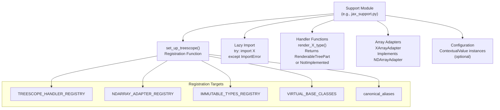
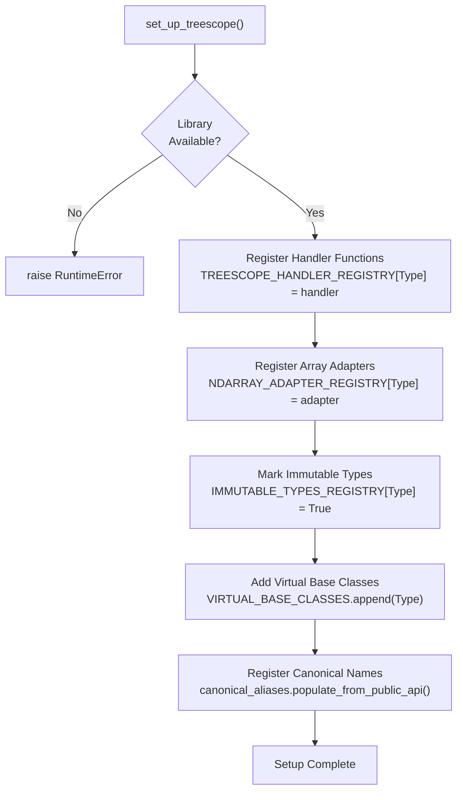
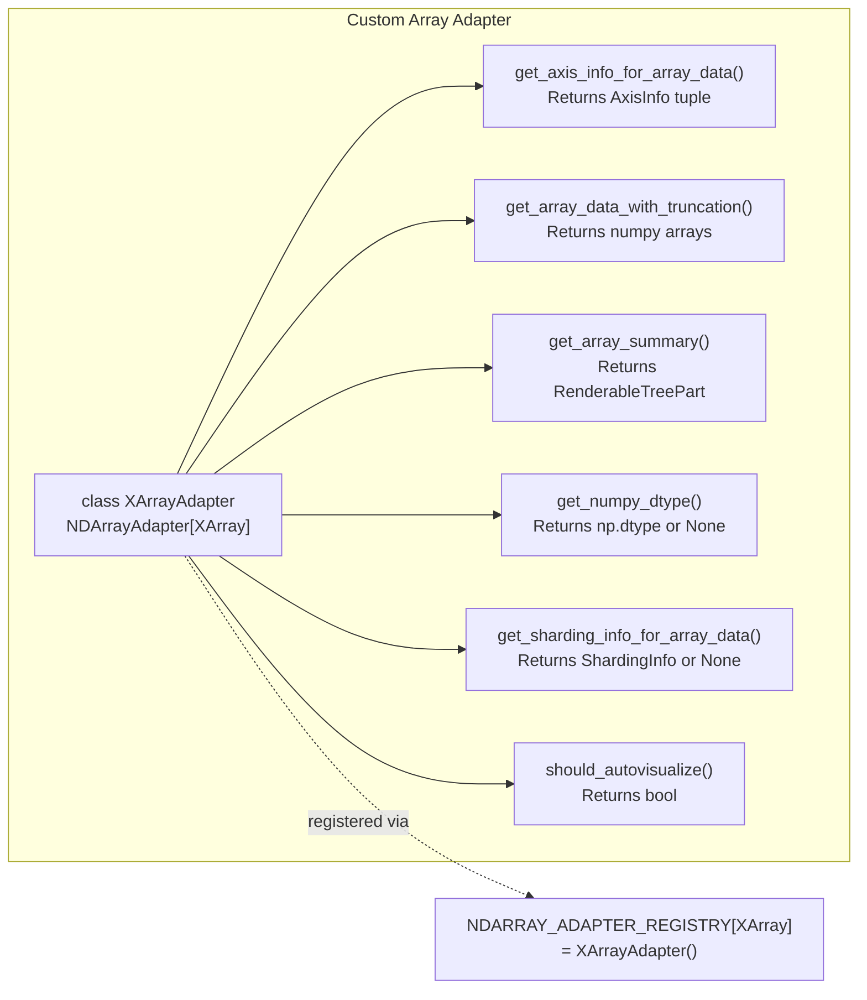
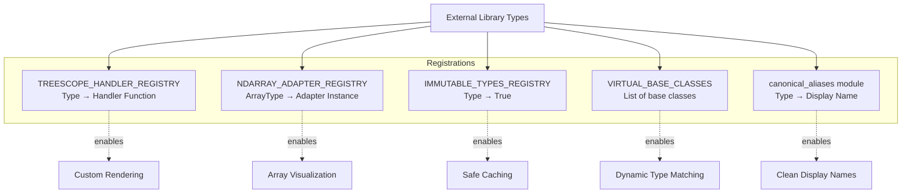

<!-- source: DeepWiki mcp.deepwiki.com · repo google-deepmind/treescope · page 8.3 Adding External Library Support · fetched 2026-10-26 -->

# Adding External Library Support

<details>
<summary>Relevant source files</summary>

The following files were used as context for generating this wiki page:

- [treescope/external/jax_support.py](treescope/external/jax_support.py)
- [treescope/external/omegaconf_support.py](treescope/external/omegaconf_support.py)
- [treescope/external/pydantic_support.py](treescope/external/pydantic_support.py)

</details>


This document explains how to create support modules for external libraries (like JAX, PyTorch, Pydantic, etc.) that integrate with Treescope's rendering system. Support modules provide specialized rendering logic and array adapters for library-specific types.

For implementing handlers for individual custom types, see [Custom Type Handlers](#8.1). For creating array adapters without a full support module, see [Custom Array Adapters](#8.2). This page covers creating complete support packages that follow established patterns in the codebase.

## Support Module Architecture

Support modules for external libraries follow a consistent structure. Each module provides a `set_up_X()` function that registers handlers, adapters, and configuration with Treescope's global registries.



**Sources:** [treescope/external/jax_support.py:15-733](), [treescope/external/pydantic_support.py:15-62](), [treescope/external/omegaconf_support.py:15-50]()

## Basic Setup Function Pattern

All support modules follow a standard pattern for conditional imports and setup functions:

| Component | Purpose | Example Location |
|-----------|---------|------------------|
| Conditional import | Import library without hard dependency | [jax_support.py:35-40]() |
| `set_up_X()` function | Main registration entry point | [jax_support.py:664-733]() |
| Runtime check | Verify library is available before setup | [jax_support.py:666-669]() |
| Handler registration | Register type-specific renderers | [jax_support.py:670-708]() |
| Canonical aliases | Register display names | [jax_support.py:709-732]() |

### Conditional Import Pattern

Every support module uses lazy imports to avoid requiring the external library as a dependency:

[treescope/external/jax_support.py:35-40]()
```python
try:
  import jax
except ImportError:
  assert not typing.TYPE_CHECKING
  jax = None
```

[treescope/external/pydantic_support.py:24-28]()
```python
try:
  import pydantic
except ImportError:
  pydantic = None
```

This pattern allows Treescope to be installed without requiring all supported libraries, while still enabling type checking when the library is available.

**Sources:** [treescope/external/jax_support.py:35-40](), [treescope/external/pydantic_support.py:24-28](), [treescope/external/omegaconf_support.py:25-29]()

### Setup Function Structure

The `set_up_X()` function is the main entry point that performs all registrations:



Example from JAX support [treescope/external/jax_support.py:664-733]():
- Checks `jax is not None`
- Registers handlers for `ShapeDtypeStruct`, tree utility classes, `Precision`, and `Array`
- Registers `JAXArrayAdapter` in `NDARRAY_ADAPTER_REGISTRY`
- Adds `jax.Array` to `VIRTUAL_BASE_CLASSES` for dynamic type checking
- Marks `jax.Array` as immutable
- Populates canonical aliases from JAX's public API

**Sources:** [treescope/external/jax_support.py:664-733](), [treescope/external/pydantic_support.py:52-61](), [treescope/external/omegaconf_support.py:32-49]()

## Implementing Type Handlers

Type handlers are functions that render specific library types. They must match the `TreescopeNodeHandler` signature and return `NotImplemented` when they cannot handle an object.

### Handler Function Signature

```python
def render_library_type(
    node: LibraryType,
    path: str | None,
    subtree_renderer: renderers.TreescopeSubtreeRenderer,
) -> (
    rendering_parts.RenderableTreePart
    | rendering_parts.RenderableAndLineAnnotations
    | type(NotImplemented)
)
```

### Handler Implementation Patterns

**Pattern 1: Dataclass-like Types**

For types that behave like dataclasses (constructible with keyword arguments matching attributes), use `make_checked_dataclasslike_renderer`:

[treescope/external/jax_support.py:302-358]() defines a factory function that creates handlers which:
1. Extract specified attributes
2. Verify round-tripping by reconstructing the object
3. Use `repr_lib.render_object_constructor()` if reconstruction succeeds
4. Return `NotImplemented` otherwise

Example usage [treescope/external/jax_support.py:670-676]():
```python
type_registries.TREESCOPE_HANDLER_REGISTRY[jax.ShapeDtypeStruct] = (
    make_checked_dataclasslike_renderer(
        jax.ShapeDtypeStruct,
        fields=("shape", "dtype"),
        fields_with_none_default=("sharding",),
    )
)
```

**Pattern 2: Enum-like Types**

For enum types, use `repr_lib.render_enumlike_item()` [treescope/external/jax_support.py:361-380]().

**Pattern 3: Mapping/List-like Types**

For custom containers, use existing handlers with partial application [treescope/external/omegaconf_support.py:39-44]():
```python
type_registries.TREESCOPE_HANDLER_REGISTRY[omegaconf.DictConfig] = (
    functools.partial(repr_lib.handle_custom_mapping, roundtrippable=True)
)
type_registries.TREESCOPE_HANDLER_REGISTRY[omegaconf.ListConfig] = (
    functools.partial(repr_lib.handle_custom_listlike, roundtrippable=True)
)
```

**Pattern 4: Models with Fields**

For model types like Pydantic's `BaseModel`, extract fields and render as constructor [treescope/external/pydantic_support.py:31-49]():
```python
def render_pydantic_model(node, path, subtree_renderer):
    fields = type(node).__fields__  # or model_fields for v2
    return repr_lib.render_object_constructor(
        type(node),
        attributes={k: getattr(node, k) for k in fields.keys()},
        path=path,
        subtree_renderer=subtree_renderer,
        roundtrippable=True,
    )
```

**Sources:** [treescope/external/jax_support.py:302-358](), [treescope/external/jax_support.py:361-380](), [treescope/external/jax_support.py:670-696](), [treescope/external/pydantic_support.py:31-49](), [treescope/external/omegaconf_support.py:39-44]()

## Registering Array Adapters

For libraries with array types, implement an `NDArrayAdapter` subclass and register it. This enables array visualization features.

### Array Adapter Implementation



The JAX array adapter [treescope/external/jax_support.py:491-573]() demonstrates all required methods:

| Method | Purpose | JAX Implementation |
|--------|---------|-------------------|
| `get_axis_info_for_array_data` | Returns axis metadata | Creates `PositionalAxisInfo` from shape |
| `get_array_data_with_truncation` | Extracts truncated data | Uses `truncate_array_and_mask()` for efficient on-device truncation |
| `get_array_summary` | Creates text summary | Includes dtype, shape, and statistics |
| `get_numpy_dtype` | Returns NumPy-compatible dtype | Returns `array.dtype` if it's a NumPy dtype |
| `get_sharding_info_for_array_data` | Provides sharding details | Extracts device mapping and shard shape |
| `should_autovisualize` | Checks if array can be visualized | Returns `False` for tracers and deleted arrays |

### Array Handler with Deferred Rendering

Array handlers can use deferred rendering for expensive operations [treescope/external/jax_support.py:575-661]():

```python
def render_jax_arrays(node, path, subtree_renderer):
    adapter = JAXArrayAdapter()
    
    def _placeholder():
        return rendering_parts.deferred_placeholder_style(
            adapter.get_array_summary(node, fast=True)
        )
    
    def _thunk(placeholder_expand_state):
        # Expensive rendering logic here
        node_repr = faster_array_repr(node)
        # ... build foldable tree node
        return rendering
    
    return rendering_parts.RenderableAndLineAnnotations(
        renderable=lowering.maybe_defer_rendering(
            main_thunk=_thunk, placeholder_thunk=_placeholder
        ),
        annotations=rendering_parts.build_copy_button(path),
    )
```

This pattern shows a fast placeholder initially, then asynchronously computes the full rendering.

**Sources:** [treescope/external/jax_support.py:491-573](), [treescope/external/jax_support.py:575-661]()

## Registration and Canonical Aliases

### Registry Patterns

The complete set of registrations for a library typically includes:



### Virtual Base Classes

For types with dynamic inheritance (like JAX arrays where the concrete type is private), add them to `VIRTUAL_BASE_CLASSES` [treescope/external/jax_support.py:704-705]():

```python
type_registries.VIRTUAL_BASE_CLASSES.append(jax.Array)
```

This enables handler matching via `isinstance()` checks on the abstract base class.

### Canonical Aliases

Canonical aliases provide clean display names for types. Use `populate_from_public_api()` to automatically register all public API names [treescope/external/jax_support.py:709-720]():

```python
for jax_api_module in [jax.lax, jax.numpy, jax.scipy, jax.random, jax.nn]:
    canonical_aliases.populate_from_public_api(
        jax_api_module, canonical_aliases.prefix_filter("jax")
    )
```

For individual types, use `add_alias()` [treescope/external/jax_support.py:722-732]():

```python
canonical_aliases.add_alias(
    jax.tree_util.SequenceKey,
    canonical_aliases.ModuleAttributePath("jax.tree_util", ("SequenceKey",)),
    on_conflict="ignore",
)
```

**Sources:** [treescope/external/jax_support.py:704-732](), [treescope/external/omegaconf_support.py:45-49]()

## Configuration with ContextualValue

Support modules can define library-specific configuration using `ContextualValue` for contextual scoping.

### Defining Configuration

The JAX support module defines `summarization_threshold` [treescope/external/jax_support.py:53-79]():

```python
summarization_threshold: context.ContextualValue[Mapping[str, int | None]] = (
    context.ContextualValue(
        module=__name__,
        qualname="summarization_threshold",
        initial_value={
            "tpu": 1_000_000_000,
            "gpu": 10_000_000,
            "default": 100_000,
        },
    )
)
```

This contextual value:
- Has a descriptive docstring explaining its purpose
- Provides sensible defaults for different array backends
- Can be read in handler functions [treescope/external/jax_support.py:106-111]()
- Can be modified globally or in scoped contexts by users

### Using Configuration in Handlers

Handlers read configuration values to adapt behavior [treescope/external/jax_support.py:97-112]():

```python
def safe_to_summarize(array: jax.Array) -> bool:
    if isinstance(array, jax.core.Tracer):
        return False
    if array.is_deleted():
        return False
    if not _is_locally_available(array):
        return False
    thresh_dict = summarization_threshold.get()  # Read contextual value
    [platform] = set(device.platform for device in array.devices())
    thresh = thresh_dict.get(platform)
    if thresh is None:
        thresh = thresh_dict["default"]
    return thresh is None or array.size < thresh
```

For more on ContextualValue, see [Configuration and Context](#5.3).

**Sources:** [treescope/external/jax_support.py:53-112]()

## Complete Examples by Complexity

### Minimal Example: OmegaConf

The simplest support module [treescope/external/omegaconf_support.py:32-49]():

1. Conditional import (lines 25-29)
2. `set_up_omegaconf()` function
3. Register handlers using existing `repr_lib` functions
4. Populate canonical aliases

Total: ~50 lines including imports and docstrings.

### Simple Example: Pydantic

A straightforward support module [treescope/external/pydantic_support.py:1-62]():

1. Conditional import (lines 24-28)
2. Custom handler function `render_pydantic_model()` (lines 31-49)
3. `set_up_pydantic()` with handler registration (lines 52-61)
4. Version-aware field extraction (lines 39-42)

Total: ~60 lines, adds one custom handler.

### Complex Example: JAX

The most comprehensive support module [treescope/external/jax_support.py:1-733]():

1. Conditional import and utilities
2. Contextual configuration (`summarization_threshold`)
3. Utility functions for array operations (`truncate_array_and_mask`, `faster_array_repr`)
4. Helper function factory (`make_checked_dataclasslike_renderer`)
5. Multiple specialized handlers (arrays, datatypes, enums)
6. Complete `JAXArrayAdapter` implementation (6 methods)
7. Array summary computation with JIT compilation
8. Deferred rendering for expensive operations
9. Registration of 7+ types and adapters
10. Canonical alias population for multiple modules

Total: ~730 lines, demonstrates all advanced patterns.

**Sources:** [treescope/external/jax_support.py:1-733](), [treescope/external/pydantic_support.py:1-62](), [treescope/external/omegaconf_support.py:1-50]()

## Creating a New Support Module Checklist

When creating support for a new library:

| Step | Required | Example |
|------|----------|---------|
| 1. Create `treescope/external/library_support.py` | Yes | `jax_support.py` |
| 2. Add conditional import with `try/except` | Yes | [jax_support.py:35-40]() |
| 3. Implement handler functions | Yes | [jax_support.py:575-661]() |
| 4. Create `set_up_library()` function | Yes | [jax_support.py:664-733]() |
| 5. Register handlers in `TREESCOPE_HANDLER_REGISTRY` | Yes | [jax_support.py:707]() |
| 6. Implement array adapter (if library has arrays) | If applicable | [jax_support.py:491-573]() |
| 7. Register adapter in `NDARRAY_ADAPTER_REGISTRY` | If applicable | [jax_support.py:706]() |
| 8. Mark immutable types in `IMMUTABLE_TYPES_REGISTRY` | If applicable | [jax_support.py:705]() |
| 9. Add virtual base classes | If needed | [jax_support.py:704]() |
| 10. Register canonical aliases | Recommended | [jax_support.py:709-732]() |
| 11. Add configuration with `ContextualValue` | Optional | [jax_support.py:53-79]() |
| 12. Add docstrings and type hints | Recommended | Throughout examples |

The module can then be activated by users calling `library_support.set_up_library()` after importing, typically in their IPython startup or notebook initialization.

**Sources:** [treescope/external/jax_support.py:1-733](), [treescope/external/pydantic_support.py:1-62](), [treescope/external/omegaconf_support.py:1-50]()

---

