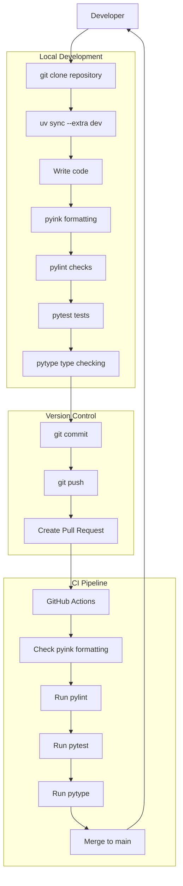
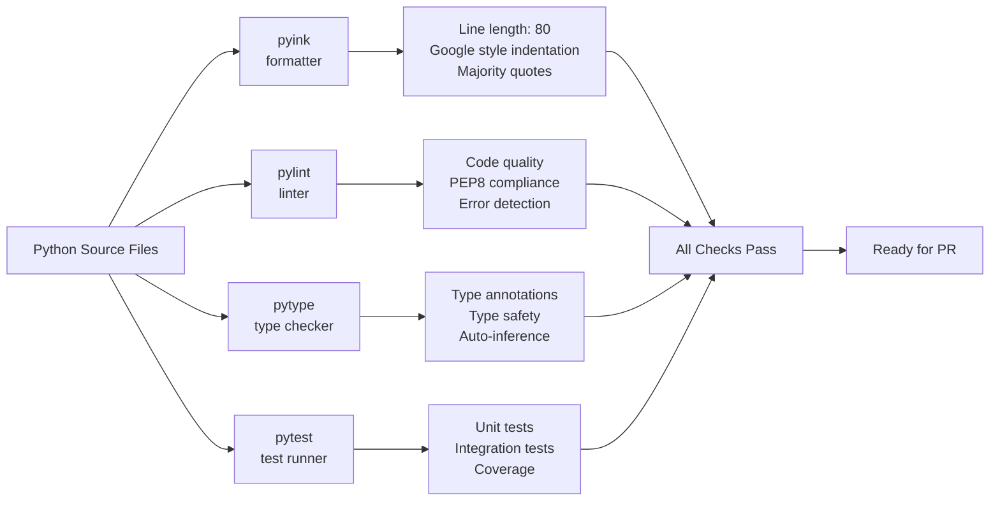
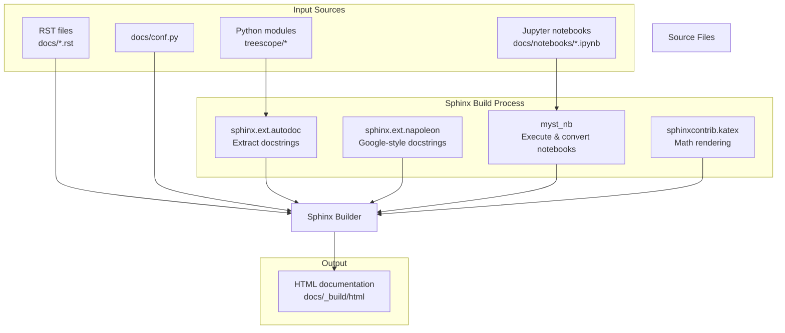

<!-- source: DeepWiki mcp.deepwiki.com · repo google-deepmind/treescope · page 9 Developer Documentation · fetched 2026-10-26 -->

# Developer Documentation

<details>
<summary>Relevant source files</summary>

The following files were used as context for generating this wiki page:

- [.github/workflows/unittests.yml](.github/workflows/unittests.yml)
- [docs/conf.py](docs/conf.py)
- [pyproject.toml](pyproject.toml)
- [uv.lock](uv.lock)

</details>


This section provides information for developers who want to contribute to Treescope itself, as opposed to users who want to extend Treescope for their own types (see [Extending Treescope](#8)). This includes setup instructions, testing procedures, code quality tools, and contribution workflows.

**Child Pages:**
- [Project Structure](#9.1) - Codebase organization and module overview
- [Development Setup](#9.2) - Setting up your development environment
- [Testing](#9.3) - Running and writing tests
- [CI/CD Pipeline](#9.4) - Automated testing and quality checks

## Development Overview

Treescope development uses modern Python tooling to ensure code quality and consistency. The project is built with `flit_core`, uses `uv` for dependency management, and enforces Google's Python style guide through `pyink`.

**Development Workflow Diagram**



Sources: [.github/workflows/unittests.yml:1-57](), [pyproject.toml:1-92]()

## Key Technologies

| Technology | Purpose | Configuration File |
|------------|---------|-------------------|
| `uv` | Fast Python package manager and virtual environment tool | `uv.lock`, `pyproject.toml` |
| `flit_core` | Build backend for packaging Treescope | `pyproject.toml` [build-system] |
| `pyink` | Code formatter (Google style, Black variant) | `pyproject.toml` [tool.pyink] |
| `pylint` | Static code analyzer for Python | `pyproject.toml` dev dependencies |
| `pytype` | Static type checker | `pyproject.toml` dev dependencies |
| `pytest` | Testing framework | `pyproject.toml` test dependencies |
| `sphinx` | Documentation generator | `docs/conf.py` |
| `GitHub Actions` | CI/CD pipeline | `.github/workflows/unittests.yml` |

Sources: [pyproject.toml:1-92](), [.github/workflows/unittests.yml:1-57](), [docs/conf.py:1-248]()

## Dependency Management

**Dependency Categories Diagram**

```mermaid
graph TB
    subgraph "Core Dependencies"
        numpy["numpy>=1.25.2"]
    end
    
    subgraph "Optional: test"
        absl["absl-py>=1.4.0"]
        jax_test["jax>=0.4.23"]
        pytest["pytest>=8.2.2"]
        torch["torch>=2.0.0"]
        pydantic["pydantic>=2.0.0"]
        omegaconf["omegaconf>=2.0.0"]
    end
    
    subgraph "Optional: dev"
        pylint["pylint>=2.6.0"]
        pyink["pyink>=24.3.0"]
        ipython_dev["ipython"]
        jupyter["jupyter"]
        pytest_dev["pytest>=8.2.2"]
        pytype["pytype"]
    end
    
    subgraph "Optional: notebook"
        ipython_nb["ipython"]
        palettable["palettable"]
        jax_nb["jax>=0.4.23"]
    end
    
    subgraph "Optional: docs"
        sphinx["sphinx>=6.0.0,<7.3.0"]
        sphinx_book["sphinx-book-theme>=1.0.1"]
        myst["myst-nb>=1.0.0"]
        jax_docs["jax[cpu]>=0.4.23"]
        matplotlib["matplotlib>=3.5.0"]
    end
    
    Project["treescope package"] --> numpy
    Project -.test extra.-> absl
    Project -.test extra.-> jax_test
    Project -.test extra.-> pytest
    Project -.test extra.-> torch
    Project -.test extra.-> pydantic
    Project -.test extra.-> omegaconf
    Project -.dev extra.-> pylint
    Project -.dev extra.-> pyink
    Project -.dev extra.-> ipython_dev
    Project -.dev extra.-> jupyter
    Project -.dev extra.-> pytest_dev
    Project -.dev extra.-> pytype
    Project -.notebook extra.-> ipython_nb
    Project -.notebook extra.-> palettable
    Project -.notebook extra.-> jax_nb
    Project -.docs extra.-> sphinx
    Project -.docs extra.-> sphinx_book
    Project -.docs extra.-> myst
    Project -.docs extra.-> jax_docs
    Project -.docs extra.-> matplotlib
```



Sources: [pyproject.toml:19-75]()

The project uses `uv` for dependency management, which provides:
- Fast dependency resolution
- Reproducible builds via `uv.lock`
- Virtual environment management
- Cross-platform compatibility

**Installation command for development:**
```bash
uv sync --locked --extra test --extra dev
```

Sources: [.github/workflows/unittests.yml:40-41](), [pyproject.toml:1-92]()

## Code Quality Tools Configuration

**Tool Chain Diagram**



Sources: [pyproject.toml:77-83](), [.github/workflows/unittests.yml:44-56]()

### pyink Configuration

```toml
[tool.pyink]
line-length = 80
unstable = true
pyink-indentation = 2
pyink-use-majority-quotes = true
```

Treescope uses `pyink`, a variant of Black that supports Google's Python style guide:
- **Line length**: 80 characters
- **Indentation**: 2 spaces (Google style)
- **Quotes**: Majority quotes (uses the most common quote style in the file)
- **Unstable**: Enabled to use latest formatting features

**Check formatting:**
```bash
uv run pyink treescope tests --check
```

**Apply formatting:**
```bash
uv run pyink treescope tests
```

Sources: [pyproject.toml:77-83](), [.github/workflows/unittests.yml:44-45]()

### pylint Configuration

Pylint is used for static code analysis. It runs on the `treescope` package:

```bash
uv run pylint treescope
```

Sources: [.github/workflows/unittests.yml:47-48](), [pyproject.toml:49]()

### pytype Configuration

Type checking is performed with `pytype`, which can auto-infer types:

```bash
uv run pytype --jobs auto treescope
```

The `--jobs auto` flag enables parallel type checking for faster execution.

Sources: [.github/workflows/unittests.yml:55-56](), [pyproject.toml:54]()

## Build System

**Build Configuration:**

```toml
[build-system]
requires = ["flit_core >=3.8,<4"]
build-backend = "flit_core.buildapi"
```

Treescope uses `flit_core` as its build backend, which:
- Automatically extracts version from `treescope.__version__`
- Simplifies packaging for pure-Python projects
- Supports PEP 517/518 standards

Sources: [pyproject.toml:89-92](), [pyproject.toml:24]()

## Documentation System

**Documentation Build Pipeline**



Key documentation dependencies:
- **sphinx** (6.0.0 to 7.3.0): Documentation generator
- **sphinx-book-theme**: Theme providing clean layout
- **myst-nb**: Execute and convert Jupyter notebooks
- **sphinx.ext.autodoc**: Auto-generate API docs from docstrings
- **sphinx.ext.napoleon**: Parse Google-style docstrings
- **sphinxcontrib.katex**: Render mathematical expressions

Sources: [docs/conf.py:1-248](), [pyproject.toml:57-75]()

## Project Metadata

| Field | Value |
|-------|-------|
| Package name | `treescope` |
| Minimum Python | 3.10 |
| License | Apache 2.0 |
| Dynamic versioning | From `treescope.__version__` |
| Homepage | https://github.com/google-deepmind/treescope |
| Authors | The Treescope Authors |
| Email | treescope-dev@google.com |

Sources: [pyproject.toml:1-29]()

## Contributing Workflow

**Recommended Development Steps:**

1. **Clone and setup:**
   ```bash
   git clone https://github.com/google-deepmind/treescope.git
   cd treescope
   uv sync --extra dev --extra test
   ```

2. **Make changes:**
   - Edit code in `treescope/`
   - Add tests in `tests/`
   - Update documentation if needed

3. **Run local checks:**
   ```bash
   uv run pyink treescope tests  # Format code
   uv run pylint treescope        # Lint
   uv run python run_tests.py     # Test
   uv run pytype --jobs auto treescope  # Type check
   ```

4. **Commit and push:**
   ```bash
   git commit -m "Description"
   git push origin feature-branch
   ```

5. **Create PR:**
   - GitHub Actions will automatically run all checks
   - Address any failures before merging

Sources: [.github/workflows/unittests.yml:1-57]()

## Next Steps

For detailed information about specific aspects of development:

- **[Project Structure](#9.1)**: Learn about codebase organization and module responsibilities
- **[Development Setup](#9.2)**: Step-by-step environment setup instructions
- **[Testing](#9.3)**: Test suite structure and writing tests
- **[CI/CD Pipeline](#9.4)**: Understanding automated checks and workflows

---

