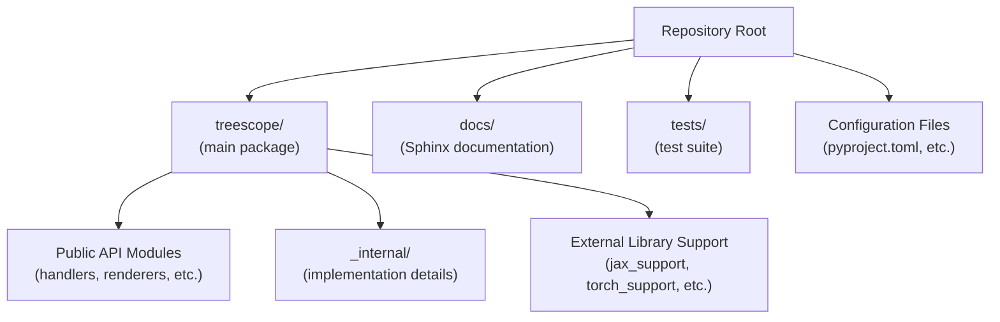
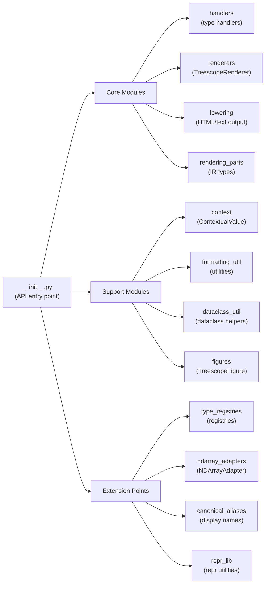
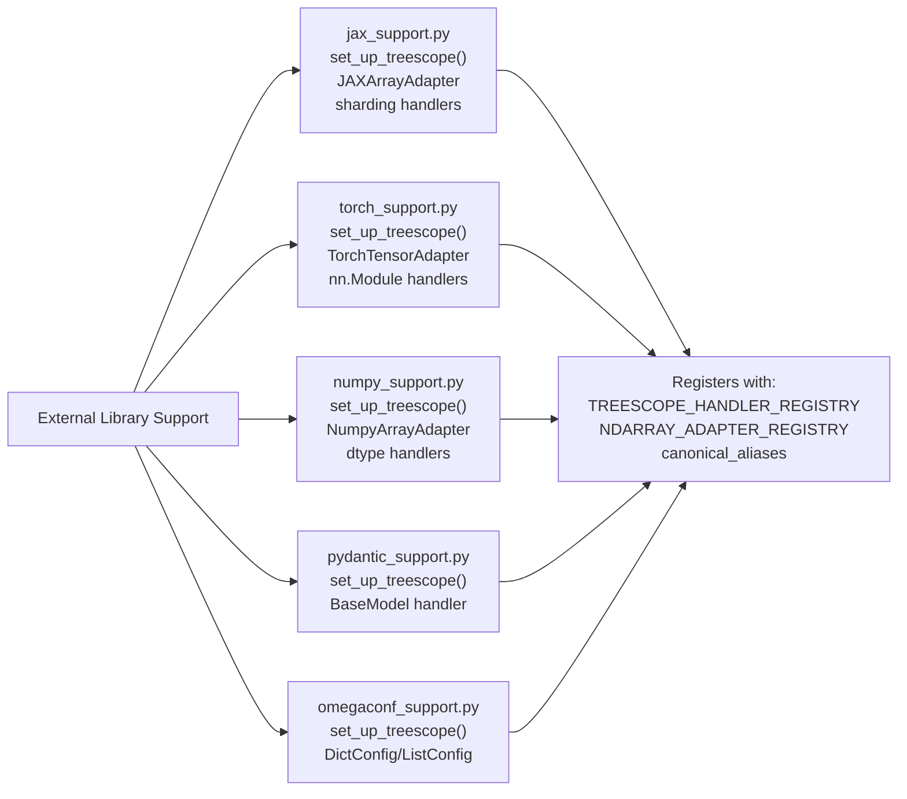
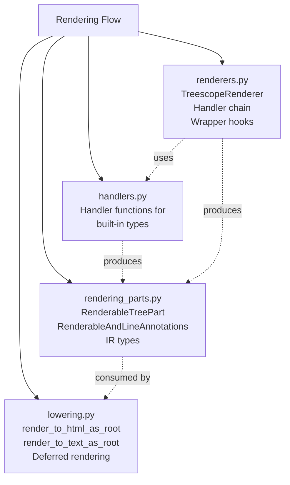
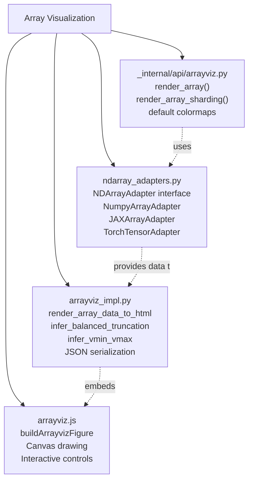
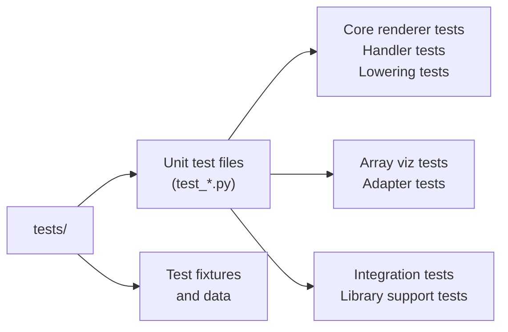
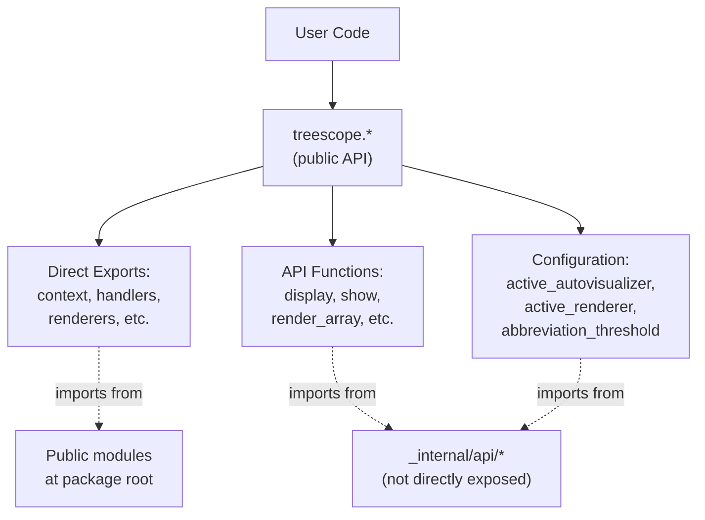

<!-- source: DeepWiki mcp.deepwiki.com · repo google-deepmind/treescope · page 9.1 Project Structure · fetched 2026-10-26 -->

# Project Structure

Relevant source files

The following files were used as context for generating this wiki page:

- [docs/conf.py](docs/conf.py)
- [pyproject.toml](pyproject.toml)
- [treescope/__init__.py](treescope/__init__.py)

This document provides an overview of the Treescope codebase organization, describing the purpose of key directories and modules to help developers navigate and contribute to the project. For information on setting up a development environment, see [Development Setup](#9.2). For testing infrastructure, see [Testing](#9.3).

## Repository Overview

The Treescope repository follows a standard Python package structure with the main source code in the `treescope/` directory:

**Sources:** [treescope/__init__.py:1-203](), [pyproject.toml:1-92](), [docs/conf.py:1-248]()

## Top-Level Directory Structure

| Directory | Purpose |
|-----------|---------|
| `treescope/` | Main package containing all source code |
| `treescope/_internal/` | Internal implementation details not part of public API |
| `treescope/external/` | Vendored external dependencies |
| `docs/` | Sphinx documentation source files and configuration |
| `tests/` | Test suite mirroring the structure of `treescope/` |

The package exposes its public API through `treescope/__init__.py`, which imports and re-exports key components from internal modules.

**Sources:** [treescope/__init__.py:32-88]()

## Public API Module Organization

The public-facing modules are organized by functionality:

**Module Purposes:**

| Module | Primary Responsibility |
|--------|----------------------|
| `handlers` | Default type handlers for built-in and common types |
| `renderers` | `TreescopeRenderer` class and handler chain implementation |
| `lowering` | Converting intermediate representation to HTML and text output |
| `rendering_parts` | Intermediate representation types (`RenderableTreePart`, `RenderableAndLineAnnotations`, etc.) |
| `context` | `ContextualValue` pattern for configuration management |
| `formatting_util` | Utility functions for formatting and text processing |
| `dataclass_util` | Helpers for rendering dataclasses |
| `figures` | `TreescopeFigure` wrapper for HTML output |
| `type_registries` | Global registries (`TREESCOPE_HANDLER_REGISTRY`, `NDARRAY_ADAPTER_REGISTRY`, etc.) |
| `ndarray_adapters` | `NDArrayAdapter` interface and base implementations |
| `canonical_aliases` | System for mapping types to canonical display names |
| `repr_lib` | Library for constructing repr-style representations |

**Sources:** [treescope/__init__.py:38-50]()

## Internal API Organization

The `_internal/` directory contains implementation details organized into subdirectories:

```mermaid
graph TB
    Internal["_internal/"]
    
    Internal --> API["api/<br/>(high-level APIs)"]
    Internal --> Parts["parts/<br/>(rendering components)"]
    Internal --> Handlers["handlers/<br/>(type-specific renderers)"]
    Internal --> Utils["(utility modules)"]
    
    API --> IPython["ipython_integration.py<br/>(display, show, magics)"]
    API --> Renderer["default_renderer.py<br/>(active_renderer)"]
    API --> AutoViz["autovisualize.py<br/>(Autovisualizer)"]
    API --> ArrayViz["arrayviz.py<br/>(render_array)"]
    API --> ArrayAuto["array_autovisualizer.py<br/>(ArrayAutovisualizer)"]
    API --> Abbrev["abbreviation.py<br/>(abbreviation config)"]
    
    Parts --> BasicParts["basic_parts.py<br/>(Text, RoundtripCondition)"]
    Parts --> FoldableParts["foldable_representation.py<br/>(FoldableTreeNode)"]
    Parts --> CommonRep["common_structures.py<br/>(dataclass rendering)"]
    Parts --> CommonStyles["common_styles.py<br/>(CSS utilities)"]
    
    Handlers --> Builtin["builtin_structure_handlers.py<br/>(dict, list, tuple)"]
    Handlers --> Sharding["sharding_viz_handlers.py<br/>(JAX sharding)"]
    Handlers --> Generic["generic_repr_handler.py<br/>(fallback handler)"]
```

**Key Internal Subdirectories:**

| Directory | Purpose |
|-----------|---------|
| `_internal/api/` | High-level user-facing API implementations |
| `_internal/parts/` | Building blocks for constructing renderable trees |
| `_internal/handlers/` | Type-specific rendering logic for various Python types |

**Sources:** [treescope/__init__.py:52-88]()

## Mapping Architecture to Code

This diagram maps the high-level architectural components to their implementations in the codebase:

```mermaid
graph TB
    subgraph "User Interface Layer"
        IPythonAPI["IPython Integration"]
    end
    
    subgraph "Core Rendering Engine"
        RendererComp["Renderer Component"]
        LoweringComp["Lowering System"]
        LayoutComp["Layout Algorithms"]
    end
    
    subgraph "Type System"
        RegistryComp["Type Registries"]
        AdapterComp["NDArray Adapters"]
    end
    
    subgraph "Visualization"
        ArrayVizComp["Array Visualization"]
        AutovisComp["Autovisualizer"]
    end
    
    subgraph "External Support"
        LibSupport["Library Support Modules"]
    end
    
    IPythonAPI --> IPythonMod["_internal/api/<br/>ipython_integration.py"]
    IPythonAPI --> Magics["IPython magic commands"]
    
    RendererComp --> RendererMod["renderers.py<br/>TreescopeRenderer"]
    RendererComp --> DefaultRend["_internal/api/<br/>default_renderer.py"]
    
    LoweringComp --> LoweringMod["lowering.py<br/>render_to_html<br/>render_to_text"]
    LoweringComp --> Streaming["lowering_impl/<br/>streaming output"]
    
    LayoutComp --> ExpandDepth["layout/<br/>expand_to_depth"]
    LayoutComp --> Balanced["layout/<br/>balanced_layout"]
    
    RegistryComp --> TypeReg["type_registries.py<br/>TREESCOPE_HANDLER_REGISTRY<br/>NDARRAY_ADAPTER_REGISTRY"]
    
    AdapterComp --> AdapterMod["ndarray_adapters.py<br/>NDArrayAdapter<br/>NumpyArrayAdapter"]
    
    ArrayVizComp --> ArrayVizAPI["_internal/api/arrayviz.py<br/>render_array"]
    ArrayVizComp --> ArrayImpl["arrayviz_impl.py<br/>render_array_data_to_html"]
    ArrayVizComp --> ArrayJS["arrayviz.js<br/>JavaScript rendering"]
    
    AutovisComp --> AutovisMod["_internal/api/<br/>autovisualize.py"]
    AutovisComp --> ArrayAutoMod["_internal/api/<br/>array_autovisualizer.py"]
    
    LibSupport --> JAXMod["jax_support.py<br/>set_up_treescope"]
    LibSupport --> TorchMod["torch_support.py<br/>set_up_treescope"]
    LibSupport --> NumPyMod["numpy_support.py<br/>set_up_treescope"]
```

**Sources:** [treescope/__init__.py:52-88]()

## External Library Support Structure

External library integration is organized into dedicated support modules at the package root:

Each support module follows a consistent pattern:
1. Implements library-specific handlers
2. Creates adapter instances for array types
3. Exports a `set_up_treescope()` function that registers everything
4. Can be imported independently when the library is available

**Sources:** [treescope/__init__.py:38-50](), [pyproject.toml:30-39]()

## Configuration and Dependencies

The project configuration is centralized in `pyproject.toml`:

| Section | Purpose |
|---------|---------|
| `[project]` | Package metadata (name, version, description, authors) |
| `[project.dependencies]` | Core runtime dependencies (numpy>=1.25.2) |
| `[project.optional-dependencies]` | Optional dependency groups (test, notebook, dev, docs) |
| `[tool.pyink]` | Code formatting configuration (Google style, 80 char lines) |
| `[build-system]` | Build configuration (uses flit_core) |

**Dependency Groups:**

- **Core dependencies**: Only NumPy is required
- **`test`**: Testing dependencies (pytest, jax, torch, pydantic, omegaconf)
- **`dev`**: Development tools (pylint, pyink, pytype, ipython, jupyter)
- **`docs`**: Documentation building (sphinx, myst-nb, various libraries for demos)
- **`notebook`**: Extra dependencies for notebook demos (ipython, palettable, jax)

**Sources:** [pyproject.toml:1-92]()

## Key Implementation Modules

### Core Rendering Components

**Module Details:**

- **`handlers.py`**: Contains default handler functions for common Python types (dict, list, tuple, set, etc.)
- **`renderers.py`**: Implements `TreescopeRenderer` class that manages the handler chain and wrapper hooks
- **`rendering_parts.py`**: Defines the intermediate representation types used between handlers and lowering
- **`lowering.py`**: Converts IR to final output formats (HTML with CSS/JS, or plain text)

**Sources:** [treescope/__init__.py:44-48]()

### Array Visualization Components

**Module Details:**

- **`_internal/api/arrayviz.py`**: High-level API for rendering arrays with configuration
- **`arrayviz_impl.py`**: Python implementation that processes array data and generates HTML
- **`ndarray_adapters.py`**: Adapter interface that abstracts different array libraries
- **`arrayviz.js`**: JavaScript code for interactive canvas rendering (embedded in HTML output)

**Sources:** [treescope/__init__.py:59-65]()

## Testing Structure

The test suite mirrors the source structure:

Tests are discovered and run using pytest. See [Testing](#9.3) for details on running tests and writing test cases.

**Sources:** [pyproject.toml:32-39]()

## Documentation Structure

Documentation is built using Sphinx with several custom extensions:

| Component | Purpose |
|-----------|---------|
| `docs/conf.py` | Sphinx configuration, theme settings, extension loading |
| `docs/index.rst` | Documentation homepage |
| `docs/api/` | Auto-generated API reference |
| `docs/notebooks/` | Example notebooks (executed during doc build) |
| `docs/ext/` | Custom Sphinx extensions for Treescope-specific features |

**Custom Sphinx Extensions:**

- `treescope_sphinx_customizations`: Customizations for rendering Treescope output in docs
- `nb_output_cell_to_iframe`: Converts notebook output cells to iframes for interactive display

**Sources:** [docs/conf.py:1-248]()

## Import Structure and API Surface

The public API is carefully controlled through `__init__.py`:

Users should import from `treescope` directly, not from `treescope._internal`. The underscore prefix indicates these are implementation details subject to change.

**Public API Categories:**

1. **Core rendering**: `render_to_html`, `render_to_text`, `display`, `show`
2. **Configuration**: `active_renderer`, `active_autovisualizer`, `abbreviation_threshold`
3. **Array visualization**: `render_array`, `render_array_sharding`, `ArrayAutovisualizer`
4. **Autovisualizers**: `Autovisualizer`, `IPythonVisualization`, `ChildAutovisualizer`
5. **Extension points**: `type_registries`, `ndarray_adapters`, `canonical_aliases`
6. **Setup**: `basic_interactive_setup`, `register_as_default`

**Sources:** [treescope/__init__.py:52-88](), [treescope/__init__.py:90-184]()

---

