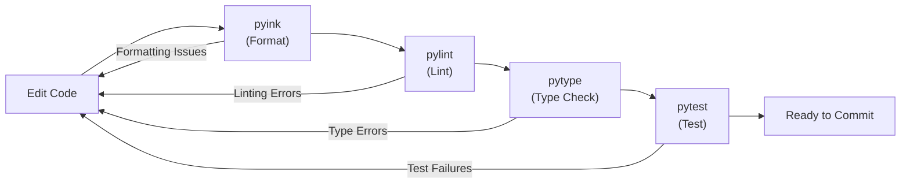
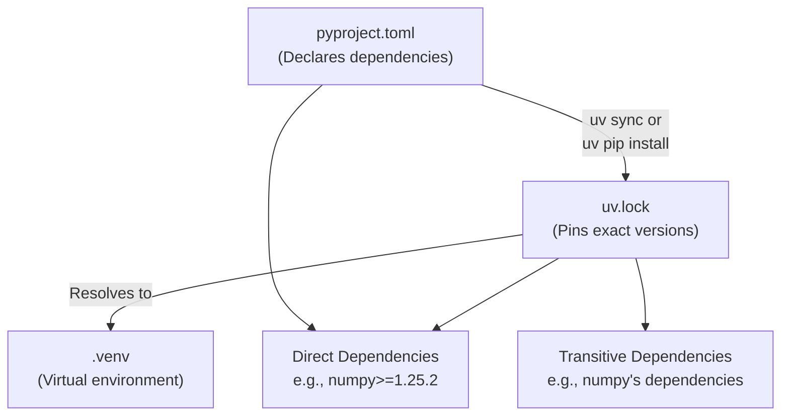
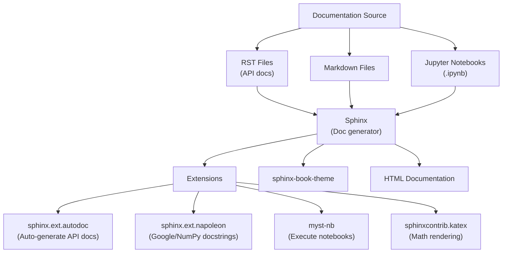

<!-- source: DeepWiki mcp.deepwiki.com · repo google-deepmind/treescope · page 9.2 Development Setup · fetched 2026-10-26 -->

# Development Setup

<details>
<summary>Relevant source files</summary>

The following files were used as context for generating this wiki page:

- [docs/conf.py](docs/conf.py)
- [pyproject.toml](pyproject.toml)
- [uv.lock](uv.lock)

</details>


This page provides instructions for setting up a development environment to contribute to Treescope. It covers installing dependencies, configuring development tools, and running basic quality checks. For information about the project structure and organization of the codebase, see [Project Structure](#9.1). For details on running tests, see [Testing](#9.3).

## Prerequisites

### Python Version

Treescope requires Python 3.10 or later. The project is tested on Python 3.10, 3.11, 3.12, and 3.13.

**Sources:** [pyproject.toml:7]()

### Package Manager: uv

Treescope uses [`uv`](https://github.com/astral-sh/uv) as its package manager and virtual environment tool. `uv` is a fast Python package installer and resolver written in Rust.

Install `uv` using one of the following methods:

```bash
# macOS and Linux
curl -LsSf https://astral.sh/uv/install.sh | sh

# Windows
powershell -c "irm https://astral.sh/uv/install.ps1 | iex"

# Or via pip
pip install uv
```

**Sources:** [uv.lock:1-9]()

## Environment Setup

### Cloning the Repository

```bash
git clone https://github.com/google-deepmind/treescope.git
cd treescope
```

### Creating a Virtual Environment

```bash
# Create a virtual environment using uv
uv venv

# Activate the virtual environment
# On Linux/macOS:
source .venv/bin/activate

# On Windows:
.venv\Scripts\activate
```

### Installing Dependencies

#### Development Dependencies

```mermaid
graph TB
    Dev["Development Setup"]
    
    Core["Core Dependencies<br/>numpy>=1.25.2"]
    DevTools["Dev Tools Group<br/>[dev]"]
    TestDeps["Test Dependencies<br/>[test]"]
    DocsDeps["Documentation Dependencies<br/>[docs]"]
    NotebookDeps["Notebook Dependencies<br/>[notebook]"]
    
    Pyink["pyink>=24.3.0<br/>(Code Formatter)"]
    Pylint["pylint>=2.6.0<br/>(Linter)"]
    Pytype["pytype<br/>(Type Checker)"]
    Pytest["pytest>=8.2.2<br/>(Test Runner)"]
    IPython["ipython<br/>(Interactive Shell)"]
    Jupyter["jupyter<br/>(Notebooks)"]
    
    JAX["jax>=0.4.23"]
    Torch["torch>=2.0.0"]
    Pydantic["pydantic>=2.0.0"]
    OmegaConf["omegaconf>=2.0.0"]
    AbslPy["absl-py>=1.4.0"]
    
    Sphinx["sphinx>=6.0.0"]
    SphinxBook["sphinx-book-theme>=1.0.1"]
    MystNB["myst-nb>=1.0.0"]
    
    Dev --> Core
    Dev --> DevTools
    Dev --> TestDeps
    
    DevTools --> Pyink
    DevTools --> Pylint
    DevTools --> Pytype
    DevTools --> Pytest
    DevTools --> IPython
    DevTools --> Jupyter
    
    TestDeps --> AbslPy
    TestDeps --> JAX
    TestDeps --> Pytest
    TestDeps --> Torch
    TestDeps --> Pydantic
    TestDeps --> OmegaConf
    
    DocsDeps --> Sphinx
    DocsDeps --> SphinxBook
    DocsDeps --> MystNB
    DocsDeps --> IPython
    DocsDeps --> JAX
```



**Development Tools Setup**

```bash
# Install package in editable mode with development dependencies
uv pip install -e ".[dev]"
```

This installs:
- **pyink**: Google's fork of Black for code formatting
- **pylint**: Static code analysis tool
- **pytype**: Type checker
- **pytest**: Testing framework
- **ipython**: Interactive Python shell
- **jupyter**: Jupyter notebook environment

**Test Dependencies**

To run the full test suite with external library support:

```bash
uv pip install -e ".[test]"
```

This includes:
- **jax**: For testing JAX array support
- **torch**: For testing PyTorch tensor support
- **pydantic**: For testing Pydantic model support
- **omegaconf**: For testing OmegaConf configuration support
- **absl-py**: Abseil Python library

**Documentation Dependencies**

To build documentation locally:

```bash
uv pip install -e ".[docs]"
```

**All Dependencies**

To install everything:

```bash
uv pip install -e ".[dev,test,docs]"
```

**Sources:** [pyproject.toml:19-75](), [uv.lock:1-9]()

## Development Tools Configuration

### Code Formatting with pyink

Treescope uses `pyink` (Google's fork of Black) for code formatting. The configuration follows Google's Python style guide.

#### Configuration

```toml
[tool.pyink]
line-length = 80
unstable = true
pyink-indentation = 2
pyink-use-majority-quotes = true
```

**Key settings:**
- **line-length = 80**: Maximum line length
- **pyink-indentation = 2**: Two-space indentation (Google style)
- **pyink-use-majority-quotes**: Use the quote style that appears most in the file

#### Running pyink

```bash
# Format all Python files
pyink treescope/

# Check formatting without modifying files
pyink --check treescope/

# Format specific files
pyink treescope/some_file.py
```

**Sources:** [pyproject.toml:77-83]()

### Linting with pylint

`pylint` performs static code analysis to detect errors and enforce coding standards.

#### Running pylint

```bash
# Run pylint on the entire codebase
pylint treescope/

# Run on specific files
pylint treescope/some_file.py

# Run with specific configuration (if .pylintrc exists)
pylint --rcfile=.pylintrc treescope/
```

**Sources:** [pyproject.toml:49]()

### Type Checking with pytype

`pytype` is Google's Python type checker that can infer types and verify type annotations.

#### Running pytype

```bash
# Run type checking on the codebase
pytype treescope/

# Run on specific files
pytype treescope/some_file.py
```

**Note:** The `pyproject.toml` shows a pyright configuration section, but the dev dependencies specify `pytype`. Both type checkers may be used.

**Sources:** [pyproject.toml:54](), [pyproject.toml:84-87]()

## Development Workflow

### Development Tool Chain



### Recommended Development Cycle

1. **Make code changes** in your editor

2. **Format code** with pyink:
   ```bash
   pyink treescope/
   ```

3. **Run linter** to catch common issues:
   ```bash
   pylint treescope/
   ```

4. **Type check** your changes:
   ```bash
   pytype treescope/
   ```

5. **Run tests** to ensure nothing breaks:
   ```bash
   pytest
   ```

For details on running the test suite, see [Testing](#9.3).

**Sources:** [pyproject.toml:48-55]()

## Interactive Development

### Using IPython

Treescope is designed for interactive use in IPython/Jupyter environments. For development:

```bash
# Start IPython
ipython

# In IPython, import and set up treescope
import treescope
treescope.basic_interactive_setup()

# Now you can test your changes interactively
```

### Using Jupyter Notebooks

```bash
# Start Jupyter
jupyter notebook

# Or Jupyter Lab
jupyter lab
```

The `notebook` optional dependency group includes IPython, Palettable (for color palettes), and JAX for trying out array visualization features.

**Sources:** [pyproject.toml:41-45](), [pyproject.toml:48-55]()

## Dependency Management with uv

### Understanding the Lock File

The `uv.lock` file pins exact versions of all dependencies and their transitive dependencies. This ensures reproducible builds across different environments.



### Updating Dependencies

```bash
# Sync environment with lock file
uv sync

# Update all dependencies to latest compatible versions
uv lock --upgrade

# Update specific package
uv lock --upgrade-package numpy
```

### Adding New Dependencies

To add a new dependency:

1. Add it to `pyproject.toml` in the appropriate section:
   - `dependencies` for core runtime dependencies
   - `dev` for development tools
   - `test` for test dependencies
   - `docs` for documentation building

2. Update the lock file:
   ```bash
   uv lock
   ```

3. Install the updated dependencies:
   ```bash
   uv sync
   ```

**Sources:** [uv.lock:1-9](), [pyproject.toml:19-75]()

## Building the Package

Treescope uses `flit_core` as its build backend.

### Building Distribution Files

```bash
# Build source distribution and wheel
uv build

# Or using python -m build (if build is installed)
python -m build
```

This creates distribution files in the `dist/` directory:
- `treescope-<version>.tar.gz` (source distribution)
- `treescope-<version>-py3-none-any.whl` (wheel)

**Sources:** [pyproject.toml:89-91]()

## Building Documentation

### Documentation Stack



### Building Docs Locally

```bash
# Install documentation dependencies
uv pip install -e ".[docs]"

# Navigate to docs directory
cd docs

# Build HTML documentation
make html

# View documentation
# Open docs/_build/html/index.html in your browser
```

On Windows:
```bash
# Use make.bat instead
make.bat html
```

### Documentation Configuration

The Sphinx configuration is located in `docs/conf.py`. Key settings include:

- **Sphinx extensions**: autodoc, napoleon, myst-nb, katex
- **Theme**: sphinx-book-theme
- **Python version support**: 3.10+
- **Notebook execution**: Automatic with error handling

**Sources:** [docs/conf.py:1-248](), [pyproject.toml:57-75]()

## Summary of Key Commands

| Task | Command |
|------|---------|
| Install dev dependencies | `uv pip install -e ".[dev]"` |
| Install all dependencies | `uv pip install -e ".[dev,test,docs]"` |
| Format code | `pyink treescope/` |
| Check formatting | `pyink --check treescope/` |
| Lint code | `pylint treescope/` |
| Type check | `pytype treescope/` |
| Run tests | `pytest` |
| Build package | `uv build` |
| Build docs | `cd docs && make html` |
| Update dependencies | `uv lock --upgrade` |
| Sync environment | `uv sync` |

**Sources:** [pyproject.toml:1-92](), [uv.lock:1-9](), [docs/conf.py:1-248]()

---

