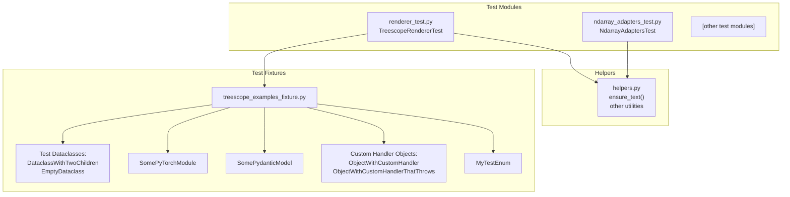
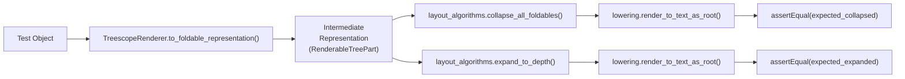
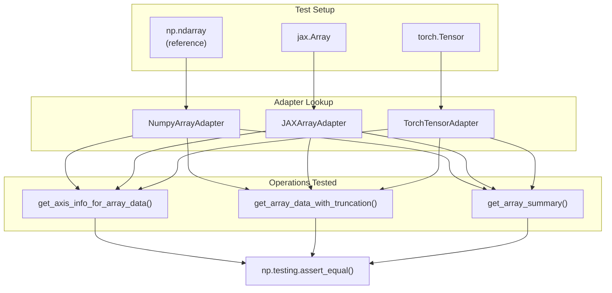

<!-- source: DeepWiki mcp.deepwiki.com · repo google-deepmind/treescope · page 9.3 Testing · fetched 2026-10-26 -->

# Testing

<details>
<summary>Relevant source files</summary>

The following files were used as context for generating this wiki page:

- [tests/__init__.py](tests/__init__.py)
- [tests/fixtures/treescope_examples_fixture.py](tests/fixtures/treescope_examples_fixture.py)
- [tests/ndarray_adapters_test.py](tests/ndarray_adapters_test.py)
- [tests/renderer_test.py](tests/renderer_test.py)
- [treescope/_internal/handlers/generic_repr_handler.py](treescope/_internal/handlers/generic_repr_handler.py)
- [treescope/external/numpy_support.py](treescope/external/numpy_support.py)

</details>


## Purpose and Scope

This document explains the test suite structure for developers contributing to Treescope. It covers how tests are organized, how to run them, and patterns for writing new tests. For information about the CI/CD pipeline that automatically runs these tests, see [CI/CD Pipeline](#9.4). For general development setup including installing test dependencies, see [Development Setup](#9.2).

## Test Framework and Structure

Treescope uses **Google's Abseil testing framework** (`absltest`) as the primary test runner, with support for parameterized tests via `absltest.parameterized`. Tests are organized in the `tests/` directory alongside a `tests/fixtures/` subdirectory for shared test data.

### Directory Structure

```
tests/
├── __init__.py                              # Empty package marker
├── fixtures/
│   ├── __init__.py                          # Empty package marker
│   └── treescope_examples_fixture.py        # Shared test fixtures
├── renderer_test.py                         # Core rendering tests
├── ndarray_adapters_test.py                 # Array adapter tests
├── helpers.py                               # Test utilities
└── [other test modules]
```

**Sources:** [tests/__init__.py:1](), [tests/fixtures/treescope_examples_fixture.py:1-256](), [tests/renderer_test.py:1-1014](), [tests/ndarray_adapters_test.py:1-227]()

### Test Module Organization



**Sources:** [tests/renderer_test.py:1-43](), [tests/ndarray_adapters_test.py:1-30](), [tests/fixtures/treescope_examples_fixture.py:1-256]()

## Running Tests

### Basic Test Execution

Tests are executed using Python's standard test discovery or by running individual test files directly:

```bash
# Run all tests in a specific file
python -m tests.renderer_test

# Run all tests with discovery (from project root)
python -m pytest tests/

# Run a specific test class
python -m tests.renderer_test TreescopeRendererTest

# Run a specific test method
python -m tests.renderer_test TreescopeRendererTest.test_renderer_interface
```

**Note:** The actual test runner configuration may vary based on the CI/CD setup. See [CI/CD Pipeline](#9.4) for automated testing configuration.

### Test Dependencies

Tests import and use the following key libraries:
- `absl.testing.absltest` - Test framework
- `absl.testing.parameterized` - Parameterized test support
- `jax`, `jax.numpy` - JAX array testing
- `numpy` - NumPy array testing
- `torch` - PyTorch tensor testing
- `omegaconf`, `pydantic` - External library support testing

**Sources:** [tests/renderer_test.py:27-42](), [tests/ndarray_adapters_test.py:21-29]()

## Writing Tests

### Test Class Structure

Test classes inherit from `parameterized.TestCase` (which extends `absltest.TestCase`) and follow standard unittest patterns:

```python
class TreescopeRendererTest(parameterized.TestCase):
  
  def setUp(self):
    super().setUp()
    # Reset global configuration before each test
    treescope.abbreviation_threshold.set_globally(None)
    treescope.roundtrip_abbreviation_threshold.set_globally(None)
  
  def test_example(self):
    # Test implementation
    pass
```

The `setUp` method is used to establish consistent state before each test, particularly for resetting contextual values that might affect rendering behavior.

**Sources:** [tests/renderer_test.py:59-65]()

### Parameterized Testing

Treescope tests extensively use `@parameterized.named_parameters` and `@parameterized.product` decorators to test multiple scenarios with a single test function:

#### Named Parameters Pattern

```python
@parameterized.named_parameters(
    dict(
        testcase_name="literals",
        target=[False, True, None, Ellipsis, NotImplemented],
        expected_collapsed="[False, True, None, Ellipsis, NotImplemented]",
    ),
    dict(
        testcase_name="numbers",
        target=[1234, 1234.0],
        expected_collapsed="[1234, 1234.0]",
    ),
    # ... more test cases
)
def test_object_rendering(
    self,
    *,
    target: Any = None,
    target_builder: Callable[[], Any] | None = None,
    expected_collapsed: str | None = None,
    expected_expanded: str | None = None,
    # ... more parameters
):
  # Test implementation
  pass
```

This pattern allows testing dozens of different object types with a single test method. Each dictionary defines a test case with a unique `testcase_name` and expected inputs/outputs.

**Sources:** [tests/renderer_test.py:155-959]()

#### Product Parameters Pattern

For testing all combinations of multiple parameters:

```python
@parameterized.product(
    array_type=["jax", "torch"],
    dtype=[np.int32, np.float32, np.bool_],
)
def test_adapter_positional_numpy_consistency(self, array_type, dtype):
  # Tests all combinations: jax×int32, jax×float32, jax×bool, torch×int32, etc.
  pass
```

**Sources:** [tests/ndarray_adapters_test.py:38-155]()

### Subtests

For testing multiple aspects within a single test, use `self.subTest()` to provide better error reporting:

```python
def test_example(self):
  with self.subTest("axis_info"):
    self.assertEqual(expected_axis_info, actual_axis_info)
  
  with self.subTest("data_untruncated_unmasked"):
    np.testing.assert_array_equal(expected_data, actual_data)
  
  with self.subTest("summary_fast"):
    self.assertEqual(expected_summary, actual_summary)
```

If one subtest fails, the others still run, providing more diagnostic information.

**Sources:** [tests/ndarray_adapters_test.py:68-155]()

### Testing Rendering Output

Tests verify rendering output in multiple modes:



**Sources:** [tests/renderer_test.py:964-1014]()

Typical test pattern:

```python
# Convert to intermediate representation
renderer = treescope.active_renderer.get()
rendering = rendering_parts.build_full_line_with_annotations(
    renderer.to_foldable_representation(target)
)

# Test collapsed rendering
layout_algorithms.collapse_all_foldables(rendering)
text_output = lowering.render_to_text_as_root(rendering)
self.assertEqual(text_output, expected_collapsed)

# Test expanded rendering
layout_algorithms.expand_to_depth(rendering, depth=1)
text_output = lowering.render_to_text_as_root(rendering)
self.assertEqual(text_output, expected_expanded)

# Test roundtrip mode
with treescope.using_expansion_strategy("roundtrip"):
    roundtrip_output = treescope.render_to_text(target)
    self.assertEqual(roundtrip_output, expected_roundtrip)
```

**Sources:** [tests/renderer_test.py:964-1014]()

### Testing Error Recovery

Tests verify that errors in handlers or hooks are properly caught and reported:

```python
def test_error_recovery(self):
  def handler_that_crashes(node, path, subtree_renderer):
    if node == "trigger handler error":
      raise RuntimeError("handler error!")
    return NotImplemented
  
  renderer = treescope.active_renderer.get().extended_with(
      handlers=[handler_that_crashes]
  )
  
  # Test that error propagates without ignore_exceptions
  with self.assertRaisesWithLiteralMatch(RuntimeError, "handler error!"):
    renderer.to_foldable_representation(["trigger handler error"])
  
  # Test that error is caught with ignore_exceptions
  with warnings.catch_warnings(record=True) as recorded:
    rendering = renderer.to_foldable_representation(
        ["trigger handler error"],
        ignore_exceptions=True,
    )
  self.assertLen(recorded, 1)
  self.assertContainsInOrder(["Ignoring error", "handler_that_crashes"], 
                             str(recorded[0].message))
```

**Sources:** [tests/renderer_test.py:87-154]()

### Testing with Target Builders

For objects that require complex construction or randomness, use `target_builder` callables instead of direct `target` values:

```python
@parameterized.named_parameters(
    dict(
        testcase_name="jax_array_large",
        target_builder=lambda: jnp.arange(3 * 7).reshape((3, 7)),
        expected_collapsed="<jax.Array int32(3, 7) ...>",
    ),
    dict(
        testcase_name="pytorch_module",
        target_builder=fixture_lib.SomePyTorchModule.build,  # Sets random seed
        expected_collapsed="SomePyTorchModule(...)",
    ),
)
def test_object_rendering(self, target_builder=None, ...):
  if target_builder is not None:
    target = target_builder()
  # Test with target
```

This ensures objects are created fresh for each test run and allows seeding randomness for reproducibility.

**Sources:** [tests/renderer_test.py:382-638](), [tests/fixtures/treescope_examples_fixture.py:246-250]()

## Test Fixtures

### Purpose of Fixtures Module

The `tests/fixtures/treescope_examples_fixture.py` module provides reusable test objects that represent edge cases and common patterns. This separation allows:

1. **Testing qualified name resolution** - Fixtures are in a different module than tests
2. **Reuse across multiple test files** - Common objects shared between test modules
3. **Clear test data organization** - Fixtures are defined once, not repeated

**Sources:** [tests/fixtures/treescope_examples_fixture.py:15-19]()

### Common Fixture Categories

| Fixture Type | Examples | Purpose |
|-------------|----------|---------|
| **Enums** | `MyTestEnum.FOO`, `MyTestEnum.BAR` | Test enum rendering with values |
| **Dataclasses** | `DataclassWithTwoChildren`, `EmptyDataclass` | Test dataclass rendering, edge cases |
| **Named Tuples** | `SomeNamedtupleClass` | Test named tuple handling |
| **Nested Classes** | `SomeOuterClass.NestedClass` | Test qualified name lookup for nested types |
| **Custom Handlers** | `ObjectWithCustomHandler`, `ObjectWithCustomHandlerThatThrows` | Test `__treescope_repr__` protocol and error handling |
| **PyTorch Modules** | `SomePyTorchModule` | Test neural network module rendering |
| **Pydantic Models** | `SomePydanticModel` | Test Pydantic model rendering |
| **Unknown Objects** | `UnknownObjectWithBuiltinRepr`, `UnknownObjectWithMultiLineRepr` | Test fallback repr handling |
| **Pytree Nodes** | `UnknownPytreeNode` | Test JAX pytree handling |

**Sources:** [tests/fixtures/treescope_examples_fixture.py:34-256]()

### Fixture Design Patterns

#### Custom Handler Protocol

```python
class ObjectWithCustomHandler:
  def __treescope_repr__(self, path, subtree_renderer):
    return treescope.rendering_parts.text(
        f"<ObjectWithCustomHandler custom rendering! Path: {repr(path)}>"
    )
```

This fixture tests the `__treescope_repr__` protocol by implementing a custom renderer that includes the path information.

**Sources:** [tests/fixtures/treescope_examples_fixture.py:186-193]()

#### Error Testing Fixtures

```python
class ObjectWithCustomHandlerThatThrows:
  def __treescope_repr__(self, path, subtree_renderer):
    raise RuntimeError("Simulated treescope_repr failure!")
  
  def __repr__(self):
    return "<Fallback repr for ObjectWithCustomHandlerThatThrows>"
```

This fixture tests error recovery by intentionally raising an exception, allowing verification that fallback behavior works correctly.

**Sources:** [tests/fixtures/treescope_examples_fixture.py:195-203]()

#### Deterministic Random Objects

```python
class SomePyTorchModule(torch.nn.Module):
  @classmethod
  def build(cls):
    torch.random.manual_seed(1234)  # Ensure deterministic weights
    return cls()
```

By seeding random number generators, fixtures produce consistent output suitable for snapshot testing.

**Sources:** [tests/fixtures/treescope_examples_fixture.py:246-250]()

## Testing Array Adapters

### Adapter Consistency Tests

Array adapter tests verify that different array types (NumPy, JAX, PyTorch) produce consistent behavior through their adapters:



**Sources:** [tests/ndarray_adapters_test.py:38-155]()

Example test pattern:

```python
@parameterized.product(
    array_type=["jax", "torch"],
    dtype=[np.int32, np.float32, np.bool_],
)
def test_adapter_positional_numpy_consistency(self, array_type, dtype):
  # Create reference numpy array
  array_np = np.arange(19 * 23).reshape((19, 23)).astype(dtype)
  
  # Create array in target framework
  if array_type == "jax":
    array = jnp.array(array_np)
  elif array_type == "torch":
    array = torch.tensor(array_np)
  
  # Get adapters
  np_adapter = type_registries.lookup_ndarray_adapter(array_np)
  cur_adapter = type_registries.lookup_ndarray_adapter(array)
  
  # Test axis info matches
  with self.subTest("axis_info"):
    self.assertEqual(
        np_adapter.get_axis_info_for_array_data(array_np),
        cur_adapter.get_axis_info_for_array_data(array),
    )
  
  # Test truncation matches
  with self.subTest("data_truncated"):
    data_np, mask_np = np_adapter.get_array_data_with_truncation(
        array=array_np, mask=None, edge_items_per_axis=(2, 4)
    )
    data, mask = cur_adapter.get_array_data_with_truncation(
        array=array, mask=None, edge_items_per_axis=(2, 4)
    )
    np.testing.assert_array_equal(data_np, data)
    np.testing.assert_array_equal(mask_np, mask)
```

**Sources:** [tests/ndarray_adapters_test.py:42-143]()

## Common Assertions and Helpers

### Text Comparison Assertions

```python
# Exact string match
self.assertEqual(actual_text, expected_text)

# Check for substring presence
self.assertIn("arrayviz", html_output)

# Check for ordered substrings
self.assertContainsInOrder(
    ["Ignoring error", "handler_that_crashes"],
    warning_message
)
```

**Sources:** [tests/renderer_test.py:139-153](), [tests/ndarray_adapters_test.py:222]()

### Array Comparison

```python
# NumPy array equality
np.testing.assert_array_equal(expected_array, actual_array)

# For arrays from different frameworks (JAX, PyTorch)
np.testing.assert_array_equal(expected_np, np.asarray(actual))
```

**Sources:** [tests/ndarray_adapters_test.py:81-132]()

### Exception Testing

```python
# Test that specific exception is raised with exact message
with self.assertRaisesWithLiteralMatch(RuntimeError, "handler error!"):
  renderer.to_foldable_representation(problematic_object)

# Capture warnings
with warnings.catch_warnings(record=True) as recorded:
  # Code that may produce warnings
  rendering = render_with_ignore_exceptions(obj)

self.assertLen(recorded, 1)
self.assertContainsInOrder(["expected", "strings"], str(recorded[0].message))
```

**Sources:** [tests/renderer_test.py:113-153]()

### Configuration Testing

Tests that verify context managers and scoped settings:

```python
# Test with scoped configuration
with treescope.abbreviation_threshold.set_scoped(1):
  output = treescope.render_to_text(large_object)
  self.assertIn("<10 elements...>", output)

# Test multiple scoped settings
with (
    treescope.abbreviation_threshold.set_scoped(1),
    treescope.roundtrip_abbreviation_threshold.set_scoped(2),
):
  # Rendering uses both thresholds
  pass
```

**Sources:** [tests/renderer_test.py:979-984]()

### Helper Utilities

The `tests/helpers.py` module (referenced but not shown in full) provides utilities like:

```python
# Convert rendering parts to plain text for testing
text = helpers.ensure_text(rendering_part)
```

This is used to extract text from `RenderableTreePart` objects for string comparison assertions.

**Sources:** [tests/ndarray_adapters_test.py:29](), [tests/ndarray_adapters_test.py:146-154]()

---

