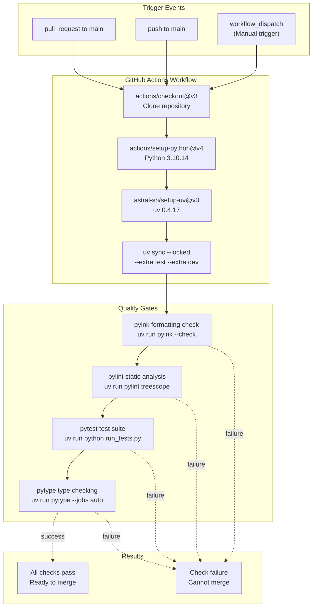
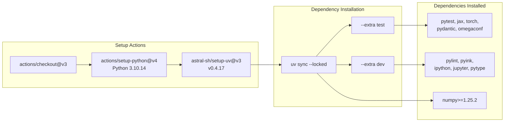
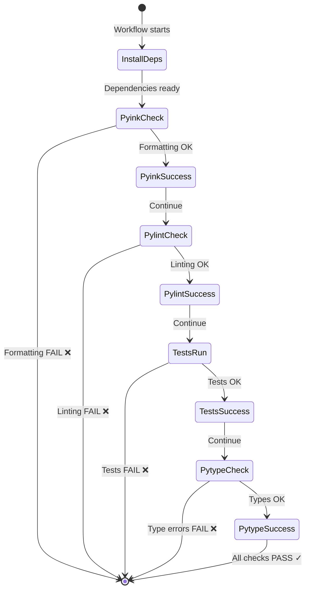

<!-- source: DeepWiki mcp.deepwiki.com · repo google-deepmind/treescope · page 9.4 CI/CD Pipeline · fetched 2026-10-26 -->

# CI/CD Pipeline

<details>
<summary>Relevant source files</summary>

The following files were used as context for generating this wiki page:

- [.github/workflows/unittests.yml](.github/workflows/unittests.yml)
- [docs/conf.py](docs/conf.py)
- [pyproject.toml](pyproject.toml)

</details>


## Purpose and Scope

This document describes Treescope's automated continuous integration and continuous delivery (CI/CD) pipeline implemented through GitHub Actions. It covers the workflow configuration, quality gates (formatting, linting, type checking, testing), and dependency management used to ensure code quality before changes are merged.

For information about setting up a local development environment, see [Development Setup](#9.2). For details on running tests locally, see [Testing](#9.3).

---

## Overview

Treescope uses a single GitHub Actions workflow to automate all quality checks on code changes. The pipeline runs on every push to main and every pull request, ensuring that all contributions meet the project's quality standards before being merged.



**Sources:** [.github/workflows/unittests.yml:1-57]()

---

## GitHub Actions Workflow Configuration

The CI/CD pipeline is defined in a single workflow file that orchestrates all automated checks.

### Workflow Definition

| Property | Value | Purpose |
|----------|-------|---------|
| **Name** | `Unittests` | Workflow identifier in GitHub UI |
| **Runner** | `ubuntu-latest` | Linux-based execution environment |
| **Timeout** | 30 minutes | Maximum execution time |
| **Python Version** | 3.10.14 | Fixed Python version for consistency |

**Sources:** [.github/workflows/unittests.yml:1-2, 16-30]()

### Trigger Configuration

The workflow activates under three conditions:

1. **Manual Dispatch** (`workflow_dispatch`): Allows developers to manually trigger the workflow when dependencies change or for debugging
2. **Push to Main** (`push.branches: main`): Runs on every commit merged to the main branch
3. **Pull Request** (`pull_request.branches: main`): Runs on all PRs targeting main, including test branches

**Sources:** [.github/workflows/unittests.yml:3-13]()

### Concurrency Control

The workflow implements automatic cancellation of redundant runs:

```yaml
concurrency:
  group: ${{ github.workflow }}-${{ github.event_name }}-${{ github.ref }}-${{ github.head_ref || 'none' }}
  cancel-in-progress: true
```

This ensures that when new commits are pushed to a PR, the previous CI run is cancelled to save resources. The concurrency group is unique per workflow, event type, branch, and head ref.

**Sources:** [.github/workflows/unittests.yml:20-22]()

---

## Setup and Dependency Management

The workflow uses `uv` for fast, deterministic dependency resolution and installation.



### Dependency Groups

The `pyproject.toml` defines multiple dependency groups:

| Group | Dependencies | Purpose |
|-------|--------------|---------|
| **Core** | `numpy>=1.25.2` | Required runtime dependencies |
| **test** | `pytest`, `jax`, `torch`, `pydantic`, `omegaconf`, `absl-py` | Test execution and library compatibility testing |
| **dev** | `pylint`, `pyink`, `pytype`, `ipython`, `jupyter` | Development tools for formatting, linting, type checking |
| **notebook** | `ipython`, `palettable`, `jax` | Extra dependencies for notebook demos |
| **docs** | `sphinx`, `myst-nb`, `torch`, etc. | Documentation building (not used in CI) |

**Sources:** [pyproject.toml:18-75](), [.github/workflows/unittests.yml:39-41]()

### Locked Dependencies

The `--locked` flag ensures that `uv.lock` file is respected exactly, preventing unexpected dependency updates during CI runs. This guarantees reproducibility across different CI runs and between local development and CI environments.

**Sources:** [.github/workflows/unittests.yml:41]()

---

## Quality Gates

The pipeline enforces four quality gates in sequence. Each must pass for the workflow to succeed.

### 1. Code Formatting (pyink)

```bash
uv run pyink treescope tests --check
```

**Tool**: `pyink` - Google's Python formatter based on Black
**Target**: `treescope/` and `tests/` directories
**Mode**: Check-only (no modifications)

#### Configuration

The formatting rules are defined in `pyproject.toml`:

| Setting | Value | Purpose |
|---------|-------|---------|
| `line-length` | 80 | Maximum line length (Google style) |
| `unstable` | true | Enable experimental features |
| `pyink-indentation` | 2 | 2-space indentation (Google style) |
| `pyink-use-majority-quotes` | true | Consistent quote style |

This check fails if any file does not conform to the formatting rules. Developers can fix issues locally by running `pyink treescope tests` without the `--check` flag.

**Sources:** [.github/workflows/unittests.yml:44-45](), [pyproject.toml:77-82]()

### 2. Static Analysis (pylint)

```bash
uv run pylint treescope
```

**Tool**: `pylint` - Static code analyzer for Python
**Target**: `treescope/` directory only (not tests)

Pylint checks for:
- Code style violations
- Programming errors (undefined variables, incorrect imports)
- Code smells (unused variables, overly complex functions)
- Refactoring opportunities

The tool runs with Treescope's pylint configuration, which may include custom rules or disabled checks specific to the project's coding standards.

**Sources:** [.github/workflows/unittests.yml:47-48](), [pyproject.toml:49]()

### 3. Test Suite (pytest)

```bash
uv run python run_tests.py
```

**Test Runner**: Custom script that invokes `pytest`
**Target**: All tests in `tests/` directory

The test suite validates:
- Core rendering functionality
- Array visualization features
- External library integrations (JAX, PyTorch, NumPy)
- Type registry behavior
- IPython integration
- Edge cases and error handling

Test dependencies include multiple ML frameworks (`jax`, `torch`) to ensure compatibility across different array types.

**Sources:** [.github/workflows/unittests.yml:51-52](), [pyproject.toml:32-39]()

### 4. Type Checking (pytype)

```bash
uv run pytype --jobs auto treescope
```

**Tool**: `pytype` - Google's static type checker
**Target**: `treescope/` directory
**Parallelization**: Automatic based on available cores

Pytype performs:
- Type inference for unannotated code
- Type checking for annotated code
- Detection of type errors and inconsistencies
- Verification of protocol implementations

The `--jobs auto` flag enables parallel type checking across multiple processes, significantly reducing execution time for the large codebase.

**Sources:** [.github/workflows/unittests.yml:55-56](), [pyproject.toml:54]()

---

## Quality Gate Execution Flow

The checks execute sequentially with fail-fast behavior:



This sequential execution ensures that:
1. Formatting issues are caught first (fastest check)
2. Code quality issues are caught before running expensive tests
3. Tests run before type checking (tests may fail faster than type checks)
4. Type checking is last (most time-consuming)

**Sources:** [.github/workflows/unittests.yml:43-56]()

---

## Build System Integration

While the CI workflow focuses on quality checks, the project's build configuration is also defined in `pyproject.toml`.

### Build Backend

| Component | Value |
|-----------|-------|
| **Build System** | `flit_core >=3.8,<4` |
| **Backend** | `flit_core.buildapi` |
| **Version Source** | Dynamic from `treescope.__version__` |

Flit provides a simple build system that reads package metadata directly from the module, eliminating the need for a separate `setup.py` file.

**Sources:** [pyproject.toml:89-91](), [pyproject.toml:24]()

### Package Metadata

Key metadata defined for PyPI distribution:

```toml
name = "treescope"
description = "An interactive HTML pretty-printer for ML research in IPython notebooks"
requires-python = ">=3.10"
license = {file = "LICENSE"}
```

**Sources:** [pyproject.toml:1-15]()

---

## Tooling Details

### uv Package Manager

The workflow uses `uv` (version 0.4.17) instead of pip for several advantages:

- **Speed**: 10-100x faster than pip for installation
- **Reproducibility**: Lock file ensures identical dependencies
- **Resolution**: More reliable dependency resolution
- **Caching**: Efficient caching of downloaded packages

**Sources:** [.github/workflows/unittests.yml:35-37]()

### Python Version Management

The workflow pins Python to 3.10.14 specifically (not just 3.10.x) to ensure:
- Consistent behavior across all CI runs
- No surprises from Python patch version changes
- Reproducible test results

This matches the project's minimum requirement of `requires-python = ">=3.10"` while providing stability.

**Sources:** [.github/workflows/unittests.yml:28-33](), [pyproject.toml:7]()

---

## Workflow Runtime Characteristics

### Execution Environment

| Property | Configuration |
|----------|---------------|
| **Operating System** | Ubuntu (latest) |
| **Architecture** | x86_64 |
| **Timeout** | 30 minutes maximum |
| **Concurrency** | 1 per PR/branch |

**Sources:** [.github/workflows/unittests.yml:17-22]()

### Resource Optimization

The workflow includes several optimizations:

1. **Concurrency cancellation**: Prevents redundant runs when PRs are updated rapidly
2. **Parallel type checking**: `pytype --jobs auto` uses multiple cores
3. **Dependency caching**: Commented-out pip cache option available if needed

**Sources:** [.github/workflows/unittests.yml:20-22, 31-33, 56]()

---

## Integration with Development Workflow

The CI pipeline enforces the same checks that developers should run locally before pushing:

```bash
# Format code
uv run pyink treescope tests

# Run linting
uv run pylint treescope

# Run tests
uv run python run_tests.py

# Type check
uv run pytype --jobs auto treescope
```

By running these commands locally, developers can catch issues before CI runs, speeding up the development cycle. See [Development Setup](#9.2) for environment setup instructions and [Testing](#9.3) for details on the test suite.

**Sources:** [.github/workflows/unittests.yml:44-56]()

---

## Workflow Status and Visibility

The workflow appears in the GitHub Actions tab with the name "Unittests". For each PR, GitHub displays:

- Overall workflow status (✓ passed, ✗ failed, ● in progress)
- Status for each individual quality gate
- Detailed logs for failed steps
- Ability to re-run failed workflows

Required status checks can be configured in branch protection rules to prevent merging PRs with failing CI.

**Sources:** [.github/workflows/unittests.yml:1]()