# Page: Introduction

# Introduction

<details>
<summary>Relevant source files</summary>

The following files were used as context for generating this wiki page:

- [README.md](README.md)
- [docs/index.rst](docs/index.rst)
- [docs/notebooks/array_visualization.ipynb](docs/notebooks/array_visualization.ipynb)
- [docs/notebooks/building_custom_visualizations.ipynb](docs/notebooks/building_custom_visualizations.ipynb)
- [docs/notebooks/pretty_printing.ipynb](docs/notebooks/pretty_printing.ipynb)
- [treescope/__init__.py](treescope/__init__.py)

</details>


This page introduces Treescope: its purpose, core capabilities, and high-level architecture. For detailed instructions on installation and setup, see [Installation and Quick Start](#2). For in-depth explanations of the rendering system, see [Core Rendering System](#3).

## Purpose and Scope

Treescope is an interactive HTML pretty-printer and N-dimensional array visualizer designed for machine learning and neural networks research in IPython notebooks. It serves as a drop-in replacement for the standard IPython/Colab renderer, providing enhanced visualization capabilities for complex nested data structures, tensors, and neural network models.

**Target Audience**: Machine learning researchers and practitioners working with:
- JAX, PyTorch, or NumPy arrays
- Nested data structures (PyTrees, dataclasses, etc.)
- Neural network models (Equinox, Flax NNX, PyTorch modules, etc.)
- IPython/Jupyter notebooks or Google Colab

Sources: [README.md:1-33](), [docs/index.rst:1-37](), [treescope/__init__.py:15-31]()

## What is Treescope?

Treescope transforms the standard Python `repr` output into interactive, syntax-highlighted HTML visualizations. Instead of static text output that becomes unreadable for large nested structures, Treescope provides:

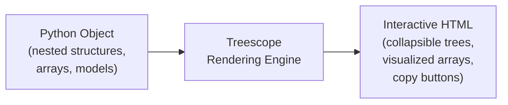

**Key Design Principle**: Treescope follows Python's `repr` conventions—most output is valid Python syntax, with extra annotations either hidden from selection or represented as comments. This makes outputs copyable and, when possible, executable.

Sources: [README.md:1-33](), [docs/notebooks/pretty_printing.ipynb:40-54]()

## Core Capabilities

### Interactive Tree Rendering

Treescope renders Python objects as collapsible tree structures, allowing users to focus on relevant parts of complex data:

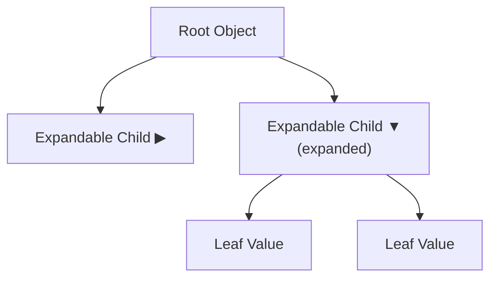

**Key Features**:
- Expand/collapse any multi-line object with ▶/▼ markers
- Configurable default expansion via `active_expansion_strategy`
- Abbreviation of deeply nested collapsed nodes via `abbreviation_threshold`
- Copy-path buttons to generate code that accesses specific subtrees

Sources: [docs/notebooks/pretty_printing.ipynb:232-290](), [treescope/__init__.py:140-148](), [treescope/__init__.py:159-169]()

### Array Visualization

Treescope includes a specialized visualizer for N-dimensional arrays that renders array contents as interactive pixel grids:

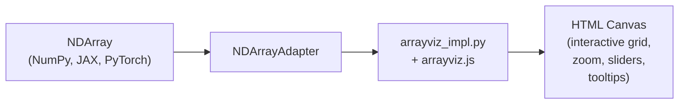

**Capabilities**:
- Automatic visualization via `ArrayAutovisualizer`
- Manual rendering via `render_array()`
- Interactive features: zoom, axis sliders, hover tooltips, dynamic colormaps
- Support for arbitrarily high-dimensional arrays
- Categorical (discrete) and continuous (numeric) rendering modes
- JAX sharding visualization via `render_array_sharding()`

Sources: [docs/notebooks/array_visualization.ipynb:40-52](), [treescope/__init__.py:59-65](), [README.md:10-12]()

### Neural Network Model Support

Treescope provides specialized rendering for neural network models from multiple frameworks:

| Framework | Support | Rendering Approach |
|-----------|---------|-------------------|
| **Penzai** | First-class | Dataclass attributes with color-coding |
| **Equinox** | Full | Dataclass attributes (PyTree structure) |
| **Flax NNX** | Full | Extension API via `__treescope_repr__` |
| **PyTorch** | Full | Dynamic inspection of `nn.Module` parameters/buffers |
| **JAX** | Arrays only | Array visualization + sharding info |

Sources: [docs/notebooks/pretty_printing.ipynb:1012-1076](), [README.md:20-32]()

### Extensibility

Treescope supports customization at multiple levels:

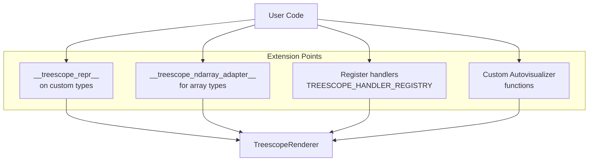

Sources: [docs/notebooks/building_custom_visualizations.ipynb:40-54](), [treescope/__init__.py:44-50]()

## Key Entry Points and Usage Patterns

The following diagram maps user-facing functions to their roles in the system:

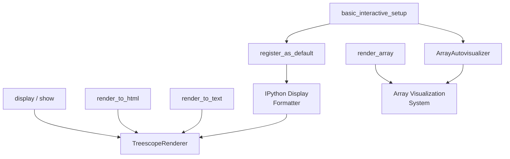

**Primary Usage Patterns**:

1. **Quick Setup (Recommended)**:
   - Call `treescope.basic_interactive_setup()` to configure Treescope as the default IPython renderer with array autovisualization
   - Located in [treescope/__init__.py:82]()

2. **Manual Display**:
   - `treescope.display(obj)` - Display a single object
   - `treescope.show(*args)` - Display multiple objects (like `print`)
   - Located in [treescope/__init__.py:83-87]()

3. **Rendering Functions**:
   - `treescope.render_to_html(obj)` - Generate HTML string
   - `treescope.render_to_text(obj)` - Generate plain text
   - Located in [treescope/__init__.py:76-77]()

4. **Array Visualization**:
   - `treescope.render_array(array, ...)` - Explicitly render an array
   - `treescope.ArrayAutovisualizer()` - Automatic array visualization in trees
   - Located in [treescope/__init__.py:56-65]()

Sources: [treescope/__init__.py:52-88](), [docs/notebooks/pretty_printing.ipynb:223-225](), [README.md:51-90]()

## Configuration System

Treescope uses a `ContextualValue` pattern for configuration, allowing global defaults, scoped contexts, and per-call parameters:

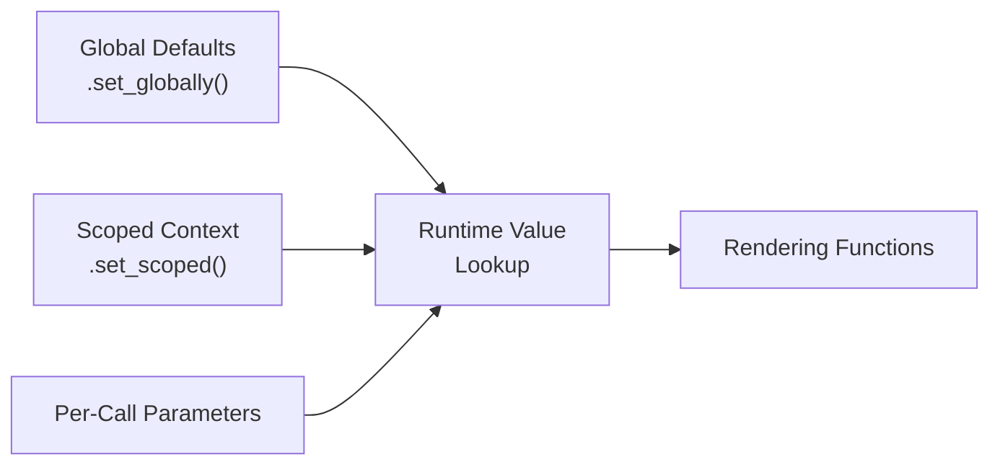

**Key Configuration Values**:
- `active_autovisualizer` - Controls automatic visualization [treescope/__init__.py:114-122]()
- `active_renderer` - Handler chain and postprocessors [treescope/__init__.py:124-138]()
- `active_expansion_strategy` - Default fold states [treescope/__init__.py:140-148]()
- `abbreviation_threshold` - Collapse depth limit [treescope/__init__.py:159-169]()
- `default_diverging_colormap` - Array colormap for signed data [treescope/__init__.py:96-103]()
- `default_sequential_colormap` - Array colormap for unsigned data [treescope/__init__.py:105-112]()

Sources: [treescope/__init__.py:96-184](), [docs/notebooks/pretty_printing.ipynb:532-598]()

## Output Modes

Treescope generates output in two primary formats:

| Mode | Format | Use Case | Key Features |
|------|--------|----------|--------------|
| **HTML** | Interactive HTML with CSS/JS | IPython notebooks, saved HTML files | Collapsible trees, interactive array grids, copy buttons |
| **Text** | Plain text with ANSI colors | Terminal output, logs | Indentation-based structure, abbreviation markers |

Both modes support:
- **Normal mode**: Abbreviated type names, compact rendering
- **Roundtrip mode** (toggle with `r` key): Fully qualified type names, explicit reconstruction syntax

Sources: [docs/notebooks/pretty_printing.ipynb:332-387](), [treescope/__init__.py:171-184]()

## Supported External Libraries

Treescope provides specialized integration for the following libraries through dedicated support modules:

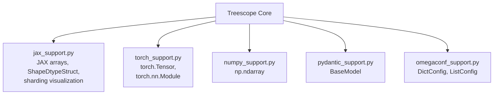

Each support module calls `set_up_treescope()` to register handlers, adapters, and type metadata with the core system. For details on library-specific features, see [External Library Support](#6).

Sources: [README.md:20-36](), [docs/index.rst:24-36]()

## Architecture at a Glance

The high-level data flow through Treescope:

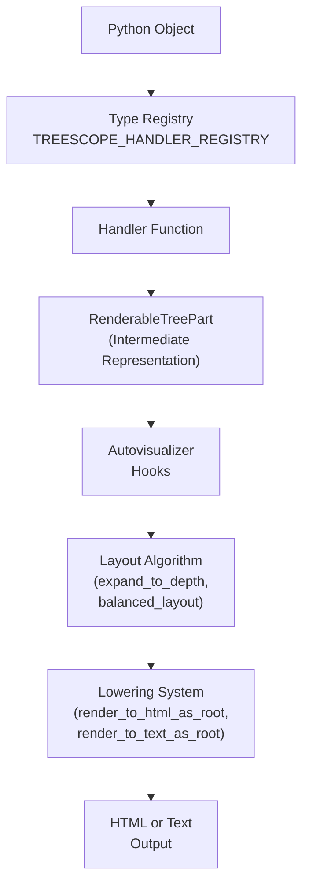

**Pipeline Stages**:
1. **Type Dispatch**: Look up handler for object type in registry
2. **Handler Execution**: Convert object to intermediate representation
3. **Autovisualization**: Optionally enhance/replace subtrees with visualizations
4. **Layout**: Determine which nodes to expand/collapse
5. **Lowering**: Convert IR to final HTML or text format

For detailed explanations of each stage, see [Rendering Pipeline](#3.1).

Sources: Diagram 2 from system overview, [treescope/__init__.py:38-50]()

## Next Steps

- **Getting Started**: See [Installation and Quick Start](#2) for setup instructions
- **Pretty-Printing**: Learn about tree rendering features in [Core Rendering System](#3)
- **Array Visualization**: Explore array rendering capabilities in [Array Visualization](#4)
- **IPython Integration**: Understand notebook usage in [IPython and Jupyter Integration](#5)
- **Extending Treescope**: Add custom handlers in [Extending Treescope](#8)

---

# Page: Installation and Quick Start

# Installation and Quick Start

<details>
<summary>Relevant source files</summary>

The following files were used as context for generating this wiki page:

- [README.md](README.md)
- [docs/api/treescope.rst](docs/api/treescope.rst)
- [docs/index.rst](docs/index.rst)
- [treescope/__init__.py](treescope/__init__.py)
- [treescope/_internal/api/ipython_integration.py](treescope/_internal/api/ipython_integration.py)
- [treescope/rendering_parts.py](treescope/rendering_parts.py)

</details>


This page guides you through installing Treescope and getting started with basic usage. It covers installation via pip, importing the library, and three common setup patterns for IPython/Jupyter notebooks. For detailed information about configuration options and context management, see [Configuration and Context](#5.3). For information about the display functions themselves, see [Display Functions](#5.1).

## Installation

Treescope is available via pip and can be installed with a single command:

```bash
pip install treescope
```

After installation, import Treescope in your Python code:

```python
import treescope
```

**Sources:** [README.md:53-63](), [docs/index.rst:66-72]()

## Three Approaches to Using Treescope

Treescope provides three main usage patterns depending on your needs:

| Approach | Function | Use Case |
|----------|----------|----------|
| **One-off display** | `treescope.show()` or `treescope.display()` | Display specific objects without changing notebook defaults |
| **All-in-one setup** | `treescope.basic_interactive_setup()` | Quick setup with sensible defaults for interactive work |
| **Manual setup** | `treescope.register_as_default()` + configuration | Fine-grained control over rendering behavior |

### Approach 1: One-off Display with `show()` and `display()`

Use `treescope.show()` or `treescope.display()` to render individual objects without configuring Treescope as the default renderer:

```python
import treescope

# Like print, but with rich interactive output
treescope.show(my_object)

# Display with more control
treescope.display(my_object, autovisualize=True)
```

**Key differences:**
- `show(*args, wrap=False, space_separated=True)` - Similar to `print()`, accepts multiple arguments and displays them inline
- `display(value, ignore_exceptions=False, roundtrip_mode=False, autovisualize=None, streaming=True)` - Displays a single value with more configuration options

**Sources:** [treescope/__init__.py:29-30](), [treescope/_internal/api/ipython_integration.py:172-216](), [treescope/_internal/api/ipython_integration.py:113-170]()

### Approach 2: All-in-One Setup with `basic_interactive_setup()`

The simplest way to configure Treescope for interactive notebook use:

```python
import treescope

# Recommended: Enable all interactive features
treescope.basic_interactive_setup(autovisualize_arrays=True)

# Or with abbreviation for verbose outputs
treescope.basic_interactive_setup(
    autovisualize_arrays=True,
    abbreviation_threshold=1  # Collapse at depth 1
)
```

This single function call performs multiple setup steps automatically.

**Sources:** [treescope/__init__.py:82-86](), [README.md:84-86](), [treescope/_internal/api/ipython_integration.py:514-547]()

### Approach 3: Manual Setup for Fine Control

For precise control over configuration:

```python
import treescope

# Step 1: Register as default renderer
treescope.register_as_default()

# Step 2: Register magic commands
treescope.register_autovisualize_magic()
treescope.register_context_manager_magic()

# Step 3: Enable array visualization (optional)
treescope.active_autovisualizer.set_globally(
    treescope.ArrayAutovisualizer()
)

# Step 4: Configure abbreviation (optional)
treescope.abbreviation_threshold.set_globally(1)
```

**Sources:** [treescope/__init__.py:21-27](), [README.md:72-79](), [treescope/_internal/api/ipython_integration.py:218-353]()

## Setup Functions and Their Relationships

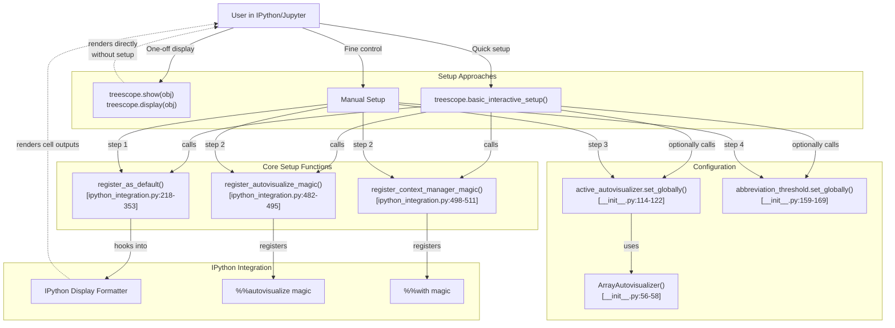

**Sources:** [treescope/_internal/api/ipython_integration.py:514-547](), [treescope/_internal/api/ipython_integration.py:218-353](), [treescope/_internal/api/ipython_integration.py:482-511]()

## What `basic_interactive_setup()` Does

The `basic_interactive_setup()` function performs the following operations:

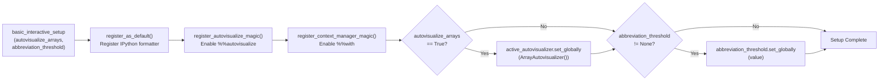

**Implementation details:**

| Step | Function Called | Purpose |
|------|----------------|---------|
| 1 | `register_as_default()` | Hooks Treescope into IPython's display formatter to render all cell outputs |
| 2 | `register_autovisualize_magic()` | Enables `%%autovisualize` cell magic for per-cell visualization control |
| 3 | `register_context_manager_magic()` | Enables `%%with` cell magic for per-cell context management |
| 4 | `active_autovisualizer.set_globally()` | If `autovisualize_arrays=True`, enables automatic array visualization |
| 5 | `abbreviation_threshold.set_globally()` | If provided, configures depth at which collapsed nodes are abbreviated |

**Sources:** [treescope/_internal/api/ipython_integration.py:514-547]()

## First Steps After Setup

Once you've configured Treescope, you can start using it immediately. The behavior depends on your setup approach:

### If you used `basic_interactive_setup()` or `register_as_default()`

Cell outputs are automatically rendered with Treescope:

```python
# After setup, just evaluate objects at the end of a cell
my_dict = {"key": [1, 2, 3], "nested": {"a": 10, "b": 20}}
my_dict  # Automatically rendered with Treescope
```

### If you're using `show()` or `display()`

Explicitly call the function:

```python
# Display specific objects
treescope.show("Result:", my_dict)

# Or with configuration
treescope.display(my_dict, autovisualize=True, roundtrip_mode=True)
```

### Using IPython Magics

If you registered magics, you can use them in cells:

```python
%%autovisualize
# Enables array visualization for this cell only
my_array = np.random.randn(10, 10)
my_array
```

```python
%%with treescope.active_autovisualizer.set_scoped(None)
# Disables autovisualization for this cell
my_array  # Rendered without automatic visualization
```

**Sources:** [README.md:65-90](), [docs/index.rst:74-89](), [treescope/_internal/api/ipython_integration.py:361-442]()

## Key Configuration Options

Treescope's behavior can be customized through `ContextualValue` objects. The most important ones for getting started:

| Configuration | Type | Default | Purpose |
|--------------|------|---------|---------|
| `active_autovisualizer` | `ContextualValue[Autovisualizer \| None]` | `None` | Controls automatic visualization of arrays and other objects |
| `abbreviation_threshold` | `ContextualValue[int \| None]` | `None` | Depth at which collapsed nodes show `...` instead of full content |
| `active_renderer` | `ContextualValue[TreescopeRenderer]` | Default renderer | The handler chain used to render objects |
| `default_magic_autovisualizer` | `ContextualValue[Autovisualizer]` | `ArrayAutovisualizer()` | The autovisualizer used by `%%autovisualize` with no arguments |

### Example: Configuring Abbreviation

```python
# Set globally for all subsequent renders
treescope.abbreviation_threshold.set_globally(1)

# Or use a context manager for temporary changes
with treescope.abbreviation_threshold.set_scoped(2):
    treescope.show(large_nested_structure)
```

For complete documentation of configuration options, see [Configuration and Context](#5.3).

**Sources:** [treescope/__init__.py:96-184](), [treescope/_internal/api/ipython_integration.py:42-48]()

## Interactive Features

After rendering an object with Treescope, you can interact with the visualization:

| Key/Action | Effect |
|------------|--------|
| Click `▶` buttons | Expand/collapse subtrees |
| Press `r` key | Toggle "roundtrip mode" (shows fully qualified type names) |
| Shift + scroll | Scroll horizontally |
| Click "Copy path" buttons | Copy Python path to clipboard for accessing that part of the object |

**Sources:** [README.md:88-90](), [docs/index.rst:91-93]()

## Display Functions Reference

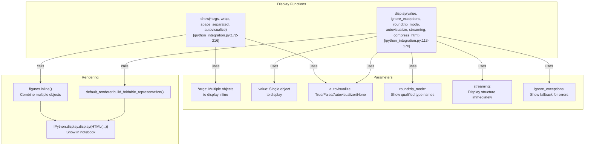

**Sources:** [treescope/_internal/api/ipython_integration.py:113-216](), [docs/api/treescope.rst:6-18]()

## Common Setup Recipes

### Recipe 1: Minimal Setup (Default Renderer Only)

```python
import treescope
treescope.register_as_default()
```

**Use when:** You want Treescope as your default renderer but don't need array visualization or magic commands.

### Recipe 2: Full Interactive Setup (Recommended)

```python
import treescope
treescope.basic_interactive_setup(autovisualize_arrays=True)
```

**Use when:** Working interactively in notebooks and want all features enabled.

### Recipe 3: Verbose Output Control

```python
import treescope
treescope.basic_interactive_setup(
    autovisualize_arrays=True,
    abbreviation_threshold=1  # Show ... for collapsed children
)
```

**Use when:** Working with large nested structures and outputs are too verbose.

### Recipe 4: Selective Display Without Global Setup

```python
import treescope

# No global setup - use show() for specific objects
treescope.show(my_model, autovisualize=True)
treescope.display(my_data, roundtrip_mode=True)
```

**Use when:** You want to keep the default IPython renderer but occasionally use Treescope.

**Sources:** [README.md:84-106](), [docs/index.rst:86-107]()

## Next Steps

After completing the setup:

- For information about rendering arrays with interactive visualizations, see [Array Visualization](#4)
- For details on the `%%autovisualize` and `%%with` magics, see [Magic Commands](#5.2)
- To understand how to customize rendering behavior, see [Configuration and Context](#5.3)
- To learn about the rendering pipeline, see [Rendering Pipeline](#3.1)
- For information about extending Treescope, see [Extending Treescope](#8)

---

# Page: Core Rendering System

# Core Rendering System

<details>
<summary>Relevant source files</summary>

The following files were used as context for generating this wiki page:

- [tests/renderer_test.py](tests/renderer_test.py)
- [treescope/__init__.py](treescope/__init__.py)
- [treescope/_internal/handlers/autovisualizer_hook.py](treescope/_internal/handlers/autovisualizer_hook.py)
- [treescope/_internal/parts/embedded_iframe.py](treescope/_internal/parts/embedded_iframe.py)
- [treescope/lowering.py](treescope/lowering.py)

</details>


This document describes the fundamental architecture of Treescope's rendering system, which converts Python objects into interactive HTML visualizations or plain text output. This page provides an overview of the major components and their interactions.

For detailed information about specific subsystems:
- For the complete rendering pipeline flow, see [Rendering Pipeline](#3.1)
- For type registry mechanics and handler registration, see [Type System and Registries](#3.2)
- For asynchronous rendering and streaming output, see [Deferred Rendering and Streaming](#3.3)

## Architecture Overview

Treescope's rendering system is organized into four major layers that transform Python objects into output:

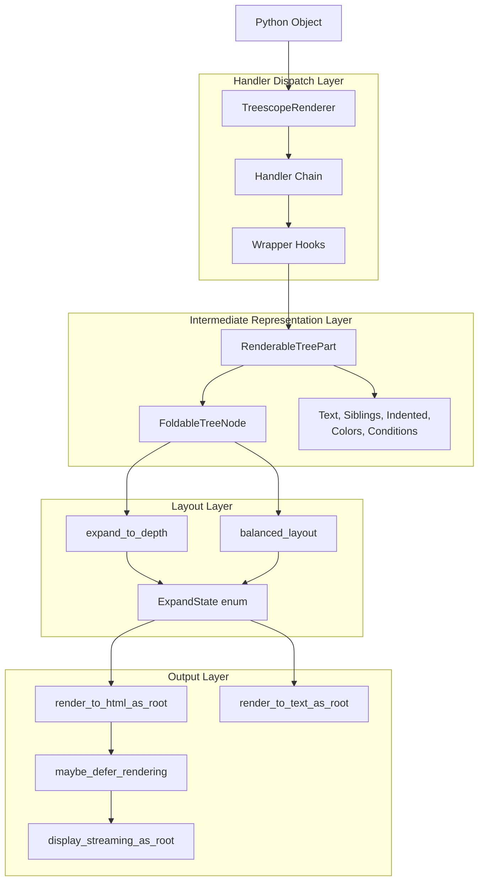

**Sources:** [treescope/__init__.py:67-88](), [treescope/lowering.py:1-505](), [Diagram 1 and Diagram 2 from high-level architecture]

## Core Components

### TreescopeRenderer

The `TreescopeRenderer` class is the central orchestrator of the rendering process. It maintains a chain of handlers and wrapper hooks that process objects.

| Method | Purpose |
|--------|---------|
| `to_foldable_representation` | Converts object to intermediate representation |
| `to_html` | Renders object to HTML string |
| `to_text` | Renders object to plain text string |
| `extended_with` | Creates new renderer with additional handlers/hooks |

The active renderer is stored in the `active_renderer` contextual value and can be customized globally or temporarily scoped.

**Sources:** [treescope/__init__.py:124-138](), [tests/renderer_test.py:66-79]()

### Handler Chain

Handlers are functions that examine an object and either render it or return `NotImplemented` to pass control to the next handler. The handler chain is evaluated in order until a handler accepts responsibility for the object.

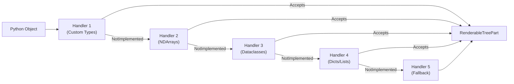

Handlers receive three arguments:
- `node`: The object to render
- `path`: String representation of the object's path in the tree (e.g., `"[0].foo"`)
- `subtree_renderer`: Function to recursively render child objects

**Sources:** [tests/renderer_test.py:88-122](), [Diagram 2 from high-level architecture]

### Wrapper Hooks

Wrapper hooks execute around the handler chain and can intercept, modify, or replace the rendering. The primary wrapper hook is the autovisualizer hook ([treescope/_internal/handlers/autovisualizer_hook.py:33-200]()), which allows custom visualizations to be injected for specific nodes.

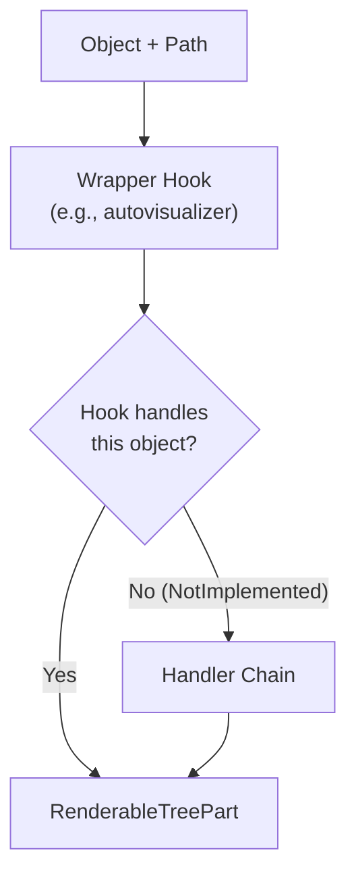

**Sources:** [treescope/_internal/handlers/autovisualizer_hook.py:33-200](), [tests/renderer_test.py:94-121]()

## Intermediate Representation

The rendering system uses an intermediate representation (IR) based on the `RenderableTreePart` interface. This IR is independent of the output format and can be lowered to either HTML or text.

### RenderableTreePart Types

| Part Type | Purpose | Example Use |
|-----------|---------|-------------|
| `Text` | Atomic text content | Variable names, literals |
| `Siblings` | Horizontal composition | `foo` + `,` + ` ` + `bar` |
| `IndentedChildren` | Vertical composition with indentation | List items, dict entries |
| `FoldableTreeNode` | Collapsible nodes | Dicts, lists, objects |
| `Styled` | Applies colors/formatting | Syntax highlighting |
| `ConditionallyColored` | Changes based on mode | Roundtrip mode differences |
| `EmbeddedIFrame` | External HTML content | Rich visualizations |

**Sources:** [treescope/rendering_parts.py (referenced throughout codebase)]

### Example IR Structure

For a simple dict `{"a": 1, "b": 2}`:

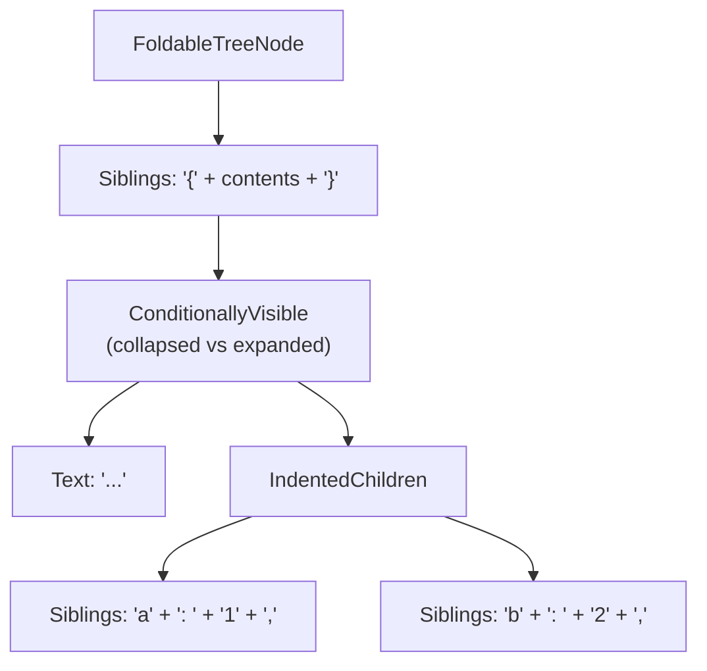

**Sources:** [tests/renderer_test.py:204-215](), [Diagram 2 from high-level architecture]

## Layout Algorithms

After handlers produce the IR, layout algorithms determine which foldable nodes should be expanded or collapsed by default. Two main strategies exist:

### expand_to_depth

The `expand_to_depth` function expands all `FoldableTreeNode` instances up to a specified depth. Depth 0 collapses everything, depth 1 expands the root, etc.

```python
# Usage pattern
rendering = renderer.to_foldable_representation(obj)
layout_algorithms.expand_to_depth(rendering.renderable, depth=2)
```

### balanced_layout

The `balanced_layout` strategy attempts to maximize information displayed within a target line count by selectively expanding nodes that fit within the budget.

**Sources:** [tests/renderer_test.py:105-106](), [tests/renderer_test.py:986-1016]()

## Lowering to Output Formats

The lowering layer converts the IR to final output formats. The main entry points are defined in [treescope/lowering.py:1-505]().

### Text Output

`render_to_text_as_root` converts the IR to plain text by calling `render_to_text` on each part:


Parameters control abbreviation thresholds and roundtrip mode behavior.

**Sources:** [treescope/lowering.py:146-199]()

### HTML Output

`render_to_html_as_root` produces interactive HTML with several features:

1. **CSS Setup**: Collects and injects CSS rules from all parts
2. **JavaScript Setup**: Collects and injects JavaScript definitions
3. **HTML Generation**: Calls `render_to_html` on each part
4. **Encapsulation**: Wraps output in a shadow DOM for isolation

The HTML rendering process is more complex due to:
- Dynamic CSS and JS collection
- Deferred rendering support
- Interactive features (collapse/expand, copy buttons)

**Sources:** [treescope/lowering.py:440-460]()

### Streaming Output

For expensive renderings, the system supports streaming output where initial structure is displayed immediately and deferred parts are filled in asynchronously:

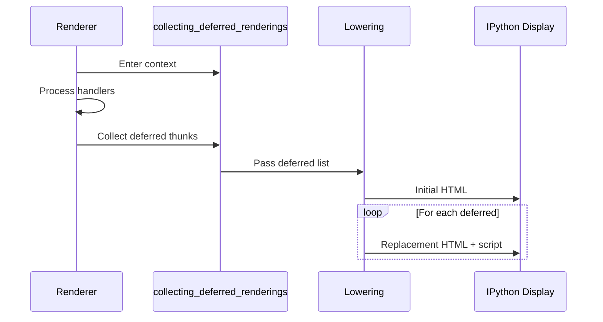

**Sources:** [treescope/lowering.py:46-111](), [treescope/lowering.py:463-505]()

## Roundtrip Mode

Treescope supports a "roundtrip mode" where output aims to be valid Python code that recreates the object. The IR includes conditional parts that render differently in roundtrip vs normal mode:

- Canonical aliases are used (e.g., `treescope.render_to_text` instead of `render_to_text`)
- Custom visualizations are hidden
- Different abbreviation thresholds apply

This is controlled by the `roundtrip` parameter in lowering functions and the `roundtrip_mode` flag in render context.

**Sources:** [treescope/__init__.py:171-184](), [treescope/lowering.py:173-180](), [tests/renderer_test.py:191-230]()

## Error Handling

The rendering system includes error recovery mechanisms to prevent failures in custom handlers from breaking the entire visualization:

1. **Handler Exceptions**: When a handler raises an exception, the system can optionally catch it and use a fallback `repr` rendering
2. **Deferred Exceptions**: Exceptions during deferred rendering are caught and displayed as error markers in the output
3. **Warning Messages**: Non-fatal errors emit warnings with traceback information

The `ignore_exceptions` parameter controls this behavior in `to_foldable_representation` and related functions.

**Sources:** [tests/renderer_test.py:87-153](), [tests/renderer_test.py:1174-1208]()

## Configuration System

The rendering system reads configuration from contextual values that can be set globally or temporarily:

| Contextual Value | Purpose |
|------------------|---------|
| `active_renderer` | The renderer instance to use |
| `active_expansion_strategy` | Default layout algorithm |
| `abbreviation_threshold` | Depth limit for collapsing |
| `roundtrip_abbreviation_threshold` | Depth limit in roundtrip mode |

These are accessed via the `ContextualValue` pattern, which supports both global settings and scoped overrides.

**Sources:** [treescope/__init__.py:124-184](), [Diagram 5 from high-level architecture]

## High-Level API Entry Points

The public API provides several convenience functions that wrap the core rendering system:

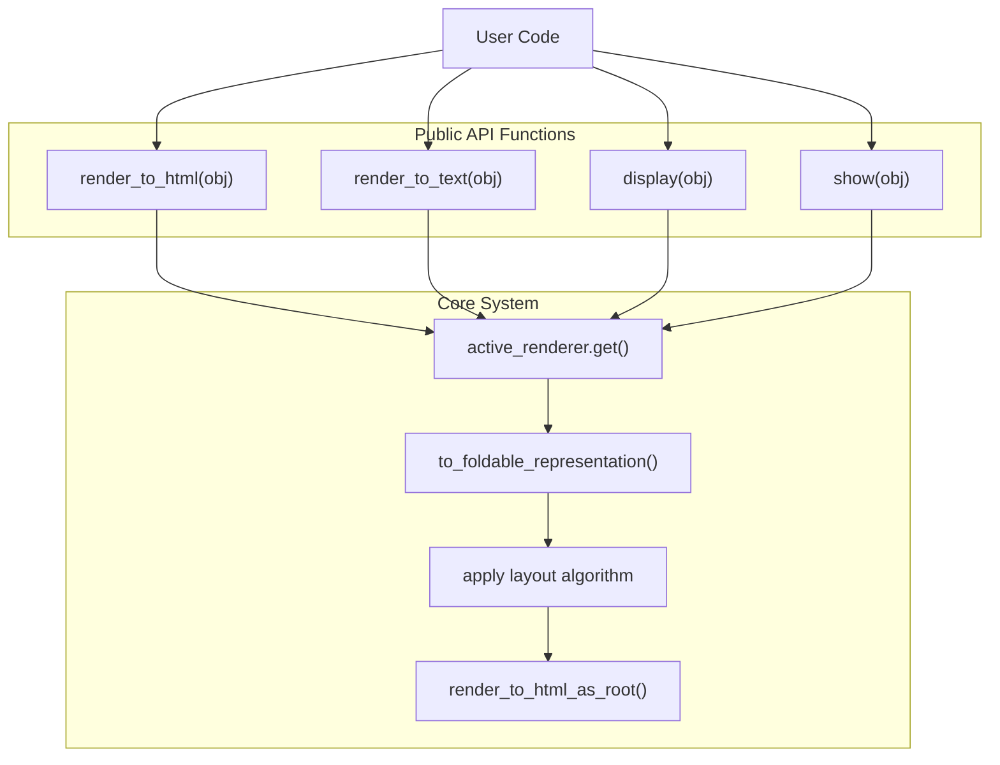

These functions automatically:
- Retrieve the active renderer
- Convert objects to IR
- Apply the active expansion strategy
- Lower to the appropriate output format

**Sources:** [treescope/__init__.py:76-88](), [tests/renderer_test.py:80-85]()

---

# Page: Rendering Pipeline

# Rendering Pipeline

<details>
<summary>Relevant source files</summary>

The following files were used as context for generating this wiki page:

- [tests/renderer_test.py](tests/renderer_test.py)
- [treescope/_internal/handlers/autovisualizer_hook.py](treescope/_internal/handlers/autovisualizer_hook.py)
- [treescope/_internal/parts/embedded_iframe.py](treescope/_internal/parts/embedded_iframe.py)
- [treescope/lowering.py](treescope/lowering.py)

</details>


## Purpose and Scope

This page describes the complete rendering pipeline that transforms Python objects into interactive HTML visualizations or plain text output. The pipeline consists of five main stages: type dispatch, handler invocation, intermediate representation construction, autovisualizer enhancement, layout computation, and lowering to the final output format.

For information about the type registry system that powers the dispatch stage, see [Type System and Registries](#3.2). For details on deferred rendering and streaming output, see [Deferred Rendering and Streaming](#3.3).

## Pipeline Overview

The rendering pipeline transforms Python objects through a series of well-defined stages:

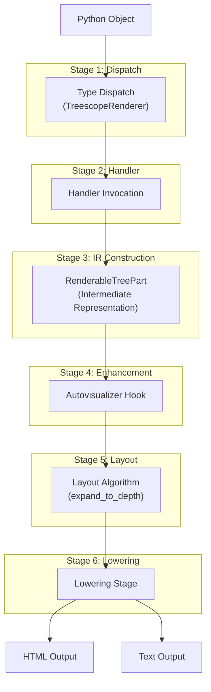

**Sources:** [treescope/lowering.py:1-505](), [tests/renderer_test.py:59-154]()

## Stage 1: Type Dispatch and Renderer Interface

The entry point to the rendering pipeline is the `TreescopeRenderer` interface, which provides three main methods:

| Method | Return Type | Purpose |
|--------|-------------|---------|
| `to_foldable_representation()` | `RenderableAndLineAnnotations` | Produces intermediate representation with layout state |
| `to_html()` | `str` | Renders directly to HTML string |
| `to_text()` | `str` | Renders directly to text string |

The renderer maintains a chain of handlers and wrapper hooks that are invoked in sequence to process objects. When an object is passed to the renderer, it:

1. Iterates through registered wrapper hooks (e.g., the autovisualizer hook)
2. Dispatches to the appropriate handler based on type matching
3. Falls back to generic handlers if no specific handler matches

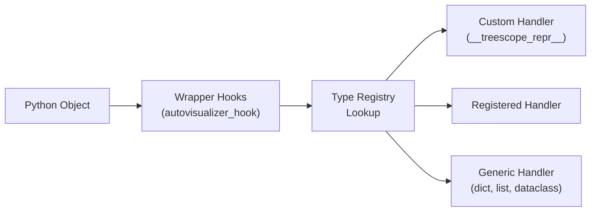

**Sources:** [tests/renderer_test.py:66-78](), [tests/renderer_test.py:88-102]()

## Stage 2: Handler Invocation and IR Construction

Handlers are functions with the signature:

```
handler(node: Any, path: str | None, subtree_renderer: TreescopeSubtreeRenderer) 
    -> RenderableTreePart | RenderableAndLineAnnotations | NotImplemented
```

Each handler examines the node and either:
- Returns `NotImplemented` to pass control to the next handler
- Returns a `RenderableTreePart` (the intermediate representation)
- Returns a `RenderableAndLineAnnotations` (IR plus annotations)

Handlers construct the intermediate representation using functions from the `rendering_parts` module. Common IR construction patterns include:

| Pattern | Functions Used | Purpose |
|---------|---------------|---------|
| One-line objects | `build_one_line_tree_node()` | Simple values like strings, numbers |
| Collection types | `build_foldable_tree_node_from_children()` | Lists, dicts, tuples |
| Custom structures | `build_custom_foldable_tree_node()` | Complex objects with custom rendering |
| Arrays | Array visualization subsystem | NDArrays with interactive canvas |

**Sources:** [tests/renderer_test.py:155-519]()

## Stage 3: Intermediate Representation (RenderableTreePart)

The `RenderableTreePart` interface is the core abstraction of Treescope's intermediate representation. All parts of the rendered tree implement this interface, which defines:

```mermaid
graph TD
    RenderableTreePart["RenderableTreePart<br/>(Interface)"]
    
    Methods["Key Methods"]
    TextMethod["render_to_text()"]
    HTMLMethod["render_to_html()"]
    LayoutMethods["_compute_collapsed_width()<br/>_compute_newlines_in_expanded_parent()"]
    FoldableMethod["foldables_in_this_part()"]
    SetupMethod["html_setup_parts()"]
    
    RenderableTreePart --> Methods
    Methods --> TextMethod
    Methods --> HTMLMethod
    Methods --> LayoutMethods
    Methods --> FoldableMethod
    Methods --> SetupMethod
    
    TextMethod --> TextOutput["Text rendering"]
    HTMLMethod --> HTMLOutput["HTML rendering"]
    LayoutMethods --> LayoutInfo["Layout computation"]
    FoldableMethod --> FoldableNodes["Foldable nodes list"]
    SetupMethod --> CSSandJS["CSS/JS setup"]
```

Key IR part types include:

| Part Type | Purpose | Module |
|-----------|---------|--------|
| `Text` | Literal text content | `rendering_parts` |
| `OneLine` | Single-line content | `rendering_parts` |
| `Siblings` | Multiple parts in sequence | `rendering_parts` |
| `IndentedChildren` | Indented child content | `rendering_parts` |
| `FoldableTreeNode` | Expandable/collapsible nodes | `foldable_impl` |
| `EmbeddedIFrame` | External HTML content | `embedded_iframe` |
| `DeferredPlaceholder` | Placeholder for deferred content | `foldable_impl` |

**Sources:** [treescope/_internal/parts/embedded_iframe.py:33-150](), [tests/renderer_test.py:104-110]()

## Stage 4: Autovisualizer Hook

After handlers construct the initial IR, the autovisualizer hook has an opportunity to enhance or replace parts of the tree. The hook is implemented as a wrapper hook in the handler chain.

```mermaid
graph TD
    OriginalIR["Original IR<br/>(from handler)"]
    AutovizCheck{"active_autovisualizer<br/>returns value?"}
    NoChange["Use original IR"]
    IPythonViz["IPythonVisualization"]
    TreescopePart["VisualizationFromTreescopePart"]
    ChildAutovis["ChildAutovisualizer"]
    
    OriginalIR --> AutovizCheck
    AutovizCheck -->|None| NoChange
    AutovizCheck -->|IPythonVisualization| IPythonViz
    AutovizCheck -->|VisualizationFromTreescopePart| TreescopePart
    AutovizCheck -->|ChildAutovisualizer| ChildAutovis
    
    IPythonViz --> WrapIFrame["Wrap in iframe<br/>(if _repr_html_)"]
    TreescopePart --> CustomRender["Use custom rendering"]
    ChildAutovis --> RecurseRenderer["Re-render with<br/>child autovisualizer"]
    
    WrapIFrame --> EnhancedIR["Enhanced IR"]
    CustomRender --> EnhancedIR
    RecurseRenderer --> EnhancedIR
    NoChange --> EnhancedIR
```

The autovisualizer can:
- Return `None` to leave the node unchanged
- Return `IPythonVisualization` to embed rich HTML content (e.g., plots)
- Return `VisualizationFromTreescopePart` to provide custom Treescope rendering
- Return `ChildAutovisualizer` to recursively render with a different autovisualizer

**Sources:** [treescope/_internal/handlers/autovisualizer_hook.py:33-200]()

## Stage 5: Layout Algorithm

After the complete IR tree is constructed, the layout algorithm determines which nodes should be expanded or collapsed. The primary function is `expand_to_depth()` from the `layout_algorithms` module.

Layout computation uses information from the IR:
- `_compute_collapsed_width()`: Width of node when collapsed
- `_compute_newlines_in_expanded_parent()`: Additional height when expanded
- `foldables_in_this_part()`: List of all foldable nodes

The algorithm traverses the tree and sets the `ExpandState` of each `FoldableTreeNode` to either:
- `EXPANDED`: Node is expanded, children visible
- `COLLAPSED`: Node is collapsed, children hidden
- `WEAKLY_EXPANDED`: Node expanded, but children may be collapsed

**Sources:** [tests/renderer_test.py:105-110](), [tests/renderer_test.py:986-1016]()

## Stage 6: Lowering to Output Format

The final stage converts the IR with layout decisions into either HTML or text output. This is handled by functions in the `lowering` module.

### Text Rendering

```mermaid
graph LR
    IR["RenderableTreePart<br/>with layout"]
    TextFunc["render_to_text_as_root()"]
    AbbrevContext["Set abbreviation<br/>threshold in context"]
    RenderLoop["Iterate parts calling<br/>render_to_text()"]
    Cleanup["Strip trailing<br/>whitespace"]
    TextOutput["Text string"]
    
    IR --> TextFunc
    TextFunc --> AbbrevContext
    AbbrevContext --> RenderLoop
    RenderLoop --> Cleanup
    Cleanup --> TextOutput
```

The text rendering process:
1. Sets up render context with abbreviation thresholds
2. Calls `render_to_text()` on root node, which recursively calls children
3. Each part writes to a `StringIO` stream
4. Strips trailing whitespace and empty lines
5. Returns final text string

**Sources:** [treescope/lowering.py:146-199]()

### HTML Rendering

```mermaid
graph TD
    IR["RenderableTreePart<br/>with layout"]
    StreamingFunc["_render_to_html_as_root_streaming()"]
    
    SetupPhase["Setup Phase"]
    RootStyles["Add root CSS styles"]
    PreambleJS["Add preamble JavaScript"]
    RootDiv["Create root div"]
    
    RenderPhase["Render Phase"]
    CollectSetup["Collect html_setup_parts()"]
    EmitCSS["Emit CSS <style> tags"]
    EmitJS["Emit JavaScript"]
    RenderNode["Call render_to_html()"]
    
    DeferredPhase["Deferred Phase"]
    RenderDeferred["Render deferred placeholders"]
    SpliceScript["Generate splice script"]
    
    Encapsulation["Encapsulation"]
    WrapShadowDOM["Wrap in Shadow DOM"]
    CompressHTML["Optional compression"]
    
    IR --> StreamingFunc
    StreamingFunc --> SetupPhase
    SetupPhase --> RootStyles
    RootStyles --> PreambleJS
    PreambleJS --> RootDiv
    
    RootDiv --> RenderPhase
    RenderPhase --> CollectSetup
    CollectSetup --> EmitCSS
    EmitCSS --> EmitJS
    EmitJS --> RenderNode
    
    RenderNode --> DeferredPhase
    DeferredPhase --> RenderDeferred
    RenderDeferred --> SpliceScript
    
    SpliceScript --> Encapsulation
    Encapsulation --> WrapShadowDOM
    WrapShadowDOM --> CompressHTML
    CompressHTML --> HTMLOutput["HTML string"]
```

The HTML rendering process:
1. **Setup**: Adds root CSS and JavaScript definitions
2. **Main render**: Traverses IR tree, collecting CSS/JS from `html_setup_parts()` and calling `render_to_html()`
3. **Deferred render**: If there are deferred parts, renders them and generates JavaScript to splice them in
4. **Encapsulation**: Wraps everything in Shadow DOM for style isolation
5. Returns complete HTML string

**Sources:** [treescope/lowering.py:236-437](), [treescope/lowering.py:440-460]()

## Deferred Rendering

Treescope supports deferred rendering for expensive operations (like array visualization). The mechanism uses:

1. **`maybe_defer_rendering()`**: Called by handlers to optionally defer work
2. **`collecting_deferred_renderings()`**: Context manager that enables deferral
3. **`DeferredPlaceholder`**: IR node that reserves space for deferred content
4. **`display_streaming_as_root()`**: IPython function that renders in multiple updates

```mermaid
graph TD
    Handler["Handler"]
    DeferCheck{"Deferral active?"}
    MainThunk["Call main_thunk()<br/>(expensive work)"]
    PlaceholderThunk["Call placeholder_thunk()<br/>(cheap placeholder)"]
    
    Handler --> DeferCheck
    DeferCheck -->|No| MainThunk
    DeferCheck -->|Yes| PlaceholderThunk
    
    PlaceholderThunk --> DeferredPlaceholder["Create DeferredPlaceholder"]
    DeferredPlaceholder --> AppendList["Append to<br/>deferreds list"]
    
    MainThunk --> IR["RenderableTreePart"]
    DeferredPlaceholder --> IR
    
    subgraph "Later: Streaming Render"
        InitialHTML["Render initial HTML<br/>(with placeholders)"]
        RenderDeferred["Render each deferred<br/>by calling main_thunk()"]
        SpliceIn["Generate JavaScript<br/>to splice in results"]
    end
    
    IR --> InitialHTML
    AppendList --> RenderDeferred
    RenderDeferred --> SpliceIn
```

The deferred rendering flow:
1. Handler calls `maybe_defer_rendering()` with `main_thunk` (expensive) and `placeholder_thunk` (cheap)
2. If deferral is active, placeholder is rendered immediately and deferred object is queued
3. Layout algorithm runs on placeholders to determine expansion
4. `display_streaming_as_root()` renders initial HTML with placeholders
5. Each deferred main_thunk is called (with final layout decision if requested)
6. JavaScript splices the final content into the DOM

**Sources:** [treescope/lowering.py:46-110](), [treescope/lowering.py:113-138](), [treescope/lowering.py:358-437](), [treescope/lowering.py:463-505](), [tests/renderer_test.py:1174-1208]()

## Complete Pipeline Example

Here's how an object flows through the complete pipeline:

```mermaid
graph TD
    PyObj["Python Object:<br/>{'key': [1, 2, 3]}"]
    
    S1["Stage 1: Dispatch"]
    DictHandler["dict handler matched"]
    
    S2["Stage 2: Handler"]
    BuildDict["build_foldable_tree_node_from_children()"]
    RecurseList["Recurse for list value"]
    ListHandler["list handler"]
    BuildList["build_foldable_tree_node_from_children()"]
    
    S3["Stage 3: IR"]
    DictIR["FoldableTreeNode (dict)<br/>with FoldableTreeNode (list) child"]
    
    S4["Stage 4: Autovisualizer"]
    NoAutovis["No autovisualizer active"]
    
    S5["Stage 5: Layout"]
    ExpandToDepth["expand_to_depth(1)"]
    SetExpanded["Dict: EXPANDED<br/>List: COLLAPSED"]
    
    S6["Stage 6: Lowering"]
    LowerHTML["render_to_html_as_root()"]
    CollectCSS["Collect CSS for foldables"]
    CollectJS["Collect JS for interactivity"]
    RenderHTML["Render HTML with classes"]
    WrapShadow["Wrap in Shadow DOM"]
    
    PyObj --> S1
    S1 --> DictHandler
    DictHandler --> S2
    S2 --> BuildDict
    BuildDict --> RecurseList
    RecurseList --> ListHandler
    ListHandler --> BuildList
    BuildList --> S3
    S3 --> DictIR
    DictIR --> S4
    S4 --> NoAutovis
    NoAutovis --> S5
    S5 --> ExpandToDepth
    ExpandToDepth --> SetExpanded
    SetExpanded --> S6
    S6 --> LowerHTML
    LowerHTML --> CollectCSS
    CollectCSS --> CollectJS
    CollectJS --> RenderHTML
    RenderHTML --> WrapShadow
    WrapShadow --> Output["Final HTML with<br/>interactive foldable tree"]
```

**Sources:** [tests/renderer_test.py:66-122](), [tests/renderer_test.py:946-1020]()

## Key Code Entities

| Entity | Location | Role |
|--------|----------|------|
| `TreescopeRenderer` | `treescope/renderer.py` | Main renderer with handler chain |
| `to_foldable_representation()` | `TreescopeRenderer` | Produces IR from object |
| `RenderableTreePart` | `rendering_parts` | Base interface for IR |
| `FoldableTreeNode` | `foldable_impl` | Expandable/collapsible IR nodes |
| `use_autovisualizer_if_present()` | `autovisualizer_hook.py` | Wrapper hook for autovisualizers |
| `expand_to_depth()` | `layout_algorithms` | Sets expansion state on nodes |
| `render_to_text_as_root()` | `lowering.py` | Lowers IR to text |
| `render_to_html_as_root()` | `lowering.py` | Lowers IR to HTML |
| `maybe_defer_rendering()` | `lowering.py` | Optionally defers expensive work |
| `collecting_deferred_renderings()` | `lowering.py` | Context manager for deferral |
| `display_streaming_as_root()` | `lowering.py` | Streaming display for IPython |

**Sources:** [treescope/lowering.py:1-505](), [treescope/_internal/handlers/autovisualizer_hook.py:1-201](), [tests/renderer_test.py:1-2800]()

---

# Page: Type System and Registries

# Type System and Registries

<details>
<summary>Relevant source files</summary>

The following files were used as context for generating this wiki page:

- [tests/__init__.py](tests/__init__.py)
- [tests/ndarray_adapters_test.py](tests/ndarray_adapters_test.py)
- [tests/renderer_test.py](tests/renderer_test.py)
- [treescope/__init__.py](treescope/__init__.py)
- [treescope/_internal/handlers/generic_repr_handler.py](treescope/_internal/handlers/generic_repr_handler.py)
- [treescope/external/numpy_support.py](treescope/external/numpy_support.py)

</details>


## Purpose and Scope

This document explains Treescope's registry-based type system that enables extensible rendering. The registries map Python types to custom rendering logic (handlers) and array-specific operations (adapters), allowing Treescope to support diverse ecosystems (JAX, PyTorch, NumPy, Pydantic, etc.) without tight coupling.

For information about the overall rendering pipeline, see [Rendering Pipeline](#3.1). For details about creating custom handlers for your own types, see [Custom Type Handlers](#8.1).

## Registry Overview

Treescope maintains five primary registries that control how objects are rendered:

| Registry | Type | Purpose |
|----------|------|---------|
| `TREESCOPE_HANDLER_REGISTRY` | `dict[type, HandlerFunction]` | Maps types to rendering handler functions |
| `NDARRAY_ADAPTER_REGISTRY` | `dict[type, NDArrayAdapter]` | Maps array types to adapter instances that provide array-specific operations |
| `IMMUTABLE_TYPES_REGISTRY` | `set[type]` | Marks types as immutable for safe caching |
| `VIRTUAL_BASE_CLASSES` | List of type predicates | Extends type hierarchy for registration |
| `canonical_aliases` | Module | Maps types/functions to canonical import paths |

**Sources:** [treescope/__init__.py:50](), [treescope/external/numpy_support.py:322-326]()

## Type-to-Handler Dispatch

```mermaid
graph TB
    Input["Python Object"]
    
    Input --> CheckMethod{"Has<br/>__treescope_repr__<br/>method?"}
    
    CheckMethod -->|Yes| CallMethod["Call<br/>obj.__treescope_repr__(path)"]
    CheckMethod -->|No| CheckAdapter{"Has<br/>__treescope_ndarray_adapter__<br/>attribute?"}
    
    CheckAdapter -->|Yes| UseAdapter["Use adapter<br/>from attribute"]
    CheckAdapter -->|No| LookupReg{"Lookup in<br/>TREESCOPE_HANDLER_REGISTRY"}
    
    LookupReg -->|Found| UseHandler["Call registered<br/>handler function"]
    LookupReg -->|Not Found| Fallback["Use generic<br/>repr handler"]
    
    CallMethod --> Result["RenderableTreePart"]
    UseAdapter --> Result
    UseHandler --> Result
    Fallback --> Result
```

**Handler Dispatch Process**

The renderer dispatches objects to handlers using the following priority:

1. **Method-based discovery**: If the object has a `__treescope_repr__` method, call it directly
2. **Attribute-based adapter**: If the object has a `__treescope_ndarray_adapter__` attribute, use that adapter
3. **Registry lookup**: Search `TREESCOPE_HANDLER_REGISTRY` for the object's type (including base classes)
4. **Fallback**: Use the generic `repr`-based handler

**Sources:** [tests/renderer_test.py:88-122](), Diagram 4 from high-level architecture

## Handler Function Interface

Handler functions must conform to this signature:

```python
def handler(
    node: Any,
    path: str | None,
    subtree_renderer: TreescopeSubtreeRenderer,
) -> RenderableTreePart | RenderableAndLineAnnotations | type(NotImplemented)
```

### Handler Parameters

| Parameter | Type | Description |
|-----------|------|-------------|
| `node` | `Any` | The object to render |
| `path` | `str \| None` | The keypath to this object (e.g., `"[0].foo"`) |
| `subtree_renderer` | `TreescopeSubtreeRenderer` | Function to recursively render child objects |

### Handler Return Values

Handlers must return one of:

- `RenderableTreePart`: The rendered representation of the object
- `RenderableAndLineAnnotations`: Renderable plus annotations (e.g., copy buttons)
- `NotImplemented`: Signal that this handler cannot handle this type

**Example Handler** (from NumPy support):

[treescope/external/numpy_support.py:215-283]() shows the `render_ndarrays` handler:
- Takes `node`, `path`, `subtree_renderer`
- Creates an `NumpyArrayAdapter` instance
- Returns `RenderableAndLineAnnotations` with deferred rendering

**Sources:** [treescope/external/numpy_support.py:215-223](), [treescope/_internal/handlers/generic_repr_handler.py:25-33]()

## NDArray Adapter Interface

The `NDArrayAdapter` interface abstracts different array types (NumPy, JAX, PyTorch) for visualization:

```mermaid
graph TB
    subgraph "NDArrayAdapter Interface"
        GetAxisInfo["get_axis_info_for_array_data()<br/>Returns axis metadata"]
        GetData["get_array_data_with_truncation()<br/>Returns truncated array + mask"]
        GetSummary["get_array_summary()<br/>Returns summary text"]
        GetDtype["get_numpy_dtype()<br/>Returns NumPy dtype"]
        GetSharding["get_sharding_info()<br/>Returns sharding metadata"]
    end
    
    subgraph "Concrete Adapters"
        NumpyAdapter["NumpyArrayAdapter"]
        JAXAdapter["JAXArrayAdapter"]
        TorchAdapter["TorchTensorAdapter"]
    end
    
    NumpyAdapter -.implements.-> GetAxisInfo
    NumpyAdapter -.implements.-> GetData
    NumpyAdapter -.implements.-> GetSummary
    NumpyAdapter -.implements.-> GetDtype
    
    JAXAdapter -.implements.-> GetAxisInfo
    JAXAdapter -.implements.-> GetData
    JAXAdapter -.implements.-> GetSummary
    JAXAdapter -.implements.-> GetDtype
    JAXAdapter -.implements.-> GetSharding
    
    TorchAdapter -.implements.-> GetAxisInfo
    TorchAdapter -.implements.-> GetData
    TorchAdapter -.implements.-> GetSummary
    TorchAdapter -.implements.-> GetDtype
```

### Key Adapter Methods

**`get_axis_info_for_array_data(array) -> tuple[AxisInfo, ...]`**

Returns metadata about each axis. Can return:
- `PositionalAxisInfo(index, size)` - unnamed axis
- `NamedPositionalAxisInfo(index, name, size)` - named axis (e.g., PyTorch named tensors)

[treescope/external/numpy_support.py:90-96]() shows NumPy implementation returning `PositionalAxisInfo` tuples.

**`get_array_data_with_truncation(array, mask, edge_items_per_axis) -> tuple[array, mask]`**

Returns a truncated view of the array with corresponding mask. Truncation keeps `edge_items` elements from start and end of each axis.

[treescope/external/numpy_support.py:98-133]() implements the truncation logic recursively.

**`get_array_summary(array, fast) -> RenderableTreePart`**

Returns a summary line showing dtype, shape, and statistics. The `fast` parameter controls whether to compute statistics.

[treescope/external/numpy_support.py:135-209]() computes mean, std, min, max, zero counts, etc.

**Sources:** [treescope/external/numpy_support.py:87-213](), [tests/ndarray_adapters_test.py:42-155]()

## Registration Mechanisms

```mermaid
graph LR
    subgraph "Registration Methods"
        AutoDiscover["Automatic Discovery<br/>__treescope_repr__<br/>__treescope_ndarray_adapter__"]
        LibSetup["Library Setup Functions<br/>jax_support.set_up_treescope()<br/>torch_support.set_up_treescope()<br/>numpy_support.set_up_treescope()"]
        ManualReg["Manual Registration<br/>TREESCOPE_HANDLER_REGISTRY[type]<br/>NDARRAY_ADAPTER_REGISTRY[type]"]
    end
    
    AutoDiscover --> Registry["Registries"]
    LibSetup --> Registry
    ManualReg --> Registry
    
    Registry --> Lookup["Runtime Lookup<br/>by TreescopeRenderer"]
```

### 1. Automatic Discovery

Types can implement special methods/attributes for automatic detection:

**`__treescope_repr__(path: str | None) -> RenderableTreePart`**

Implement this method to provide custom rendering without explicit registration.

**`__treescope_ndarray_adapter__: NDArrayAdapter`**

Set this class attribute to provide an adapter for custom array types.

**Sources:** Diagram 4 from high-level architecture

### 2. Library Setup Functions

External library support modules provide `set_up_treescope()` functions that register handlers and adapters:

[treescope/external/numpy_support.py:322-342]() shows NumPy's setup:
```python
def set_up_treescope():
  """Sets up treescope to render Numpy objects."""
  type_registries.NDARRAY_ADAPTER_REGISTRY[np.ndarray] = NumpyArrayAdapter()
  type_registries.TREESCOPE_HANDLER_REGISTRY[np.ndarray] = render_ndarrays
  type_registries.TREESCOPE_HANDLER_REGISTRY[np.dtype] = render_dtype_instances
  canonical_aliases.populate_from_public_api(np, ...)
```

This pattern is used by:
- `jax_support.set_up_treescope()`
- `torch_support.set_up_treescope()` 
- `numpy_support.set_up_treescope()`
- `pydantic_support.set_up_treescope()`
- `omegaconf_support.set_up_treescope()`

**Sources:** [treescope/external/numpy_support.py:322-342]()

### 3. Manual Registration

Users can directly register handlers and adapters:

```python
# Register a handler
type_registries.TREESCOPE_HANDLER_REGISTRY[MyCustomType] = my_handler_function

# Register an adapter
type_registries.NDARRAY_ADAPTER_REGISTRY[MyArrayType] = MyArrayAdapter()
```

**Sources:** [treescope/external/numpy_support.py:324-326]()

## Registry Lookup Process

```mermaid
graph TB
    Start["lookup_ndarray_adapter(array)"]
    
    Start --> CheckAttr{"Has __treescope_ndarray_adapter__<br/>attribute?"}
    
    CheckAttr -->|Yes| ReturnAttr["Return adapter<br/>from attribute"]
    CheckAttr -->|No| CheckRegistry{"type(array) in<br/>NDARRAY_ADAPTER_REGISTRY?"}
    
    CheckRegistry -->|Yes| ReturnReg["Return registered<br/>adapter"]
    CheckRegistry -->|No| CheckBases{"Check base classes<br/>in registry"}
    
    CheckBases -->|Found| ReturnBase["Return adapter<br/>for base class"]
    CheckBases -->|Not Found| ReturnNone["Return None"]
    
    ReturnAttr --> End["NDArrayAdapter instance"]
    ReturnReg --> End
    ReturnBase --> End
    ReturnNone --> End
```

**Handler Lookup**

The `TREESCOPE_HANDLER_REGISTRY` lookup follows similar logic:
1. Check exact type match
2. Check base classes (walking up the MRO)
3. Check virtual base classes from `VIRTUAL_BASE_CLASSES`
4. Return `None` if no match

**Adapter Lookup**

The `lookup_ndarray_adapter()` function:
1. Checks for `__treescope_ndarray_adapter__` attribute
2. Looks up exact type in `NDARRAY_ADAPTER_REGISTRY`
3. Walks base classes to find a registered adapter
4. Returns `None` if no adapter found

[tests/ndarray_adapters_test.py:62-66]() demonstrates adapter lookup:
```python
np_adapter = type_registries.lookup_ndarray_adapter(array_np)
self.assertIsNotNone(np_adapter)

cur_adapter = type_registries.lookup_ndarray_adapter(array)
self.assertIsNotNone(cur_adapter)
```

**Sources:** [tests/ndarray_adapters_test.py:62-66](), [tests/ndarray_adapters_test.py:169-177]()

## Handler Execution and Error Recovery

When a handler is invoked, the renderer provides error recovery:

[tests/renderer_test.py:87-153]() shows error handling behavior:
- Handlers that raise exceptions can be caught with `ignore_exceptions=True`
- Warnings are emitted for ignored exceptions
- Fallback rendering uses `repr()` when custom handlers fail

This allows robust rendering even when custom handlers are buggy.

**Sources:** [tests/renderer_test.py:87-153]()

## Summary of Registry-Type Relationships

| Type Category | Handler Registry | Adapter Registry | Example Types |
|---------------|------------------|------------------|---------------|
| NumPy arrays | ✓ | ✓ | `np.ndarray` |
| JAX arrays | ✓ | ✓ | `jax.Array`, `ShapeDtypeStruct` |
| PyTorch tensors | ✓ | ✓ | `torch.Tensor`, `torch.nn.Parameter` |
| PyTorch modules | ✓ | ✗ | `torch.nn.Module` |
| Dataclasses | ✓ | ✗ | Any `@dataclass` |
| Pydantic models | ✓ | ✗ | `pydantic.BaseModel` |
| OmegaConf configs | ✓ | ✗ | `DictConfig`, `ListConfig` |
| NumPy dtypes | ✓ | ✗ | `np.dtype` |
| Standard types | ✓ | ✗ | `dict`, `list`, `tuple`, `set` |

**Sources:** [treescope/external/numpy_support.py:322-326](), [tests/renderer_test.py:155-944]()

---

# Page: Deferred Rendering and Streaming

# Deferred Rendering and Streaming

<details>
<summary>Relevant source files</summary>

The following files were used as context for generating this wiki page:

- [tests/renderer_test.py](tests/renderer_test.py)
- [treescope/_internal/handlers/autovisualizer_hook.py](treescope/_internal/handlers/autovisualizer_hook.py)
- [treescope/_internal/parts/embedded_iframe.py](treescope/_internal/parts/embedded_iframe.py)
- [treescope/lowering.py](treescope/lowering.py)

</details>


## Purpose and Scope

This document describes Treescope's **deferred rendering** and **streaming output** mechanisms, which allow expensive rendering operations to be postponed and executed asynchronously in interactive environments. Deferred rendering prevents slow computations (such as summarizing large JAX arrays) from blocking the initial display of object structure, while streaming enables progressive updates to be sent to the browser.

For information about the overall rendering pipeline that deferred rendering is part of, see [Rendering Pipeline](#3.1). For details on how layout algorithms determine expand states before deferred rendering occurs, see [Rendering Pipeline](#3.1).

---

## Overview

Treescope's deferred rendering system splits expensive rendering operations into two phases:

1. **Initial rendering**: Quickly displays the object's tree structure with lightweight **placeholders** for expensive nodes
2. **Deferred rendering**: Asynchronously computes and injects the full rendering for expensive nodes after the initial structure is visible

In interactive IPython/Jupyter environments, this provides a responsive user experience where the structure appears immediately, followed by streaming updates as expensive operations complete.

**Key benefits:**
- Users can interact with the tree structure while expensive leaves are still computing
- Browser remains responsive during rendering of large objects
- Layout algorithms can make decisions before expensive rendering completes

Sources: [treescope/lowering.py:46-110](), [treescope/lowering.py:236-437]()

---

## Core Components

### Contextual State

**`_deferrables` Contextual Value** [treescope/lowering.py:38-42]()

A contextual value storing an optional list of `DeferredWithThunk` objects. When `None`, deferred rendering is disabled (non-interactive mode). When set to a list, calls to `maybe_defer_rendering` append to this list instead of executing immediately.

### Key Data Structures

```mermaid
graph TB
    subgraph "Deferred Rendering Data Flow"
        DeferredWithThunk["DeferredWithThunk<br/>(placeholder + thunk pair)"]
        DeferredPlaceholder["DeferredPlaceholder<br/>(IR node with unique ID)"]
        MainThunk["main_thunk<br/>(produces final rendering)"]
        PlaceholderThunk["placeholder_thunk<br/>(produces placeholder)"]
        
        MainThunk -.stored in.-> DeferredWithThunk
        PlaceholderThunk -.produces.-> DeferredPlaceholder
        DeferredPlaceholder -.stored in.-> DeferredWithThunk
    end
    
    subgraph "Placeholder State"
        ReplacementID["replacement_id: str<br/>(unique identifier)"]
        SavedContext["saved_render_context<br/>(captured rendering state)"]
        LayoutDecision["needs_layout_decision: bool<br/>(whether to pass expand state)"]
        Child["child: RenderableTreePart<br/>(placeholder content)"]
        
        ReplacementID -.in.-> DeferredPlaceholder
        SavedContext -.in.-> DeferredPlaceholder
        LayoutDecision -.in.-> DeferredPlaceholder
        Child -.in.-> DeferredPlaceholder
    end
```

**`DeferredPlaceholder`** - An IR node representing a deferred operation
- `replacement_id`: Unique identifier for DOM replacement
- `child`: The placeholder content (visible initially)
- `needs_layout_decision`: Whether the final rendering needs the inferred expand state
- `saved_render_context`: Captured rendering context for deferred execution

**`DeferredWithThunk`** - Pairs a placeholder with its deferred computation
- `placeholder`: The `DeferredPlaceholder` in the IR tree
- `thunk`: Function to produce the final rendering

**`fake_placeholder_foldable`** [treescope/lowering.py:99-100]()
- Creates a foldable node that participates in layout with estimated height but doesn't actually expand

Sources: [treescope/lowering.py:38-42](), [treescope/lowering.py:90-110]()

---

## Deferred Rendering Workflow

### Phase 1: Deferral

```mermaid
graph LR
    Handler["Handler/Autovisualizer"] --> CheckContext{"_deferrables<br/>context active?"}
    CheckContext -->|No| ExecuteNow["Execute main_thunk<br/>immediately"]
    CheckContext -->|Yes| CreatePlaceholder["Create<br/>DeferredPlaceholder"]
    CreatePlaceholder --> AddToList["Append to<br/>_deferrables list"]
    CreatePlaceholder --> ReturnPlaceholder["Return placeholder<br/>(inserted in IR)"]
    
    ExecuteNow --> FinalRendering["Final rendering"]
    ReturnPlaceholder --> InitialRendering["Initial rendering<br/>with placeholder"]
```

**`maybe_defer_rendering(main_thunk, placeholder_thunk, expanded_newlines_for_layout)`** [treescope/lowering.py:46-110]()

This function determines whether to defer an expensive operation:

1. **Check context**: If `_deferrables.get()` is `None`, execute `main_thunk(None)` immediately
2. **Create placeholder**: If deferring, call `placeholder_thunk()` to get placeholder content
3. **Layout participation** (optional): If `expanded_newlines_for_layout` is provided:
   - Wrap placeholder in a `fake_placeholder_foldable` with estimated height
   - Mark `needs_layout_decision=True` so expand state is passed to `main_thunk`
4. **Generate unique ID**: Create a `replacement_id` using `uuid.uuid4().hex`
5. **Build and register**: Create `DeferredPlaceholder`, append to `_deferrables`, return it

**Example usage pattern:**
```python
def expensive_handler(node, path, subtree_renderer):
    def main_thunk(expand_state):
        # Expensive operation - may be called later
        return render_expensive_content(node)
    
    def placeholder_thunk():
        # Cheap operation - called immediately
        return rendering_parts.text("<computing...>")
    
    return lowering.maybe_defer_rendering(
        main_thunk,
        placeholder_thunk,
        expanded_newlines_for_layout=10  # Estimated height when expanded
    )
```

Sources: [treescope/lowering.py:46-110](), [treescope/_internal/handlers/autovisualizer_hook.py:87-92]()

### Phase 2: Collection

**`collecting_deferred_renderings()`** [treescope/lowering.py:113-138]()

Context manager that enables deferred rendering for a rendering operation:

```python
with lowering.collecting_deferred_renderings() as deferreds:
    foldable_ir = renderer.to_foldable_representation(obj)
    # deferreds now contains all DeferredWithThunk objects
```

This sets `_deferrables` to an empty list, which is populated during rendering and yielded to the caller.

Sources: [treescope/lowering.py:113-138](), [tests/renderer_test.py:1183-1186]()

---

## Streaming HTML Output

### Streaming Process

```mermaid
graph TD
    Start["display_streaming_as_root"] --> Iterate["_render_to_html_as_root_streaming"]
    Iterate --> InitialHTML["Yield initial HTML<br/>(tree structure + placeholders)"]
    InitialHTML --> IPythonDisplay1["IPython.display.HTML<br/>(shows in notebook)"]
    
    Iterate --> ProcessDeferred["For each deferred in deferreds:"]
    ProcessDeferred --> CallThunk["Call thunk with<br/>expand_state if needed"]
    CallThunk --> RenderDeferred["Render deferred content<br/>to hidden div"]
    RenderDeferred --> YieldUpdate["Yield HTML with<br/>DOM replacement script"]
    YieldUpdate --> IPythonDisplay2["IPython.display.HTML<br/>(updates notebook)"]
    
    subgraph "DOM Manipulation"
        Script["JavaScript replaces<br/>placeholder with<br/>deferred content"]
        Clone["Clone tree during<br/>updates to avoid<br/>re-rendering"]
    end
    
    YieldUpdate --> Script
    Script -.uses.-> Clone
```

**`display_streaming_as_root(root_node, deferreds, ...)`** [treescope/lowering.py:463-504]()

Displays a root node in IPython with streaming updates:

1. **Iterate streaming renderer**: Calls `_render_to_html_as_root_streaming`
2. **Display initial structure**: First yield contains tree with placeholders, displayed via `IPython.display.HTML`
3. **Display deferred updates**: Subsequent yields contain DOM replacement scripts, each displayed separately
4. **Return stealer** (optional): If `stealable=True`, returns a final HTML snippet that can relocate the rendering

**`_render_to_html_as_root_streaming(root_node, roundtrip, deferreds, ignore_exceptions)`** [treescope/lowering.py:236-437]()

Generator that produces HTML in chunks:

### Initial Yield

1. **Setup styles/scripts**: Include preamble with `runSoon` queue and CSS
2. **Render root**: Call `_render_one(root_node, ...)` to render initial tree with placeholders
3. **Yield HTML**: Return complete initial HTML structure

### Deferred Yields

For each `deferred` in `deferreds`:

1. **Retrieve context**: Get `saved_at_beginning_of_line` and `saved_render_context` from placeholder
2. **Execute thunk**: Call `deferred.thunk(layout_decision)` where `layout_decision` is:
   - The inferred `expand_state` if `needs_layout_decision=True`
   - `None` otherwise
3. **Render to hidden div**: Render result to `<div id="for_{replacement_id}">`
4. **Generate swap script**: Create JavaScript that:
   - Clones the root tree (to prevent re-rendering during edits)
   - Replaces each placeholder span with corresponding deferred content from hidden div
   - Swaps the clone back with the edited original
5. **Yield update**: Return HTML with hidden divs and replacement script

### DOM Replacement Strategy

[treescope/lowering.py:415-437]()

The replacement uses a clone-edit-swap strategy to maintain performance:

```javascript
// Clone tree to avoid repeated re-renders
const treerootClone = treeroot.cloneNode(true);
treeroot.replaceWith(treerootClone);

// Edit original tree in document fragment
for each placeholder_id:
    target = find placeholder by id
    sourceDiv = find hidden div by id
    target.replaceWith(sourceDiv.firstElementChild)

// Swap edited tree back
treerootClone.replaceWith(treeroot);
```

This preserves node identity (important for event listeners) while avoiding expensive DOM re-rendering.

Sources: [treescope/lowering.py:236-437](), [treescope/lowering.py:463-504]()

---

## Layout Participation

Deferred nodes can participate in layout algorithm decisions by providing an estimated height when expanded.

### Mechanism

When `expanded_newlines_for_layout` is provided to `maybe_defer_rendering`:

1. **Create fake foldable**: `fake_placeholder_foldable(placeholder_thunk(), extra_newlines_guess=expanded_newlines_for_layout)` [treescope/lowering.py:99-100]()
2. **Layout runs**: Layout algorithm treats this as a foldable with the estimated height
3. **Capture decision**: After layout, the placeholder's `get_expand_state()` reflects the final decision
4. **Pass to thunk**: When deferred rendering executes, `main_thunk(expand_state)` receives this decision

### Example: JAX Array Handler

A handler for large arrays might:

```python
def render_jax_array(array):
    def main_thunk(expand_state):
        if expand_state == ExpandState.EXPANDED:
            return render_full_array(array)
        else:
            return render_summary(array)
    
    def placeholder_thunk():
        return rendering_parts.text(f"<Array {array.shape}>")
    
    return lowering.maybe_defer_rendering(
        main_thunk,
        placeholder_thunk,
        expanded_newlines_for_layout=array.shape[0] + 2  # Estimate
    )
```

This allows the layout algorithm to decide whether to expand the array based on available space, even though the full rendering hasn't been computed yet.

Sources: [treescope/lowering.py:94-101](), [treescope/lowering.py:374-379]()

---

## Using Deferred Rendering in Handlers

### Handler Integration Pattern

Handlers and autovisualizers can use deferred rendering for expensive operations:

```mermaid
graph TB
    Handler["Custom Handler"] --> RenderSubtrees["Render child subtrees<br/>(before deferring)"]
    RenderSubtrees --> DefineThunks["Define main_thunk and<br/>placeholder_thunk"]
    DefineThunks --> CallDefer["Call maybe_defer_rendering"]
    
    subgraph "Thunk Requirements"
        MainThunk["main_thunk:<br/>- Self-contained logic<br/>- No subtree_renderer calls<br/>- Safe to run later"]
        PlaceholderThunk["placeholder_thunk:<br/>- Fast execution<br/>- Returns placeholder part"]
    end
    
    DefineThunks --> MainThunk
    DefineThunks --> PlaceholderThunk
```

### Best Practices

**Render subtrees before deferring**: Don't call `subtree_renderer` inside `main_thunk`, as context managers may have been exited.

```python
# ✓ Good: Render children before deferring
def handler(node, path, subtree_renderer):
    children = [subtree_renderer(child, f"{path}[{i}]") 
                for i, child in enumerate(node.children)]
    
    def main_thunk(expand_state):
        return expensive_layout(children)  # Uses pre-rendered children
    
    return lowering.maybe_defer_rendering(main_thunk, placeholder_thunk)

# ✗ Bad: Subtree rendering inside main_thunk
def bad_handler(node, path, subtree_renderer):
    def main_thunk(expand_state):
        children = [subtree_renderer(child, f"{path}[{i}]") 
                    for i, child in enumerate(node.children)]  # Context lost!
        return expensive_layout(children)
    
    return lowering.maybe_defer_rendering(main_thunk, placeholder_thunk)
```

**Control all logic in main_thunk**: The handler should control the entire deferred computation rather than delegating to external code that might have assumptions about context.

**Provide layout estimates when possible**: If the deferred content's height is predictable, provide `expanded_newlines_for_layout` so the layout algorithm can make informed decisions.

### Autovisualizer Example

[treescope/_internal/handlers/autovisualizer_hook.py:70-92]()

The autovisualizer hook defers rendering of rich HTML visualizations:

```python
def _thunk(_):
    html_rendering = object_inspection.to_html(display_obj)
    if html_rendering:
        return rendering_parts.embedded_iframe(
            embedded_html=html_rendering,
            fallback_in_text_mode=rendering_parts.text("<rich HTML>")
        )
    else:
        return rendering_parts.error_color(...)

ipy_rendering = lowering.maybe_defer_rendering(
    _thunk,
    lambda: rendering_parts.text("<rich HTML visualization loading...>")
)
```

This defers the potentially expensive conversion of display objects to HTML.

Sources: [treescope/lowering.py:46-110](), [treescope/_internal/handlers/autovisualizer_hook.py:70-92]()

---

## Error Handling

### Exception Recovery in Deferred Rendering

Deferred rendering operations may fail after the initial structure is displayed. The `ignore_exceptions` parameter enables graceful degradation:

```mermaid
graph TB
    ExecuteThunk["Execute deferred.thunk"] --> TryCatch{"Exception<br/>raised?"}
    TryCatch -->|No| RenderNormal["Render deferred<br/>content normally"]
    TryCatch -->|Yes| CheckIgnore{"ignore_exceptions<br/>= True?"}
    CheckIgnore -->|No| Reraise["Re-raise exception"]
    CheckIgnore -->|Yes| CaptureTrace["Capture traceback"]
    CaptureTrace --> RenderError["Render error marker<br/>with foldable traceback"]
    
    RenderError --> ErrorContent["&lt;Exception during<br/>deferred rendering&gt;<br/><br/>Traceback: ..."]
```

**`_render_to_html_as_root_streaming` exception handling** [treescope/lowering.py:380-399]()

When rendering deferred content:

```python
try:
    replacement_part = deferred.thunk(layout_decision)
except Exception as e:
    if not ignore_exceptions:
        raise
    exc_child = rendering_parts.fold_condition(
        expanded=rendering_parts.indented_children(
            [rendering_parts.text(traceback.format_exc())]
        )
    )
    replacement_part = rendering_parts.error_color(
        rendering_parts.build_custom_foldable_tree_node(
            label=rendering_parts.text(
                f"<{type(e).__name__} during deferred rendering"
            ),
            contents=rendering_parts.siblings(exc_child, rendering_parts.text(">")),
        ).renderable
    )
```

This creates a foldable error node showing:
- Exception type in error color
- Full traceback when expanded

**Test coverage**: [tests/renderer_test.py:1174-1208]() demonstrates error handling with a custom handler that throws during deferred rendering.

Sources: [treescope/lowering.py:380-399](), [tests/renderer_test.py:1174-1208]()

---

## Static vs Streaming Rendering

### Mode Comparison

| Aspect | `render_to_html_as_root` | `display_streaming_as_root` |
|--------|--------------------------|----------------------------|
| **Deferred rendering** | Not supported | Supported via `deferreds` parameter |
| **Output** | Single HTML string | Iterator of HTML chunks via IPython.display |
| **Use case** | Static HTML export, non-interactive | Interactive IPython/Jupyter notebooks |
| **Execution** | Synchronous | Streaming/progressive |
| **Implementation** | [lowering.py:440-460]() | [lowering.py:463-504]() |

### Static Rendering

[treescope/lowering.py:440-460]()

```python
def render_to_html_as_root(root_node, roundtrip=False, compressed=False):
    render_iterator = _render_to_html_as_root_streaming(
        root_node, roundtrip, []  # Empty deferreds list
    )
    html_src = "".join(render_iterator)  # Consume immediately
    return html_encapsulation.encapsulate_html(html_src, compress=compressed)
```

Static rendering calls the streaming renderer with an empty `deferreds` list, then immediately consumes the iterator (which yields only once).

### Streaming Rendering

[treescope/lowering.py:463-504]()

Streaming rendering:
1. Calls `_render_to_html_as_root_streaming` with actual `deferreds`
2. Wraps output with `html_encapsulation.encapsulate_streaming_html`
3. Displays each chunk via `IPython.display.HTML`
4. Optionally returns a "stealer" snippet for relocation

The `stealable` parameter enables special handling for IPython output cell association in some backends like JupyterLab.

Sources: [treescope/lowering.py:440-460](), [treescope/lowering.py:463-504]()

---

## Summary

### Key Functions

| Function | Purpose | Location |
|----------|---------|----------|
| `maybe_defer_rendering` | Defer an expensive operation | [lowering.py:46-110]() |
| `collecting_deferred_renderings` | Context manager to enable deferral | [lowering.py:113-138]() |
| `_render_to_html_as_root_streaming` | Generate streaming HTML chunks | [lowering.py:236-437]() |
| `display_streaming_as_root` | Display with streaming in IPython | [lowering.py:463-504]() |
| `render_to_html_as_root` | Static HTML rendering | [lowering.py:440-460]() |

### Data Flow

```mermaid
graph LR
    Handler["Handler calls<br/>maybe_defer_rendering"] --> Placeholder["DeferredPlaceholder<br/>in IR tree"]
    Handler --> DeferredList["_deferrables list<br/>accumulates thunks"]
    
    Placeholder --> InitialRender["Initial HTML<br/>rendering"]
    DeferredList --> StreamingRender["Streaming renderer<br/>executes thunks"]
    
    StreamingRender --> Updates["Progressive HTML<br/>updates via IPython"]
    
    InitialRender --> Browser1["Browser: Initial display"]
    Updates --> Browser2["Browser: DOM updates"]
```

Deferred rendering and streaming enable Treescope to provide responsive interactive experiences even when rendering complex objects with expensive leaves like large arrays or rich visualizations.

Sources: [treescope/lowering.py:1-504]()

---

# Page: Array Visualization

# Array Visualization

<details>
<summary>Relevant source files</summary>

The following files were used as context for generating this wiki page:

- [docs/notebooks/array_visualization.ipynb](docs/notebooks/array_visualization.ipynb)
- [docs/notebooks/building_custom_visualizations.ipynb](docs/notebooks/building_custom_visualizations.ipynb)
- [docs/notebooks/pretty_printing.ipynb](docs/notebooks/pretty_printing.ipynb)
- [treescope/_internal/api/array_autovisualizer.py](treescope/_internal/api/array_autovisualizer.py)
- [treescope/_internal/api/arrayviz.py](treescope/_internal/api/arrayviz.py)

</details>


## Purpose and Scope

This document describes Treescope's specialized array visualization subsystem, which renders multidimensional arrays (NumPy arrays, JAX arrays, PyTorch tensors, etc.) as interactive HTML visualizations. The system handles arbitrarily high-dimensional arrays, displaying them as nested grids with interactive controls for zooming, slicing, and inspecting values.

For information about how arrays are automatically visualized within rendered objects, see [ArrayAutovisualizer](#4.2). For details on the array rendering API and parameters, see [Array Rendering API](#4.1). For interactive features of the JavaScript-based renderer, see [Interactive Array Features](#4.3). For extending the system to support custom array types, see [NDArray Adapters](#4.4).

## System Overview

The array visualization system provides two primary entry points:

1. **`render_array`**: Direct function to render a single array with full control over visualization parameters
2. **`ArrayAutovisualizer`**: Automatic visualizer that renders arrays encountered during tree traversal with configurable defaults

Both produce interactive HTML visualizations that embed array data and JavaScript code to render arrays on an HTML canvas with user controls.

### High-Level Data Flow

```mermaid
graph TD
    Array["Array Object<br/>(jax.Array, np.ndarray,<br/>torch.Tensor, etc.)"]
    
    API["Entry Point"]
    RenderArray["render_array()"]
    AutoVis["ArrayAutovisualizer.__call__()"]
    
    Adapter["NDArrayAdapter"]
    AdapterOps["Adapter Operations:<br/>- get_axis_info_for_array_data()<br/>- get_array_data_with_truncation()<br/>- get_array_summary()<br/>- get_sharding_info()"]
    
    Inference["Inference Functions<br/>(arrayviz_impl)"]
    InferFuncs["- infer_balanced_truncation()<br/>- infer_rows_and_columns()<br/>- infer_vmin_vmax()<br/>- infer_abs_min_max()"]
    
    PythonRender["arrayviz_impl.render_array_data_to_html()"]
    Serialize["- Serialize array to base64<br/>- Build formatting instructions (JSON)<br/>- Generate HTML structure"]
    
    HTML["HTML Output"]
    HTMLContent["<canvas> + <script> + controls"]
    
    JS["arrayviz.js"]
    JSRender["JavaScript Rendering:<br/>- buildArrayvizFigure()<br/>- Canvas drawing<br/>- Event handlers"]
    
    Interactive["Interactive Features:<br/>- Zoom slider<br/>- Axis sliders<br/>- Hover tooltips<br/>- Click for colormap adjust"]
    
    Array --> API
    API --> RenderArray
    API --> AutoVis
    
    RenderArray --> Adapter
    AutoVis --> Adapter
    
    Adapter --> AdapterOps
    AdapterOps --> Inference
    Inference --> InferFuncs
    InferFuncs --> PythonRender
    PythonRender --> Serialize
    Serialize --> HTML
    HTML --> HTMLContent
    HTMLContent --> JS
    JS --> JSRender
    JSRender --> Interactive
```

**Sources:** [treescope/_internal/api/arrayviz.py:108-367](), [treescope/_internal/api/array_autovisualizer.py:91-297]()

## Core Components

### Python Layer

The Python layer is responsible for data processing, truncation, colormap inference, and HTML generation:

```mermaid
graph TB
    subgraph "Public API"
        RenderArray["render_array()<br/>(arrayviz.py)"]
        ArrayAutovis["ArrayAutovisualizer<br/>(array_autovisualizer.py)"]
        RenderSharding["render_array_sharding()"]
        IntegerDigit["integer_digitbox()"]
    end
    
    subgraph "Array Adaptation"
        LookupAdapter["type_registries.lookup_ndarray_adapter()"]
        AdapterInterface["NDArrayAdapter Interface:<br/>- get_axis_info_for_array_data()<br/>- get_array_data_with_truncation()<br/>- get_numpy_dtype()<br/>- get_array_summary()<br/>- get_sharding_info()"]
        
        NumpyAdapter["NumpyArrayAdapter"]
        JAXAdapter["JAXArrayAdapter"]
        TorchAdapter["TorchTensorAdapter"]
    end
    
    subgraph "Processing Functions (arrayviz_impl)"
        InferTrunc["infer_balanced_truncation()"]
        InferRC["infer_rows_and_columns()"]
        InferVminVmax["infer_vmin_vmax()"]
        InferAbsMinMax["infer_abs_min_max()"]
    end
    
    subgraph "HTML Generation"
        RenderImpl["arrayviz_impl.render_array_data_to_html()"]
        RenderPretrunc["_render_pretruncated()"]
        FormatInstructions["Build formatting_instructions (JSON)"]
        SerializeData["Serialize array data to base64"]
    end
    
    subgraph "Configuration"
        SeqColormap["default_sequential_colormap"]
        DivColormap["default_diverging_colormap"]
    end
    
    RenderArray --> LookupAdapter
    ArrayAutovis --> LookupAdapter
    LookupAdapter --> AdapterInterface
    
    AdapterInterface --> NumpyAdapter
    AdapterInterface --> JAXAdapter
    AdapterInterface --> TorchAdapter
    
    RenderArray --> InferTrunc
    RenderArray --> InferRC
    RenderArray --> InferVminVmax
    RenderArray --> InferAbsMinMax
    
    RenderArray --> RenderPretrunc
    RenderPretrunc --> RenderImpl
    
    RenderImpl --> FormatInstructions
    RenderImpl --> SerializeData
    
    SeqColormap --> RenderPretrunc
    DivColormap --> RenderPretrunc
```

**Sources:** [treescope/_internal/api/arrayviz.py:1-698](), [treescope/_internal/api/array_autovisualizer.py:1-398]()

### JavaScript Layer

The JavaScript layer (`arrayviz.js`) deserializes the embedded data and renders it to an HTML canvas with interactive controls. It handles:

- Canvas drawing for array elements
- Zoom controls
- Axis sliders for high-dimensional arrays
- Hover tooltips showing array indices and values
- Click interactions for dynamic colormap adjustment
- Multiple rendering modes (continuous, palette_index, digitbox)

**Sources:** [treescope/_internal/api/arrayviz.py:15-20](), High-level architecture Diagram 3

## Entry Points

### `render_array()` Function

The `render_array` function provides direct, fine-grained control over array visualization:

```python
treescope.render_array(
    array,
    columns=[...],      # Axis assignment
    rows=[...],
    sliders=[...],
    continuous=True,    # Rendering strategy
    around_zero=True,   # Colormap centering
    vmin=None,          # Colormap bounds
    vmax=None,
    colormap=None,      # Custom colormap
    truncate=True,      # Truncation control
    maximum_size=10_000,
    axis_labels={...},  # Metadata
    axis_item_labels={...},
    # ... additional parameters
)
```

**Location:** [treescope/_internal/api/arrayviz.py:108-367]()

For details on all parameters and usage, see [Array Rendering API](#4.1).

### `ArrayAutovisualizer` Class

The `ArrayAutovisualizer` class implements the autovisualizer protocol to automatically render arrays encountered during tree traversal:

```python
autovisualizer = treescope.ArrayAutovisualizer(
    maximum_size=4_000,
    cutoff_size_per_axis=128,
    edge_items=5,
    prefers_column=(),
    prefers_row=(),
    around_zero=True,
    force_continuous=False,
    include_repr_line_threshold=5,
    token_lookup_fn=None,
    pixels_per_cell=7,
)
```

**Location:** [treescope/_internal/api/array_autovisualizer.py:49-398]()

When activated, it replaces arrays in the rendered tree with visualizations. For details on configuration and usage, see [ArrayAutovisualizer](#4.2).

## NDArrayAdapter System

The array visualization system abstracts different array types through the `NDArrayAdapter` interface, allowing it to work uniformly with NumPy arrays, JAX arrays, PyTorch tensors, and custom array types:

```mermaid
graph TB
    subgraph "Type Registry"
        Registry["NDARRAY_ADAPTER_REGISTRY"]
        Lookup["type_registries.lookup_ndarray_adapter()"]
    end
    
    subgraph "Adapter Interface"
        Interface["NDArrayAdapter (Abstract)"]
        Methods["Methods:<br/>- get_axis_info_for_array_data()<br/>- get_array_data_with_truncation()<br/>- get_numpy_dtype()<br/>- get_array_summary()<br/>- get_sharding_info()<br/>- should_autovisualize()"]
    end
    
    subgraph "Concrete Adapters"
        NumPy["NumpyArrayAdapter"]
        JAX["JAXArrayAdapter"]
        Torch["TorchTensorAdapter"]
        Custom["Custom Adapters"]
    end
    
    subgraph "Return Types"
        AxisInfo["AxisInfo:<br/>- PositionalAxisInfo<br/>- NamedPositionalAxisInfo<br/>- NamedPositionlessAxisInfo"]
        ShardingInfo["ShardingInfo:<br/>- shard_shape<br/>- device_index_to_shard_slices<br/>- device_type<br/>- fully_replicated"]
    end
    
    Registry --> Lookup
    Lookup --> Interface
    Interface --> Methods
    
    Methods --> NumPy
    Methods --> JAX
    Methods --> Torch
    Methods --> Custom
    
    Methods --> AxisInfo
    Methods --> ShardingInfo
```

**Sources:** [treescope/_internal/api/array_autovisualizer.py:33-36](), [treescope/_internal/api/arrayviz.py:42-45]()

The adapter system enables visualization of:
- **NumPy arrays** (`np.ndarray`)
- **JAX arrays** (`jax.Array`), including sharding information
- **PyTorch tensors** (`torch.Tensor`)
- **Penzai NamedArrays** with named axes
- **Custom array types** via the `__treescope_ndarray_adapter__` protocol

For details on implementing adapters for custom array types, see [NDArray Adapters](#4.4).

## Rendering Strategies

The array visualizer supports three primary rendering strategies, selected automatically or explicitly via the `continuous` parameter:

```mermaid
graph TD
    Start["Array to Render"]
    CheckDtype{"Dtype?"}
    Floating["Floating-point"]
    Integer["Integer/Boolean"]
    
    CheckContinuous{"continuous<br/>parameter?"}
    AutoCont["auto"]
    ForceCont["True"]
    ForceCat["False"]
    
    ContRender["Continuous Colormap"]
    CatRender["Categorical Rendering"]
    
    CheckColormap{"Custom<br/>colormap?"}
    YesColormap["Yes"]
    NoColormap["No"]
    
    CheckAZ{"around_zero?"}
    AZTrue["True"]
    AZFalse["False"]
    
    DivergingCmap["default_diverging_colormap<br/>(Balance colormap)"]
    SequentialCmap["default_sequential_colormap<br/>(Viridis colormap)"]
    PaletteIndex["Palette Index<br/>(use colormap as palette)"]
    CustomCont["Continuous<br/>(interpolate colormap)"]
    
    Digitbox["Digitbox Mode<br/>(nested squares for digits)"]
    
    Start --> CheckDtype
    CheckDtype --> Floating
    CheckDtype --> Integer
    
    Floating --> ContRender
    Integer --> CheckContinuous
    
    CheckContinuous --> AutoCont
    CheckContinuous --> ForceCont
    CheckContinuous --> ForceCat
    
    AutoCont --> CatRender
    ForceCont --> ContRender
    ForceCat --> CatRender
    
    ContRender --> CheckColormap
    CheckColormap --> YesColormap
    CheckColormap --> NoColormap
    
    YesColormap --> CustomCont
    NoColormap --> CheckAZ
    
    CheckAZ --> AZTrue
    CheckAZ --> AZFalse
    
    AZTrue --> DivergingCmap
    AZFalse --> SequentialCmap
    
    CatRender --> CheckColormap
    CheckColormap --> YesColormap
    CheckColormap --> NoColormap
    
    YesColormap --> PaletteIndex
    NoColormap --> Digitbox
```

**Sources:** [treescope/_internal/api/arrayviz.py:571-662]()

### Strategy Details

| Strategy | When Used | Description |
|----------|-----------|-------------|
| **Continuous** | Float arrays or `continuous=True` | Maps values to colors via interpolation. Supports diverging (around zero) or sequential colormaps. |
| **Digitbox** | Integer arrays (default) | Renders integers as nested colored squares, one per digit. Supports up to 7-digit integers. |
| **Palette Index** | Integer arrays with custom colormap | Maps each integer to a color in the provided colormap (no interpolation). |

**Sources:** [treescope/_internal/api/arrayviz.py:138-180]()

## Colormap Configuration

Two contextual values control default colormaps:

- **`default_sequential_colormap`**: Used for `around_zero=False`. Initially set to Viridis (matplotlib).
- **`default_diverging_colormap`**: Used for `around_zero=True`. Initially set to Balance (cmocean).

These can be overridden globally or within a context:

```python
# Set globally
treescope.default_diverging_colormap.set_globally(custom_colormap)

# Set in context
with treescope.default_diverging_colormap.set_scoped(custom_colormap):
    treescope.render_array(my_array)
```

**Location:** [treescope/_internal/api/arrayviz.py:50-105]()

**Sources:** [treescope/_internal/api/arrayviz.py:50-105]()

## Truncation and Inference

For large arrays, the system automatically infers balanced truncation strategies to keep visualization sizes manageable:

```mermaid
graph LR
    Array["Large Array"]
    Infer["infer_balanced_truncation()"]
    EdgeItems["edge_items_per_axis"]
    Truncate["get_array_data_with_truncation()"]
    TruncData["Truncated Array Data"]
    
    InferRC["infer_rows_and_columns()"]
    Assignment["Axis Assignment:<br/>rows, columns, sliders"]
    
    Array --> Infer
    Infer --> EdgeItems
    EdgeItems --> Truncate
    Array --> Truncate
    Truncate --> TruncData
    
    EdgeItems --> InferRC
    TruncData --> InferRC
    InferRC --> Assignment
```

**Sources:** [treescope/_internal/api/array_autovisualizer.py:114-126](), [treescope/_internal/api/arrayviz.py:314-343]()

The truncation system:
1. Determines how many elements to keep along each axis via `infer_balanced_truncation`
2. Extracts truncated data through the adapter's `get_array_data_with_truncation` method
3. Infers optimal row/column assignments via `infer_rows_and_columns`

Truncated regions are rendered with gray pixels and dots to indicate missing data.

## JAX Sharding Visualization

For JAX arrays with sharding information, the system provides specialized visualization:

- **`render_array_sharding(array)`**: Renders which device stores each shard
- **`render_sharding_info(array_axis_info, sharding_info)`**: Renders sharding from metadata
- **Automatic sharding display**: `ArrayAutovisualizer` automatically includes sharding info when rendering JAX arrays

```mermaid
graph LR
    JAXArray["JAX Array with Sharding"]
    Adapter["JAXArrayAdapter"]
    GetSharding["get_sharding_info_for_array_data()"]
    ShardingInfo["ShardingInfo:<br/>- shard_shape<br/>- device_index_to_shard_slices<br/>- device_type"]
    
    RenderShard["render_sharding_info()"]
    DigitboxViz["Digitbox Visualization<br/>(devices as nested squares)"]
    
    JAXArray --> Adapter
    Adapter --> GetSharding
    GetSharding --> ShardingInfo
    ShardingInfo --> RenderShard
    RenderShard --> DigitboxViz
```

**Sources:** [treescope/_internal/api/arrayviz.py:700-989](), [treescope/_internal/api/array_autovisualizer.py:173-220]()

Sharding visualizations reuse the digitbox rendering mode to assign each device or shard a distinct visual pattern.

## Related Functions

### `integer_digitbox()`

Renders a single integer using the digitbox visualization strategy:

```python
treescope.integer_digitbox(
    value=42,
    label="some_label",
    size="1em"
)
```

**Location:** [treescope/_internal/api/arrayviz.py:1035-1077]()

This is useful for custom visualizations that need to render token IDs or device indices.

**Sources:** [treescope/_internal/api/arrayviz.py:1035-1077]()

## Architecture Summary

The array visualization system is a two-layer architecture:

1. **Python Layer** ([arrayviz.py](), [array_autovisualizer.py](), [arrayviz_impl.py]()):
   - Array type abstraction via `NDArrayAdapter`
   - Truncation and inference logic
   - Colormap configuration
   - HTML and JSON generation

2. **JavaScript Layer** ([arrayviz.js]()):
   - Canvas-based rendering
   - Interactive controls (zoom, sliders)
   - Event handling (hover, click)
   - Dynamic colormap adjustment

This separation allows the system to generate self-contained HTML that requires no server-side state and can be saved to files for offline viewing.

**Sources:** High-level architecture Diagram 3, [treescope/_internal/api/arrayviz.py:15-20]()

## Related Pages

- [Array Rendering API](#4.1): Detailed documentation of `render_array` parameters
- [ArrayAutovisualizer](#4.2): Configuration and usage of automatic array visualization
- [Interactive Array Features](#4.3): JavaScript-powered interactivity details
- [NDArray Adapters](#4.4): Extending the system to support custom array types

---

# Page: Array Rendering API

# Array Rendering API

<details>
<summary>Relevant source files</summary>

The following files were used as context for generating this wiki page:

- [docs/notebooks/array_visualization.ipynb](docs/notebooks/array_visualization.ipynb)
- [docs/notebooks/building_custom_visualizations.ipynb](docs/notebooks/building_custom_visualizations.ipynb)
- [docs/notebooks/pretty_printing.ipynb](docs/notebooks/pretty_printing.ipynb)
- [treescope/_internal/api/arrayviz.py](treescope/_internal/api/arrayviz.py)

</details>


## Purpose and Scope

This page documents the programmatic API for rendering arrays to interactive visualizations in Treescope. The primary function is `render_array`, which converts NDArrays (NumPy, JAX, PyTorch, etc.) into interactive HTML visualizations with customizable colormaps, axis layouts, and truncation strategies. This page also covers `render_array_sharding` for visualizing JAX array shardings and the `integer_digitbox` utility for rendering categorical values.

For information about automatically visualizing arrays within object trees, see [ArrayAutovisualizer](#4.2). For details on the JavaScript-powered interactive features (zoom, sliders, tooltips), see [Interactive Array Features](#4.3). For information about supporting custom array types, see [NDArray Adapters](#4.4).

**Sources:** [treescope/_internal/api/arrayviz.py:1-130]()

---

## Core Rendering Function

### render_array

The `render_array` function is the primary entry point for creating array visualizations. It accepts any array type registered in the NDArray adapter registry and produces a `TreescopeFigure` containing interactive HTML visualization.

```python
treescope.render_array(
    array: ArrayInRegistry,
    *,
    # Axis assignment
    columns: Sequence[AxisName | int] = (),
    rows: Sequence[AxisName | int] = (),
    sliders: Sequence[AxisName | int] = (),
    # Colormap configuration
    continuous: bool | Literal["auto"] = "auto",
    around_zero: bool | Literal["auto"] = "auto",
    vmax: float | None = None,
    vmin: float | None = None,
    trim_outliers: bool = True,
    dynamic_colormap: bool | Literal["auto"] = "auto",
    colormap: list[tuple[int, int, int]] | None = None,
    # Truncation
    truncate: bool = False,
    maximum_size: int = 10_000,
    cutoff_size_per_axis: int = 512,
    minimum_edge_items: int = 5,
    # Labels
    axis_item_labels: dict[AxisName | int, list[str]] | None = None,
    value_item_labels: dict[int, str] | None = None,
    axis_labels: dict[AxisName | int, str] | None = None,
    # Display
    valid_mask: Any | None = None,
    pixels_per_cell: int | float = 7,
) -> figures_impl.TreescopeFigure
```

**Return Type:** `TreescopeFigure` - a renderable object that can be displayed in IPython or converted to HTML.

**Sources:** [treescope/_internal/api/arrayviz.py:108-262](), [docs/notebooks/array_visualization.ipynb:136-179]()

---

## Parameter Reference

### Axis Assignment Parameters

These parameters control how array dimensions are mapped to the visualization layout. Axes can be assigned to columns (horizontal), rows (vertical), or sliders (interactive slicing).

| Parameter | Type | Default | Description |
|-----------|------|---------|-------------|
| `columns` | `Sequence[AxisName \| int]` | `()` | Axes to place on x-axis, innermost to outermost |
| `rows` | `Sequence[AxisName \| int]` | `()` | Axes to place on y-axis, innermost to outermost |
| `sliders` | `Sequence[AxisName \| int]` | `()` | Axes to show with interactive sliders |

**Axis Specification:** Axes can be specified by:
- **Position** (for positional axes): integer index (e.g., `0`, `1`, `2`)
- **Name** (for named axes): axis name (e.g., `"batch"`, `"features"`)

**Automatic Inference:** If `columns` and `rows` are not fully specified, unassigned axes are automatically distributed to balance the visualization layout. The inference logic is in `arrayviz_impl.infer_rows_and_columns`.

**Sources:** [treescope/_internal/api/arrayviz.py:111-113, 186-193](), [treescope/_internal/api/arrayviz.py:298-344](), [docs/notebooks/array_visualization.ipynb:286-338]()

#### Axis Assignment Flow Diagram

```mermaid
graph TB
    Input["User specifies<br/>columns, rows, sliders"]
    
    Validate["Validate axis specifications<br/>Convert names/positions to AxisInfo<br/>[arrayviz.py:298-312]"]
    
    CheckUnassigned{"Unassigned<br/>axes?"}
    
    InferLayout["infer_rows_and_columns<br/>Balance remaining axes<br/>between rows and columns<br/>[arrayviz_impl.py]"]
    
    Output["column_infos<br/>row_infos<br/>slider_infos"]
    
    Input --> Validate
    Validate --> CheckUnassigned
    CheckUnassigned -->|Yes| InferLayout
    CheckUnassigned -->|No| Output
    InferLayout --> Output
```

**Sources:** [treescope/_internal/api/arrayviz.py:298-344]()

---

### Colormap and Rendering Parameters

These parameters control how array values are mapped to colors and rendered visually.

| Parameter | Type | Default | Description |
|-----------|------|---------|-------------|
| `continuous` | `bool \| Literal["auto"]` | `"auto"` | Whether to use continuous colormap (vs categorical) |
| `around_zero` | `bool \| Literal["auto"]` | `"auto"` | Whether to use diverging colormap centered at zero |
| `vmax` | `float \| None` | `None` | Maximum value for colormap range |
| `vmin` | `float \| None` | `None` | Minimum value for colormap range |
| `trim_outliers` | `bool` | `True` | Clip colormap to 3 std devs from mean |
| `dynamic_colormap` | `bool \| Literal["auto"]` | `"auto"` | Enable mouse-based colormap adjustment |
| `colormap` | `list[tuple[int, int, int]] \| None` | `None` | Custom RGB colormap |

**Rendering Modes:**

1. **Continuous Mode** (`continuous=True`):
   - Uses interpolated colormaps for float data
   - Supports diverging (around zero) and sequential colormaps
   - Out-of-range values marked with "+" or "-"
   - Invalid values (NaN, Inf) marked with "X", "I", "-I"

2. **Categorical Mode** (`continuous=False`):
   - Uses "digitbox" rendering for integers 0-9,999,999
   - Each digit rendered as nested colored square
   - Only valid for integer/boolean dtypes

**Default Colormaps:**

- **Diverging (around_zero=True):** `default_diverging_colormap` - cmocean Balance_19 (blue=positive, red=negative)
- **Sequential (around_zero=False):** `default_sequential_colormap` - Matplotlib Viridis_20

**Sources:** [treescope/_internal/api/arrayviz.py:115-121, 199-223](), [treescope/_internal/api/arrayviz.py:50-105](), [docs/notebooks/array_visualization.ipynb:145-267]()

#### Colormap Selection Logic

```mermaid
graph TB
    Start["render_array called"]
    
    InferContinuous{"continuous<br/>== 'auto'?"}
    CheckDtype["Check array dtype<br/>is_floating_dtype<br/>[arrayviz.py:574]"]
    SetContinuous["continuous = dtype result"]
    UserContinuous["Use user's continuous value"]
    
    CheckColormap{"colormap<br/>provided?"}
    
    CustomCmap["Use custom colormap<br/>Type: continuous or palette_index"]
    
    CheckAroundZero{"continuous<br/>== True?"}
    
    Digitbox["colormap_type = 'digitbox'<br/>No colormap data"]
    
    CheckZeroCentered{"around_zero<br/>== True?"}
    
    Diverging["Use default_diverging_colormap<br/>cmocean Balance_19"]
    Sequential["Use default_sequential_colormap<br/>Matplotlib Viridis_20"]
    
    Output["colormap_type, colormap_data<br/>passed to arrayviz_impl"]
    
    Start --> InferContinuous
    InferContinuous -->|Yes| CheckDtype
    InferContinuous -->|No| UserContinuous
    CheckDtype --> SetContinuous
    SetContinuous --> CheckColormap
    UserContinuous --> CheckColormap
    
    CheckColormap -->|Yes| CustomCmap
    CheckColormap -->|No| CheckAroundZero
    
    CheckAroundZero -->|No| Digitbox
    CheckAroundZero -->|Yes| CheckZeroCentered
    
    CheckZeroCentered -->|Yes| Diverging
    CheckZeroCentered -->|No| Sequential
    
    CustomCmap --> Output
    Digitbox --> Output
    Diverging --> Output
    Sequential --> Output
```

**Sources:** [treescope/_internal/api/arrayviz.py:574-662]()

---

### Truncation Parameters

Large arrays are truncated before rendering to limit memory usage and rendering time. These parameters control the truncation strategy.

| Parameter | Type | Default | Description |
|-----------|------|---------|-------------|
| `truncate` | `bool` | `False` | Whether to enable truncation |
| `maximum_size` | `int` | `10_000` | Max total elements to display |
| `cutoff_size_per_axis` | `int` | `512` | Max elements per axis before truncation |
| `minimum_edge_items` | `int` | `5` | Min elements to keep at each edge |

**Truncation Strategy:** When `truncate=True`, the function calls `arrayviz_impl.infer_balanced_truncation` to compute `edge_items_per_axis`, which determines how many items to keep at the start and end of each axis. The truncation algorithm:
1. Respects `maximum_size` as a global budget
2. Truncates axes longer than `cutoff_size_per_axis`
3. Keeps at least `minimum_edge_items` at each edge
4. Balances edge items across axes to use the full budget

Truncated regions are rendered as masked (gray with dots).

**Sources:** [treescope/_internal/api/arrayviz.py:122-125, 224-235, 314-323]()

---

### Label Parameters

These parameters add semantic labels to axes and values in the visualization.

| Parameter | Type | Default | Description |
|-----------|------|---------|-------------|
| `axis_item_labels` | `dict[AxisName \| int, list[str]] \| None` | `None` | Labels for each item along axes |
| `value_item_labels` | `dict[int, str] \| None` | `None` | Labels for categorical values |
| `axis_labels` | `dict[AxisName \| int, str] \| None` | `None` | Custom names for axes |

**Axis Item Labels:** Provide semantic meaning for positions along axes (e.g., token strings for sequence positions, class names for classification axes). Shown in hover tooltips and click displays.

**Value Item Labels:** For categorical data, map integer values to human-readable strings (e.g., token IDs to token strings).

**Axis Labels:** Override the default axis labeling (which uses axis names for named axes, or "axis {i}" for positional axes).

**Sources:** [treescope/_internal/api/arrayviz.py:126-128, 236-252](), [docs/notebooks/array_visualization.ipynb:636-690]()

---

### Display Parameters

| Parameter | Type | Default | Description |
|-----------|------|---------|-------------|
| `valid_mask` | `Any \| None` | `None` | Boolean mask for valid elements |
| `pixels_per_cell` | `int \| float` | `7` | Zoom level (1-21 pixels per cell) |

**Valid Mask:** A boolean array with the same shape as the input. Elements where the mask is `False` are rendered as masked (gray with dots), allowing you to hide invalid, missing, or out-of-bounds data.

**Pixels Per Cell:** Controls the visual zoom level. Arrays are always rendered at 7 pixels per cell internally and then scaled. Values less than 7 may cause annotation artifacts.

**Sources:** [treescope/_internal/api/arrayviz.py:114, 129, 194-198, 253-257, 272-276]()

---

## Rendering Pipeline

### Internal Processing Flow

```mermaid
graph TB
    Input["render_array(...) called"]
    
    LookupAdapter["type_registries.lookup_ndarray_adapter<br/>Get NDArrayAdapter for array type<br/>[arrayviz.py:265-271]"]
    
    GetAxisInfo["adapter.get_axis_info_for_array_data<br/>Extract AxisInfo for each dimension<br/>[arrayviz.py:279]"]
    
    ValidateAxes["Map user axis specs to AxisInfo<br/>Validate no duplicates<br/>[arrayviz.py:298-312]"]
    
    Truncate{"truncate<br/>== True?"}
    
    InferTrunc["infer_balanced_truncation<br/>Compute edge_items_per_axis<br/>[arrayviz.py:316-321]"]
    
    NoTrunc["edge_items_per_axis = (None, ...)<br/>[arrayviz.py:323]"]
    
    GetData["adapter.get_array_data_with_truncation<br/>Extract truncated_array_data, truncated_mask_data<br/>[arrayviz.py:326-332]"]
    
    InferLayout["infer_rows_and_columns<br/>Balance unassigned axes<br/>[arrayviz.py:339-344]"]
    
    RenderPre["_render_pretruncated<br/>Build HTML with arrayviz_impl<br/>[arrayviz.py:346-367]"]
    
    WrapFigure["TreescopeFigure(...)<br/>[arrayviz.py:346]"]
    
    Output["Return TreescopeFigure"]
    
    Input --> LookupAdapter
    LookupAdapter --> GetAxisInfo
    GetAxisInfo --> ValidateAxes
    ValidateAxes --> Truncate
    Truncate -->|Yes| InferTrunc
    Truncate -->|No| NoTrunc
    InferTrunc --> GetData
    NoTrunc --> GetData
    GetData --> InferLayout
    InferLayout --> RenderPre
    RenderPre --> WrapFigure
    WrapFigure --> Output
```

**Sources:** [treescope/_internal/api/arrayviz.py:263-367]()

### _render_pretruncated Internal Function

The `_render_pretruncated` helper function (lines 370-697) handles the core rendering logic:

1. **Axis metadata processing:** Builds `data_axis_labels` and `formatting_instructions` for displaying array indices and labels
2. **Colormap inference:** Determines `vmin`, `vmax`, `colormap_type`, and `colormap_data` based on parameters
3. **HTML generation:** Calls `arrayviz_impl.render_array_data_to_html` to serialize the array data to HTML with embedded JavaScript

The function produces an `ArrayvizRendering` object containing HTML source code.

**Sources:** [treescope/_internal/api/arrayviz.py:370-697]()

---

## Sharding Visualization

### render_array_sharding

For JAX arrays with sharding information, `render_array_sharding` visualizes which devices store which parts of the array.

```python
treescope.render_array_sharding(
    array: ArrayInRegistry,
    rows: Sequence[int | AxisName] = (),
    columns: Sequence[int | AxisName] = (),
) -> figures_impl.TreescopeFigure
```

**Parameters:**
- `array`: JAX array with sharding metadata
- `rows`, `columns`: Optional explicit axis ordering for the visualization

**Rendering Strategy:** The function reuses the "digitbox" categorical rendering mode to visualize shardings:
- Each device is assigned a unique integer value or pattern
- The visualization shows which device(s) own each shard
- Device assignments are labeled below the visualization

**Sources:** [treescope/_internal/api/arrayviz.py:992-1032](), [docs/notebooks/array_visualization.ipynb:822-913]()

### render_sharding_info

The `render_sharding_info` helper function (lines 700-989) performs the actual sharding visualization:

1. **Extract sharding metadata:** Convert `ShardingInfo.device_index_to_shard_slices` into a visualization array
2. **Build shard representation:** Create a smaller "mini" representation of each shard using `infer_balanced_truncation`
3. **Assign device colors:** Map devices to integer values for digitbox rendering:
   - ≤10 devices: Each device gets a digit 1-9, replicas shown as multi-digit numbers
   - Many devices/shards: Each unique shard gets a distinct pattern
4. **Render:** Use `arrayviz_impl.render_array_data_to_html` with `colormap_type="digitbox"`

**Sources:** [treescope/_internal/api/arrayviz.py:700-989]()

---

## Integer Digitbox Rendering

### integer_digitbox

The `integer_digitbox` function renders a single integer using the "digitbox" pattern, useful for custom visualizations of categorical data.

```python
treescope.integer_digitbox(
    value: int,
    *,
    label: str | None = None,
    size: str = "1em"
) -> figures_impl.TreescopeFigure
```

**Parameters:**
- `value`: Integer to render (supports up to 7 digits)
- `label`: Optional text label to display next to the digitbox
- `size`: CSS size specification (e.g., "1em", "30px")

**Rendering:** Each digit is rendered as a nested colored square, with colors from the D3 Category20 palette. This is the same rendering used for categorical array elements and sharding visualizations.

**Sources:** [treescope/_internal/api/arrayviz.py:1035-1077](), [docs/notebooks/array_visualization.ipynb:549-588]()

---

## Configuration Values

### Default Colormaps

Two contextual values control the default colormaps used by `render_array`:

**`default_sequential_colormap`:** Used for continuous, non-centered data (`around_zero=False`)
- **Type:** `ContextualValue[list[tuple[int, int, int]]]`
- **Default:** Matplotlib Viridis_20 colormap (20 RGB color stops)
- **Location:** [treescope/_internal/api/arrayviz.py:50-78]()

**`default_diverging_colormap`:** Used for continuous, zero-centered data (`around_zero=True`)
- **Type:** `ContextualValue[list[tuple[int, int, int]]]`
- **Default:** cmocean Balance_19 colormap (17 RGB color stops, truncated)
- **Location:** [treescope/_internal/api/arrayviz.py:80-105]()

These can be customized globally using `.set_globally()` or scoped using `.set_scoped()`. See [Configuration and Context](#5.3) for details on ContextualValue usage.

**Sources:** [treescope/_internal/api/arrayviz.py:50-105]()

---

## Parameter Summary Table

| Category | Parameters |
|----------|------------|
| **Axis Assignment** | `columns`, `rows`, `sliders` |
| **Colormap** | `continuous`, `around_zero`, `vmax`, `vmin`, `trim_outliers`, `dynamic_colormap`, `colormap` |
| **Truncation** | `truncate`, `maximum_size`, `cutoff_size_per_axis`, `minimum_edge_items` |
| **Labels** | `axis_item_labels`, `value_item_labels`, `axis_labels` |
| **Display** | `valid_mask`, `pixels_per_cell` |

**Sources:** [treescope/_internal/api/arrayviz.py:108-130]()

---

# Page: ArrayAutovisualizer

# ArrayAutovisualizer

<details>
<summary>Relevant source files</summary>

The following files were used as context for generating this wiki page:

- [treescope/__init__.py](treescope/__init__.py)
- [treescope/_internal/api/array_autovisualizer.py](treescope/_internal/api/array_autovisualizer.py)

</details>


`ArrayAutovisualizer` is a specialized implementation of the `Autovisualizer` interface that automatically detects and visualizes arrays within object trees. When configured as the active autovisualizer, it intercepts array objects during rendering and replaces their standard representation with rich, interactive visualizations powered by the array visualization system.

For information about the general autovisualizer mechanism and other autovisualizer types, see [Understanding Autovisualizers](#7.1). For details on the underlying array rendering functions, see [Array Rendering API](#4.1). For interactive features of the rendered output, see [Interactive Array Features](#4.3).

## Overview

The `ArrayAutovisualizer` class is defined in [treescope/_internal/api/array_autovisualizer.py:49-398]() as a dataclass that implements the autovisualizer protocol. It detects arrays registered in `NDARRAY_ADAPTER_REGISTRY` and automatically generates visualizations for them during tree rendering.

```mermaid
graph TB
    subgraph "Rendering Pipeline"
        Renderer["TreescopeRenderer<br/>Handler Chain"]
        AutovizHook["Autovisualization Hook"]
        IRBefore["Intermediate<br/>Representation"]
    end
    
    subgraph "ArrayAutovisualizer"
        AAV["ArrayAutovisualizer<br/>__call__ method"]
        CheckType["Type Registry<br/>Lookup"]
        CheckDtype["Dtype Check"]
        CheckSize["Size Check"]
        Placeholder["Deferred Placeholder"]
        Thunk["Deferred Rendering Thunk"]
    end
    
    subgraph "Rendering Logic"
        ExtractInfo["Extract Axis Info<br/>via NDArrayAdapter"]
        InferTrunc["Infer Truncation<br/>infer_balanced_truncation"]
        InferLayout["Infer Row/Column<br/>infer_rows_and_columns"]
        GetData["Get Truncated Data<br/>get_array_data_with_truncation"]
        RenderArray["render_pretruncated"]
        RenderSharding["render_array_sharding"]
    end
    
    subgraph "Output"
        Enhanced["Enhanced IR<br/>with Visualization"]
    end
    
    Renderer --> AutovizHook
    AutovizHook --> AAV
    AAV --> CheckType
    
    CheckType -->|"No adapter"| IRBefore
    CheckType -->|"Has adapter"| CheckDtype
    CheckDtype -->|"Unsupported"| IRBefore
    CheckDtype -->|"Supported"| CheckSize
    CheckSize -->|"Scalar"| IRBefore
    CheckSize -->|"Non-scalar"| Placeholder
    
    Placeholder --> Enhanced
    Thunk --> ExtractInfo
    ExtractInfo --> InferTrunc
    InferTrunc --> InferLayout
    InferLayout --> GetData
    GetData --> RenderArray
    RenderArray --> RenderSharding
    RenderSharding --> Enhanced
    
    Enhanced --> IRBefore
```

**Sources:** [treescope/_internal/api/array_autovisualizer.py:246-297]()

## Configuration Options

`ArrayAutovisualizer` is configured through dataclass attributes that control visualization behavior:

| Attribute | Type | Default | Description |
|-----------|------|---------|-------------|
| `maximum_size` | `int` | `4_000` | Maximum total elements to display. Larger arrays are truncated. |
| `cutoff_size_per_axis` | `int` | `128` | Per-axis truncation threshold. Axes longer than this are truncated with logarithmic visual scaling. |
| `edge_items` | `int` | `5` | Number of elements to preserve at each edge of truncated axes. |
| `prefers_column` | `Collection[str]` | `()` | Axis names that should be assigned to columns. |
| `prefers_row` | `Collection[str]` | `()` | Axis names that should be assigned to rows. |
| `around_zero` | `bool` | `True` | Whether to use diverging colormaps centered at zero for continuous data. |
| `force_continuous` | `bool` | `False` | Force integer arrays to render as continuous colormaps. |
| `include_repr_line_threshold` | `int` | `5` | Maximum lines in array `repr` to include in visualization. Useful for small arrays. |
| `token_lookup_fn` | `Callable[[int], str] \| None` | `None` | Function mapping integer values to token strings for hover annotations. |
| `pixels_per_cell` | `int \| float` | `7` | Rendering size per array element (1-21 pixels). Values below 7 may have display issues. |

**Sources:** [treescope/_internal/api/array_autovisualizer.py:49-90]()

## Usage

### Basic Setup

The most common usage is to set `ArrayAutovisualizer` as the global active autovisualizer:

```python
import treescope

# Enable array autovisualization globally
treescope.active_autovisualizer.set_globally(
    treescope.ArrayAutovisualizer()
)
```

This is also done automatically by `basic_interactive_setup()` when `autovisualize_arrays=True`:

```python
treescope.basic_interactive_setup(autovisualize_arrays=True)
```

**Sources:** [treescope/__init__.py:17-27]()

### Scoped Configuration

Use context managers for temporary configuration:

```python
# Temporarily use custom configuration
with treescope.active_autovisualizer.set_scoped(
    treescope.ArrayAutovisualizer(
        maximum_size=10_000,
        edge_items=10,
        around_zero=False,
    )
):
    treescope.show(my_array)
```

### Tokenizer Integration

The `for_tokenizer` class method creates an autovisualizer that annotates integer arrays with token strings:

```python
autovisualizer = treescope.ArrayAutovisualizer.for_tokenizer(tokenizer)
treescope.active_autovisualizer.set_globally(autovisualizer)
```

This supports two tokenizer types:
1. Callable objects mapping token IDs to strings
2. SentencePiece tokenizers with `IdToPiece` and `GetPieceSize` methods

**Sources:** [treescope/_internal/api/array_autovisualizer.py:369-397]()

## Implementation Details

### Detection and Dispatch Flow

```mermaid
graph TD
    Call["ArrayAutovisualizer.__call__<br/>(value, path)"]
    
    LookupAdapter["type_registries.lookup_ndarray_adapter"]
    
    AdapterFound{"Adapter<br/>found?"}
    
    ShouldViz{"should_autovisualize<br/>returns True?"}
    
    CheckScalar{"total_size > 1?"}
    
    CheckDtype{"_supported_dtype?"}
    
    BuildViz["Build VisualizationFromTreescopePart<br/>with deferred rendering"]
    
    CheckJAX{"JAX sharding<br/>or Mesh?"}
    
    BuildJAXViz["Build sharding visualization"]
    
    ReturnNone["Return None<br/>(no visualization)"]
    
    Call --> LookupAdapter
    LookupAdapter --> AdapterFound
    
    AdapterFound -->|No| CheckJAX
    AdapterFound -->|Yes| ShouldViz
    
    ShouldViz -->|No| ReturnNone
    ShouldViz -->|Yes| CheckScalar
    
    CheckScalar -->|Scalar| ReturnNone
    CheckScalar -->|Non-scalar| CheckDtype
    
    CheckDtype -->|Unsupported| ReturnNone
    CheckDtype -->|Supported| BuildViz
    
    CheckJAX -->|Yes| BuildJAXViz
    CheckJAX -->|No| ReturnNone
    
    BuildViz --> Return["Return visualization"]
    BuildJAXViz --> Return
```

**Sources:** [treescope/_internal/api/array_autovisualizer.py:246-367]()

### Deferred Rendering Strategy

`ArrayAutovisualizer` uses deferred rendering to avoid blocking on expensive array operations:

1. **Placeholder function** (`_placeholder`): Returns fast summary from `adapter.get_array_summary(value, fast=True)`
2. **Rendering thunk** (`_thunk`): Performs full array visualization when requested

This is implemented via `lowering.maybe_defer_rendering`, which renders the placeholder immediately and schedules the full rendering to execute asynchronously.

**Sources:** [treescope/_internal/api/array_autovisualizer.py:269-297]()

### Visualization Construction Process

The `_autovisualize_array` helper method orchestrates the visualization:

```mermaid
graph TD
    Start["_autovisualize_array"]
    
    GetAxisInfo["adapter.get_axis_info_for_array_data<br/>Extract axis metadata"]
    
    AssignPreferred["Assign preferred axes<br/>to rows/columns"]
    
    InferTrunc["arrayviz_impl.infer_balanced_truncation<br/>Determine edge_items_per_axis"]
    
    InferLayout["arrayviz_impl.infer_rows_and_columns<br/>Assign remaining axes"]
    
    GetData["adapter.get_array_data_with_truncation<br/>Extract truncated data"]
    
    CheckTokens{"token_lookup_fn<br/>provided?"}
    
    BuildTokenLabels["Build value_item_labels<br/>from unique tokens"]
    
    RenderMain["arrayviz._render_pretruncated<br/>Generate array visualization"]
    
    CheckSharding{"Has sharding<br/>info?"}
    
    RenderSharding["arrayviz.render_array_sharding<br/>Add sharding visualization"]
    
    BuildTree["build_custom_foldable_tree_node<br/>Construct final IR"]
    
    Start --> GetAxisInfo
    GetAxisInfo --> AssignPreferred
    AssignPreferred --> InferTrunc
    InferTrunc --> InferLayout
    InferLayout --> GetData
    GetData --> CheckTokens
    
    CheckTokens -->|Yes| BuildTokenLabels
    CheckTokens -->|No| RenderMain
    BuildTokenLabels --> RenderMain
    
    RenderMain --> CheckSharding
    
    CheckSharding -->|Yes| RenderSharding
    CheckSharding -->|No| BuildTree
    RenderSharding --> BuildTree
    
    BuildTree --> Return["Return RenderableTreePart"]
```

**Sources:** [treescope/_internal/api/array_autovisualizer.py:91-244]()

### Axis Assignment Logic

The autovisualizer assigns axes to rows, columns, and sliders based on:

1. **User preferences**: Axes named in `prefers_column` or `prefers_row` are assigned first
2. **Inference algorithm**: Remaining axes are assigned by `infer_rows_and_columns` to balance visual layout
3. **Truncation constraints**: Assignment considers `edge_items_per_axis` to prevent overly sparse displays

**Sources:** [treescope/_internal/api/array_autovisualizer.py:103-126]()

## Supported Array Types

The autovisualizer supports arrays registered in `NDARRAY_ADAPTER_REGISTRY` with dtypes:

- **Integer types**: All NumPy integer dtypes (`int8`, `int16`, `int32`, `int64`, `uint8`, etc.)
- **Floating point types**: `float16`, `float32`, `float64`, `bfloat16`
- **Boolean type**: `bool`

Unsupported dtypes (complex, string, object, etc.) are not visualized.

**Sources:** [treescope/_internal/api/array_autovisualizer.py:41-46](), [treescope/_internal/api/array_autovisualizer.py:265-267]()

## Special Features

### Sharding Visualization

When an array has sharding information (typically JAX arrays), the autovisualizer adds a foldable sharding visualization section:

- **Single device**: Displays device type and ID as inline text
- **Multiple devices**: Displays sharding summary and expandable visual representation via `render_array_sharding`

The sharding visualization uses the same row/column axis assignment as the main array display for consistency.

**Sources:** [treescope/_internal/api/array_autovisualizer.py:173-220]()

### JAX Sharding Objects

The autovisualizer has special handling for bare JAX sharding objects (`jax.sharding.NamedSharding` and `jax.sharding.Mesh`):

- **NamedSharding**: Constructs fake positional axis info based on partition spec and mesh shape
- **Mesh**: Creates a NamedSharding with full partitioning and uses named axis info

These are visualized using `render_sharding_info` to show device placement.

**Sources:** [treescope/_internal/api/array_autovisualizer.py:299-367]()

### Token Annotations

When `token_lookup_fn` is provided and the array has integer dtype:

1. Extract unique integer values from the truncated array
2. Call `token_lookup_fn` for each unique value
3. Pass resulting `value_item_labels` dictionary to the renderer
4. Hover tooltips display token strings alongside numeric values

**Sources:** [treescope/_internal/api/array_autovisualizer.py:138-148]()

## Integration with Rendering Pipeline

```mermaid
graph LR
    subgraph "Context Layer"
        ActiveAutovis["active_autovisualizer<br/>ContextualValue"]
    end
    
    subgraph "Rendering Entry Points"
        Display["treescope.display"]
        Show["treescope.show"]
        Magic["%%autovisualize magic"]
    end
    
    subgraph "Core Rendering"
        RenderToHTML["render_to_html"]
        Lowering["Lowering System"]
    end
    
    subgraph "Autovisualizer"
        AAV["ArrayAutovisualizer"]
    end
    
    subgraph "Array System"
        Adapters["NDArray Adapters"]
        ArrayViz["arrayviz_impl"]
    end
    
    ActiveAutovis --> Display
    ActiveAutovis --> Show
    ActiveAutovis --> Magic
    
    Display --> RenderToHTML
    Show --> RenderToHTML
    Magic --> RenderToHTML
    
    RenderToHTML --> Lowering
    Lowering --> AAV
    
    AAV --> Adapters
    AAV --> ArrayViz
```

**Sources:** [treescope/__init__.py:56-88](), [treescope/_internal/api/array_autovisualizer.py]()

The autovisualizer is invoked during the lowering phase of rendering, after handlers have produced initial intermediate representations but before final HTML/text generation. This allows it to enhance or replace array representations with rich visualizations while preserving the overall tree structure.

---

# Page: Interactive Array Features

# Interactive Array Features

<details>
<summary>Relevant source files</summary>

The following files were used as context for generating this wiki page:

- [docs/notebooks/array_visualization.ipynb](docs/notebooks/array_visualization.ipynb)
- [docs/notebooks/building_custom_visualizations.ipynb](docs/notebooks/building_custom_visualizations.ipynb)
- [docs/notebooks/pretty_printing.ipynb](docs/notebooks/pretty_printing.ipynb)
- [treescope/_internal/arrayviz_impl.py](treescope/_internal/arrayviz_impl.py)
- [treescope/_internal/js/arrayviz.js](treescope/_internal/js/arrayviz.js)

</details>


**Purpose**: This page documents the JavaScript-powered interactive features that make Treescope's array visualizations dynamic and explorable. For the Python API to create array visualizations, see [Array Rendering API](#4.1). For automatic array visualization in object trees, see [ArrayAutovisualizer](#4.2).

## Architecture Overview

Treescope's array visualizer uses a two-layer architecture separating data processing (Python) from interactive rendering (JavaScript):

```mermaid
graph TB
    subgraph Python["Python Layer (arrayviz_impl.py)"]
        RenderFunc["render_array_data_to_html()"]
        SerializeData["Serialize array data to base64"]
        BuildConfig["Build JSON configuration"]
    end
    
    subgraph HTML["Generated HTML"]
        Canvas["<canvas> element"]
        ZoomSlider["Zoom slider input"]
        AxisSliders["Axis slider inputs"]
        Tooltips["Tooltip divs (.hovertip, .hoverbox)"]
        ConfigJSON["JSON config in <template>"]
    end
    
    subgraph JavaScript["JavaScript Layer (arrayviz.js)"]
        BuildFigure["buildArrayvizFigure()"]
        DrawCells["drawAllCells()"]
        DrawOneCell["drawOneCell()"]
        LookupPixel["lookupPixel()"]
        FormatValue["formatValueAndIndices()"]
        DynamicRemap["dynamicArcsinhRemap()"]
    end
    
    RenderFunc --> SerializeData
    RenderFunc --> BuildConfig
    SerializeData --> ConfigJSON
    BuildConfig --> ConfigJSON
    
    ConfigJSON --> BuildFigure
    BuildFigure --> Canvas
    BuildFigure --> ZoomSlider
    BuildFigure --> AxisSliders
    BuildFigure --> Tooltips
    
    BuildFigure --> DrawCells
    DrawCells --> DrawOneCell
    
    ZoomSlider -.triggers.-> DrawCells
    AxisSliders -.triggers.-> DrawCells
    Canvas -.hover.-> LookupPixel
    Canvas -.click.-> DynamicRemap
    LookupPixel --> FormatValue
    FormatValue --> Tooltips
    DynamicRemap --> DrawCells
```

**Sources**: [treescope/_internal/arrayviz_impl.py:129-266](), [treescope/_internal/js/arrayviz.js:580-825]()

The Python layer processes array data, applies truncation, and serializes it to base64-encoded binary data embedded in HTML. The JavaScript layer deserializes this data and renders it to an HTML5 canvas with interactive controls. This design allows visualizations to work offline and remain functional even after the Python kernel disconnects.

## Interactive Controls

### Zoom Slider

The zoom slider controls the pixel size of each array cell, allowing users to zoom in for detail or zoom out for an overview:

```mermaid
graph LR
    Slider["<input type='range'> zoom slider"]
    CSSVar["CSS variable --arrayviz-zoom"]
    CanvasScale["canvas CSS scale property"]
    ContainerSize["container width/height"]
    
    Slider -->|updates| CSSVar
    CSSVar --> CanvasScale
    CSSVar --> ContainerSize
```

**Sources**: [treescope/_internal/js/arrayviz.js:1020-1034](), [treescope/_internal/js/arrayviz.js:900-910]()

The zoom slider has predefined snap points at `[1, 2, 3.5, 7, 14, 21]` pixels per cell ([arrayviz.js:1015-1019]()). The initial zoom level is controlled by the `pixels_per_cell` parameter in `render_array_data_to_html` ([arrayviz_impl.py:145]()).

**Implementation**: The zoom is implemented using CSS transforms rather than redrawing the canvas. The canvas is always rendered at exactly 7×7 pixels per cell, then scaled using `scale: var(--arrayviz-zoom)` ([arrayviz.js:910]()). This provides smooth, GPU-accelerated zooming without re-rendering.

### Axis Sliders for High-Dimensional Arrays

For arrays with more than 2-3 dimensions, axis sliders allow users to "scrub" through slices along specified axes:

```mermaid
graph TB
    SliderSpec["slicedAxisSpecs configuration"]
    SliderHTML["Slider UI elements"]
    ActiveOffsets["activeSliceOffsets state"]
    Redraw["drawAllCells() re-render"]
    
    SliderSpec -->|defines| SliderHTML
    SliderHTML -->|user input| ActiveOffsets
    ActiveOffsets -->|triggers| Redraw
    
    subgraph "Per-axis slider"
        NumBox["<input type='number'>"]
        RangeSlider["<input type='range'>"]
    end
    
    SliderHTML --> NumBox
    SliderHTML --> RangeSlider
    NumBox -.synced.-> RangeSlider
```

**Sources**: [treescope/_internal/js/arrayviz.js:970-1008](), [treescope/_internal/arrayviz_impl.py:134]()

Each slider corresponds to one axis in the `slider_axes` parameter. The slider shows both a range input (for dragging) and a number input (for precise entry), synchronized via event listeners ([arrayviz.js:999-1007]()):

| Component | Purpose | Updates |
|-----------|---------|---------|
| `slicedAxisSpecs` | Configuration from Python | Defines axis name, start, end |
| `activeSliceOffsets` | JavaScript state object | Current slice index per axis |
| `sliceSliderCallback` | Event handler | Updates state and triggers redraw |
| `drawAllCells` | Rendering function | Reads offsets to select data slice |

When a slider moves, the callback updates `activeSliceOffsets[spec.name]` and calls `drawAllCells()` to re-render the entire canvas with the new slice ([arrayviz.js:1003-1004]()).

## Hover Tooltips

Hovering over the array visualization displays a tooltip with the value and indices at that location:

```mermaid
graph TB
    MouseMove["Mouse move event on canvas"]
    LookupPixel["lookupPixel(x, y)"]
    ComputeIndices["Compute data index from pixel coords"]
    FormatValue["formatValueAndIndices()"]
    UpdateTooltip["Update .hovertip content and position"]
    UpdateHoverbox["Update .hoverbox position and size"]
    
    MouseMove --> LookupPixel
    LookupPixel --> ComputeIndices
    ComputeIndices --> FormatValue
    FormatValue --> UpdateTooltip
    LookupPixel --> UpdateHoverbox
    
    subgraph "lookupPixel returns"
        ReturnValue["[value, isValid, indices_dict, row, col]"]
    end
    
    ComputeIndices --> ReturnValue
```

**Sources**: [treescope/_internal/js/arrayviz.js:836-886](), [treescope/_internal/js/arrayviz.js:1064-1149]()

The `lookupPixel` function ([arrayviz.js:837-886]()) performs reverse coordinate lookup:

1. **Pixel to cell**: Divides pixel coordinates by `cellSize` (7) to get row/column
2. **Cell to axis indices**: Iterates through axis groups (sliders, columns, rows) to compute multi-dimensional indices
3. **Indices to data offset**: Uses `dataStrides` to calculate linear array offset
4. **Retrieve value**: Returns `array[dataIndex]` and `valid_mask[dataIndex]`

The `formatValueAndIndices` function ([arrayviz.js:464-512]()) interprets `valueFormattingInstructions` from Python to format the display. Instructions can be:

| Instruction Type | Purpose | Example Output |
|-----------------|---------|----------------|
| `"literal"` | Static text | `"["` or `"]"` |
| `"index"` | Show axis index | `"5"` or `"10:15"` (for truncated) |
| `"value"` | Show array value | `"3.14159"` or `"(masked out)"` |
| `"value_lookup"` | Map value to label | Token ID → token text |
| `"axis_lookup"` | Map index to label | Position → axis label |

**Sources**: [treescope/_internal/arrayviz_impl.py:140-141](), [treescope/_internal/js/arrayviz.js:464-512]()

## Click Interaction and Dynamic Colormap

Clicking on an array cell remembers that value and, in continuous mode with `dynamic_continuous_cmap=True`, dynamically adjusts the colormap to improve contrast around the clicked value:

```mermaid
graph TB
    Click["Click event on canvas"]
    LookupValue["lookupPixel(x, y) -> value"]
    SetKeypoint["setRemapKeypoint(value)"]
    CheckDynamic{"colormapConfig.dynamic?"}
    ComputeRemap["dynamicArcsinhRemap()"]
    Redraw["drawAllCells() with new colormap"]
    UpdateClickData["Display clicked value in .clickdata"]
    
    Click --> LookupValue
    LookupValue --> SetKeypoint
    LookupValue --> UpdateClickData
    SetKeypoint --> CheckDynamic
    CheckDynamic -->|Yes| ComputeRemap
    CheckDynamic -->|No| UpdateClickData
    ComputeRemap --> Redraw
```

**Sources**: [treescope/_internal/js/arrayviz.js:1151-1199](), [treescope/_internal/js/arrayviz.js:826-833](), [treescope/_internal/js/arrayviz.js:110-177]()

The dynamic remapping uses a symmetric arcsinh transformation ([arrayviz.js:110-177]()):

**Purpose**: Ensure the clicked "keypoint" value has high visual contrast while keeping zero centered and clipping outliers appropriately.

**Algorithm**:
1. If keypoint < clipMax: Use arcsinh to compress the colormap, ensuring keypoint maps to at least `1 - dynamicGap` (default 0.15) on the [0, 1] colormap range
2. If keypoint > clipMax: Extend the colormap beyond clipMax, ensuring keypoint maps to at most `1 - dynamicGap`
3. Special case for keypoint=0: Use the smallest non-zero value or clipMax instead

The `tau` parameter controls the transition between linear (tau → ∞) and logarithmic (small tau) scaling. This provides smooth, context-sensitive rescaling that adapts to the value the user is examining.

**Sources**: [treescope/_internal/arrayviz_impl.py:142-144]()

## Rendering Modes

Treescope supports three rendering modes, determined by `cmap_type` in the colormap configuration:

### Mode Comparison

```mermaid
graph TB
    subgraph continuous["continuous mode"]
        CFloatData["float32 array data"]
        CRemapper["Value remapper function"]
        CContinuousColor["getContinuousColor()"]
        CRGBPixel["Interpolated RGB color"]
        
        CFloatData --> CRemapper
        CRemapper --> CContinuousColor
        CContinuousColor --> CRGBPixel
    end
    
    subgraph palette_index["palette_index mode"]
        PIntData["int32 array data"]
        PLookup["Direct index into cmapData"]
        PRGBPixel["RGB color from palette"]
        
        PIntData --> PLookup
        PLookup --> PRGBPixel
    end
    
    subgraph digitbox["digitbox mode"]
        DIntData["int32 array data"]
        DDigits["Extract decimal digits"]
        DPattern["Nested box pattern"]
        DColors["Color per digit 0-9"]
        
        DIntData --> DDigits
        DDigits --> DPattern
        DPattern --> DColors
    end
```

**Sources**: [treescope/_internal/arrayviz_impl.py:138](), [treescope/_internal/js/arrayviz.js:274-451]()

### Continuous Mode

Used for floating-point data with smooth color gradients:

- **Data type**: `float32` ([arrayviz_impl.py:192-193]())
- **Colormap**: Linear interpolation between RGB color stops in `cmapData` ([arrayviz.js:71-91]())
- **Value mapping**: `remapper(value)` transforms values to [0, 1] range before color lookup
- **Special values**: NaN renders as magenta X pattern, ±Infinity render as I/-I symbols with background color from endpoints ([arrayviz.js:290-324]())
- **Out-of-bounds**: Values outside [0, 1] after remapping show + or - symbols ([arrayviz.js:327-350]())

### Palette Index Mode

Used for categorical data with discrete color assignments:

- **Data type**: `int32` ([arrayviz_impl.py:195-196]())
- **Colormap**: Direct lookup: `cmapData[value]` gives RGB triple ([arrayviz.js:362-382]())
- **Invalid values**: Values not in colormap render as magenta X on black ([arrayviz.js:367-377]())
- **Use case**: Useful when values have semantic meaning (e.g., class labels, token IDs)

### Digitbox Mode

Used for visualizing integers with arbitrary magnitude using nested colored boxes:

- **Data type**: `int32` ([arrayviz_impl.py:195-196]())
- **Rendering**: Each digit rendered as a nested square, with size and position determined by digit position ([arrayviz.js:385-418]())
- **Colors**: Digits 0-9 use distinct primary colors, with white for 0 ([arrayviz.js:227-234]())
- **Sign**: Negative numbers show a black triangle in corner ([arrayviz.js:420-428]())
- **Limits**: Supports integers with up to 7 digits ([arrayviz.js:385-446]())

| Value | Rendering | Color Pattern |
|-------|-----------|---------------|
| 0-9 | Single solid color | White (0), then distinct hues |
| 10-99 | Two nested boxes | Outer=tens digit, Inner=ones digit |
| 123 | Three nested boxes | Outermost=hundreds, middle=tens, innermost=ones |
| -42 | Two boxes + triangle | Same as 42, with black corner indicator |

**Sources**: [treescope/_internal/js/arrayviz.js:383-446]()

## Special Value Rendering

The visualizer includes special handling for invalid and out-of-range values:

### Annotation Patterns

```mermaid
graph TB
    Value["Cell value"]
    CheckValid{"valid_mask?"}
    CheckNaN{"isNaN()?"}
    CheckInf{"== ±Infinity?"}
    CheckBounds{"In colormap range?"}
    
    Value --> CheckValid
    CheckValid -->|False| MaskedPattern["Gray background with dots<br/>Pattern: checkerboard"]
    CheckValid -->|True| CheckNaN
    CheckNaN -->|True| NaNPattern["Black background<br/>Magenta X pattern"]
    CheckNaN -->|False| CheckInf
    CheckInf -->|+Inf| PosInfPattern["Max color background<br/>White I symbol"]
    CheckInf -->|-Inf| NegInfPattern["Min color background<br/>White -I symbol"]
    CheckInf -->|False| CheckBounds
    CheckBounds -->|Above max| AbovePattern["Max color background<br/>White + symbol"]
    CheckBounds -->|Below min| BelowPattern["Min color background<br/>White - symbol"]
    CheckBounds -->|In range| NormalRender["Normal rendering"]
```

**Sources**: [treescope/_internal/js/arrayviz.js:274-360]()

### Pattern Definitions

The `fillPattern` helper ([arrayviz.js:215-224]()) renders pixel patterns within each 7×7 cell. Pattern arrays specify which pixels to fill:

| Special Value | Background | Pattern | Code Reference |
|---------------|------------|---------|----------------|
| Masked out | Gray (#888) | Dots at (1,1), (1,3), (3,1), (3,3) | [arrayviz.js:276-286]() |
| NaN | Black | Magenta X (diagonal lines) | [arrayviz.js:290-300]() |
| +Infinity | Max color | White vertical "I" bar | [arrayviz.js:301-312]() |
| -Infinity | Min color | White vertical "-I" bar | [arrayviz.js:313-324]() |
| Above max | Max color | White "+" (horizontal + vertical) | [arrayviz.js:327-338]() |
| Below min | Min color | White "-" (horizontal line) | [arrayviz.js:339-350]() |

All patterns use contrasting colors computed by `contrastingStyleString()` ([arrayviz.js:195-204]()), which selects white or black based on background luminance.

## Canvas Drawing Pipeline

The complete rendering pipeline processes array data into visible pixels:

```mermaid
graph TB
    subgraph Input["Input from Python"]
        Base64["base64-encoded array data"]
        ValidMask["base64-encoded valid mask"]
        Strides["dataStrides mapping"]
        AxisSpecs["x/y/slicedAxisSpecs"]
        ColorConfig["colormapConfig"]
    end
    
    subgraph Decode["Decoding (buildArrayvizFigure)"]
        Deserialize["deserializeFloat32/Int32()"]
        ParseSpecs["Parse axis specifications"]
        CreateCanvas["Create canvas element"]
        InitState["Initialize activeSliceOffsets"]
    end
    
    subgraph Render["Rendering Loop (drawAllCells)"]
        SetupColormap["Setup colormap remapper"]
        LoopAxes["Nested loops over x/y axes"]
        ComputeIndex["Compute linear array index"]
        DrawCell["drawOneCell(value, isValid)"]
        ApplyColormap["Apply colormap"]
        FillRect["ctx.fillRect()"]
    end
    
    subgraph Output["Canvas Output"]
        PixelData["7×7 pixels per cell"]
        Outlines["Black outlines around groups"]
        Labels["Axis labels"]
    end
    
    Base64 --> Deserialize
    ValidMask --> Deserialize
    AxisSpecs --> ParseSpecs
    ColorConfig --> SetupColormap
    
    Deserialize --> LoopAxes
    ParseSpecs --> LoopAxes
    InitState --> ComputeIndex
    Strides --> ComputeIndex
    LoopAxes --> ComputeIndex
    ComputeIndex --> DrawCell
    SetupColormap --> DrawCell
    DrawCell --> ApplyColormap
    ApplyColormap --> FillRect
    FillRect --> PixelData
    LoopAxes --> Outlines
    ParseSpecs --> Labels
```

**Sources**: [treescope/_internal/js/arrayviz.js:585-824](), [treescope/_internal/js/arrayviz.js:663-824]()

### Rendering Algorithm

The `drawAllCells` function ([arrayviz.js:664-824]()) uses nested iteration over axis groups:

1. **Setup**: Compute total rows/columns including spacing between axis groups ([arrayviz.js:620-643]())
2. **Cell rendering loop**: Double-nested while loop over X and Y positions ([arrayviz.js:702-758]())
   - For each cell: compute linear data index using strides
   - Call `drawOneCell` to render value at that index
   - Increment position with axis-group wrapping and spacing
3. **Outline drawing**: Second loop draws black borders around axis groups ([arrayviz.js:763-823]())

**Spacing**: Groups along the same physical axis (X or Y) are separated by Fibonacci sequence spacing ([arrayviz.js:610-618]()): gaps of 0, 1, 1, 2, 3, 5, 8, ... pixels, making nested structure visually distinguishable.

### Performance

**Data Transfer**: All array data is serialized once and embedded in HTML. Hovering, zooming, and slider interactions do not require Python communication.

**Rendering Cost**: 
- Each slider move redraws the entire canvas (O(visible_cells))
- Each hover updates tooltip only (O(1))
- Each click with dynamic colormap redraws entire canvas (O(visible_cells))

**Memory**: A 1000×1000 array adds ~5MB to notebook size (4 bytes per float32 value, plus base64 encoding overhead ≈ 1.33×).

**Sources**: [docs/notebooks/array_visualization.ipynb:800-814]()

## HTML Structure

The generated HTML follows this structure:

```
<div class="arrayviz_container">
  <span class="loading_message">Rendering array...</span>
  <treescope-run-here>
    <!-- JavaScript that calls buildArrayvizFigure -->
  </treescope-run-here>
  <template class="deferred_args">
    <script type="application/json">
      {
        "arrayBase64": "...",
        "validMaskBase64": "...",
        "dataStrides": {"a0": 1, "a1": 10, ...},
        "xAxisSpecs": [...],
        "yAxisSpecs": [...],
        "slicedAxisSpecs": [...],
        "colormapConfig": {...},
        "pixelsPerCell": 7,
        "valueFormattingInstructions": [...]
      }
    </script>
  </template>
</div>
```

After JavaScript execution, this becomes:

```
<div class="arrayviz_container">
  <div> <!-- Sliders for sliced axes -->
    <input type="number"> <input type="range">
  </div>
  <div> <!-- Main figure container -->
    <canvas></canvas>
    <div class="hovertip"></div> <!-- Tooltip -->
    <div class="hoverbox"></div> <!-- Highlight box -->
    <!-- Axis labels positioned absolutely -->
  </div>
  <div class="info"> <!-- Zoom slider and metadata -->
    Zoom: -<input type="range">+ ...
  </div>
  <div class="info clickdata"></div> <!-- Clicked value display -->
</div>
```

**Sources**: [treescope/_internal/arrayviz_impl.py:257-264](), [treescope/_internal/js/arrayviz.js:890-1049]()

The `treescope-run-here` custom element triggers deferred execution of the JavaScript, and the `<template>` element holds the JSON configuration until needed. This allows the visualization to load lazily when scrolled into view ([arrayviz.js:523-539]()).

---

# Page: NDArray Adapters

# NDArray Adapters

<details>
<summary>Relevant source files</summary>

The following files were used as context for generating this wiki page:

- [tests/__init__.py](tests/__init__.py)
- [tests/ndarray_adapters_test.py](tests/ndarray_adapters_test.py)
- [treescope/_internal/api/array_autovisualizer.py](treescope/_internal/api/array_autovisualizer.py)
- [treescope/_internal/handlers/generic_repr_handler.py](treescope/_internal/handlers/generic_repr_handler.py)
- [treescope/external/jax_support.py](treescope/external/jax_support.py)
- [treescope/external/numpy_support.py](treescope/external/numpy_support.py)

</details>


## Purpose and Scope

This document describes the NDArrayAdapter system, which provides a uniform interface for working with different array types (NumPy, JAX, PyTorch) in Treescope's array visualization pipeline. NDArray adapters abstract away the differences between array implementations, allowing the visualization system to work seamlessly with any registered array type.

For information about using the array visualization API, see [Array Rendering API](#4.1). For automatic array visualization, see [ArrayAutovisualizer](#4.2). For creating custom handlers for non-array types, see [Custom Type Handlers](#8.1).

## Overview

The NDArrayAdapter system enables Treescope to support multiple array libraries without tight coupling. Each array type (e.g., `np.ndarray`, `jax.Array`, `torch.Tensor`) has a corresponding adapter that implements a standard interface for extracting array metadata, truncating data, and providing summary information.

### Architecture

```mermaid
graph TB
    subgraph "Array Types"
        NumPy["np.ndarray"]
        JAX["jax.Array"]
        Torch["torch.Tensor"]
        Custom["Custom Array Type"]
    end
    
    subgraph "Adapter Layer"
        NumpyAdapter["NumpyArrayAdapter"]
        JAXAdapter["JAXArrayAdapter"]
        TorchAdapter["TorchTensorAdapter"]
        CustomAdapter["Custom Adapter"]
    end
    
    subgraph "Registry"
        Registry["NDARRAY_ADAPTER_REGISTRY"]
    end
    
    subgraph "Consumers"
        ArrayViz["ArrayAutovisualizer"]
        RenderArray["render_array"]
        ShardingViz["render_array_sharding"]
    end
    
    NumPy -.registered with.-> NumpyAdapter
    JAX -.registered with.-> JAXAdapter
    Torch -.registered with.-> TorchAdapter
    Custom -.registered with.-> CustomAdapter
    
    NumpyAdapter --> Registry
    JAXAdapter --> Registry
    TorchAdapter --> Registry
    CustomAdapter --> Registry
    
    Registry --> ArrayViz
    Registry --> RenderArray
    Registry --> ShardingViz
    
    ArrayViz -.calls methods on.-> NumpyAdapter
    ArrayViz -.calls methods on.-> JAXAdapter
    ArrayViz -.calls methods on.-> TorchAdapter
```

**Sources:** Diagram based on architecture overview from high-level diagrams and [treescope/external/jax_support.py:491-706](), [treescope/external/numpy_support.py:87-324]()

## The NDArrayAdapter Interface

The `NDArrayAdapter` interface is a generic class parameterized by the array type. Implementations must provide six methods to support array visualization and inspection.

### Interface Methods

```mermaid
classDiagram
    class NDArrayAdapter~ArrayType~ {
        <<interface>>
        +get_axis_info_for_array_data(array) tuple~AxisInfo~
        +get_array_data_with_truncation(array, mask, edge_items_per_axis) tuple~ndarray, ndarray~
        +get_array_summary(array, fast) RenderableTreePart
        +get_numpy_dtype(array) dtype|None
        +get_sharding_info_for_array_data(array) ShardingInfo|None
        +should_autovisualize(array) bool
    }
    
    class AxisInfo {
        <<interface>>
    }
    
    class PositionalAxisInfo {
        +int axis
        +int size
    }
    
    class NamedPositionalAxisInfo {
        +int axis
        +str axis_name
        +int size
    }
    
    class NamedPositionlessAxisInfo {
        +str axis_name
        +int size
    }
    
    class ShardingInfo {
        +tuple shard_shape
        +dict device_index_to_shard_slices
        +str device_type
        +bool fully_replicated
    }
    
    AxisInfo <|-- PositionalAxisInfo
    AxisInfo <|-- NamedPositionalAxisInfo
    AxisInfo <|-- NamedPositionlessAxisInfo
    
    NDArrayAdapter --> AxisInfo : returns
    NDArrayAdapter --> ShardingInfo : returns
```

**Sources:** [treescope/external/jax_support.py:491-573](), [treescope/external/numpy_support.py:87-213](), [treescope/_internal/api/array_autovisualizer.py:33-36]()

### Method Descriptions

| Method | Purpose | Return Type |
|--------|---------|-------------|
| `get_axis_info_for_array_data` | Extract axis metadata (names, positions, sizes) | `tuple[AxisInfo, ...]` |
| `get_array_data_with_truncation` | Retrieve array data with optional truncation and masking | `tuple[np.ndarray, np.ndarray]` |
| `get_array_summary` | Generate a text summary of the array for display | `RenderableTreePart` |
| `get_numpy_dtype` | Get the NumPy-compatible dtype if available | `np.dtype \| None` |
| `get_sharding_info_for_array_data` | Extract device sharding information | `ShardingInfo \| None` |
| `should_autovisualize` | Determine if this array should be auto-visualized | `bool` |

**Sources:** [treescope/external/jax_support.py:494-573](), [treescope/external/numpy_support.py:90-213]()

#### get_axis_info_for_array_data

Returns axis metadata for the array. The tuple length equals the number of dimensions. Each `AxisInfo` object describes an axis:

- **PositionalAxisInfo**: Unnamed axis with position and size
- **NamedPositionalAxisInfo**: Named axis with position, name, and size (e.g., PyTorch named tensors)
- **NamedPositionlessAxisInfo**: Named axis without a position (used for mesh axes)

```python
# Example from JAXArrayAdapter
def get_axis_info_for_array_data(self, array: jax.Array) -> tuple[AxisInfo, ...]:
    return tuple(
        PositionalAxisInfo(i, size)
        for i, size in enumerate(array.shape)
    )
```

**Sources:** [treescope/external/jax_support.py:494-501](), [treescope/external/numpy_support.py:90-96](), [tests/ndarray_adapters_test.py:156-177]()

#### get_array_data_with_truncation

Retrieves array data with optional truncation and masking. Returns a tuple of (data, mask), both as NumPy arrays.

Parameters:
- `array`: The array to truncate
- `mask`: Optional mask array (broadcast-compatible with array shape), or `None`
- `edge_items_per_axis`: Tuple specifying edge items to keep per axis (`None` = no truncation)

The method must handle truncation by keeping only the first and last `edge_items` elements along each axis, inserting a placeholder element (with mask=False) in the middle.

```python
# Example truncation specification
edge_items_per_axis = (2, None, 4)
# Means: keep 2 edge items on axis 0, all of axis 1, 4 edge items on axis 2
```

**Sources:** [treescope/external/jax_support.py:503-521](), [treescope/external/numpy_support.py:98-133](), [tests/ndarray_adapters_test.py:75-142]()

#### get_array_summary

Generates a `RenderableTreePart` that summarizes the array. The `fast` parameter indicates whether to compute statistics (when `False`) or just return basic metadata like shape and dtype (when `True`).

Summaries typically include:
- Array type prefix (e.g., "jax.Array", "np.ndarray")
- Dtype
- Shape
- Optional statistics (mean, std, min, max, special value counts)

**Sources:** [treescope/external/jax_support.py:522-544](), [treescope/external/numpy_support.py:135-209]()

#### get_numpy_dtype

Returns the NumPy dtype of the array if available, or `None` if the array uses a non-NumPy dtype (e.g., JAX's custom dtypes).

**Sources:** [treescope/external/jax_support.py:546-550](), [treescope/external/numpy_support.py:211-212]()

#### get_sharding_info_for_array_data

Extracts device sharding information for distributed arrays. Returns `None` for non-distributed arrays. The `ShardingInfo` object contains:
- `shard_shape`: Shape of individual shards
- `device_index_to_shard_slices`: Mapping from device IDs to slice tuples
- `device_type`: Type of devices (e.g., "TPU", "GPU", "CPU")
- `fully_replicated`: Whether the array is replicated across all devices

**Sources:** [treescope/external/jax_support.py:552-568](), [treescope/_internal/api/array_autovisualizer.py:174-220]()

#### should_autovisualize

Returns whether this array should be automatically visualized by `ArrayAutovisualizer`. Used to skip visualization of special array types like JAX tracers or deleted arrays.

**Sources:** [treescope/external/jax_support.py:570-572](), [treescope/_internal/api/array_autovisualizer.py:254-255]()

## Existing Adapters

Treescope includes three built-in adapters for common array types.

### Adapter Implementations

```mermaid
graph LR
    subgraph "NumpyArrayAdapter"
        NP_Axis["get_axis_info_for_array_data<br/>Returns PositionalAxisInfo"]
        NP_Trunc["get_array_data_with_truncation<br/>Recursive slicing via _truncate_and_copy"]
        NP_Summary["get_array_summary<br/>Computes stats for arrays < 100k elements"]
        NP_Dtype["get_numpy_dtype<br/>Returns array.dtype"]
        NP_Shard["get_sharding_info_for_array_data<br/>Returns None (no sharding)"]
        NP_Auto["should_autovisualize<br/>Returns True"]
    end
    
    subgraph "JAXArrayAdapter"
        JAX_Axis["get_axis_info_for_array_data<br/>Returns PositionalAxisInfo"]
        JAX_Trunc["get_array_data_with_truncation<br/>JIT-compiled truncate_array_and_mask"]
        JAX_Summary["get_array_summary<br/>Uses safe_to_summarize check"]
        JAX_Dtype["get_numpy_dtype<br/>Returns dtype if isinstance(dtype, np.dtype)"]
        JAX_Shard["get_sharding_info_for_array_data<br/>Extracts JAX sharding info"]
        JAX_Auto["should_autovisualize<br/>False for tracers/deleted arrays"]
    end
    
    subgraph "TorchTensorAdapter"
        Torch_Axis["get_axis_info_for_array_data<br/>Handles named dimensions"]
        Torch_Trunc["get_array_data_with_truncation<br/>Similar to NumPy approach"]
        Torch_Summary["get_array_summary<br/>Similar to NumPy"]
        Torch_Dtype["get_numpy_dtype<br/>Converts torch dtype to NumPy"]
        Torch_Shard["get_sharding_info_for_array_data<br/>Returns None"]
        Torch_Auto["should_autovisualize<br/>Returns True"]
    end
```

**Sources:** [treescope/external/numpy_support.py:87-213](), [treescope/external/jax_support.py:491-573](), [tests/ndarray_adapters_test.py:156-177]()

### NumpyArrayAdapter

The NumPy adapter is the reference implementation, providing straightforward access to NumPy array properties.

**Key characteristics:**
- Uses recursive slicing in `_truncate_and_copy` helper for truncation
- Computes summary statistics for arrays under 100,000 elements
- Always returns `True` for `should_autovisualize`
- Returns `None` for `get_sharding_info_for_array_data` (no sharding support)

**Sources:** [treescope/external/numpy_support.py:87-213]()

### JAXArrayAdapter

The JAX adapter handles JAX arrays with special consideration for distributed computing and JIT compilation.

**Key characteristics:**
- Uses `truncate_array_and_mask` function with JIT compilation for efficient truncation
- Falls back to NumPy for small arrays (< 10M elements) to avoid JIT overhead
- Checks `safe_to_summarize` before computing statistics (respects `summarization_threshold`)
- Extracts sharding information from `jax.sharding` objects
- Returns `False` for tracers and deleted arrays in `should_autovisualize`
- Handles device placement and replication metadata

**Special features:**
- `safe_to_summarize()`: Checks array size against device-specific thresholds
- `faster_array_repr()`: Optimized repr computation that truncates before host transfer
- `summarize_array_data()`: Computes statistics with special handling for tracers

**Sources:** [treescope/external/jax_support.py:90-573]()

### TorchTensorAdapter

The PyTorch adapter (implementation not shown in provided files, but referenced in tests) supports both standard and named tensors.

**Key characteristics:**
- Supports PyTorch's named tensor dimensions via `NamedPositionalAxisInfo`
- Converts PyTorch dtypes to NumPy-compatible dtypes
- Handles tensors on different devices (CPU, CUDA)

**Sources:** [tests/ndarray_adapters_test.py:156-177]()

## Registration and Lookup

### Registration Process

Adapters are registered in the `NDARRAY_ADAPTER_REGISTRY` during library setup. Each array type is mapped to its corresponding adapter instance.

```mermaid
sequenceDiagram
    participant User
    participant Setup as "set_up_treescope()"
    participant Registry as "NDARRAY_ADAPTER_REGISTRY"
    participant Adapter as "Adapter Instance"
    
    User->>Setup: Call setup function
    Setup->>Adapter: Create adapter instance
    Setup->>Registry: Register array type -> adapter
    Note over Registry: type_registries.NDARRAY_ADAPTER_REGISTRY[ArrayType] = adapter
```

**Example registration code:**

```python
# From jax_support.py
def set_up_treescope():
    type_registries.NDARRAY_ADAPTER_REGISTRY[jax.Array] = JAXArrayAdapter()
    type_registries.TREESCOPE_HANDLER_REGISTRY[jax.Array] = render_jax_arrays
    # ... other registrations
```

**Sources:** [treescope/external/jax_support.py:664-708](), [treescope/external/numpy_support.py:322-326]()

### Lookup Process

The `type_registries.lookup_ndarray_adapter()` function retrieves the appropriate adapter for a given array instance. This function is used by visualization components to obtain the adapter without knowing the specific array type.

```mermaid
graph TD
    Value["Array Value"] --> Lookup["type_registries.lookup_ndarray_adapter(value)"]
    Lookup --> Check{Check __treescope_ndarray_adapter__}
    Check -->|Has attribute| Custom["Return value.__treescope_ndarray_adapter__()"]
    Check -->|No attribute| Registry["Check NDARRAY_ADAPTER_REGISTRY"]
    Registry --> TypeMatch{Type match?}
    TypeMatch -->|Found| Return["Return registered adapter"]
    TypeMatch -->|Not found| None["Return None"]
```

**Sources:** [treescope/_internal/api/array_autovisualizer.py:252](), [tests/ndarray_adapters_test.py:63-66]()

## Adapter Usage in Visualization Pipeline

The array visualization pipeline uses adapters at multiple stages:

```mermaid
graph TB
    Array["Array Instance"] --> AutoViz["ArrayAutovisualizer.__call__"]
    AutoViz --> Lookup["lookup_ndarray_adapter(value)"]
    Lookup --> Adapter["NDArrayAdapter instance"]
    
    Adapter --> AxisInfo["get_axis_info_for_array_data<br/>Extract dimensions"]
    AxisInfo --> Infer["infer_balanced_truncation<br/>infer_rows_and_columns"]
    Infer --> GetData["get_array_data_with_truncation<br/>Fetch truncated data"]
    GetData --> Render["arrayviz._render_pretruncated<br/>Generate visualization"]
    
    Adapter --> Sharding["get_sharding_info_for_array_data<br/>Extract sharding"]
    Sharding --> ShardViz["render_array_sharding<br/>Optional sharding display"]
    
    Adapter --> Summary["get_array_summary<br/>Generate text summary"]
    Summary --> Label["Display as label"]
```

**Sources:** [treescope/_internal/api/array_autovisualizer.py:91-244](), [treescope/_internal/api/array_autovisualizer.py:246-297]()

### Truncation Workflow

The truncation process is critical for displaying large arrays efficiently:

| Step | Function | Adapter Method |
|------|----------|----------------|
| 1. Determine truncation | `infer_balanced_truncation` | Uses axis sizes from `get_axis_info_for_array_data` |
| 2. Request truncated data | Array visualization | Calls `get_array_data_with_truncation` |
| 3. Adapter truncates | Adapter implementation | Returns (data, mask) tuple with placeholders |
| 4. Render truncated data | `arrayviz_impl` | Uses returned NumPy arrays |

**Sources:** [treescope/_internal/api/array_autovisualizer.py:114-135]()

## Custom Adapter Implementation

To support a custom array type, implement the `NDArrayAdapter` interface and register it.

### Implementation Template

```python
from treescope import ndarray_adapters
from treescope import type_registries
import numpy as np

class CustomArrayAdapter(ndarray_adapters.NDArrayAdapter[CustomArrayType]):
    def get_axis_info_for_array_data(
        self, array: CustomArrayType
    ) -> tuple[ndarray_adapters.AxisInfo, ...]:
        # Return axis information
        return tuple(
            ndarray_adapters.PositionalAxisInfo(i, size)
            for i, size in enumerate(array.shape)
        )
    
    def get_array_data_with_truncation(
        self,
        array: CustomArrayType,
        mask: np.ndarray | None,
        edge_items_per_axis: tuple[int | None, ...],
    ) -> tuple[np.ndarray, np.ndarray]:
        # Convert to NumPy and truncate
        # Must handle mask broadcasting and placeholder insertion
        ...
    
    def get_array_summary(
        self, array: CustomArrayType, fast: bool
    ) -> rendering_parts.RenderableTreePart:
        # Generate summary text
        ...
    
    def get_numpy_dtype(self, array: CustomArrayType) -> np.dtype | None:
        # Return NumPy-compatible dtype or None
        ...
    
    def get_sharding_info_for_array_data(
        self, array: CustomArrayType
    ) -> ndarray_adapters.ShardingInfo | None:
        # Return sharding info for distributed arrays, or None
        return None
    
    def should_autovisualize(self, array: CustomArrayType) -> bool:
        # Return whether to auto-visualize this array
        return True

# Register the adapter
type_registries.NDARRAY_ADAPTER_REGISTRY[CustomArrayType] = CustomArrayAdapter()
```

**Sources:** Template structure based on [treescope/external/jax_support.py:491-573]() and [treescope/external/numpy_support.py:87-213]()

### Alternative: Per-Instance Adapters

For types that cannot be registered globally, implement the `__treescope_ndarray_adapter__` method:

```python
class CustomArray:
    def __treescope_ndarray_adapter__(self) -> ndarray_adapters.NDArrayAdapter:
        return CustomArrayAdapter()
```

This method is checked before consulting the registry during adapter lookup.

**Sources:** Inferred from lookup pattern in [treescope/_internal/api/array_autovisualizer.py:252]()

## Testing Adapters

The test suite includes comprehensive adapter tests to ensure consistency across implementations.

### Key Test Patterns

```mermaid
graph TD
    Test["Adapter Test"] --> AxisTest["Test get_axis_info_for_array_data<br/>Verify axis metadata consistency"]
    Test --> TruncTest["Test get_array_data_with_truncation<br/>Various edge_items_per_axis values"]
    Test --> MaskTest["Test mask handling<br/>Broadcast-compatible masks"]
    Test --> SummaryTest["Test get_array_summary<br/>Fast and slow modes"]
    Test --> ConsistencyTest["Cross-adapter consistency<br/>NumPy vs JAX vs PyTorch"]
    
    TruncTest --> Untruncated["edge_items_per_axis=(None, None)"]
    TruncTest --> SemiTrunc["edge_items_per_axis=(2, None)"]
    TruncTest --> FullTrunc["edge_items_per_axis=(2, 4)"]
```

**Sources:** [tests/ndarray_adapters_test.py:32-222]()

### Example Test

The test suite verifies that different adapters produce identical results for equivalent operations:

```python
# Test pattern from ndarray_adapters_test.py
def test_adapter_positional_numpy_consistency(self, array_type, dtype):
    # Create equivalent arrays in NumPy, JAX, PyTorch
    array_np = ...
    array_other = convert_to_type(array_np, array_type)
    
    # Get adapters
    np_adapter = lookup_ndarray_adapter(array_np)
    other_adapter = lookup_ndarray_adapter(array_other)
    
    # Verify consistency
    assert np_adapter.get_axis_info(...) == other_adapter.get_axis_info(...)
    assert_arrays_equal(
        np_adapter.get_array_data_with_truncation(...),
        other_adapter.get_array_data_with_truncation(...)
    )
```

**Sources:** [tests/ndarray_adapters_test.py:42-154]()

---

# Page: IPython and Jupyter Integration

# IPython and Jupyter Integration

<details>
<summary>Relevant source files</summary>

The following files were used as context for generating this wiki page:

- [docs/api/treescope.rst](docs/api/treescope.rst)
- [treescope/__init__.py](treescope/__init__.py)
- [treescope/_internal/api/ipython_integration.py](treescope/_internal/api/ipython_integration.py)
- [treescope/rendering_parts.py](treescope/rendering_parts.py)

</details>


## Purpose and Scope

This page explains how Treescope integrates with IPython and Jupyter notebook environments to provide interactive HTML visualizations. It covers the mechanisms by which Treescope hooks into IPython's display system, registers as a formatter, and provides convenience functions for rendering objects.

For detailed documentation of individual display functions, see [Display Functions](#5.1). For magic command syntax and usage, see [Magic Commands](#5.2). For configuration options and context management, see [Configuration and Context](#5.3). For details on the rendering pipeline that powers these displays, see [Core Rendering System](#3).

## Integration Architecture

Treescope integrates with IPython at multiple levels to provide seamless interactive visualization:

```mermaid
graph TB
    subgraph "IPython/Jupyter Environment"
        IPythonCore["IPython Core"]
        DisplayFormatter["IPython.display_formatter"]
        HTMLFormatter["text/html formatter"]
        TextFormatter["text/plain formatter"]
        MagicSystem["IPython.core.magic"]
    end
    
    subgraph "Treescope Integration Points"
        RegisterDefault["register_as_default()"]
        RegisterMagics["register_autovisualize_magic()<br/>register_context_manager_magic()"]
        DisplayFunc["display()"]
        ShowFunc["show()"]
        BasicSetup["basic_interactive_setup()"]
    end
    
    subgraph "Treescope Magic Commands"
        AutovizMagic["AutovisualizerMagic<br/>%%autovisualize"]
        ContextMagic["ContextManagerMagic<br/>%%with"]
    end
    
    subgraph "Rendering Pipeline"
        BuildFoldable["build_foldable_representation()"]
        RenderHTML["render_to_html_as_root()"]
        RenderText["render_to_text()"]
        StreamOutput["display_streaming_as_root()"]
    end
    
    BasicSetup --> RegisterDefault
    BasicSetup --> RegisterMagics
    
    RegisterDefault --> DisplayFormatter
    DisplayFormatter --> HTMLFormatter
    DisplayFormatter --> TextFormatter
    
    RegisterMagics --> MagicSystem
    MagicSystem --> AutovizMagic
    MagicSystem --> ContextMagic
    
    DisplayFunc --> BuildFoldable
    ShowFunc --> BuildFoldable
    HTMLFormatter --> BuildFoldable
    
    BuildFoldable --> RenderHTML
    BuildFoldable --> StreamOutput
    TextFormatter --> RenderText
    
    AutovizMagic -.sets context.-> DisplayFunc
    ContextMagic -.sets context.-> DisplayFunc
```

**Integration Architecture Overview**

Sources: [treescope/_internal/api/ipython_integration.py:1-547]()

The integration operates through three primary mechanisms:

1. **Display Formatter Registration**: `register_as_default()` hooks into IPython's formatter system to render objects as HTML or text
2. **Direct Display Functions**: `display()` and `show()` provide explicit rendering control
3. **Magic Commands**: Cell-level directives (`%%autovisualize`, `%%with`) for scoped configuration

## Display Formatter Registration

The `register_as_default()` function establishes Treescope as IPython's default renderer for objects without specialized formatters:

```mermaid
graph TB
    Object["Python Object"]
    
    IPythonDisplay["IPython.display.display(obj)"]
    
    CheckReprHTML{{"Has _repr_html_?<br/>(real method)"}}
    CheckDisplayObj{{"Is DisplayObject?"}}
    CheckIPythonFormat{{"Has IPython<br/>format method?"}}
    CheckTreescopeFormat{{"Has Treescope<br/>format method?"}}
    
    DeferToHTML["Call _repr_html_()<br/>directly"]
    DeferToIPython["Return None<br/>(use IPython default)"]
    RenderTreescope["_render_for_ipython()"]
    
    CheckRootRepr{{"Has __treescope_root_repr__?"}}
    CallRootRepr["Call __treescope_root_repr__()"]
    BuildFoldable["build_foldable_representation()"]
    
    CheckStreaming{{"streaming=True?"}}
    StreamingRender["display_streaming_as_root()"]
    StaticRender["render_to_html_as_root()"]
    
    OutputStealer["Return HTML snippet<br/>(stealable mode)"]
    
    IPythonDisplay --> CheckReprHTML
    CheckReprHTML -->|Yes| DeferToHTML
    CheckReprHTML -->|No| CheckDisplayObj
    CheckDisplayObj -->|Yes| DeferToIPython
    CheckDisplayObj -->|No| CheckIPythonFormat
    CheckIPythonFormat -->|Yes| CheckTreescopeFormat
    CheckTreescopeFormat -->|No| DeferToIPython
    CheckTreescopeFormat -->|Yes| RenderTreescope
    CheckIPythonFormat -->|No| RenderTreescope
    
    RenderTreescope --> CheckRootRepr
    CheckRootRepr -->|Yes| CallRootRepr
    CheckRootRepr -->|No| BuildFoldable
    CallRootRepr --> CheckStreaming
    BuildFoldable --> CheckStreaming
    
    CheckStreaming -->|Yes| StreamingRender
    CheckStreaming -->|No| StaticRender
    
    StreamingRender --> OutputStealer
    StaticRender --> OutputStealer
    OutputStealer --> IPythonDisplay
```

**Formatter Registration Flow**

Sources: [treescope/_internal/api/ipython_integration.py:218-353]()

### Key Components

**Formatter Function**: `_render_for_ipython(value)` [treescope/_internal/api/ipython_integration.py:265-308]()

This function is registered with `IPython.display_formatter.formatters["text/html"]` for the `object` type, making it a fallback for all objects. It implements a priority system:

1. **Defer to `_repr_html_`**: If the object has a real `_repr_html_` method (not inherited), call it directly [treescope/_internal/api/ipython_integration.py:266-275]()
2. **Skip DisplayObjects**: If the object is an `IPython.display.DisplayObject`, return `None` to let IPython handle it [treescope/_internal/api/ipython_integration.py:277-279]()
3. **Check Format Methods**: If the object has IPython format methods (`_repr_pretty_`, `_repr_mimebundle_`) but no Treescope methods, return `None` [treescope/_internal/api/ipython_integration.py:281-292]()
4. **Render with Treescope**: Otherwise, render using Treescope's pipeline [treescope/_internal/api/ipython_integration.py:294-308]()

**Output Stealing**: The rendering is done in "stealable" mode [treescope/_internal/api/ipython_integration.py:300](), which means it displays immediately but returns an HTML snippet that can relocate the output to the correct position (e.g., after the "Out[]" marker in JupyterLab).

**Text Formatter**: For `jax.Array` specifically, a text formatter is registered to avoid copying large arrays to CPU [treescope/_internal/api/ipython_integration.py:314-328]().

**Formatter Ordering**: The HTML formatter is moved to the front of the formatter dict to ensure streaming outputs work correctly [treescope/_internal/api/ipython_integration.py:332-337]().

## Display Functions

Treescope provides two main functions for explicit rendering:

### display()

```mermaid
graph LR
    DisplayCall["display(value, ...)"]
    
    CheckAutovis{{"autovisualize<br/>parameter?"}}
    SetScope["Set active_autovisualizer<br/>scope"]
    
    DisplayHelper["_display_and_maybe_steal()"]
    
    CheckRootRepr{{"Has __treescope_root_repr__?"}}
    CallRoot["Call __treescope_root_repr__()"]
    BuildFoldable["build_foldable_representation()"]
    
    CheckStreaming{{"streaming=True?"}}
    StreamDisplay["display_streaming_as_root()"]
    StaticDisplay["render_to_html_as_root()<br/>+ IPython.display.display()"]
    
    DisplayCall --> CheckAutovis
    CheckAutovis -->|Yes| SetScope
    CheckAutovis -->|No| DisplayHelper
    SetScope --> DisplayHelper
    
    DisplayHelper --> CheckRootRepr
    CheckRootRepr -->|Yes| CallRoot
    CheckRootRepr -->|No| BuildFoldable
    CallRoot --> CheckStreaming
    BuildFoldable --> CheckStreaming
    
    CheckStreaming -->|Yes| StreamDisplay
    CheckStreaming -->|No| StaticDisplay
```

**display() Function Flow**

Sources: [treescope/_internal/api/ipython_integration.py:113-170]()

The `display()` function [treescope/_internal/api/ipython_integration.py:113-170]() renders a single value as an interactive foldable tree. Key parameters:

- `value`: The object to display
- `ignore_exceptions`: Whether to catch rendering errors and show fallbacks [default: `False`]
- `roundtrip_mode`: Whether to start in roundtrip mode [default: `False`]
- `autovisualize`: Override for active autovisualizer - `True` uses default, `False` disables, or provide a custom autovisualizer [default: `None`]
- `streaming`: Whether to use streaming mode (displays structure immediately, fills in expensive parts later) [default: `True`]
- `compress_html`: Whether to zlib-compress output for transmission/storage [default: `True`]

### show()

```mermaid
graph LR
    ShowCall["show(*args, ...)"]
    
    CheckSpaces{{"space_separated=True?"}}
    AddSpaces["Insert ' ' between args"]
    
    CheckAutovis{{"autovisualize<br/>parameter?"}}
    SetScope["Set active_autovisualizer scope"]
    
    InlineFig["figures.inline(*args, wrap=...)"]
    IPythonDisplay["IPython.display.display()"]
    
    ShowCall --> CheckSpaces
    CheckSpaces -->|Yes| AddSpaces
    CheckSpaces -->|No| CheckAutovis
    AddSpaces --> CheckAutovis
    
    CheckAutovis -->|Yes| SetScope
    CheckAutovis -->|No| InlineFig
    SetScope --> InlineFig
    InlineFig --> IPythonDisplay
```

**show() Function Flow**

Sources: [treescope/_internal/api/ipython_integration.py:172-216]()

The `show()` function [treescope/_internal/api/ipython_integration.py:172-216]() is similar to Python's `print()` but with rich display. It renders multiple objects inline, treating strings as plain text and other objects with their Treescope or IPython representations. Parameters:

- `*args`: Objects to show
- `wrap`: Whether to wrap at line end [default: `False`]
- `space_separated`: Whether to add spaces between objects [default: `True`]
- `autovisualize`: Same as `display()`

## Helper Function: _display_and_maybe_steal()

The core rendering logic is in `_display_and_maybe_steal()` [treescope/_internal/api/ipython_integration.py:51-111](), which both `display()` and the registered formatter use. It handles:

1. **Deferred Rendering Collection**: If `streaming=True`, collects deferred renderings [treescope/_internal/api/ipython_integration.py:76-79]()
2. **Root Repr Method**: Checks for `__treescope_root_repr__` for custom root rendering [treescope/_internal/api/ipython_integration.py:81-85]()
3. **Foldable IR Construction**: Builds the intermediate representation [treescope/_internal/api/ipython_integration.py:87-91]()
4. **Streaming or Static**: Renders either as streaming (with deferred updates) or complete HTML [treescope/_internal/api/ipython_integration.py:92-110]()
5. **Stealable Mode**: Optionally returns HTML for output relocation [treescope/_internal/api/ipython_integration.py:98-99]()

Sources: [treescope/_internal/api/ipython_integration.py:51-111]()

## Magic Commands

Treescope provides two IPython magic commands for cell-level configuration:

### AutovisualizerMagic

```mermaid
graph TB
    CellStart["%%autovisualize [arg]<br/>cell contents..."]
    
    ParseArg{{"Argument<br/>provided?"}}
    EvalArg["Evaluate line as Python:<br/>self.shell.ev(line)"]
    DefaultTrue["autovisualizer = True"]
    
    CheckTrue{{"autovisualizer<br/>is True?"}}
    CheckFalse{{"autovisualizer<br/>is False/None?"}}
    
    GetDefault["autovisualizer =<br/>default_magic_autovisualizer.get()"]
    SetNone["autovisualizer = None"]
    KeepValue["Use evaluated value"]
    
    SetScoped["active_autovisualizer.set_scoped()"]
    RunCell["self.shell.run_cell(cell)"]
    
    CellStart --> ParseArg
    ParseArg -->|Yes| EvalArg
    ParseArg -->|No| DefaultTrue
    
    EvalArg --> CheckTrue
    DefaultTrue --> CheckTrue
    
    CheckTrue -->|Yes| GetDefault
    CheckTrue -->|No| CheckFalse
    CheckFalse -->|Yes| SetNone
    CheckFalse -->|No| KeepValue
    
    GetDefault --> SetScoped
    SetNone --> SetScoped
    KeepValue --> SetScoped
    SetScoped --> RunCell
```

**%%autovisualize Magic Flow**

Sources: [treescope/_internal/api/ipython_integration.py:356-442]()

The `AutovisualizerMagic` class [treescope/_internal/api/ipython_integration.py:357-442]() implements the `%%autovisualize` cell magic. Usage patterns:

1. **No arguments or `True`**: Uses `default_magic_autovisualizer` (usually `ArrayAutovisualizer`)
2. **`False` or `None`**: Disables autovisualization
3. **Expression**: Evaluates to an autovisualizer object

Example:
```python
%%autovisualize
result = {"array": jnp.ones((5, 5))}
result  # Arrays will be visualized
```

### ContextManagerMagic

Sources: [treescope/_internal/api/ipython_integration.py:444-475]()

The `ContextManagerMagic` class [treescope/_internal/api/ipython_integration.py:444-475]() implements the `%%with` cell magic for running cells under any context manager:

```python
%%with abbreviation_threshold.set_scoped(2)
large_object = {"nested": {"data": [1, 2, 3, ...]}}
large_object  # Will abbreviate at depth 2
```

The magic evaluates the line as a Python expression to get a context manager [treescope/_internal/api/ipython_integration.py:473](), then runs the cell within it [treescope/_internal/api/ipython_integration.py:474-475]().

## Setup and Registration Functions

### basic_interactive_setup()

```mermaid
graph TB
    Setup["basic_interactive_setup(<br/>autovisualize_arrays=True,<br/>abbreviation_threshold=None)"]
    
    RegDefault["register_as_default()"]
    RegAutoMagic["register_autovisualize_magic()"]
    RegWithMagic["register_context_manager_magic()"]
    
    CheckAutovis{{"autovisualize_arrays?"}}
    SetAutovis["active_autovisualizer.set_globally(<br/>ArrayAutovisualizer())"]
    
    CheckAbbrev{{"abbreviation_threshold<br/>not None?"}}
    SetAbbrev["abbreviation_threshold.set_globally(value)"]
    
    Setup --> RegDefault
    RegDefault --> RegAutoMagic
    RegAutoMagic --> RegWithMagic
    RegWithMagic --> CheckAutovis
    
    CheckAutovis -->|Yes| SetAutovis
    CheckAutovis -->|No| CheckAbbrev
    SetAutovis --> CheckAbbrev
    
    CheckAbbrev -->|Yes| SetAbbrev
    CheckAbbrev -->|No| Done["Setup Complete"]
    SetAbbrev --> Done
```

**basic_interactive_setup() Flow**

Sources: [treescope/_internal/api/ipython_integration.py:514-546]()

The `basic_interactive_setup()` function [treescope/_internal/api/ipython_integration.py:514-546]() is a convenience function that performs common setup steps:

1. Calls `register_as_default()` to hook into IPython's display system
2. Calls `register_autovisualize_magic()` to enable `%%autovisualize`
3. Calls `register_context_manager_magic()` to enable `%%with`
4. If `autovisualize_arrays=True`, globally enables `ArrayAutovisualizer` [treescope/_internal/api/ipython_integration.py:540-542]()
5. If `abbreviation_threshold` is provided, sets it globally [treescope/_internal/api/ipython_integration.py:545-546]()

This is the recommended way to set up Treescope for interactive use.

### register_autovisualize_magic()

Sources: [treescope/_internal/api/ipython_integration.py:482-495]()

Registers the `AutovisualizerMagic` class with IPython [treescope/_internal/api/ipython_integration.py:495](). Must be called after IPython is available.

### register_context_manager_magic()

Sources: [treescope/_internal/api/ipython_integration.py:498-511]()

Registers the `ContextManagerMagic` class with IPython [treescope/_internal/api/ipython_integration.py:511](). Must be called after IPython is available.

## Contextual Configuration

The IPython integration uses a `ContextualValue` for the default magic autovisualizer:

**default_magic_autovisualizer** [treescope/_internal/api/ipython_integration.py:42-48]()

This determines which autovisualizer is used when `%%autovisualize` is called without arguments. Default value is `ArrayAutovisualizer()`. Users can override it:

```python
treescope.default_magic_autovisualizer.set_globally(my_custom_autovisualizer)
```

For more details on contextual configuration and scoping, see [Configuration and Context](#5.3).

## Colab-Specific Integration

Sources: [treescope/_internal/api/ipython_integration.py:339-352]()

When running in Google Colab, `register_as_default()` disables Colab's custom reprs for strings, ndarrays, and functions [treescope/_internal/api/ipython_integration.py:339-352]() to ensure consistent Treescope rendering.

## API Entry Points Summary

| Function | Purpose | Location |
|----------|---------|----------|
| `basic_interactive_setup()` | One-command setup for interactive use | [treescope/_internal/api/ipython_integration.py:514-546]() |
| `display()` | Display single object with Treescope | [treescope/_internal/api/ipython_integration.py:113-170]() |
| `show()` | Display multiple objects inline | [treescope/_internal/api/ipython_integration.py:172-216]() |
| `register_as_default()` | Hook into IPython's display system | [treescope/_internal/api/ipython_integration.py:218-353]() |
| `register_autovisualize_magic()` | Enable `%%autovisualize` magic | [treescope/_internal/api/ipython_integration.py:482-495]() |
| `register_context_manager_magic()` | Enable `%%with` magic | [treescope/_internal/api/ipython_integration.py:498-511]() |

Sources: [treescope/__init__.py:80-88](), [treescope/_internal/api/ipython_integration.py:1-547]()

---

# Page: Display Functions

# Display Functions

<details>
<summary>Relevant source files</summary>

The following files were used as context for generating this wiki page:

- [README.md](README.md)
- [docs/api/treescope.rst](docs/api/treescope.rst)
- [docs/index.rst](docs/index.rst)
- [treescope/_internal/api/ipython_integration.py](treescope/_internal/api/ipython_integration.py)
- [treescope/rendering_parts.py](treescope/rendering_parts.py)

</details>


This document covers the primary functions for displaying Python objects using Treescope in IPython/Jupyter environments: `treescope.display()`, `treescope.show()`, and `treescope.register_as_default()`. These functions provide different interfaces for rendering objects with Treescope's interactive visualizations.

For information about IPython magic commands (`%%autovisualize`, `%%with`), see [Magic Commands](#5.2). For details about configuration options and context management, see [Configuration and Context](#5.3).

## Overview

Treescope provides three main entry points for displaying objects in IPython/Jupyter:

| Function | Purpose | When to Use |
|----------|---------|-------------|
| `treescope.display()` | Displays a single value with full control over rendering options | When you need explicit control over streaming, compression, or roundtrip mode |
| `treescope.show()` | Displays multiple objects inline, similar to `print()` | When you want to quickly show multiple values with rich formatting |
| `treescope.register_as_default()` | Registers Treescope as IPython's default renderer | When you want all cell outputs to automatically use Treescope |

### Display Functions Architecture

```mermaid
graph TB
    subgraph "User-Facing API"
        display["display(value, ...)"]
        show["show(*args, ...)"]
        register["register_as_default()"]
    end
    
    subgraph "Core Rendering Path"
        helper["_display_and_maybe_steal()"]
        build["default_renderer.build_foldable_representation()"]
        fullline["rendering_parts.build_full_line_with_annotations()"]
    end
    
    subgraph "Output Generation"
        streaming["lowering.display_streaming_as_root()"]
        static["lowering.render_to_html_as_root()"]
        inline["figures.inline()"]
    end
    
    subgraph "IPython Integration"
        ipy_display["IPython.display.display()"]
        ipy_html["IPython.display.HTML()"]
        formatter["IPython DisplayFormatter"]
    end
    
    display --> helper
    show --> inline
    register --> formatter
    
    helper --> build
    build --> fullline
    
    fullline --> streaming
    fullline --> static
    inline --> ipy_display
    
    streaming --> ipy_display
    static --> ipy_html
    ipy_html --> ipy_display
    
    formatter -.calls.-> helper
```

Sources: [treescope/_internal/api/ipython_integration.py:1-547]()

## The `display()` Function

The `display()` function is the primary way to explicitly render a value with Treescope in IPython/Jupyter notebooks. It provides full control over rendering options including streaming, compression, and autovisualization.

### Function Signature

```python
def display(
    value: Any,
    ignore_exceptions: bool = False,
    roundtrip_mode: bool = False,
    autovisualize: bool | Autovisualizer | None = None,
    streaming: bool = True,
    compress_html: bool = True,
)
```

### Parameters

| Parameter | Type | Default | Description |
|-----------|------|---------|-------------|
| `value` | `Any` | Required | The Python object to display |
| `ignore_exceptions` | `bool` | `False` | Whether to catch errors during rendering of subtrees and show a fallback |
| `roundtrip_mode` | `bool` | `False` | Whether to start in roundtrip mode (shows qualified type names) |
| `autovisualize` | `bool \| Autovisualizer \| None` | `None` | Controls automatic visualization: `True` for default autovisualizer, `False` to disable, an `Autovisualizer` object for custom, or `None` to use active context |
| `streaming` | `bool` | `True` | Whether to render in streaming mode (displays structure immediately while computing expensive parts) |
| `compress_html` | `bool` | `True` | Whether to zlib-compress HTML to reduce size |

### Rendering Flow

```mermaid
graph TD
    start["display(value, ...)"]
    
    check_ipython{"IPython<br/>available?"}
    
    setup_autovis{"autovisualize<br/>parameter?"}
    set_scoped["active_autovisualizer.set_scoped()"]
    
    call_helper["_display_and_maybe_steal()"]
    
    check_method{"Has<br/>__treescope_root_repr__?"}
    custom_repr["Call __treescope_root_repr__()"]
    build_repr["default_renderer.build_foldable_representation()"]
    wrap_fullline["rendering_parts.build_full_line_with_annotations()"]
    
    check_streaming{"streaming<br/>mode?"}
    
    collect_deferred["lowering.collecting_deferred_renderings()"]
    streaming_display["lowering.display_streaming_as_root()"]
    
    static_render["lowering.render_to_html_as_root()"]
    ipython_display["IPython.display.display(HTML(...))"]
    
    start --> check_ipython
    check_ipython -->|No| raise_error["Raise RuntimeError"]
    check_ipython -->|Yes| setup_autovis
    
    setup_autovis -->|Not None| set_scoped
    setup_autovis -->|None| call_helper
    set_scoped --> call_helper
    
    call_helper --> check_method
    check_method -->|Yes| custom_repr
    check_method -->|No| build_repr
    
    custom_repr --> wrap_fullline
    build_repr --> wrap_fullline
    
    wrap_fullline --> check_streaming
    
    check_streaming -->|Yes| collect_deferred
    collect_deferred --> streaming_display
    
    check_streaming -->|No| static_render
    static_render --> ipython_display
```

Sources: [treescope/_internal/api/ipython_integration.py:113-170]()

### Example Usage

```python
import treescope
import jax.numpy as jnp

# Basic display
treescope.display({"key": [1, 2, 3]})

# With array autovisualization
treescope.display(
    jnp.array([[1, 2], [3, 4]]),
    autovisualize=True
)

# In roundtrip mode with error handling
treescope.display(
    complex_object,
    roundtrip_mode=True,
    ignore_exceptions=True
)

# Disable streaming for stable HTML output
treescope.display(
    my_data,
    streaming=False
)
```

### Autovisualize Parameter Behavior

The `autovisualize` parameter controls automatic visualization for the display call:

```mermaid
graph TD
    param["autovisualize parameter"]
    
    check_none{"Value?"}
    
    use_active["Use active_autovisualizer.get()"]
    check_bool{"Is True/False?"}
    
    use_default["Use default_magic_autovisualizer.get()"]
    disable["Set to None (disable)"]
    use_custom["Use provided Autovisualizer"]
    
    set_context["Set active_autovisualizer.set_scoped()"]
    
    param --> check_none
    check_none -->|None| use_active
    check_none -->|Not None| check_bool
    
    check_bool -->|True| use_default
    check_bool -->|False| disable
    check_bool -->|Other| use_custom
    
    use_default --> set_context
    disable --> set_context
    use_custom --> set_context
```

Sources: [treescope/_internal/api/ipython_integration.py:149-159]()

## The `show()` Function

The `show()` function displays multiple objects inline, similar to Python's `print()` function but with rich Treescope formatting. It's particularly useful for quick inspection of multiple values.

### Function Signature

```python
def show(
    *args,
    wrap: bool = False,
    space_separated: bool = True,
    autovisualize: bool | Autovisualizer | None = None,
)
```

### Parameters

| Parameter | Type | Default | Description |
|-----------|------|---------|-------------|
| `*args` | Multiple values | Required | Values to show. Strings display as themselves, other objects use Treescope or IPython rendering |
| `wrap` | `bool` | `False` | Whether to wrap at the end of the line |
| `space_separated` | `bool` | `True` | Whether to add single spaces between objects |
| `autovisualize` | `bool \| Autovisualizer \| None` | `None` | Controls automatic visualization (same as `display()`) |

### Object Handling

```mermaid
graph TD
    args["*args input"]
    
    check_space{"space_separated?"}
    
    insert_spaces["Insert ' ' between args"]
    keep_args["Use args as-is"]
    
    process_each["For each arg:"]
    
    check_type{"Object type?"}
    
    string["String → Display as-is"]
    treescope_repr["Has __treescope_repr__ → Treescope rendering"]
    ipython_repr["Has _repr_html_ → IPython rendering"]
    fallback["Other → Treescope rendering"]
    
    inline["figures.inline(*processed_args, wrap=wrap)"]
    display_output["IPython.display.display()"]
    
    args --> check_space
    check_space -->|True| insert_spaces
    check_space -->|False| keep_args
    
    insert_spaces --> process_each
    keep_args --> process_each
    
    process_each --> check_type
    
    check_type --> string
    check_type --> treescope_repr
    check_type --> ipython_repr
    check_type --> fallback
    
    string --> inline
    treescope_repr --> inline
    ipython_repr --> inline
    fallback --> inline
    
    inline --> display_output
```

Sources: [treescope/_internal/api/ipython_integration.py:172-216]()

### Example Usage

```python
import treescope

# Show multiple values with automatic spacing
treescope.show("Result:", result, "Status:", status)

# Show without spacing
treescope.show("x=", x, space_separated=False)

# Show with wrapping enabled
treescope.show(
    "Long output:", data1, data2, data3,
    wrap=True
)

# Show with array visualization
treescope.show(
    "Array:", my_array,
    autovisualize=True
)
```

### Comparison: `display()` vs `show()`

| Feature | `display()` | `show()` |
|---------|-------------|----------|
| Number of arguments | Single value | Multiple values |
| Output style | Full tree rendering | Inline formatting |
| Streaming control | Yes | No (always static) |
| Compression control | Yes | No |
| Roundtrip mode | Yes | No |
| Space separation | N/A | Yes (configurable) |
| Wrapping | N/A | Yes (configurable) |
| Use case | Primary rendering function | Quick multi-value inspection |

Sources: [treescope/_internal/api/ipython_integration.py:113-216]()

## The `register_as_default()` Function

The `register_as_default()` function configures Treescope as IPython's default renderer for all cell outputs. This enables automatic Treescope rendering without explicitly calling `display()` or `show()`.

### Function Signature

```python
def register_as_default(
    streaming: bool = True,
    compress_html: bool = True,
)
```

### Parameters

| Parameter | Type | Default | Description |
|-----------|------|---------|-------------|
| `streaming` | `bool` | `True` | Whether to use streaming mode for all renderings |
| `compress_html` | `bool` | `True` | Whether to compress HTML output |

### Registration Process

```mermaid
graph TD
    start["register_as_default()"]
    
    get_formatter["Get IPython DisplayFormatter"]
    html_formatter["Get 'text/html' formatter"]
    text_formatter["Get 'text/plain' formatter"]
    
    define_html["Define _render_for_ipython()"]
    define_text["Define _render_as_text_oneline()"]
    
    register_html["Register for 'object' type in HTML formatter"]
    register_jax_text["Register for jax.Array in text formatter"]
    
    reorder["Move HTML formatter to front"]
    
    check_colab{"Running in<br/>Colab?"}
    disable_colab["Disable Colab's custom repr"]
    
    done["Registration complete"]
    
    start --> get_formatter
    get_formatter --> html_formatter
    get_formatter --> text_formatter
    
    html_formatter --> define_html
    text_formatter --> define_text
    
    define_html --> register_html
    define_text --> register_jax_text
    
    register_html --> reorder
    register_jax_text --> reorder
    
    reorder --> check_colab
    check_colab -->|Yes| disable_colab
    check_colab -->|No| done
    disable_colab --> done
```

Sources: [treescope/_internal/api/ipython_integration.py:218-353]()

### HTML Renderer Logic

The `_render_for_ipython()` function registered as the HTML formatter implements the following decision logic:

```mermaid
graph TD
    value["Object to render"]
    
    check_repr_html{"Has _repr_html_<br/>method?"}
    call_repr_html["Call _repr_html_()"]
    
    check_display_obj{"Is IPython<br/>DisplayObject?"}
    return_none1["Return None (IPython handles it)"]
    
    check_methods{"Has IPython format<br/>methods but no<br/>__treescope_repr__?"}
    return_none2["Return None (use IPython)"]
    
    render_treescope["_display_and_maybe_steal()"]
    output_stealer["Return output stealer HTML"]
    
    value --> check_repr_html
    check_repr_html -->|Yes| call_repr_html
    check_repr_html -->|No| check_display_obj
    
    check_display_obj -->|Yes| return_none1
    check_display_obj -->|No| check_methods
    
    check_methods -->|Yes| return_none2
    check_methods -->|No| render_treescope
    
    render_treescope --> output_stealer
```

This logic ensures Treescope respects existing IPython display methods while providing fallback rendering for other objects.

Sources: [treescope/_internal/api/ipython_integration.py:265-308]()

### Output Stealing Mechanism

When `register_as_default()` is active, Treescope uses an "output stealing" mechanism to ensure rendered HTML appears in the correct location in Jupyter:

1. **Problem**: In streaming mode, the final rendered HTML is empty, which can cause issues with IPython's display system
2. **Solution**: Render with `stealable=True` to get an HTML snippet that relocates already-displayed content
3. **Implementation**: The stealer HTML is returned as the formatter result, ensuring correct placement

```mermaid
graph LR
    render["Render with stealable=True"]
    display["Display immediately"]
    return["Return stealer HTML"]
    relocate["Browser relocates output"]
    
    render --> display
    display --> return
    return --> relocate
```

Sources: [treescope/_internal/api/ipython_integration.py:294-308]()

### Text Formatter for JAX Arrays

`register_as_default()` also registers a custom text formatter specifically for JAX arrays to avoid copying large arrays to host:

```python
def _render_as_text_oneline(value, p, cycle):
    with default_renderer.using_expansion_strategy(max_height=None):
        rendering = default_renderer.render_to_text(value, ignore_exceptions=True)
    for i, line in enumerate(rendering.split("\n")):
        if i:
            p.break_()
        p.text(line)
```

This formatter is registered for `jaxlib.xla_extension.ArrayImpl` (JAX's internal array type).

Sources: [treescope/_internal/api/ipython_integration.py:314-328]()

### Example Usage

```python
import treescope

# Basic registration
treescope.register_as_default()

# Now all cell outputs use Treescope automatically
my_dict = {"a": 1, "b": [2, 3, 4]}
my_dict  # Automatically rendered with Treescope

# Registration with specific options
treescope.register_as_default(
    streaming=False,  # Disable streaming for stable outputs
    compress_html=False  # Disable compression for debugging
)
```

## Rendering Modes: Streaming vs Static

Treescope supports two rendering modes that affect how HTML output is generated and displayed.

### Streaming Mode (`streaming=True`)

In streaming mode, Treescope immediately displays the structure of the output while computing expensive leaf renderings asynchronously:

```mermaid
graph TD
    start["Begin rendering"]
    
    collect["collecting_deferred_renderings()"]
    
    build["Build foldable representation"]
    immediate["Identify deferred parts"]
    
    display["display_streaming_as_root()"]
    initial["Display initial structure"]
    placeholders["Show placeholders for deferred parts"]
    
    compute["Compute deferred renderings"]
    update["Send updates to browser"]
    replace["Replace placeholders with actual content"]
    
    start --> collect
    collect --> build
    build --> immediate
    
    immediate --> display
    display --> initial
    initial --> placeholders
    
    placeholders --> compute
    compute --> update
    update --> replace
```

**Advantages:**
- Provides immediate feedback in interactive environments
- Better user experience for complex objects
- Allows interaction before full rendering completes

**Disadvantages:**
- Final HTML in notebook is empty (content delivered via updates)
- Can interfere with other IPython display handlers
- Not suitable for static notebook exports

Sources: [treescope/_internal/api/ipython_integration.py:76-100]()

### Static Mode (`streaming=False`)

In static mode, Treescope computes the complete rendering before displaying:

```mermaid
graph TD
    start["Begin rendering"]
    
    build["Build foldable representation"]
    render["render_to_html_as_root()"]
    
    complete["Complete HTML string"]
    display["IPython.display.display(HTML(...))"]
    
    start --> build
    build --> render
    render --> complete
    complete --> display
```

**Advantages:**
- Complete HTML in notebook cells
- Works with notebook exports
- Predictable behavior with other display handlers

**Disadvantages:**
- Slower initial display for complex objects
- No progressive rendering feedback

Sources: [treescope/_internal/api/ipython_integration.py:101-110]()

## The `_display_and_maybe_steal()` Helper

The `_display_and_maybe_steal()` function is the core implementation that both `display()` and `register_as_default()` use. It handles the actual rendering logic with optional output stealing.

### Function Signature

```python
def _display_and_maybe_steal(
    value: Any,
    ignore_exceptions: bool,
    roundtrip_mode: bool,
    streaming: bool,
    compress_html: bool,
    stealable: bool,
) -> str | None
```

### Implementation Flow

```mermaid
graph TD
    start["_display_and_maybe_steal()"]
    
    check_streaming{"streaming?"}
    setup_deferred["collecting_deferred_renderings()"]
    no_deferred["deferreds = []"]
    
    check_root_repr{"Has __treescope_root_repr__?"}
    call_root["root_repr_method()"]
    build_repr["default_renderer.build_foldable_representation()"]
    wrap["rendering_parts.build_full_line_with_annotations()"]
    
    streaming_render["display_streaming_as_root()"]
    static_render["render_to_html_as_root()"]
    
    check_stealable{"stealable?"}
    return_html["Return HTML string"]
    display_html["IPython.display.display(HTML(...))"]
    return_none["Return None"]
    
    start --> check_streaming
    check_streaming -->|Yes| setup_deferred
    check_streaming -->|No| no_deferred
    
    setup_deferred --> check_root_repr
    no_deferred --> check_root_repr
    
    check_root_repr -->|Yes| call_root
    check_root_repr -->|No| build_repr
    
    call_root --> wrap
    build_repr --> wrap
    
    wrap --> check_streaming
    check_streaming -->|Yes| streaming_render
    check_streaming -->|No| static_render
    
    streaming_render --> check_stealable
    static_render --> check_stealable
    
    check_stealable -->|Yes| return_html
    check_stealable -->|No| display_html
    
    display_html --> return_none
```

Sources: [treescope/_internal/api/ipython_integration.py:51-111]()

### Special Method: `__treescope_root_repr__`

Objects can define a `__treescope_root_repr__()` method to customize root-level rendering:

```python
class CustomObject:
    def __treescope_root_repr__(self):
        # Return a RenderableTreePart
        return rendering_parts.text("Custom root representation")
```

This method:
- Takes no arguments
- Returns a `RenderableTreePart` or `RenderableAndLineAnnotations`
- Bypasses the normal handler chain
- Only affects root-level rendering (use `__treescope_repr__` for general customization)

Sources: [treescope/_internal/api/ipython_integration.py:81-91](), [treescope/_internal/api/ipython_integration.py:239-245]()

## Integration with IPython Display System

### Display System Architecture

```mermaid
graph TD
    subgraph "IPython Display System"
        display_call["IPython.display.display()"]
        formatter["DisplayFormatter"]
        html_fmt["HTMLFormatter"]
        text_fmt["PlainTextFormatter"]
    end
    
    subgraph "Treescope Integration"
        render_fn["_render_for_ipython()"]
        text_fn["_render_as_text_oneline()"]
    end
    
    subgraph "Rendering Path"
        helper["_display_and_maybe_steal()"]
        output["HTML/Text output"]
    end
    
    display_call --> formatter
    formatter --> html_fmt
    formatter --> text_fmt
    
    html_fmt --> render_fn
    text_fmt --> text_fn
    
    render_fn --> helper
    text_fn --> helper
    
    helper --> output
```

Sources: [treescope/_internal/api/ipython_integration.py:260-337]()

### Formatter Priority

When `register_as_default()` is called, it reorders IPython's formatters to ensure HTML rendering happens first:

```python
# Make sure the HTML formatter runs first
old_formatters = display_formatter.formatters
display_formatter.formatters = {}
display_formatter.formatters["text/html"] = cur_html_formatter
for k, v in old_formatters.items():
    if k != "text/html":
        display_formatter.formatters[k] = v
```

This ensures streaming outputs work correctly by having the HTML output precede any other format outputs.

Sources: [treescope/_internal/api/ipython_integration.py:330-337]()

## Summary of Key Functions

| Function | Module | Lines | Purpose |
|----------|--------|-------|---------|
| `display()` | `ipython_integration` | 113-170 | Explicitly display a value with full control |
| `show()` | `ipython_integration` | 172-216 | Display multiple values inline |
| `register_as_default()` | `ipython_integration` | 218-353 | Register Treescope as default renderer |
| `_display_and_maybe_steal()` | `ipython_integration` | 51-111 | Core rendering implementation |
| `_render_for_ipython()` | `ipython_integration` | 265-308 | HTML formatter for IPython |
| `_render_as_text_oneline()` | `ipython_integration` | 314-321 | Text formatter for JAX arrays |

Sources: [treescope/_internal/api/ipython_integration.py:1-547]()

---

# Page: Magic Commands

# Magic Commands

<details>
<summary>Relevant source files</summary>

The following files were used as context for generating this wiki page:

- [docs/api/treescope.rst](docs/api/treescope.rst)
- [docs/notebooks/array_visualization.ipynb](docs/notebooks/array_visualization.ipynb)
- [docs/notebooks/building_custom_visualizations.ipynb](docs/notebooks/building_custom_visualizations.ipynb)
- [docs/notebooks/pretty_printing.ipynb](docs/notebooks/pretty_printing.ipynb)
- [treescope/_internal/api/ipython_integration.py](treescope/_internal/api/ipython_integration.py)
- [treescope/rendering_parts.py](treescope/rendering_parts.py)

</details>


## Purpose and Scope

This page documents the IPython/Jupyter magic commands provided by Treescope for cell-level configuration. Magic commands allow users to temporarily override configuration settings for a single notebook cell without explicit context manager boilerplate.

For information about the underlying configuration system and contextual values, see [Configuration and Context](#5.3). For general display functions, see [Display Functions](#5.1).

**Sources**: [treescope/_internal/api/ipython_integration.py:355-512]()

---

## Overview

Treescope provides two cell magic commands for IPython/Jupyter notebooks:

| Magic Command | Purpose | Typical Use Case |
|--------------|---------|------------------|
| `%%autovisualize` | Enable/disable/configure automatic visualization for cell outputs | Temporarily enable array visualization or use custom autovisualizer |
| `%%with` | Run cell code within a context manager scope | Temporarily override any `ContextualValue` setting |

Both magics are registered by calling `register_autovisualize_magic()` and `register_context_manager_magic()`, respectively. The `basic_interactive_setup()` function registers both automatically.

**Sources**: [treescope/_internal/api/ipython_integration.py:482-512](), [treescope/_internal/api/ipython_integration.py:514-547]()

---

## Magic Command Processing Flow

```mermaid
graph TD
    CellExec["User executes notebook cell<br/>with magic command"]
    ParseMagic["IPython parses magic line"]
    
    AutovizMagic["%%autovisualize magic"]
    WithMagic["%%with magic"]
    
    EvalLine["Evaluate magic argument<br/>using shell.ev()"]
    
    AutovizCheck{"Argument value?"}
    TrueCase["True or empty"]
    FalseCase["False or None"]
    CustomCase["Custom object"]
    
    GetDefault["Retrieve<br/>default_magic_autovisualizer.get()"]
    SetNone["Set autovisualizer = None"]
    UseCustom["Use provided object"]
    
    SetScoped["Enter<br/>active_autovisualizer.set_scoped()"]
    RunCell["Execute cell code<br/>via shell.run_cell()"]
    
    EvalCtxMgr["Evaluate context manager<br/>expression using shell.ev()"]
    EnterCtxMgr["Enter context manager"]
    
    CellExec --> ParseMagic
    ParseMagic --> AutovizMagic
    ParseMagic --> WithMagic
    
    AutovizMagic --> EvalLine
    EvalLine --> AutovizCheck
    AutovizCheck --> TrueCase
    AutovizCheck --> FalseCase
    AutovizCheck --> CustomCase
    
    TrueCase --> GetDefault
    FalseCase --> SetNone
    CustomCase --> UseCustom
    
    GetDefault --> SetScoped
    SetNone --> SetScoped
    UseCustom --> SetScoped
    SetScoped --> RunCell
    
    WithMagic --> EvalCtxMgr
    EvalCtxMgr --> EnterCtxMgr
    EnterCtxMgr --> RunCell
```

**Sources**: [treescope/_internal/api/ipython_integration.py:361-442](), [treescope/_internal/api/ipython_integration.py:448-475]()

---

## The `%%autovisualize` Magic

### Syntax

The `%%autovisualize` magic accepts an optional argument that specifies which autovisualizer to use:

```python
%%autovisualize [expression]
```

Where `[expression]` can be:
- **Empty or `True`**: Activates `default_magic_autovisualizer` (typically `ArrayAutovisualizer`)
- **`False` or `None`**: Disables autovisualization
- **Any Python expression**: Evaluates to an autovisualizer object

### Usage Examples

**Enable default autovisualizer:**
```python
%%autovisualize
treescope.display(some_arrays)
```

**Disable autovisualization:**
```python
%%autovisualize False
treescope.display(some_arrays)
```

**Use custom autovisualizer:**
```python
%%autovisualize treescope.ArrayAutovisualizer(maximum_size=100)
treescope.display(some_arrays)
```

**Use custom function:**
```python
%%autovisualize my_custom_visualizer_function
treescope.display(data)
```

**Sources**: [docs/notebooks/pretty_printing.ipynb:572-598](), [docs/notebooks/array_visualization.ipynb:890-913]()

### Implementation

The `%%autovisualize` magic is implemented by the `AutovisualizerMagic` class:

```mermaid
graph TB
    Magic["AutovisualizerMagic.autovisualize()"]
    
    CheckLine{"line.strip()?"}
    EvalLine["autovisualizer = shell.ev(line)"]
    SetTrue["autovisualizer = True"]
    
    CheckValue{"autovisualizer value?"}
    IsTrue["is True"]
    IsFalse["is False"]
    IsOther["Other object"]
    
    GetDefault["autovisualizer =<br/>default_magic_autovisualizer.get()"]
    SetNone["autovisualizer = None"]
    KeepValue["Keep as-is"]
    
    SetScoped["active_autovisualizer.set_scoped(autovisualizer)"]
    RunCell["shell.run_cell(cell)"]
    
    Magic --> CheckLine
    CheckLine -->|Has content| EvalLine
    CheckLine -->|Empty| SetTrue
    
    EvalLine --> CheckValue
    SetTrue --> CheckValue
    
    CheckValue --> IsTrue
    CheckValue --> IsFalse
    CheckValue --> IsOther
    
    IsTrue --> GetDefault
    IsFalse --> SetNone
    IsOther --> KeepValue
    
    GetDefault --> SetScoped
    SetNone --> SetScoped
    KeepValue --> SetScoped
    
    SetScoped --> RunCell
```

The magic expands to approximately:
```python
with treescope.active_autovisualizer.set_scoped(autovisualizer):
    # ... cell contents ...
    IPython.display.display(result)
```

**Sources**: [treescope/_internal/api/ipython_integration.py:361-442]()

### Key Implementation Details

| Component | Description | Code Reference |
|-----------|-------------|----------------|
| `default_magic_autovisualizer` | `ContextualValue` storing the default autovisualizer for the magic | [ipython_integration.py:42-48]() |
| `shell.ev(line)` | Evaluates the magic argument as Python expression | [ipython_integration.py:430]() |
| `active_autovisualizer.set_scoped()` | Creates scoped context for autovisualizer | [ipython_integration.py:441]() |
| `shell.run_cell(cell)` | Executes cell code within the context | [ipython_integration.py:442]() |

**Sources**: [treescope/_internal/api/ipython_integration.py:361-442]()

---

## The `%%with` Magic

### Syntax

The `%%with` magic takes a Python expression that evaluates to a context manager:

```python
%%with context_manager_expression
```

### Usage Examples

**Set a contextual value:**
```python
%%with treescope.abbreviation_threshold.set_scoped(2)
treescope.display(large_nested_structure)
```

**Combine multiple context managers:**
```python
%%with contextlib.ExitStack() as stack; stack.enter_context(value1.set_scoped(x)); stack.enter_context(value2.set_scoped(y))
# Note: Single line required for magic argument
treescope.display(data)
```

**Use custom context manager:**
```python
%%with my_custom_context_manager()
result = compute_something()
result
```

**Sources**: [treescope/_internal/api/ipython_integration.py:448-475]()

### Implementation

The `%%with` magic is implemented by the `ContextManagerMagic` class:

```mermaid
graph LR
    Magic["ContextManagerMagic.with_()"]
    EvalLine["ctxmgr = shell.ev(line)"]
    EnterCtx["with ctxmgr:"]
    RunCell["shell.run_cell(cell)"]
    
    Magic --> EvalLine
    EvalLine --> EnterCtx
    EnterCtx --> RunCell
```

The magic expands to:
```python
with context_manager_expression:
    # ... cell contents ...
    IPython.display.display(result)
```

**Sources**: [treescope/_internal/api/ipython_integration.py:448-475]()

---

## Code Entity Mapping

```mermaid
graph TB
    subgraph "User API"
        RegisterAutovis["register_autovisualize_magic()"]
        RegisterWith["register_context_manager_magic()"]
        BasicSetup["basic_interactive_setup()"]
    end
    
    subgraph "Magic Classes"
        AutovisClass["AutovisualizerMagic"]
        AutovisMethod["autovisualize(line, cell)"]
        
        WithClass["ContextManagerMagic"]
        WithMethod["with_(line, cell)"]
    end
    
    subgraph "Contextual Values"
        ActiveAutovis["active_autovisualizer"]
        DefaultMagicAutovis["default_magic_autovisualizer"]
    end
    
    subgraph "IPython Integration"
        GetIPython["IPython.get_ipython()"]
        RegisterMagics["register_magics()"]
        ShellEv["shell.ev()"]
        ShellRunCell["shell.run_cell()"]
    end
    
    BasicSetup --> RegisterAutovis
    BasicSetup --> RegisterWith
    
    RegisterAutovis --> GetIPython
    RegisterAutovis --> AutovisClass
    RegisterWith --> GetIPython
    RegisterWith --> WithClass
    
    GetIPython --> RegisterMagics
    
    AutovisClass --> AutovisMethod
    WithClass --> WithMethod
    
    AutovisMethod --> DefaultMagicAutovis
    AutovisMethod --> ActiveAutovis
    AutovisMethod --> ShellEv
    AutovisMethod --> ShellRunCell
    
    WithMethod --> ShellEv
    WithMethod --> ShellRunCell
```

**Sources**: [treescope/_internal/api/ipython_integration.py:355-512]()

---

## Registration and Setup

### Manual Registration

Magic commands must be registered with IPython before use:

```python
import treescope

# Register %%autovisualize
treescope.register_autovisualize_magic()

# Register %%with
treescope.register_context_manager_magic()
```

**Sources**: [treescope/_internal/api/ipython_integration.py:482-511]()

### Automatic Registration

The `basic_interactive_setup()` function registers both magics automatically:

```python
treescope.basic_interactive_setup()
# Now both %%autovisualize and %%with are available
```

**Sources**: [treescope/_internal/api/ipython_integration.py:514-547]()

### Registration Implementation

| Function | Implementation | Code Reference |
|----------|---------------|----------------|
| `register_autovisualize_magic()` | Calls `IPython.get_ipython().register_magics(AutovisualizerMagic)` | [ipython_integration.py:482-495]() |
| `register_context_manager_magic()` | Calls `IPython.get_ipython().register_magics(ContextManagerMagic)` | [ipython_integration.py:498-511]() |

Both functions check if IPython is available and raise `RuntimeError` if not.

**Sources**: [treescope/_internal/api/ipython_integration.py:482-511]()

---

## Relationship to Configuration System

```mermaid
graph TD
    subgraph "Magic Commands"
        AutovizMagic["%%autovisualize"]
        WithMagic["%%with"]
    end
    
    subgraph "ContextualValue System"
        SetScoped[".set_scoped()"]
        SetGlobally[".set_globally()"]
    end
    
    subgraph "Configuration Values"
        ActiveAutovis["active_autovisualizer"]
        DefaultMagicAutovis["default_magic_autovisualizer"]
        ActiveRenderer["active_renderer"]
        AbbrevThresh["abbreviation_threshold"]
        OtherValues["Other ContextualValues"]
    end
    
    subgraph "Scope Duration"
        CellScope["Cell execution scope"]
        GlobalScope["Entire session"]
    end
    
    AutovizMagic --> SetScoped
    AutovizMagic --> DefaultMagicAutovis
    SetScoped --> ActiveAutovis
    
    WithMagic --> SetScoped
    SetScoped --> ActiveRenderer
    SetScoped --> AbbrevThresh
    SetScoped --> OtherValues
    
    SetScoped --> CellScope
    SetGlobally --> GlobalScope
```

Magic commands provide **cell-level scoping** as a convenience wrapper around `ContextualValue.set_scoped()`. They are equivalent to using explicit context managers but reduce boilerplate for interactive notebook usage.

**Sources**: [treescope/_internal/api/ipython_integration.py:361-475]()

---

## Implementation Details Table

| Aspect | `%%autovisualize` | `%%with` |
|--------|------------------|----------|
| **Magic Type** | Cell magic (`@cell_magic`) | Cell magic (`@cell_magic("with")`) |
| **Decorator Class** | `@IPython.core.magic.magics_class` | `@IPython.core.magic.magics_class` |
| **Argument Processing** | Evaluates as Python expression via `shell.ev()`, with special handling for True/False | Evaluates as Python expression via `shell.ev()` |
| **Context Setup** | Always uses `active_autovisualizer.set_scoped()` | Uses whatever context manager is returned |
| **Default Behavior** | Uses `default_magic_autovisualizer.get()` if argument is True or empty | No default; requires explicit context manager |
| **Cell Execution** | `shell.run_cell(cell)` within context | `shell.run_cell(cell)` within context |

**Sources**: [treescope/_internal/api/ipython_integration.py:355-479]()

---

## Error Handling

Both magic commands will raise errors in the following scenarios:

1. **IPython Not Available**: If executed outside IPython environment, registration functions raise `RuntimeError`
2. **Invalid Expression**: If the magic argument cannot be evaluated, `shell.ev()` raises appropriate Python exceptions
3. **Invalid Context Manager**: For `%%with`, if the expression doesn't return a valid context manager, Python raises `AttributeError` when entering context

**Sources**: [treescope/_internal/api/ipython_integration.py:482-511]()

---

## Complete Usage Example

```python
# Setup (run once per session)
import treescope
treescope.basic_interactive_setup()

# Example 1: Default array visualization
%%autovisualize
{
    "weights": jax.random.normal(jax.random.key(0), (10, 20)),
    "biases": jnp.zeros((20,))
}

# Example 2: Custom autovisualizer
%%autovisualize treescope.ArrayAutovisualizer(maximum_size=50)
large_model_weights

# Example 3: Disable autovisualization
%%autovisualize False
model_with_many_arrays

# Example 4: Set abbreviation threshold
%%with treescope.abbreviation_threshold.set_scoped(1)
deeply_nested_structure

# Example 5: Combine multiple settings
%%with treescope.active_expansion_strategy.set_scoped(treescope.balanced_layout)
complex_pytree
```

**Sources**: [docs/notebooks/pretty_printing.ipynb:572-598](), [docs/notebooks/array_visualization.ipynb:890-948]()

---

# Page: Configuration and Context

# Configuration and Context

<details>
<summary>Relevant source files</summary>

The following files were used as context for generating this wiki page:

- [docs/api/treescope.rst](docs/api/treescope.rst)
- [treescope/__init__.py](treescope/__init__.py)
- [treescope/_internal/api/ipython_integration.py](treescope/_internal/api/ipython_integration.py)
- [treescope/rendering_parts.py](treescope/rendering_parts.py)

</details>


## Purpose and Scope

This page explains Treescope's configuration system, which uses a `ContextualValue` pattern to manage rendering options across different scopes. It covers the available configuration options, how to set them globally or temporarily, and how the system reads these values during rendering.

For information about IPython integration APIs like `display()` and `show()`, see [Display Functions](#5.1). For details on magic commands syntax and usage, see [Magic Commands](#5.2).

## The ContextualValue Pattern

Treescope's configuration system is built on `context.ContextualValue`, a pattern that provides hierarchical scoping with three levels:

1. **Global defaults** - Set permanently for the session
2. **Scoped contexts** - Temporary overrides within a `with` block
3. **Per-call parameters** - One-time overrides for specific function calls

Each configuration option is represented by a `ContextualValue` instance that can be queried by any part of the rendering system without explicit parameter passing.

```mermaid
graph TB
    subgraph "Configuration Hierarchy"
        PerCall["Per-call Parameter<br/>(highest priority)"]
        Scoped["Scoped Context<br/>(with block)"]
        Global["Global Default<br/>(lowest priority)"]
    end
    
    subgraph "Example"
        Ex1["render_to_html(value)"]
        Ex2["with abbreviation_threshold.set_scoped(2)"]
        Ex3["abbreviation_threshold.set_globally(1)"]
    end
    
    PerCall -.priority.-> Scoped
    Scoped -.priority.-> Global
    
    Ex1 -.reads from.-> PerCall
    Ex2 -.creates.-> Scoped
    Ex3 -.creates.-> Global
    
    subgraph "System Reads"
        Render["render_to_html_as_root"]
        Layout["Layout Algorithms"]
        Handlers["Type Handlers"]
    end
    
    PerCall -.queried by.-> Render
    Scoped -.queried by.-> Layout
    Global -.queried by.-> Handlers
```

**Sources:** [treescope/context.py](), [treescope/__init__.py:96-184]()

## Available Configuration Options

Treescope provides ten primary `ContextualValue` instances that control different aspects of rendering:

| ContextualValue | Type | Purpose | Default Value |
|----------------|------|---------|---------------|
| `active_autovisualizer` | `Autovisualizer \| None` | Controls automatic visualization of tree nodes | `None` |
| `active_renderer` | `TreescopeRenderer` | Handler chain and postprocessors for rendering | Default renderer instance |
| `active_expansion_strategy` | `Callable` | Determines default fold/expand states | `expand_to_depth` |
| `default_magic_autovisualizer` | `Autovisualizer` | Autovisualizer used by `%%autovisualize` magic | `ArrayAutovisualizer()` |
| `abbreviation_threshold` | `int \| None` | Depth at which to abbreviate collapsed nodes | `None` (no abbreviation) |
| `roundtrip_abbreviation_threshold` | `int \| None` | Depth threshold for roundtrip mode | `None` (no abbreviation) |
| `default_diverging_colormap` | `list[tuple[int, int, int]]` | Colormap for around-zero array values | Built-in diverging colormap |
| `default_sequential_colormap` | `list[tuple[int, int, int]]` | Colormap for sequential array values | Built-in sequential colormap |
| `summarization_threshold` | `int` | JAX array size limit for full rendering | Large integer |
| `show_dynamic_attributes` | `bool` | Whether to inspect PyTorch module attributes | `False` |

**Sources:** [treescope/__init__.py:96-184](), [treescope/_internal/api/ipython_integration.py:42-48]()

## Configuration Scope Diagram

```mermaid
graph TB
    subgraph "User APIs"
        BasicSetup["basic_interactive_setup()"]
        GlobalSet[".set_globally()"]
        ScopedSet[".set_scoped()"]
        MagicWith["%%with context_var.set_scoped()"]
        MagicAutovis["%%autovisualize"]
    end
    
    subgraph "ContextualValue Instances"
        ActiveAutovis["active_autovisualizer"]
        ActiveRenderer["active_renderer"]
        ActiveExpansion["active_expansion_strategy"]
        AbbrevThresh["abbreviation_threshold"]
        RoundtripAbbrev["roundtrip_abbreviation_threshold"]
        DivergingCmap["default_diverging_colormap"]
        SeqCmap["default_sequential_colormap"]
        MagicAutovisDefault["default_magic_autovisualizer"]
    end
    
    subgraph "Rendering System"
        RenderHTML["render_to_html_as_root"]
        RenderText["render_to_text_as_root"]
        DisplayFunc["display()"]
        ShowFunc["show()"]
        BuildFoldable["build_foldable_representation"]
    end
    
    subgraph "Specialized Subsystems"
        ArrayViz["render_array"]
        ArrayAutovis["ArrayAutovisualizer"]
        JAXHandlers["JAX Handlers"]
        TorchHandlers["PyTorch Handlers"]
    end
    
    BasicSetup --> GlobalSet
    GlobalSet --> ActiveAutovis
    GlobalSet --> AbbrevThresh
    
    ScopedSet --> ActiveAutovis
    ScopedSet --> ActiveRenderer
    ScopedSet --> AbbrevThresh
    
    MagicWith --> ScopedSet
    MagicAutovis --> ActiveAutovis
    MagicAutovis --> MagicAutovisDefault
    
    ActiveRenderer -.read_by.-> RenderHTML
    ActiveRenderer -.read_by.-> RenderText
    ActiveRenderer -.read_by.-> BuildFoldable
    
    ActiveExpansion -.read_by.-> RenderHTML
    
    ActiveAutovis -.read_by.-> DisplayFunc
    ActiveAutovis -.read_by.-> ShowFunc
    ActiveAutovis -.read_by.-> BuildFoldable
    
    AbbrevThresh -.read_by.-> RenderHTML
    AbbrevThresh -.read_by.-> RenderText
    RoundtripAbbrev -.read_by.-> RenderHTML
    
    DivergingCmap -.read_by.-> ArrayViz
    SeqCmap -.read_by.-> ArrayViz
```

**Sources:** [treescope/_internal/api/ipython_integration.py:514-546](), [treescope/_internal/api/default_renderer.py]()

## Setting Configuration Values

### Global Configuration

Use `.set_globally()` to permanently change a configuration value for the entire session:

```python
import treescope

# Enable array autovisualization globally
treescope.active_autovisualizer.set_globally(
    treescope.ArrayAutovisualizer()
)

# Set abbreviation threshold
treescope.abbreviation_threshold.set_globally(2)

# Change default colormap
treescope.default_diverging_colormap.set_globally(custom_colormap)
```

Global settings persist until explicitly changed or until the Python session ends.

**Sources:** [treescope/_internal/api/ipython_integration.py:540-546]()

### Scoped Configuration

Use `.set_scoped()` as a context manager to temporarily override configuration:

```python
import treescope

# Temporarily enable autovisualization
with treescope.active_autovisualizer.set_scoped(
    treescope.ArrayAutovisualizer()
):
    treescope.display(my_model)  # Uses autovisualizer
    
treescope.display(my_model)  # No autovisualization

# Temporarily change abbreviation threshold
with treescope.abbreviation_threshold.set_scoped(1):
    result = treescope.render_to_html(large_object)
```

The original value is restored when exiting the `with` block.

**Sources:** [treescope/context.py]()

### Per-Call Parameters

Some functions accept direct parameter overrides:

```python
import treescope

# Override autovisualizer for one call
treescope.display(value, autovisualize=True)

# Disable autovisualization for one call
treescope.show(value, autovisualize=False)
```

Per-call parameters take precedence over scoped and global settings.

**Sources:** [treescope/_internal/api/ipython_integration.py:113-170]()

## The basic_interactive_setup Function

The `basic_interactive_setup()` function provides a convenient way to configure Treescope for interactive use:

```python
treescope.basic_interactive_setup(
    autovisualize_arrays=True,
    abbreviation_threshold=None
)
```

This function performs several setup steps:

1. Calls `register_as_default()` to make Treescope the default IPython renderer
2. Registers the `%%autovisualize` magic command
3. Registers the `%%with` magic command  
4. If `autovisualize_arrays=True`, sets `active_autovisualizer` globally to `ArrayAutovisualizer()`
5. If `abbreviation_threshold` is provided, sets it globally

```mermaid
graph LR
    BasicSetup["basic_interactive_setup()"]
    
    BasicSetup --> RegDefault["register_as_default()"]
    BasicSetup --> RegAutovis["register_autovisualize_magic()"]
    BasicSetup --> RegWith["register_context_manager_magic()"]
    BasicSetup --> SetAutovis["active_autovisualizer.set_globally()"]
    BasicSetup --> SetAbbrev["abbreviation_threshold.set_globally()"]
    
    RegDefault --> IPythonHook["IPython Formatter Hook"]
    RegAutovis --> Magic1["%%autovisualize"]
    RegWith --> Magic2["%%with"]
    SetAutovis --> GlobalAutovis["Global Autovisualizer"]
    SetAbbrev --> GlobalAbbrev["Global Abbreviation"]
```

**Sources:** [treescope/_internal/api/ipython_integration.py:514-546]()

## IPython Magic Commands and Context

### The %%autovisualize Magic

The `%%autovisualize` magic provides cell-level scoping for autovisualization:

```python
%%autovisualize
# Uses default_magic_autovisualizer
result = compute_model()
result
```

This expands to approximately:

```python
with treescope.active_autovisualizer.set_scoped(
    treescope.default_magic_autovisualizer.get()
):
    result = compute_model()
    IPython.display.display(result)
```

You can also specify a custom autovisualizer:

```python
%%autovisualize my_custom_autovisualizer
result = compute_model()
result
```

**Sources:** [treescope/_internal/api/ipython_integration.py:361-442]()

### The %%with Magic

The `%%with` magic allows using any context manager at the cell level:

```python
%%with treescope.abbreviation_threshold.set_scoped(1)
large_structure = build_large_tree()
large_structure
```

This is equivalent to:

```python
with treescope.abbreviation_threshold.set_scoped(1):
    large_structure = build_large_tree()
    IPython.display.display(large_structure)
```

**Sources:** [treescope/_internal/api/ipython_integration.py:444-475]()

## How Configuration is Read by the System

Different components of Treescope query `ContextualValue` instances at render time:

```mermaid
graph TB
    subgraph "Rendering Entry Points"
        RenderHTML["render_to_html_as_root"]
        RenderText["render_to_text_as_root"]
        Display["display()"]
        Show["show()"]
    end
    
    subgraph "Context Queries"
        Q1["active_renderer.get()"]
        Q2["active_expansion_strategy.get()"]
        Q3["active_autovisualizer.get()"]
        Q4["abbreviation_threshold.get()"]
        Q5["roundtrip_abbreviation_threshold.get()"]
    end
    
    subgraph "Rendering Operations"
        BuildFoldable["build_foldable_representation"]
        ApplyStrategy["Apply expansion strategy"]
        ApplyAutovis["Apply autovisualizer"]
        LowerHTML["Lower to HTML"]
        LowerText["Lower to text"]
    end
    
    RenderHTML --> Q1
    RenderHTML --> Q2
    RenderHTML --> Q4
    
    RenderText --> Q1
    RenderText --> Q4
    RenderText --> Q5
    
    Display --> Q3
    Show --> Q3
    
    Q1 --> BuildFoldable
    Q2 --> ApplyStrategy
    Q3 --> ApplyAutovis
    Q4 --> LowerHTML
    Q4 --> LowerText
    Q5 --> LowerText
    
    BuildFoldable --> ApplyAutovis
    ApplyAutovis --> ApplyStrategy
    ApplyStrategy --> LowerHTML
    ApplyStrategy --> LowerText
```

**Sources:** [treescope/_internal/api/default_renderer.py](), [treescope/_internal/api/ipython_integration.py:81-111]()

### Configuration Read Points

| Component | Reads Configuration | Purpose |
|-----------|-------------------|---------|
| `build_foldable_representation` | `active_renderer`, `active_autovisualizer` | Select handler chain and apply visualizations |
| `render_to_html_as_root` | `active_expansion_strategy`, `abbreviation_threshold` | Determine fold states and abbreviation |
| `render_to_text_as_root` | `active_renderer`, `abbreviation_threshold`, `roundtrip_abbreviation_threshold` | Text rendering with abbreviation |
| `display()` / `show()` | `active_autovisualizer` | Apply autovisualization override |
| `render_array` | `default_diverging_colormap`, `default_sequential_colormap` | Select colormaps for visualization |
| JAX handlers | `summarization_threshold` | Determine when to summarize vs fully render arrays |
| PyTorch handlers | `show_dynamic_attributes` | Control module attribute inspection |

**Sources:** [treescope/_internal/api/default_renderer.py](), [treescope/_internal/api/arrayviz.py](), [treescope/external/jax_support.py](), [treescope/external/torch_support.py]()

## Common Configuration Patterns

### Interactive Exploration

For interactive data exploration, enable array visualization and abbreviation:

```python
treescope.basic_interactive_setup(
    autovisualize_arrays=True,
    abbreviation_threshold=2
)
```

### Scripted Workflows

For scripts that generate HTML reports, configure once at the start:

```python
import treescope

treescope.active_autovisualizer.set_globally(
    treescope.ArrayAutovisualizer()
)
treescope.abbreviation_threshold.set_globally(1)
```

### Temporary Overrides

For specific rendering needs, use scoped contexts:

```python
# Render with full expansion
with treescope.active_expansion_strategy.set_scoped(lambda x: None):
    html = treescope.render_to_html(obj)

# Render without autovisualization
with treescope.active_autovisualizer.set_scoped(None):
    simple_html = treescope.render_to_html(obj)
```

### Custom Colormaps

Configure array colormaps for specific color schemes:

```python
# Use custom colormaps
custom_diverging = [(0, 0, 255), (255, 255, 255), (255, 0, 0)]
custom_sequential = [(255, 255, 255), (0, 128, 0)]

treescope.default_diverging_colormap.set_globally(custom_diverging)
treescope.default_sequential_colormap.set_globally(custom_sequential)
```

**Sources:** [treescope/__init__.py:17-30](), [treescope/_internal/api/ipython_integration.py:514-546]()

## Configuration Flow Diagram

```mermaid
graph TB
    subgraph "Configuration Sources"
        UserCode["User Code<br/>.set_globally()/.set_scoped()"]
        BasicSetup["basic_interactive_setup()"]
        MagicCell["%%autovisualize/%%with"]
        FuncParam["Function Parameters"]
    end
    
    subgraph "ContextualValue Storage"
        CV1["active_autovisualizer"]
        CV2["active_renderer"]
        CV3["abbreviation_threshold"]
        CV4["default_*_colormap"]
        CV5["Other ContextualValues"]
    end
    
    subgraph "Query Points"
        Entry1["display()/show()"]
        Entry2["render_to_html()"]
        Entry3["render_to_text()"]
        Entry4["render_array()"]
    end
    
    subgraph "Rendering Logic"
        Handler["Handler Selection"]
        Layout["Layout Algorithm"]
        Autovis["Autovisualization"]
        Lowering["HTML/Text Lowering"]
    end
    
    UserCode --> CV1
    UserCode --> CV2
    UserCode --> CV3
    UserCode --> CV4
    
    BasicSetup --> CV1
    BasicSetup --> CV3
    
    MagicCell --> CV1
    MagicCell --> CV2
    
    FuncParam -.overrides.-> Entry1
    
    CV1 -.get().-> Entry1
    CV2 -.get().-> Entry2
    CV3 -.get().-> Entry2
    CV4 -.get().-> Entry4
    
    Entry1 --> Autovis
    Entry2 --> Handler
    Entry2 --> Layout
    Entry3 --> Handler
    Entry4 --> Lowering
    
    Handler --> Autovis
    Autovis --> Layout
    Layout --> Lowering
```

**Sources:** [treescope/_internal/api/ipython_integration.py:51-170](), [treescope/_internal/api/default_renderer.py]()

---

# Page: External Library Support

# External Library Support

<details>
<summary>Relevant source files</summary>

The following files were used as context for generating this wiki page:

- [tests/__init__.py](tests/__init__.py)
- [tests/ndarray_adapters_test.py](tests/ndarray_adapters_test.py)
- [treescope/_internal/handlers/generic_repr_handler.py](treescope/_internal/handlers/generic_repr_handler.py)
- [treescope/external/jax_support.py](treescope/external/jax_support.py)
- [treescope/external/numpy_support.py](treescope/external/numpy_support.py)
- [treescope/external/torch_support.py](treescope/external/torch_support.py)

</details>


This page provides an overview of how Treescope integrates with external Python libraries through specialized handlers and adapters. Treescope supports major ML and scientific computing libraries including JAX, PyTorch, NumPy, Pydantic, and OmegaConf.

For details on specific library integrations:
- JAX-specific features: [JAX Support](#6.1)
- PyTorch-specific features: [PyTorch Support](#6.2)
- NumPy-specific features: [NumPy Support](#6.3)
- Pydantic and OmegaConf: [Pydantic and OmegaConf Support](#6.4)

For information on creating custom handlers or extending support to new libraries, see [Extending Treescope](#8).

## Architecture Overview

External library support in Treescope follows a consistent pattern where each library provides:

1. **Setup functions** that register library types with Treescope registries
2. **Custom handlers** that define how to render library-specific objects
3. **NDArray adapters** for array types that provide a uniform interface for visualization
4. **Configuration options** that control library-specific behavior

```mermaid
graph TB
    subgraph ExternalLibraries["External Libraries"]
        JAX["jax<br/>jax.Array<br/>jax.ShapeDtypeStruct"]
        PyTorch["torch<br/>torch.Tensor<br/>torch.nn.Module"]
        NumPy["numpy<br/>np.ndarray<br/>np.dtype"]
        Other["pydantic<br/>omegaconf<br/>etc."]
    end
    
    subgraph SetupFunctions["Setup Functions"]
        JAXSetup["jax_support.py<br/>set_up_treescope()"]
        TorchSetup["torch_support.py<br/>set_up_treescope()"]
        NumPySetup["numpy_support.py<br/>set_up_treescope()"]
        OtherSetup["other_support.py<br/>set_up_treescope()"]
    end
    
    subgraph Registries["Type Registries"]
        HandlerReg["TREESCOPE_HANDLER_REGISTRY<br/>Maps types to render functions"]
        AdapterReg["NDARRAY_ADAPTER_REGISTRY<br/>Maps array types to adapters"]
        OtherReg["IMMUTABLE_TYPES_REGISTRY<br/>VIRTUAL_BASE_CLASSES<br/>canonical_aliases"]
    end
    
    subgraph Adapters["NDArray Adapter Implementations"]
        JAXAdapter["JAXArrayAdapter"]
        TorchAdapter["TorchTensorAdapter"]
        NumPyAdapter["NumpyArrayAdapter"]
    end
    
    subgraph Handlers["Custom Handlers"]
        JAXHandlers["render_jax_arrays<br/>render_precision<br/>make_checked_dataclasslike_renderer"]
        TorchHandlers["render_torch_tensors<br/>render_torch_modules"]
        NumPyHandlers["render_ndarrays<br/>render_dtype_instances"]
    end
    
    JAX --> JAXSetup
    PyTorch --> TorchSetup
    NumPy --> NumPySetup
    Other --> OtherSetup
    
    JAXSetup --> HandlerReg
    JAXSetup --> AdapterReg
    JAXSetup --> OtherReg
    
    TorchSetup --> HandlerReg
    TorchSetup --> AdapterReg
    
    NumPySetup --> HandlerReg
    NumPySetup --> AdapterReg
    
    OtherSetup --> HandlerReg
    
    JAXSetup --> JAXAdapter
    TorchSetup --> TorchAdapter
    NumPySetup --> NumPyAdapter
    
    JAXSetup --> JAXHandlers
    TorchSetup --> TorchHandlers
    NumPySetup --> NumPyHandlers
    
    JAXAdapter --> AdapterReg
    TorchAdapter --> AdapterReg
    NumPyAdapter --> AdapterReg
    
    JAXHandlers --> HandlerReg
    TorchHandlers --> HandlerReg
    NumPyHandlers --> HandlerReg
```

**Sources:** [treescope/external/jax_support.py:664-733](), [treescope/external/torch_support.py:584-598](), [treescope/external/numpy_support.py:322-343]()

## Setup Functions

Each external library support module provides a `set_up_treescope()` function that registers the library's types with Treescope. These setup functions are called automatically when Treescope detects that a library is imported, or can be called manually.

### Setup Function Pattern

All setup functions follow a common pattern:

```python
def set_up_treescope():
    """Sets up treescope to render <Library> objects."""
    if library is None:
        raise RuntimeError("Cannot set up <Library> support...")
    
    # Register handlers
    type_registries.TREESCOPE_HANDLER_REGISTRY[LibraryType] = render_function
    
    # Register adapters
    type_registries.NDARRAY_ADAPTER_REGISTRY[ArrayType] = AdapterClass()
    
    # Register additional metadata
    type_registries.IMMUTABLE_TYPES_REGISTRY[Type] = True
    canonical_aliases.populate_from_public_api(...)
```

### Library Setup Functions

| Library | Module | Function | Key Registrations |
|---------|--------|----------|-------------------|
| JAX | `treescope.external.jax_support` | `set_up_treescope()` | `jax.Array`, `jax.ShapeDtypeStruct`, tree utility keys, `jax.lax.Precision` |
| PyTorch | `treescope.external.torch_support` | `set_up_treescope()` | `torch.Tensor`, `torch.nn.Module` |
| NumPy | `treescope.external.numpy_support` | `set_up_treescope()` | `np.ndarray`, `np.dtype` |
| Pydantic | `treescope.external.pydantic_support` | `set_up_treescope()` | `pydantic.BaseModel` |
| OmegaConf | `treescope.external.omegaconf_support` | `set_up_treescope()` | `DictConfig`, `ListConfig` |

**Sources:** [treescope/external/jax_support.py:664-733](), [treescope/external/torch_support.py:584-598](), [treescope/external/numpy_support.py:322-343]()

## Extension Mechanisms

Treescope provides two primary extension mechanisms for external libraries:

### Handler Registration

The `TREESCOPE_HANDLER_REGISTRY` maps types to rendering functions. Handlers receive a node, path, and subtree renderer, and return a renderable tree part.

```mermaid
graph LR
    Type["Type<br/>(e.g., jax.Array)"] --> Registry["TREESCOPE_HANDLER_REGISTRY"]
    Registry --> Handler["Handler Function<br/>(e.g., render_jax_arrays)"]
    Handler --> Signature["Signature:<br/>node, path, subtree_renderer<br/>-> RenderableTreePart"]
```

Example handler registrations:

```python
# JAX
type_registries.TREESCOPE_HANDLER_REGISTRY[jax.Array] = render_jax_arrays
type_registries.TREESCOPE_HANDLER_REGISTRY[jax.ShapeDtypeStruct] = ...

# PyTorch
type_registries.TREESCOPE_HANDLER_REGISTRY[torch.Tensor] = render_torch_tensors
type_registries.TREESCOPE_HANDLER_REGISTRY[torch.nn.Module] = render_torch_modules

# NumPy
type_registries.TREESCOPE_HANDLER_REGISTRY[np.ndarray] = render_ndarrays
type_registries.TREESCOPE_HANDLER_REGISTRY[np.dtype] = render_dtype_instances
```

**Sources:** [treescope/external/jax_support.py:707-708](), [treescope/external/torch_support.py:591-597](), [treescope/external/numpy_support.py:324-326]()

### NDArray Adapter Registration

The `NDARRAY_ADAPTER_REGISTRY` maps array types to adapter instances that implement the `NDArrayAdapter` interface. This enables array visualization for different array libraries.

```mermaid
graph TB
    subgraph Interface["NDArrayAdapter Interface"]
        GetAxisInfo["get_axis_info_for_array_data()<br/>Returns: tuple[AxisInfo, ...]"]
        GetData["get_array_data_with_truncation()<br/>Returns: (np.ndarray, np.ndarray)"]
        GetSummary["get_array_summary()<br/>Returns: RenderableTreePart"]
        GetSharding["get_sharding_info_for_array_data()<br/>Returns: ShardingInfo | None"]
        GetDtype["get_numpy_dtype()<br/>Returns: np.dtype | None"]
        ShouldViz["should_autovisualize()<br/>Returns: bool"]
    end
    
    subgraph Implementations["Adapter Implementations"]
        JAXImpl["JAXArrayAdapter<br/>jax.Array"]
        TorchImpl["TorchTensorAdapter<br/>torch.Tensor"]
        NumPyImpl["NumpyArrayAdapter<br/>np.ndarray"]
    end
    
    GetAxisInfo --> JAXImpl
    GetAxisInfo --> TorchImpl
    GetAxisInfo --> NumPyImpl
    
    GetData --> JAXImpl
    GetData --> TorchImpl
    GetData --> NumPyImpl
    
    GetSummary --> JAXImpl
    GetSummary --> TorchImpl
    GetSummary --> NumPyImpl
```

Adapter registration examples:

```python
# JAX
type_registries.NDARRAY_ADAPTER_REGISTRY[jax.Array] = JAXArrayAdapter()

# PyTorch
type_registries.NDARRAY_ADAPTER_REGISTRY[torch.Tensor] = TorchTensorAdapter()

# NumPy
type_registries.NDARRAY_ADAPTER_REGISTRY[np.ndarray] = NumpyArrayAdapter()
```

**Sources:** [treescope/external/jax_support.py:491-573](), [treescope/external/torch_support.py:118-314](), [treescope/external/numpy_support.py:87-213]()

## NDArray Adapter Interface

All array adapters must implement the `NDArrayAdapter` interface. The key methods are:

| Method | Purpose | Return Type |
|--------|---------|-------------|
| `get_axis_info_for_array_data()` | Provides axis metadata (size, names) | `tuple[AxisInfo, ...]` |
| `get_array_data_with_truncation()` | Extracts truncated array data and validity mask | `(np.ndarray, np.ndarray)` |
| `get_array_summary()` | Creates a text summary of the array | `RenderableTreePart` |
| `get_sharding_info_for_array_data()` | Provides device sharding information | `ShardingInfo \| None` |
| `get_numpy_dtype()` | Converts array dtype to NumPy dtype | `np.dtype \| None` |
| `should_autovisualize()` | Determines if array should be auto-visualized | `bool` |

### Example Implementations

**JAX Array Truncation:**
```python
# Uses on-device truncation with JIT compilation
def get_array_data_with_truncation(self, array, mask, edge_items_per_axis):
    if edge_items_per_axis == (None,) * array.ndim:
        return np.array(array), np.broadcast_to(mask, array.shape)
    
    array, mask = truncate_array_and_mask(array, mask, edge_items_per_axis)
    return jax.device_get((array, mask))
```

**PyTorch Tensor Summary:**
```python
# Computes statistics for tensor summary
def get_array_summary(self, array, fast):
    summary_parts = []
    if not fast and array.size < 100_000:
        if array.dtype.is_floating_point:
            summary_parts.append(f" ≈{float(mean):.2} ±{float(std):.2}")
            summary_parts.append(f" [≥{float(nanmin):.2}, ≤{float(nanmax):.2}]")
    return rendering_parts.siblings(*parts, *summary_parts)
```

**Sources:** [treescope/external/jax_support.py:503-521](), [treescope/external/torch_support.py:177-291](), [treescope/external/numpy_support.py:98-133]()

## Common Rendering Patterns

All library support modules follow similar patterns for rendering their objects:

### Deferred Rendering with Placeholders

Large arrays use deferred rendering to avoid blocking the UI:

```mermaid
graph LR
    Handler["Handler Function"] --> Placeholder["_placeholder()<br/>Fast summary"]
    Handler --> Thunk["_thunk()<br/>Full rendering"]
    Placeholder --> Initial["Initial Display"]
    Thunk --> Final["Final Display<br/>(rendered later)"]
```

This pattern is implemented identically across all array handlers:

```python
def render_arrays(node, path, subtree_renderer):
    def _placeholder():
        return adapter.get_array_summary(node, fast=True)
    
    def _thunk(placeholder_expand_state):
        # Full rendering logic here
        return rendering
    
    return RenderableAndLineAnnotations(
        renderable=lowering.maybe_defer_rendering(
            main_thunk=_thunk,
            placeholder_thunk=_placeholder
        ),
        annotations=build_copy_button(path)
    )
```

**Sources:** [treescope/external/jax_support.py:602-661](), [treescope/external/torch_support.py:334-392](), [treescope/external/numpy_support.py:229-282]()

### Foldable Array Representations

Arrays with multi-line reprs are rendered as foldable nodes with summaries:

| State | Display |
|-------|---------|
| Collapsed | `<jax.Array float32(100, 200) ≈1.5 ±0.8 [≥0.0, ≤3.2]>` |
| Expanded | Full `repr()` output with comment-styled summary |

The expansion state logic is consistent:

```python
if node_repr.count("\n") <= 15:
    default_expand_state = ExpandState.WEAKLY_EXPANDED
else:
    default_expand_state = ExpandState.COLLAPSED
```

**Sources:** [treescope/external/jax_support.py:619-652](), [treescope/external/torch_support.py:348-381](), [treescope/external/numpy_support.py:240-273]()

## Library-Specific Configuration

Each library can define contextual configuration values that control rendering behavior:

### Configuration Values

| Library | Configuration | Type | Purpose |
|---------|--------------|------|---------|
| JAX | `summarization_threshold` | `Mapping[str, int \| None]` | Controls when to compute array statistics by device type |
| PyTorch | `show_dynamic_attributes` | `bool` | Controls whether to inspect all module attributes |

### JAX Summarization Threshold

The `summarization_threshold` configuration controls when JAX arrays should compute summary statistics:

```python
summarization_threshold = ContextualValue(
    module=__name__,
    qualname="summarization_threshold",
    initial_value={
        "tpu": 1_000_000_000,
        "gpu": 10_000_000,
        "default": 100_000,
    }
)
```

Usage:
```python
# Check if safe to summarize
def safe_to_summarize(array):
    thresh_dict = summarization_threshold.get()
    [platform] = set(device.platform for device in array.devices())
    thresh = thresh_dict.get(platform, thresh_dict["default"])
    return thresh is None or array.size < thresh
```

**Sources:** [treescope/external/jax_support.py:53-79](), [treescope/external/jax_support.py:97-112]()

### PyTorch Dynamic Attributes

The `show_dynamic_attributes` configuration controls PyTorch module rendering:

```python
show_dynamic_attributes = ContextualValue(
    module=__name__,
    qualname="show_dynamic_attributes",
    initial_value=True,
)
```

When `True`, renders all non-private attributes. When `False`, uses `extra_repr()` method.

**Sources:** [treescope/external/torch_support.py:39-52](), [treescope/external/torch_support.py:448-500]()

## Additional Type Registrations

Beyond handlers and adapters, libraries may register additional metadata:

### Virtual Base Classes

JAX registers `jax.Array` as a virtual base class because the concrete array type is private and dynamically registered:

```python
type_registries.VIRTUAL_BASE_CLASSES.append(jax.Array)
```

This enables handler lookup for all JAX array subclasses.

**Sources:** [treescope/external/jax_support.py:704]()

### Immutable Types

Libraries can mark types as immutable to enable safe rendering optimizations:

```python
type_registries.IMMUTABLE_TYPES_REGISTRY[jax.Array] = True
```

**Sources:** [treescope/external/jax_support.py:705]()

### Canonical Aliases

Libraries populate canonical aliases to enable consistent type name display:

```python
canonical_aliases.populate_from_public_api(
    jax_api_module,
    canonical_aliases.prefix_filter("jax")
)
```

This ensures types display as `jax.Array` rather than internal module paths.

**Sources:** [treescope/external/jax_support.py:709-720](), [treescope/external/numpy_support.py:340-342]()

## Testing NDArray Adapters

The test suite verifies that all array adapters produce consistent results with NumPy as the reference implementation:

```python
@parameterized.product(
    array_type=["jax", "torch"],
    dtype=[np.int32, np.float32, np.bool_],
)
def test_adapter_positional_numpy_consistency(self, array_type, dtype):
    # Test axis info consistency
    # Test untruncated data consistency
    # Test truncated data consistency
    # Test summary consistency
```

**Sources:** [tests/ndarray_adapters_test.py:32-155]()

## Integration Flow

```mermaid
sequenceDiagram
    participant User
    participant Treescope
    participant Setup["set_up_treescope()"]
    participant Registry["Type Registries"]
    participant Handler["Custom Handler"]
    participant Adapter["NDArray Adapter"]
    
    User->>Treescope: import treescope
    Treescope->>Setup: Auto-detect library imports
    Setup->>Registry: Register handlers
    Setup->>Registry: Register adapters
    Setup->>Registry: Register aliases
    
    User->>Treescope: treescope.show(array)
    Treescope->>Registry: Lookup handler for type
    Registry->>Handler: Return render function
    Handler->>Adapter: Get axis info
    Handler->>Adapter: Get array data
    Handler->>Adapter: Get summary
    Adapter->>Handler: Return data
    Handler->>User: Display rendering
```

**Sources:** [treescope/external/jax_support.py:664-733](), [treescope/external/torch_support.py:584-598]()

## Next Steps

- For detailed JAX-specific features including sharding visualization and tracer handling, see [JAX Support](#6.1)
- For PyTorch module rendering and parameter display, see [PyTorch Support](#6.2)  
- For NumPy array and dtype handling, see [NumPy Support](#6.3)
- For Pydantic and OmegaConf integration, see [Pydantic and OmegaConf Support](#6.4)
- To add support for a new library, see [Adding External Library Support](#8.3)

---

# Page: JAX Support

# JAX Support

<details>
<summary>Relevant source files</summary>

The following files were used as context for generating this wiki page:

- [treescope/external/jax_support.py](treescope/external/jax_support.py)

</details>


This page documents Treescope's specialized support for JAX arrays and related types. It covers the `JAXArrayAdapter` implementation, array summarization logic, sharding visualization, and handling of JAX-specific constructs like tracers and multi-host arrays.

For general array visualization features that apply to all array types, see [Array Visualization](#4). For configuration of the rendering system, see [Configuration and Context](#5.3).

## Overview

Treescope provides first-class support for JAX through the [treescope/external/jax_support.py]() module. This module registers handlers for `jax.Array` and related JAX types, implements an `NDArrayAdapter` for JAX arrays, and provides specialized logic to safely handle JAX's computational model (tracers, JIT compilation, multi-host arrays).

**Key capabilities:**
- Safe rendering of JAX arrays that avoids triggering unwanted computations
- Efficient truncation of large arrays on-device before fetching to host
- Summary statistics computed with configurable thresholds per accelerator type
- Sharding information visualization for distributed arrays
- Special handling for tracers, deleted arrays, and multi-host scenarios
- Support for JAX dataclass-like types (`ShapeDtypeStruct`, tree util keys, etc.)

Sources: [treescope/external/jax_support.py:15-80]()

## JAX Array Types and Safety Considerations

### Array States

JAX arrays can exist in several states that require different handling:

| Array State | Check Method | Rendering Behavior |
|-------------|--------------|-------------------|
| Normal | Default | Full rendering with summary statistics |
| Tracer (inside JIT/grad) | `isinstance(array, jax.core.Tracer)` | Delegates to generic handler |
| Deleted | `array.is_deleted()` | Shows error-colored deletion notice |
| Multi-host | `not _is_locally_available(array)` | Shows "multi-host array!" notice |
| Too large | `not safe_to_summarize(array)` | Skips summary statistics |

```mermaid
graph TD
    Array["jax.Array node"]
    
    CheckTracer{"isinstance(...,<br/>jax.core.Tracer)?"}
    CheckDeleted{"array.is_deleted()?"}
    CheckLocal{"_is_locally_available<br/>(array)?"}
    CheckSafe{"safe_to_summarize<br/>(array)?"}
    
    Array --> CheckTracer
    CheckTracer -->|Yes| Delegate["Return NotImplemented<br/>(use generic handler)"]
    CheckTracer -->|No| CheckDeleted
    
    CheckDeleted -->|Yes| ErrorRender["Render with<br/>error_color:<br/>'deleted!'"]
    CheckDeleted -->|No| CheckLocal
    
    CheckLocal -->|No| MultiHostRender["Render with notice:<br/>'multi-host array!'"]
    CheckLocal -->|Yes| CheckSafe
    
    CheckSafe -->|No| NoStatsRender["Render without<br/>summary stats:<br/>'too large to summarize'"]
    CheckSafe -->|Yes| FullRender["Full rendering with<br/>summary statistics"]
    
    Delegate --> Output["Final rendering"]
    ErrorRender --> Output
    MultiHostRender --> Output
    NoStatsRender --> Output
    FullRender --> Output
```

### Safety Check: `safe_to_summarize()`

The `safe_to_summarize()` function determines whether it's safe to compute summary statistics for an array:

[treescope/external/jax_support.py:97-112]()

**Check sequence:**
1. **Not a tracer**: Ensures we're not inside a JIT/grad context
2. **Not deleted**: Verifies the array buffer exists
3. **Locally available**: Checks `is_fully_addressable` or `is_fully_replicated`
4. **Below threshold**: Compares array size against platform-specific threshold from `summarization_threshold` contextual value

Sources: [treescope/external/jax_support.py:90-112]()

## JAXArrayAdapter Implementation

The `JAXArrayAdapter` class implements the `NDArrayAdapter` interface to provide JAX-specific array operations:

```mermaid
classDiagram
    class NDArrayAdapter {
        <<interface>>
        +get_axis_info_for_array_data()
        +get_array_data_with_truncation()
        +get_array_summary()
        +get_numpy_dtype()
        +get_sharding_info_for_array_data()
        +should_autovisualize()
    }
    
    class JAXArrayAdapter {
        +get_axis_info_for_array_data(array)
        +get_array_data_with_truncation(array, mask, edge_items_per_axis)
        +get_array_summary(array, fast)
        +get_numpy_dtype(array)
        +get_sharding_info_for_array_data(array)
        +should_autovisualize(array)
    }
    
    NDArrayAdapter <|-- JAXArrayAdapter
```

### Key Methods

#### `get_axis_info_for_array_data()`

Returns positional axis information for each dimension:

[treescope/external/jax_support.py:494-501]()

Returns a tuple of `PositionalAxisInfo` objects, one per axis.

#### `get_array_data_with_truncation()`

Efficiently truncates large arrays on-device before fetching to host:

[treescope/external/jax_support.py:503-521]()

**Key optimization:** Calls `truncate_array_and_mask()` which performs truncation on-device using JIT compilation, then uses `jax.device_get()` only on the truncated result. This avoids copying entire large arrays to host memory.

#### `get_array_summary()`

Generates a summary representation of the array:

[treescope/external/jax_support.py:522-544]()

**Output format:** `jax.Array dtype(shape) [summary statistics]`

The `fast` parameter controls whether to include summary statistics (mean, std, min, max, etc.) or just basic metadata.

#### `get_sharding_info_for_array_data()`

Extracts sharding information for distributed arrays:

[treescope/external/jax_support.py:552-568]()

Returns `ShardingInfo` with:
- `shard_shape`: Shape of individual shards
- `device_index_to_shard_slices`: Mapping from device IDs to slice tuples
- `device_type`: Platform name (e.g., "TPU", "GPU")
- `fully_replicated`: Boolean indicating replication status

Sources: [treescope/external/jax_support.py:491-573]()

## Array Rendering Pipeline

The `render_jax_arrays()` function orchestrates JAX array rendering:

```mermaid
graph TB
    Input["jax.Array"]
    
    TracerCheck{"Is tracer?"}
    DeletedCheck{"Is deleted?"}
    
    Input --> TracerCheck
    TracerCheck -->|Yes| NotImpl["Return NotImplemented"]
    TracerCheck -->|No| DeletedCheck
    
    DeletedCheck -->|Yes| ErrorMsg["error_color:<br/>'deleted!'"]
    DeletedCheck -->|No| DeferredRender["Deferred rendering<br/>with placeholder"]
    
    DeferredRender --> Placeholder["_placeholder():<br/>Fast summary"]
    DeferredRender --> Thunk["_thunk():<br/>Full rendering"]
    
    Thunk --> ReprCheck{"faster_array_repr<br/>compact?"}
    
    ReprCheck -->|Yes<br/>No newlines<br/>No ellipsis| CompactRender["<jax.Array(...)>"]
    ReprCheck -->|No| FoldableRender["Foldable tree node"]
    
    FoldableRender --> LineCount{"Line count<br/><= 15?"}
    LineCount -->|Yes| WeakExpand["WEAKLY_EXPANDED"]
    LineCount -->|No| Collapsed["COLLAPSED"]
    
    WeakExpand --> BuildFoldable["build_custom_foldable_tree_node"]
    Collapsed --> BuildFoldable
    
    BuildFoldable --> Label["Label: Summary + fold icon"]
    BuildFoldable --> Contents["Contents: repr string"]
    
    CompactRender --> Output["RenderableAndLineAnnotations"]
    BuildFoldable --> Output
    ErrorMsg --> Output
```

### Deferred Rendering

JAX array rendering uses deferred rendering to avoid blocking on expensive operations:

[treescope/external/jax_support.py:602-661]()

**Two-phase approach:**
1. **Placeholder**: Shows fast summary immediately (`get_array_summary(array, fast=True)`)
2. **Thunk**: Computes full rendering asynchronously, including:
   - `faster_array_repr()` for element values
   - `summarize_array_data()` for statistics
   - Foldable tree construction for large arrays

Sources: [treescope/external/jax_support.py:575-662]()

## Array Summarization System

### Summarization Threshold Configuration

The `summarization_threshold` contextual value controls when to compute summary statistics:

[treescope/external/jax_support.py:53-79]()

**Default values:**
```python
{
    "tpu": 1_000_000_000,    # 1B elements
    "gpu": 10_000_000,        # 10M elements
    "default": 100_000,       # 100K elements
}
```

Users can customize these thresholds:
```python
from treescope.external.jax_support import summarization_threshold

# Globally
summarization_threshold.set_globally({"gpu": 50_000_000})

# Scoped
with summarization_threshold.set_scoped({"tpu": None}):  # No limit
    treescope.show(large_array)
```

### Summary Statistics Computation

The summarization pipeline efficiently computes statistics:

```mermaid
graph TB
    Start["_summarize_array_data_unconditionally(array)"]
    
    DtypeCheck["Determine dtype category:<br/>floating, integer, bool"]
    
    SizeCheck{"array.size <<br/>SUMMARIZE_USING_NUMPY_THRESHOLD<br/>(10M)?"}
    
    Start --> DtypeCheck
    DtypeCheck --> SizeCheck
    
    SizeCheck -->|Yes| NumPyPath["_compute_summary(..., xnp=np)<br/>Use NumPy directly"]
    SizeCheck -->|No| JitPath["jax.jit(_compute_summary)<br/>Compile and execute"]
    
    NumPyPath --> Stats["Summary dict:<br/>mean, std, min, max,<br/>zero, nonzero, nan, inf"]
    JitPath --> DeviceGet["jax.device_get(stat)<br/>Fetch results in parallel"]
    DeviceGet --> Stats
    
    Stats --> Format["Format as string:<br/>'≈mean ±std [≥min, ≤max]<br/>zero:N nonzero:M'"]
    
    Format --> Output["Summary string"]
```

#### Statistics Computed

**For floating-point arrays:**
- Mean and standard deviation (using `nanmean`/`nanstd`)
- Min and max (using `nanmin`/`nanmax`) 
- Counts: zero, nonzero, nan, inf, -inf

**For integer arrays:**
- Min and max
- Counts: zero, nonzero

**For boolean arrays:**
- Counts: true, false

Implementation: [treescope/external/jax_support.py:383-416]()

### Optimized Array repr: `faster_array_repr()`

Standard `repr(jax_array)` can be slow for large arrays because it copies the entire array to host. The `faster_array_repr()` function optimizes this:

[treescope/external/jax_support.py:254-299]()

**Optimization strategy:**
1. Check if array is small (below NumPy's print threshold) - if so, use standard `repr()`
2. For large arrays:
   - Determine edge items per axis based on `np.get_printoptions()['edgeitems']`
   - Call `truncate_array_and_mask()` to truncate **on-device**
   - Fetch only truncated data with `jax.device_get()`
   - Format using `np.array2string()` with ellipsis for omitted elements

Sources: [treescope/external/jax_support.py:254-299](), [treescope/external/jax_support.py:418-489]()

## On-Device Array Truncation

The `truncate_array_and_mask()` function is a critical optimization that truncates arrays before copying to host:

### Truncation Algorithm

[treescope/external/jax_support.py:197-251]()

**Recursive slicing approach:**

```mermaid
graph TB
    Start["truncate_array_and_mask(array, mask,<br/>edge_items_per_axis)"]
    
    Helper["_truncate_part_with_slices(array, mask,<br/>prefix_slices, remaining_edge_items)"]
    
    Start --> SizeCheck{"array.size <<br/>SUMMARIZE_USING_NUMPY_THRESHOLD?"}
    
    SizeCheck -->|Yes| NumPyBackend["Use NumPy backend<br/>(xnp=np)"]
    SizeCheck -->|No| JitBackend["Use JIT-compiled JAX<br/>(jax.jit)"]
    
    NumPyBackend --> Helper
    JitBackend --> ShardingSetup["Configure out_shardings<br/>as fully replicated"]
    ShardingSetup --> Helper
    
    Helper --> BaseCase{"All axes<br/>sliced?"}
    
    BaseCase -->|Yes| ApplySlices["Apply prefix_slices<br/>to array and mask"]
    BaseCase -->|No| RecursiveStep["Process next axis"]
    
    RecursiveStep --> EdgeCheck{"edge_items<br/>is None?"}
    
    EdgeCheck -->|Yes| NoSlice["Add slice(None)<br/>Continue recursion"]
    EdgeCheck -->|No| TwoSides["Recursively truncate:<br/>1. [:edge_items]<br/>2. [-edge_items:]"]
    
    TwoSides --> Concat["Concatenate with<br/>zero-filled padding<br/>in middle"]
    
    NoSlice --> Helper
    Concat --> Helper
    ApplySlices --> Result["Truncated array and mask"]
    
    Result --> Output["Return (array, mask)"]
```

**Key implementation details:**

1. **Sharding-aware**: Sets `out_shardings` to fully replicated to avoid partitioning errors when retrieving results [treescope/external/jax_support.py:221-244]()

2. **Recursive structure**: Processes one axis at a time, building up `prefix_slices` [treescope/external/jax_support.py:114-194]()

3. **Padding insertion**: Adds zero-filled "gap" elements to represent omitted data [treescope/external/jax_support.py:185-194]()

4. **Mask broadcasting**: Handles masks with singleton dimensions correctly [treescope/external/jax_support.py:147-153]()

Sources: [treescope/external/jax_support.py:114-251]()

## Sharding Visualization

The `get_sharding_info_for_array_data()` method provides sharding metadata for visualization:

[treescope/external/jax_support.py:552-568]()

**Extracted information:**
- **Platform**: Determined from `device.platform` (e.g., "cpu", "gpu", "tpu")
- **Shard shape**: Computed via `array.sharding.shard_shape(array.shape)`
- **Device mapping**: Uses `array.sharding.devices_indices_map(array.shape)` to get per-device slice tuples
- **Replication status**: From `array.is_fully_replicated`

This information is consumed by the array visualization system (see [Array Visualization](#4)) to render sharding diagrams showing how data is distributed across devices.

**Example output structure:**
```python
ShardingInfo(
    shard_shape=(128, 256),
    device_index_to_shard_slices={
        0: (slice(0, 128), slice(0, 256)),
        1: (slice(128, 256), slice(0, 256)),
        # ...
    },
    device_type="TPU",
    fully_replicated=False,
)
```

Sources: [treescope/external/jax_support.py:552-568]()

## Additional JAX Types

Beyond `jax.Array`, the module registers handlers for several JAX-specific types:

### ShapeDtypeStruct

JAX's abstract array type used in shape inference:

[treescope/external/jax_support.py:670-676]()

Rendered as: `jax.ShapeDtypeStruct(shape=..., dtype=..., sharding=...)`

### Tree Utility Keys

JAX's pytree traversal key types:

[treescope/external/jax_support.py:677-696]()

- `jax.tree_util.SequenceKey`: For indexing sequences
- `jax.tree_util.DictKey`: For dictionary keys
- `jax.tree_util.GetAttrKey`: For object attributes
- `jax.tree_util.FlattenedIndexKey`: For flattened indices

### Precision Enum

The `jax.lax.Precision` enum for matrix multiplication precision:

[treescope/external/jax_support.py:361-380](), [treescope/external/jax_support.py:697-699]()

Rendered as enum-like: `jax.lax.Precision.DEFAULT`, `jax.lax.Precision.HIGH`, etc.

### Checked Dataclass Renderer

The `make_checked_dataclasslike_renderer()` utility creates safe renderers for dataclass-like types:

[treescope/external/jax_support.py:302-358]()

**Safety mechanism:**
1. Extract attributes specified in `fields` parameter
2. Reconstruct object by calling constructor with those attributes
3. Verify reconstructed object equals original via `==`
4. If verification fails, return `NotImplemented` (falls back to generic handler)

This ensures the rendering is truly roundtrippable and robust to API changes.

Sources: [treescope/external/jax_support.py:302-380](), [treescope/external/jax_support.py:670-699]()

## Setup and Registration

### `set_up_treescope()` Function

The main entry point that registers all JAX support:

[treescope/external/jax_support.py:664-733]()

**Registration steps:**

```mermaid
graph TD
    Setup["set_up_treescope()"]
    
    Setup --> Handlers["Register in<br/>TREESCOPE_HANDLER_REGISTRY"]
    Setup --> Adapters["Register in<br/>NDARRAY_ADAPTER_REGISTRY"]
    Setup --> Virtual["Add to<br/>VIRTUAL_BASE_CLASSES"]
    Setup --> Immutable["Register in<br/>IMMUTABLE_TYPES_REGISTRY"]
    Setup --> Aliases["Populate<br/>canonical_aliases"]
    
    Handlers --> ArrayHandler["jax.Array -> render_jax_arrays"]
    Handlers --> StructHandler["ShapeDtypeStruct -> renderer"]
    Handlers --> KeyHandlers["Tree keys -> renderers"]
    Handlers --> PrecisionHandler["Precision -> render_precision"]
    
    Adapters --> JAXAdapter["jax.Array -> JAXArrayAdapter()"]
    
    Virtual --> VirtualBase["jax.Array as virtual base"]
    
    Immutable --> ImmutableMark["jax.Array -> True"]
    
    Aliases --> ModuleAliases["jax.lax, jax.numpy,<br/>jax.scipy, etc."]
    Aliases --> KeyAliases["Tree key classes"]
```

**Key registrations:**

| Registry | Type | Handler/Value |
|----------|------|---------------|
| `TREESCOPE_HANDLER_REGISTRY` | `jax.Array` | `render_jax_arrays` |
| `TREESCOPE_HANDLER_REGISTRY` | `jax.ShapeDtypeStruct` | Dataclass-like renderer |
| `TREESCOPE_HANDLER_REGISTRY` | `jax.lax.Precision` | `render_precision` |
| `TREESCOPE_HANDLER_REGISTRY` | Tree key types | Dataclass-like renderers |
| `NDARRAY_ADAPTER_REGISTRY` | `jax.Array` | `JAXArrayAdapter()` instance |
| `VIRTUAL_BASE_CLASSES` | `jax.Array` | Appended to list |
| `IMMUTABLE_TYPES_REGISTRY` | `jax.Array` | `True` |

**Canonical aliases:** Populated from JAX's public API modules (`jax.lax`, `jax.numpy`, `jax.scipy`, `jax.random`, `jax.nn`, `jax.custom_derivatives`) and tree utility keys [treescope/external/jax_support.py:709-732]()

### Virtual Base Class Registration

JAX arrays use a dynamically-registered concrete type, so `jax.Array` is added to `VIRTUAL_BASE_CLASSES`:

[treescope/external/jax_support.py:704]()

This ensures isinstance checks work correctly during type dispatch (see [Type System and Registries](#3.2)).

Sources: [treescope/external/jax_support.py:664-733]()

## Configuration Reference

### Contextual Values

| Name | Type | Purpose | Default |
|------|------|---------|---------|
| `summarization_threshold` | `Mapping[str, int \| None]` | Per-platform thresholds for computing summary stats | `{"tpu": 1B, "gpu": 10M, "default": 100K}` |

### Module Constants

| Name | Value | Purpose |
|------|-------|---------|
| `SUMMARIZE_USING_NUMPY_THRESHOLD` | `10_000_000` | Size threshold for using NumPy vs JAX for summarization |

Sources: [treescope/external/jax_support.py:53-87]()

## Usage Examples

### Basic Setup

```python
import treescope
from treescope.external import jax_support

# Initialize JAX support
jax_support.set_up_treescope()

# Configure if needed
jax_support.summarization_threshold.set_globally({
    "gpu": 50_000_000,  # Increase GPU threshold
    "tpu": None,         # No limit for TPU
})
```

### Checking Safety

```python
import jax.numpy as jnp
from treescope.external.jax_support import safe_to_summarize

array = jnp.ones((1000, 1000))

if safe_to_summarize(array):
    # Safe to compute statistics
    summary = jax_support.summarize_array_data(array)
    print(summary)
```

### Custom Truncation

```python
from treescope.external.jax_support import truncate_array_and_mask

# Truncate to first/last 3 elements per axis
truncated, mask = truncate_array_and_mask(
    array=large_array,
    mask=jnp.ones((1,) * large_array.ndim),
    edge_items_per_axis=(3, 3, None),  # None = don't truncate that axis
)
```

Sources: [treescope/external/jax_support.py:1-733]()

---

# Page: PyTorch Support

# PyTorch Support

<details>
<summary>Relevant source files</summary>

The following files were used as context for generating this wiki page:

- [treescope/external/torch_support.py](treescope/external/torch_support.py)

</details>


This page documents Treescope's integration with PyTorch, covering how `torch.Tensor` objects and `torch.nn.Module` instances are rendered in interactive HTML and text output. This includes array visualization for tensors, structured display of neural network modules with their parameters and submodules, and configuration options for controlling the level of detail shown.

For general information about array visualization capabilities, see [Array Visualization](#4). For details on the NDArray adapter interface, see [NDArray Adapters](#4.4). For information about custom type handlers, see [Custom Type Handlers](#8.1).

**Sources:** [treescope/external/torch_support.py:1-598]()

## Overview

PyTorch support in Treescope is implemented through the type registry system, which maps `torch.Tensor` to a specialized array adapter and rendering handler, and `torch.nn.Module` to a module-specific handler. The integration is activated by calling `set_up_treescope()` from the `treescope.external.torch_support` module.

```mermaid
graph TB
    SetUp["set_up_treescope()"]
    
    subgraph "Type Registries"
        HandlerReg["TREESCOPE_HANDLER_REGISTRY"]
        AdapterReg["NDARRAY_ADAPTER_REGISTRY"]
    end
    
    subgraph "PyTorch Type Support"
        TorchTensor["torch.Tensor"]
        TorchModule["torch.nn.Module"]
    end
    
    subgraph "Adapters and Handlers"
        TensorAdapter["TorchTensorAdapter"]
        TensorHandler["render_torch_tensors()"]
        ModuleHandler["render_torch_modules()"]
    end
    
    SetUp -->|"registers"| HandlerReg
    SetUp -->|"registers"| AdapterReg
    
    TorchTensor -->|"mapped to"| TensorAdapter
    TorchTensor -->|"mapped to"| TensorHandler
    TorchModule -->|"mapped to"| ModuleHandler
    
    AdapterReg -.->|"looks up"| TensorAdapter
    HandlerReg -.->|"looks up"| TensorHandler
    HandlerReg -.->|"looks up"| ModuleHandler
    
    TensorAdapter -->|"implements"| NDArrayInterface["NDArrayAdapter interface"]
```

**Sources:** [treescope/external/torch_support.py:584-597]()

## Setup and Registration

The `set_up_treescope()` function registers PyTorch types with Treescope's type registries. This function is typically called automatically when using `basic_interactive_setup()` with PyTorch available, or can be called manually.

```mermaid
graph LR
    Import["Import torch_support"]
    Check{{"torch available?"}}
    Register["Register handlers"]
    Error["Raise RuntimeError"]
    
    Import --> Check
    Check -->|"Yes"| Register
    Check -->|"No"| Error
    
    subgraph "Registration Actions"
        Register --> RegAdapter["NDARRAY_ADAPTER_REGISTRY[torch.Tensor] = TorchTensorAdapter()"]
        Register --> RegTensor["TREESCOPE_HANDLER_REGISTRY[torch.Tensor] = render_torch_tensors"]
        Register --> RegModule["TREESCOPE_HANDLER_REGISTRY[torch.nn.Module] = render_torch_modules"]
    end
```

The function performs the following registrations:
- Maps `torch.Tensor` to `TorchTensorAdapter` in `NDARRAY_ADAPTER_REGISTRY`
- Maps `torch.Tensor` to `render_torch_tensors` handler in `TREESCOPE_HANDLER_REGISTRY`
- Maps `torch.nn.Module` to `render_torch_modules` handler in `TREESCOPE_HANDLER_REGISTRY`

**Sources:** [treescope/external/torch_support.py:584-597]()

## Tensor Rendering

### TorchTensorAdapter

The `TorchTensorAdapter` class implements the `NDArrayAdapter` interface for PyTorch tensors, enabling integration with Treescope's array visualization system.

| Method | Purpose |
|--------|---------|
| `get_axis_info_for_array_data()` | Extracts axis metadata including named dimensions |
| `get_array_data_with_truncation()` | Retrieves truncated tensor data as NumPy arrays |
| `get_array_summary()` | Generates summary statistics (mean, std, min, max, counts) |
| `get_sharding_info_for_array_data()` | Returns device information as sharding metadata |
| `get_numpy_dtype()` | Converts PyTorch dtype to NumPy dtype |
| `should_autovisualize()` | Returns `True` unless tensor is on meta device |

**Sources:** [treescope/external/torch_support.py:118-314]()

#### Named Dimensions

PyTorch tensors can have named dimensions, which the adapter extracts and provides to the visualization system:

```mermaid
graph LR
    Tensor["torch.Tensor with named dims"]
    GetAxis["get_axis_info_for_array_data()"]
    AxisInfo["tuple of AxisInfo"]
    
    subgraph "Axis Types"
        Positional["PositionalAxisInfo (unnamed axes)"]
        Named["NamedPositionalAxisInfo (named axes)"]
    end
    
    Tensor --> GetAxis
    GetAxis --> AxisInfo
    AxisInfo --> Positional
    AxisInfo --> Named
```

**Sources:** [treescope/external/torch_support.py:121-134]()

#### Data Truncation and Conversion

The adapter handles conversion from PyTorch tensors to NumPy arrays, with special handling for 16-bit float types (`bfloat16`, `float16`) which are converted to `float32` before conversion to NumPy. Truncation is performed recursively to extract only edge items along each axis.

```mermaid
graph TB
    Input["torch.Tensor"]
    Detach["detach()"]
    CheckTrunc{"Truncation needed?"}
    Direct["_tensor_to_numpy()"]
    Recursive["_truncate_and_copy()"]
    Output["np.ndarray"]
    
    Input --> Detach
    Detach --> CheckTrunc
    CheckTrunc -->|"No"| Direct
    CheckTrunc -->|"Yes"| Recursive
    Direct --> Output
    Recursive --> Output
    
    subgraph "_tensor_to_numpy() logic"
        CheckDtype{"dtype is bfloat16 or float16?"}
        Convert["Convert to float32"]
        ToNumpy["numpy(force=True)"]
        
        CheckDtype -->|"Yes"| Convert
        CheckDtype -->|"No"| ToNumpy
        Convert --> ToNumpy
    end
```

**Sources:** [treescope/external/torch_support.py:55-59](), [treescope/external/torch_support.py:62-115](), [treescope/external/torch_support.py:136-175]()

#### Tensor Summary Statistics

The `get_array_summary()` method generates comprehensive statistics for tensors, including:

- **Always shown:** Type name, dtype, shape (with named dimensions if present)
- **For floating-point tensors:** Mean, standard deviation, min, max (excluding infinities)
- **For integer tensors:** Min, max
- **For floating-point and integer tensors:** Zero count, nonzero count
- **For floating-point tensors:** NaN count, infinity counts
- **For boolean tensors:** True/false counts
- **Gradient information:** `requires_grad` flag and `grad` attribute presence

Statistics are computed only for tensors with fewer than 100,000 elements when `fast=False`.

**Sources:** [treescope/external/torch_support.py:177-291]()

#### Device Information as Sharding

The adapter converts PyTorch device information into sharding metadata, treating each tensor as a single shard on its device:

**Sources:** [treescope/external/torch_support.py:293-304]()

### render_torch_tensors Handler

The `render_torch_tensors()` function is the top-level handler that orchestrates tensor rendering. It uses deferred rendering for complex tensors and provides copy buttons for path expressions.

```mermaid
graph TB
    Handler["render_torch_tensors()"]
    Check{"Meta device?"}
    NotImpl["Return NotImplemented"]
    Adapter["Create TorchTensorAdapter"]
    Defer["maybe_defer_rendering()"]
    
    Handler --> Check
    Check -->|"Yes"| NotImpl
    Check -->|"No"| Adapter
    Adapter --> Defer
    
    subgraph "Deferred Rendering"
        Placeholder["_placeholder() - fast summary"]
        Thunk["_thunk() - full rendering"]
        
        SimpleCheck{"Simple repr (no newlines/ellipsis)?"}
        SimpleText["Text repr with 'torch.' prefix"]
        ComplexTree["Foldable tree with summary"]
        
        Thunk --> SimpleCheck
        SimpleCheck -->|"Yes"| SimpleText
        SimpleCheck -->|"No"| ComplexTree
    end
    
    Defer --> Placeholder
    Defer --> Thunk
    
    Output["RenderableAndLineAnnotations with copy button"]
    Defer --> Output
```

The handler logic:
1. Returns `NotImplemented` for tensors on the meta device (which have no data)
2. Creates a `TorchTensorAdapter` instance
3. For simple tensors (compact repr without newlines/ellipsis), renders as plain text with `torch.` prefix
4. For complex tensors, creates a foldable tree node with:
   - Summary as the label (abbreviated when collapsed)
   - Full `repr()` as the contents (shown when expanded)
   - Default expand state based on size (collapsed for very large tensors)

**Sources:** [treescope/external/torch_support.py:316-392]()

## Module Rendering

The `render_torch_modules()` function handles rendering of `torch.nn.Module` instances, displaying their structure including parameters, buffers, submodules, and optionally all attributes.

```mermaid
graph TB
    Input["torch.nn.Module"]
    Constructor["Build constructor prefix"]
    Color["Determine background color"]
    
    Input --> Constructor
    Input --> Color
    
    subgraph "Content Sections"
        Attrs["Attributes (if show_dynamic_attributes)"]
        Params["Parameters"]
        Buffers["Buffers"]
        Submodules["Child modules"]
    end
    
    Config["show_dynamic_attributes.get()"]
    Config -->|"True"| Attrs
    
    Constructor --> Attrs
    Constructor --> Params
    Constructor --> Buffers
    Constructor --> Submodules
    
    BuildTree["build_foldable_tree_node_from_children()"]
    
    Attrs --> BuildTree
    Params --> BuildTree
    Buffers --> BuildTree
    Submodules --> BuildTree
    
    Color --> BuildTree
    
    Output["RenderableAndLineAnnotations"]
    BuildTree --> Output
```

**Sources:** [treescope/external/torch_support.py:395-581]()

### Module Structure

Modules are rendered as foldable tree nodes with the following structure:

1. **Constructor prefix:** Type name followed by opening parenthesis
2. **Content sections** (in order):
   - Attributes (when `show_dynamic_attributes` is True)
   - Parameters (from `named_parameters(recurse=False)`)
   - Buffers (from `named_buffers(recurse=False)`)
   - Child modules (from `named_children()`)
3. **Closing suffix:** Closing parenthesis

Each section is preceded by a comment-style header when expanded (e.g., `# Parameters:`).

**Sources:** [treescope/external/torch_support.py:408-559]()

### Background Coloring

Modules are color-coded based on their type:

| Module Type | Color Strategy |
|-------------|----------------|
| Has `__treescope_color__()` method | Uses the returned color specification |
| `torch.nn.Sequential` | Fixed gray color |
| No custom `forward()` (container) | No background color |
| Other modules | Hash-based color from fully qualified type name |

**Sources:** [treescope/external/torch_support.py:418-440]()

### Expand State Heuristic

Modules with submodules default to `WEAKLY_EXPANDED` state, while leaf modules (no submodules) default to `COLLAPSED` state, matching PyTorch's default `repr()` behavior.

**Sources:** [treescope/external/torch_support.py:565-570]()

## Configuration: show_dynamic_attributes

The `show_dynamic_attributes` contextual value controls how module attributes are displayed.

| Setting | Behavior |
|---------|----------|
| `True` (default) | Inspects and renders all non-private attributes from module's `__dict__` |
| `False` | Uses module's `extra_repr()` method, matching default PyTorch behavior |

When `True`, attributes are rendered in a specific order:
1. All non-underscore, non-`training` attributes (alphabetically from `vars(node)`)
2. The `training` attribute (if present)

For modules with more than one attribute, they are grouped under a collapsible "# Attributes:" section.

```mermaid
graph LR
    Context["show_dynamic_attributes"]
    Check{{"Value?"}}
    
    Context --> Check
    
    subgraph "True: Inspect __dict__"
        VarsNode["vars(node)"]
        Filter["Filter non-private attrs"]
        Render["Render each as key=value"]
        VarsNode --> Filter
        Filter --> Render
    end
    
    subgraph "False: Use extra_repr"
        ExtraRepr["node.extra_repr()"]
        RenderText["Render as text"]
        ExtraRepr --> RenderText
    end
    
    Check -->|"True"| VarsNode
    Check -->|"False"| ExtraRepr
```

**Sources:** [treescope/external/torch_support.py:39-52](), [treescope/external/torch_support.py:448-499]()

### Usage Example

```python
from treescope.external import torch_support

# Globally set to False to match PyTorch repr behavior
torch_support.show_dynamic_attributes.set_globally(False)

# Or use scoped context manager
with torch_support.show_dynamic_attributes.set_scoped(False):
    treescope.show(my_module)
```

**Sources:** [treescope/external/torch_support.py:39-52]()

## Special Handling

### Parameter vs. Non-Parameter Tensors

The tensor summary includes information about the `requires_grad` attribute, with different defaults:

- **`torch.nn.Parameter` instances:** Assumes `requires_grad=True` by default, shows `requires_grad=False` if disabled
- **Other tensors:** Assumes `requires_grad=False` by default, shows `requires_grad=True` if enabled

**Sources:** [treescope/external/torch_support.py:273-283]()

### Meta Device Tensors

Tensors on the meta device (which have no actual data) are not rendered by the tensor handler and fall back to default rendering. The adapter's `should_autovisualize()` method returns `False` for meta device tensors.

**Sources:** [treescope/external/torch_support.py:311-313](), [treescope/external/torch_support.py:329-331]()

### Gradient Information

If a tensor has a gradient attached (non-None `grad` attribute), the summary includes `grad=<GradientTypeName>`.

**Sources:** [treescope/external/torch_support.py:282-283]()

---

# Page: NumPy Support

# NumPy Support

<details>
<summary>Relevant source files</summary>

The following files were used as context for generating this wiki page:

- [tests/__init__.py](tests/__init__.py)
- [tests/ndarray_adapters_test.py](tests/ndarray_adapters_test.py)
- [treescope/_internal/handlers/generic_repr_handler.py](treescope/_internal/handlers/generic_repr_handler.py)
- [treescope/external/numpy_support.py](treescope/external/numpy_support.py)

</details>


## Purpose and Scope

This document describes Treescope's support for NumPy objects, focusing on how NumPy arrays (`np.ndarray`) and data types (`np.dtype`) are rendered. It covers the implementation of the `NumpyArrayAdapter`, the specialized rendering handlers, array truncation logic, and summary statistics generation.

For general information about the NDArray adapter interface that NumPy implements, see [NDArray Adapters](#4.4). For details on array visualization features (colormaps, interactive controls, etc.) that work with NumPy arrays, see [Array Visualization](#4).

## Setup and Registration

NumPy support is initialized through the `set_up_treescope()` function, which registers handlers and adapters with Treescope's type registries.

### Registration Flow

```mermaid
graph TD
    SetUp["set_up_treescope()"]
    
    SetUp --> RegAdapter["Register NumpyArrayAdapter<br/>in NDARRAY_ADAPTER_REGISTRY"]
    SetUp --> RegNDArray["Register render_ndarrays<br/>in TREESCOPE_HANDLER_REGISTRY<br/>for np.ndarray"]
    SetUp --> RegDtype["Register render_dtype_instances<br/>in TREESCOPE_HANDLER_REGISTRY<br/>for np.dtype"]
    SetUp --> PopulateAliases["populate_from_public_api<br/>for canonical_aliases"]
    
    RegAdapter --> AdapterRegistry[("NDARRAY_ADAPTER_REGISTRY<br/>np.ndarray → NumpyArrayAdapter")]
    RegNDArray --> HandlerRegistry[("TREESCOPE_HANDLER_REGISTRY<br/>np.ndarray → render_ndarrays")]
    RegDtype --> HandlerRegistry
    PopulateAliases --> AliasRegistry[("canonical_aliases<br/>numpy.array → np.array, etc.")]
    
    style SetUp fill:#f9f9f9
    style AdapterRegistry fill:#e8f4f8
    style HandlerRegistry fill:#e8f4f8
    style AliasRegistry fill:#e8f4f8
```

**Sources:** [treescope/external/numpy_support.py:322-342]()

The setup function performs four key registrations:

| Registry | Type | Target | Purpose |
|----------|------|--------|---------|
| `NDARRAY_ADAPTER_REGISTRY` | `np.ndarray` | `NumpyArrayAdapter()` | Enables array visualization |
| `TREESCOPE_HANDLER_REGISTRY` | `np.ndarray` | `render_ndarrays` | Custom array rendering |
| `TREESCOPE_HANDLER_REGISTRY` | `np.dtype` | `render_dtype_instances` | Dtype display |
| `canonical_aliases` | NumPy API | Various | Qualified name resolution |

**Sources:** [treescope/external/numpy_support.py:322-342]()

## NumpyArrayAdapter Implementation

The `NumpyArrayAdapter` class implements the `NDArrayAdapter` interface to provide NumPy-specific array operations for Treescope's visualization system.

### Adapter Method Mapping

```mermaid
graph TB
    subgraph "NDArrayAdapter Interface"
        GetAxisInfo["get_axis_info_for_array_data"]
        GetDataTrunc["get_array_data_with_truncation"]
        GetSummary["get_array_summary"]
        GetDtype["get_numpy_dtype"]
    end
    
    subgraph "NumpyArrayAdapter Implementation"
        AxisInfoImpl["Returns tuple of<br/>PositionalAxisInfo<br/>from array.shape"]
        
        TruncImpl["_truncate_and_copy<br/>Recursively copies edge items<br/>Handles masking"]
        
        SummaryImpl["Computes statistics:<br/>- mean/std for floats<br/>- min/max ranges<br/>- zero/nonzero counts<br/>- NaN/Inf counts<br/>- true/false counts"]
        
        DtypeImpl["Returns array.dtype"]
    end
    
    GetAxisInfo --> AxisInfoImpl
    GetDataTrunc --> TruncImpl
    GetSummary --> SummaryImpl
    GetDtype --> DtypeImpl
    
    style GetAxisInfo fill:#f9f9f9
    style GetDataTrunc fill:#f9f9f9
    style GetSummary fill:#f9f9f9
    style GetDtype fill:#f9f9f9
```

**Sources:** [treescope/external/numpy_support.py:87-213]()

### Key Methods

#### `get_axis_info_for_array_data`

Returns axis information for visualization. For NumPy arrays with positional axes only:

[treescope/external/numpy_support.py:90-96]()

Returns a tuple of `PositionalAxisInfo` objects, one per dimension, containing the axis index and size.

**Sources:** [treescope/external/numpy_support.py:90-96]()

#### `get_array_data_with_truncation`

Performs edge-based truncation on large arrays to reduce memory usage during visualization:

[treescope/external/numpy_support.py:98-133]()

The method:
1. Broadcasts the optional mask to match the array shape
2. Determines the destination shape based on `edge_items_per_axis`
3. Allocates destination arrays for data and mask
4. Calls `_truncate_and_copy` to recursively copy edge items

**Sources:** [treescope/external/numpy_support.py:98-133]()

#### `get_array_summary`

Generates a summary with array metadata and statistics:

[treescope/external/numpy_support.py:135-209]()

The summary includes:
- Array type prefix (`np.ndarray` or `np` abbreviated)
- Dtype name
- Shape tuple

For non-fast mode (arrays < 100,000 elements):

| Dtype Category | Statistics Included |
|----------------|-------------------|
| Floating-point | Mean ± std, min/max range, zero/nonzero counts, NaN count, +/-Inf counts |
| Integer | Min/max range, zero/nonzero counts |
| Boolean | True/false counts |

**Sources:** [treescope/external/numpy_support.py:135-209]()

#### `get_numpy_dtype`

Simple accessor returning the array's dtype:

[treescope/external/numpy_support.py:211-212]()

**Sources:** [treescope/external/numpy_support.py:211-212]()

## Array Truncation Algorithm

The `_truncate_and_copy` function implements recursive edge-based truncation, copying only the beginning and end items along each axis.

### Truncation Process

```mermaid
graph TD
    Start["_truncate_and_copy<br/>(source, dest, prefix_slices,<br/>remaining_edge_items)"]
    
    CheckRemaining{"remaining_edge_items<br/>empty?"}
    
    Start --> CheckRemaining
    
    CheckRemaining -->|Yes| BaseCase["Copy source[prefix_slices]<br/>to dest[prefix_slices]"]
    
    CheckRemaining -->|No| GetEdgeItems["Get edge_items for<br/>current axis"]
    
    GetEdgeItems --> CheckNone{"edge_items<br/>is None?"}
    
    CheckNone -->|Yes| NoTrunc["Recurse with<br/>slice(None)<br/>(no truncation on this axis)"]
    
    CheckNone -->|No| DoTrunc["Recurse twice:<br/>1. slice(None, edge_items)<br/>2. slice(-edge_items, None)"]
    
    NoTrunc --> Continue["Continue to next axis"]
    DoTrunc --> Continue
    BaseCase --> End["Done"]
    Continue --> End
    
    style Start fill:#f9f9f9
    style BaseCase fill:#e8f4f8
    style DoTrunc fill:#e8f4f8
```

**Sources:** [treescope/external/numpy_support.py:32-84]()

### Example: 2D Truncation

For a shape `(19, 23)` array with `edge_items_per_axis=(2, 4)`:

1. **Axis 0 (size 19)**: Copy rows 0-1 and 17-18 → destination shape 5 (2+1+2)
2. **Axis 1 (size 23)**: Copy columns 0-3 and 19-22 → destination shape 9 (4+1+4)
3. **Result**: Destination array shape `(5, 9)` containing edges of original `(19, 23)` array

The middle elements (implicit in the +1) represent truncation markers used by the visualization system.

**Sources:** [treescope/external/numpy_support.py:32-84]()

## Array Rendering

The `render_ndarrays` function handles visualization of NumPy arrays, providing both simple repr-based rendering and detailed foldable summaries.

### Rendering Decision Flow

```mermaid
graph TD
    Input["render_ndarrays<br/>(node: np.ndarray, path, subtree_renderer)"]
    
    CreateAdapter["Create NumpyArrayAdapter"]
    
    Input --> CreateAdapter
    CreateAdapter --> GetRepr["Get repr(node)"]
    
    GetRepr --> CheckSimple{"Is repr simple?<br/>(no newlines, no '...')"}
    
    CheckSimple -->|Yes| SimpleRender["Return np.{repr}<br/>as text"]
    
    CheckSimple -->|No| CheckSize{"Line count<br/>> 15?"}
    
    CheckSize -->|Yes| BigArray["Default expand_state:<br/>COLLAPSED"]
    CheckSize -->|No| SmallArray["Default expand_state:<br/>WEAKLY_EXPANDED or<br/>from placeholder"]
    
    BigArray --> BuildFoldable["build_custom_foldable_tree_node"]
    SmallArray --> BuildFoldable
    
    BuildFoldable --> Label["Label: # summary (expanded)<br/>or <summary> (collapsed)"]
    BuildFoldable --> Contents["Contents: indented repr"]
    
    Label --> Deferred["Wrap in maybe_defer_rendering<br/>with placeholder thunk"]
    Contents --> Deferred
    
    Deferred --> AddAnnotations["Add copy button annotation"]
    
    SimpleRender --> Output["RenderableAndLineAnnotations"]
    AddAnnotations --> Output
    
    style Input fill:#f9f9f9
    style SimpleRender fill:#e8f4f8
    style BuildFoldable fill:#e8f4f8
```

**Sources:** [treescope/external/numpy_support.py:215-282]()

### Rendering Modes

The handler chooses between two rendering approaches:

| Condition | Rendering Approach |
|-----------|-------------------|
| `repr` has no newlines and no `...` | Simple text: `np.{repr}` |
| `repr` is complex | Foldable tree with summary and full repr |

For complex arrays:
- **Placeholder**: Fast summary from `adapter.get_array_summary(node, fast=True)`
- **Label**: Comment-colored summary with fold indicators
- **Contents**: Full `repr(node)` output, indented
- **Default state**: `COLLAPSED` for >15 lines, `WEAKLY_EXPANDED` otherwise

**Sources:** [treescope/external/numpy_support.py:215-282]()

### Deferred Rendering Integration

The rendering is wrapped with `maybe_defer_rendering` to support asynchronous computation:

[treescope/external/numpy_support.py:277-282]()

This allows expensive array summary calculations to occur in the background while displaying a fast placeholder first.

**Sources:** [treescope/external/numpy_support.py:277-282]()

## Dtype Rendering

The `render_dtype_instances` function handles `np.dtype` objects, ensuring they display with the `np.` prefix for clarity.

### Dtype Display Logic

```mermaid
graph TD
    Input["render_dtype_instances<br/>(node, path, subtree_renderer)"]
    
    CheckType{"isinstance(node,<br/>np.dtype)?"}
    
    Input --> CheckType
    
    CheckType -->|No| NotImpl["return NotImplemented"]
    
    CheckType -->|Yes| GetName["Get node.name"]
    
    GetName --> CheckNamed{"name in np.sctypeDict<br/>AND<br/>node == dtype(sctypeDict[name])?"}
    
    CheckNamed -->|Yes| UseNamed["dtype_string =<br/>dtype(repr(name))"]
    
    CheckNamed -->|No| UseRepr["dtype_string = repr(node)"]
    
    UseNamed --> Build["build_one_line_tree_node"]
    UseRepr --> Build
    
    Build --> Prefix["Add roundtrip_condition<br/>for 'np.' prefix"]
    
    Prefix --> Output["RenderableTreePart"]
    NotImpl --> End["End"]
    Output --> End
    
    style Input fill:#f9f9f9
    style UseNamed fill:#e8f4f8
    style UseRepr fill:#e8f4f8
```

**Sources:** [treescope/external/numpy_support.py:285-319]()

### Dtype Handling Cases

The function handles two cases:

1. **Named scalar types** (e.g., `'float32'`, `'int64'`):
   - Checks if the name is in `np.sctypeDict`
   - Uses `dtype(repr(name))` format for roundtrippable output
   - Example: `np.dtype('float32')`

2. **Other dtypes** (structured, extended, etc.):
   - Uses `repr(node)` directly
   - Adds `np.` prefix in roundtrip mode
   - Example: `np.dtype([('f0', '<i4'), ('f1', '<f8')])`

**Sources:** [treescope/external/numpy_support.py:285-319]()

## Statistics and Summary Generation

The `get_array_summary` method computes comprehensive statistics to provide meaningful array summaries.

### Statistics by Dtype

#### Floating-Point Arrays

For floating-point dtypes, when `fast=False` and `size < 100,000`:

[treescope/external/numpy_support.py:154-192]()

Statistics computed:
- **Mean and standard deviation**: `≈{mean:.2} ±{std:.2}` (ignoring infinities)
- **Range**: `[≥{min:.2}, ≤{max:.2}]`
- **Zero count**: `zero:{count:_d}` (underscore thousands separator)
- **Nonzero count**: `nonzero:{count:_d}`
- **NaN count**: `nan:{count:_d}`
- **Positive infinity**: `inf:{count:_d}`
- **Negative infinity**: `-inf:{count:_d}`

**Sources:** [treescope/external/numpy_support.py:154-192]()

#### Integer Arrays

For integer dtypes:

[treescope/external/numpy_support.py:169-179]()

Statistics computed:
- **Range**: `[≥{min:_d}, ≤{max:_d}]`
- **Zero count**: `zero:{count:_d}`
- **Nonzero count**: `nonzero:{count:_d}`

**Sources:** [treescope/external/numpy_support.py:169-179]()

#### Boolean Arrays

For boolean dtypes:

[treescope/external/numpy_support.py:194-201]()

Statistics computed:
- **True count**: `true:{count:_d}`
- **False count**: `false:{count:_d}`

**Sources:** [treescope/external/numpy_support.py:194-201]()

### Fast vs. Full Summary

The `fast` parameter controls summary computation:

| Mode | When Used | Information Included |
|------|-----------|---------------------|
| `fast=True` | Placeholder rendering | Type, dtype, shape only |
| `fast=False` | Final rendering | Type, dtype, shape + statistics |
| `size >= 100,000` | Automatic | Always fast mode |

The size threshold prevents expensive computation on very large arrays.

**Sources:** [treescope/external/numpy_support.py:135-209]()

## Canonical Aliases

During setup, NumPy's public API is scanned to populate canonical aliases:

[treescope/external/numpy_support.py:328-342]()

This allows Treescope to display NumPy objects with their canonical import paths (e.g., `np.array` instead of `numpy.core.multiarray.array`). The function filters out deprecated modules like `numpy.core`.

**Sources:** [treescope/external/numpy_support.py:328-342]()

---

# Page: Pydantic and OmegaConf Support

# Pydantic and OmegaConf Support

<details>
<summary>Relevant source files</summary>

The following files were used as context for generating this wiki page:

- [treescope/external/omegaconf_support.py](treescope/external/omegaconf_support.py)
- [treescope/external/pydantic_support.py](treescope/external/pydantic_support.py)

</details>


## Purpose and Scope

This page documents Treescope's support for rendering **Pydantic** models and **OmegaConf** configurations. Pydantic is a data validation library built around Python type hints, commonly used for configuration and data serialization. OmegaConf is a hierarchical configuration system with variable interpolation, often used in ML research workflows.

Treescope provides specialized handlers that render these types in a structured, readable format while preserving their semantics. For information about extending Treescope with custom types, see [Custom Type Handlers](#8.1). For general information about type registry systems, see [Type System and Registries](#3.2).

## Overview

Both Pydantic and OmegaConf support modules follow Treescope's standard extension pattern:

1. **Lazy Import**: Libraries are imported conditionally to avoid hard dependencies
2. **Setup Function**: A `set_up_X()` function registers handlers with the type registry
3. **Custom Handlers**: Specialized rendering functions handle library-specific types
4. **Roundtrippable Output**: Generated representations can be copy-pasted as valid Python

### Pydantic Support Architecture

```mermaid
graph TB
    SetupFunc["set_up_pydantic()"]
    Registry["TREESCOPE_HANDLER_REGISTRY"]
    BaseModel["pydantic.BaseModel"]
    RenderFunc["render_pydantic_model()"]
    
    VersionCheck{"Pydantic<br/>Version?"}
    V1Fields["__fields__<br/>(Pydantic v1)"]
    V2Fields["model_fields<br/>(Pydantic v2)"]
    
    RenderObjConstructor["repr_lib.render_object_constructor()"]
    Output["Rendering with<br/>constructor syntax"]
    
    SetupFunc -->|"registers"| Registry
    Registry -->|"maps type to handler"| BaseModel
    BaseModel -->|"handled by"| RenderFunc
    
    RenderFunc --> VersionCheck
    VersionCheck -->|"v1.x"| V1Fields
    VersionCheck -->|"v2.x"| V2Fields
    
    V1Fields --> RenderObjConstructor
    V2Fields --> RenderObjConstructor
    
    RenderObjConstructor -->|"roundtrippable=True"| Output
    
    style SetupFunc fill:#f9f9f9
    style RenderFunc fill:#f9f9f9
    style Registry fill:#e8e8e8
    style Output fill:#f0f0f0
```

**Diagram: Pydantic Support Flow**

Sources: [treescope/external/pydantic_support.py:1-62]()

### OmegaConf Support Architecture

```mermaid
graph TB
    SetupFunc["set_up_omegaconf()"]
    Registry["TREESCOPE_HANDLER_REGISTRY"]
    
    DictConfig["omegaconf.DictConfig"]
    ListConfig["omegaconf.ListConfig"]
    
    MappingHandler["repr_lib.handle_custom_mapping()"]
    ListHandler["repr_lib.handle_custom_listlike()"]
    
    CanonicalAliases["canonical_aliases<br/>registration"]
    PublicAPI["omegaconf.__all__"]
    
    OutputDict["Dictionary-like<br/>rendering"]
    OutputList["List-like<br/>rendering"]
    
    SetupFunc -->|"registers"| Registry
    SetupFunc -->|"populates"| CanonicalAliases
    
    Registry -->|"DictConfig handler"| DictConfig
    Registry -->|"ListConfig handler"| ListConfig
    
    DictConfig -->|"uses"| MappingHandler
    ListConfig -->|"uses"| ListHandler
    
    MappingHandler -->|"roundtrippable=True"| OutputDict
    ListHandler -->|"roundtrippable=True"| OutputList
    
    PublicAPI -->|"provides aliases"| CanonicalAliases
    
    style SetupFunc fill:#f9f9f9
    style Registry fill:#e8e8e8
    style CanonicalAliases fill:#e8e8e8
```

**Diagram: OmegaConf Support Flow**

Sources: [treescope/external/omegaconf_support.py:1-50]()

## Pydantic Support

### Setup and Registration

The `set_up_pydantic()` function enables Pydantic support by registering a handler for `pydantic.BaseModel` in the type registry.

**Setup Function**: [treescope/external/pydantic_support.py:52-62]()

| Component | Description |
|-----------|-------------|
| **Import Check** | Pydantic is imported conditionally; raises `RuntimeError` if unavailable |
| **Registry Target** | `pydantic.BaseModel` registered in `TREESCOPE_HANDLER_REGISTRY` |
| **Handler Function** | `render_pydantic_model` processes all Pydantic model instances |

### Rendering Logic

The `render_pydantic_model` function handles both Pydantic v1 and v2:

**Key Implementation Details**: [treescope/external/pydantic_support.py:31-49]()

```mermaid
graph LR
    Input["pydantic.BaseModel<br/>instance"]
    CheckVersion{"pydantic.__version__<br/>startswith('1.')?"}
    
    GetV1["type(node).__fields__"]
    GetV2["type(node).model_fields"]
    
    ExtractAttrs["Extract field values:<br/>{k: getattr(node, k)}"]
    
    RenderConstructor["repr_lib.render_object_constructor()<br/>roundtrippable=True"]
    
    Output["RenderableTreePart"]
    
    Input --> CheckVersion
    CheckVersion -->|"Yes"| GetV1
    CheckVersion -->|"No"| GetV2
    
    GetV1 --> ExtractAttrs
    GetV2 --> ExtractAttrs
    
    ExtractAttrs --> RenderConstructor
    RenderConstructor --> Output
    
    style Input fill:#f9f9f9
    style RenderConstructor fill:#f0f0f0
    style Output fill:#e8e8e8
```

**Diagram: Pydantic Model Rendering Pipeline**

Sources: [treescope/external/pydantic_support.py:31-49]()

### Version Compatibility

| Pydantic Version | Field Access | Line Reference |
|------------------|-------------|----------------|
| **v1.x** | `type(node).__fields__` | [pydantic_support.py:40]() |
| **v2.x** | `type(node).model_fields` | [pydantic_support.py:42]() |

Both versions extract field names and use `getattr()` to retrieve values, ensuring consistent rendering across Pydantic versions.

### Roundtrippable Output

The handler uses `repr_lib.render_object_constructor` with `roundtrippable=True`, meaning the output can be copy-pasted as valid Python code to reconstruct the object:

```python
# Example Pydantic model rendering:
# Input:  User(id=123, name="Alice")
# Output: User(id=123, name="Alice")  # Valid constructor syntax
```

Sources: [treescope/external/pydantic_support.py:43-49]()

## OmegaConf Support

### Setup and Registration

The `set_up_omegaconf()` function registers handlers for both `DictConfig` and `ListConfig` types.

**Setup Function**: [treescope/external/omegaconf_support.py:32-49]()

| Component | Description |
|-----------|-------------|
| **Import Check** | OmegaConf imported conditionally; raises `RuntimeError` if unavailable |
| **DictConfig Handler** | Maps to `repr_lib.handle_custom_mapping` |
| **ListConfig Handler** | Maps to `repr_lib.handle_custom_listlike` |
| **Canonical Aliases** | Registers display names for all types in `omegaconf.__all__` |

### Handler Registration

```mermaid
graph TB
    SetupCall["set_up_omegaconf() called"]
    
    RegisterDict["TREESCOPE_HANDLER_REGISTRY<br/>[omegaconf.DictConfig]"]
    RegisterList["TREESCOPE_HANDLER_REGISTRY<br/>[omegaconf.ListConfig]"]
    
    MappingPartial["functools.partial(<br/>repr_lib.handle_custom_mapping,<br/>roundtrippable=True)"]
    
    ListPartial["functools.partial(<br/>repr_lib.handle_custom_listlike,<br/>roundtrippable=True)"]
    
    AliasSystem["canonical_aliases.populate_from_public_api()"]
    FilterFunc["prefix_filter('omegaconf')"]
    
    SetupCall --> RegisterDict
    SetupCall --> RegisterList
    SetupCall --> AliasSystem
    
    RegisterDict -->|"assigned to"| MappingPartial
    RegisterList -->|"assigned to"| ListPartial
    
    AliasSystem -->|"uses"| FilterFunc
    
    style SetupCall fill:#f9f9f9
    style MappingPartial fill:#f0f0f0
    style ListPartial fill:#f0f0f0
    style AliasSystem fill:#e8e8e8
```

**Diagram: OmegaConf Handler Registration**

Sources: [treescope/external/omegaconf_support.py:39-49]()

### DictConfig Rendering

`omegaconf.DictConfig` objects are rendered as custom mappings using `repr_lib.handle_custom_mapping`. This displays them in a dictionary-like format while preserving OmegaConf-specific features like variable interpolation.

**Handler Registration**: [treescope/external/omegaconf_support.py:39-41]()

The `functools.partial` wraps the generic mapping handler with `roundtrippable=True`, ensuring the output uses constructor syntax.

### ListConfig Rendering

`omegaconf.ListConfig` objects are rendered as custom list-like structures using `repr_lib.handle_custom_listlike`.

**Handler Registration**: [treescope/external/omegaconf_support.py:42-44]()

This displays them in a list-like format with proper indentation and folding for nested structures.

### Canonical Aliases

OmegaConf support includes automatic registration of canonical display names for all public API types:

**Alias Registration**: [treescope/external/omegaconf_support.py:45-49]()

```python
canonical_aliases.populate_from_public_api(
    omegaconf, canonical_aliases.prefix_filter("omegaconf")
)
```

This ensures that OmegaConf types display with their canonical names (e.g., `omegaconf.DictConfig` rather than internal module paths).

## Activation and Usage

### Automatic Setup

Both Pydantic and OmegaConf support can be activated automatically:

| Method | When Used | Notes |
|--------|-----------|-------|
| **Automatic on import** | When respective libraries are available | Checked at `basic_interactive_setup()` time |
| **Manual activation** | Call `set_up_pydantic()` or `set_up_omegaconf()` | Useful for explicit control |
| **Lazy loading** | Import failure is handled gracefully | No hard dependency required |

```mermaid
graph TD
    BasicSetup["basic_interactive_setup()"]
    
    CheckPydantic{"pydantic<br/>importable?"}
    CheckOmega{"omegaconf<br/>importable?"}
    
    SetupPydantic["set_up_pydantic()"]
    SetupOmega["set_up_omegaconf()"]
    
    SkipPydantic["Skip Pydantic support"]
    SkipOmega["Skip OmegaConf support"]
    
    Ready["Treescope ready with<br/>available library support"]
    
    BasicSetup --> CheckPydantic
    BasicSetup --> CheckOmega
    
    CheckPydantic -->|"Yes"| SetupPydantic
    CheckPydantic -->|"No"| SkipPydantic
    
    CheckOmega -->|"Yes"| SetupOmega
    CheckOmega -->|"No"| SkipOmega
    
    SetupPydantic --> Ready
    SetupOmega --> Ready
    SkipPydantic --> Ready
    SkipOmega --> Ready
    
    style BasicSetup fill:#f9f9f9
    style Ready fill:#e8e8e8
```

**Diagram: Conditional Setup During Initialization**

Sources: [treescope/external/pydantic_support.py:52-62](), [treescope/external/omegaconf_support.py:32-38]()

### Manual Setup

To explicitly enable support (e.g., in scripts where `basic_interactive_setup()` is not called):

```python
from treescope.external import pydantic_support
from treescope.external import omegaconf_support

pydantic_support.set_up_pydantic()
omegaconf_support.set_up_omegaconf()
```

## Implementation Patterns

### Common Design Elements

Both support modules share common patterns:

| Pattern | Implementation | Purpose |
|---------|---------------|---------|
| **Lazy Import** | `try: import X except ImportError: X = None` | Avoid hard dependencies |
| **Guard Checks** | `if X is None: raise RuntimeError(...)` | Provide clear error messages |
| **Roundtrippable** | `roundtrippable=True` parameter | Enable copy-paste code reconstruction |
| **Registry Use** | Registration in `TREESCOPE_HANDLER_REGISTRY` | Integrate with dispatch system |

Sources: [treescope/external/pydantic_support.py:24-28](), [treescope/external/omegaconf_support.py:24-29]()

### Handler Function Signatures

Both rendering functions follow the standard Treescope handler signature:

```python
def render_X(
    node: X,
    path: str | None,
    subtree_renderer: renderers.TreescopeSubtreeRenderer,
) -> rendering_parts.Rendering | type(NotImplemented)
```

This allows them to be registered in `TREESCOPE_HANDLER_REGISTRY` and participate in the standard rendering pipeline.

Sources: [treescope/external/pydantic_support.py:31-35]()

### Reusing Generic Handlers

OmegaConf support demonstrates how to leverage existing generic handlers:

- **DictConfig**: Reuses `repr_lib.handle_custom_mapping`
- **ListConfig**: Reuses `repr_lib.handle_custom_listlike`

This approach minimizes code duplication and ensures consistent behavior with other mapping/list types.

Sources: [treescope/external/omegaconf_support.py:39-44]()

## Code-to-Concept Mapping

### Key Files and Functions

```mermaid
graph TB
    subgraph "Pydantic Module"
        PydanticFile["treescope/external/<br/>pydantic_support.py"]
        SetupP["set_up_pydantic()"]
        RenderP["render_pydantic_model()"]
    end
    
    subgraph "OmegaConf Module"
        OmegaFile["treescope/external/<br/>omegaconf_support.py"]
        SetupO["set_up_omegaconf()"]
    end
    
    subgraph "Core Systems"
        Registry["type_registries.<br/>TREESCOPE_HANDLER_REGISTRY"]
        ReprLib["repr_lib"]
        CanonAliases["canonical_aliases"]
    end
    
    subgraph "External Libraries"
        Pydantic["pydantic.BaseModel"]
        DictConfig["omegaconf.DictConfig"]
        ListConfig["omegaconf.ListConfig"]
    end
    
    PydanticFile -->|"contains"| SetupP
    PydanticFile -->|"contains"| RenderP
    OmegaFile -->|"contains"| SetupO
    
    SetupP -->|"registers in"| Registry
    SetupO -->|"registers in"| Registry
    
    RenderP -->|"uses"| ReprLib
    SetupO -->|"uses"| ReprLib
    SetupO -->|"uses"| CanonAliases
    
    Registry -->|"maps"| Pydantic
    Registry -->|"maps"| DictConfig
    Registry -->|"maps"| ListConfig
    
    style PydanticFile fill:#f9f9f9
    style OmegaFile fill:#f9f9f9
    style Registry fill:#e8e8e8
```

**Diagram: File and Function Relationships**

Sources: [treescope/external/pydantic_support.py:1-62](), [treescope/external/omegaconf_support.py:1-50]()

### Function Call Chain

| User Action | Setup Function | Registry Update | Runtime Handler |
|-------------|---------------|-----------------|-----------------|
| Enable Pydantic | `set_up_pydantic()` | `TREESCOPE_HANDLER_REGISTRY[pydantic.BaseModel]` | `render_pydantic_model()` |
| Enable OmegaConf | `set_up_omegaconf()` | `TREESCOPE_HANDLER_REGISTRY[omegaconf.DictConfig/ListConfig]` | `handle_custom_mapping()` / `handle_custom_listlike()` |

Sources: [treescope/external/pydantic_support.py:52-62](), [treescope/external/omegaconf_support.py:32-49]()

## Related Documentation

- For information about creating support for other libraries, see [Adding External Library Support](#8.3)
- For details on the type registry system, see [Type System and Registries](#3.2)
- For general handler implementation patterns, see [Custom Type Handlers](#8.1)
- For other external library examples, see [JAX Support](#6.1), [PyTorch Support](#6.2), and [NumPy Support](#6.3)

---

# Page: Autovisualizer System

# Autovisualizer System

<details>
<summary>Relevant source files</summary>

The following files were used as context for generating this wiki page:

- [docs/notebooks/array_visualization.ipynb](docs/notebooks/array_visualization.ipynb)
- [docs/notebooks/building_custom_visualizations.ipynb](docs/notebooks/building_custom_visualizations.ipynb)
- [docs/notebooks/pretty_printing.ipynb](docs/notebooks/pretty_printing.ipynb)
- [treescope/__init__.py](treescope/__init__.py)
- [treescope/_internal/handlers/autovisualizer_hook.py](treescope/_internal/handlers/autovisualizer_hook.py)
- [treescope/_internal/parts/embedded_iframe.py](treescope/_internal/parts/embedded_iframe.py)
- [treescope/lowering.py](treescope/lowering.py)

</details>


## Purpose and Scope

This document describes the autovisualizer system, which enables automatic insertion of rich visualizations at specific nodes during tree rendering. The system allows users to define functions that can augment or replace parts of rendered objects with custom visualizations such as array plots, matplotlib figures, or interactive HTML widgets.

For information about the array rendering API itself, see [Array Visualization](#4). For details on creating custom type handlers, see [Custom Type Handlers](#8.1). For IPython integration features, see [IPython and Jupyter Integration](#5).

---

## What is an Autovisualizer?

An autovisualizer is a callable that intercepts node rendering and optionally returns a visualization to insert at that node. The autovisualizer is invoked for every node in the object tree during rendering.

### Function Signature

```python
def autovisualizer(
    value: Any,
    path: str | None,
) -> IPythonVisualization | VisualizationFromTreescopePart | ChildAutovisualizer | None
```

| Parameter | Type | Description |
|-----------|------|-------------|
| `value` | `Any` | The Python object being rendered at this node |
| `path` | `str \| None` | String keypath to this node from the root (e.g., `"['foo'][0].bar"`) |
| **Returns** | Various | Action to take: visualize, replace, recurse with different autovisualizer, or continue normally |

**Sources:** [treescope/_internal/api/autovisualize.py](), [docs/notebooks/building_custom_visualizations.ipynb:264-274]()

---

## Autovisualizer Return Types

The autovisualizer can return one of four values, each triggering different behavior:

### Return Type Reference

```mermaid
graph TD
    Autovisualizer["Autovisualizer Function<br/>(value, path)"]
    
    Autovisualizer --> ReturnNone["Return None"]
    Autovisualizer --> ReturnIPython["Return IPythonVisualization"]
    Autovisualizer --> ReturnTreescope["Return VisualizationFromTreescopePart"]
    Autovisualizer --> ReturnChild["Return ChildAutovisualizer"]
    
    ReturnNone --> ContinueNormal["Continue rendering<br/>value normally"]
    
    ReturnIPython --> CheckReplace{"replace=True?"}
    CheckReplace -->|Yes| ReplaceNode["Replace node with<br/>visualization"]
    CheckReplace -->|No| AugmentNode["Augment node with<br/>visualization annotation"]
    
    ReturnTreescope --> ReplaceTreescope["Replace node with<br/>custom TreescopePart"]
    
    ReturnChild --> RecurseChild["Re-render value with<br/>different autovisualizer"]
```

### IPythonVisualization

Embeds a rich display object (anything with `_repr_html_`) such as matplotlib figures, plotly charts, or custom HTML.

```python
class IPythonVisualization:
    display_object: Any  # Must have _repr_html_ method
    replace: bool        # If True, replaces node; if False, augments it
```

The `display_object` can be:
- Any IPython rich display object (matplotlib figure, plotly figure, etc.)
- A `TreescopeFigure` from `treescope.figures`
- An object with `_repr_html_` method

**Sources:** [treescope/_internal/api/autovisualize.py](), [treescope/_internal/handlers/autovisualizer_hook.py:52-183]()

### VisualizationFromTreescopePart

Replaces the node with a custom Treescope rendering constructed using `treescope.rendering_parts`.

```python
class VisualizationFromTreescopePart:
    rendering: RenderableAndLineAnnotations
```

This provides full control over the rendering using Treescope's internal IR.

**Sources:** [treescope/_internal/api/autovisualize.py](), [treescope/_internal/handlers/autovisualizer_hook.py:154-158]()

### ChildAutovisualizer

Changes the active autovisualizer for rendering this node and its children.

```python
class ChildAutovisualizer:
    autovisualizer: Autovisualizer
```

This enables hierarchical autovisualizer scoping, where different parts of the tree use different visualization strategies.

**Sources:** [treescope/_internal/api/autovisualize.py](), [treescope/_internal/handlers/autovisualizer_hook.py:185-188]()

### None

Returning `None` indicates the autovisualizer has no visualization for this node. Rendering continues normally using standard handlers.

**Sources:** [treescope/_internal/handlers/autovisualizer_hook.py:47-50]()

---

## Integration into Rendering Pipeline

The autovisualizer system integrates into Treescope's rendering pipeline as a wrapper hook that intercepts every node before normal rendering occurs.

### Rendering Pipeline Flow with Autovisualizer

```mermaid
graph TD
    StartRender["Render Node<br/>(value, path)"]
    
    StartRender --> CheckActive{"active_autovisualizer<br/>set?"}
    CheckActive -->|No| NormalRender["Normal handler<br/>chain rendering"]
    CheckActive -->|Yes| InvokeAuto["Invoke autovisualizer<br/>(value, path)"]
    
    InvokeAuto --> CheckReturn{"Return value?"}
    
    CheckReturn -->|None| NormalRender
    CheckReturn -->|IPythonVisualization| HandleIPython["Handle IPython viz"]
    CheckReturn -->|VisualizationFromTreescopePart| HandleTreescope["Handle Treescope part"]
    CheckReturn -->|ChildAutovisualizer| HandleChild["Handle child autovisualizer"]
    
    HandleIPython --> ExtractDisplay["Extract display_object"]
    ExtractDisplay --> CheckType{"Object type?"}
    CheckType -->|TreescopeFigure| UseTreescopePart["Use treescope_part"]
    CheckType -->|Has _repr_html_| EmbedHTML["Embed in iframe<br/>via EmbeddedIFrame"]
    CheckType -->|Invalid| ErrorRendering["Error rendering"]
    
    UseTreescopePart --> BuildRoundtrip["Build roundtrip/normal<br/>conditional rendering"]
    EmbedHTML --> DeferEmbed["Defer iframe embedding<br/>via maybe_defer_rendering"]
    DeferEmbed --> BuildRoundtrip
    ErrorRendering --> BuildRoundtrip
    
    HandleTreescope --> UseCustomPart["Use custom rendering<br/>with roundtrip fallback"]
    
    HandleChild --> SetChildContext["Set child autovisualizer<br/>in context"]
    SetChildContext --> RecurseRender["Recursively render<br/>with new autovisualizer"]
    
    NormalRender --> FinalRender["Final rendering"]
    BuildRoundtrip --> FinalRender
    UseCustomPart --> FinalRender
    RecurseRender --> FinalRender
```

### Key Components

| Component | Location | Purpose |
|-----------|----------|---------|
| `active_autovisualizer` | [treescope/_internal/api/autovisualize.py]() | ContextualValue holding the current autovisualizer |
| `use_autovisualizer_if_present` | [treescope/_internal/handlers/autovisualizer_hook.py:33-201]() | Wrapper hook that invokes the autovisualizer |
| `EmbeddedIFrame` | [treescope/_internal/parts/embedded_iframe.py:34-150]() | Renders external HTML in an iframe |
| `maybe_defer_rendering` | [treescope/lowering.py:46-111]() | Defers expensive rendering operations |

**Sources:** [treescope/_internal/handlers/autovisualizer_hook.py](), [treescope/lowering.py:46-111](), [treescope/_internal/parts/embedded_iframe.py]()

---

## Built-in Autovisualizers

### ArrayAutovisualizer

The primary built-in autovisualizer that automatically visualizes NDArrays when encountered in the object tree.

```mermaid
graph TD
    ArrayAuto["ArrayAutovisualizer instance"]
    
    ArrayAuto --> Config["Configuration"]
    Config --> MaxSize["maximum_size: int<br/>Max array size to visualize"]
    Config --> MaxRank["maximum_rank: int<br/>Max array dimensions"]
    Config --> Kwargs["**kwargs<br/>Passed to render_array"]
    
    ArrayAuto --> Invoke["__call__(value, path)"]
    
    Invoke --> CheckArray{"Is NDArray<br/>via adapter?"}
    CheckArray -->|No| ReturnNone["Return None"]
    CheckArray -->|Yes| CheckSize{"Size <= maximum_size<br/>and<br/>rank <= maximum_rank?"}
    
    CheckSize -->|No| ReturnNone
    CheckSize -->|Yes| RenderArray["Call render_array<br/>with configured kwargs"]
    
    RenderArray --> WrapIPython["Wrap in IPythonVisualization<br/>with replace=True"]
    WrapIPython --> Return["Return visualization"]
```

#### Usage

```python
# Set globally
treescope.active_autovisualizer.set_globally(
    treescope.ArrayAutovisualizer(maximum_size=1000)
)

# Use in context
with treescope.active_autovisualizer.set_scoped(
    treescope.ArrayAutovisualizer(maximum_size=100)
):
    display(my_data)

# Use with magic command
%%autovisualize treescope.ArrayAutovisualizer(maximum_size=100)
my_data
```

#### Configuration Parameters

| Parameter | Type | Default | Description |
|-----------|------|---------|-------------|
| `maximum_size` | `int` | `10_000` | Maximum array size (number of elements) to visualize |
| `maximum_rank` | `int` | `None` | Maximum number of dimensions to visualize |
| Additional kwargs | | | Passed through to `render_array` (e.g., `around_zero`, `colormap`) |

**Sources:** [treescope/_internal/api/array_autovisualizer.py](), [treescope/__init__.py:56-58](), [docs/notebooks/array_visualization.ipynb:920-1002]()

---

## Creating Custom Autovisualizers

Custom autovisualizers can be implemented as simple functions or callable classes that follow the autovisualizer signature.

### Simple Function Autovisualizer

```python
def my_autovisualizer(value: Any, path: str | None):
    if isinstance(value, MyCustomType):
        # Return visualization for MyCustomType
        return treescope.IPythonVisualization(
            display_object=create_visualization(value),
            replace=True
        )
    # Return None for other types
    return None
```

### Example: Plotly Histogram Autovisualizer

```python
def plotly_histogram_autovisualizer(value: Any, path: str | None):
    if isinstance(value, (np.ndarray, jax.Array)):
        return treescope.IPythonVisualization(
            px.histogram(
                value.flatten(),
                width=400, height=200
            ).update_layout(
                margin=dict(l=20, r=20, t=20, b=20)
            ),
            replace=True
        )
```

### Example: Conditional Rendering Mode

```python
def continuous_array_autovisualizer(value: Any, path: str | None):
    if isinstance(value, np.ndarray):
        return treescope.IPythonVisualization(
            treescope.render_array(
                value,
                continuous=True,
                around_zero=False
            ),
            replace=True
        )
```

### Example: Augmentation (replace=False)

```python
def verbose_metadata_autovisualizer(value: Any, path: str | None):
    if isinstance(value, np.ndarray):
        return treescope.IPythonVisualization(
            treescope.figures.inline(
                f"Array metadata: shape={value.shape}, dtype={value.dtype}\n",
                treescope.render_array(value),
            ),
            replace=False  # Augments instead of replacing
        )
```

**Sources:** [docs/notebooks/building_custom_visualizations.ipynb:225-454](), [docs/notebooks/pretty_printing.ipynb:606-665]()

---

## HTML Embedding and IFrame Handling

When an autovisualizer returns an `IPythonVisualization` with a display object that has `_repr_html_`, the system embeds it in an iframe for isolation and sizing.

### IFrame Embedding Flow

```mermaid
graph TD
    IPythonViz["IPythonVisualization<br/>with display_object"]
    
    IPythonViz --> CheckObj{"display_object type?"}
    
    CheckObj -->|TreescopeFigure| ExtractPart["Extract treescope_part<br/>from figure"]
    CheckObj -->|Has _repr_html_| ConvertHTML["Call _repr_html_<br/>to get HTML string"]
    CheckObj -->|Other| ErrorBad["Error: Invalid<br/>display object"]
    
    ConvertHTML --> DeferThunk["Create thunk that builds<br/>embedded_iframe"]
    
    DeferThunk --> CreateIFrame["rendering_parts.embedded_iframe<br/>embedded_html=html<br/>fallback_in_text_mode=..."]
    
    CreateIFrame --> Defer["maybe_defer_rendering<br/>for async loading"]
    
    Defer --> Placeholder["Show placeholder:<br/>'rich HTML visualization loading...'"]
    
    ExtractPart --> RenderDirect["Render treescope_part<br/>directly"]
    
    Placeholder --> FinalEmbed["Final rendering with iframe"]
    RenderDirect --> FinalEmbed
    ErrorBad --> FinalEmbed
```

### EmbeddedIFrame Implementation

The `EmbeddedIFrame` class handles the actual iframe rendering:

- **HTML Rendering**: Creates an `<iframe srcdoc="...">` element with the external HTML
- **Auto-sizing**: JavaScript automatically resizes iframe to fit content using ResizeObserver
- **Text Fallback**: Renders a fallback in text mode (non-HTML output)
- **Virtual Dimensions**: Reports virtual width/height for layout purposes

**Sources:** [treescope/_internal/handlers/autovisualizer_hook.py:64-92](), [treescope/_internal/parts/embedded_iframe.py:33-150]()

---

## Configuration and Context Management

The autovisualizer system uses Treescope's `ContextualValue` pattern for hierarchical configuration.

### Configuration Levels

```mermaid
graph TD
    GlobalDefault["Global Default<br/>active_autovisualizer<br/>initial value"]
    
    GlobalSet["Global Override<br/>active_autovisualizer.set_globally()"]
    
    ScopedSet["Scoped Context<br/>active_autovisualizer.set_scoped()"]
    
    MagicSet["Cell-level Magic<br/>%%autovisualize"]
    
    GlobalDefault --> GlobalSet
    GlobalSet --> ScopedSet
    ScopedSet --> MagicSet
    
    MagicSet --> Lookup["Autovisualizer Lookup<br/>during rendering"]
    
    Lookup --> ActiveAuto["active_autovisualizer.get()"]
    ActiveAuto --> Invoke["Invoke autovisualizer<br/>on each node"]
```

### Setting the Active Autovisualizer

| Method | Scope | Example |
|--------|-------|---------|
| Global | Entire session | `treescope.active_autovisualizer.set_globally(my_autovisualizer)` |
| Scoped | Python context block | `with treescope.active_autovisualizer.set_scoped(my_autovisualizer):` |
| Magic | Single notebook cell | `%%autovisualize my_autovisualizer` |

### Default Magic Autovisualizer

The `default_magic_autovisualizer` ContextualValue determines which autovisualizer is used when `%%autovisualize` is called without arguments (i.e., `%%autovisualize` on its own line).

```python
# Set the default for %%autovisualize
treescope.default_magic_autovisualizer.set_globally(
    treescope.ArrayAutovisualizer(maximum_size=1000)
)

# Now this uses the configured default
%%autovisualize
my_data
```

**Sources:** [treescope/__init__.py:114-157](), [treescope/_internal/api/ipython_integration.py](), [docs/notebooks/pretty_printing.ipynb:529-598]()

---

## Roundtrip Mode Handling

Autovisualizers must respect roundtrip mode, where visualizations should be hidden to maintain valid Python syntax.

### Roundtrip Conditional Rendering

The autovisualizer hook automatically wraps visualizations in a roundtrip conditional:

```mermaid
graph LR
    Visualization["Autovisualizer<br/>visualization"]
    
    Visualization --> RoundtripCheck{"Roundtrip mode?"}
    
    RoundtripCheck -->|Yes| ShowNormal["Show normal rendering<br/>+ comment:<br/>'# Visualization hidden in roundtrip mode'"]
    
    RoundtripCheck -->|No| ShowViz["Show visualization"]
    
    ShowNormal --> Output["Final output"]
    ShowViz --> Output
```

For `replace=True` visualizations:
- **Normal mode**: Shows the visualization
- **Roundtrip mode**: Shows the normal rendering with a comment annotation

For `replace=False` visualizations:
- **Normal mode**: Shows both normal rendering and visualization
- **Roundtrip mode**: Shows only normal rendering

**Sources:** [treescope/_internal/handlers/autovisualizer_hook.py:159-183]()

---

## Code Entity Reference

### Key Classes and Functions

| Entity | Location | Purpose |
|--------|----------|---------|
| `Autovisualizer` | [treescope/_internal/api/autovisualize.py]() | Protocol defining autovisualizer callable |
| `IPythonVisualization` | [treescope/_internal/api/autovisualize.py]() | Dataclass for rich display visualizations |
| `VisualizationFromTreescopePart` | [treescope/_internal/api/autovisualize.py]() | Dataclass for custom Treescope renderings |
| `ChildAutovisualizer` | [treescope/_internal/api/autovisualize.py]() | Dataclass for hierarchical autovisualizer scoping |
| `active_autovisualizer` | [treescope/_internal/api/autovisualize.py]() | ContextualValue for current autovisualizer |
| `ArrayAutovisualizer` | [treescope/_internal/api/array_autovisualizer.py]() | Built-in array autovisualizer class |
| `use_autovisualizer_if_present` | [treescope/_internal/handlers/autovisualizer_hook.py:33-201]() | Wrapper hook that invokes autovisualizer |
| `EmbeddedIFrame` | [treescope/_internal/parts/embedded_iframe.py:34-150]() | Renders external HTML in iframe |
| `embedded_iframe` | [treescope/_internal/parts/embedded_iframe.py:152-185]() | Factory function for EmbeddedIFrame |

### Registration and Setup

The autovisualizer hook is registered as part of the default renderer configuration. When `basic_interactive_setup()` is called, it:

1. Registers the autovisualizer hook in the handler chain
2. Sets `active_autovisualizer` to `ArrayAutovisualizer()` by default
3. Registers the `%%autovisualize` magic command

**Sources:** [treescope/_internal/api/ipython_integration.py](), [treescope/__init__.py:80-88]()

---

## Examples from Documentation

### Example 1: Array Autovisualization

From [docs/notebooks/pretty_printing.ipynb:529-541]():

```python
# Arrays automatically visualized after basic_interactive_setup()
some_arrays['array_1']
# Displays with automatic array visualization
```

### Example 2: Custom Size Limit

From [docs/notebooks/pretty_printing.ipynb:553-564]():

```python
with treescope.active_autovisualizer.set_scoped(
    treescope.ArrayAutovisualizer(maximum_size=100)
):
    treescope.display(some_arrays['array_1'])
```

### Example 3: Plotly Integration

From [docs/notebooks/building_custom_visualizations.ipynb:398-428]():

```python
def my_plotly_autovisualizer(value: Any, path: tuple[Any, ...] | None):
    if isinstance(value, (np.ndarray, jax.Array)):
        return treescope.IPythonVisualization(
            px.histogram(value.flatten(), width=400, height=200)
        )

with treescope.active_autovisualizer.set_scoped(my_plotly_autovisualizer):
    IPython.display.display({"foo": arr1, "bar": arr2})
```

### Example 4: Using Magic Command

From [docs/notebooks/pretty_printing.ipynb:576-585]():

```python
%%autovisualize treescope.ArrayAutovisualizer(maximum_size=100)
treescope.display(some_arrays['array_1'])
```

**Sources:** [docs/notebooks/pretty_printing.ipynb](), [docs/notebooks/building_custom_visualizations.ipynb](), [docs/notebooks/array_visualization.ipynb]()

---

# Page: Understanding Autovisualizers

# Understanding Autovisualizers

<details>
<summary>Relevant source files</summary>

The following files were used as context for generating this wiki page:

- [tests/renderer_test.py](tests/renderer_test.py)
- [treescope/_internal/handlers/autovisualizer_hook.py](treescope/_internal/handlers/autovisualizer_hook.py)
- [treescope/_internal/parts/embedded_iframe.py](treescope/_internal/parts/embedded_iframe.py)
- [treescope/lowering.py](treescope/lowering.py)

</details>


## Purpose and Scope

This document explains the autovisualizer mechanism in Treescope: how it allows users to inject custom visualizations at specific nodes in the object tree during rendering. Autovisualizers are functions that intercept the rendering process and can either enhance or replace the standard representation of objects with custom visualizations, such as plots, interactive widgets, or specialized views.

For information about creating custom autovisualizers and integrating plotting libraries, see [Creating Custom Autovisualizers](#7.2). For the array-specific autovisualizer implementation, see [ArrayAutovisualizer](#4.2).

---

## What Are Autovisualizers?

An **autovisualizer** is a callable that takes a node and its path in the object tree and optionally returns a custom visualization. The signature is:

```python
def autovisualizer(node: Any, path: str | None) -> AutovisualizerResult | None
```

Autovisualizers enable:
- **Adding visualizations** to specific objects (e.g., showing a plot alongside an array)
- **Replacing representations** entirely (e.g., rendering a model as an interactive diagram)
- **Contextual rendering** where different parts of the tree use different visualization strategies
- **Rich HTML embedding** for integration with external plotting libraries

The active autovisualizer is controlled by the `active_autovisualizer` contextual value and can be set globally or scoped to specific code blocks.

**Sources:** [treescope/_internal/handlers/autovisualizer_hook.py:33-50]()

---

## Autovisualizer in the Rendering Pipeline

The autovisualizer mechanism is implemented as a **wrapper hook** in the rendering pipeline, meaning it runs after handlers produce their initial representation but before the final result is returned.

```mermaid
graph TD
    Input["Object to render"]
    
    Handler["Type Handler<br/>(produces initial IR)"]
    
    AutovizHook{"Autovisualizer Hook<br/>use_autovisualizer_if_present"}
    
    GetAutoviz["Get active_autovisualizer<br/>from context"]
    
    CallAutoviz["Call autovisualizer(node, path)"]
    
    CheckResult{"Return value?"}
    
    None["None"]
    IPyViz["IPythonVisualization"]
    TreescopePart["VisualizationFromTreescopePart"]
    ChildAutoviz["ChildAutovisualizer"]
    
    ReturnOriginal["Return original IR"]
    
    EmbedHTML["Embed HTML in iframe<br/>or use TreescopeFigure"]
    
    UseCustom["Use custom rendering"]
    
    Recurse["Recurse with new<br/>autovisualizer"]
    
    Final["Final rendering"]
    
    Input --> Handler
    Handler --> AutovizHook
    AutovizHook --> GetAutoviz
    GetAutoviz --> CallAutoviz
    CallAutoviz --> CheckResult
    
    CheckResult -->|"None"| None
    CheckResult -->|"IPythonVisualization"| IPyViz
    CheckResult -->|"VisualizationFromTreescopePart"| TreescopePart
    CheckResult -->|"ChildAutovisualizer"| ChildAutoviz
    
    None --> ReturnOriginal
    IPyViz --> EmbedHTML
    TreescopePart --> UseCustom
    ChildAutoviz --> Recurse
    
    ReturnOriginal --> Final
    EmbedHTML --> Final
    UseCustom --> Final
    Recurse --> Final
```

**Key points:**
- The hook is registered in the renderer's `wrapper_hooks` list
- It runs **after** the standard handler produces the initial representation
- It can inspect the node and its path to decide whether to visualize
- The original rendering is always computed as a fallback for roundtrip mode

**Sources:** [treescope/_internal/handlers/autovisualizer_hook.py:33-200]()

---

## Return Types

Autovisualizers can return one of four types. The return type determines how the visualization is integrated into the tree.

| Return Type | Purpose | Effect |
|-------------|---------|--------|
| `None` | No visualization | Continue with standard rendering |
| `IPythonVisualization` | Rich HTML display object | Embed HTML in iframe or display TreescopeFigure |
| `VisualizationFromTreescopePart` | Custom treescope rendering | Use the provided renderable part directly |
| `ChildAutovisualizer` | Contextual autovisualizer | Apply a different autovisualizer to this subtree |

### None

Returning `None` indicates no visualization should be applied. The rendering continues normally as if no autovisualizer was active.

**Sources:** [treescope/_internal/handlers/autovisualizer_hook.py:48-50]()

### IPythonVisualization

`IPythonVisualization` wraps a display object (anything with `_repr_html_()` or a `TreescopeFigure`) and specifies whether it should replace the standard rendering.

```python
class IPythonVisualization:
    display_object: Any  # Object with _repr_html_() or TreescopeFigure
    replace: bool        # If True, replace; if False, annotate
```

**When `replace=True`:**
- The visualization replaces the standard rendering in normal mode
- In roundtrip mode, the standard rendering is shown with a comment indicating the visualization is hidden
- Useful for completely custom representations

**When `replace=False`:**
- The visualization appears as a floating annotation alongside the standard rendering
- The standard rendering remains visible
- Useful for supplementary information like plots

**Display object types:**
- `TreescopeFigure` - Directly embedded as a treescope part
- Objects with `_repr_html_()` - HTML is extracted and embedded in an iframe
- Invalid objects trigger an error message

**Sources:** [treescope/_internal/handlers/autovisualizer_hook.py:52-183]()

---

## HTML Embedding and Deferred Rendering

When an autovisualizer returns an `IPythonVisualization` with a display object that has `_repr_html_()`, the HTML content is embedded in an isolated iframe within the treescope output.

```mermaid
graph TD
    AutovizReturn["IPythonVisualization returned"]
    
    CheckType{"Display object type?"}
    
    TreescopeFig["TreescopeFigure"]
    HasReprHTML["Has _repr_html_()"]
    Invalid["Invalid"]
    
    DirectEmbed["Extract treescope_part<br/>and use directly"]
    
    CreateThunk["Create deferred thunk<br/>to get HTML"]
    
    Defer["maybe_defer_rendering<br/>with placeholder"]
    
    EventuallyRender["Eventually render HTML"]
    
    CreateIFrame["EmbeddedIFrame part<br/>with HTML in srcdoc"]
    
    Error["Error message rendering"]
    
    AutovizReturn --> CheckType
    CheckType -->|"TreescopeFigure"| TreescopeFig
    CheckType -->|"Has _repr_html_()"| HasReprHTML
    CheckType -->|"Other"| Invalid
    
    TreescopeFig --> DirectEmbed
    HasReprHTML --> CreateThunk
    Invalid --> Error
    
    CreateThunk --> Defer
    Defer --> EventuallyRender
    EventuallyRender --> CreateIFrame
```

### Deferred Rendering Flow

The HTML extraction and iframe creation is **deferred** to avoid blocking the initial tree rendering:

1. **Placeholder creation** - A placeholder `"<rich HTML visualization loading...>"` is inserted
2. **Thunk registration** - A thunk that will call `_repr_html_()` and create the iframe is registered
3. **Initial display** - The tree structure is displayed immediately with the placeholder
4. **Deferred execution** - The thunk is called asynchronously
5. **DOM update** - The placeholder is replaced with the actual iframe containing the HTML

This pattern allows expensive visualizations (e.g., rendering a large plot) to complete without delaying the display of the overall tree structure.

**Sources:** [treescope/_internal/handlers/autovisualizer_hook.py:64-92](), [treescope/lowering.py:46-110]()

---

## EmbeddedIFrame Implementation

The `EmbeddedIFrame` part handles the actual embedding of external HTML content:

```mermaid
graph TD
    EmbedIFrame["EmbeddedIFrame part"]
    
    Attributes["Attributes:<br/>- embedded_html (str)<br/>- fallback_in_text_mode<br/>- virtual_width<br/>- virtual_height"]
    
    HTMLRender["render_to_html()"]
    
    CreateIFrame["Create <iframe> with srcdoc"]
    
    ResizeScript["JavaScript to auto-resize<br/>iframe to content"]
    
    TextRender["render_to_text()"]
    
    UseFallback["Use fallback_in_text_mode"]
    
    EmbedIFrame --> Attributes
    EmbedIFrame --> HTMLRender
    EmbedIFrame --> TextRender
    
    HTMLRender --> CreateIFrame
    CreateIFrame --> ResizeScript
    
    TextRender --> UseFallback
```

**Key features:**
- **Isolated rendering** - HTML is rendered in an iframe with its own document context
- **Auto-resizing** - JavaScript observes the content size and resizes the iframe
- **Text mode fallback** - A simpler representation is used when rendering to plain text
- **Virtual dimensions** - For layout purposes, the iframe has estimated width/height before actual rendering

The iframe uses the `srcdoc` attribute to embed HTML directly without external URLs:

```html
<iframe srcdoc="<html><body style='margin: 0'><!-- content --></body></html>"
        onload="resize_iframe_by_content(this)">
</iframe>
```

**Sources:** [treescope/_internal/parts/embedded_iframe.py:33-184]()

---

## VisualizationFromTreescopePart

This return type allows autovisualizers to provide a completely custom treescope rendering built from rendering parts:

```python
class VisualizationFromTreescopePart:
    rendering: RenderableAndLineAnnotations
```

The provided rendering is used directly, bypassing the standard handler. This is always a replacement (equivalent to `IPythonVisualization` with `replace=True`).

**Use cases:**
- Building custom tree structures with specific layout
- Combining multiple rendering parts in complex ways
- Fine-grained control over foldable regions and annotations

In roundtrip mode, the standard rendering is shown instead with a comment.

**Sources:** [treescope/_internal/handlers/autovisualizer_hook.py:154-179]()

---

## ChildAutovisualizer

This return type switches the autovisualizer used for the current subtree:

```python
class ChildAutovisualizer:
    autovisualizer: Callable[[Any, str | None], AutovisualizerResult | None]
```

When returned, the rendering process **re-renders the current node** using the new autovisualizer. This enables:
- **Contextual visualization** - Different parts of an object tree can use different strategies
- **Composition** - Autovisualizers can delegate to specialized autovisualizers for certain object types
- **Scoped behavior** - Visualization rules can apply only to specific subtrees

Example pattern:
```python
def outer_autovisualizer(node, path):
    if isinstance(node, SpecialContainer):
        # Use a different autovisualizer for contents of SpecialContainer
        return ChildAutovisualizer(autovisualizer=inner_autovisualizer)
    return None
```

**Sources:** [treescope/_internal/handlers/autovisualizer_hook.py:185-188]()

---

## Configuration and Context

Autovisualizers are controlled through the `active_autovisualizer` contextual value:

| Method | Scope | Use Case |
|--------|-------|----------|
| `active_autovisualizer.set_globally(fn)` | Global (process-wide) | Set default behavior |
| `active_autovisualizer.set_scoped(fn)` | Context manager | Temporary changes |
| `basic_interactive_setup(autovisualize_arrays=True)` | Global | Enable array autovisualization |
| `%%autovisualize` magic | IPython cell | Cell-level autovisualization |

**Example usage:**

```python
# Global setting
treescope.active_autovisualizer.set_globally(my_autovisualizer)

# Scoped setting
with treescope.active_autovisualizer.set_scoped(my_autovisualizer):
    treescope.show(my_object)

# Disable autovisualization temporarily
with treescope.active_autovisualizer.set_scoped(lambda node, path: None):
    treescope.show(my_object)
```

The autovisualizer receives:
- `node` - The object being rendered
- `path` - A string representation of the path to this node (e.g., `"[0]['key']"`) or `None` for the root

**Sources:** [treescope/_internal/handlers/autovisualizer_hook.py:43-45]()

---

## Integration with Replace Flag

The `replace` flag in `IPythonVisualization` controls whether the visualization supplements or replaces the standard rendering:

```mermaid
graph TD
    IPyViz["IPythonVisualization"]
    
    CheckReplace{"replace flag?"}
    
    ReplaceTrue["replace=True"]
    ReplaceFalse["replace=False"]
    
    WrapLabel["Wrap as<br/>'Visualization of TypeName'"]
    
    Foldable["Foldable with visualization<br/>in expanded state"]
    
    RoundtripCond["roundtrip_condition:<br/>standard in roundtrip,<br/>visualization otherwise"]
    
    FloatAnnot["floating_annotation_with_separate_focus"]
    
    OutlinedBox["in_outlined_box"]
    
    BothShown["Both standard and<br/>visualization shown"]
    
    IPyViz --> CheckReplace
    CheckReplace -->|"True"| ReplaceTrue
    CheckReplace -->|"False"| ReplaceFalse
    
    ReplaceTrue --> WrapLabel
    WrapLabel --> Foldable
    Foldable --> RoundtripCond
    
    ReplaceFalse --> FloatAnnot
    FloatAnnot --> OutlinedBox
    OutlinedBox --> BothShown
```

**Replace mode (`replace=True`):**
- Visualization is the primary rendering
- Standard rendering appears only in roundtrip mode with a comment: `"# Visualization hidden in roundtrip mode"`
- Useful when the visualization **is** the representation

**Annotate mode (`replace=False`):**
- Standard rendering is shown normally
- Visualization appears as a floating annotation in an outlined box
- Can be collapsed independently
- Comment when collapsed: `"(Visualization hidden)"`
- Useful for **supplementary** visualizations like plots or explanatory diagrams

**Sources:** [treescope/_internal/handlers/autovisualizer_hook.py:104-183]()

---

## Code Entity Reference

This table maps conceptual entities to their code locations:

| Concept | Code Entity | Location |
|---------|-------------|----------|
| Autovisualizer hook | `use_autovisualizer_if_present()` | [treescope/_internal/handlers/autovisualizer_hook.py:33-200]() |
| Active autovisualizer context | `active_autovisualizer` | Referenced from autovisualize module |
| IPython visualization | `IPythonVisualization` | [treescope/_internal/handlers/autovisualizer_hook.py:28]() |
| Treescope part visualization | `VisualizationFromTreescopePart` | [treescope/_internal/handlers/autovisualizer_hook.py:29]() |
| Child autovisualizer | `ChildAutovisualizer` | [treescope/_internal/handlers/autovisualizer_hook.py:30]() |
| HTML embedding | `EmbeddedIFrame` | [treescope/_internal/parts/embedded_iframe.py:33-184]() |
| Deferred rendering | `maybe_defer_rendering()` | [treescope/lowering.py:46-110]() |
| Deferred context | `collecting_deferred_renderings()` | [treescope/lowering.py:113-138]() |
| HTML extraction | `object_inspection.to_html()` | Referenced in [treescope/_internal/handlers/autovisualizer_hook.py:71]() |
| Figure type | `TreescopeFigure` | Referenced in [treescope/_internal/handlers/autovisualizer_hook.py:66]() |

**Sources:** Multiple files listed above

---

# Page: Creating Custom Autovisualizers

# Creating Custom Autovisualizers

<details>
<summary>Relevant source files</summary>

The following files were used as context for generating this wiki page:

- [docs/notebooks/array_visualization.ipynb](docs/notebooks/array_visualization.ipynb)
- [docs/notebooks/building_custom_visualizations.ipynb](docs/notebooks/building_custom_visualizations.ipynb)
- [docs/notebooks/pretty_printing.ipynb](docs/notebooks/pretty_printing.ipynb)
- [treescope/_internal/handlers/autovisualizer_hook.py](treescope/_internal/handlers/autovisualizer_hook.py)
- [treescope/_internal/parts/embedded_iframe.py](treescope/_internal/parts/embedded_iframe.py)
- [treescope/lowering.py](treescope/lowering.py)

</details>


This page provides a practical guide to writing custom autovisualizer functions that automatically visualize specific types of objects within rendered trees. Custom autovisualizers allow you to enhance Treescope's output by adding rich visualizations (histograms, plots, custom figures) at specific nodes in the object tree.

For information about the conceptual model of autovisualizers and the different visualization types they can return, see [Understanding Autovisualizers](#7.1). For information about extending Treescope by adding custom type handlers instead, see [Custom Type Handlers](#8.1).

## Autovisualizer Function Signature

An autovisualizer is a callable that examines each node in the tree during rendering and optionally returns a visualization. The function signature is:

```python
def autovisualizer_fn(
    value: Any,
    path: tuple[Any, ...] | None,
) -> (
    IPythonVisualization 
    | VisualizationFromTreescopePart 
    | ChildAutovisualizer 
    | None
)
```

**Parameters:**
- `value`: The current node being rendered
- `path`: Optional tuple representing the path from root to this node (e.g., `("key", 0, "field")`)

**Return values:**
- `None`: Continue with normal rendering
- `IPythonVisualization`: Display a rich visualization
- `VisualizationFromTreescopePart`: Display a custom Treescope rendering
- `ChildAutovisualizer`: Use a different autovisualizer for this subtree

Sources: [docs/notebooks/building_custom_visualizations.ipynb:264-274](), [treescope/_internal/handlers/autovisualizer_hook.py:33-50]()

## Autovisualizer Execution Flow

```mermaid
flowchart TD
    Start["TreescopeRenderer processes node"]
    Hook["use_autovisualizer_if_present called"]
    GetActive["active_autovisualizer.get()"]
    CheckActive{Autovisualizer<br/>active?}
    CallViz["Call autovisualizer_fn(node, path)"]
    CheckReturn{Return<br/>value?}
    
    ReturnNone["Returns None"]
    ReturnIPython["Returns IPythonVisualization"]
    ReturnTreescope["Returns VisualizationFromTreescopePart"]
    ReturnChild["Returns ChildAutovisualizer"]
    
    NormalRender["Continue with normal rendering"]
    RenderOrdinary["Render node normally<br/>(without autovisualizer)"]
    CheckReplace{replace<br/>flag?}
    BuildVisualization["Build visualization rendering"]
    MaybeDefer["maybe_defer_rendering for HTML"]
    WrapInBox["Wrap with annotation or replacement"]
    SetScoped["active_autovisualizer.set_scoped"]
    RecurseRender["Recursively render with<br/>new autovisualizer"]
    
    Start --> Hook
    Hook --> GetActive
    GetActive --> CheckActive
    CheckActive -->|None| NormalRender
    CheckActive -->|Found| CallViz
    CallViz --> CheckReturn
    
    CheckReturn --> ReturnNone
    CheckReturn --> ReturnIPython
    CheckReturn --> ReturnTreescope
    CheckReturn --> ReturnChild
    
    ReturnNone --> NormalRender
    
    ReturnIPython --> RenderOrdinary
    ReturnIPython --> CheckReplace
    CheckReplace -->|True| BuildVisualization
    CheckReplace -->|False| BuildVisualization
    BuildVisualization --> MaybeDefer
    MaybeDefer --> WrapInBox
    
    ReturnTreescope --> RenderOrdinary
    ReturnTreescope --> WrapInBox
    
    ReturnChild --> SetScoped
    SetScoped --> RecurseRender
```

**Autovisualizer Hook Execution in Rendering Pipeline**

Sources: [treescope/_internal/handlers/autovisualizer_hook.py:33-200]()

## Return Types and Their Usage

| Return Type | Purpose | When to Use |
|------------|---------|-------------|
| `None` | No visualization | Type doesn't need custom visualization |
| `IPythonVisualization` | Rich HTML display | Embedding plots, charts, or external library output |
| `VisualizationFromTreescopePart` | Custom Treescope rendering | Building visualizations with Treescope's internal APIs |
| `ChildAutovisualizer` | Change autovisualizer | Different subtrees need different visualization strategies |

Sources: [treescope/_internal/handlers/autovisualizer_hook.py:28-30](), [docs/notebooks/building_custom_visualizations.ipynb:264-274]()

## Basic Example: Customizing Array Visualization

The simplest autovisualizer checks the type and returns a visualization:

```python
def my_continuous_autovisualizer(value, path):
    if isinstance(value, np.ndarray):
        return treescope.IPythonVisualization(
            treescope.render_array(value, continuous=True, around_zero=False),
            replace=True,
        )
    # Return None for non-arrays (continue normal rendering)
    return None
```

**Using the autovisualizer:**

```python
# In a cell or context:
with treescope.active_autovisualizer.set_scoped(my_continuous_autovisualizer):
    treescope.display(my_data)

# Or using the magic command:
%%autovisualize my_continuous_autovisualizer
my_data
```

Sources: [docs/notebooks/building_custom_visualizations.ipynb:286-319](), [docs/notebooks/pretty_printing.ipynb:625-656]()

## Integrating External Libraries

Autovisualizers can embed any object that implements IPython's `_repr_html_` method, including plots from matplotlib, plotly, or other visualization libraries.

**Example: Plotly histograms for arrays**

```python
import plotly.express as px

def my_plotly_autovisualizer(value, path):
    if isinstance(value, (np.ndarray, jax.Array)):
        return treescope.IPythonVisualization(
            px.histogram(
                value.flatten(),
                width=400, height=200
            ).update_layout(
                margin=dict(l=20, r=20, t=20, b=20)
            )
        )
```

The rendering system:
1. Detects the object has `_repr_html_`
2. Calls `object_inspection.to_html(display_obj)` to get HTML content
3. Wraps it in an `EmbeddedIFrame` via `rendering_parts.embedded_iframe()`
4. Uses `lowering.maybe_defer_rendering()` to defer expensive rendering

Sources: [docs/notebooks/building_custom_visualizations.ipynb:393-429](), [treescope/_internal/handlers/autovisualizer_hook.py:64-92]()

## Replace vs Augment Mode

The `IPythonVisualization` constructor accepts a `replace` parameter:

```python
class IPythonVisualization:
    display_object: Any
    replace: bool = True
```

### Replace Mode (`replace=True`)

The visualization replaces the normal rendering entirely:

```python
def replace_mode_example(value, path):
    if isinstance(value, np.ndarray):
        return treescope.IPythonVisualization(
            my_custom_figure(value),
            replace=True  # Default
        )
```

**Behavior:**
- Normal rendering is wrapped in `roundtrip_condition` and shown only in roundtrip mode
- Visualization is primary, with comment "# Visualization hidden in roundtrip mode"
- User sees the visualization by default, object structure only when pressing 'r'

### Augment Mode (`replace=False`)

The visualization is added alongside the normal rendering:

```python
def augment_mode_example(value, path):
    if isinstance(value, np.ndarray):
        return treescope.IPythonVisualization(
            my_custom_figure(value),
            replace=False
        )
```

**Behavior:**
- Normal rendering remains visible
- Visualization appears in a `floating_annotation_with_separate_focus`
- Can be collapsed with "(Visualization hidden)" comment when folded
- Both structure and visualization are always visible

Sources: [treescope/_internal/handlers/autovisualizer_hook.py:104-183](), [treescope/_internal/api/autovisualize.py]()

## Decision Flow for Return Values

```mermaid
flowchart TD
    Start["Autovisualizer called with value"]
    
    CheckType{Type needs<br/>visualization?}
    ReturnNone["return None"]
    
    CheckVizType{What kind of<br/>visualization?}
    
    ExternalLib["External library<br/>(plotly, matplotlib)"]
    TreescopeAPI["Treescope API<br/>(render_array, figures)"]
    CustomParts["Custom low-level<br/>rendering parts"]
    
    CheckReplace{Replace or<br/>augment?}
    
    IPythonReplace["return IPythonVisualization(<br/>  display_object,<br/>  replace=True<br/>)"]
    IPythonAugment["return IPythonVisualization(<br/>  display_object,<br/>  replace=False<br/>)"]
    
    TreescopeFig["Use TreescopeFigure or<br/>figures.inline()"]
    
    ReturnTreescope["return VisualizationFromTreescopePart(<br/>  rendering<br/>)"]
    
    CheckChild{Need different<br/>autovisualizer<br/>for subtree?}
    ReturnChild["return ChildAutovisualizer(<br/>  new_autovisualizer<br/>)"]
    
    Start --> CheckType
    CheckType -->|No| ReturnNone
    CheckType -->|Yes| CheckVizType
    
    CheckVizType --> ExternalLib
    CheckVizType --> TreescopeAPI
    CheckVizType --> CustomParts
    
    ExternalLib --> CheckReplace
    CheckReplace -->|Replace| IPythonReplace
    CheckReplace -->|Augment| IPythonAugment
    
    TreescopeAPI --> TreescopeFig
    TreescopeFig --> CheckReplace
    
    CustomParts --> ReturnTreescope
    
    Start --> CheckChild
    CheckChild -->|Yes| ReturnChild
    CheckChild -->|No| CheckType
```

**Return Value Decision Tree**

Sources: [treescope/_internal/handlers/autovisualizer_hook.py:42-200]()

## Advanced: Using ChildAutovisualizer

`ChildAutovisualizer` allows changing the autovisualizer for a specific subtree. This is useful when different parts of your data structure need different visualization strategies.

**Example: Different visualization for nested structures**

```python
def outer_autovisualizer(value, path):
    if isinstance(value, MyCustomContainer):
        # Use a different autovisualizer for contents
        return treescope.ChildAutovisualizer(
            inner_autovisualizer
        )
    # Default handling
    return None

def inner_autovisualizer(value, path):
    # Specialized visualization for inner values
    if isinstance(value, np.ndarray):
        return treescope.IPythonVisualization(
            treescope.render_array(value, vmax=1.0)
        )
    return None
```

**Implementation:**
The `ChildAutovisualizer` return causes the hook to:
1. Call `active_autovisualizer.set_scoped(result.autovisualizer)`
2. Recursively call the renderer on the same node
3. The new autovisualizer is active for all descendants

Sources: [treescope/_internal/handlers/autovisualizer_hook.py:185-188](), [treescope/_internal/api/autovisualize.py]()

## Adding Metadata and Context

Autovisualizers receive the path to the current node, which can be used to provide context-specific visualizations:

```python
def path_aware_autovisualizer(value, path):
    if isinstance(value, np.ndarray):
        size = value.size
        
        # Use path information to customize display
        path_str = ".".join(str(p) for p in path) if path else "root"
        
        return treescope.IPythonVisualization(
            treescope.figures.inline(
                f"Array at {path_str}:\\n",
                treescope.render_array(value),
                f"\\nSize: {size}, Mean: {value.mean():.3f}"
            ),
            replace=False
        )
```

Sources: [docs/notebooks/building_custom_visualizations.ipynb:338-378]()

## Combining with treescope.figures

The `treescope.figures` module provides utilities for building rich inline content:

```python
def rich_metadata_autovisualizer(value, path):
    if isinstance(value, np.ndarray):
        return treescope.IPythonVisualization(
            treescope.figures.inline(
                treescope.figures.bolded("Array Summary"),
                ":\\n",
                "  Shape: ", value.shape, "\\n",
                "  Visualization:\\n",
                treescope.figures.indented(
                    treescope.render_array(value)
                ),
                "\\n  Statistics:\\n",
                treescope.figures.indented(
                    treescope.figures.inline(
                        "Mean: ", treescope.figures.with_color(f"{value.mean():.3f}", "blue"), "\\n",
                        "Std: ", treescope.figures.with_color(f"{value.std():.3f}", "green")
                    )
                )
            ),
            replace=False
        )
```

Sources: [docs/notebooks/building_custom_visualizations.ipynb:156-208]()

## Best Practices and Considerations

### Memory Management

Visualizations are serialized into the notebook output. Large visualizations increase notebook size and browser memory usage:

- Arrays are fully serialized even when using sliders
- A 1000×1000 array adds ~5MB to the notebook
- Consider size limits or conditional visualization for large arrays

Sources: [docs/notebooks/array_visualization.ipynb:800-814]()

### Deferred Rendering

The autovisualizer hook uses `lowering.maybe_defer_rendering()` for HTML content from external libraries. This:
- Renders the tree structure first
- Inserts visualizations asynchronously
- Improves perceived performance for expensive visualizations

The deferral is automatic for `IPythonVisualization` objects containing HTML-capable display objects.

Sources: [treescope/_internal/handlers/autovisualizer_hook.py:87-92](), [treescope/lowering.py:46-111]()

### Context Safety

Autovisualizers are called during rendering, which may be in a different context than where they were defined:

- Avoid relying on global state
- Don't call subtree renderers inside deferred thunks (as shown in `lowering.py:68-72`)
- The `path` parameter is only available during initial rendering, not in deferred rendering

Sources: [treescope/lowering.py:67-72]()

### Type Checking

Always check types explicitly before returning visualizations:

```python
def safe_autovisualizer(value, path):
    # Explicit type check
    if not isinstance(value, np.ndarray):
        return None
    
    # Only visualize if criteria met
    if value.size > 100:
        return treescope.IPythonVisualization(...)
    
    return None
```

### Roundtrip Mode Compatibility

When `replace=True`, the normal rendering is still generated for roundtrip mode. Ensure your types have proper `__repr__` or `__treescope_repr__` implementations so the roundtrip view is useful.

Sources: [treescope/_internal/handlers/autovisualizer_hook.py:159-179]()

## Activation Methods

Autovisualizers can be activated in three ways:

```python
# 1. Globally (persistent across cells)
treescope.active_autovisualizer.set_globally(my_autovisualizer)

# 2. Context manager (scoped to block)
with treescope.active_autovisualizer.set_scoped(my_autovisualizer):
    treescope.display(data)

# 3. Cell magic (scoped to cell)
%%autovisualize my_autovisualizer
data
```

The `ArrayAutovisualizer` is set globally by `basic_interactive_setup()` and can be customized:

```python
treescope.basic_interactive_setup(
    autovisualize_arrays=True,  # Enable ArrayAutovisualizer
)
```

Sources: [docs/notebooks/building_custom_visualizations.ipynb:312-453](), [docs/notebooks/array_visualization.ipynb:936-993]()

---

# Page: Extending Treescope

# Extending Treescope

<details>
<summary>Relevant source files</summary>

The following files were used as context for generating this wiki page:

- [tests/fixtures/treescope_examples_fixture.py](tests/fixtures/treescope_examples_fixture.py)
- [tests/renderer_test.py](tests/renderer_test.py)
- [treescope/external/omegaconf_support.py](treescope/external/omegaconf_support.py)
- [treescope/external/pydantic_support.py](treescope/external/pydantic_support.py)

</details>


## Purpose and Scope

This document provides an overview of Treescope's extensibility mechanisms, explaining how to add support for custom types and external libraries. Treescope is designed to be extensible through a registry-based architecture that allows users and library authors to customize how objects are rendered.

This page covers the high-level extension architecture and patterns. For implementation details, see:
- [Custom Type Handlers](#8.1) - for adding `__treescope_repr__` methods or registering handlers
- [Custom Array Adapters](#8.2) - for integrating custom array types with array visualization
- [Adding External Library Support](#8.3) - for creating comprehensive library integrations

## Extension Mechanisms Overview

Treescope provides three primary mechanisms for extension:

| Mechanism | Use Case | Requires Modification |
|-----------|----------|----------------------|
| `__treescope_repr__` method | Custom rendering for types you own | Type definition |
| Handler Registration | Custom rendering for any type | No (registration code) |
| NDArray Adapter | Array visualization for custom array types | No (adapter class + registration) |

All mechanisms integrate with Treescope's rendering pipeline at runtime through type registries.

## Core Extension Architecture

```mermaid
graph TB
    subgraph "Extension Points"
        CustomRepr["__treescope_repr__ Method<br/>on Custom Class"]
        ManualReg["Manual Registration<br/>type_registries.register()"]
        NDArrayAdapter["__treescope_ndarray_adapter__<br/>on Array Class"]
    end
    
    subgraph "Type Registries"
        HandlerReg["TREESCOPE_HANDLER_REGISTRY<br/>type → handler function"]
        AdapterReg["NDARRAY_ADAPTER_REGISTRY<br/>type → NDArrayAdapter"]
        ImmutableReg["IMMUTABLE_TYPES_REGISTRY<br/>immutable types"]
        VirtualBase["VIRTUAL_BASE_CLASSES<br/>type hierarchy"]
        CanonicalAlias["canonical_aliases<br/>display names"]
    end
    
    subgraph "Runtime Lookup"
        Renderer["TreescopeRenderer<br/>Handler Chain"]
        ArrayViz["Array Visualization<br/>render_array"]
    end
    
    CustomRepr -->|"discovered by"| HandlerReg
    ManualReg --> HandlerReg
    ManualReg --> AdapterReg
    NDArrayAdapter -->|"discovered by"| AdapterReg
    
    HandlerReg -->|"lookup"| Renderer
    AdapterReg -->|"lookup"| ArrayViz
    ImmutableReg -->|"consulted by"| Renderer
    VirtualBase -->|"consulted by"| Renderer
    CanonicalAlias -->|"consulted by"| Renderer
    
    Renderer --> Output["Rendered HTML/Text"]
    ArrayViz --> Output
```

**Sources:** [treescope/external/pydantic_support.py:59-61](), [treescope/external/omegaconf_support.py:39-44](), [tests/fixtures/treescope_examples_fixture.py:186-192]()

## Type Registry System

The registry system maps types to their rendering logic:

```mermaid
graph LR
    subgraph "Type Discovery"
        TypeCheck["Object Type<br/>type(obj)"]
    end
    
    subgraph "Registry Lookup Order"
        ExactMatch["1. Exact type match<br/>TREESCOPE_HANDLER_REGISTRY"]
        CustomMethod["2. __treescope_repr__<br/>method check"]
        BaseClass["3. Base class match<br/>MRO traversal"]
        VirtualMatch["4. Virtual base match<br/>VIRTUAL_BASE_CLASSES"]
        DefaultHandler["5. Default handler<br/>Generic rendering"]
    end
    
    subgraph "Handler Execution"
        HandlerFunc["Handler Function<br/>(node, path, subtree_renderer)"]
        RenderOutput["RenderableTreePart<br/>Intermediate Representation"]
    end
    
    TypeCheck --> ExactMatch
    ExactMatch -->|"found"| HandlerFunc
    ExactMatch -->|"not found"| CustomMethod
    CustomMethod -->|"found"| HandlerFunc
    CustomMethod -->|"not found"| BaseClass
    BaseClass -->|"found"| HandlerFunc
    BaseClass -->|"not found"| VirtualMatch
    VirtualMatch -->|"found"| HandlerFunc
    VirtualMatch -->|"not found"| DefaultHandler
    DefaultHandler --> HandlerFunc
    
    HandlerFunc --> RenderOutput
```

**Sources:** [tests/renderer_test.py:506-511](), [treescope/external/pydantic_support.py:31-49]()

## Extension Patterns

### Pattern 1: Custom Repr Method

The simplest extension for types you control:

```python
class ObjectWithCustomHandler:
  def __treescope_repr__(self, path, subtree_renderer):
    # Return a RenderableTreePart
    return treescope.rendering_parts.text(f"Custom rendering! Path: {path}")
```

The method receives:
- `path`: String representation of the object's path in the tree (e.g., `"[0].foo"`)
- `subtree_renderer`: Renderer for recursively rendering child objects

**Sources:** [tests/fixtures/treescope_examples_fixture.py:186-192](), [tests/renderer_test.py:506-511]()

### Pattern 2: Handler Registration

For types you don't control, register a handler function:

```python
def render_pydantic_model(node, path, subtree_renderer):
  fields = type(node).model_fields
  return repr_lib.render_object_constructor(
      type(node),
      attributes={k: getattr(node, k) for k in fields.keys()},
      path=path,
      subtree_renderer=subtree_renderer,
      roundtrippable=True,
  )

type_registries.TREESCOPE_HANDLER_REGISTRY[pydantic.BaseModel] = (
    render_pydantic_model
)
```

Handler functions have the same signature as `__treescope_repr__` methods.

**Sources:** [treescope/external/pydantic_support.py:31-61]()

### Pattern 3: External Library Setup Function

Create a `set_up_X()` function that performs all registrations:

```python
def set_up_omegaconf():
  """Registers handlers for OmegaConf types."""
  if omegaconf is None:
    raise RuntimeError("Cannot set up OmegaConf support: omegaconf cannot be imported.")
  
  # Register handlers
  type_registries.TREESCOPE_HANDLER_REGISTRY[omegaconf.DictConfig] = (
      functools.partial(repr_lib.handle_custom_mapping, roundtrippable=True)
  )
  type_registries.TREESCOPE_HANDLER_REGISTRY[omegaconf.ListConfig] = (
      functools.partial(repr_lib.handle_custom_listlike, roundtrippable=True)
  )
  
  # Register canonical aliases
  canonical_aliases.populate_from_public_api(
      omegaconf, canonical_aliases.prefix_filter("omegaconf")
  )
```

This pattern allows lazy imports and centralized configuration.

**Sources:** [treescope/external/omegaconf_support.py:32-49](), [treescope/external/pydantic_support.py:52-61]()

## Registry Types and Their Roles

| Registry | Purpose | Registration Method |
|----------|---------|-------------------|
| `TREESCOPE_HANDLER_REGISTRY` | Maps types to rendering functions | Direct assignment or `register()` |
| `NDARRAY_ADAPTER_REGISTRY` | Maps array types to NDArrayAdapter instances | Direct assignment or `__treescope_ndarray_adapter__` |
| `IMMUTABLE_TYPES_REGISTRY` | Marks types as immutable for optimization | `add()` or `update()` |
| `VIRTUAL_BASE_CLASSES` | Defines virtual inheritance for type matching | Direct assignment |
| `canonical_aliases` | Display names for types and functions | `update()` or `populate_from_public_api()` |

**Sources:** [treescope/external/pydantic_support.py:59-61](), [treescope/external/omegaconf_support.py:39-48]()

## External Library Integration Flow

```mermaid
graph TB
    subgraph "Library Package"
        LibTypes["Library Types<br/>e.g., pydantic.BaseModel<br/>omegaconf.DictConfig"]
        LibModule["Library Module"]
    end
    
    subgraph "Treescope Support Module"
        SetupFunc["set_up_X() Function"]
        Handlers["Handler Functions<br/>render_X_type()"]
        Adapters["Adapter Classes<br/>XArrayAdapter"]
    end
    
    subgraph "Registration Actions"
        RegHandler["Register in<br/>TREESCOPE_HANDLER_REGISTRY"]
        RegAdapter["Register in<br/>NDARRAY_ADAPTER_REGISTRY"]
        RegAlias["Register in<br/>canonical_aliases"]
        RegImmutable["Register in<br/>IMMUTABLE_TYPES_REGISTRY"]
    end
    
    subgraph "User Code"
        UserImport["Import Library"]
        UserSetup["Call set_up_X()"]
        UserRender["Render Objects"]
    end
    
    LibTypes -.provides.-> LibModule
    LibModule -.imported by.-> SetupFunc
    
    SetupFunc --> Handlers
    SetupFunc --> Adapters
    
    Handlers --> RegHandler
    Adapters --> RegAdapter
    SetupFunc --> RegAlias
    SetupFunc --> RegImmutable
    
    UserImport --> LibTypes
    UserSetup --> SetupFunc
    UserRender -.uses.-> RegHandler
    UserRender -.uses.-> RegAdapter
    UserRender -.uses.-> RegAlias
```

**Sources:** [treescope/external/pydantic_support.py:52-61](), [treescope/external/omegaconf_support.py:32-49]()

## Examples in the Codebase

The codebase includes several examples of extensions:

### Test Fixtures

| Example | File | Purpose |
|---------|------|---------|
| `ObjectWithCustomHandler` | [tests/fixtures/treescope_examples_fixture.py:186-192]() | Simple custom handler via `__treescope_repr__` |
| `ObjectWithCustomHandlerThatThrows` | [tests/fixtures/treescope_examples_fixture.py:195-202]() | Error handling example |
| `UnknownPytreeNode` | [tests/fixtures/treescope_examples_fixture.py:141-161]() | PyTree without custom handler |

### External Library Support

| Library | Module | Key Registrations |
|---------|--------|------------------|
| Pydantic | [treescope/external/pydantic_support.py]() | `pydantic.BaseModel` handler |
| OmegaConf | [treescope/external/omegaconf_support.py]() | `DictConfig`, `ListConfig` handlers |
| JAX | Referenced in tests | Array handlers, sharding visualization |
| PyTorch | Referenced in tests | Tensor and Module handlers |

**Sources:** [tests/fixtures/treescope_examples_fixture.py:186-256](), [treescope/external/pydantic_support.py:1-62](), [treescope/external/omegaconf_support.py:1-50]()

## Handler Function Signature

All custom handlers must follow this signature:

```python
def handler(
    node: Any,  # The object being rendered
    path: str | None,  # Path to object in tree (e.g., "[0].foo")
    subtree_renderer: TreescopeSubtreeRenderer,  # Renderer for children
) -> Rendering | type(NotImplemented):
    # Return NotImplemented to fall through to next handler
    # Return a Rendering (RenderableTreePart) to handle the object
    pass
```

The handler can:
- Return `NotImplemented` to decline handling (next handler in chain is tried)
- Return a `RenderableTreePart` (via `rendering_parts` module) to provide the rendering
- Use `subtree_renderer` to recursively render child objects
- Use `repr_lib` utilities for common patterns (e.g., `render_object_constructor`)

**Sources:** [treescope/external/pydantic_support.py:31-49](), [tests/fixtures/treescope_examples_fixture.py:186-192]()

## Error Handling

Treescope includes error recovery mechanisms:

```python
# Test showing error recovery with ignore_exceptions=True
def test_fallback_repr_after_error(self):
  target = [ObjectWithCustomHandlerThatThrows()]
  renderer = treescope.active_renderer.get()
  
  # Raises error normally
  with self.assertRaises(RuntimeError):
    renderer.to_foldable_representation(target)
  
  # With ignore_exceptions, falls back to __repr__
  rendering = renderer.to_foldable_representation(
      target, ignore_exceptions=True
  )
```

When `ignore_exceptions=True`, Treescope:
1. Catches exceptions in custom handlers
2. Issues a warning with traceback
3. Falls back to the object's `__repr__` method
4. Displays `<Fallback repr for TypeName>` if `__repr__` also fails

**Sources:** [tests/renderer_test.py:1137-1172]()

## Next Steps

For detailed implementation guides, see:

- **[Custom Type Handlers](#8.1)** - Learn to implement `__treescope_repr__` and register custom handlers for full control over rendering
- **[Custom Array Adapters](#8.2)** - Create adapters for custom array types to enable array visualization features
- **[Adding External Library Support](#8.3)** - Follow the established pattern for comprehensive library integration

For understanding the rendering pipeline that your extensions integrate with, see [Rendering Pipeline](#3.1).

For array-specific visualization features, see [Array Visualization](#4).

---

# Page: Custom Type Handlers

# Custom Type Handlers

<details>
<summary>Relevant source files</summary>

The following files were used as context for generating this wiki page:

- [tests/fixtures/treescope_examples_fixture.py](tests/fixtures/treescope_examples_fixture.py)
- [tests/renderer_test.py](tests/renderer_test.py)

</details>


## Purpose and Scope

This page explains how to control the rendering of custom types in Treescope by implementing custom type handlers. There are two primary approaches: implementing the `__treescope_repr__` method on your class, or manually registering handler functions in the global registry. 

For adding custom array type support, see [Custom Array Adapters](#8.2). For creating comprehensive external library support modules, see [Adding External Library Support](#8.3).

## Overview of Custom Type Handlers

Custom type handlers intercept the rendering process for specific object types, allowing you to control how they appear in Treescope's output. This is essential for:

- Providing meaningful representations of domain-specific objects
- Hiding implementation details while showing relevant structure
- Integrating custom visualization logic
- Supporting types from external libraries

**Sources:** [tests/renderer_test.py:87-153](), [tests/fixtures/treescope_examples_fixture.py:186-225]()

## Handler Dispatch Mechanism

```mermaid
graph TB
    Input["Python Object"]
    
    CheckMethod{"Has<br/>__treescope_repr__?"}
    CallMethod["Call obj.__treescope_repr__<br/>(path, subtree_renderer)"]
    
    CheckRegistry{"Type in<br/>TREESCOPE_HANDLER_REGISTRY?"}
    CallRegistered["Call registered handler<br/>(node, path, subtree_renderer)"]
    
    CheckHooks{"Handler returns<br/>NotImplemented?"}
    NextHandler["Try next handler<br/>in chain"]
    
    GenericHandler["Use generic handler<br/>(dict/list/dataclass/etc)"]
    FallbackRepr["Use __repr__ as<br/>last resort"]
    
    ReturnIR["Return<br/>RenderableTreePart"]
    
    Input --> CheckMethod
    CheckMethod -->|Yes| CallMethod
    CheckMethod -->|No| CheckRegistry
    
    CallMethod --> CheckHooks
    CheckRegistry -->|Yes| CallRegistered
    CheckRegistry -->|No| GenericHandler
    
    CallRegistered --> CheckHooks
    CheckHooks -->|Yes| NextHandler
    CheckHooks -->|No| ReturnIR
    
    NextHandler --> GenericHandler
    GenericHandler --> FallbackRepr
    FallbackRepr --> ReturnIR
```

**Sources:** [tests/renderer_test.py:88-122]()

## Two Approaches to Custom Handlers

| Approach | When to Use | Pros | Cons |
|----------|-------------|------|------|
| `__treescope_repr__` method | You control the class definition | Automatic discovery, no registration needed | Requires modifying the class |
| Manual registration | External types, library integration | Works with any type, can override existing handlers | Requires explicit registration, order matters |

**Sources:** [tests/fixtures/treescope_examples_fixture.py:186-192](), [tests/renderer_test.py:100-102]()

## Implementing `__treescope_repr__`

### Method Signature

```python
def __treescope_repr__(
    self, 
    path: str, 
    subtree_renderer: Callable[[Any, str], RenderableTreePart]
) -> RenderableTreePart | NotImplemented
```

**Parameters:**
- `path`: String representation of the path to this object in the tree (e.g., `"[0].foo.bar"`)
- `subtree_renderer`: Function to recursively render child objects at new paths

**Returns:**
- A `RenderableTreePart` (typically created via `rendering_parts` functions), or
- `NotImplemented` to delegate to the next handler in the chain

**Sources:** [tests/fixtures/treescope_examples_fixture.py:188-192]()

### Basic Example

```python
# From tests/fixtures/treescope_examples_fixture.py:186-192
class ObjectWithCustomHandler:

  def __treescope_repr__(self, path, subtree_renderer):
    del subtree_renderer
    return treescope.rendering_parts.text(
        f"<ObjectWithCustomHandler custom rendering! Path: {repr(path)}>"
    )
```

This example demonstrates:
- Receiving the `path` parameter showing the object's location in the tree
- Using `rendering_parts.text()` to create a simple text rendering
- Ignoring `subtree_renderer` when no child rendering is needed

**Sources:** [tests/fixtures/treescope_examples_fixture.py:186-192](), [tests/renderer_test.py:506-511]()

### Rendering with Children

To render child objects, use the `subtree_renderer` callback:

```python
def __treescope_repr__(self, path, subtree_renderer):
    # Render child attributes
    child_parts = []
    for attr_name in ['foo', 'bar']:
        attr_value = getattr(self, attr_name)
        child_rendering = subtree_renderer(
            attr_value, 
            f"{path}.{attr_name}"
        )
        child_parts.append(child_rendering)
    
    # Combine into structured output
    return rendering_parts.siblings(
        rendering_parts.text("MyObject("),
        rendering_parts.indented_children(child_parts),
        rendering_parts.text(")")
    )
```

**Key points:**
- Always pass updated paths when recursing (e.g., `f"{path}.{attr_name}"`)
- Use `rendering_parts` functions to structure output
- The renderer handles foldable/expandable behavior automatically

**Sources:** [tests/fixtures/treescope_examples_fixture.py:188-192]()

## Manual Handler Registration

### Handler Function Signature

Handler functions registered in the global registry follow this signature:

```python
def custom_handler(
    node: Any,
    path: str,
    subtree_renderer: Callable[[Any, str], RenderableTreePart]
) -> RenderableTreePart | type(NotImplemented)
```

**Parameters:**
- `node`: The object to render
- `path`: String path to this object in the tree
- `subtree_renderer`: Function to recursively render children

**Returns:**
- A `RenderableTreePart` if the handler handles this type, or
- `NotImplemented` to pass to the next handler

**Sources:** [tests/renderer_test.py:88-99]()

### Extending the Renderer

```python
# From tests/renderer_test.py:100-102
renderer = treescope.active_renderer.get().extended_with(
    handlers=[handler_that_checks_type],
    wrapper_hooks=[optional_wrapper_hook]
)
```

This creates a new renderer with additional handlers prepended to the handler chain. Handlers are tried in order until one returns a result (not `NotImplemented`).

**Sources:** [tests/renderer_test.py:100-102](), [tests/renderer_test.py:1033-1040]()

### Example Handler Function

```python
def handler_for_my_type(node, path, subtree_renderer):
    if not isinstance(node, MyCustomType):
        return NotImplemented
    
    # Handle the type
    return rendering_parts.text(
        f"<MyCustomType: {node.important_field}>"
    )

# Use it
renderer = treescope.active_renderer.get().extended_with(
    handlers=[handler_for_my_type]
)
```

**Sources:** [tests/renderer_test.py:88-99]()

## Error Handling and Recovery

### Exception Handling in Handlers

Treescope provides robust error recovery when handlers fail:

```mermaid
graph TD
    CallHandler["Call handler"]
    
    CheckError{"Handler<br/>raises exception?"}
    CheckIgnore{"ignore_exceptions<br/>enabled?"}
    
    Propagate["Propagate exception<br/>to caller"]
    WarnUser["Emit UserWarning<br/>with traceback"]
    UseFallback["Use fallback<br/>__repr__"]
    
    ReturnResult["Return handler result"]
    
    CallHandler --> CheckError
    CheckError -->|No| ReturnResult
    CheckError -->|Yes| CheckIgnore
    
    CheckIgnore -->|No| Propagate
    CheckIgnore -->|Yes| WarnUser
    WarnUser --> UseFallback
```

**Sources:** [tests/renderer_test.py:123-153](), [tests/renderer_test.py:1287-1320]()

### Example: Handler That Throws

```python
# From tests/fixtures/treescope_examples_fixture.py:195-202
class ObjectWithCustomHandlerThatThrows:

  def __treescope_repr__(self, path, subtree_renderer):
    del path, subtree_renderer
    raise RuntimeError("Simulated treescope_repr failure!")

  def __repr__(self):
    return "<Fallback repr for ObjectWithCustomHandlerThatThrows>"
```

When `ignore_exceptions=True` is used:
1. The exception is caught and logged as a warning
2. The object's `__repr__` is used as a fallback
3. Rendering continues for other objects

**Sources:** [tests/fixtures/treescope_examples_fixture.py:195-202](), [tests/renderer_test.py:1137-1172]()

### Testing Error Recovery

```python
# From tests/renderer_test.py:123-153
with warnings.catch_warnings(record=True) as recorded:
    rendering = renderer.to_foldable_representation(
        [1, 2, 3, "trigger handler error", "trigger hook error", 4],
        ignore_exceptions=True,
    )

# Warnings are emitted but rendering continues
assert len(recorded) == 2
```

**Sources:** [tests/renderer_test.py:123-153]()

## Deferred Rendering in Custom Handlers

For expensive rendering operations, handlers can defer computation until the node is actually expanded:

### Deferred Rendering Pattern

```python
# From tests/fixtures/treescope_examples_fixture.py:211-225
class ObjectWithCustomHandlerThatThrowsDeferred:

  def __treescope_repr__(self, path, subtree_renderer):
    del path, subtree_renderer

    def _internal_main_thunk(layout_decision):
        del layout_decision
        # Expensive computation here
        raise RuntimeError("Simulated deferred treescope_repr failure!")

    return treescope.lowering.maybe_defer_rendering(
        main_thunk=_internal_main_thunk,
        placeholder_thunk=lambda: treescope.rendering_parts.text(
            "<deferred placeholder>"
        ),
    )
```

**How it works:**
1. `placeholder_thunk` runs immediately, providing a lightweight summary
2. `main_thunk` runs only when the node is expanded in the UI
3. This avoids expensive computation for collapsed nodes

**Sources:** [tests/fixtures/treescope_examples_fixture.py:211-225](), [tests/renderer_test.py:1174-1208]()

## Building Renderable Parts

### Common Rendering Primitives

The `treescope.rendering_parts` module provides building blocks for constructing renderable output:

| Function | Purpose |
|----------|---------|
| `text(s)` | Plain text content |
| `siblings(*parts)` | Horizontal concatenation |
| `indented_children(parts)` | Vertical list with indentation |
| `fold_condition(collapsed, expanded)` | Foldable content |
| `build_foldable_tree_node(prefix, contents, suffix)` | Standard tree node structure |

**Sources:** [tests/fixtures/treescope_examples_fixture.py:190-192](), [tests/renderer_test.py:1356-1385]()

### Example: Complex Structured Output

```python
def __treescope_repr__(self, path, subtree_renderer):
    # Render children
    children = [
        subtree_renderer(getattr(self, attr), f"{path}.{attr}")
        for attr in self.__dict__
    ]
    
    # Build foldable structure
    return rendering_parts.build_foldable_tree_node(
        prefix=rendering_parts.text(f"{self.__class__.__name__}("),
        contents=rendering_parts.indented_children(children),
        suffix=rendering_parts.text(")")
    )
```

This creates a collapsible tree node similar to how dataclasses are rendered.

**Sources:** [tests/renderer_test.py:339-351]()

## Integration with Renderer Chain

### Handler Execution Order

```mermaid
graph LR
    Start["Object to render"]
    
    Custom1["Custom Handler 1<br/>(from extended_with)"]
    Custom2["Custom Handler 2<br/>(from extended_with)"]
    Registry["Handlers from<br/>TREESCOPE_HANDLER_REGISTRY"]
    Generic["Generic handlers<br/>(dict, list, dataclass, etc)"]
    Fallback["Fallback to __repr__"]
    
    Start --> Custom1
    Custom1 -->|NotImplemented| Custom2
    Custom2 -->|NotImplemented| Registry
    Registry -->|NotImplemented| Generic
    Generic -->|NotImplemented| Fallback
    
    Custom1 -.->|"Returns result"| Done["Rendering complete"]
    Custom2 -.->|"Returns result"| Done
    Registry -.->|"Returns result"| Done
    Generic -.->|"Returns result"| Done
    Fallback --> Done
```

**Key points:**
- Handlers added via `extended_with()` are tried first
- Earlier handlers take precedence over later ones
- Returning `NotImplemented` passes control to the next handler
- The fallback `__repr__` always succeeds (returns a value)

**Sources:** [tests/renderer_test.py:88-122]()

## Best Practices

### Type Checking in Handlers

Always check the type before handling:

```python
def my_handler(node, path, subtree_renderer):
    if not isinstance(node, MyType):
        return NotImplemented
    # ... handle MyType
```

**Sources:** [tests/renderer_test.py:88-99]()

### Path Management

When recursing, always update the path:

```python
# Good
child_rendering = subtree_renderer(child, f"{path}.child_attr")

# Bad - loses path information
child_rendering = subtree_renderer(child, path)
```

**Sources:** [tests/fixtures/treescope_examples_fixture.py:188-192]()

### Error Messages

Provide informative error messages for debugging:

```python
def __treescope_repr__(self, path, subtree_renderer):
    if not self.is_valid():
        raise ValueError(
            f"Cannot render invalid {self.__class__.__name__} at {path}"
        )
    # ... normal rendering
```

**Sources:** [tests/fixtures/treescope_examples_fixture.py:197-199]()

### Performance Considerations

For expensive operations:
1. Use deferred rendering with `maybe_defer_rendering`
2. Provide a lightweight placeholder
3. Compute expensive summaries only when expanded

**Sources:** [tests/fixtures/treescope_examples_fixture.py:211-225]()

## Testing Custom Handlers

### Basic Handler Testing

```python
# From tests/renderer_test.py:506-511
def test_custom_handler(self):
    target = [fixture_lib.ObjectWithCustomHandler()]
    
    renderer = treescope.active_renderer.get()
    rendering = renderer.to_foldable_representation(target)
    
    result = lowering.render_to_text_as_root(
        rendering_parts.build_full_line_with_annotations(rendering)
    )
    
    self.assertEqual(
        result,
        "[<ObjectWithCustomHandler custom rendering! Path: '[0]'>]"
    )
```

**Sources:** [tests/renderer_test.py:506-511]()

### Testing Error Handling

```python
# From tests/renderer_test.py:513-519
def test_custom_handler_that_throws(self):
    target = [fixture_lib.ObjectWithCustomHandlerThatThrows()]
    
    rendering = renderer.to_foldable_representation(
        target,
        ignore_exceptions=True
    )
    
    # Should fall back to __repr__
    self.assertContains(result, "Fallback repr")
```

**Sources:** [tests/renderer_test.py:513-519](), [tests/renderer_test.py:1137-1172]()

## Summary

Custom type handlers provide two integration points:

1. **`__treescope_repr__` method**: For types you control, implement this method directly on the class
2. **Manual registration**: For external types or advanced use cases, register handler functions via `extended_with()`

Both approaches receive `node`, `path`, and `subtree_renderer` parameters and return `RenderableTreePart` objects. Handlers can defer expensive computation, handle errors gracefully, and integrate seamlessly with Treescope's foldable tree rendering system.

**Sources:** [tests/renderer_test.py:59-1686](), [tests/fixtures/treescope_examples_fixture.py:186-225]()

---

# Page: Custom Array Adapters

# Custom Array Adapters

<details>
<summary>Relevant source files</summary>

The following files were used as context for generating this wiki page:

- [tests/__init__.py](tests/__init__.py)
- [tests/ndarray_adapters_test.py](tests/ndarray_adapters_test.py)
- [treescope/_internal/api/array_autovisualizer.py](treescope/_internal/api/array_autovisualizer.py)
- [treescope/_internal/handlers/generic_repr_handler.py](treescope/_internal/handlers/generic_repr_handler.py)
- [treescope/external/numpy_support.py](treescope/external/numpy_support.py)

</details>


## Purpose and Scope

This page provides a tutorial for implementing custom `NDArrayAdapter` classes to integrate new array types with Treescope's array visualization system. This enables automatic visualization and rendering of proprietary or domain-specific array types through the same infrastructure used for NumPy, JAX, and PyTorch arrays.

For information about the `NDArrayAdapter` interface itself and how it fits into the visualization system, see [NDArray Adapters](#4.4). For general information about custom type handlers, see [Custom Type Handlers](#8.1).

---

## The NDArrayAdapter Interface

An `NDArrayAdapter` is a protocol that abstracts array-like objects so they can be visualized using Treescope's array visualization system. By implementing this interface for a custom array type, you enable:

- Automatic visualization via `ArrayAutovisualizer`
- Manual visualization via `treescope.render_array()`
- Interactive features (zoom, sliders, colormaps)
- Sharding visualization

```mermaid
graph TB
    CustomArray["Custom Array Type<br/>(e.g., MyArray)"]
    CustomAdapter["Custom NDArrayAdapter<br/>MyArrayAdapter"]
    Registry["NDARRAY_ADAPTER_REGISTRY"]
    Lookup["type_registries.lookup_ndarray_adapter()"]
    ArrayAutovis["ArrayAutovisualizer"]
    RenderArray["render_array()"]
    Visualizations["Interactive Array Visualizations"]
    
    CustomArray -->|"implements adapter for"| CustomAdapter
    CustomAdapter -->|"registered in"| Registry
    Registry -->|"queried by"| Lookup
    Lookup -->|"used by"| ArrayAutovis
    Lookup -->|"used by"| RenderArray
    ArrayAutovis --> Visualizations
    RenderArray --> Visualizations
```

**Sources:** [treescope/_internal/api/array_autovisualizer.py:91-98](), [treescope/external/numpy_support.py:87-213]()

---

## Required Methods

Every `NDArrayAdapter` must implement the following core methods:

### Method Overview Table

| Method | Purpose | Returns |
|--------|---------|---------|
| `get_axis_info_for_array_data` | Describe axis structure (positions, names, sizes) | `tuple[AxisInfo, ...]` |
| `get_array_data_with_truncation` | Extract truncated data for visualization | `tuple[np.ndarray, np.ndarray]` |
| `get_numpy_dtype` | Get NumPy-compatible dtype | `np.dtype` |
| `get_array_summary` | Generate text summary of the array | `RenderableTreePart` |

### 1. `get_axis_info_for_array_data`

This method returns metadata about each axis of the array.

**Signature:**
```python
def get_axis_info_for_array_data(
    self, array: YourArrayType
) -> tuple[ndarray_adapters.AxisInfo, ...]
```

**Returns:** A tuple of `AxisInfo` objects, one per axis. Each `AxisInfo` can be:
- `PositionalAxisInfo(position: int, size: int)` - For unnamed positional axes
- `NamedPositionalAxisInfo(position: int, axis_name: str, size: int)` - For named positional axes
- `NamedPositionlessAxisInfo(axis_name: str, size: int)` - For named axes without fixed positions

**Example (NumPy):**
```python
# From numpy_support.py:90-96
def get_axis_info_for_array_data(
    self, array: np.ndarray
) -> tuple[ndarray_adapters.AxisInfo, ...]:
  return tuple(
      ndarray_adapters.PositionalAxisInfo(i, size)
      for i, size in enumerate(array.shape)
  )
```

**Sources:** [treescope/external/numpy_support.py:90-96](), [treescope/_internal/api/array_autovisualizer.py:101]()

### 2. `get_array_data_with_truncation`

This method extracts the actual array data, optionally truncating large arrays to show only edge elements along each axis. It must handle optional masking.

**Signature:**
```python
def get_array_data_with_truncation(
    self,
    array: YourArrayType,
    mask: YourArrayType | None,
    edge_items_per_axis: tuple[int | None, ...],
) -> tuple[np.ndarray, np.ndarray]
```

**Parameters:**
- `array`: The source array to extract data from
- `mask`: Optional boolean mask indicating which elements are valid (same shape as array or broadcastable)
- `edge_items_per_axis`: For each axis, either `None` (keep all elements) or an integer N (keep first N and last N elements only)

**Returns:** A tuple of `(truncated_data, truncated_mask)`, both as NumPy arrays.

**Example (NumPy):**
```python
# From numpy_support.py:98-133
def get_array_data_with_truncation(
    self,
    array: np.ndarray,
    mask: np.ndarray | None,
    edge_items_per_axis: tuple[int | None, ...],
) -> tuple[np.ndarray, np.ndarray]:

  if mask is None:
    mask = np.ones((1,) * array.ndim, dtype=bool)

  # Broadcast mask
  mask = np.broadcast_to(mask, array.shape)

  if edge_items_per_axis == (None,) * array.ndim:
    # No truncation
    return array, mask

  # Create destination arrays with truncated shapes
  dest_shape = [
      size if edge_items is None else 2 * edge_items + 1
      for size, edge_items in zip(array.shape, edge_items_per_axis)
  ]
  array_dest = np.zeros(dest_shape, array.dtype)
  mask_dest = np.zeros(dest_shape, bool)
  
  # Copy edge elements (implementation using _truncate_and_copy helper)
  # ...
  return array_dest, mask_dest
```

**Sources:** [treescope/external/numpy_support.py:98-133](), [treescope/_internal/api/array_autovisualizer.py:129-135]()

### 3. `get_numpy_dtype`

Returns the NumPy-compatible dtype of the array.

**Signature:**
```python
def get_numpy_dtype(self, array: YourArrayType) -> np.dtype
```

**Example (NumPy):**
```python
# From numpy_support.py:211-212
def get_numpy_dtype(self, array: np.ndarray) -> np.dtype:
  return array.dtype
```

**Sources:** [treescope/external/numpy_support.py:211-212](), [treescope/_internal/api/array_autovisualizer.py:265]()

### 4. `get_array_summary`

Generates a human-readable summary of the array for display in collapsed mode.

**Signature:**
```python
def get_array_summary(
    self, array: YourArrayType, fast: bool
) -> rendering_parts.RenderableTreePart
```

**Parameters:**
- `fast`: If `True`, return a quick summary (no statistics). If `False`, compute detailed statistics.

**Returns:** A `RenderableTreePart` containing the summary text.

**Example (NumPy):**
```python
# From numpy_support.py:135-209
def get_array_summary(
    self, array: np.ndarray, fast: bool
) -> rendering_parts.RenderableTreePart:
  main_parts = [
      rendering_parts.abbreviatable(
          rendering_parts.text("np.ndarray "),
          rendering_parts.text("np "),
      )
  ]
  main_parts.append(dtype_util.get_dtype_name(array.dtype))
  main_parts.append(repr(array.shape))

  summary_parts = []
  if array.size > 0 and array.size < 100_000 and not fast:
    # Add statistics: mean, std, min, max, counts
    # ...
  
  return rendering_parts.siblings(*main_parts, ...)
```

**Sources:** [treescope/external/numpy_support.py:135-209](), [treescope/_internal/api/array_autovisualizer.py:270]()

---

## Optional Methods

### `should_autovisualize`

Control whether the array should be automatically visualized.

**Signature:**
```python
def should_autovisualize(self, array: YourArrayType) -> bool
```

**Default behavior:** Returns `True` if not overridden.

**Use case:** Skip visualization for special array types (e.g., symbolic arrays, very large arrays).

**Sources:** [treescope/_internal/api/array_autovisualizer.py:254]()

### `get_sharding_info_for_array_data`

Return information about how the array is distributed across devices.

**Signature:**
```python
def get_sharding_info_for_array_data(
    self, array: YourArrayType
) -> ndarray_adapters.ShardingInfo | None
```

**Returns:** A `ShardingInfo` object or `None` if the array is not sharded.

**Sources:** [treescope/_internal/api/array_autovisualizer.py:174]()

---

## Implementation Workflow

```mermaid
graph TD
    Start["Start: Custom Array Type"]
    DefineClass["Define MyArrayAdapter(NDArrayAdapter)"]
    ImplAxisInfo["Implement get_axis_info_for_array_data()"]
    ImplTruncation["Implement get_array_data_with_truncation()"]
    ImplDtype["Implement get_numpy_dtype()"]
    ImplSummary["Implement get_array_summary()"]
    OptionalMethods["Optional: Override should_autovisualize(),<br/>get_sharding_info_for_array_data()"]
    Register["Register in NDARRAY_ADAPTER_REGISTRY"]
    Test["Test with render_array() and<br/>ArrayAutovisualizer"]
    Done["Done: Array type fully integrated"]
    
    Start --> DefineClass
    DefineClass --> ImplAxisInfo
    ImplAxisInfo --> ImplTruncation
    ImplTruncation --> ImplDtype
    ImplDtype --> ImplSummary
    ImplSummary --> OptionalMethods
    OptionalMethods --> Register
    Register --> Test
    Test --> Done
```

**Sources:** [treescope/external/numpy_support.py:87-213]()

---

## Complete Implementation Example

Here's a skeleton implementation for a hypothetical custom array type:

```python
import numpy as np
from treescope import ndarray_adapters
from treescope import rendering_parts
from treescope import dtype_util

class MyCustomArray:
    """Example custom array type."""
    def __init__(self, data, axis_names=None):
        self.data = np.asarray(data)
        self.axis_names = axis_names or [None] * self.data.ndim
    
    @property
    def shape(self):
        return self.data.shape
    
    @property
    def dtype(self):
        return self.data.dtype

class MyCustomArrayAdapter(ndarray_adapters.NDArrayAdapter):
    """Adapter for MyCustomArray."""
    
    def get_axis_info_for_array_data(
        self, array: MyCustomArray
    ) -> tuple[ndarray_adapters.AxisInfo, ...]:
        """Return axis information with names if available."""
        result = []
        for i, (size, name) in enumerate(zip(array.shape, array.axis_names)):
            if name is not None:
                result.append(
                    ndarray_adapters.NamedPositionalAxisInfo(i, name, size)
                )
            else:
                result.append(ndarray_adapters.PositionalAxisInfo(i, size))
        return tuple(result)
    
    def get_array_data_with_truncation(
        self,
        array: MyCustomArray,
        mask: MyCustomArray | np.ndarray | None,
        edge_items_per_axis: tuple[int | None, ...],
    ) -> tuple[np.ndarray, np.ndarray]:
        """Extract truncated data as NumPy arrays."""
        # Convert to numpy
        np_array = array.data
        
        if mask is None:
            np_mask = np.ones((1,) * np_array.ndim, dtype=bool)
        elif isinstance(mask, MyCustomArray):
            np_mask = mask.data
        else:
            np_mask = mask
        
        # Broadcast mask
        np_mask = np.broadcast_to(np_mask, np_array.shape)
        
        if edge_items_per_axis == (None,) * np_array.ndim:
            return np_array, np_mask
        
        # Truncate (simplified version - see numpy_support.py for full impl)
        # For production, implement proper edge truncation
        return np_array, np_mask
    
    def get_numpy_dtype(self, array: MyCustomArray) -> np.dtype:
        """Return the NumPy dtype."""
        return array.dtype
    
    def get_array_summary(
        self, array: MyCustomArray, fast: bool
    ) -> rendering_parts.RenderableTreePart:
        """Generate a summary string."""
        parts = [
            rendering_parts.text("MyCustomArray "),
            dtype_util.get_dtype_name(array.dtype),
            rendering_parts.text(repr(array.shape)),
        ]
        
        if not fast and array.data.size > 0:
            # Add statistics
            if dtype_util.is_floating_dtype(array.dtype):
                mean = np.mean(array.data)
                std = np.std(array.data)
                parts.append(
                    rendering_parts.text(f" ≈{float(mean):.2} ±{float(std):.2}")
                )
        
        return rendering_parts.siblings(*parts)
```

**Sources:** [treescope/external/numpy_support.py:87-213]()

---

## Registration

Once your adapter is implemented, register it with Treescope's type registry:

```python
from treescope import type_registries

# Register the adapter
type_registries.NDARRAY_ADAPTER_REGISTRY[MyCustomArray] = MyCustomArrayAdapter()
```

This typically happens in a setup function similar to the pattern used for external library support:

```python
def set_up_treescope():
    """Sets up treescope to render MyCustomArray objects."""
    type_registries.NDARRAY_ADAPTER_REGISTRY[MyCustomArray] = (
        MyCustomArrayAdapter()
    )
```

Call this function once during application initialization or when importing your library's Treescope integration module.

**Sources:** [treescope/external/numpy_support.py:322-326]()

---

## Registration Diagram

```mermaid
graph LR
    SetupFunc["set_up_treescope()"]
    AdapterInstance["MyCustomArrayAdapter()"]
    Registry["type_registries.NDARRAY_ADAPTER_REGISTRY"]
    LookupFunc["lookup_ndarray_adapter(obj)"]
    ArrayAutovis["ArrayAutovisualizer"]
    
    SetupFunc -->|"creates"| AdapterInstance
    AdapterInstance -->|"stored in"| Registry
    Registry -->|"type(obj) -> adapter"| LookupFunc
    LookupFunc -->|"returns adapter"| ArrayAutovis
```

**Sources:** [treescope/external/numpy_support.py:322-326](), [treescope/_internal/api/array_autovisualizer.py:252]()

---

## Testing Your Adapter

After registration, test your adapter in several ways:

### 1. Direct Adapter Testing

```python
import numpy as np
from treescope import type_registries

# Create test array
test_array = MyCustomArray([[1, 2, 3], [4, 5, 6]], axis_names=["rows", "cols"])

# Look up the adapter
adapter = type_registries.lookup_ndarray_adapter(test_array)
assert adapter is not None

# Test axis info
axis_info = adapter.get_axis_info_for_array_data(test_array)
print(axis_info)  # Should show named axes

# Test truncation
data, mask = adapter.get_array_data_with_truncation(
    test_array, mask=None, edge_items_per_axis=(None, None)
)
assert isinstance(data, np.ndarray)
assert isinstance(mask, np.ndarray)

# Test summary
summary = adapter.get_array_summary(test_array, fast=False)
print(summary)  # Should render to text
```

### 2. Rendering Tests

```python
import treescope

# Test manual rendering
fig = treescope.render_array(test_array)
display(fig)  # In Jupyter

# Test automatic visualization
with treescope.active_autovisualizer.set_scoped(
    treescope.ArrayAutovisualizer()
):
    treescope.show(test_array)
```

### 3. Integration Tests

Create tests similar to those in [tests/ndarray_adapters_test.py:38-155]():

```python
from absl.testing import absltest
from absl.testing import parameterized
import numpy as np
import treescope

class MyCustomArrayAdapterTest(parameterized.TestCase):
    
    def test_axis_info(self):
        array = MyCustomArray([[1, 2], [3, 4]], axis_names=["x", "y"])
        adapter = type_registries.lookup_ndarray_adapter(array)
        self.assertIsNotNone(adapter)
        
        axis_info = adapter.get_axis_info_for_array_data(array)
        self.assertEqual(len(axis_info), 2)
        self.assertIsInstance(
            axis_info[0], ndarray_adapters.NamedPositionalAxisInfo
        )
    
    def test_truncation_consistency(self):
        # Compare truncated output with NumPy reference
        array = MyCustomArray(np.arange(100).reshape(10, 10))
        adapter = type_registries.lookup_ndarray_adapter(array)
        
        data, mask = adapter.get_array_data_with_truncation(
            array, mask=None, edge_items_per_axis=(2, 2)
        )
        self.assertEqual(data.shape, (5, 5))  # 2*2+1 per axis
    
    def test_rendering_without_error(self):
        array = MyCustomArray([[1, 2], [3, 4]])
        result = treescope.render_array(array)
        self.assertTrue(hasattr(result, "_repr_html_"))
```

**Sources:** [tests/ndarray_adapters_test.py:38-155]()

---

## Common Pitfalls and Solutions

### Pitfall 1: Incorrect Truncation Logic

**Problem:** `get_array_data_with_truncation` doesn't properly handle edge items.

**Solution:** For axis with size S and edge_items N, the truncated axis should have size 2*N+1 (first N, middle gap, last N). See [treescope/external/numpy_support.py:32-84]() for a recursive implementation.

### Pitfall 2: Missing Mask Broadcast

**Problem:** Mask shape doesn't match array shape.

**Solution:** Always broadcast the mask to array shape: `mask = np.broadcast_to(mask, array.shape)` as shown in [treescope/external/numpy_support.py:109]().

### Pitfall 3: Dtype Conversion Issues

**Problem:** Custom dtypes don't have NumPy equivalents.

**Solution:** Convert to closest NumPy dtype in `get_numpy_dtype()`. For visualization, only integer, floating, and boolean dtypes are supported (checked in [treescope/_internal/api/array_autovisualizer.py:41-46]()).

### Pitfall 4: Expensive Summary Computation

**Problem:** `get_array_summary(fast=True)` is slow.

**Solution:** When `fast=True`, skip all statistical computations. Only include type name, dtype, and shape. See [treescope/external/numpy_support.py:149]() for the conditional.

**Sources:** [treescope/external/numpy_support.py:32-84](), [treescope/external/numpy_support.py:109](), [treescope/_internal/api/array_autovisualizer.py:41-46](), [treescope/external/numpy_support.py:149]()

---

## Advanced: Sharding Visualization

For distributed arrays, implement `get_sharding_info_for_array_data` to visualize how data is partitioned across devices:

```python
def get_sharding_info_for_array_data(
    self, array: MyCustomArray
) -> ndarray_adapters.ShardingInfo | None:
    if not array.is_sharded:
        return None
    
    return ndarray_adapters.ShardingInfo(
        shard_shape=array.shard_shape,
        device_index_to_shard_slices=array.device_map,
        device_type=array.device_type,  # e.g., "GPU", "TPU"
        fully_replicated=array.is_replicated,
    )
```

The sharding information will be automatically visualized alongside the array data by `ArrayAutovisualizer` (see [treescope/_internal/api/array_autovisualizer.py:173-220]()).

**Sources:** [treescope/_internal/api/array_autovisualizer.py:173-220]()

---

## Alternative: Duck Typing with `__treescope_ndarray_adapter__`

Instead of registering an adapter globally, you can implement a `__treescope_ndarray_adapter__` method on your array class that returns an adapter instance:

```python
class MyCustomArray:
    # ... array implementation ...
    
    def __treescope_ndarray_adapter__(self) -> ndarray_adapters.NDArrayAdapter:
        return MyCustomArrayAdapter()
```

Treescope will automatically discover and use this adapter without explicit registration. This approach is useful for library authors who want to provide Treescope support without requiring users to call a setup function.

**Sources:** Inferred from type registry lookup patterns (not directly shown in provided files, but follows the same pattern as `__treescope_repr__`)

---

## Summary Checklist

When implementing a custom NDArrayAdapter:

- [ ] Define adapter class inheriting from `NDArrayAdapter`
- [ ] Implement `get_axis_info_for_array_data()` - return axis metadata
- [ ] Implement `get_array_data_with_truncation()` - handle edge truncation and masking
- [ ] Implement `get_numpy_dtype()` - return NumPy-compatible dtype
- [ ] Implement `get_array_summary()` - respect `fast` parameter
- [ ] (Optional) Override `should_autovisualize()` for conditional visualization
- [ ] (Optional) Implement `get_sharding_info_for_array_data()` for distributed arrays
- [ ] Register adapter in `NDARRAY_ADAPTER_REGISTRY`
- [ ] Test with `render_array()` and `ArrayAutovisualizer`
- [ ] Verify truncation produces correct output shapes
- [ ] Check that statistics appear in summary when `fast=False`

**Sources:** [treescope/external/numpy_support.py:87-213](), [treescope/_internal/api/array_autovisualizer.py:91-297]()

---

# Page: Adding External Library Support

# Adding External Library Support

<details>
<summary>Relevant source files</summary>

The following files were used as context for generating this wiki page:

- [treescope/external/jax_support.py](treescope/external/jax_support.py)
- [treescope/external/omegaconf_support.py](treescope/external/omegaconf_support.py)
- [treescope/external/pydantic_support.py](treescope/external/pydantic_support.py)

</details>


This document explains how to create support modules for external libraries (like JAX, PyTorch, Pydantic, etc.) that integrate with Treescope's rendering system. Support modules provide specialized rendering logic and array adapters for library-specific types.

For implementing handlers for individual custom types, see [Custom Type Handlers](#8.1). For creating array adapters without a full support module, see [Custom Array Adapters](#8.2). This page covers creating complete support packages that follow established patterns in the codebase.

## Support Module Architecture

Support modules for external libraries follow a consistent structure. Each module provides a `set_up_X()` function that registers handlers, adapters, and configuration with Treescope's global registries.

```mermaid
graph TB
    SupportModule["Support Module<br/>(e.g., jax_support.py)"]
    
    SetupFunc["set_up_treescope()<br/>Registration Function"]
    
    LazyImport["Lazy Import<br/>try: import X<br/>except ImportError"]
    
    Handlers["Handler Functions<br/>render_X_type()<br/>Returns RenderableTreePart<br/>or NotImplemented"]
    
    Adapters["Array Adapters<br/>XArrayAdapter<br/>Implements NDArrayAdapter"]
    
    Config["Configuration<br/>ContextualValue instances<br/>(optional)"]
    
    subgraph "Registration Targets"
        HandlerReg["TREESCOPE_HANDLER_REGISTRY"]
        AdapterReg["NDARRAY_ADAPTER_REGISTRY"]
        ImmutableReg["IMMUTABLE_TYPES_REGISTRY"]
        VirtualBase["VIRTUAL_BASE_CLASSES"]
        Aliases["canonical_aliases"]
    end
    
    SupportModule --> LazyImport
    SupportModule --> SetupFunc
    SupportModule --> Handlers
    SupportModule --> Adapters
    SupportModule --> Config
    
    SetupFunc --> HandlerReg
    SetupFunc --> AdapterReg
    SetupFunc --> ImmutableReg
    SetupFunc --> VirtualBase
    SetupFunc --> Aliases
```

**Sources:** [treescope/external/jax_support.py:15-733](), [treescope/external/pydantic_support.py:15-62](), [treescope/external/omegaconf_support.py:15-50]()

## Basic Setup Function Pattern

All support modules follow a standard pattern for conditional imports and setup functions:

| Component | Purpose | Example Location |
|-----------|---------|------------------|
| Conditional import | Import library without hard dependency | [jax_support.py:35-40]() |
| `set_up_X()` function | Main registration entry point | [jax_support.py:664-733]() |
| Runtime check | Verify library is available before setup | [jax_support.py:666-669]() |
| Handler registration | Register type-specific renderers | [jax_support.py:670-708]() |
| Canonical aliases | Register display names | [jax_support.py:709-732]() |

### Conditional Import Pattern

Every support module uses lazy imports to avoid requiring the external library as a dependency:

[treescope/external/jax_support.py:35-40]()
```python
try:
  import jax
except ImportError:
  assert not typing.TYPE_CHECKING
  jax = None
```

[treescope/external/pydantic_support.py:24-28]()
```python
try:
  import pydantic
except ImportError:
  pydantic = None
```

This pattern allows Treescope to be installed without requiring all supported libraries, while still enabling type checking when the library is available.

**Sources:** [treescope/external/jax_support.py:35-40](), [treescope/external/pydantic_support.py:24-28](), [treescope/external/omegaconf_support.py:25-29]()

### Setup Function Structure

The `set_up_X()` function is the main entry point that performs all registrations:

```mermaid
graph TD
    Entry["set_up_treescope()"]
    
    Check{"Library<br/>Available?"}
    
    Error["raise RuntimeError"]
    
    RegHandlers["Register Handler Functions<br/>TREESCOPE_HANDLER_REGISTRY[Type] = handler"]
    
    RegAdapters["Register Array Adapters<br/>NDARRAY_ADAPTER_REGISTRY[Type] = adapter"]
    
    RegImmutable["Mark Immutable Types<br/>IMMUTABLE_TYPES_REGISTRY[Type] = True"]
    
    RegVirtual["Add Virtual Base Classes<br/>VIRTUAL_BASE_CLASSES.append(Type)"]
    
    RegAliases["Register Canonical Names<br/>canonical_aliases.populate_from_public_api()"]
    
    Complete["Setup Complete"]
    
    Entry --> Check
    Check -->|No| Error
    Check -->|Yes| RegHandlers
    RegHandlers --> RegAdapters
    RegAdapters --> RegImmutable
    RegImmutable --> RegVirtual
    RegVirtual --> RegAliases
    RegAliases --> Complete
```

Example from JAX support [treescope/external/jax_support.py:664-733]():
- Checks `jax is not None`
- Registers handlers for `ShapeDtypeStruct`, tree utility classes, `Precision`, and `Array`
- Registers `JAXArrayAdapter` in `NDARRAY_ADAPTER_REGISTRY`
- Adds `jax.Array` to `VIRTUAL_BASE_CLASSES` for dynamic type checking
- Marks `jax.Array` as immutable
- Populates canonical aliases from JAX's public API

**Sources:** [treescope/external/jax_support.py:664-733](), [treescope/external/pydantic_support.py:52-61](), [treescope/external/omegaconf_support.py:32-49]()

## Implementing Type Handlers

Type handlers are functions that render specific library types. They must match the `TreescopeNodeHandler` signature and return `NotImplemented` when they cannot handle an object.

### Handler Function Signature

```python
def render_library_type(
    node: LibraryType,
    path: str | None,
    subtree_renderer: renderers.TreescopeSubtreeRenderer,
) -> (
    rendering_parts.RenderableTreePart
    | rendering_parts.RenderableAndLineAnnotations
    | type(NotImplemented)
)
```

### Handler Implementation Patterns

**Pattern 1: Dataclass-like Types**

For types that behave like dataclasses (constructible with keyword arguments matching attributes), use `make_checked_dataclasslike_renderer`:

[treescope/external/jax_support.py:302-358]() defines a factory function that creates handlers which:
1. Extract specified attributes
2. Verify round-tripping by reconstructing the object
3. Use `repr_lib.render_object_constructor()` if reconstruction succeeds
4. Return `NotImplemented` otherwise

Example usage [treescope/external/jax_support.py:670-676]():
```python
type_registries.TREESCOPE_HANDLER_REGISTRY[jax.ShapeDtypeStruct] = (
    make_checked_dataclasslike_renderer(
        jax.ShapeDtypeStruct,
        fields=("shape", "dtype"),
        fields_with_none_default=("sharding",),
    )
)
```

**Pattern 2: Enum-like Types**

For enum types, use `repr_lib.render_enumlike_item()` [treescope/external/jax_support.py:361-380]().

**Pattern 3: Mapping/List-like Types**

For custom containers, use existing handlers with partial application [treescope/external/omegaconf_support.py:39-44]():
```python
type_registries.TREESCOPE_HANDLER_REGISTRY[omegaconf.DictConfig] = (
    functools.partial(repr_lib.handle_custom_mapping, roundtrippable=True)
)
type_registries.TREESCOPE_HANDLER_REGISTRY[omegaconf.ListConfig] = (
    functools.partial(repr_lib.handle_custom_listlike, roundtrippable=True)
)
```

**Pattern 4: Models with Fields**

For model types like Pydantic's `BaseModel`, extract fields and render as constructor [treescope/external/pydantic_support.py:31-49]():
```python
def render_pydantic_model(node, path, subtree_renderer):
    fields = type(node).__fields__  # or model_fields for v2
    return repr_lib.render_object_constructor(
        type(node),
        attributes={k: getattr(node, k) for k in fields.keys()},
        path=path,
        subtree_renderer=subtree_renderer,
        roundtrippable=True,
    )
```

**Sources:** [treescope/external/jax_support.py:302-358](), [treescope/external/jax_support.py:361-380](), [treescope/external/jax_support.py:670-696](), [treescope/external/pydantic_support.py:31-49](), [treescope/external/omegaconf_support.py:39-44]()

## Registering Array Adapters

For libraries with array types, implement an `NDArrayAdapter` subclass and register it. This enables array visualization features.

### Array Adapter Implementation

```mermaid
graph LR
    subgraph "Custom Array Adapter"
        Adapter["class XArrayAdapter<br/>NDArrayAdapter[XArray]"]
        
        GetAxis["get_axis_info_for_array_data()<br/>Returns AxisInfo tuple"]
        
        GetData["get_array_data_with_truncation()<br/>Returns numpy arrays"]
        
        GetSummary["get_array_summary()<br/>Returns RenderableTreePart"]
        
        GetDtype["get_numpy_dtype()<br/>Returns np.dtype or None"]
        
        GetSharding["get_sharding_info_for_array_data()<br/>Returns ShardingInfo or None"]
        
        ShouldViz["should_autovisualize()<br/>Returns bool"]
    end
    
    Adapter --> GetAxis
    Adapter --> GetData
    Adapter --> GetSummary
    Adapter --> GetDtype
    Adapter --> GetSharding
    Adapter --> ShouldViz
    
    Register["NDARRAY_ADAPTER_REGISTRY[XArray]<br/>= XArrayAdapter()"]
    
    Adapter -.registered via.-> Register
```

The JAX array adapter [treescope/external/jax_support.py:491-573]() demonstrates all required methods:

| Method | Purpose | JAX Implementation |
|--------|---------|-------------------|
| `get_axis_info_for_array_data` | Returns axis metadata | Creates `PositionalAxisInfo` from shape |
| `get_array_data_with_truncation` | Extracts truncated data | Uses `truncate_array_and_mask()` for efficient on-device truncation |
| `get_array_summary` | Creates text summary | Includes dtype, shape, and statistics |
| `get_numpy_dtype` | Returns NumPy-compatible dtype | Returns `array.dtype` if it's a NumPy dtype |
| `get_sharding_info_for_array_data` | Provides sharding details | Extracts device mapping and shard shape |
| `should_autovisualize` | Checks if array can be visualized | Returns `False` for tracers and deleted arrays |

### Array Handler with Deferred Rendering

Array handlers can use deferred rendering for expensive operations [treescope/external/jax_support.py:575-661]():

```python
def render_jax_arrays(node, path, subtree_renderer):
    adapter = JAXArrayAdapter()
    
    def _placeholder():
        return rendering_parts.deferred_placeholder_style(
            adapter.get_array_summary(node, fast=True)
        )
    
    def _thunk(placeholder_expand_state):
        # Expensive rendering logic here
        node_repr = faster_array_repr(node)
        # ... build foldable tree node
        return rendering
    
    return rendering_parts.RenderableAndLineAnnotations(
        renderable=lowering.maybe_defer_rendering(
            main_thunk=_thunk, placeholder_thunk=_placeholder
        ),
        annotations=rendering_parts.build_copy_button(path),
    )
```

This pattern shows a fast placeholder initially, then asynchronously computes the full rendering.

**Sources:** [treescope/external/jax_support.py:491-573](), [treescope/external/jax_support.py:575-661]()

## Registration and Canonical Aliases

### Registry Patterns

The complete set of registrations for a library typically includes:

```mermaid
graph TB
    Library["External Library Types"]
    
    subgraph "Registrations"
        Handler["TREESCOPE_HANDLER_REGISTRY<br/>Type → Handler Function"]
        
        Adapter["NDARRAY_ADAPTER_REGISTRY<br/>ArrayType → Adapter Instance"]
        
        Immutable["IMMUTABLE_TYPES_REGISTRY<br/>Type → True"]
        
        Virtual["VIRTUAL_BASE_CLASSES<br/>List of base classes"]
        
        Aliases["canonical_aliases module<br/>Type → Display Name"]
    end
    
    Library --> Handler
    Library --> Adapter
    Library --> Immutable
    Library --> Virtual
    Library --> Aliases
    
    Handler -.enables.-> Rendering["Custom Rendering"]
    Adapter -.enables.-> ArrayViz["Array Visualization"]
    Immutable -.enables.-> Caching["Safe Caching"]
    Virtual -.enables.-> DynamicCheck["Dynamic Type Matching"]
    Aliases -.enables.-> DisplayNames["Clean Display Names"]
```

### Virtual Base Classes

For types with dynamic inheritance (like JAX arrays where the concrete type is private), add them to `VIRTUAL_BASE_CLASSES` [treescope/external/jax_support.py:704-705]():

```python
type_registries.VIRTUAL_BASE_CLASSES.append(jax.Array)
```

This enables handler matching via `isinstance()` checks on the abstract base class.

### Canonical Aliases

Canonical aliases provide clean display names for types. Use `populate_from_public_api()` to automatically register all public API names [treescope/external/jax_support.py:709-720]():

```python
for jax_api_module in [jax.lax, jax.numpy, jax.scipy, jax.random, jax.nn]:
    canonical_aliases.populate_from_public_api(
        jax_api_module, canonical_aliases.prefix_filter("jax")
    )
```

For individual types, use `add_alias()` [treescope/external/jax_support.py:722-732]():

```python
canonical_aliases.add_alias(
    jax.tree_util.SequenceKey,
    canonical_aliases.ModuleAttributePath("jax.tree_util", ("SequenceKey",)),
    on_conflict="ignore",
)
```

**Sources:** [treescope/external/jax_support.py:704-732](), [treescope/external/omegaconf_support.py:45-49]()

## Configuration with ContextualValue

Support modules can define library-specific configuration using `ContextualValue` for contextual scoping.

### Defining Configuration

The JAX support module defines `summarization_threshold` [treescope/external/jax_support.py:53-79]():

```python
summarization_threshold: context.ContextualValue[Mapping[str, int | None]] = (
    context.ContextualValue(
        module=__name__,
        qualname="summarization_threshold",
        initial_value={
            "tpu": 1_000_000_000,
            "gpu": 10_000_000,
            "default": 100_000,
        },
    )
)
```

This contextual value:
- Has a descriptive docstring explaining its purpose
- Provides sensible defaults for different array backends
- Can be read in handler functions [treescope/external/jax_support.py:106-111]()
- Can be modified globally or in scoped contexts by users

### Using Configuration in Handlers

Handlers read configuration values to adapt behavior [treescope/external/jax_support.py:97-112]():

```python
def safe_to_summarize(array: jax.Array) -> bool:
    if isinstance(array, jax.core.Tracer):
        return False
    if array.is_deleted():
        return False
    if not _is_locally_available(array):
        return False
    thresh_dict = summarization_threshold.get()  # Read contextual value
    [platform] = set(device.platform for device in array.devices())
    thresh = thresh_dict.get(platform)
    if thresh is None:
        thresh = thresh_dict["default"]
    return thresh is None or array.size < thresh
```

For more on ContextualValue, see [Configuration and Context](#5.3).

**Sources:** [treescope/external/jax_support.py:53-112]()

## Complete Examples by Complexity

### Minimal Example: OmegaConf

The simplest support module [treescope/external/omegaconf_support.py:32-49]():

1. Conditional import (lines 25-29)
2. `set_up_omegaconf()` function
3. Register handlers using existing `repr_lib` functions
4. Populate canonical aliases

Total: ~50 lines including imports and docstrings.

### Simple Example: Pydantic

A straightforward support module [treescope/external/pydantic_support.py:1-62]():

1. Conditional import (lines 24-28)
2. Custom handler function `render_pydantic_model()` (lines 31-49)
3. `set_up_pydantic()` with handler registration (lines 52-61)
4. Version-aware field extraction (lines 39-42)

Total: ~60 lines, adds one custom handler.

### Complex Example: JAX

The most comprehensive support module [treescope/external/jax_support.py:1-733]():

1. Conditional import and utilities
2. Contextual configuration (`summarization_threshold`)
3. Utility functions for array operations (`truncate_array_and_mask`, `faster_array_repr`)
4. Helper function factory (`make_checked_dataclasslike_renderer`)
5. Multiple specialized handlers (arrays, datatypes, enums)
6. Complete `JAXArrayAdapter` implementation (6 methods)
7. Array summary computation with JIT compilation
8. Deferred rendering for expensive operations
9. Registration of 7+ types and adapters
10. Canonical alias population for multiple modules

Total: ~730 lines, demonstrates all advanced patterns.

**Sources:** [treescope/external/jax_support.py:1-733](), [treescope/external/pydantic_support.py:1-62](), [treescope/external/omegaconf_support.py:1-50]()

## Creating a New Support Module Checklist

When creating support for a new library:

| Step | Required | Example |
|------|----------|---------|
| 1. Create `treescope/external/library_support.py` | Yes | `jax_support.py` |
| 2. Add conditional import with `try/except` | Yes | [jax_support.py:35-40]() |
| 3. Implement handler functions | Yes | [jax_support.py:575-661]() |
| 4. Create `set_up_library()` function | Yes | [jax_support.py:664-733]() |
| 5. Register handlers in `TREESCOPE_HANDLER_REGISTRY` | Yes | [jax_support.py:707]() |
| 6. Implement array adapter (if library has arrays) | If applicable | [jax_support.py:491-573]() |
| 7. Register adapter in `NDARRAY_ADAPTER_REGISTRY` | If applicable | [jax_support.py:706]() |
| 8. Mark immutable types in `IMMUTABLE_TYPES_REGISTRY` | If applicable | [jax_support.py:705]() |
| 9. Add virtual base classes | If needed | [jax_support.py:704]() |
| 10. Register canonical aliases | Recommended | [jax_support.py:709-732]() |
| 11. Add configuration with `ContextualValue` | Optional | [jax_support.py:53-79]() |
| 12. Add docstrings and type hints | Recommended | Throughout examples |

The module can then be activated by users calling `library_support.set_up_library()` after importing, typically in their IPython startup or notebook initialization.

**Sources:** [treescope/external/jax_support.py:1-733](), [treescope/external/pydantic_support.py:1-62](), [treescope/external/omegaconf_support.py:1-50]()

---

# Page: Developer Documentation

# Developer Documentation

<details>
<summary>Relevant source files</summary>

The following files were used as context for generating this wiki page:

- [.github/workflows/unittests.yml](.github/workflows/unittests.yml)
- [docs/conf.py](docs/conf.py)
- [pyproject.toml](pyproject.toml)
- [uv.lock](uv.lock)

</details>


This section provides information for developers who want to contribute to Treescope itself, as opposed to users who want to extend Treescope for their own types (see [Extending Treescope](#8)). This includes setup instructions, testing procedures, code quality tools, and contribution workflows.

**Child Pages:**
- [Project Structure](#9.1) - Codebase organization and module overview
- [Development Setup](#9.2) - Setting up your development environment
- [Testing](#9.3) - Running and writing tests
- [CI/CD Pipeline](#9.4) - Automated testing and quality checks

## Development Overview

Treescope development uses modern Python tooling to ensure code quality and consistency. The project is built with `flit_core`, uses `uv` for dependency management, and enforces Google's Python style guide through `pyink`.

**Development Workflow Diagram**

```mermaid
graph TB
    Dev["Developer"]
    
    subgraph "Local Development"
        Clone["git clone repository"]
        Setup["uv sync --extra dev"]
        Code["Write code"]
        Format["pyink formatting"]
        Lint["pylint checks"]
        Test["pytest tests"]
        Type["pytype type checking"]
    end
    
    subgraph "Version Control"
        Commit["git commit"]
        Push["git push"]
        PR["Create Pull Request"]
    end
    
    subgraph "CI Pipeline"
        GHA["GitHub Actions"]
        AutoFormat["Check pyink formatting"]
        AutoLint["Run pylint"]
        AutoTest["Run pytest"]
        AutoType["Run pytype"]
        Merge["Merge to main"]
    end
    
    Dev --> Clone
    Clone --> Setup
    Setup --> Code
    Code --> Format
    Format --> Lint
    Lint --> Test
    Test --> Type
    Type --> Commit
    Commit --> Push
    Push --> PR
    PR --> GHA
    GHA --> AutoFormat
    AutoFormat --> AutoLint
    AutoLint --> AutoTest
    AutoTest --> AutoType
    AutoType --> Merge
    Merge --> Dev
```

Sources: [.github/workflows/unittests.yml:1-57](), [pyproject.toml:1-92]()

## Key Technologies

| Technology | Purpose | Configuration File |
|------------|---------|-------------------|
| `uv` | Fast Python package manager and virtual environment tool | `uv.lock`, `pyproject.toml` |
| `flit_core` | Build backend for packaging Treescope | `pyproject.toml` [build-system] |
| `pyink` | Code formatter (Google style, Black variant) | `pyproject.toml` [tool.pyink] |
| `pylint` | Static code analyzer for Python | `pyproject.toml` dev dependencies |
| `pytype` | Static type checker | `pyproject.toml` dev dependencies |
| `pytest` | Testing framework | `pyproject.toml` test dependencies |
| `sphinx` | Documentation generator | `docs/conf.py` |
| `GitHub Actions` | CI/CD pipeline | `.github/workflows/unittests.yml` |

Sources: [pyproject.toml:1-92](), [.github/workflows/unittests.yml:1-57](), [docs/conf.py:1-248]()

## Dependency Management

**Dependency Categories Diagram**

```mermaid
graph TB
    subgraph "Core Dependencies"
        numpy["numpy>=1.25.2"]
    end
    
    subgraph "Optional: test"
        absl["absl-py>=1.4.0"]
        jax_test["jax>=0.4.23"]
        pytest["pytest>=8.2.2"]
        torch["torch>=2.0.0"]
        pydantic["pydantic>=2.0.0"]
        omegaconf["omegaconf>=2.0.0"]
    end
    
    subgraph "Optional: dev"
        pylint["pylint>=2.6.0"]
        pyink["pyink>=24.3.0"]
        ipython_dev["ipython"]
        jupyter["jupyter"]
        pytest_dev["pytest>=8.2.2"]
        pytype["pytype"]
    end
    
    subgraph "Optional: notebook"
        ipython_nb["ipython"]
        palettable["palettable"]
        jax_nb["jax>=0.4.23"]
    end
    
    subgraph "Optional: docs"
        sphinx["sphinx>=6.0.0,<7.3.0"]
        sphinx_book["sphinx-book-theme>=1.0.1"]
        myst["myst-nb>=1.0.0"]
        jax_docs["jax[cpu]>=0.4.23"]
        matplotlib["matplotlib>=3.5.0"]
    end
    
    Project["treescope package"] --> numpy
    Project -.test extra.-> absl
    Project -.test extra.-> jax_test
    Project -.test extra.-> pytest
    Project -.test extra.-> torch
    Project -.test extra.-> pydantic
    Project -.test extra.-> omegaconf
    Project -.dev extra.-> pylint
    Project -.dev extra.-> pyink
    Project -.dev extra.-> ipython_dev
    Project -.dev extra.-> jupyter
    Project -.dev extra.-> pytest_dev
    Project -.dev extra.-> pytype
    Project -.notebook extra.-> ipython_nb
    Project -.notebook extra.-> palettable
    Project -.notebook extra.-> jax_nb
    Project -.docs extra.-> sphinx
    Project -.docs extra.-> sphinx_book
    Project -.docs extra.-> myst
    Project -.docs extra.-> jax_docs
    Project -.docs extra.-> matplotlib
```

Sources: [pyproject.toml:19-75]()

The project uses `uv` for dependency management, which provides:
- Fast dependency resolution
- Reproducible builds via `uv.lock`
- Virtual environment management
- Cross-platform compatibility

**Installation command for development:**
```bash
uv sync --locked --extra test --extra dev
```

Sources: [.github/workflows/unittests.yml:40-41](), [pyproject.toml:1-92]()

## Code Quality Tools Configuration

**Tool Chain Diagram**

```mermaid
graph LR
    Code["Python Source Files"]
    
    Code --> Pyink["pyink<br/>formatter"]
    Code --> Pylint["pylint<br/>linter"]
    Code --> Pytype["pytype<br/>type checker"]
    Code --> Pytest["pytest<br/>test runner"]
    
    Pyink --> Check1["Line length: 80<br/>Google style indentation<br/>Majority quotes"]
    Pylint --> Check2["Code quality<br/>PEP8 compliance<br/>Error detection"]
    Pytype --> Check3["Type annotations<br/>Type safety<br/>Auto-inference"]
    Pytest --> Check4["Unit tests<br/>Integration tests<br/>Coverage"]
    
    Check1 --> Pass["All Checks Pass"]
    Check2 --> Pass
    Check3 --> Pass
    Check4 --> Pass
    
    Pass --> Ready["Ready for PR"]
```

Sources: [pyproject.toml:77-83](), [.github/workflows/unittests.yml:44-56]()

### pyink Configuration

```toml
[tool.pyink]
line-length = 80
unstable = true
pyink-indentation = 2
pyink-use-majority-quotes = true
```

Treescope uses `pyink`, a variant of Black that supports Google's Python style guide:
- **Line length**: 80 characters
- **Indentation**: 2 spaces (Google style)
- **Quotes**: Majority quotes (uses the most common quote style in the file)
- **Unstable**: Enabled to use latest formatting features

**Check formatting:**
```bash
uv run pyink treescope tests --check
```

**Apply formatting:**
```bash
uv run pyink treescope tests
```

Sources: [pyproject.toml:77-83](), [.github/workflows/unittests.yml:44-45]()

### pylint Configuration

Pylint is used for static code analysis. It runs on the `treescope` package:

```bash
uv run pylint treescope
```

Sources: [.github/workflows/unittests.yml:47-48](), [pyproject.toml:49]()

### pytype Configuration

Type checking is performed with `pytype`, which can auto-infer types:

```bash
uv run pytype --jobs auto treescope
```

The `--jobs auto` flag enables parallel type checking for faster execution.

Sources: [.github/workflows/unittests.yml:55-56](), [pyproject.toml:54]()

## Build System

**Build Configuration:**

```toml
[build-system]
requires = ["flit_core >=3.8,<4"]
build-backend = "flit_core.buildapi"
```

Treescope uses `flit_core` as its build backend, which:
- Automatically extracts version from `treescope.__version__`
- Simplifies packaging for pure-Python projects
- Supports PEP 517/518 standards

Sources: [pyproject.toml:89-92](), [pyproject.toml:24]()

## Documentation System

**Documentation Build Pipeline**

```mermaid
graph TB
    Source["Source Files"]
    
    subgraph "Input Sources"
        Code["Python modules<br/>treescope/*"]
        RST["RST files<br/>docs/*.rst"]
        Notebooks["Jupyter notebooks<br/>docs/notebooks/*.ipynb"]
        Config["docs/conf.py"]
    end
    
    subgraph "Sphinx Build Process"
        Autodoc["sphinx.ext.autodoc<br/>Extract docstrings"]
        Napoleon["sphinx.ext.napoleon<br/>Google-style docstrings"]
        MystNB["myst_nb<br/>Execute & convert notebooks"]
        Katex["sphinxcontrib.katex<br/>Math rendering"]
    end
    
    subgraph "Output"
        HTML["HTML documentation<br/>docs/_build/html"]
    end
    
    Code --> Autodoc
    RST --> Sphinx["Sphinx Builder"]
    Notebooks --> MystNB
    Config --> Sphinx
    
    Autodoc --> Sphinx
    Napoleon --> Sphinx
    MystNB --> Sphinx
    Katex --> Sphinx
    
    Sphinx --> HTML
```

Key documentation dependencies:
- **sphinx** (6.0.0 to 7.3.0): Documentation generator
- **sphinx-book-theme**: Theme providing clean layout
- **myst-nb**: Execute and convert Jupyter notebooks
- **sphinx.ext.autodoc**: Auto-generate API docs from docstrings
- **sphinx.ext.napoleon**: Parse Google-style docstrings
- **sphinxcontrib.katex**: Render mathematical expressions

Sources: [docs/conf.py:1-248](), [pyproject.toml:57-75]()

## Project Metadata

| Field | Value |
|-------|-------|
| Package name | `treescope` |
| Minimum Python | 3.10 |
| License | Apache 2.0 |
| Dynamic versioning | From `treescope.__version__` |
| Homepage | https://github.com/google-deepmind/treescope |
| Authors | The Treescope Authors |
| Email | treescope-dev@google.com |

Sources: [pyproject.toml:1-29]()

## Contributing Workflow

**Recommended Development Steps:**

1. **Clone and setup:**
   ```bash
   git clone https://github.com/google-deepmind/treescope.git
   cd treescope
   uv sync --extra dev --extra test
   ```

2. **Make changes:**
   - Edit code in `treescope/`
   - Add tests in `tests/`
   - Update documentation if needed

3. **Run local checks:**
   ```bash
   uv run pyink treescope tests  # Format code
   uv run pylint treescope        # Lint
   uv run python run_tests.py     # Test
   uv run pytype --jobs auto treescope  # Type check
   ```

4. **Commit and push:**
   ```bash
   git commit -m "Description"
   git push origin feature-branch
   ```

5. **Create PR:**
   - GitHub Actions will automatically run all checks
   - Address any failures before merging

Sources: [.github/workflows/unittests.yml:1-57]()

## Next Steps

For detailed information about specific aspects of development:

- **[Project Structure](#9.1)**: Learn about codebase organization and module responsibilities
- **[Development Setup](#9.2)**: Step-by-step environment setup instructions
- **[Testing](#9.3)**: Test suite structure and writing tests
- **[CI/CD Pipeline](#9.4)**: Understanding automated checks and workflows

---

# Page: Project Structure

# Project Structure

<details>
<summary>Relevant source files</summary>

The following files were used as context for generating this wiki page:

- [docs/conf.py](docs/conf.py)
- [pyproject.toml](pyproject.toml)
- [treescope/__init__.py](treescope/__init__.py)

</details>


This document provides an overview of the Treescope codebase organization, describing the purpose of key directories and modules to help developers navigate and contribute to the project. For information on setting up a development environment, see [Development Setup](#9.2). For testing infrastructure, see [Testing](#9.3).

## Repository Overview

The Treescope repository follows a standard Python package structure with the main source code in the `treescope/` directory:

```mermaid
graph TB
    Root["Repository Root"]
    Root --> Treescope["treescope/<br/>(main package)"]
    Root --> Docs["docs/<br/>(Sphinx documentation)"]
    Root --> Tests["tests/<br/>(test suite)"]
    Root --> Config["Configuration Files<br/>(pyproject.toml, etc.)"]
    
    Treescope --> PublicAPI["Public API Modules<br/>(handlers, renderers, etc.)"]
    Treescope --> Internal["_internal/<br/>(implementation details)"]
    Treescope --> ExtSupport["External Library Support<br/>(jax_support, torch_support, etc.)"]
```

**Sources:** [treescope/__init__.py:1-203](), [pyproject.toml:1-92](), [docs/conf.py:1-248]()

## Top-Level Directory Structure

| Directory | Purpose |
|-----------|---------|
| `treescope/` | Main package containing all source code |
| `treescope/_internal/` | Internal implementation details not part of public API |
| `treescope/external/` | Vendored external dependencies |
| `docs/` | Sphinx documentation source files and configuration |
| `tests/` | Test suite mirroring the structure of `treescope/` |

The package exposes its public API through `treescope/__init__.py`, which imports and re-exports key components from internal modules.

**Sources:** [treescope/__init__.py:32-88]()

## Public API Module Organization

The public-facing modules are organized by functionality:

```mermaid
graph LR
    Init["__init__.py<br/>(API entry point)"]
    
    Init --> Core["Core Modules"]
    Init --> Support["Support Modules"]
    Init --> Extensions["Extension Points"]
    
    Core --> handlers["handlers<br/>(type handlers)"]
    Core --> renderers["renderers<br/>(TreescopeRenderer)"]
    Core --> lowering["lowering<br/>(HTML/text output)"]
    Core --> rendering_parts["rendering_parts<br/>(IR types)"]
    
    Support --> context["context<br/>(ContextualValue)"]
    Support --> formatting_util["formatting_util<br/>(utilities)"]
    Support --> dataclass_util["dataclass_util<br/>(dataclass helpers)"]
    Support --> figures["figures<br/>(TreescopeFigure)"]
    
    Extensions --> type_registries["type_registries<br/>(registries)"]
    Extensions --> ndarray_adapters["ndarray_adapters<br/>(NDArrayAdapter)"]
    Extensions --> canonical_aliases["canonical_aliases<br/>(display names)"]
    Extensions --> repr_lib["repr_lib<br/>(repr utilities)"]
```

**Module Purposes:**

| Module | Primary Responsibility |
|--------|----------------------|
| `handlers` | Default type handlers for built-in and common types |
| `renderers` | `TreescopeRenderer` class and handler chain implementation |
| `lowering` | Converting intermediate representation to HTML and text output |
| `rendering_parts` | Intermediate representation types (`RenderableTreePart`, `RenderableAndLineAnnotations`, etc.) |
| `context` | `ContextualValue` pattern for configuration management |
| `formatting_util` | Utility functions for formatting and text processing |
| `dataclass_util` | Helpers for rendering dataclasses |
| `figures` | `TreescopeFigure` wrapper for HTML output |
| `type_registries` | Global registries (`TREESCOPE_HANDLER_REGISTRY`, `NDARRAY_ADAPTER_REGISTRY`, etc.) |
| `ndarray_adapters` | `NDArrayAdapter` interface and base implementations |
| `canonical_aliases` | System for mapping types to canonical display names |
| `repr_lib` | Library for constructing repr-style representations |

**Sources:** [treescope/__init__.py:38-50]()

## Internal API Organization

The `_internal/` directory contains implementation details organized into subdirectories:

```mermaid
graph TB
    Internal["_internal/"]
    
    Internal --> API["api/<br/>(high-level APIs)"]
    Internal --> Parts["parts/<br/>(rendering components)"]
    Internal --> Handlers["handlers/<br/>(type-specific renderers)"]
    Internal --> Utils["(utility modules)"]
    
    API --> IPython["ipython_integration.py<br/>(display, show, magics)"]
    API --> Renderer["default_renderer.py<br/>(active_renderer)"]
    API --> AutoViz["autovisualize.py<br/>(Autovisualizer)"]
    API --> ArrayViz["arrayviz.py<br/>(render_array)"]
    API --> ArrayAuto["array_autovisualizer.py<br/>(ArrayAutovisualizer)"]
    API --> Abbrev["abbreviation.py<br/>(abbreviation config)"]
    
    Parts --> BasicParts["basic_parts.py<br/>(Text, RoundtripCondition)"]
    Parts --> FoldableParts["foldable_representation.py<br/>(FoldableTreeNode)"]
    Parts --> CommonRep["common_structures.py<br/>(dataclass rendering)"]
    Parts --> CommonStyles["common_styles.py<br/>(CSS utilities)"]
    
    Handlers --> Builtin["builtin_structure_handlers.py<br/>(dict, list, tuple)"]
    Handlers --> Sharding["sharding_viz_handlers.py<br/>(JAX sharding)"]
    Handlers --> Generic["generic_repr_handler.py<br/>(fallback handler)"]
```

**Key Internal Subdirectories:**

| Directory | Purpose |
|-----------|---------|
| `_internal/api/` | High-level user-facing API implementations |
| `_internal/parts/` | Building blocks for constructing renderable trees |
| `_internal/handlers/` | Type-specific rendering logic for various Python types |

**Sources:** [treescope/__init__.py:52-88]()

## Mapping Architecture to Code

This diagram maps the high-level architectural components to their implementations in the codebase:

```mermaid
graph TB
    subgraph "User Interface Layer"
        IPythonAPI["IPython Integration"]
    end
    
    subgraph "Core Rendering Engine"
        RendererComp["Renderer Component"]
        LoweringComp["Lowering System"]
        LayoutComp["Layout Algorithms"]
    end
    
    subgraph "Type System"
        RegistryComp["Type Registries"]
        AdapterComp["NDArray Adapters"]
    end
    
    subgraph "Visualization"
        ArrayVizComp["Array Visualization"]
        AutovisComp["Autovisualizer"]
    end
    
    subgraph "External Support"
        LibSupport["Library Support Modules"]
    end
    
    IPythonAPI --> IPythonMod["_internal/api/<br/>ipython_integration.py"]
    IPythonAPI --> Magics["IPython magic commands"]
    
    RendererComp --> RendererMod["renderers.py<br/>TreescopeRenderer"]
    RendererComp --> DefaultRend["_internal/api/<br/>default_renderer.py"]
    
    LoweringComp --> LoweringMod["lowering.py<br/>render_to_html<br/>render_to_text"]
    LoweringComp --> Streaming["lowering_impl/<br/>streaming output"]
    
    LayoutComp --> ExpandDepth["layout/<br/>expand_to_depth"]
    LayoutComp --> Balanced["layout/<br/>balanced_layout"]
    
    RegistryComp --> TypeReg["type_registries.py<br/>TREESCOPE_HANDLER_REGISTRY<br/>NDARRAY_ADAPTER_REGISTRY"]
    
    AdapterComp --> AdapterMod["ndarray_adapters.py<br/>NDArrayAdapter<br/>NumpyArrayAdapter"]
    
    ArrayVizComp --> ArrayVizAPI["_internal/api/arrayviz.py<br/>render_array"]
    ArrayVizComp --> ArrayImpl["arrayviz_impl.py<br/>render_array_data_to_html"]
    ArrayVizComp --> ArrayJS["arrayviz.js<br/>JavaScript rendering"]
    
    AutovisComp --> AutovisMod["_internal/api/<br/>autovisualize.py"]
    AutovisComp --> ArrayAutoMod["_internal/api/<br/>array_autovisualizer.py"]
    
    LibSupport --> JAXMod["jax_support.py<br/>set_up_treescope"]
    LibSupport --> TorchMod["torch_support.py<br/>set_up_treescope"]
    LibSupport --> NumPyMod["numpy_support.py<br/>set_up_treescope"]
```

**Sources:** [treescope/__init__.py:52-88]()

## External Library Support Structure

External library integration is organized into dedicated support modules at the package root:

```mermaid
graph LR
    Support["External Library Support"]
    
    Support --> JAX["jax_support.py<br/>set_up_treescope()<br/>JAXArrayAdapter<br/>sharding handlers"]
    Support --> PyTorch["torch_support.py<br/>set_up_treescope()<br/>TorchTensorAdapter<br/>nn.Module handlers"]
    Support --> NumPy["numpy_support.py<br/>set_up_treescope()<br/>NumpyArrayAdapter<br/>dtype handlers"]
    Support --> Pydantic["pydantic_support.py<br/>set_up_treescope()<br/>BaseModel handler"]
    Support --> OmegaConf["omegaconf_support.py<br/>set_up_treescope()<br/>DictConfig/ListConfig"]
    
    JAX --> RegistersTo["Registers with:<br/>TREESCOPE_HANDLER_REGISTRY<br/>NDARRAY_ADAPTER_REGISTRY<br/>canonical_aliases"]
    PyTorch --> RegistersTo
    NumPy --> RegistersTo
    Pydantic --> RegistersTo
    OmegaConf --> RegistersTo
```

Each support module follows a consistent pattern:
1. Implements library-specific handlers
2. Creates adapter instances for array types
3. Exports a `set_up_treescope()` function that registers everything
4. Can be imported independently when the library is available

**Sources:** [treescope/__init__.py:38-50](), [pyproject.toml:30-39]()

## Configuration and Dependencies

The project configuration is centralized in `pyproject.toml`:

| Section | Purpose |
|---------|---------|
| `[project]` | Package metadata (name, version, description, authors) |
| `[project.dependencies]` | Core runtime dependencies (numpy>=1.25.2) |
| `[project.optional-dependencies]` | Optional dependency groups (test, notebook, dev, docs) |
| `[tool.pyink]` | Code formatting configuration (Google style, 80 char lines) |
| `[build-system]` | Build configuration (uses flit_core) |

**Dependency Groups:**

- **Core dependencies**: Only NumPy is required
- **`test`**: Testing dependencies (pytest, jax, torch, pydantic, omegaconf)
- **`dev`**: Development tools (pylint, pyink, pytype, ipython, jupyter)
- **`docs`**: Documentation building (sphinx, myst-nb, various libraries for demos)
- **`notebook`**: Extra dependencies for notebook demos (ipython, palettable, jax)

**Sources:** [pyproject.toml:1-92]()

## Key Implementation Modules

### Core Rendering Components

```mermaid
graph TB
    RenderFlow["Rendering Flow"]
    
    RenderFlow --> Handler["handlers.py<br/>Handler functions for<br/>built-in types"]
    
    RenderFlow --> Renderer["renderers.py<br/>TreescopeRenderer<br/>Handler chain<br/>Wrapper hooks"]
    
    RenderFlow --> Parts["rendering_parts.py<br/>RenderableTreePart<br/>RenderableAndLineAnnotations<br/>IR types"]
    
    RenderFlow --> Lowering["lowering.py<br/>render_to_html_as_root<br/>render_to_text_as_root<br/>Deferred rendering"]
    
    Handler -.produces.-> Parts
    Renderer -.uses.-> Handler
    Renderer -.produces.-> Parts
    Parts -.consumed by.-> Lowering
```

**Module Details:**

- **`handlers.py`**: Contains default handler functions for common Python types (dict, list, tuple, set, etc.)
- **`renderers.py`**: Implements `TreescopeRenderer` class that manages the handler chain and wrapper hooks
- **`rendering_parts.py`**: Defines the intermediate representation types used between handlers and lowering
- **`lowering.py`**: Converts IR to final output formats (HTML with CSS/JS, or plain text)

**Sources:** [treescope/__init__.py:44-48]()

### Array Visualization Components

```mermaid
graph TB
    ArrayFlow["Array Visualization"]
    
    ArrayFlow --> PublicAPI["_internal/api/arrayviz.py<br/>render_array()<br/>render_array_sharding()<br/>default colormaps"]
    
    ArrayFlow --> Impl["arrayviz_impl.py<br/>render_array_data_to_html<br/>infer_balanced_truncation<br/>infer_vmin_vmax<br/>JSON serialization"]
    
    ArrayFlow --> Adapter["ndarray_adapters.py<br/>NDArrayAdapter interface<br/>NumpyArrayAdapter<br/>JAXArrayAdapter<br/>TorchTensorAdapter"]
    
    ArrayFlow --> JS["arrayviz.js<br/>buildArrayvizFigure<br/>Canvas drawing<br/>Interactive controls"]
    
    PublicAPI -.uses.-> Adapter
    Adapter -.provides data to.-> Impl
    Impl -.embeds.-> JS
```

**Module Details:**

- **`_internal/api/arrayviz.py`**: High-level API for rendering arrays with configuration
- **`arrayviz_impl.py`**: Python implementation that processes array data and generates HTML
- **`ndarray_adapters.py`**: Adapter interface that abstracts different array libraries
- **`arrayviz.js`**: JavaScript code for interactive canvas rendering (embedded in HTML output)

**Sources:** [treescope/__init__.py:59-65]()

## Testing Structure

The test suite mirrors the source structure:

```mermaid
graph LR
    TestRoot["tests/"]
    
    TestRoot --> UnitTests["Unit test files<br/>(test_*.py)"]
    TestRoot --> TestData["Test fixtures<br/>and data"]
    
    UnitTests --> CoreTests["Core renderer tests<br/>Handler tests<br/>Lowering tests"]
    UnitTests --> ArrayTests["Array viz tests<br/>Adapter tests"]
    UnitTests --> IntegrationTests["Integration tests<br/>Library support tests"]
```

Tests are discovered and run using pytest. See [Testing](#9.3) for details on running tests and writing test cases.

**Sources:** [pyproject.toml:32-39]()

## Documentation Structure

Documentation is built using Sphinx with several custom extensions:

| Component | Purpose |
|-----------|---------|
| `docs/conf.py` | Sphinx configuration, theme settings, extension loading |
| `docs/index.rst` | Documentation homepage |
| `docs/api/` | Auto-generated API reference |
| `docs/notebooks/` | Example notebooks (executed during doc build) |
| `docs/ext/` | Custom Sphinx extensions for Treescope-specific features |

**Custom Sphinx Extensions:**

- `treescope_sphinx_customizations`: Customizations for rendering Treescope output in docs
- `nb_output_cell_to_iframe`: Converts notebook output cells to iframes for interactive display

**Sources:** [docs/conf.py:1-248]()

## Import Structure and API Surface

The public API is carefully controlled through `__init__.py`:

```mermaid
graph TB
    User["User Code"]
    
    User --> PublicAPI["treescope.*<br/>(public API)"]
    
    PublicAPI --> DirectExports["Direct Exports:<br/>context, handlers,<br/>renderers, etc."]
    
    PublicAPI --> APIFunctions["API Functions:<br/>display, show,<br/>render_array, etc."]
    
    PublicAPI --> ConfigValues["Configuration:<br/>active_autovisualizer,<br/>active_renderer,<br/>abbreviation_threshold"]
    
    DirectExports -.imports from.-> PublicModules["Public modules<br/>at package root"]
    
    APIFunctions -.imports from.-> InternalAPI["_internal/api/*<br/>(not directly exposed)"]
    
    ConfigValues -.imports from.-> InternalAPI
```

Users should import from `treescope` directly, not from `treescope._internal`. The underscore prefix indicates these are implementation details subject to change.

**Public API Categories:**

1. **Core rendering**: `render_to_html`, `render_to_text`, `display`, `show`
2. **Configuration**: `active_renderer`, `active_autovisualizer`, `abbreviation_threshold`
3. **Array visualization**: `render_array`, `render_array_sharding`, `ArrayAutovisualizer`
4. **Autovisualizers**: `Autovisualizer`, `IPythonVisualization`, `ChildAutovisualizer`
5. **Extension points**: `type_registries`, `ndarray_adapters`, `canonical_aliases`
6. **Setup**: `basic_interactive_setup`, `register_as_default`

**Sources:** [treescope/__init__.py:52-88](), [treescope/__init__.py:90-184]()

---

# Page: Development Setup

# Development Setup

<details>
<summary>Relevant source files</summary>

The following files were used as context for generating this wiki page:

- [docs/conf.py](docs/conf.py)
- [pyproject.toml](pyproject.toml)
- [uv.lock](uv.lock)

</details>


This page provides instructions for setting up a development environment to contribute to Treescope. It covers installing dependencies, configuring development tools, and running basic quality checks. For information about the project structure and organization of the codebase, see [Project Structure](#9.1). For details on running tests, see [Testing](#9.3).

## Prerequisites

### Python Version

Treescope requires Python 3.10 or later. The project is tested on Python 3.10, 3.11, 3.12, and 3.13.

**Sources:** [pyproject.toml:7]()

### Package Manager: uv

Treescope uses [`uv`](https://github.com/astral-sh/uv) as its package manager and virtual environment tool. `uv` is a fast Python package installer and resolver written in Rust.

Install `uv` using one of the following methods:

```bash
# macOS and Linux
curl -LsSf https://astral.sh/uv/install.sh | sh

# Windows
powershell -c "irm https://astral.sh/uv/install.ps1 | iex"

# Or via pip
pip install uv
```

**Sources:** [uv.lock:1-9]()

## Environment Setup

### Cloning the Repository

```bash
git clone https://github.com/google-deepmind/treescope.git
cd treescope
```

### Creating a Virtual Environment

```bash
# Create a virtual environment using uv
uv venv

# Activate the virtual environment
# On Linux/macOS:
source .venv/bin/activate

# On Windows:
.venv\Scripts\activate
```

### Installing Dependencies

#### Development Dependencies

```mermaid
graph TB
    Dev["Development Setup"]
    
    Core["Core Dependencies<br/>numpy>=1.25.2"]
    DevTools["Dev Tools Group<br/>[dev]"]
    TestDeps["Test Dependencies<br/>[test]"]
    DocsDeps["Documentation Dependencies<br/>[docs]"]
    NotebookDeps["Notebook Dependencies<br/>[notebook]"]
    
    Pyink["pyink>=24.3.0<br/>(Code Formatter)"]
    Pylint["pylint>=2.6.0<br/>(Linter)"]
    Pytype["pytype<br/>(Type Checker)"]
    Pytest["pytest>=8.2.2<br/>(Test Runner)"]
    IPython["ipython<br/>(Interactive Shell)"]
    Jupyter["jupyter<br/>(Notebooks)"]
    
    JAX["jax>=0.4.23"]
    Torch["torch>=2.0.0"]
    Pydantic["pydantic>=2.0.0"]
    OmegaConf["omegaconf>=2.0.0"]
    AbslPy["absl-py>=1.4.0"]
    
    Sphinx["sphinx>=6.0.0"]
    SphinxBook["sphinx-book-theme>=1.0.1"]
    MystNB["myst-nb>=1.0.0"]
    
    Dev --> Core
    Dev --> DevTools
    Dev --> TestDeps
    
    DevTools --> Pyink
    DevTools --> Pylint
    DevTools --> Pytype
    DevTools --> Pytest
    DevTools --> IPython
    DevTools --> Jupyter
    
    TestDeps --> AbslPy
    TestDeps --> JAX
    TestDeps --> Pytest
    TestDeps --> Torch
    TestDeps --> Pydantic
    TestDeps --> OmegaConf
    
    DocsDeps --> Sphinx
    DocsDeps --> SphinxBook
    DocsDeps --> MystNB
    DocsDeps --> IPython
    DocsDeps --> JAX
```

**Development Tools Setup**

```bash
# Install package in editable mode with development dependencies
uv pip install -e ".[dev]"
```

This installs:
- **pyink**: Google's fork of Black for code formatting
- **pylint**: Static code analysis tool
- **pytype**: Type checker
- **pytest**: Testing framework
- **ipython**: Interactive Python shell
- **jupyter**: Jupyter notebook environment

**Test Dependencies**

To run the full test suite with external library support:

```bash
uv pip install -e ".[test]"
```

This includes:
- **jax**: For testing JAX array support
- **torch**: For testing PyTorch tensor support
- **pydantic**: For testing Pydantic model support
- **omegaconf**: For testing OmegaConf configuration support
- **absl-py**: Abseil Python library

**Documentation Dependencies**

To build documentation locally:

```bash
uv pip install -e ".[docs]"
```

**All Dependencies**

To install everything:

```bash
uv pip install -e ".[dev,test,docs]"
```

**Sources:** [pyproject.toml:19-75](), [uv.lock:1-9]()

## Development Tools Configuration

### Code Formatting with pyink

Treescope uses `pyink` (Google's fork of Black) for code formatting. The configuration follows Google's Python style guide.

#### Configuration

```toml
[tool.pyink]
line-length = 80
unstable = true
pyink-indentation = 2
pyink-use-majority-quotes = true
```

**Key settings:**
- **line-length = 80**: Maximum line length
- **pyink-indentation = 2**: Two-space indentation (Google style)
- **pyink-use-majority-quotes**: Use the quote style that appears most in the file

#### Running pyink

```bash
# Format all Python files
pyink treescope/

# Check formatting without modifying files
pyink --check treescope/

# Format specific files
pyink treescope/some_file.py
```

**Sources:** [pyproject.toml:77-83]()

### Linting with pylint

`pylint` performs static code analysis to detect errors and enforce coding standards.

#### Running pylint

```bash
# Run pylint on the entire codebase
pylint treescope/

# Run on specific files
pylint treescope/some_file.py

# Run with specific configuration (if .pylintrc exists)
pylint --rcfile=.pylintrc treescope/
```

**Sources:** [pyproject.toml:49]()

### Type Checking with pytype

`pytype` is Google's Python type checker that can infer types and verify type annotations.

#### Running pytype

```bash
# Run type checking on the codebase
pytype treescope/

# Run on specific files
pytype treescope/some_file.py
```

**Note:** The `pyproject.toml` shows a pyright configuration section, but the dev dependencies specify `pytype`. Both type checkers may be used.

**Sources:** [pyproject.toml:54](), [pyproject.toml:84-87]()

## Development Workflow

### Development Tool Chain

```mermaid
graph LR
    Edit["Edit Code"]
    
    Format["pyink<br/>(Format)"]
    Lint["pylint<br/>(Lint)"]
    TypeCheck["pytype<br/>(Type Check)"]
    Test["pytest<br/>(Test)"]
    
    Pass["Ready to Commit"]
    
    Edit --> Format
    Format --> Lint
    Lint --> TypeCheck
    TypeCheck --> Test
    Test --> Pass
    
    Format -->|"Formatting Issues"| Edit
    Lint -->|"Linting Errors"| Edit
    TypeCheck -->|"Type Errors"| Edit
    Test -->|"Test Failures"| Edit
```

### Recommended Development Cycle

1. **Make code changes** in your editor

2. **Format code** with pyink:
   ```bash
   pyink treescope/
   ```

3. **Run linter** to catch common issues:
   ```bash
   pylint treescope/
   ```

4. **Type check** your changes:
   ```bash
   pytype treescope/
   ```

5. **Run tests** to ensure nothing breaks:
   ```bash
   pytest
   ```

For details on running the test suite, see [Testing](#9.3).

**Sources:** [pyproject.toml:48-55]()

## Interactive Development

### Using IPython

Treescope is designed for interactive use in IPython/Jupyter environments. For development:

```bash
# Start IPython
ipython

# In IPython, import and set up treescope
import treescope
treescope.basic_interactive_setup()

# Now you can test your changes interactively
```

### Using Jupyter Notebooks

```bash
# Start Jupyter
jupyter notebook

# Or Jupyter Lab
jupyter lab
```

The `notebook` optional dependency group includes IPython, Palettable (for color palettes), and JAX for trying out array visualization features.

**Sources:** [pyproject.toml:41-45](), [pyproject.toml:48-55]()

## Dependency Management with uv

### Understanding the Lock File

The `uv.lock` file pins exact versions of all dependencies and their transitive dependencies. This ensures reproducible builds across different environments.

```mermaid
graph TB
    PyProject["pyproject.toml<br/>(Declares dependencies)"]
    UVLock["uv.lock<br/>(Pins exact versions)"]
    VirtualEnv[".venv<br/>(Virtual environment)"]
    
    PyProject -->|"uv sync or<br/>uv pip install"| UVLock
    UVLock -->|"Resolves to"| VirtualEnv
    
    DirectDeps["Direct Dependencies<br/>e.g., numpy>=1.25.2"]
    TransDeps["Transitive Dependencies<br/>e.g., numpy's dependencies"]
    
    PyProject --> DirectDeps
    UVLock --> DirectDeps
    UVLock --> TransDeps
```

### Updating Dependencies

```bash
# Sync environment with lock file
uv sync

# Update all dependencies to latest compatible versions
uv lock --upgrade

# Update specific package
uv lock --upgrade-package numpy
```

### Adding New Dependencies

To add a new dependency:

1. Add it to `pyproject.toml` in the appropriate section:
   - `dependencies` for core runtime dependencies
   - `dev` for development tools
   - `test` for test dependencies
   - `docs` for documentation building

2. Update the lock file:
   ```bash
   uv lock
   ```

3. Install the updated dependencies:
   ```bash
   uv sync
   ```

**Sources:** [uv.lock:1-9](), [pyproject.toml:19-75]()

## Building the Package

Treescope uses `flit_core` as its build backend.

### Building Distribution Files

```bash
# Build source distribution and wheel
uv build

# Or using python -m build (if build is installed)
python -m build
```

This creates distribution files in the `dist/` directory:
- `treescope-<version>.tar.gz` (source distribution)
- `treescope-<version>-py3-none-any.whl` (wheel)

**Sources:** [pyproject.toml:89-91]()

## Building Documentation

### Documentation Stack

```mermaid
graph TB
    Source["Documentation Source"]
    
    RST["RST Files<br/>(API docs)"]
    MD["Markdown Files"]
    Notebooks["Jupyter Notebooks<br/>(.ipynb)"]
    
    Sphinx["Sphinx<br/>(Doc generator)"]
    
    Extensions["Extensions"]
    Autodoc["sphinx.ext.autodoc<br/>(Auto-generate API docs)"]
    Napoleon["sphinx.ext.napoleon<br/>(Google/NumPy docstrings)"]
    MystNB["myst-nb<br/>(Execute notebooks)"]
    KaTeX["sphinxcontrib.katex<br/>(Math rendering)"]
    
    Theme["sphinx-book-theme"]
    
    HTMLOutput["HTML Documentation"]
    
    Source --> RST
    Source --> MD
    Source --> Notebooks
    
    RST --> Sphinx
    MD --> Sphinx
    Notebooks --> Sphinx
    
    Sphinx --> Extensions
    Extensions --> Autodoc
    Extensions --> Napoleon
    Extensions --> MystNB
    Extensions --> KaTeX
    
    Sphinx --> Theme
    Sphinx --> HTMLOutput
```

### Building Docs Locally

```bash
# Install documentation dependencies
uv pip install -e ".[docs]"

# Navigate to docs directory
cd docs

# Build HTML documentation
make html

# View documentation
# Open docs/_build/html/index.html in your browser
```

On Windows:
```bash
# Use make.bat instead
make.bat html
```

### Documentation Configuration

The Sphinx configuration is located in `docs/conf.py`. Key settings include:

- **Sphinx extensions**: autodoc, napoleon, myst-nb, katex
- **Theme**: sphinx-book-theme
- **Python version support**: 3.10+
- **Notebook execution**: Automatic with error handling

**Sources:** [docs/conf.py:1-248](), [pyproject.toml:57-75]()

## Summary of Key Commands

| Task | Command |
|------|---------|
| Install dev dependencies | `uv pip install -e ".[dev]"` |
| Install all dependencies | `uv pip install -e ".[dev,test,docs]"` |
| Format code | `pyink treescope/` |
| Check formatting | `pyink --check treescope/` |
| Lint code | `pylint treescope/` |
| Type check | `pytype treescope/` |
| Run tests | `pytest` |
| Build package | `uv build` |
| Build docs | `cd docs && make html` |
| Update dependencies | `uv lock --upgrade` |
| Sync environment | `uv sync` |

**Sources:** [pyproject.toml:1-92](), [uv.lock:1-9](), [docs/conf.py:1-248]()

---

# Page: Testing

# Testing

<details>
<summary>Relevant source files</summary>

The following files were used as context for generating this wiki page:

- [tests/__init__.py](tests/__init__.py)
- [tests/fixtures/treescope_examples_fixture.py](tests/fixtures/treescope_examples_fixture.py)
- [tests/ndarray_adapters_test.py](tests/ndarray_adapters_test.py)
- [tests/renderer_test.py](tests/renderer_test.py)
- [treescope/_internal/handlers/generic_repr_handler.py](treescope/_internal/handlers/generic_repr_handler.py)
- [treescope/external/numpy_support.py](treescope/external/numpy_support.py)

</details>


## Purpose and Scope

This document explains the test suite structure for developers contributing to Treescope. It covers how tests are organized, how to run them, and patterns for writing new tests. For information about the CI/CD pipeline that automatically runs these tests, see [CI/CD Pipeline](#9.4). For general development setup including installing test dependencies, see [Development Setup](#9.2).

## Test Framework and Structure

Treescope uses **Google's Abseil testing framework** (`absltest`) as the primary test runner, with support for parameterized tests via `absltest.parameterized`. Tests are organized in the `tests/` directory alongside a `tests/fixtures/` subdirectory for shared test data.

### Directory Structure

```
tests/
├── __init__.py                              # Empty package marker
├── fixtures/
│   ├── __init__.py                          # Empty package marker
│   └── treescope_examples_fixture.py        # Shared test fixtures
├── renderer_test.py                         # Core rendering tests
├── ndarray_adapters_test.py                 # Array adapter tests
├── helpers.py                               # Test utilities
└── [other test modules]
```

**Sources:** [tests/__init__.py:1](), [tests/fixtures/treescope_examples_fixture.py:1-256](), [tests/renderer_test.py:1-1014](), [tests/ndarray_adapters_test.py:1-227]()

### Test Module Organization

```mermaid
graph TB
    subgraph "Test Modules"
        RendererTest["renderer_test.py<br/>TreescopeRendererTest"]
        AdapterTest["ndarray_adapters_test.py<br/>NdarrayAdaptersTest"]
        OtherTests["[other test modules]"]
    end
    
    subgraph "Test Fixtures"
        FixtureModule["treescope_examples_fixture.py"]
        Dataclasses["Test Dataclasses:<br/>DataclassWithTwoChildren<br/>EmptyDataclass"]
        PyTorchMod["SomePyTorchModule"]
        Pydantic["SomePydanticModel"]
        CustomHandlers["Custom Handler Objects:<br/>ObjectWithCustomHandler<br/>ObjectWithCustomHandlerThatThrows"]
        Enums["MyTestEnum"]
    end
    
    subgraph "Helpers"
        HelpersModule["helpers.py<br/>ensure_text()<br/>other utilities"]
    end
    
    RendererTest --> FixtureModule
    RendererTest --> HelpersModule
    AdapterTest --> HelpersModule
    
    FixtureModule --> Dataclasses
    FixtureModule --> PyTorchMod
    FixtureModule --> Pydantic
    FixtureModule --> CustomHandlers
    FixtureModule --> Enums
```

**Sources:** [tests/renderer_test.py:1-43](), [tests/ndarray_adapters_test.py:1-30](), [tests/fixtures/treescope_examples_fixture.py:1-256]()

## Running Tests

### Basic Test Execution

Tests are executed using Python's standard test discovery or by running individual test files directly:

```bash
# Run all tests in a specific file
python -m tests.renderer_test

# Run all tests with discovery (from project root)
python -m pytest tests/

# Run a specific test class
python -m tests.renderer_test TreescopeRendererTest

# Run a specific test method
python -m tests.renderer_test TreescopeRendererTest.test_renderer_interface
```

**Note:** The actual test runner configuration may vary based on the CI/CD setup. See [CI/CD Pipeline](#9.4) for automated testing configuration.

### Test Dependencies

Tests import and use the following key libraries:
- `absl.testing.absltest` - Test framework
- `absl.testing.parameterized` - Parameterized test support
- `jax`, `jax.numpy` - JAX array testing
- `numpy` - NumPy array testing
- `torch` - PyTorch tensor testing
- `omegaconf`, `pydantic` - External library support testing

**Sources:** [tests/renderer_test.py:27-42](), [tests/ndarray_adapters_test.py:21-29]()

## Writing Tests

### Test Class Structure

Test classes inherit from `parameterized.TestCase` (which extends `absltest.TestCase`) and follow standard unittest patterns:

```python
class TreescopeRendererTest(parameterized.TestCase):
  
  def setUp(self):
    super().setUp()
    # Reset global configuration before each test
    treescope.abbreviation_threshold.set_globally(None)
    treescope.roundtrip_abbreviation_threshold.set_globally(None)
  
  def test_example(self):
    # Test implementation
    pass
```

The `setUp` method is used to establish consistent state before each test, particularly for resetting contextual values that might affect rendering behavior.

**Sources:** [tests/renderer_test.py:59-65]()

### Parameterized Testing

Treescope tests extensively use `@parameterized.named_parameters` and `@parameterized.product` decorators to test multiple scenarios with a single test function:

#### Named Parameters Pattern

```python
@parameterized.named_parameters(
    dict(
        testcase_name="literals",
        target=[False, True, None, Ellipsis, NotImplemented],
        expected_collapsed="[False, True, None, Ellipsis, NotImplemented]",
    ),
    dict(
        testcase_name="numbers",
        target=[1234, 1234.0],
        expected_collapsed="[1234, 1234.0]",
    ),
    # ... more test cases
)
def test_object_rendering(
    self,
    *,
    target: Any = None,
    target_builder: Callable[[], Any] | None = None,
    expected_collapsed: str | None = None,
    expected_expanded: str | None = None,
    # ... more parameters
):
  # Test implementation
  pass
```

This pattern allows testing dozens of different object types with a single test method. Each dictionary defines a test case with a unique `testcase_name` and expected inputs/outputs.

**Sources:** [tests/renderer_test.py:155-959]()

#### Product Parameters Pattern

For testing all combinations of multiple parameters:

```python
@parameterized.product(
    array_type=["jax", "torch"],
    dtype=[np.int32, np.float32, np.bool_],
)
def test_adapter_positional_numpy_consistency(self, array_type, dtype):
  # Tests all combinations: jax×int32, jax×float32, jax×bool, torch×int32, etc.
  pass
```

**Sources:** [tests/ndarray_adapters_test.py:38-155]()

### Subtests

For testing multiple aspects within a single test, use `self.subTest()` to provide better error reporting:

```python
def test_example(self):
  with self.subTest("axis_info"):
    self.assertEqual(expected_axis_info, actual_axis_info)
  
  with self.subTest("data_untruncated_unmasked"):
    np.testing.assert_array_equal(expected_data, actual_data)
  
  with self.subTest("summary_fast"):
    self.assertEqual(expected_summary, actual_summary)
```

If one subtest fails, the others still run, providing more diagnostic information.

**Sources:** [tests/ndarray_adapters_test.py:68-155]()

### Testing Rendering Output

Tests verify rendering output in multiple modes:

```mermaid
graph LR
    TestObject["Test Object"]
    
    TestObject --> Renderer["TreescopeRenderer.to_foldable_representation()"]
    
    Renderer --> IR["Intermediate<br/>Representation<br/>(RenderableTreePart)"]
    
    IR --> LayoutCollapsed["layout_algorithms.collapse_all_foldables()"]
    IR --> LayoutExpanded["layout_algorithms.expand_to_depth()"]
    
    LayoutCollapsed --> TextCollapsed["lowering.render_to_text_as_root()"]
    LayoutExpanded --> TextExpanded["lowering.render_to_text_as_root()"]
    
    TextCollapsed --> AssertCollapsed["assertEqual(expected_collapsed)"]
    TextExpanded --> AssertExpanded["assertEqual(expected_expanded)"]
```

**Sources:** [tests/renderer_test.py:964-1014]()

Typical test pattern:

```python
# Convert to intermediate representation
renderer = treescope.active_renderer.get()
rendering = rendering_parts.build_full_line_with_annotations(
    renderer.to_foldable_representation(target)
)

# Test collapsed rendering
layout_algorithms.collapse_all_foldables(rendering)
text_output = lowering.render_to_text_as_root(rendering)
self.assertEqual(text_output, expected_collapsed)

# Test expanded rendering
layout_algorithms.expand_to_depth(rendering, depth=1)
text_output = lowering.render_to_text_as_root(rendering)
self.assertEqual(text_output, expected_expanded)

# Test roundtrip mode
with treescope.using_expansion_strategy("roundtrip"):
    roundtrip_output = treescope.render_to_text(target)
    self.assertEqual(roundtrip_output, expected_roundtrip)
```

**Sources:** [tests/renderer_test.py:964-1014]()

### Testing Error Recovery

Tests verify that errors in handlers or hooks are properly caught and reported:

```python
def test_error_recovery(self):
  def handler_that_crashes(node, path, subtree_renderer):
    if node == "trigger handler error":
      raise RuntimeError("handler error!")
    return NotImplemented
  
  renderer = treescope.active_renderer.get().extended_with(
      handlers=[handler_that_crashes]
  )
  
  # Test that error propagates without ignore_exceptions
  with self.assertRaisesWithLiteralMatch(RuntimeError, "handler error!"):
    renderer.to_foldable_representation(["trigger handler error"])
  
  # Test that error is caught with ignore_exceptions
  with warnings.catch_warnings(record=True) as recorded:
    rendering = renderer.to_foldable_representation(
        ["trigger handler error"],
        ignore_exceptions=True,
    )
  self.assertLen(recorded, 1)
  self.assertContainsInOrder(["Ignoring error", "handler_that_crashes"], 
                             str(recorded[0].message))
```

**Sources:** [tests/renderer_test.py:87-154]()

### Testing with Target Builders

For objects that require complex construction or randomness, use `target_builder` callables instead of direct `target` values:

```python
@parameterized.named_parameters(
    dict(
        testcase_name="jax_array_large",
        target_builder=lambda: jnp.arange(3 * 7).reshape((3, 7)),
        expected_collapsed="<jax.Array int32(3, 7) ...>",
    ),
    dict(
        testcase_name="pytorch_module",
        target_builder=fixture_lib.SomePyTorchModule.build,  # Sets random seed
        expected_collapsed="SomePyTorchModule(...)",
    ),
)
def test_object_rendering(self, target_builder=None, ...):
  if target_builder is not None:
    target = target_builder()
  # Test with target
```

This ensures objects are created fresh for each test run and allows seeding randomness for reproducibility.

**Sources:** [tests/renderer_test.py:382-638](), [tests/fixtures/treescope_examples_fixture.py:246-250]()

## Test Fixtures

### Purpose of Fixtures Module

The `tests/fixtures/treescope_examples_fixture.py` module provides reusable test objects that represent edge cases and common patterns. This separation allows:

1. **Testing qualified name resolution** - Fixtures are in a different module than tests
2. **Reuse across multiple test files** - Common objects shared between test modules
3. **Clear test data organization** - Fixtures are defined once, not repeated

**Sources:** [tests/fixtures/treescope_examples_fixture.py:15-19]()

### Common Fixture Categories

| Fixture Type | Examples | Purpose |
|-------------|----------|---------|
| **Enums** | `MyTestEnum.FOO`, `MyTestEnum.BAR` | Test enum rendering with values |
| **Dataclasses** | `DataclassWithTwoChildren`, `EmptyDataclass` | Test dataclass rendering, edge cases |
| **Named Tuples** | `SomeNamedtupleClass` | Test named tuple handling |
| **Nested Classes** | `SomeOuterClass.NestedClass` | Test qualified name lookup for nested types |
| **Custom Handlers** | `ObjectWithCustomHandler`, `ObjectWithCustomHandlerThatThrows` | Test `__treescope_repr__` protocol and error handling |
| **PyTorch Modules** | `SomePyTorchModule` | Test neural network module rendering |
| **Pydantic Models** | `SomePydanticModel` | Test Pydantic model rendering |
| **Unknown Objects** | `UnknownObjectWithBuiltinRepr`, `UnknownObjectWithMultiLineRepr` | Test fallback repr handling |
| **Pytree Nodes** | `UnknownPytreeNode` | Test JAX pytree handling |

**Sources:** [tests/fixtures/treescope_examples_fixture.py:34-256]()

### Fixture Design Patterns

#### Custom Handler Protocol

```python
class ObjectWithCustomHandler:
  def __treescope_repr__(self, path, subtree_renderer):
    return treescope.rendering_parts.text(
        f"<ObjectWithCustomHandler custom rendering! Path: {repr(path)}>"
    )
```

This fixture tests the `__treescope_repr__` protocol by implementing a custom renderer that includes the path information.

**Sources:** [tests/fixtures/treescope_examples_fixture.py:186-193]()

#### Error Testing Fixtures

```python
class ObjectWithCustomHandlerThatThrows:
  def __treescope_repr__(self, path, subtree_renderer):
    raise RuntimeError("Simulated treescope_repr failure!")
  
  def __repr__(self):
    return "<Fallback repr for ObjectWithCustomHandlerThatThrows>"
```

This fixture tests error recovery by intentionally raising an exception, allowing verification that fallback behavior works correctly.

**Sources:** [tests/fixtures/treescope_examples_fixture.py:195-203]()

#### Deterministic Random Objects

```python
class SomePyTorchModule(torch.nn.Module):
  @classmethod
  def build(cls):
    torch.random.manual_seed(1234)  # Ensure deterministic weights
    return cls()
```

By seeding random number generators, fixtures produce consistent output suitable for snapshot testing.

**Sources:** [tests/fixtures/treescope_examples_fixture.py:246-250]()

## Testing Array Adapters

### Adapter Consistency Tests

Array adapter tests verify that different array types (NumPy, JAX, PyTorch) produce consistent behavior through their adapters:

```mermaid
graph TB
    subgraph "Test Setup"
        NPArray["np.ndarray<br/>(reference)"]
        JAXArray["jax.Array"]
        TorchTensor["torch.Tensor"]
    end
    
    subgraph "Adapter Lookup"
        NPAdapter["NumpyArrayAdapter"]
        JAXAdapter["JAXArrayAdapter"]
        TorchAdapter["TorchTensorAdapter"]
    end
    
    subgraph "Operations Tested"
        AxisInfo["get_axis_info_for_array_data()"]
        Truncate["get_array_data_with_truncation()"]
        Summary["get_array_summary()"]
    end
    
    NPArray --> NPAdapter
    JAXArray --> JAXAdapter
    TorchTensor --> TorchAdapter
    
    NPAdapter --> AxisInfo
    NPAdapter --> Truncate
    NPAdapter --> Summary
    
    JAXAdapter --> AxisInfo
    JAXAdapter --> Truncate
    JAXAdapter --> Summary
    
    TorchAdapter --> AxisInfo
    TorchAdapter --> Truncate
    TorchAdapter --> Summary
    
    AxisInfo --> Compare["np.testing.assert_equal()"]
    Truncate --> Compare
    Summary --> Compare
```

**Sources:** [tests/ndarray_adapters_test.py:38-155]()

Example test pattern:

```python
@parameterized.product(
    array_type=["jax", "torch"],
    dtype=[np.int32, np.float32, np.bool_],
)
def test_adapter_positional_numpy_consistency(self, array_type, dtype):
  # Create reference numpy array
  array_np = np.arange(19 * 23).reshape((19, 23)).astype(dtype)
  
  # Create array in target framework
  if array_type == "jax":
    array = jnp.array(array_np)
  elif array_type == "torch":
    array = torch.tensor(array_np)
  
  # Get adapters
  np_adapter = type_registries.lookup_ndarray_adapter(array_np)
  cur_adapter = type_registries.lookup_ndarray_adapter(array)
  
  # Test axis info matches
  with self.subTest("axis_info"):
    self.assertEqual(
        np_adapter.get_axis_info_for_array_data(array_np),
        cur_adapter.get_axis_info_for_array_data(array),
    )
  
  # Test truncation matches
  with self.subTest("data_truncated"):
    data_np, mask_np = np_adapter.get_array_data_with_truncation(
        array=array_np, mask=None, edge_items_per_axis=(2, 4)
    )
    data, mask = cur_adapter.get_array_data_with_truncation(
        array=array, mask=None, edge_items_per_axis=(2, 4)
    )
    np.testing.assert_array_equal(data_np, data)
    np.testing.assert_array_equal(mask_np, mask)
```

**Sources:** [tests/ndarray_adapters_test.py:42-143]()

## Common Assertions and Helpers

### Text Comparison Assertions

```python
# Exact string match
self.assertEqual(actual_text, expected_text)

# Check for substring presence
self.assertIn("arrayviz", html_output)

# Check for ordered substrings
self.assertContainsInOrder(
    ["Ignoring error", "handler_that_crashes"],
    warning_message
)
```

**Sources:** [tests/renderer_test.py:139-153](), [tests/ndarray_adapters_test.py:222]()

### Array Comparison

```python
# NumPy array equality
np.testing.assert_array_equal(expected_array, actual_array)

# For arrays from different frameworks (JAX, PyTorch)
np.testing.assert_array_equal(expected_np, np.asarray(actual))
```

**Sources:** [tests/ndarray_adapters_test.py:81-132]()

### Exception Testing

```python
# Test that specific exception is raised with exact message
with self.assertRaisesWithLiteralMatch(RuntimeError, "handler error!"):
  renderer.to_foldable_representation(problematic_object)

# Capture warnings
with warnings.catch_warnings(record=True) as recorded:
  # Code that may produce warnings
  rendering = render_with_ignore_exceptions(obj)

self.assertLen(recorded, 1)
self.assertContainsInOrder(["expected", "strings"], str(recorded[0].message))
```

**Sources:** [tests/renderer_test.py:113-153]()

### Configuration Testing

Tests that verify context managers and scoped settings:

```python
# Test with scoped configuration
with treescope.abbreviation_threshold.set_scoped(1):
  output = treescope.render_to_text(large_object)
  self.assertIn("<10 elements...>", output)

# Test multiple scoped settings
with (
    treescope.abbreviation_threshold.set_scoped(1),
    treescope.roundtrip_abbreviation_threshold.set_scoped(2),
):
  # Rendering uses both thresholds
  pass
```

**Sources:** [tests/renderer_test.py:979-984]()

### Helper Utilities

The `tests/helpers.py` module (referenced but not shown in full) provides utilities like:

```python
# Convert rendering parts to plain text for testing
text = helpers.ensure_text(rendering_part)
```

This is used to extract text from `RenderableTreePart` objects for string comparison assertions.

**Sources:** [tests/ndarray_adapters_test.py:29](), [tests/ndarray_adapters_test.py:146-154]()

---

# Page: CI/CD Pipeline

# CI/CD Pipeline

<details>
<summary>Relevant source files</summary>

The following files were used as context for generating this wiki page:

- [.github/workflows/unittests.yml](.github/workflows/unittests.yml)
- [docs/conf.py](docs/conf.py)
- [pyproject.toml](pyproject.toml)

</details>


## Purpose and Scope

This document describes Treescope's automated continuous integration and continuous delivery (CI/CD) pipeline implemented through GitHub Actions. It covers the workflow configuration, quality gates (formatting, linting, type checking, testing), and dependency management used to ensure code quality before changes are merged.

For information about setting up a local development environment, see [Development Setup](#9.2). For details on running tests locally, see [Testing](#9.3).

---

## Overview

Treescope uses a single GitHub Actions workflow to automate all quality checks on code changes. The pipeline runs on every push to main and every pull request, ensuring that all contributions meet the project's quality standards before being merged.

```mermaid
graph TB
    subgraph "Trigger Events"
        Manual["workflow_dispatch<br/>(Manual trigger)"]
        Push["push to main"]
        PR["pull_request to main"]
    end
    
    subgraph "GitHub Actions Workflow"
        Checkout["actions/checkout@v3<br/>Clone repository"]
        SetupPython["actions/setup-python@v4<br/>Python 3.10.14"]
        SetupUV["astral-sh/setup-uv@v3<br/>uv 0.4.17"]
        Install["uv sync --locked<br/>--extra test --extra dev"]
    end
    
    subgraph "Quality Gates"
        Format["pyink formatting check<br/>uv run pyink --check"]
        Lint["pylint static analysis<br/>uv run pylint treescope"]
        Test["pytest test suite<br/>uv run python run_tests.py"]
        TypeCheck["pytype type checking<br/>uv run pytype --jobs auto"]
    end
    
    subgraph "Results"
        Success["All checks pass<br/>Ready to merge"]
        Failure["Check failure<br/>Cannot merge"]
    end
    
    Manual --> Checkout
    Push --> Checkout
    PR --> Checkout
    
    Checkout --> SetupPython
    SetupPython --> SetupUV
    SetupUV --> Install
    
    Install --> Format
    Format --> Lint
    Lint --> Test
    Test --> TypeCheck
    
    Format -.failure.-> Failure
    Lint -.failure.-> Failure
    Test -.failure.-> Failure
    TypeCheck -.failure.-> Failure
    
    TypeCheck -.success.-> Success
```

**Sources:** [.github/workflows/unittests.yml:1-57]()

---

## GitHub Actions Workflow Configuration

The CI/CD pipeline is defined in a single workflow file that orchestrates all automated checks.

### Workflow Definition

| Property | Value | Purpose |
|----------|-------|---------|
| **Name** | `Unittests` | Workflow identifier in GitHub UI |
| **Runner** | `ubuntu-latest` | Linux-based execution environment |
| **Timeout** | 30 minutes | Maximum execution time |
| **Python Version** | 3.10.14 | Fixed Python version for consistency |

**Sources:** [.github/workflows/unittests.yml:1-2, 16-30]()

### Trigger Configuration

The workflow activates under three conditions:

1. **Manual Dispatch** (`workflow_dispatch`): Allows developers to manually trigger the workflow when dependencies change or for debugging
2. **Push to Main** (`push.branches: main`): Runs on every commit merged to the main branch
3. **Pull Request** (`pull_request.branches: main`): Runs on all PRs targeting main, including test branches

**Sources:** [.github/workflows/unittests.yml:3-13]()

### Concurrency Control

The workflow implements automatic cancellation of redundant runs:

```yaml
concurrency:
  group: ${{ github.workflow }}-${{ github.event_name }}-${{ github.ref }}-${{ github.head_ref || 'none' }}
  cancel-in-progress: true
```

This ensures that when new commits are pushed to a PR, the previous CI run is cancelled to save resources. The concurrency group is unique per workflow, event type, branch, and head ref.

**Sources:** [.github/workflows/unittests.yml:20-22]()

---

## Setup and Dependency Management

The workflow uses `uv` for fast, deterministic dependency resolution and installation.

```mermaid
graph LR
    subgraph "Setup Actions"
        A["actions/checkout@v3"]
        B["actions/setup-python@v4<br/>Python 3.10.14"]
        C["astral-sh/setup-uv@v3<br/>v0.4.17"]
    end
    
    subgraph "Dependency Installation"
        D["uv sync --locked"]
        E["--extra test"]
        F["--extra dev"]
    end
    
    subgraph "Dependencies Installed"
        Test["pytest, jax, torch,<br/>pydantic, omegaconf"]
        Dev["pylint, pyink,<br/>ipython, jupyter, pytype"]
        Core["numpy>=1.25.2"]
    end
    
    A --> B
    B --> C
    C --> D
    D --> E
    D --> F
    
    E --> Test
    F --> Dev
    D --> Core
```

### Dependency Groups

The `pyproject.toml` defines multiple dependency groups:

| Group | Dependencies | Purpose |
|-------|--------------|---------|
| **Core** | `numpy>=1.25.2` | Required runtime dependencies |
| **test** | `pytest`, `jax`, `torch`, `pydantic`, `omegaconf`, `absl-py` | Test execution and library compatibility testing |
| **dev** | `pylint`, `pyink`, `pytype`, `ipython`, `jupyter` | Development tools for formatting, linting, type checking |
| **notebook** | `ipython`, `palettable`, `jax` | Extra dependencies for notebook demos |
| **docs** | `sphinx`, `myst-nb`, `torch`, etc. | Documentation building (not used in CI) |

**Sources:** [pyproject.toml:18-75](), [.github/workflows/unittests.yml:39-41]()

### Locked Dependencies

The `--locked` flag ensures that `uv.lock` file is respected exactly, preventing unexpected dependency updates during CI runs. This guarantees reproducibility across different CI runs and between local development and CI environments.

**Sources:** [.github/workflows/unittests.yml:41]()

---

## Quality Gates

The pipeline enforces four quality gates in sequence. Each must pass for the workflow to succeed.

### 1. Code Formatting (pyink)

```bash
uv run pyink treescope tests --check
```

**Tool**: `pyink` - Google's Python formatter based on Black
**Target**: `treescope/` and `tests/` directories
**Mode**: Check-only (no modifications)

#### Configuration

The formatting rules are defined in `pyproject.toml`:

| Setting | Value | Purpose |
|---------|-------|---------|
| `line-length` | 80 | Maximum line length (Google style) |
| `unstable` | true | Enable experimental features |
| `pyink-indentation` | 2 | 2-space indentation (Google style) |
| `pyink-use-majority-quotes` | true | Consistent quote style |

This check fails if any file does not conform to the formatting rules. Developers can fix issues locally by running `pyink treescope tests` without the `--check` flag.

**Sources:** [.github/workflows/unittests.yml:44-45](), [pyproject.toml:77-82]()

### 2. Static Analysis (pylint)

```bash
uv run pylint treescope
```

**Tool**: `pylint` - Static code analyzer for Python
**Target**: `treescope/` directory only (not tests)

Pylint checks for:
- Code style violations
- Programming errors (undefined variables, incorrect imports)
- Code smells (unused variables, overly complex functions)
- Refactoring opportunities

The tool runs with Treescope's pylint configuration, which may include custom rules or disabled checks specific to the project's coding standards.

**Sources:** [.github/workflows/unittests.yml:47-48](), [pyproject.toml:49]()

### 3. Test Suite (pytest)

```bash
uv run python run_tests.py
```

**Test Runner**: Custom script that invokes `pytest`
**Target**: All tests in `tests/` directory

The test suite validates:
- Core rendering functionality
- Array visualization features
- External library integrations (JAX, PyTorch, NumPy)
- Type registry behavior
- IPython integration
- Edge cases and error handling

Test dependencies include multiple ML frameworks (`jax`, `torch`) to ensure compatibility across different array types.

**Sources:** [.github/workflows/unittests.yml:51-52](), [pyproject.toml:32-39]()

### 4. Type Checking (pytype)

```bash
uv run pytype --jobs auto treescope
```

**Tool**: `pytype` - Google's static type checker
**Target**: `treescope/` directory
**Parallelization**: Automatic based on available cores

Pytype performs:
- Type inference for unannotated code
- Type checking for annotated code
- Detection of type errors and inconsistencies
- Verification of protocol implementations

The `--jobs auto` flag enables parallel type checking across multiple processes, significantly reducing execution time for the large codebase.

**Sources:** [.github/workflows/unittests.yml:55-56](), [pyproject.toml:54]()

---

## Quality Gate Execution Flow

The checks execute sequentially with fail-fast behavior:

```mermaid
stateDiagram-v2
    [*] --> InstallDeps: Workflow starts
    InstallDeps --> PyinkCheck: Dependencies ready
    
    PyinkCheck --> PyinkSuccess: Formatting OK
    PyinkCheck --> [*]: Formatting FAIL ❌
    
    PyinkSuccess --> PylintCheck: Continue
    PylintCheck --> PylintSuccess: Linting OK
    PylintCheck --> [*]: Linting FAIL ❌
    
    PylintSuccess --> TestsRun: Continue
    TestsRun --> TestsSuccess: Tests OK
    TestsRun --> [*]: Tests FAIL ❌
    
    TestsSuccess --> PytypeCheck: Continue
    PytypeCheck --> PytypeSuccess: Types OK
    PytypeCheck --> [*]: Type errors FAIL ❌
    
    PytypeSuccess --> [*]: All checks PASS ✓
```

This sequential execution ensures that:
1. Formatting issues are caught first (fastest check)
2. Code quality issues are caught before running expensive tests
3. Tests run before type checking (tests may fail faster than type checks)
4. Type checking is last (most time-consuming)

**Sources:** [.github/workflows/unittests.yml:43-56]()

---

## Build System Integration

While the CI workflow focuses on quality checks, the project's build configuration is also defined in `pyproject.toml`.

### Build Backend

| Component | Value |
|-----------|-------|
| **Build System** | `flit_core >=3.8,<4` |
| **Backend** | `flit_core.buildapi` |
| **Version Source** | Dynamic from `treescope.__version__` |

Flit provides a simple build system that reads package metadata directly from the module, eliminating the need for a separate `setup.py` file.

**Sources:** [pyproject.toml:89-91](), [pyproject.toml:24]()

### Package Metadata

Key metadata defined for PyPI distribution:

```toml
name = "treescope"
description = "An interactive HTML pretty-printer for ML research in IPython notebooks"
requires-python = ">=3.10"
license = {file = "LICENSE"}
```

**Sources:** [pyproject.toml:1-15]()

---

## Tooling Details

### uv Package Manager

The workflow uses `uv` (version 0.4.17) instead of pip for several advantages:

- **Speed**: 10-100x faster than pip for installation
- **Reproducibility**: Lock file ensures identical dependencies
- **Resolution**: More reliable dependency resolution
- **Caching**: Efficient caching of downloaded packages

**Sources:** [.github/workflows/unittests.yml:35-37]()

### Python Version Management

The workflow pins Python to 3.10.14 specifically (not just 3.10.x) to ensure:
- Consistent behavior across all CI runs
- No surprises from Python patch version changes
- Reproducible test results

This matches the project's minimum requirement of `requires-python = ">=3.10"` while providing stability.

**Sources:** [.github/workflows/unittests.yml:28-33](), [pyproject.toml:7]()

---

## Workflow Runtime Characteristics

### Execution Environment

| Property | Configuration |
|----------|---------------|
| **Operating System** | Ubuntu (latest) |
| **Architecture** | x86_64 |
| **Timeout** | 30 minutes maximum |
| **Concurrency** | 1 per PR/branch |

**Sources:** [.github/workflows/unittests.yml:17-22]()

### Resource Optimization

The workflow includes several optimizations:

1. **Concurrency cancellation**: Prevents redundant runs when PRs are updated rapidly
2. **Parallel type checking**: `pytype --jobs auto` uses multiple cores
3. **Dependency caching**: Commented-out pip cache option available if needed

**Sources:** [.github/workflows/unittests.yml:20-22, 31-33, 56]()

---

## Integration with Development Workflow

The CI pipeline enforces the same checks that developers should run locally before pushing:

```bash
# Format code
uv run pyink treescope tests

# Run linting
uv run pylint treescope

# Run tests
uv run python run_tests.py

# Type check
uv run pytype --jobs auto treescope
```

By running these commands locally, developers can catch issues before CI runs, speeding up the development cycle. See [Development Setup](#9.2) for environment setup instructions and [Testing](#9.3) for details on the test suite.

**Sources:** [.github/workflows/unittests.yml:44-56]()

---

## Workflow Status and Visibility

The workflow appears in the GitHub Actions tab with the name "Unittests". For each PR, GitHub displays:

- Overall workflow status (✓ passed, ✗ failed, ● in progress)
- Status for each individual quality gate
- Detailed logs for failed steps
- Ability to re-run failed workflows

Required status checks can be configured in branch protection rules to prevent merging PRs with failing CI.

**Sources:** [.github/workflows/unittests.yml:1]()