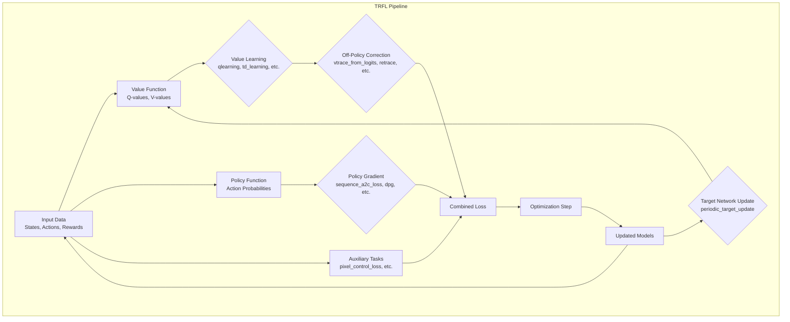

<!-- source: DeepWiki mcp.deepwiki.com · repo google-deepmind/trfl · page 1 Overview · fetched 2026-10-26 -->

# Overview

<details>
<summary>Relevant source files</summary>

The following files were used as context for generating this wiki page:

- [CONTRIBUTING.md](CONTRIBUTING.md)
- [README.md](README.md)
- [docs/index.md](docs/index.md)
- [docs/multistep_forward_view.md](docs/multistep_forward_view.md)
- [docs/trfl.md](docs/trfl.md)
- [setup.py](setup.py)
- [trfl/__init__.py](trfl/__init__.py)

</details>


TRFL (pronounced "truffle") is a library built on top of TensorFlow that provides essential building blocks for implementing Reinforcement Learning (RL) algorithms. Rather than implementing complete RL algorithms, TRFL focuses on supplying the fundamental mathematical operations needed to construct custom RL agents.

This page introduces the TRFL library, explains its purpose, and outlines its organization. For installation instructions, see [Installation and Getting Started](#1.1). For more details about reinforcement learning terminology and concepts used throughout the library, see [Core Concepts](#1.2).

## Purpose and Scope

TRFL formulates common RL update rules as differentiable loss functions that can be composed with neural networks within TensorFlow. The library provides implementations for:

- Value-based learning methods (Q-learning, TD learning, SARSA)
- Policy-based learning methods (Policy gradients, Actor-Critic)
- Distributional RL algorithms
- Off-policy correction methods (V-trace, Retrace)
- Auxiliary RL tasks (like pixel control)
- Utility operations for RL (target network updates, batched indexing, etc.)

These components are designed to be:
- **Modular** - Each operation focuses on one specific RL computation
- **Composable** - Components can be combined to implement complex algorithms
- **Differentiable** - All operations work within TensorFlow's automatic differentiation

TRFL is not a full RL framework - it doesn't handle environment interactions, replay buffers, or neural network architecture design. Instead, it provides the mathematical core of RL algorithms as pure TensorFlow operations.

Sources: [setup.py:35-38](), [docs/index.md:3-26](), [README.md:3-5]()

## Library Architecture

```mermaid
graph TD
    subgraph "TRFL Library"
        ValueLearning["Value-Based Learning"]
        PolicyLearning["Policy-Based Learning"]
        OffPolicy["Off-Policy Algorithms"]
        DistRL["Distributional RL"]
        Auxiliary["Auxiliary Tasks"]
        Utilities["Utility Operations"]
    end

    ValueLearning --> QL["Q-Learning Family"]
    ValueLearning --> TDL["TD Learning"]
    ValueLearning --> SARSA["SARSA Family"]

    PolicyLearning --> PG["Policy Gradients"]
    PolicyLearning --> A2C["Advantage Actor-Critic"]
    PolicyLearning --> DPG["Deterministic Policy Gradient"]

    OffPolicy --> VTrace["V-trace"]
    OffPolicy --> Retrace["Retrace"]

    DistRL --> CategoricalDist["Categorical Distributions"]
    
    Auxiliary --> PixelControl["Pixel Control"]
    Auxiliary --> TargetNets["Target Network Updates"]

    Utilities --> Periodic["Periodic Operations"]
    Utilities --> Sequence["Sequence Operations"]
    Utilities --> Policy["Policy Operations"]
    Utilities --> Indexing["Indexing Operations"]
```



Sources: [docs/index.md:126-182](), [trfl/__init__.py:17-58]()

## Core Components

TRFL organizes its functionality into several key modules, each focusing on a specific aspect of reinforcement learning:

### Value-Based Learning

Value-based methods estimate the value of states or state-action pairs. TRFL provides implementations for:

- **Q-Learning Family**: Standard Q-learning (`qlearning`), Double Q-learning (`double_qlearning`), and Persistent Q-learning (`persistent_qlearning`)
- **TD Learning**: Temporal difference learning (`td_learning`), TD(λ) (`td_lambda`)
- **SARSA Family**: SARSA (`sarsa`), SARSA(λ) (`sarsa_lambda`), Expected SARSA (`sarse`)
- **Value Function Combinations**: QV-learning (`qv_learning`), QV-max (`qv_max`)

Sources: [trfl/__init__.py:17-24](), [docs/index.md:127-143]()

### Policy-Based Learning

Policy-based methods directly optimize policies rather than learning value functions. TRFL provides:

- **Policy Gradients**: For continuous (`policy_gradient`, `policy_gradient_loss`) and discrete action spaces (`discrete_policy_gradient`, `discrete_policy_gradient_loss`)
- **Actor-Critic Methods**: Advantage Actor-Critic implementation (`sequence_advantage_actor_critic_loss`, `sequence_a2c_loss`)
- **Deterministic Policy Gradient**: DPG implementation (`dpg`)
- **Entropy Regularization**: Policy entropy losses for exploration (`policy_entropy_loss`, `discrete_policy_entropy_loss`)

Sources: [trfl/__init__.py:30-33](), [trfl/__init__.py:37](), [trfl/__init__.py:42-45](), [docs/index.md:150-167]()

### Off-Policy Learning

Off-policy methods allow learning from data generated by a different policy than the one being optimized. TRFL includes:

- **V-trace**: Implementation of V-trace algorithm (`vtrace_from_logits`, `vtrace_from_importance_weights`)
- **Retrace**: Implementation of Retrace algorithm (`retrace`, `retrace_core`)

Sources: [trfl/__init__.py:47-48](), [trfl/__init__.py:57-58](), [docs/index.md:174-187]()

### Distributional RL

Distributional RL methods learn distributions over returns rather than expected values. TRFL provides:

- **Categorical Distributions**: Categorical distributional Q-learning (`categorical_dist_qlearning`), Categorical distributional double Q-learning (`categorical_dist_double_qlearning`), and Categorical distributional TD learning (`categorical_dist_td_learning`)

Sources: [trfl/__init__.py:34-36](), [docs/index.md:144-148]()

### Auxiliary Tasks

Auxiliary tasks can help with representation learning and policy improvement. TRFL includes:

- **Pixel Control**: Functions for computing pixel control rewards (`pixel_control_rewards`) and losses (`pixel_control_loss`)
- **Target Network Updates**: Utilities for updating target networks (`update_target_variables`, `periodic_target_update`)

Sources: [trfl/__init__.py:40-41](), [trfl/__init__.py:51-52](), [docs/index.md:169-182]()

### Utility Operations

TRFL provides various utility operations to support RL algorithm implementation:

- **Periodic Operations**: Functions for periodic execution of operations (`periodically`)
- **Sequence Operations**: Functions for working with sequences like trajectories (`multistep_forward_view`, `scan_discounted_sum`)
- **Policy Operations**: Functions for policy operations like epsilon-greedy exploration (`epsilon_greedy`)
- **Indexing Operations**: Functions for indexing tensors (`batched_index`)
- **Clipping Operations**: Functions like Huber loss (`huber_loss`)

Sources: [trfl/__init__.py:27](), [trfl/__init__.py:38-39](), [trfl/__init__.py:46](), [trfl/__init__.py:49-50](), [docs/index.md:189-215]()

## Data Flow in Reinforcement Learning Pipeline



Sources: [docs/index.md:3-26](), [docs/index.md:126-167]()

## Naming Conventions

TRFL follows specific naming conventions that make it easier to understand the relationship between different components:

- **Time indices and variable names**:
  - `q_tm1`: Action values at time t-1 (source state)
  - `a_tm1`: Action taken at time t-1
  - `r_t`: Rewards received at time t
  - `pcont_t`: Continuation probability/discount at time t
  - `q_t`: Action values at time t (destination state)

- **Tensor shapes**:
  - `B`: Batch dimension
  - `T`: Time/sequence dimension (for sequential data)
  - All losses have shape `[B]` (not reduced over the batch dimension)
  - Sequential data has shape `[T, B, ...]` (time-major)

Sources: [docs/index.md:102-124]()

## Basic Usage Pattern

All TRFL functions follow a consistent pattern where they return both a loss tensor and a namedtuple with additional information:

```python
# Compute loss for RL update
loss, extra_info = trfl.qlearning(q_tm1, a_tm1, r_t, pcont_t, q_t)

# Use loss in optimization
reduced_loss = tf.reduce_mean(loss)
optimizer = tf.train.AdamOptimizer(learning_rate=0.1)
train_op = optimizer.minimize(reduced_loss)

# Access additional information if needed
td_error = extra_info.td_error
target = extra_info.target
```

This consistent interface makes it easy to swap different RL algorithms while keeping the surrounding code unchanged.

Sources: [docs/index.md:37-98](), [README.md:18-48]()

## Implementation Details

TRFL functions typically implement the mathematical core of RL algorithms without making assumptions about the surrounding infrastructure. The library follows these key design principles:

1. **Pure TensorFlow Operations**: All components are implemented as TensorFlow operations, enabling them to be part of a larger computational graph.

2. **Building Block Approach**: Rather than implementing complete algorithms, TRFL provides the core mathematical operations that can be composed to create custom algorithms.

3. **Support for Multiple RL Paradigms**: The library supports value-based methods, policy gradient methods, distributional learning, and off-policy learning.

4. **Modularity**: Each component is specialized and can be combined with others to implement various RL algorithms.

Sources: [docs/index.md:7-26](), [setup.py:35-38]()

---

