<!-- source: DeepWiki mcp.deepwiki.com · repo google-deepmind/trfl · page 1.1 Installation and Getting Started · fetched 2026-10-26 -->

# Installation and Getting Started

<details>
<summary>Relevant source files</summary>

The following files were used as context for generating this wiki page:

- [CONTRIBUTING.md](CONTRIBUTING.md)
- [README.md](README.md)
- [setup.py](setup.py)
- [trfl/__init__.py](trfl/__init__.py)

</details>


This page guides you through installing the TRFL (TensorFlow Reinforcement Learning) library and demonstrates its basic usage. For an introduction to the core reinforcement learning concepts used in TRFL, see [Core Concepts](#1.2). For detailed information about specific algorithms, refer to the respective algorithm pages under [Value-Based Learning](#2) and [Policy-Based Learning](#3).

## Installation

TRFL can be installed using pip, the Python package manager. The library is designed to work with both CPU and GPU versions of TensorFlow.

### Basic Installation

To install TRFL, run the following command:

```bash
pip install trfl
```

### Dependencies

TRFL has the following dependencies, as specified in the setup file:

- six
- absl-py
- numpy
- wrapt
- dm-tree

**Important**: TRFL does not list TensorFlow as a direct requirement to allow flexibility between CPU and GPU versions. You need to install TensorFlow and TensorFlow Probability separately:

```bash
# For CPU version
pip install tensorflow>=1.15 tensorflow-probability>=0.8

# For GPU version
pip install tensorflow-gpu>=1.15 tensorflow-probability>=0.8
```

Sources: [setup.py:24-32](), [README.md:9-14]()

## TRFL Architecture Overview

The diagram below illustrates how TRFL fits into a typical reinforcement learning workflow:

```mermaid
flowchart TD
    subgraph "TRFL Library"
        ValueOps["Value-Based Operators
        (qlearning, td_learning, etc.)"]
        PolicyOps["Policy-Based Operators
        (policy_gradient, dpg, etc.)"]
        UtilityOps["Utility Operators
        (update_target_variables, etc.)"]
    end

    TF["TensorFlow"]
    Agent["RL Agent Implementation"]
    Training["Training Loop"]

    Agent --> TRFL Library
    TRFL Library --> TF
    Training --> Agent
```

Sources: [trfl/__init__.py:17-58]()

## Basic Usage Example

The following example demonstrates how to use TRFL to implement a Q-learning update:

```python
import tensorflow as tf
import trfl

# Q-values for the previous and next timesteps, shape [batch_size, num_actions]
q_tm1 = tf.get_variable(
    "q_tm1", initializer=[[1., 1., 0.], [1., 2., 0.]], dtype=tf.float32)
q_t = tf.get_variable(
    "q_t", initializer=[[0., 1., 0.], [1., 2., 0.]], dtype=tf.float32)

# Action indices, discounts and rewards, shape [batch_size]
a_tm1 = tf.constant([0, 1], dtype=tf.int32)
r_t = tf.constant([1, 1], dtype=tf.float32)
pcont_t = tf.constant([0, 1], dtype=tf.float32)  # the discount factor

# Q-learning loss, and auxiliary data
loss, q_learning = trfl.qlearning(q_tm1, a_tm1, r_t, pcont_t, q_t)

# Use the loss in an optimization step
reduced_loss = tf.reduce_mean(loss)
optimizer = tf.train.AdamOptimizer(learning_rate=0.1)
train_op = optimizer.minimize(reduced_loss)
```

In this example:
1. We define Q-values for the previous timestep (`q_tm1`) and current timestep (`q_t`)
2. We specify the actions taken (`a_tm1`), rewards received (`r_t`), and discount factors (`pcont_t`)
3. We compute the Q-learning loss using `trfl.qlearning`
4. We create an optimization operation to minimize the loss

Sources: [README.md:16-48]()

## Key Components of TRFL

TRFL exposes several building blocks for reinforcement learning, organized into functional categories:

```mermaid
graph TD
    TRFL["TRFL Library"] --> ValueLearning["Value-Based Learning"]
    TRFL --> PolicyLearning["Policy-Based Learning"]
    TRFL --> OffPolicy["Off-Policy Learning"]
    TRFL --> Auxiliary["Auxiliary Tasks"]
    TRFL --> Utility["Utility Operations"]

    ValueLearning --> QL["Q-Learning
    (qlearning, double_qlearning)"]
    ValueLearning --> TD["TD Learning
    (td_learning, td_lambda)"]
    ValueLearning --> SARSA["SARSA
    (sarsa, sarsa_lambda)"]
    ValueLearning --> Dist["Distributional RL
    (categorical_dist_qlearning)"]

    PolicyLearning --> PG["Policy Gradients
    (policy_gradient, discrete_policy_gradient)"]
    PolicyLearning --> AC["Actor-Critic
    (sequence_a2c_loss)"]
    PolicyLearning --> DPG["Deterministic Policy Gradient
    (dpg)"]

    OffPolicy --> VTrace["V-trace
    (vtrace_from_logits)"]
    OffPolicy --> Retrace["Retrace
    (retrace, retrace_core)"]

    Auxiliary --> PixelControl["Pixel Control
    (pixel_control_loss)"]

    Utility --> TargetUpdate["Target Network Updates
    (update_target_variables)"]
    Utility --> Indexing["Indexing Operations
    (batched_index)"]
    Utility --> Sequence["Sequence Operations
    (multistep_forward_view)"]
```



Sources: [trfl/__init__.py:17-58]()

## Function Return Format

All loss functions in TRFL follow a consistent return pattern:

1. A loss tensor (typically of shape `[batch_size]`)
2. A namedtuple with additional information specific to the algorithm

For example, the `qlearning` function returns:
- A loss tensor: half the squared difference between predicted Q-values and TD targets
- A namedtuple containing fields like `td_error` and `target`

This format makes it easy to either use just the loss for optimization or access additional information for debugging or further processing.

Sources: [README.md:37-53]()

## Next Steps

After getting familiar with the basic usage of TRFL, you can explore:

1. [Value-Based Learning](#2) for detailed information about Q-learning, TD learning, and SARSA implementations
2. [Policy-Based Learning](#3) to learn about policy gradients and actor-critic methods
3. [Off-Policy Learning Methods](#4) for advanced techniques like V-trace and Retrace
4. [Auxiliary Tasks and Features](#5) for additional functionality like pixel control
5. [Utility Operations](#6) for supporting functions like target network updates

## Compatibility

TRFL is compatible with:
- Python 3.4, 3.5, 3.6, and 3.7
- TensorFlow 1.15 and later versions
- TensorFlow Probability 0.8 and later versions

Sources: [setup.py:51-66](), [setup.py:25-32]()

---

