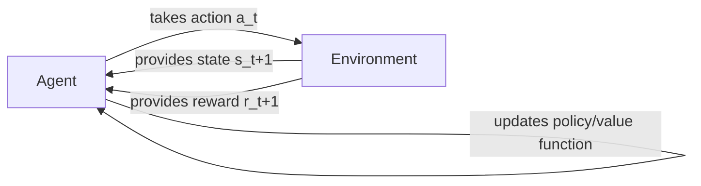
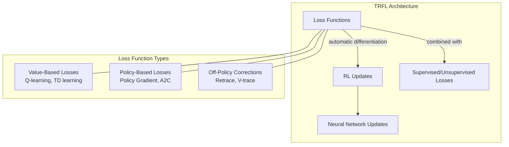
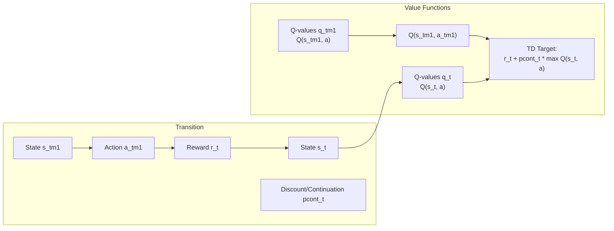
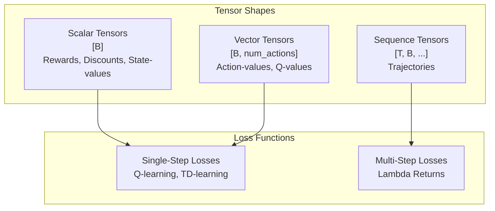
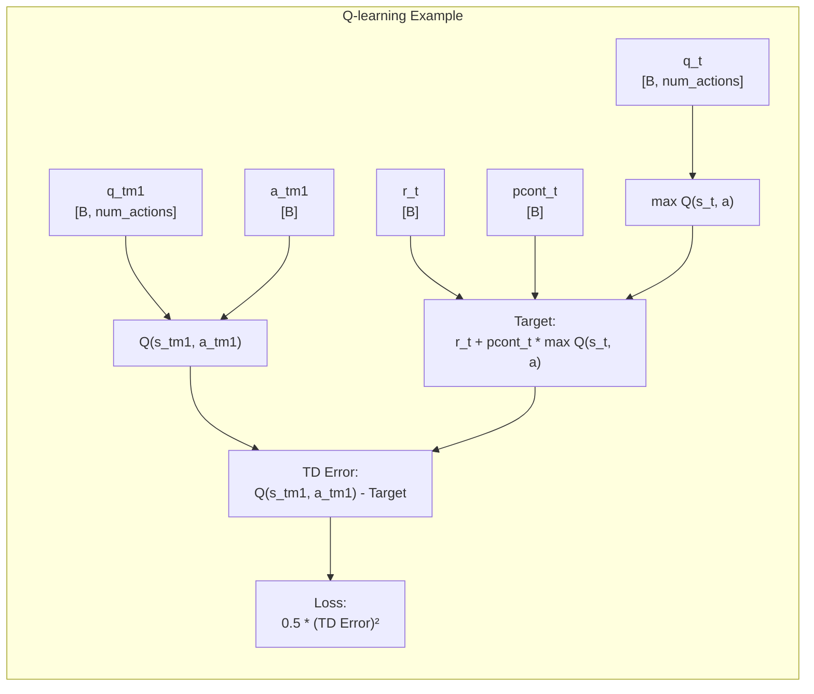

<!-- source: DeepWiki mcp.deepwiki.com · repo google-deepmind/trfl · page 1.2 Core Concepts · fetched 2026-10-26 -->

# Core Concepts

<details>
<summary>Relevant source files</summary>

The following files were used as context for generating this wiki page:

- [docs/index.md](docs/index.md)
- [docs/multistep_forward_view.md](docs/multistep_forward_view.md)
- [docs/trfl.md](docs/trfl.md)

</details>


This document explains the foundational reinforcement learning concepts and terminology used throughout the TRFL library. It covers the basic building blocks, abstractions, and conventions that underpin the library's implementation of reinforcement learning algorithms. For information about installation and getting started, see [Installation and Getting Started](#1.1).

## Reinforcement Learning Fundamentals

Reinforcement Learning (RL) is a paradigm where an agent learns to make decisions by interacting with an environment. The agent takes actions in an environment, which transitions to new states and provides rewards. The agent's goal is to learn a policy that maximizes cumulative rewards over time.



Sources: [docs/index.md:7-16]()

## TRFL's Approach to RL

TRFL implements reinforcement learning algorithms as differentiable loss functions in TensorFlow, rather than as explicit update rules. This approach provides several advantages:

1. **Modularity**: Loss functions can be easily combined with other losses (e.g., supervised or unsupervised).
2. **Automatic Differentiation**: Under TensorFlow's automatic differentiation, the original update rule is recovered.
3. **Composability**: Different components can be mixed and matched to create custom agents.

TRFL provides implementations of mathematical operations needed for RL, but does not enforce sampling constraints (e.g., whether data is on-policy or off-policy).



Sources: [docs/index.md:7-25]()

## Key Abstractions in TRFL

### Value Functions

TRFL supports two main types of value functions:

1. **State-Value Function (V-function)**: Estimates the expected return from a state, denoted as V(s).
2. **Action-Value Function (Q-function)**: Estimates the expected return from taking an action in a state, denoted as Q(s,a).

### Policies

Policies define the agent's behavior:

1. **Deterministic Policies**: Directly map states to actions.
2. **Stochastic Policies**: Output probability distributions over actions.

### Transitions

A transition represents a single interaction with the environment, containing:
- State at time t-1: s_tm1
- Action at time t-1: a_tm1
- Reward at time t: r_t
- Discount factor (or continuation probability) at time t: pcont_t
- Next state at time t: s_t



Sources: [docs/index.md:36-53](), [docs/index.md:102-110]()

## Naming Conventions and Tensor Shapes

### Time Indices and Variable Names

TRFL uses consistent naming conventions for variables at different time steps:

| Variable | Meaning |
|----------|---------|
| `q_tm1` | Action values in the source state |
| `a_tm1` | Action selected in the source state |
| `r_t` | Reward received in the destination state |
| `pcont_t` | Continuation probability/discount for the transition |
| `q_t` | Action values in the destination state |

### Tensor Shapes

TRFL operations support minibatches, with consistent tensor shape conventions:

| Tensor Type | Shape | Description |
|-------------|-------|-------------|
| Rewards, discounts | `[B]` | Batch of scalar values |
| State-values | `[B]` | Batch of scalar state values |
| Action-values | `[B, num_actions]` | Batch of vectors with values for each action |
| Losses | `[B]` | Per-example losses (not reduced) |
| Sequence data | `[T, B, ...]` | Time-major tensors (T=sequence length, B=batch size) |



Sources: [docs/index.md:102-124]()

## Core Algorithm Families

TRFL organizes reinforcement learning algorithms into several families:

### Value-Based Learning

Algorithms that learn value functions:

1. **TD Learning**: Learns state values V(s) using temporal difference updates.
2. **Q-Learning Family**: Learns action values Q(s,a) using various Q-learning variants.
3. **SARSA Family**: On-policy methods that use the actual next action for bootstrapping.
4. **Distributional RL**: Learns distributions over returns rather than expected values.

### Policy-Based Learning

Algorithms that directly optimize policies:

1. **Policy Gradients**: Updates policy parameters to maximize expected returns.
2. **Actor-Critic Methods**: Combines policy optimization with value function learning.
3. **Deterministic Policy Gradient**: Specialized for continuous action spaces.

### Off-Policy Learning

Methods that correct for differences between behavior and target policies:

1. **V-trace**: Off-policy correction for value learning.
2. **Retrace**: Q-value off-policy correction method.

```mermaid
flowchart TD
    TRFL["TRFL Library"] --> ValueLearning["Value-Based Learning"]
    TRFL --> PolicyLearning["Policy-Based Learning"]
    TRFL --> OffPolicy["Off-Policy Algorithms"]
    TRFL --> Utilities["Utility Operations"]
    
    ValueLearning --> TD["TD Learning\ntd_learning()"]
    ValueLearning --> QL["Q-Learning\nqlearning(), double_qlearning()"]
    ValueLearning --> SARSA["SARSA\nsarsa(), sarsa_lambda()"]
    ValueLearning --> DistRL["Distributional RL\ncategorical_dist_qlearning()"]
    
    PolicyLearning --> PG["Policy Gradients\npolicy_gradient(), discrete_policy_gradient()"]
    PolicyLearning --> AC["Actor-Critic\nsequence_a2c_loss()"]
    PolicyLearning --> DPG["Deterministic Policy Gradient\ndpg()"]
    
    OffPolicy --> VTrace["V-trace\nvtrace_from_logits()"]
    OffPolicy --> Retrace["Retrace\nretrace(), retrace_core()"]
    
    Utilities --> Target["Target Network Updates\nupdate_target_variables()"]
    Utilities --> Sequence["Sequence Operations\nmultistep_forward_view()"]
    Utilities --> Policy["Policy Operations\nepsilon_greedy()"]
```



Sources: [docs/trfl.md:4-1372](), [docs/index.md:125-187]()

## Data Flow in TRFL Loss Functions

Most TRFL loss functions follow a common pattern:

1. Input tensors represent transitions or sequences of transitions.
2. Loss functions compute target values based on current estimates.
3. The difference between current estimates and targets forms the loss.
4. Loss values are returned along with extra information in a namedtuple.



Sources: [docs/index.md:54-88](), [docs/trfl.md:937-963]()

## Loss Function Return Structure

All TRFL loss functions return a tuple with two elements:
1. A tensor of losses with shape `[B]` (one loss per batch element)
2. A namedtuple with extra information specific to each algorithm

For example, the Q-learning loss function returns:
```
loss, q_learning = trfl.qlearning(q_tm1, a_tm1, r_t, pcont_t, q_t)
```

Where `q_learning` is a namedtuple with fields:
- `target`: The TD target values
- `td_error`: The temporal difference errors

This consistent return structure makes it easy to use different loss functions interchangeably.

Sources: [docs/index.md:71-88](), [docs/trfl.md:957-963]()

## Distribution Types in TRFL

TRFL supports both discrete and continuous action spaces through different distribution types:

### Discrete Actions
- Represented by logits or probabilities over a finite set of actions
- Examples: `discrete_policy_gradient()`, `categorical_dist_qlearning()`

### Continuous Actions
- Represented by probability distributions (often Gaussian)
- Examples: `policy_gradient()`, `dpg()`

### Distributional RL
- Represents value functions as distributions over returns
- Uses categorical distributions with fixed support
- Examples: `categorical_dist_qlearning()`, `categorical_dist_td_learning()`

Sources: [docs/trfl.md:134-205](), [docs/trfl.md:827-859]()

## Combining Loss Functions

A key advantage of TRFL's approach is the ability to combine multiple loss functions. For example:

1. **Actor-Critic Methods**: Combine policy gradient loss with value function loss
2. **Auxiliary Tasks**: Add pixel control or other auxiliary losses
3. **Regularization**: Add entropy regularization to policy losses

The losses can be combined by simple addition, possibly with scaling coefficients:

```python
total_loss = (policy_loss + baseline_cost * value_loss - 
             entropy_cost * entropy_loss)
```

This modular design allows researchers to easily experiment with different combinations of learning objectives.

Sources: [docs/index.md:7-25](), [docs/trfl.md:1341-1362]()

---

