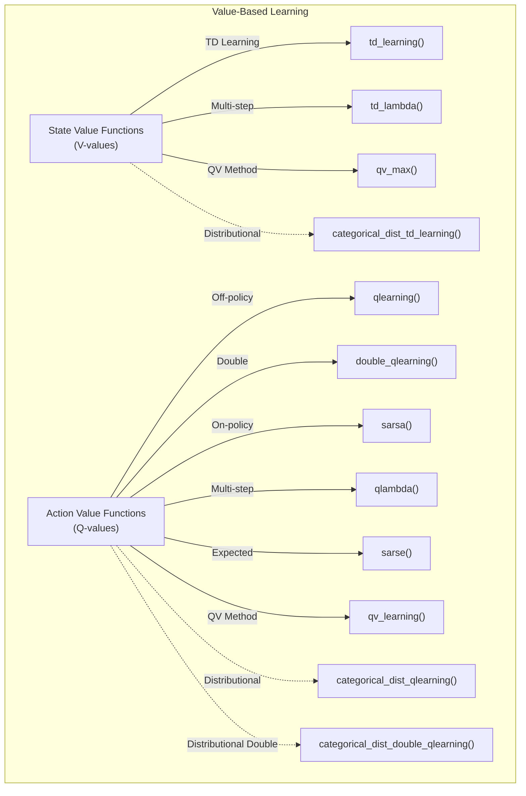
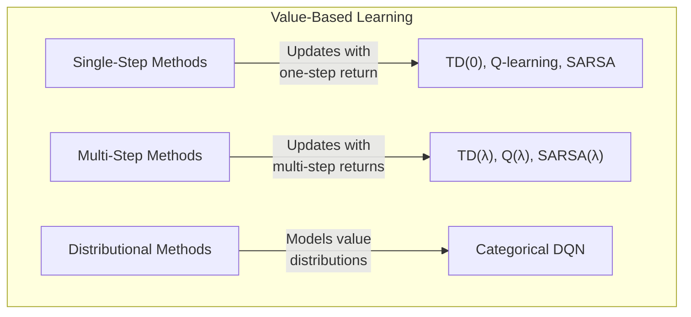
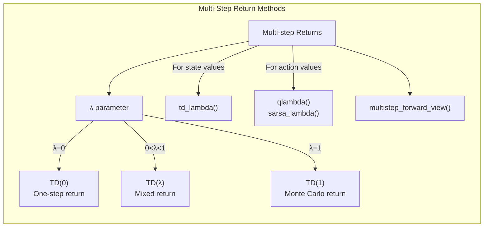
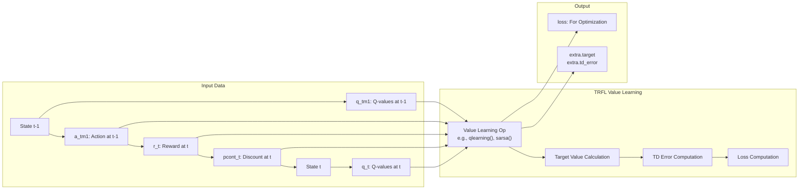
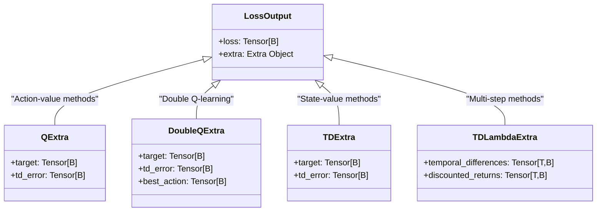

<!-- source: DeepWiki mcp.deepwiki.com · repo google-deepmind/trfl · page 2 Value-Based Learning · fetched 2026-10-26 -->

# Value-Based Learning

<details>
<summary>Relevant source files</summary>

The following files were used as context for generating this wiki page:

- [docs/multistep_forward_view.md](docs/multistep_forward_view.md)
- [docs/trfl.md](docs/trfl.md)
- [trfl/action_value_ops.py](trfl/action_value_ops.py)
- [trfl/value_ops.py](trfl/value_ops.py)

</details>


This document covers value-based reinforcement learning methods implemented in the TRFL library. Value-based methods learn to estimate the expected future return (value) of states or state-action pairs, and use these estimates to derive optimal policies. For policy-based learning approaches, see [Policy-Based Learning](#3), and for off-policy correction techniques, see [Off-Policy Learning Methods](#4).

## Core Concepts

Value-based reinforcement learning centers around estimating the value of states or state-action pairs. Two key value function types are supported in TRFL:

1. **State-value functions (V-values)**: Estimate the expected return from being in a particular state
2. **Action-value functions (Q-values)**: Estimate the expected return from taking a specific action in a specific state

TRFL provides implementations of various algorithms that learn these value functions through temporal difference (TD) learning, bootstrapping, and function approximation.



Sources: [trfl/action_value_ops.py:41-472](), [trfl/value_ops.py:34-264](), [docs/trfl.md:73-171]()

## Value Function Learning Types

TRFL supports three primary categories of value-based learning methods:



Sources: [docs/trfl.md:73-205]()

## Single-Step Methods

Single-step methods update value estimates using only immediate rewards and bootstrapped values from the next state.

### Q-Learning

Q-learning is an off-policy algorithm that learns the optimal action-value function regardless of the policy being followed. It updates Q-values using the maximum Q-value in the next state:

```
target = r_t + pcont_t * max(q_t)
loss = 0.5 * (target - q_tm1[a_tm1])²
```

Implementation: [trfl/action_value_ops.py:40-84]()

### Double Q-Learning

Double Q-learning reduces overestimation bias by using two separate value functions: one to select the best action and another to evaluate it:

```
best_action = argmax(q_t_selector)
target = r_t + pcont_t * q_t_value[best_action]
loss = 0.5 * (target - q_tm1[a_tm1])²
```

Implementation: [trfl/action_value_ops.py:87-138]()

### Persistent Q-Learning

Persistent Q-learning modifies the target calculation to increase the action gap (the value difference between optimal and suboptimal actions):

```
target = r_t + pcont_t * ((1-action_gap_scale) * max(q_t) + action_gap_scale * q_t[a_tm1])
loss = 0.5 * (target - q_tm1[a_tm1])²
```

Implementation: [trfl/action_value_ops.py:141-193]()

### SARSA

SARSA is an on-policy algorithm that uses the actual next action taken (rather than the greedy action) when computing the target:

```
target = r_t + pcont_t * q_t[a_t]
loss = 0.5 * (target - q_tm1[a_tm1])²
```

Implementation: [trfl/action_value_ops.py:196-240]()

### Expected SARSA (SARSE)

Expected SARSA computes the expected value over all possible next actions, weighted by their probability:

```
target = r_t + pcont_t * sum(probs_a_t[a] * q_t[a])
loss = 0.5 * (target - q_tm1[a_tm1])²
```

Implementation: [trfl/action_value_ops.py:243-304]()

### TD Learning

TD learning updates state-value estimates based on the observed reward and the next state's value:

```
target = r_t + pcont_t * v_t
loss = 0.5 * (target - v_tm1)²
```

Implementation: [trfl/value_ops.py:34-71]()

### QV Learning

QV learning combines state-value and action-value functions, where the Q-function is updated using V-values:

```
target = r_t + pcont_t * v_t
loss = 0.5 * (target - q_tm1[a_tm1])²
```

Implementation: [trfl/action_value_ops.py:426-471]()

### QV-Max

QV-Max is the complementary algorithm to QV Learning, where the V-function is updated using max Q-values:

```
target = r_t + pcont_t * max(q_t)
loss = 0.5 * (target - v_tm1)²
```

Implementation: [trfl/value_ops.py:224-263]()

Sources: [trfl/action_value_ops.py:40-304](), [trfl/value_ops.py:34-71](), [trfl/action_value_ops.py:426-471](), [trfl/value_ops.py:224-263]()

## Multi-Step Methods

Multi-step methods use information from multiple future time steps to improve learning efficiency and stability.

### Q(λ) and SARSA(λ)

Q(λ) and SARSA(λ) combine immediate rewards with future rewards through eligibility traces:



Implementation for Q(λ): [trfl/action_value_ops.py:307-367]()
Implementation for SARSA(λ): [trfl/action_value_ops.py:370-423]()

### TD(λ)

TD(λ) applies the multi-step learning concept to state-value functions, blending between one-step TD and Monte Carlo returns:

```
discounted_returns = generalized_lambda_returns(rewards, pcontinues, state_values, bootstrap_value, lambda_)
loss = 0.5 * sum((discounted_returns - state_values)²)
```

Implementation: [trfl/value_ops.py:159-221]()

### Generalized Lambda Returns

The generalized lambda returns mechanism is a core component for implementing multi-step methods:

```
For λ=1: scan_discounted_sum(rewards, pcontinues, bootstrap_value)
For λ<1: multistep_forward_view(rewards, pcontinues, next_values, lambda_)
```

Implementation: [trfl/value_ops.py:74-156](), [docs/multistep_forward_view.md:1-63]()

Sources: [trfl/action_value_ops.py:307-423](), [trfl/value_ops.py:74-221](), [docs/multistep_forward_view.md:1-63]()

## Distributional Methods

Distributional reinforcement learning methods model the distribution of returns rather than just their expected value.

### Categorical Distributional Q-Learning

Categorical DQN represents the value distribution with a discrete set of atoms (categories):

```
target_distribution = project_distribution(r_t + pcont_t * argmax_action(mean(q_t)) distribution)
loss = cross_entropy(target_distribution, q_tm1[a_tm1])
```

Implementation reference: [docs/trfl.md:73-171]()

### Categorical Distributional Double Q-Learning

Similar to standard Double Q-learning, this uses separate networks for action selection and evaluation, but with distributional representations:

```
best_action = argmax(q_t_selector)
target_distribution = project_distribution(r_t + pcont_t * q_t_value[best_action] distribution)
loss = cross_entropy(target_distribution, q_tm1[a_tm1])
```

Implementation reference: [docs/trfl.md:87-131]()

Sources: [docs/trfl.md:73-171](), [docs/trfl.md:87-131](), [docs/trfl.md:173-209]()

## Data Flow in Value-Based Learning

The following diagram illustrates the typical data flow when using TRFL's value-based learning operations:



Sources: [trfl/action_value_ops.py:41-84](), [trfl/value_ops.py:34-71]()

## Implementation Architecture

TRFL's value-based learning operations follow a consistent structure and return format:



All value-based learning functions return a `LossOutput` namedtuple containing:
- `loss`: A tensor of loss values (typically shape `[B]` for batch size B)
- `extra`: A namedtuple containing algorithm-specific information (targets, TD errors, etc.)

Sources: [trfl/action_value_ops.py:34-38](), [trfl/value_ops.py:29-31]()

## Usage Example

Here's a conceptual example of how to use TRFL's value-based learning operations in a reinforcement learning agent:

1. Define your Q-network and target network
2. Get Q-values from your networks for states/actions in a batch of transitions
3. Use TRFL's operations to compute the loss
4. Optimize your Q-network using the loss
5. Periodically update your target network

```python
# Compute Q-values for current and next states
q_tm1 = q_network(states)
q_t = target_network(next_states)

# Compute loss using TRFL's qlearning operation
loss_output = trfl.qlearning(q_tm1, actions, rewards, discounts, q_t)

# Use the loss for optimization
optimizer.minimize(loss_output.loss)

# Periodically update target network
target_update_op = trfl.periodic_target_update(
    target_variables=target_network.variables,
    source_variables=q_network.variables,
    update_period=1000)
```

Sources: [docs/trfl.md:40-66](), [docs/trfl.md:590-618]()

## Relationship to Other Components

Value-based learning methods in TRFL are often used in conjunction with other components:

- **Target Network Updates**: [Target Network Updates](#5.2) are commonly used with value-based methods to improve stability
- **Exploration Strategies**: [Policy Operations](#6.4) like `epsilon_greedy` are used for exploration in value-based methods
- **Off-Policy Corrections**: [Off-Policy Learning Methods](#4) can be combined with value-based methods for learning from offline data
- **Auxiliary Tasks**: [Auxiliary Tasks](#5) like Pixel Control can provide additional learning signals

Sources: [docs/trfl.md:590-618](), [docs/trfl.md:404-435]()

---

