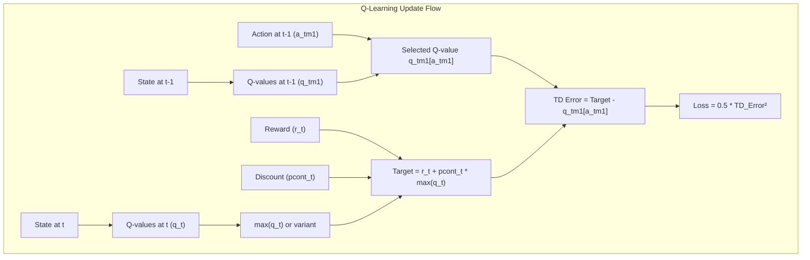
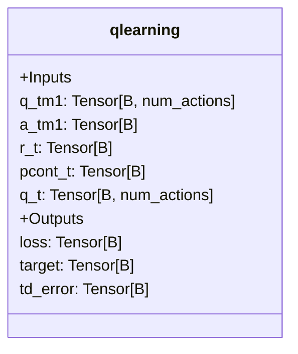
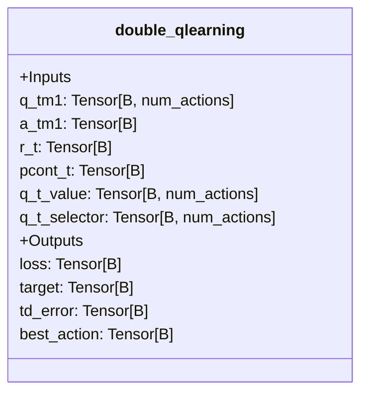
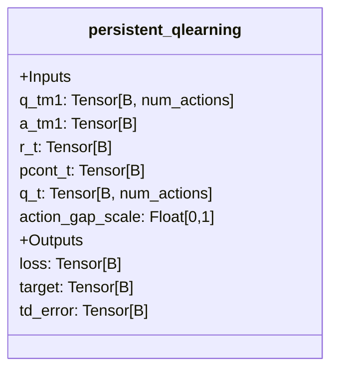
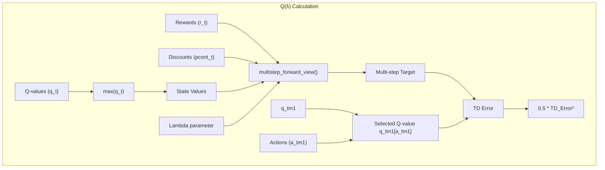
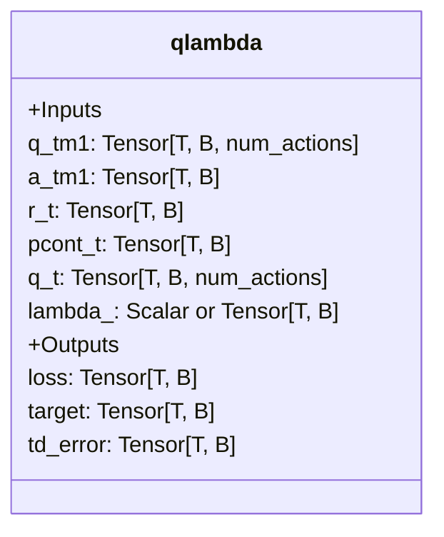

<!-- source: DeepWiki mcp.deepwiki.com · repo google-deepmind/trfl · page 2.1 Q-Learning Family · fetched 2026-10-26 -->

# Q-Learning Family

<details>
<summary>Relevant source files</summary>

The following files were used as context for generating this wiki page:

- [docs/multistep_forward_view.md](docs/multistep_forward_view.md)
- [docs/trfl.md](docs/trfl.md)
- [trfl/action_value_ops.py](trfl/action_value_ops.py)

</details>


## Purpose and Scope

This document describes the Q-Learning family of reinforcement learning algorithms implemented in TRFL. These algorithms are value-based methods that learn to approximate the optimal action-value function (Q-function) through temporal difference learning. The scope includes standard Q-Learning, Double Q-Learning, Persistent Q-Learning, and Q(λ) variants. For information about distributional variants of Q-Learning, see [Distributional RL](#2.4). For other value-based methods like TD-Learning and SARSA, see [TD Learning](#2.2) and [SARSA Family](#2.3) respectively.

Sources: [docs/trfl.md:934-963](), [trfl/action_value_ops.py:15-21]()

## Core Principles of the Q-Learning Family

Q-Learning algorithms aim to learn an action-value function Q(s,a) that estimates the expected return when taking action 'a' in state 's' and following the optimal policy thereafter. The key characteristic of Q-Learning is that it's an off-policy algorithm, learning about the optimal policy regardless of the actions actually taken.

All Q-Learning variants in TRFL use a similar interface pattern:
- Inputs include current Q-values, actions, rewards, and continuation values
- Each function returns a loss and additional information for debugging
- Loss is scaled by 0.5 so that the gradient equals the TD error



Sources: [trfl/action_value_ops.py:41-84]()

## Standard Q-Learning

The standard Q-Learning algorithm updates the action-value function using the Bellman optimality equation. The TRFL implementation is provided through the `qlearning` function.

### Algorithm

For a transition (state, action, reward, next_state):
1. Compute the target value: `r_t + pcont_t * max(q_t)`
2. Compute the TD error: `target - q_tm1[a_tm1]`
3. Compute the loss: `0.5 * td_error²`

### Implementation



The implementation computes the target values by taking the maximum Q-value for the next state across all possible actions. This means standard Q-learning can directly approximate the optimal policy without needing to follow it during training.

Key implementation details:
- Input tensors use batch dimension `B` for efficiency
- Gradient of the loss equals the TD error
- Return value is a namedtuple with `loss` and `extra` fields

Sources: [trfl/action_value_ops.py:41-84]()

## Double Q-Learning

Double Q-Learning addresses the overestimation bias problem in standard Q-Learning. The bias occurs because taking the maximum of estimated values tends to overestimate the true maximum, especially when estimates have noise.

### Algorithm

The key modification in Double Q-Learning is separating action selection from action evaluation:
1. Use one set of Q-values (`q_t_selector`) to select the best action
2. Use another set of Q-values (`q_t_value`) to evaluate that action
3. Compute target: `r_t + pcont_t * q_t_value[argmax(q_t_selector)]`

### Implementation



In practice, `q_t_selector` often comes from the online network, while `q_t_value` comes from a target network, creating a decoupling that helps reduce overestimation.

Sources: [trfl/action_value_ops.py:88-138](), [docs/trfl.md:331-365]()

## Persistent Q-Learning

Persistent Q-Learning aims to increase the "action gap" (the difference between the value of the optimal action and the values of suboptimal actions) to make value functions more robust.

### Algorithm

The persistent Q-learning target modifies the bootstrapping term:
1. Compute a weighted average between the max Q-value and the Q-value of the selected action
2. Target: `r_t + pcont_t * [(1-action_gap_scale) * max(q_t) + action_gap_scale * q_t[a_tm1]]`
3. The `action_gap_scale` parameter controls the trade-off (typically set to 0.5)

### Implementation



By incorporating the Q-value of the selected action in the target, persistent Q-learning increases the gap between good and bad actions, potentially leading to more robust policies.

Sources: [trfl/action_value_ops.py:142-193](), [docs/trfl.md:660-693]()

## Q(λ) Methods

Q(λ) algorithms combine one-step temporal difference learning with multi-step returns, providing a middle ground between TD learning and Monte Carlo methods. The TRFL implementation supports both Peng's and Watkins' Q(λ) variants.

### Algorithm

Q(λ) computes a mixture of n-step returns using the λ parameter:
1. Apply the `multistep_forward_view` operation to compute mixed returns
2. Target is computed using rewards and state values over multiple time steps
3. The λ parameter controls the balance between TD learning and Monte Carlo returns



### Implementation



The implementation provides flexibility in setting λ:
- For Peng's Q(λ): use a constant λ for all time steps
- For Watkins' Q(λ): set λ=0 for suboptimal actions and a constant for optimal actions
- General case: provide a tensor of λ values, potentially different for each state

Sources: [trfl/action_value_ops.py:308-367](), [docs/trfl.md:894-932](), [docs/multistep_forward_view.md:1-63]()

## Usage Patterns

All Q-Learning functions in TRFL follow a consistent pattern:

```python
# Create Q-learning loss
loss_output = trfl.qlearning(q_tm1, a_tm1, r_t, pcont_t, q_t)

# Extract actual loss for optimization
q_learning_loss = loss_output.loss

# Optionally, extract additional values for logging or analysis
target = loss_output.extra.target
td_error = loss_output.extra.td_error

# Use with optimizer
optimizer = tf.train.AdamOptimizer(learning_rate=0.001)
train_op = optimizer.minimize(tf.reduce_mean(q_learning_loss))
```

Key considerations when using these functions:
- Q-Learning methods are off-policy and work with any data collection strategy
- Double Q-Learning requires two networks (online and target)
- Q(λ) requires sequence data rather than single transitions
- All methods benefit from experience replay

Sources: [trfl/action_value_ops.py:34-38](), [docs/trfl.md:934-963]()

## Comparing Q-Learning Variants

| Variant | Key Feature | Best Used When | Implementation |
|---------|-------------|----------------|---------------|
| Standard Q-Learning | Simple, proven approach | Learning from scratch in stable environments | `qlearning` |
| Double Q-Learning | Reduces overestimation bias | Unstable environments or high-variance rewards | `double_qlearning` |
| Persistent Q-Learning | Increases action gap | Fine-tuning policies or when requiring robust decisions | `persistent_qlearning` |
| Q(λ) | Balances TD and MC learning | Learning from sequences of data or when requiring credit assignment over time | `qlambda` |

All Q-Learning variants can be combined with experience replay, target networks, and various exploration strategies to improve performance.

Sources: [trfl/action_value_ops.py:41-472](), [docs/trfl.md:331-470]()

---

