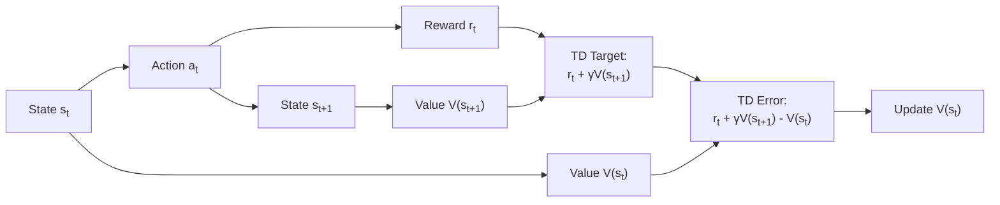
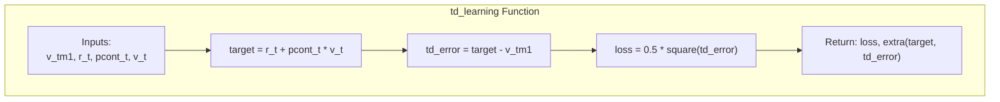
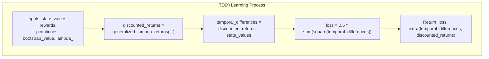
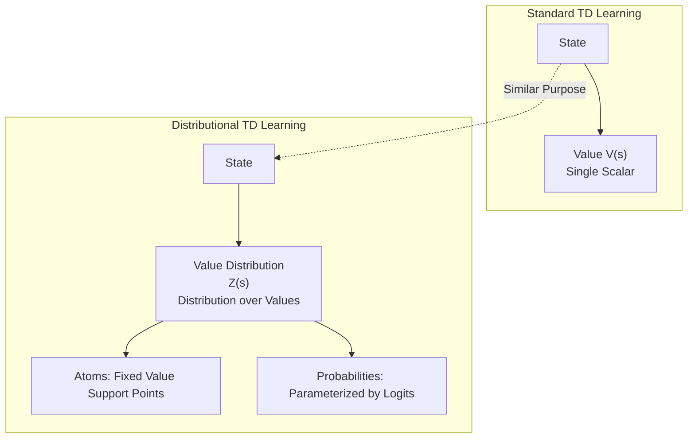
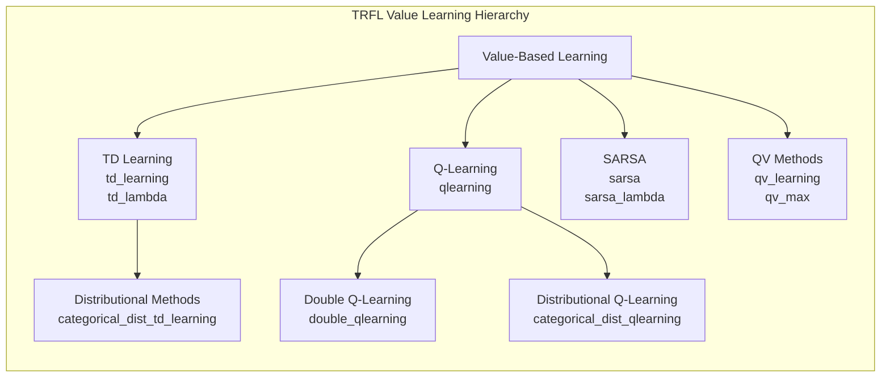

<!-- source: DeepWiki mcp.deepwiki.com · repo google-deepmind/trfl · page 2.2 TD Learning · fetched 2026-10-26 -->

# TD Learning

Relevant source files

The following files were used as context for generating this wiki page:

- [docs/multistep_forward_view.md](docs/multistep_forward_view.md)
- [docs/trfl.md](docs/trfl.md)
- [trfl/value_ops.py](trfl/value_ops.py)

This document details the Temporal Difference (TD) learning components in the TRFL library. TD learning is a foundational technique in reinforcement learning where value functions are updated based on the difference between temporally successive predictions. TRFL provides implementations of both basic TD(0) and more advanced TD(λ) learning, along with distributional variants. For related Q-learning techniques, see [Q-Learning Family](#2.1).

## Overview of TD Learning

Temporal Difference learning is a method for estimating value functions in reinforcement learning. TD learning combines elements of Monte Carlo and dynamic programming methods by using bootstrapped estimates of future returns to update value functions. The key concept is the TD error - the difference between the estimated value of a state and the "target" value determined by the reward and the estimated value of the next state.

Sources: [trfl/value_ops.py:34-71]()

## Basic TD(0) Implementation

TRFL implements the classic TD(0) learning algorithm through the `td_learning` function. This function computes the loss as half the squared difference between the previous state's value estimate and the TD target.

The function takes the following parameters:
- `v_tm1`: Value estimates at previous timestep, shape `[B]`
- `r_t`: Rewards, shape `[B]`
- `pcont_t`: Continuation probabilities (discount factors), shape `[B]`
- `v_t`: Value estimates at current timestep, shape `[B]`

And returns a namedtuple with:
- `loss`: The batch of losses, shape `[B]`
- `extra`: Additional information including target values and TD errors

Sources: [trfl/value_ops.py:34-71]()

## TD(λ) and Generalized Lambda Returns

TRFL provides the `td_lambda` function for implementing TD(λ) learning, which utilizes the `generalized_lambda_returns` function for computing multi-step returns. TD(λ) generalizes TD learning by blending between one-step TD updates and full Monte Carlo returns using the λ parameter.

### Generalized Lambda Returns

The `generalized_lambda_returns` function computes a mixture of returns with different lookahead horizons, weighted by the lambda parameter:

- For λ=0: Returns one-step TD(0) targets
- For λ=1: Returns full Monte Carlo returns (or bootstrapped returns if using incomplete episodes)
- For values between 0 and 1: Returns a weighted mixture of different n-step returns

The implementation uses a recursive backward view computation to efficiently calculate these returns.

| Lambda Value | Type of Return | Characteristic |
|--------------|----------------|----------------|
| 0 | TD(0) | Uses only immediate reward and next state value |
| 0.5 | Intermediate | Balanced between TD(0) and Monte Carlo |
| 1 | Monte Carlo | Uses full episode rewards with no bootstrapping |

Sources: [trfl/value_ops.py:74-156](), [trfl/value_ops.py:159-221](), [docs/multistep_forward_view.md:1-63]()

## Distributional TD Learning

TRFL also supports distributional TD learning through the `categorical_dist_td_learning` function. Instead of learning a single expected value for each state, distributional TD learning estimates a probability distribution over possible returns.

The `categorical_dist_td_learning` function:
- Takes discrete support points (atoms) and logits that parameterize categorical distributions
- Projects the expected next-state distribution through the Bellman operator
- Computes a loss that minimizes the distance between distributions

Sources: [docs/trfl.md:173-210]()

## Relationship with Other Value Learning Functions

TD learning methods in TRFL integrate with other value-based methods. For example, the `qv_max` function implements a value learning update using the maximum Q-value from a separately learned Q-function.

The TD learning components form a foundational part of TRFL's reinforcement learning tools, which can be used in various architectures including:

- Value function approximation in actor-critic methods
- Baseline value prediction in advantage-based policy gradient methods
- State value prediction in model-based reinforcement learning

Sources: [docs/trfl.md:173-210](), [trfl/value_ops.py:224-263]()

## Usage Example

TD learning is typically used to update a value function approximator (like a neural network) by minimizing the TD loss. The basic pattern involves:

1. Computing state values for states at times t-1 and t
2. Observing rewards and continuation probabilities
3. Computing the TD loss using `td_learning`
4. Optimizing the value function parameters by minimizing this loss

This works within the broader reinforcement learning loop where new experiences are continuously collected and used for updates.

Sources: [trfl/value_ops.py:34-71]()

---

