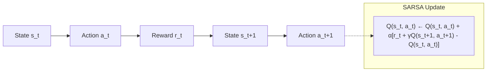
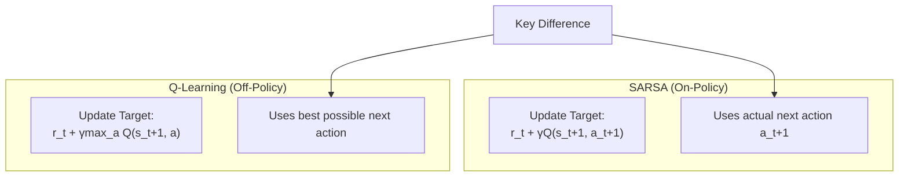
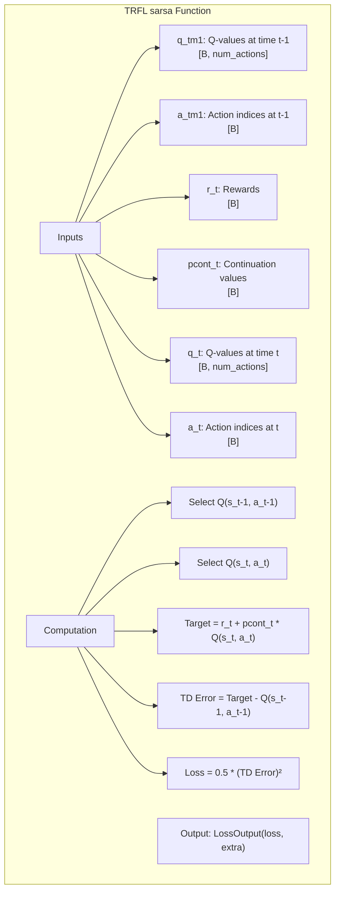
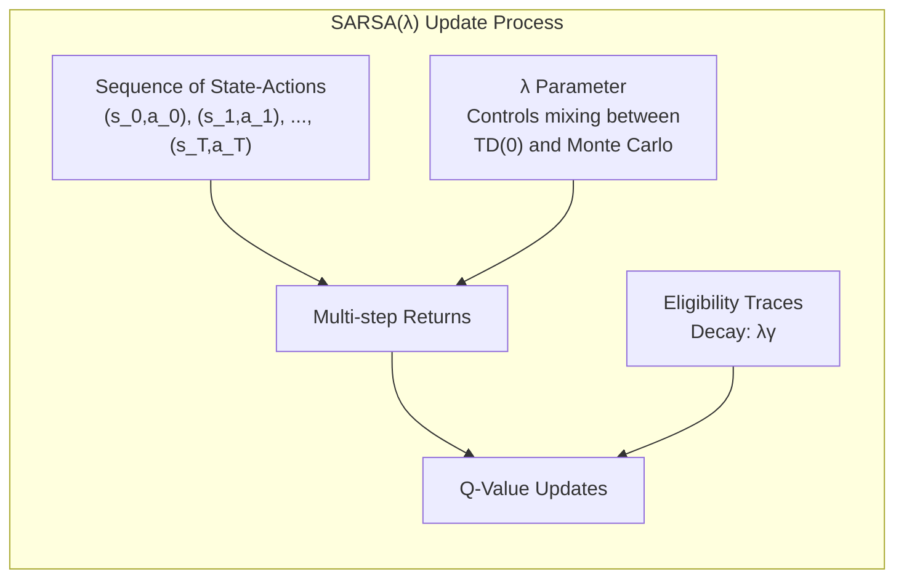
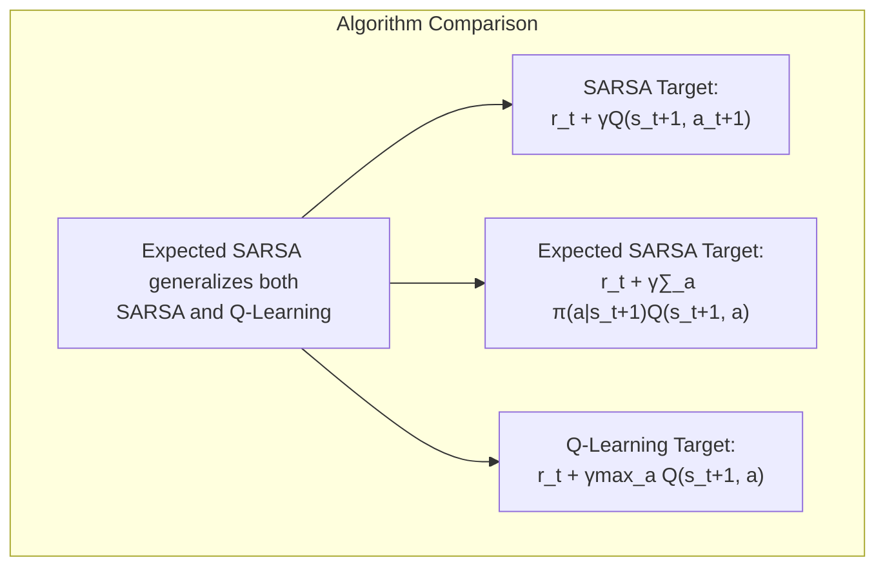
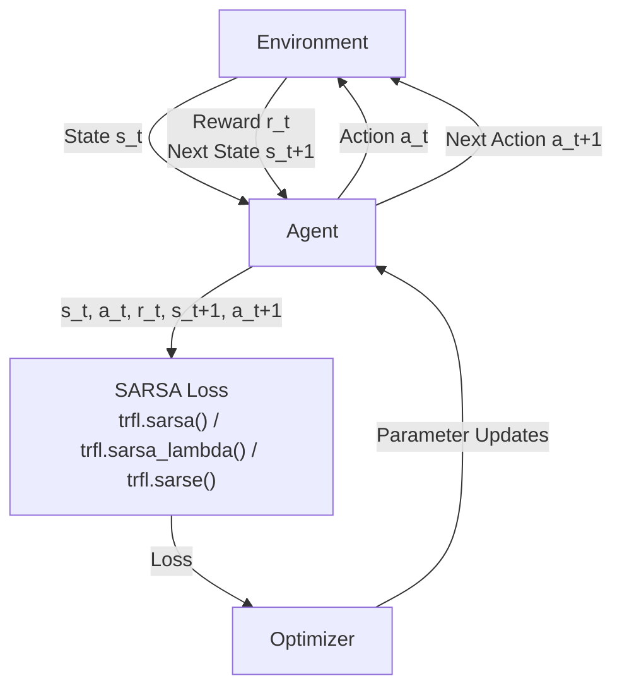
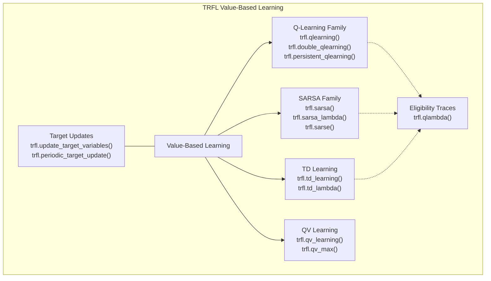

<!-- source: DeepWiki mcp.deepwiki.com · repo google-deepmind/trfl · page 2.3 SARSA Family · fetched 2026-10-26 -->

# SARSA Family

<details>
<summary>Relevant source files</summary>

The following files were used as context for generating this wiki page:

- [docs/multistep_forward_view.md](docs/multistep_forward_view.md)
- [docs/trfl.md](docs/trfl.md)
- [trfl/action_value_ops.py](trfl/action_value_ops.py)

</details>


This document covers the SARSA (State-Action-Reward-State-Action) family of reinforcement learning algorithms implemented in the TRFL library. SARSA algorithms are on-policy temporal difference learning methods for estimating action-value functions. For related value-based learning approaches, see [Q-Learning Family](#2.1) and [TD Learning](#2.2).

The SARSA family in TRFL includes:
- Standard SARSA
- SARSA(λ) (SARSA Lambda)
- Expected SARSA (SARSE)

Sources: [trfl/action_value_ops.py:196-240](), [trfl/action_value_ops.py:370-423](), [trfl/action_value_ops.py:243-304]()

## SARSA Algorithm Overview

SARSA is an on-policy temporal difference control algorithm that learns action-value functions directly from experience. Unlike Q-learning, which is off-policy and uses the maximum action value for the next state, SARSA uses the action value for the actual action taken in the next state.

The name "SARSA" comes from the tuple of events (state, action, reward, next state, next action) used in the algorithm's update rule.



### SARSA vs Q-Learning



Sources: [trfl/action_value_ops.py:196-240](), [trfl/action_value_ops.py:41-84]()

## Implementation in TRFL

The TRFL library provides implementations of the SARSA family algorithms as TensorFlow operations, making them easy to integrate into deep learning pipelines.

### Standard SARSA

The standard SARSA algorithm in TRFL is implemented by the `sarsa` function, which computes the loss as 0.5 times the squared difference between the Q-value of the current state-action pair and the target value:



The `sarsa` function takes the following inputs:
- `q_tm1`: Q-values for first timestep in a batch of transitions `[B x num_actions]`
- `a_tm1`: Action indices `[B]`
- `r_t`: Rewards `[B]`
- `pcont_t`: Continuation probabilities (discount factors) `[B]`
- `q_t`: Q-values for second timestep `[B x num_actions]`
- `a_t`: Action indices for second timestep `[B]`

It returns a `LossOutput` named tuple with:
- `loss`: batch of losses `[B]`
- `extra`: named tuple with `target` and `td_error` fields

Example usage:

```python
# Assuming these tensors are available
q_tm1 = ... # Shape [batch_size, num_actions]
a_tm1 = ... # Shape [batch_size]
r_t = ...   # Shape [batch_size]
pcont_t = ... # Shape [batch_size]
q_t = ...   # Shape [batch_size, num_actions]
a_t = ...   # Shape [batch_size]

# Compute SARSA loss
sarsa_loss = trfl.sarsa(q_tm1, a_tm1, r_t, pcont_t, q_t, a_t)

# Use the loss for optimization
optimizer.minimize(tf.reduce_mean(sarsa_loss.loss))
```

Sources: [trfl/action_value_ops.py:196-240]()

### SARSA(λ) - SARSA Lambda

SARSA(λ) extends standard SARSA by incorporating eligibility traces, which allow for a mix of temporal difference learning and Monte Carlo methods. This often leads to faster learning because it propagates rewards more efficiently through the state-action space.



In TRFL, SARSA(λ) is implemented by the `sarsa_lambda` function. This function works with sequences of transitions and uses the `multistep_forward_view` operation to compute the mixture of n-step returns.

The `sarsa_lambda` function takes:
- `q_tm1`: Sequence of Q-values `[T, B, num_actions]`
- `a_tm1`: Sequence of action indices `[T, B]`
- `r_t`: Sequence of rewards `[T, B]`
- `pcont_t`: Sequence of continuation values `[T, B]`
- `q_t`: Sequence of Q-values for next timestep `[T, B, num_actions]`
- `a_t`: Sequence of action indices for next timestep `[T, B]`
- `lambda_`: Scalar mixing parameter between bootstrapped and Monte Carlo returns

It returns a `LossOutput` with loss of shape `[T, B]`.

Implementation details:
- Uses `batched_index` to select appropriate Q-values for actions
- Computes targets using `multistep_forward_view` with the λ parameter
- Returns squared TD errors as loss

Sources: [trfl/action_value_ops.py:370-423](), [docs/multistep_forward_view.md:1-62]()

### Expected SARSA (SARSE)

Expected SARSA is a variant of SARSA that, instead of using the value of the actual next action, uses the expected value of the next state under the current policy. This can reduce variance in updates compared to standard SARSA.



In TRFL, Expected SARSA is implemented by the `sarse` function, which takes:
- `q_tm1`: Q-values for first timestep `[B x num_actions]`
- `a_tm1`: Action indices `[B]`
- `r_t`: Rewards `[B]`
- `pcont_t`: Continuation values `[B]`
- `q_t`: Q-values for second timestep `[B x num_actions]`
- `probs_a_t`: Action probabilities for second timestep `[B x num_actions]`
- `debug`: Boolean flag to add validity checks for probability distributions

The key difference from standard SARSA is that `sarse` takes action probabilities instead of specific next actions, and computes the expected Q-value by multiplying action probabilities with their respective Q-values.

Sources: [trfl/action_value_ops.py:243-304]()

## Usage Patterns and Integration

The SARSA family algorithms in TRFL are designed to be used as part of a larger reinforcement learning pipeline. Here's a typical usage pattern:



### Integration with Deep Networks

When using SARSA with deep networks:

1. Use a neural network to approximate the Q-function
2. For each batch of transitions, compute Q-values with the network
3. Apply the appropriate SARSA loss function
4. Optimize the network using the loss

Example pattern with deep networks:

```python
# Neural network for Q-function approximation
q_network = build_q_network(...)

# Process batch of transitions
q_tm1 = q_network(states_tm1)
q_t = q_network(states_t)

# For SARSA
sarsa_loss = trfl.sarsa(q_tm1, actions_tm1, rewards, pcontinues, q_t, actions_t)

# For Expected SARSA
action_probs = policy(states_t)
sarse_loss = trfl.sarse(q_tm1, actions_tm1, rewards, pcontinues, q_t, action_probs)

# For SARSA(λ)
sarsa_lambda_loss = trfl.sarsa_lambda(
    q_sequence, action_sequence, reward_sequence, 
    pcontinue_sequence, next_q_sequence, next_action_sequence, lambda_
)

# Optimize
optimizer.minimize(tf.reduce_mean(loss.loss))
```

Sources: [trfl/action_value_ops.py:196-240](), [trfl/action_value_ops.py:370-423](), [trfl/action_value_ops.py:243-304]()

## Choosing the Right SARSA Variant

| Algorithm | Characteristics | Best Used When |
|-----------|-----------------|----------------|
| SARSA | On-policy, uses actual next action | Need strictly on-policy learning, simpler implementation |
| SARSA(λ) | On-policy with eligibility traces | Faster credit assignment over long sequences, balancing TD and Monte Carlo |
| Expected SARSA | Reduces variance by using expected next value | Stochastic policies, needs improved stability vs. standard SARSA |

The choice between these variants depends on:
- The nature of the problem (episodic vs. continuing)
- The desired trade-off between variance and bias
- Computational constraints
- The specific policy being learned (deterministic vs. stochastic)

Sources: [trfl/action_value_ops.py:196-240](), [trfl/action_value_ops.py:370-423](), [trfl/action_value_ops.py:243-304]()

## Relationship to Other TRFL Components

The SARSA family functions in TRFL are closely related to other value-based learning methods in the library:



The SARSA family functions use several common utility operations from TRFL:
- `batched_index`: For selecting values at specific action indices
- `multistep_forward_view`: For computing λ-returns in SARSA(λ)
- `scan_discounted_sum`: For computing discounted sums along sequences

Sources: [trfl/action_value_ops.py:196-240](), [trfl/action_value_ops.py:370-423](), [trfl/action_value_ops.py:243-304](), [docs/trfl.md:196-240](), [docs/trfl.md:370-423](), [docs/trfl.md:243-304]()

---

