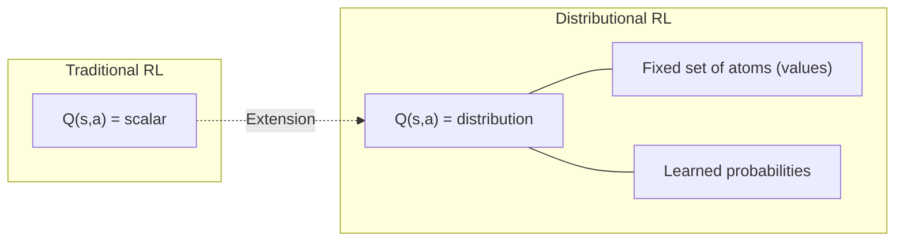
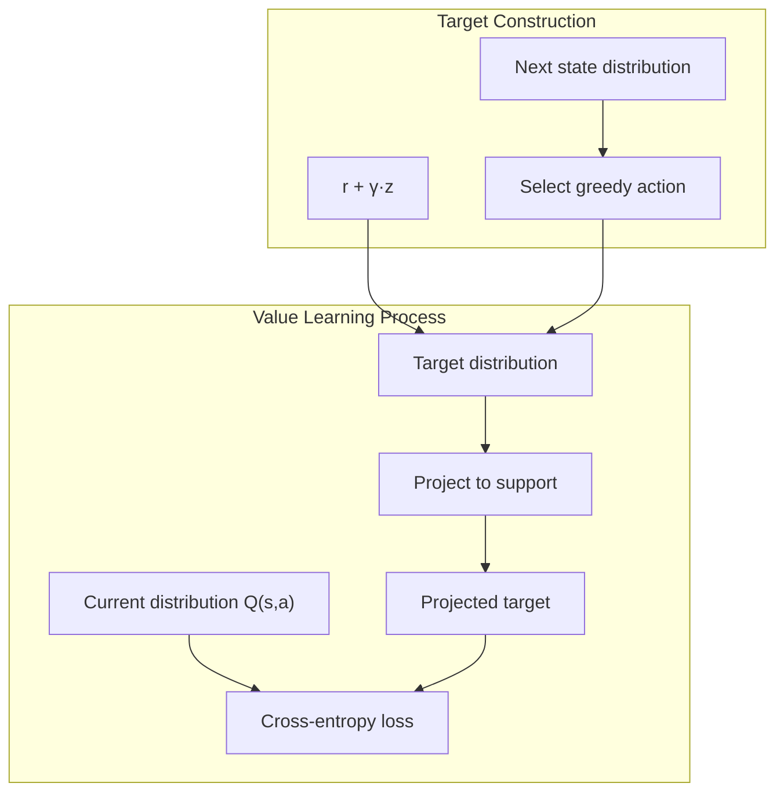
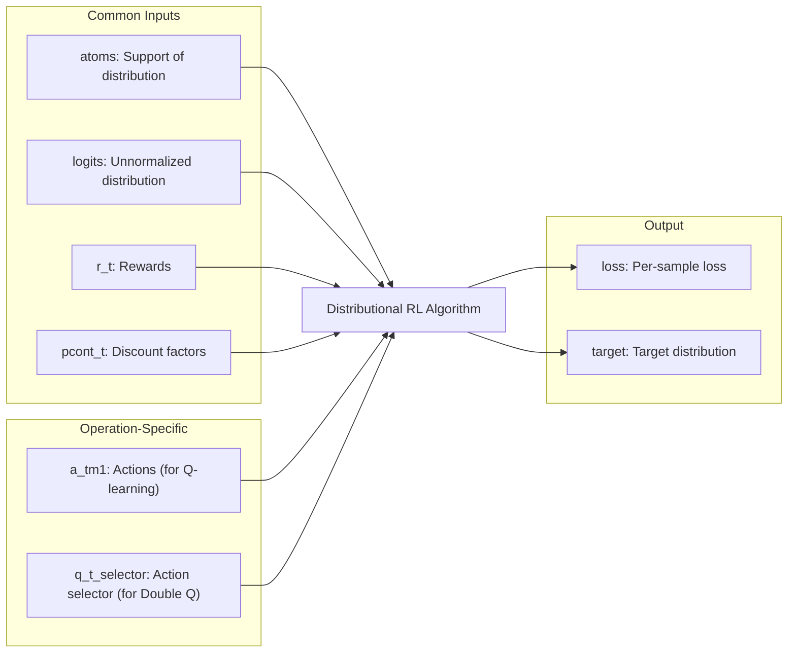
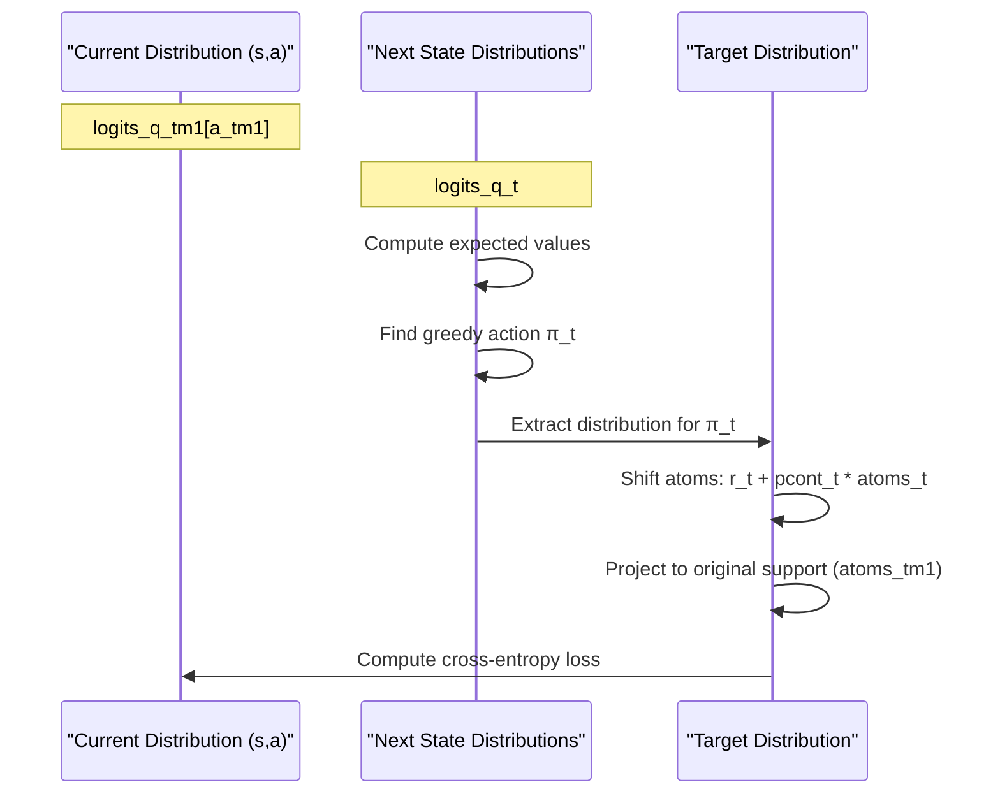
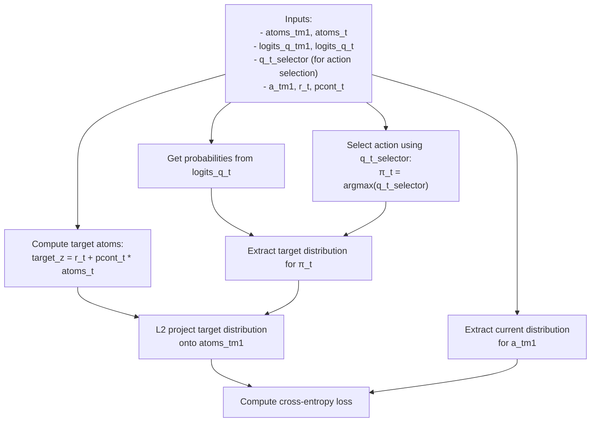
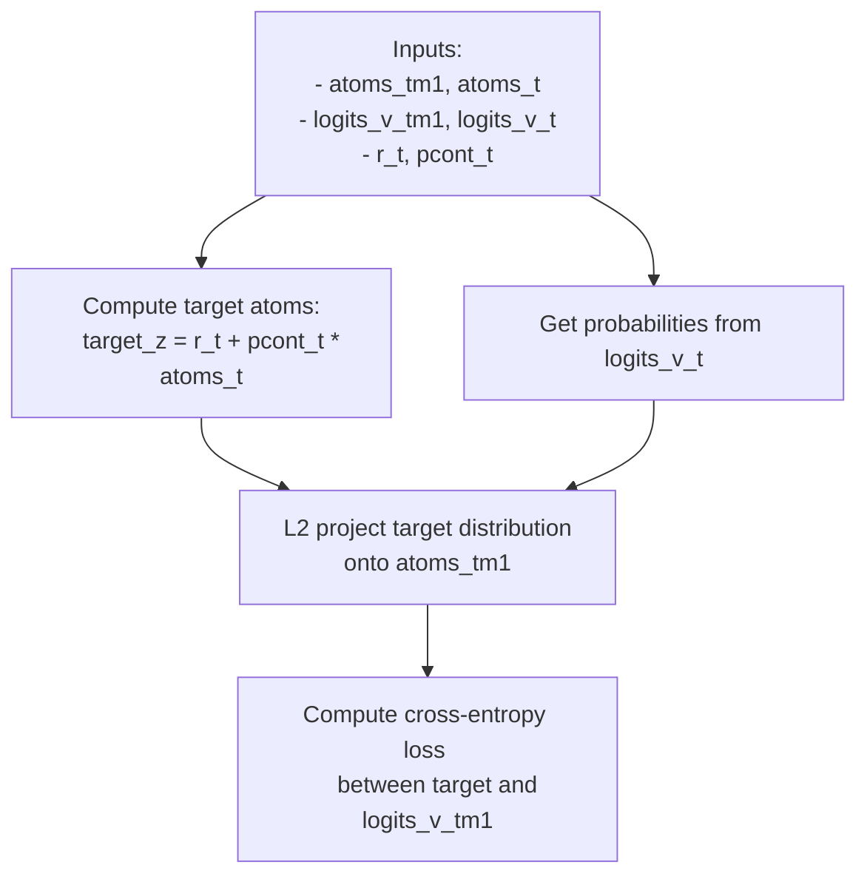
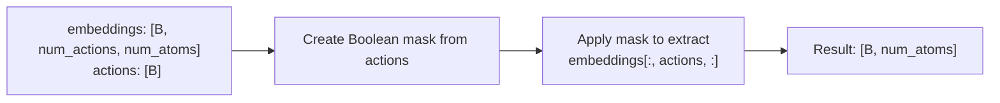
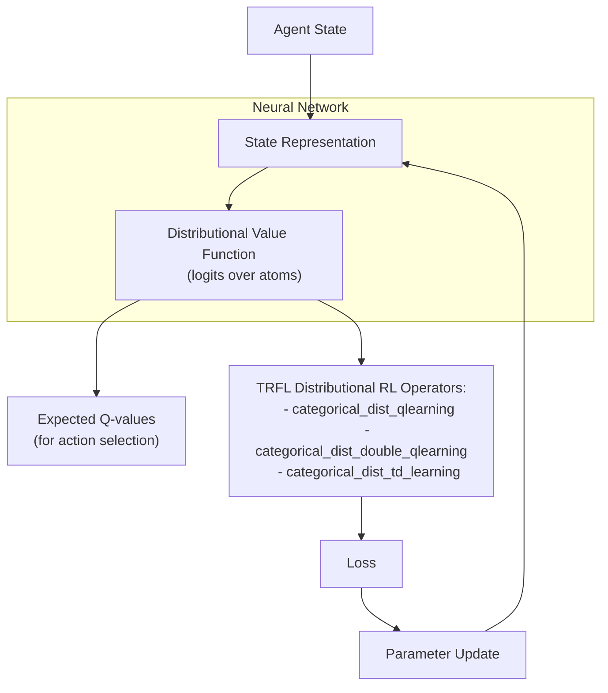

<!-- source: DeepWiki mcp.deepwiki.com · repo google-deepmind/trfl · page 2.4 Distributional RL · fetched 2026-10-26 -->

# Distributional RL

Relevant source files

The following files were used as context for generating this wiki page:

- [docs/multistep_forward_view.md](docs/multistep_forward_view.md)
- [docs/trfl.md](docs/trfl.md)
- [trfl/dist_value_ops.py](trfl/dist_value_ops.py)

## Purpose and Scope

This page documents the Distributional Reinforcement Learning (Distributional RL) implementation in the TRFL library. Distributional RL extends traditional value-based reinforcement learning methods by modeling the entire distribution of possible returns rather than just their expected values. This approach offers improved learning dynamics, more stable training, and richer representations of uncertainty. For standard value-based methods like Q-learning, see [Q-Learning Family](#2.1) and [TD Learning](#2.2).

## Theoretical Background

Distributional RL replaces the traditional scalar value function with a distribution over possible returns. In TRFL, this distribution is represented as a categorical distribution over a discrete set of value atoms.

Sources: [trfl/dist_value_ops.py:15-23]()

### Key Concepts

1. **Return Distribution**: Instead of learning expected returns, distributional RL algorithms learn to approximate the actual distribution of returns.

2. **Categorical Representation**: The return distribution is represented as a categorical distribution over a fixed set of atoms (values).

3. **Distributional Bellman Update**: Standard Bellman updates are extended to handle distributions using a distributional version of the Bellman equation.

4. **Projection Step**: Since the target distribution may not align with the fixed atoms, a projection step is required. TRFL uses the L2 projection (minimizing Cramer distance).

Sources: [trfl/dist_value_ops.py:72-143](), [trfl/dist_value_ops.py:147-227](), [trfl/dist_value_ops.py:229-288]()

## Implemented Algorithms

TRFL provides three main distributional RL operations:

| Algorithm | Function | Description |
|-----------|----------|-------------|
| Categorical DQN | `categorical_dist_qlearning` | Basic distributional Q-learning with categorical representation |
| Categorical Double DQN | `categorical_dist_double_qlearning` | Distributional Q-learning with Double DQN action selection |
| Categorical TD | `categorical_dist_td_learning` | Distributional temporal difference learning for state values |

Sources: [trfl/dist_value_ops.py:72-143](), [trfl/dist_value_ops.py:147-227](), [trfl/dist_value_ops.py:229-288]()

### Common Input Patterns

All distributional RL operations in TRFL follow a similar pattern:

Sources: [trfl/dist_value_ops.py:72-143](), [trfl/dist_value_ops.py:147-227](), [trfl/dist_value_ops.py:229-288]()

## Implementation Details

### Categorical Distributional Q-Learning

The core algorithm for distributional Q-learning involves:

1. Calculating the target distribution by:
   - Shifting and scaling the support (atoms) by rewards and discounts
   - Finding the greedy action based on the expected value of next state distributions
   - Extracting the next state distribution for the greedy action

2. Projecting the target distribution onto the fixed support using L2 projection

3. Computing the loss using cross-entropy between the current and target distributions

Sources: [trfl/dist_value_ops.py:72-143]()

### Categorical Double Q-Learning

Extends the categorical Q-learning algorithm by using a separate set of Q-values (`q_t_selector`) to select the best action, reducing overestimation bias:

Sources: [trfl/dist_value_ops.py:147-227]()

### Categorical TD-Learning

Similar to categorical Q-learning but for state values rather than action values:

Sources: [trfl/dist_value_ops.py:229-288]()

## Helper Functions

### L2 Projection

The `_l2_project` function projects a target distribution onto a fixed set of support atoms, minimizing the Cramer distance (L2 norm of cumulative distribution functions). This is imported from `distribution_ops.l2_project`.

### Slicing with Actions

The `_slice_with_actions` function extracts distributions corresponding to specific actions from a batch of distributions:

Sources: [trfl/dist_value_ops.py:40-70]()

## Integration with Other TRFL Components

Distributional RL operations can be used as drop-in replacements for their scalar counterparts when working with distributional value functions. They integrate with other TRFL components like target networks, sequence operations, and policy gradient methods.

Sources: [docs/trfl.md:87-143](), [docs/trfl.md:172-205]()

## Conclusion

Distributional RL in TRFL provides a powerful framework for modeling value distributions rather than just expected values. By representing uncertainty in returns, these methods can lead to more stable learning and improved exploration. The implementation follows the algorithms described in the original distributional RL papers, using categorical distributions with fixed supports and L2 projection for distribution updates.

---

