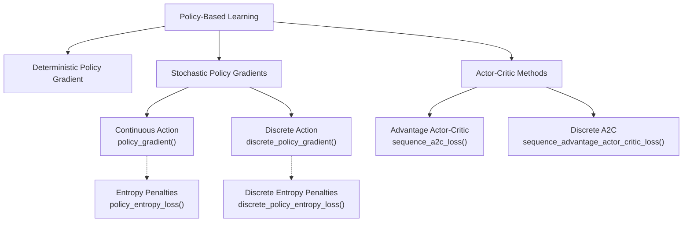
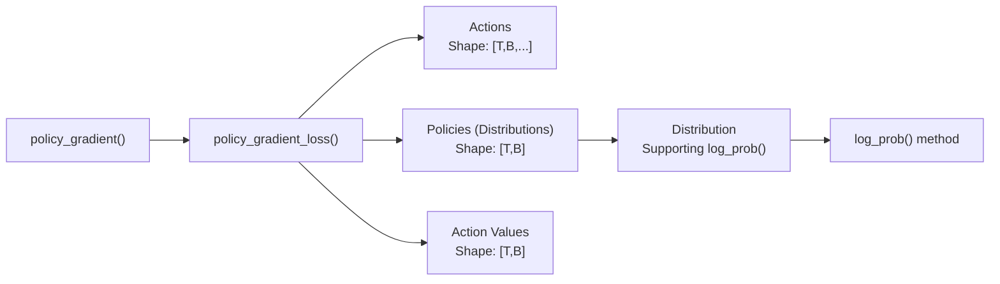
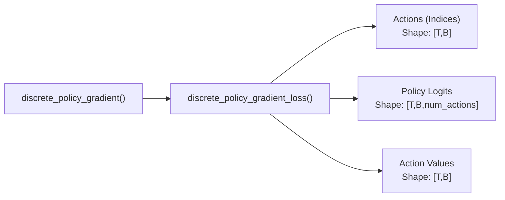
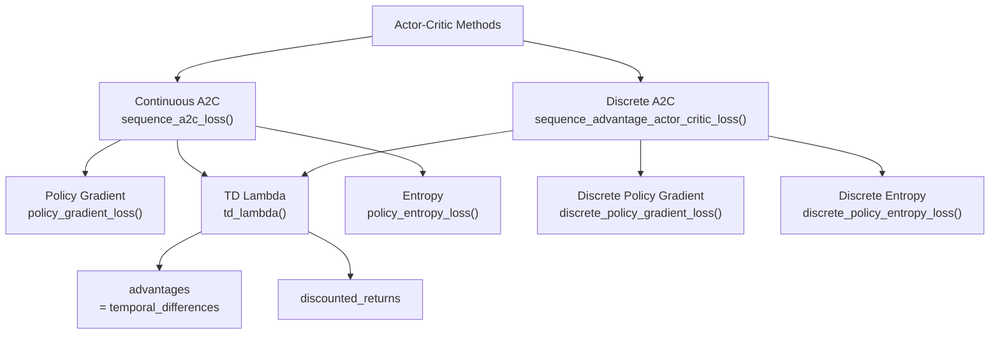
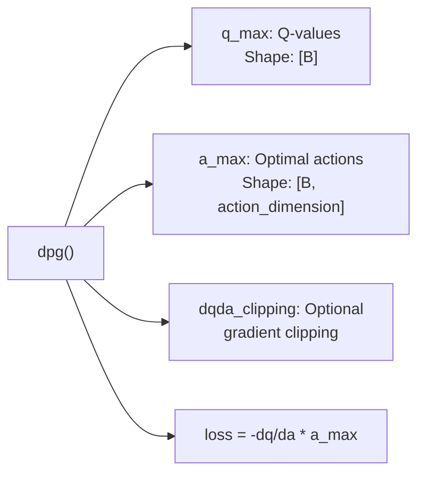

<!-- source: DeepWiki mcp.deepwiki.com · repo google-deepmind/trfl · page 3 Policy-Based Learning · fetched 2026-10-26 -->

# Policy-Based Learning

<details>
<summary>Relevant source files</summary>

The following files were used as context for generating this wiki page:

- [docs/multistep_forward_view.md](docs/multistep_forward_view.md)
- [docs/trfl.md](docs/trfl.md)
- [trfl/discrete_policy_gradient_ops.py](trfl/discrete_policy_gradient_ops.py)
- [trfl/policy_gradient_ops.py](trfl/policy_gradient_ops.py)

</details>


## Purpose and Scope

This page provides an overview of policy-based reinforcement learning methods implemented in the TRFL library. Policy-based methods directly learn a policy function that maps states to actions (or action probabilities), in contrast to [Value-Based Learning](#2) which learns value functions and derives policies from them. This document covers the core policy gradient algorithms for both discrete and continuous action spaces, actor-critic methods, and deterministic policy gradient implementations.

For off-policy correction methods like V-trace that can be used with policy-based algorithms, see [Off-Policy Learning Methods](#4).

## Overview of Policy-Based Learning in TRFL

Policy-based learning in TRFL provides operations to optimize policies directly using gradient ascent on the expected return. The library supports:

1. **Stochastic Policy Gradients** - For both continuous and discrete action spaces
2. **Actor-Critic Methods** - Combining policy gradients with value function learning
3. **Deterministic Policy Gradient** - Direct optimization of deterministic policies

The implementations follow a modular approach where lower-level operations can be combined to create complete algorithms.



Sources: [trfl/policy_gradient_ops.py](), [trfl/discrete_policy_gradient_ops.py](), [docs/trfl.md:365-371]()

## Policy Gradient Methods

Policy gradient methods optimize a parameterized policy by directly adjusting the policy parameters in the direction of the gradient of expected return. TRFL implements policy gradients for both continuous and discrete action spaces.

### Continuous Action Spaces

For continuous action spaces, TRFL provides implementations that work with probability distributions over actions.



Key operations:

- `policy_gradient`: Computes basic policy gradient losses for a batch of trajectories
- `policy_gradient_loss`: Handles nested action spaces and sums losses across time dimensions

These operations implement the policy gradient theorem, calculating gradients of the form:
- log_prob(action) * advantage_value

Sources: [trfl/policy_gradient_ops.py:39-74](), [trfl/policy_gradient_ops.py:77-105](), [docs/trfl.md:827-892]()

### Discrete Action Spaces

For discrete action spaces, TRFL provides implementations that work with categorical distributions represented by logits.



Key operations:

- `discrete_policy_gradient`: Computes policy gradient losses for discrete action spaces
- `discrete_policy_gradient_loss`: Handles nested action spaces and sums losses across time dimensions

These implementations use `tf.nn.sparse_softmax_cross_entropy_with_logits` to efficiently compute the negative log probabilities of chosen actions.

Sources: [trfl/discrete_policy_gradient_ops.py:223-276](), [trfl/discrete_policy_gradient_ops.py:279-327](), [docs/trfl.md:212-329]()

## Entropy Regularization

Both continuous and discrete policy gradient implementations support entropy regularization, which encourages exploration by penalizing low-entropy policies.

For continuous action spaces:
- `policy_entropy_loss`: Calculates entropy 'loss' for policies represented by distributions
  
For discrete action spaces:
- `discrete_policy_entropy_loss`: Computes entropy 'loss' for a batch of policy logits

The entropy loss is scaled by a negative constant to make it a minimization objective when combined with the policy gradient loss. Both implementations support optional normalization to make the entropy loss invariant to the action space size.

Sources: [trfl/policy_gradient_ops.py:137-196](), [trfl/discrete_policy_gradient_ops.py:42-95](), [docs/trfl.md:212-248](), [docs/trfl.md:779-825]()

## Actor-Critic Methods

Actor-critic methods combine policy-based learning (the actor) with value function estimation (the critic) to reduce variance in policy updates. TRFL implements advantage actor-critic methods:



Key operations:

- `sequence_a2c_loss`: Implements advantage actor-critic for continuous action spaces
- `sequence_advantage_actor_critic_loss`: Implements advantage actor-critic for discrete action spaces

Both implementations:
1. Calculate advantages using TD(λ) error
2. Use these advantages for policy gradient updates
3. Train the value function toward n-step returns
4. Optionally add entropy regularization

The advantage actor-critic implementations support Generalized Advantage Estimation (GAE) through the lambda parameter.

Sources: [trfl/policy_gradient_ops.py:199-341](), [trfl/discrete_policy_gradient_ops.py:98-219](), [docs/trfl.md:199-211](), [docs/multistep_forward_view.md]()

## Deterministic Policy Gradient

While stochastic policy gradients learn a probability distribution over actions, the Deterministic Policy Gradient (DPG) algorithm directly learns a deterministic policy that outputs the optimal action.



The DPG implementation in TRFL:
1. Receives Q-values and optimal actions
2. Computes the gradients of Q-values with respect to actions (dq/da)
3. Optionally applies clipping to these gradients
4. Returns the loss which can be minimized to update the policy

This algorithm is the foundation for DDPG (Deep Deterministic Policy Gradient) and other actor-critic algorithms for continuous action spaces.

Sources: [docs/trfl.md:366-402]()

## Implementation Considerations

### Input/Output Tensor Shapes

Most policy-based learning operations in TRFL follow a consistent convention for tensor shapes:
- Time dimension first: `[T, ...]`
- Batch dimension second: `[T, B, ...]`
- Additional dimensions specific to the operation type

For example, policy logits for discrete action spaces typically have shape `[T, B, num_actions]`, while actions have shape `[T, B]`.

### Nested Structures Support

TRFL policy operations support nested structures of inputs to handle:
1. Multiple action dimensions
2. Multiple distribution types 
3. Independent multivariate distributions

This allows for complex policies that might produce actions across different spaces or dimensions.

### Integration with TensorFlow

All policy-based learning operations are implemented as differentiable TensorFlow operations, enabling them to be incorporated into larger computation graphs and trained using standard optimizers.

## Usage Pattern

A typical usage pattern for policy-based learning in TRFL follows these steps:

1. Define policy network(s) that output policy parameters (logits, means, etc.)
2. Define value network(s) that estimate state or action values
3. Use TRFL operations to compute losses from trajectories of experience
4. Update networks using TensorFlow optimizers

For example, to implement Advantage Actor-Critic with a discrete action space:

```
# Compute A2C loss
loss_output = trfl.sequence_advantage_actor_critic_loss(
    policy_logits=policy_logits,
    baseline_values=baseline_values,
    actions=actions,
    rewards=rewards,
    pcontinues=discounts,
    bootstrap_value=bootstrap_value,
    lambda_=lambda_param,
    entropy_cost=entropy_cost)

# Extract total loss
total_loss = loss_output.loss

# Use optimizer to update network parameters
optimizer.minimize(total_loss)
```

Sources: [trfl/policy_gradient_ops.py](), [trfl/discrete_policy_gradient_ops.py]()

---

