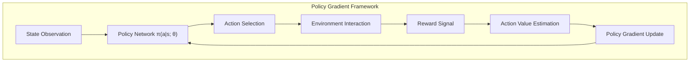
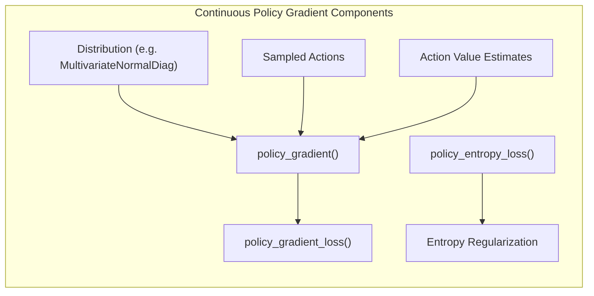
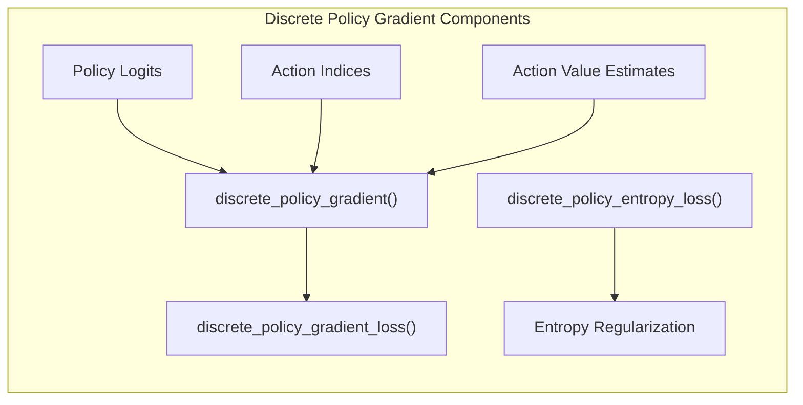
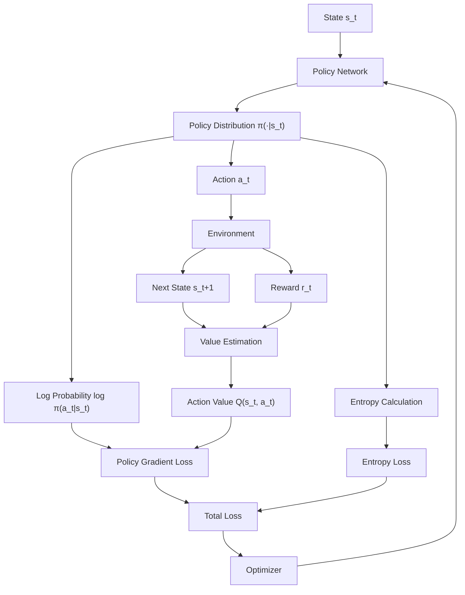

<!-- source: DeepWiki mcp.deepwiki.com · repo google-deepmind/trfl · page 3.1 Policy Gradients · fetched 2026-10-26 -->

# Policy Gradients

<details>
<summary>Relevant source files</summary>

The following files were used as context for generating this wiki page:

- [docs/multistep_forward_view.md](docs/multistep_forward_view.md)
- [docs/trfl.md](docs/trfl.md)
- [trfl/discrete_policy_gradient_ops.py](trfl/discrete_policy_gradient_ops.py)
- [trfl/policy_gradient_ops.py](trfl/policy_gradient_ops.py)

</details>


This page documents the policy gradient algorithms implemented in the TRFL library, covering both continuous and discrete action spaces. Policy gradients are a family of reinforcement learning methods that directly optimize a parameterized policy by computing gradients with respect to the policy parameters. For Actor-Critic methods that combine policy gradients with value functions, see [Actor-Critic Methods](#3.2). For the deterministic variant of policy gradients, see [Deterministic Policy Gradient](#3.3).

## Overview of Policy Gradients

Policy gradient methods work by directly optimizing the parameters θ of a policy π(a|s; θ) to maximize expected return. Unlike value-based methods that learn a value function and derive a policy from it, policy gradient methods learn the policy directly. The core formula that enables policy gradients is:

∇θJ(θ) = E[∇θ log π(a|s; θ) · Q^π(s,a)]

Where J(θ) is the expected return, π(a|s; θ) is the policy, and Q^π(s,a) is the action-value function under policy π.



Sources: [trfl/policy_gradient_ops.py:38-74](), [trfl/discrete_policy_gradient_ops.py:222-276]()

## Continuous Action Space Policy Gradients

TRFL provides implementations for policy gradients in continuous action spaces through the `policy_gradient` and `policy_gradient_loss` functions. These functions work with probability distributions from TensorFlow Probability (tfp).



Sources: [trfl/policy_gradient_ops.py:38-74](), [trfl/policy_gradient_ops.py:76-105](), [trfl/policy_gradient_ops.py:136-196]()

### Core Functions

`policy_gradient` takes a distribution over actions, sampled actions, and estimates of the action values to compute the policy gradient loss:

```
loss = -log_prob_actions * action_values
```

This is the basic REINFORCE algorithm, where the gradient with respect to the policy parameters is computed to maximize expected return.

`policy_gradient_loss` extends this to support nested structures of policies and actions, which is useful for multi-dimensional action spaces or when using multiple independent distributions.

Sources: [trfl/policy_gradient_ops.py:38-74](), [trfl/policy_gradient_ops.py:76-105]()

### Usage Pattern

The typical usage pattern for continuous policy gradients is:

1. Define a policy network that outputs distribution parameters (e.g., mean and standard deviation)
2. Create a probability distribution using these parameters
3. Sample actions from this distribution
4. Compute action values (returns, advantages, etc.)
5. Calculate policy gradient loss using `policy_gradient_loss`
6. Optionally add entropy regularization with `policy_entropy_loss`
7. Update the policy network parameters using the calculated loss

Sources: [trfl/policy_gradient_ops.py:76-105]()

## Discrete Action Space Policy Gradients

For discrete action spaces, TRFL provides the `discrete_policy_gradient` and `discrete_policy_gradient_loss` functions, which work with logits-based policies.



Sources: [trfl/discrete_policy_gradient_ops.py:222-276](), [trfl/discrete_policy_gradient_ops.py:278-327](), [trfl/discrete_policy_gradient_ops.py:41-95]()

### Core Functions

`discrete_policy_gradient` computes the policy gradient loss for discrete action spaces:

```
loss = cross_entropy * action_values
```

Where `cross_entropy` is computed using `tf.nn.sparse_softmax_cross_entropy_with_logits` from the policy logits and action indices.

`discrete_policy_gradient_loss` extends this to support nested structures of policy logits and actions, suitable for multi-dimensional discrete action spaces.

Sources: [trfl/discrete_policy_gradient_ops.py:222-276](), [trfl/discrete_policy_gradient_ops.py:278-327]()

### Input and Output Shapes

The functions expect specific tensor shapes to work correctly:

| Input | Shape for `discrete_policy_gradient` | Shape for `discrete_policy_gradient_loss` |
|-------|--------------------------------------|-------------------------------------------|
| `policy_logits` | `[B1, B2, ..., num_actions]` | `[T, B, num_actions]` |
| `actions` | `[B1, B2, ...]` | `[T, B]` |
| `action_values` | `[B1, B2, ...]` | `[T, B]` |

Where:
- `T` is the sequence length (time dimension)
- `B` is the batch size
- `num_actions` is the number of possible actions
- `B1, B2, ...` are arbitrary batch dimensions

Sources: [trfl/discrete_policy_gradient_ops.py:222-276](), [trfl/discrete_policy_gradient_ops.py:278-327]()

## Entropy Regularization

Entropy regularization is a technique used to encourage exploration by adding an entropy term to the policy gradient loss. TRFL provides `policy_entropy_loss` for continuous action spaces and `discrete_policy_entropy_loss` for discrete action spaces.

### Continuous Action Spaces

For continuous action spaces, `policy_entropy_loss` calculates the negative entropy of the policy distribution:

```
loss = -scale * entropy
```

Where the entropy is calculated using the distribution's `entropy()` method.

Sources: [trfl/policy_gradient_ops.py:136-196]()

### Discrete Action Spaces

For discrete action spaces, `discrete_policy_entropy_loss` calculates the negative entropy of the softmax distribution:

```
entropy = -sum(softmax(logits) * log_softmax(logits))
loss = -scale * entropy
```

The entropy can be normalized by dividing by the log of the number of actions, making it invariant to the action space size.

Sources: [trfl/discrete_policy_gradient_ops.py:41-95]()

## Data Flow in Policy Gradient Computation

The following diagram illustrates the data flow in policy gradient computation, highlighting the relationship between different components:



Sources: [trfl/policy_gradient_ops.py:38-74](), [trfl/discrete_policy_gradient_ops.py:222-276]()

## Code Structure and Relationships

This diagram illustrates how the policy gradient components in TRFL relate to each other and to the broader reinforcement learning framework:

```mermaid
graph TD
    subgraph "TRFL Policy Gradient Components"
        PGOps["policy_gradient_ops.py"]
        DPGOps["discrete_policy_gradient_ops.py"]
        
        PGOps --> PolicyGradient["policy_gradient()"]
        PGOps --> PolicyGradientLoss["policy_gradient_loss()"]
        PGOps --> PolicyEntropyLoss["policy_entropy_loss()"]
        PGOps --> SequenceA2CLoss["sequence_a2c_loss()"]
        
        DPGOps --> DiscretePolGrad["discrete_policy_gradient()"]
        DPGOps --> DiscretePolGradLoss["discrete_policy_gradient_loss()"]
        DPGOps --> DiscreteEntLoss["discrete_policy_entropy_loss()"]
        DPGOps --> SequenceAdvActCriticLoss["sequence_advantage_actor_critic_loss()"]
    end
    
    subgraph "Dependencies"
        TF["TensorFlow"]
        TFP["TensorFlow Probability"]
        TreeLib["tree library"]
        BaseOps["base_ops.py"]
        ValueOps["value_ops.py"]
    end
    
    PGOps --> TF
    PGOps --> TFP
    PGOps --> TreeLib
    PGOps --> BaseOps
    PGOps --> ValueOps
    
    DPGOps --> TF
    DPGOps --> TreeLib
    DPGOps --> BaseOps
    DPGOps --> ValueOps
    
    subgraph "Related Components"
        A2C["Actor-Critic Methods (#3.2)"]
        DPG["Deterministic Policy Gradient (#3.3)"]
        ValueLearning["Value-Based Learning (#2)"]
    end
    
    SequenceA2CLoss --> A2C
    SequenceAdvActCriticLoss --> A2C
    PolicyGradient --> DPG
    ValueOps --> ValueLearning
```



Sources: [trfl/policy_gradient_ops.py](), [trfl/discrete_policy_gradient_ops.py](), [docs/trfl.md]()

## Working with Nested Structures

Both continuous and discrete policy gradient implementations in TRFL support nested structures of policies and actions. This is useful for:

1. Multi-dimensional action spaces where different dimensions have different distributions
2. Independent action components with no corresponding multivariate distribution
3. Hybrid action spaces combining discrete and continuous actions

The library uses the `tree` module (also known as `nest`) to flatten and unflatten these nested structures, maintaining the correspondence between policies and actions.

Sources: [trfl/policy_gradient_ops.py:76-105](), [trfl/discrete_policy_gradient_ops.py:278-327]()

## Integration with Actor-Critic Methods

While this page focuses on pure policy gradient methods, TRFL also provides functions that integrate policy gradients with value function learning:

- `sequence_a2c_loss`: For continuous action spaces
- `sequence_advantage_actor_critic_loss`: For discrete action spaces

These functions combine policy gradient loss with a baseline value function loss and optional entropy regularization, implementing the Advantage Actor-Critic (A2C) algorithm. For more details, see [Actor-Critic Methods](#3.2).

Sources: [trfl/policy_gradient_ops.py:199-341](), [trfl/discrete_policy_gradient_ops.py:98-218]()

---

